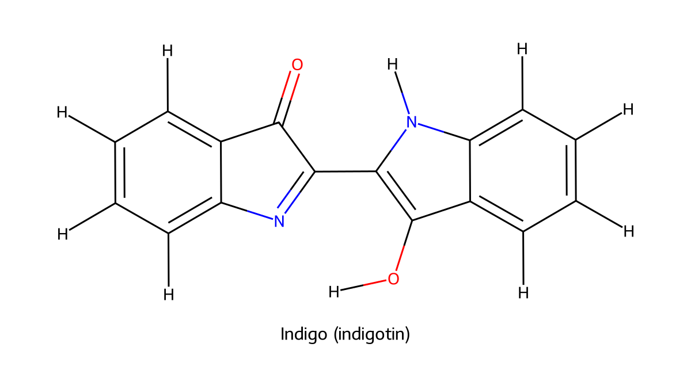
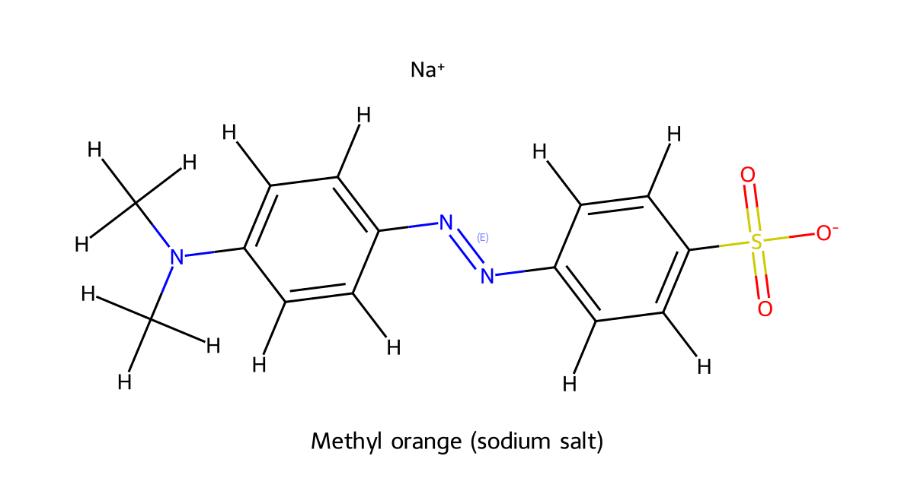

# Chemistry-II (CHEM 103) — Fully Solved Examination Questions

**Bangladesh University of Textiles**  
B.Sc. in Textile Engineering (For Affiliated Colleges)  
**Level-I, Term-II Final Examination — 2025**  
**Time:** 3 hours · **Full marks:** 72

> **Study version:** All eight questions are answered, although the examination asks candidates to answer any three questions from each part. Answers are arranged in the original order and written in an exam-oriented format. Structural schemes and mechanisms are included wherever useful.

## Notation used in the answers

- `R` = alkyl group; `Ar` = aryl (aromatic) group; `Ph` = phenyl group, `C₆H₅–`.
- `Et` = ethyl group, `–CH₂CH₃`; `Me` = methyl group, `–CH₃`.
- `Δ` = heating; `[O]` = oxidation; `[H]` = reduction; `H₃O⁺` = acidic work-up.
- In the diagrams, a line such as `C(=O)` explicitly shows a carbonyl group. Lone-pair dots are omitted when they do not help explain the reaction.

---

# Part A

## Question 1

### 1(a) What do you mean by S<sub>N</sub>1 and S<sub>N</sub>2 reaction? Give examples. [3]

**Nucleophilic substitution** is a reaction in which a nucleophile replaces a leaving group attached to a carbon atom.

### S<sub>N</sub>1 reaction — Unimolecular nucleophilic substitution

An S<sub>N</sub>1 reaction takes place in **two steps**. First, the carbon–leaving-group bond breaks slowly and forms a carbocation. Then the nucleophile attacks the carbocation.

**Example: Hydrolysis of tert-butyl chloride**

```text
Step 1 — slow, rate-determining ionisation

       CH₃                                  CH₃
        |                                    |
CH₃ — C — Cl       →       CH₃ — C⁺   +   Cl⁻
        |                                    |
       CH₃                                  CH₃

Step 2 — rapid nucleophilic attack

       CH₃                                  CH₃
        |                                    |
CH₃ — C⁺   +   :OH₂       →       CH₃ — C — OH₂⁺
        |                                    |
       CH₃                                  CH₃

Deprotonation:
(CH₃)₃C—OH₂⁺  →  (CH₃)₃C—OH  +  H⁺
```

The product is **tert-butyl alcohol (2-methylpropan-2-ol)**.

**Rate equation:**

\[
\text{Rate}=k[\mathrm{R-X}]
\]

The rate depends only on the concentration of the alkyl halide. Tertiary alkyl halides generally favour S<sub>N</sub>1 because they form relatively stable tertiary carbocations. A planar carbocation may be attacked from either face, so a chiral substrate can show racemisation.

### S<sub>N</sub>2 reaction — Bimolecular nucleophilic substitution

An S<sub>N</sub>2 reaction takes place in **one concerted step**. The nucleophile attacks from the side opposite the leaving group while the carbon–leaving-group bond breaks.

**Example: Hydrolysis of bromoethane**

```text
       H   H                              H   H
       |   |                              |   |
:OH⁻ → C — C — Br       ─────────→    HO — C — C — H  +  Br⁻
       |   |                              |   |
       H   H                              H   H

       (backside attack; bond formation and bond breaking occur together)
```

In a compact structural scheme:

\[
\mathrm{CH_3CH_2Br+OH^-\longrightarrow CH_3CH_2OH+Br^-}
\]

**Rate equation:**

\[
\text{Rate}=k[\mathrm{R-X}][\mathrm{Nu^-}]
\]

The rate depends on both the alkyl halide and the nucleophile. Methyl and primary alkyl halides generally favour S<sub>N</sub>2 because backside attack is less sterically hindered. The reaction gives **inversion of configuration** at a chiral reaction centre.

| Feature | S<sub>N</sub>1 | S<sub>N</sub>2 |
|---|---|---|
| Number of steps | Two | One concerted step |
| Intermediate | Carbocation | No isolable intermediate |
| Rate law | $k[\mathrm{R-X}]$ | $k[\mathrm{R-X}][\mathrm{Nu^-}]$ |
| Favoured substrate | Usually tertiary | Usually methyl or primary |
| Stereochemical result | Often racemisation | Inversion |

### 1(b) Show that E1 reaction is a two-step reaction but E2 reaction is a one-step reaction. [3]

**Elimination** is a reaction in which a base removes a hydrogen atom from a carbon adjacent to the carbon bearing a leaving group. A carbon–carbon double bond is formed.

### E1 elimination — two steps

1. The leaving group departs first, forming a carbocation. This is the slow, rate-determining step.
2. A base removes a β-hydrogen; the electrons from the C–H bond form the C=C bond.

**Example: Dehydrohalogenation of 2-bromo-2-methylbutane**

```text
Step 1 — slow ionisation

       CH₃                         CH₃
        |                           |
CH₃ — C — CH₂CH₃   →   CH₃ — C⁺ — CH₂CH₃  +  Br⁻
        |                           |
        Br                         CH₃

Step 2 — base removes a β-hydrogen

       CH₃                                  CH₃
        |                                    |
CH₃ — C⁺ — CH₂CH₃  +  B⁻  →  CH₃ — C = CHCH₃  +  HB
        |                                    |
       CH₃                                  CH₃
```

The more substituted alkene is generally the major product (Zaitsev product), where the reaction conditions permit it.

### E2 elimination — one concerted step

A strong base removes the β-hydrogen at the same time as the leaving group departs. The C=C bond forms in that same transition state; no carbocation is produced.

**Example: 2-bromobutane with alcoholic KOH and heat**

\[
\mathrm{CH_3CH(Br)CH_2CH_3+KOH_{(alc)}\xrightarrow{\Delta}}
\mathrm{CH_3CH=CHCH_3+KBr+H_2O}
\]

```text
       β-H        leaving group
        |              |
   C — C — Br  +  B⁻  ─────→  C = C  +  HB  +  Br⁻
     (C—H bond breaks)          (π bond forms)

       All bond changes occur in one concerted step.
```

**Main differences:** E1 is unimolecular and proceeds through a carbocation; E2 is bimolecular and requires a base in the rate-determining concerted step. E2 commonly requires an anti-periplanar arrangement of the β-H and leaving group.

### 1(c) What are organometallic compounds? Give examples. [3]

**Definition:** Organometallic compounds are organic compounds containing at least one direct bond between a carbon atom of an organic group and a metal atom.

**Examples**

1. **Grignard reagent:** methylmagnesium bromide, `CH₃–Mg–Br`.
2. **Organolithium compound:** ethyllithium, `CH₃CH₂–Li`.
3. **Organozinc compound:** diethylzinc, `(CH₃CH₂)₂Zn`.

The carbon–metal bond is usually polar because carbon is more electronegative than many metals:

```text
       δ−       δ+
       C  —  MgX          (Grignard reagent)
       |
       R

General formula: R—Mg—X
```

**Uses:** Grignard and organolithium reagents act as strong nucleophiles and are used to form carbon–carbon bonds, especially in the preparation of alcohols and other organic compounds.

### 1(d) Write the mechanism of the Reformatsky reaction. [3]

**Definition:** The Reformatsky reaction is the reaction of an α-halo ester with zinc to form an organozinc reagent, which adds to an aldehyde or ketone. Acidic work-up gives a **β-hydroxy ester**.

**General reaction**

\[
\mathrm{XCH_2COOR'+Zn\longrightarrow R'OOCCH_2ZnX}
\]

\[
\mathrm{R_2C=O+R'OOCCH_2ZnX\xrightarrow{H_3O^+}
R_2C(OH)CH_2COOR'}
\]

**Mechanism with benzaldehyde and ethyl bromoacetate**

```text
1. Formation of the organozinc reagent

Br—CH₂—C(=O)—O—CH₂CH₃  +  Zn
                 ↓
EtO—C(=O)—CH₂—ZnBr

2. Addition to the carbonyl group

                 O                         O—ZnBr
                 ||                          |
C₆H₅ — C — H  +  EtO—C(=O)—CH₂—ZnBr
                 ↓
C₆H₅ — CH — CH₂ — C(=O)—OEt
          |
        O—ZnBr

3. Acidic work-up

C₆H₅—CH(O—ZnBr)—CH₂—C(=O)—OEt
                 ──H₃O⁺──→
C₆H₅—CH(OH)—CH₂—C(=O)—OEt
```

**Product:** Ethyl 3-hydroxy-3-phenylpropanoate, a β-hydroxy ester.

---

## Question 2

### 2(a) What are alcohol and phenol? Give examples. [3]

**Alcohols:** Organic compounds in which a hydroxyl group (`–OH`) is attached to a saturated carbon atom (usually an sp³-hybridised carbon). Their general form is `R–OH`.

**Example — ethanol:**

```text
H   H
|   |
H—C—C—O—H
|   |
H   H
```

Structural formula: `CH₃–CH₂–OH`.

**Phenols:** Aromatic compounds in which the hydroxyl group is attached **directly to an aromatic ring**. Their general form is `Ar–OH`.

**Example — phenol:**

```text
       OH
        |
    /-------\
   |         |
   |   ⌬     |
    \-------/
```

Structural formula: `C₆H₅–OH`.

**Important distinction:** In phenol, `–OH` is bonded directly to the benzene ring. In benzyl alcohol, `C₆H₅–CH₂–OH`, the `–OH` is attached to the side-chain carbon, so benzyl alcohol is an alcohol, not a phenol.

### 2(b) Write the preparation of 1°, 2° and 3° alcohols. [3]

Alcohols are classified according to the number of carbon groups attached to the carbon bearing the `–OH` group.

### 1° (primary) alcohol

The carbon bearing `–OH` is attached to one other carbon group.

```text
       H
       |
R — C — OH
       |
       H
```

**Preparation by reduction of an aldehyde:**

\[
\mathrm{RCHO+2[H]\xrightarrow{NaBH_4\ or\ LiAlH_4}RCH_2OH}
\]

Example:

\[
\mathrm{CH_3CHO+2[H]\longrightarrow CH_3CH_2OH}
\]

Ethanal gives ethanol.

### 2° (secondary) alcohol

The carbon bearing `–OH` is attached to two other carbon groups.

```text
       OH
       |
R — C — R′
       |
       H
```

**Preparation by reduction of a ketone:**

\[
\mathrm{RCO R'+2[H]\xrightarrow{NaBH_4\ or\ LiAlH_4}RCH(OH)R'}
\]

Example:

\[
\mathrm{CH_3COCH_3+2[H]\longrightarrow CH_3CH(OH)CH_3}
\]

Propanone gives propan-2-ol.

### 3° (tertiary) alcohol

The carbon bearing `–OH` is attached to three other carbon groups.

```text
       OH
       |
R — C — R′
       |
       R″
```

**Preparation by Grignard addition to a ketone:**

\[
\mathrm{R_2C=O+R'MgX\xrightarrow{ether}\ R_2C(OMgX)R'}
\]

\[
\mathrm{R_2C(OMgX)R'\xrightarrow{H_3O^+}R_2C(OH)R'}
\]

Example:

\[
\mathrm{(CH_3)_2CO+CH_3MgBr\xrightarrow{ether,\ then\ H_3O^+}(CH_3)_3COH}
\]

Propanone reacts with methylmagnesium bromide to produce tert-butyl alcohol after acid work-up.

### 2(c) Explain (i) coupling reaction and (ii) Kolbe's reaction. [4]

#### (i) Azo coupling reaction

Azo coupling is the reaction of an aromatic diazonium salt with an activated aromatic compound such as phenol or aniline. It forms an **azo compound** containing the `–N=N–` linkage. Coupling generally occurs at the para position when that position is available.

**Example: Benzene diazonium chloride with phenol**

\[
\mathrm{C_6H_5N_2^+Cl^-+C_6H_5OH+NaOH}
\]

\[
\mathrm{\longrightarrow\ HO{-}C_6H_4{-}N=N{-}C_6H_5+NaCl+H_2O}
\]

Structural outline of the azo product:

```text
       C₆H₅ — N = N — C₆H₄ — OH
             azo linkage       para-OH
```

The product is **p-hydroxyazobenzene**, an orange-coloured azo compound. Azo coupling is important in the manufacture of azo dyes.

#### (ii) Kolbe–Schmitt reaction (Kolbe's reaction of phenol)

Sodium phenoxide reacts with carbon dioxide under pressure and heat to give sodium salicylate. Acidification produces salicylic acid (2-hydroxybenzoic acid).

```text
       ONa                                 OH
        |                                   |
   C₆H₅—O⁻ Na⁺  +  CO₂   ──125–140 °C, pressure──→
                                      HOOC—C₆H₄—OH
                                             |
                                     (ortho relationship)

Sodium phenoxide  →  sodium salicylate  →  salicylic acid
                                      H⁺ work-up
```

More conventionally:

\[
\mathrm{C_6H_5ONa+CO_2\xrightarrow[pressure]{125-140^\circ C}
 o{-}HO{-}C_6H_4{-}COONa}
\]

\[
\mathrm{o{-}HO{-}C_6H_4{-}COONa+HCl\longrightarrow
 o{-}HO{-}C_6H_4{-}COOH+NaCl}
\]

**Product:** Salicylic acid, used in the manufacture of aspirin.

### 2(d) What happens when KHSO₄/P₂O₅ reacts with glycerin on heating? [2]

Glycerin (glycerol) undergoes **dehydration** when heated with a strong dehydrating agent such as potassium hydrogen sulfate (`KHSO₄`) or phosphorus pentoxide (`P₂O₅`). It forms acrolein (prop-2-enal), which has a sharp, irritating smell.

**Reaction:**

```text
Glycerol

HO—CH₂—CH(OH)—CH₂—OH
          │
          │  KHSO₄ or P₂O₅, heat
          ↓
Acrolein

CH₂ = CH — CHO  +  2H₂O
```

**Name of product:** Acrolein (propenal, `CH₂=CH–CHO`).

---

## Question 3

### 3(a) What is meant by aliphatic and aromatic aldehydes and ketones? [2]

**Aldehydes** contain a terminal carbonyl group in which the carbonyl carbon is bonded to at least one hydrogen atom:

```text
    O
    ||
R — C — H          General structure: R—CHO
```

- **Aliphatic aldehyde:** The carbonyl group is attached to an aliphatic group. Example: ethanal, `CH₃–CHO`.
- **Aromatic aldehyde:** The aldehyde group is attached directly to an aromatic ring. Example: benzaldehyde, `C₆H₅–CHO`.

**Ketones** contain a carbonyl group bonded to two carbon groups:

```text
    O
    ||
R — C — R′         General structure: R—CO—R′
```

- **Aliphatic ketone:** Example: propanone (acetone), `CH₃–CO–CH₃`.
- **Aromatic ketone:** Example: acetophenone, `C₆H₅–CO–CH₃`.

### 3(b) Write about the chloroform reaction and haloform reaction. [3]

A methyl ketone contains the structural group `R–CO–CH₃`. On treatment with chlorine and aqueous alkali, the methyl group is successively chlorinated and then cleaved to produce **chloroform** and a carboxylate salt. This chlorine-based case is often called the **chloroform reaction**; it is one member of the wider haloform reaction.

**General chloroform reaction:**

\[
\mathrm{RCOCH_3+3Cl_2+4NaOH\longrightarrow
 RCOONa+CHCl_3+3NaCl+3H_2O}
\]

**Example — acetone:**

\[
\mathrm{CH_3COCH_3+3Cl_2+4NaOH\longrightarrow
 CH_3COONa+CHCl_3+3NaCl+3H_2O}
\]

**Outline of the mechanism:**

1. Base removes an α-hydrogen from the methyl group to form an enolate.
2. The three α-hydrogens are successively replaced by chlorine, giving a trichloromethyl ketone, `R–CO–CCl₃`.
3. Hydroxide attacks the carbonyl carbon; cleavage of the C–C bond gives `R–COO⁻` and `CCl₃⁻`.
4. The trichloromethyl anion is protonated by water to give `CHCl₃`.

The broader **haloform reaction** occurs with chlorine, bromine or iodine. A methyl ketone gives the corresponding haloform:

\[
\mathrm{RCOCH_3+3X_2+4NaOH\longrightarrow
 RCOONa+CHX_3+3NaX+3H_2O}
\]

where `X = Cl, Br or I`.

| Halogen used | Haloform product | Name |
|---|---|---|
| `Cl₂` | `CHCl₃` | Chloroform |
| `Br₂` | `CHBr₃` | Bromoform |
| `I₂` | `CHI₃` | Iodoform |

**Iodoform test:** When iodine and alkali are used, a compound containing a suitable `CH₃CO–` group (or one oxidised to it under the test conditions) gives a pale-yellow precipitate of iodoform, `CHI₃`.

### 3(c) Explain methods of preparation of aliphatic and aromatic aldehydes and ketones. [4]

### A. Preparation of aldehydes

**1. Oxidation of primary alcohols (aliphatic aldehydes)**

A primary alcohol gives an aldehyde under controlled oxidation. Strong or prolonged oxidation may produce a carboxylic acid.

\[
\mathrm{RCH_2OH+[O]\xrightarrow{controlled\ oxidation}RCHO+H_2O}
\]

Example:

\[
\mathrm{CH_3CH_2OH+[O]\longrightarrow CH_3CHO+H_2O}
\]

**2. Rosenmund reduction of acid chlorides**

An acid chloride is hydrogenated over a poisoned palladium catalyst to give an aldehyde.

\[
\mathrm{RCOCl+H_2\xrightarrow{Pd/BaSO_4}RCHO+HCl}
\]

Example:

\[
\mathrm{C_6H_5COCl+H_2\xrightarrow{Pd/BaSO_4}C_6H_5CHO+HCl}
\]

Benzoyl chloride gives benzaldehyde.

**3. Gattermann–Koch formylation (aromatic aldehyde)**

Benzene reacts with carbon monoxide and hydrogen chloride in the presence of `AlCl₃/CuCl` to form benzaldehyde after work-up.

\[
\mathrm{C_6H_6+CO+HCl\xrightarrow{AlCl_3/CuCl}C_6H_5CHO}
\]

**4. Etard reaction (aromatic aldehyde)**

Toluene is oxidised with chromyl chloride (`CrO₂Cl₂`) to give benzaldehyde after hydrolysis.

\[
\mathrm{C_6H_5CH_3\xrightarrow{CrO_2Cl_2}\ C_6H_5CHO}
\]

### B. Preparation of ketones

**1. Oxidation of secondary alcohols**

\[
\mathrm{RCH(OH)R'+[O]\longrightarrow RCOR'+H_2O}
\]

Example:

\[
\mathrm{CH_3CH(OH)CH_3+[O]\longrightarrow CH_3COCH_3+H_2O}
\]

Propan-2-ol gives propanone.

**2. Friedel–Crafts acylation (aromatic ketone)**

Benzene reacts with an acyl chloride in the presence of anhydrous aluminium chloride.

\[
\mathrm{C_6H_6+CH_3COCl\xrightarrow{anhydrous\ AlCl_3}
 C_6H_5COCH_3+HCl}
\]

The product is acetophenone.

**3. From nitriles using a Grignard reagent (followed by hydrolysis)**

\[
\mathrm{RCN+R'MgX\xrightarrow{ether}imine\ magnesium\ salt
 \xrightarrow{H_3O^+}RCOR'}
\]

This method can be used to prepare ketones from suitable nitriles and Grignard reagents.

### 3(d) Differentiate between aldehydes and ketones. [3]

| Property | Aldehydes | Ketones |
|---|---|---|
| Functional group | `R–CHO` | `R–CO–R′` |
| Position of carbonyl | Normally at the end of a carbon chain | Within the carbon chain |
| Groups attached to carbonyl carbon | At least one H and one carbon group (formaldehyde has two H atoms) | Two carbon groups |
| Oxidation | Easily oxidised to carboxylic acids | Resist mild oxidation; stronger oxidation can cleave carbon chains |
| Tollens' reagent | Usually gives a silver mirror | Normally no silver mirror |
| Fehling's solution | Many aliphatic aldehydes give brick-red `Cu₂O` | Normally no reaction |
| Example | `CH₃CHO` (ethanal) | `CH₃COCH₃` (propanone) |

**Tollens' test (aldehyde):**

\[
\mathrm{RCHO\xrightarrow{[Ag(NH_3)_2]^+}RCOO^-+Ag\ (silver\ mirror)}
\]

The silver mirror is a common laboratory test for aldehydes.

---

## Question 4

### 4(a) What is meant by phenol and alcohols? [2]

**Alcohol:** An organic compound containing a hydroxyl group (`–OH`) attached to a saturated carbon atom. Example: ethanol, `CH₃–CH₂–OH`.

**Phenol:** An aromatic compound in which the hydroxyl group is directly attached to an aromatic ring. Example: phenol, `C₆H₅–OH`.

```text
Alcohol:  CH₃—CH₂—OH       Phenol:  C₆H₅—OH
          OH on an sp³ C             OH directly on the ring
```

Phenol is more acidic than a typical aliphatic alcohol because its conjugate base (phenoxide ion) is stabilised by resonance:

```text
       O⁻                         O
        |                         ||
   ⌬  ↔ ring resonance forms with negative charge delocalised
```

### 4(b) What happens when a carboxylic acid reacts with (i) benzoyl alcohol and (ii) PCl₅? [3]

> **Wording note:** The exam paper says “benzoyl alcohol”. The usual alcohol meant in this esterification question is **benzyl alcohol**, `C₆H₅–CH₂–OH`. The reaction below is written for benzyl alcohol.

#### (i) Reaction with benzyl alcohol — esterification

A carboxylic acid reacts with benzyl alcohol in the presence of concentrated sulfuric acid and heat to produce a benzyl ester and water.

\[
\mathrm{RCOOH+C_6H_5CH_2OH\xrightleftharpoons[ ]{conc.\ H_2SO_4,\ heat}
 RCOOCH_2C_6H_5+H_2O}
\]

Structural outline:

```text
       O                         O
       ||                        ||
R — C — OH  +  HO—CH₂—C₆H₅  ⇌  R — C — O—CH₂—C₆H₅  +  H₂O
  carboxylic acid   benzyl alcohol       benzyl ester
```

#### (ii) Reaction with phosphorus pentachloride

Carboxylic acids react with phosphorus pentachloride to form acid chlorides.

\[
\mathrm{RCOOH+PCl_5\longrightarrow RCOCl+POCl_3+HCl}
\]

Example:

\[
\mathrm{CH_3COOH+PCl_5\longrightarrow CH_3COCl+POCl_3+HCl}
\]

Acetic acid gives acetyl chloride.

### 4(c) Write the preparation of acetyl chloride and acetic anhydride. [4]

#### Preparation of acetyl chloride (ethanoyl chloride)

Acetic acid reacts with phosphorus pentachloride to form acetyl chloride.

\[
\mathrm{CH_3COOH+PCl_5\longrightarrow CH_3COCl+POCl_3+HCl}
\]

It can also be prepared using thionyl chloride:

\[
\mathrm{CH_3COOH+SOCl_2\longrightarrow CH_3COCl+SO_2+HCl}
\]

**Structure:**

```text
       O
       ||
CH₃ — C — Cl        Acetyl chloride (CH₃COCl)
```

#### Preparation of acetic anhydride

Acetic anhydride is prepared by dehydration of acetic acid using phosphorus pentoxide on heating.

\[
\mathrm{2CH_3COOH\xrightarrow{P_2O_5,\ heat}(CH_3CO)_2O+H_2O}
\]

**Structure:**

```text
       O        O
       ||       ||
CH₃ — C — O — C — CH₃

Acetic anhydride: CH₃CO—O—COCH₃
```

### 4(d) Write the uses of acid anhydrides and esters. [3]

**Uses of acid anhydrides**

1. Used as acetylating agents in organic synthesis; for example, acetic anhydride is used to acetylate salicylic acid in aspirin manufacture.
2. Used in the preparation of esters and other acyl derivatives.
3. Used in the manufacture of cellulose acetate and other industrial chemicals.

**Uses of esters**

1. Many low-molecular-mass esters have pleasant fruity odours and are used in perfumes and flavourings.
2. Used as solvents in paints, inks, coatings and adhesives; for example, ethyl acetate.
3. Used in the manufacture of polyesters such as PET and in plasticisers and other materials.

---

# Part B

## Question 5

### 5(a) What is meant by amino acid and protein? [2]

**Amino acids** are organic compounds containing both an amino group (`–NH₂`) and a carboxyl group (`–COOH`). The amino acids found in proteins are mainly α-amino acids, in which both groups are attached to the same α-carbon atom.

**General structure of an α-amino acid:**

```text
        H
        |
H₂N — C — COOH
        |
        R
```

General formula: `H₂N–CH(R)–COOH`.

**Examples**

Glycine (`R = H`): `H₂N–CH₂–COOH`.

Alanine (`R = CH₃`):

```text
        H
        |
H₂N — C — COOH
        |
       CH₃
```

**Proteins** are high-molecular-mass biological polymers made from α-amino acids joined by peptide bonds (`–CO–NH–`). They are essential for body structure, enzymes, transport and many biological functions.

### 5(b) How will you calculate the basicity constant of amines? [3]

Amines behave as weak bases in water. They accept a proton from water and form an alkylammonium (or arylammonium) ion and hydroxide ion.

**Equilibrium:**

\[
\mathrm{RNH_2+H_2O\rightleftharpoons RNH_3^++OH^-}
\]

The **basicity constant**, `K_b`, is the equilibrium constant for this reaction:

\[
\boxed{K_b=\frac{[\mathrm{RNH_3^+}][\mathrm{OH^-}]}{[\mathrm{RNH_2}]}}
\]

Water is omitted from the expression because it is a pure liquid.

If the initial amine concentration is `C` and its degree of ionisation is `α`, then at equilibrium:

| Species | Equilibrium concentration |
|---|---:|
| `RNH₂` | `C(1 − α)` |
| `RNH₃⁺` | `Cα` |
| `OH⁻` | `Cα` |

Therefore,

\[
K_b=\frac{(C\alpha)(C\alpha)}{C(1-\alpha)}
=\boxed{\frac{C\alpha^2}{1-\alpha}}
\]

For a very weak base, where `α` is small, `1 − α ≈ 1`:

\[
\boxed{K_b\approx C\alpha^2}
\]

**Calculation from pH:** At 25 °C, first calculate `pOH = 14 − pH`, then `[OH⁻] = 10⁻ᵖᴼᴴ`. If the initial amine concentration is `C`, then approximately (for a simple monobasic amine):

\[
K_b=\frac{[OH^-]^2}{C-[OH^-]}
\]

**Example:** For a `0.10 mol L⁻¹` amine solution with pH `11.00`:

\[
pOH=14-11=3,\qquad [OH^-]=10^{-3}\;\mathrm{mol\,L^{-1}}
\]

\[
K_b=\frac{(10^{-3})^2}{0.10-0.001}
\approx1.01\times10^{-5}
\]

### 5(c) Explain methods of preparation of 1°, 2° and 3° aliphatic amines. [4]

Amines are classified according to the number of carbon groups attached to nitrogen.

```text
Primary amine       Secondary amine        Tertiary amine

    H                     R′                    R′
    |                     |                     |
R — N — H             R — N — H             R — N — R″
                         
RNH₂                  R₂NH (general)        R₃N (general)
```

#### 1° amine — primary amine

**Preparation by ammonolysis of an alkyl halide:** An alkyl halide reacts with excess alcoholic ammonia to produce a primary amine.

\[
\mathrm{R-X+2NH_3\longrightarrow R-NH_2+NH_4X}
\]

Example:

\[
\mathrm{CH_3CH_2Br+2NH_3\longrightarrow CH_3CH_2NH_2+NH_4Br}
\]

Product: ethylamine.

A primary amine can also be prepared by reduction of a nitrile:

\[
\mathrm{R-C\equiv N+4[H]\longrightarrow R-CH_2-NH_2}
\]

#### 2° amine — secondary amine

A primary amine undergoes further alkylation with an alkyl halide. A suitable base removes the acid formed.

\[
\mathrm{RNH_2+R'X\longrightarrow RNHR'+HX}
\]

Example:

\[
\mathrm{CH_3NH_2+C_2H_5Br\longrightarrow CH_3NHC_2H_5+HBr}
\]

Product: ethylmethylamine.

#### 3° amine — tertiary amine

A secondary amine reacts with another alkyl halide to give a tertiary amine.

\[
\mathrm{R_2NH+R'X\longrightarrow R_2NR'+HX}
\]

Example:

\[
\mathrm{(CH_3)_2NH+C_2H_5Br\longrightarrow (CH_3)_2NC_2H_5+HBr}
\]

Product: N,N-dimethylethylamine.

**Important note:** Direct alkylation of ammonia or an amine can produce mixtures, including further-alkylated and quaternary ammonium products. Excess ammonia favours primary amine formation, but selective laboratory synthesis may use methods such as Gabriel synthesis for primary amines.

### 5(d) Write short notes on (i) coupling reaction and (ii) Gattermann reaction. [3]

#### (i) Coupling reaction

An aromatic diazonium salt reacts with an activated aromatic compound, such as phenol or aniline, to form an azo compound containing the `–N=N–` group.

**Preparation of diazonium salt:**

\[
\mathrm{C_6H_5NH_2+NaNO_2+2HCl\xrightarrow{0-5^\circ C}
 C_6H_5N_2^+Cl^-+NaCl+2H_2O}
\]

**Coupling with phenol:**

```text
C₆H₅—N₂⁺  +  activated phenol
                  ↓
        C₆H₅—N=N—C₆H₄—OH
                  azo dye
```

The reaction is used in the manufacture of azo dyes.

#### (ii) Gattermann reaction

In the Gattermann reaction of aromatic diazonium salts, the diazonium group (`–N₂⁺`) is replaced by chlorine or bromine by treating the salt with the corresponding hydrogen halide in the presence of copper powder. Nitrogen gas is released.

**Replacement by chlorine:**

\[
\mathrm{C_6H_5N_2^+Cl^-+HCl\xrightarrow{Cu}C_6H_5Cl+N_2\uparrow}
\]

**Replacement by bromine:**

\[
\mathrm{C_6H_5N_2^+Cl^-+HBr\xrightarrow{Cu}C_6H_5Br+N_2\uparrow+HCl}
\]

**Use:** Preparation of aryl halides from aromatic amines through diazonium salts.

---

## Question 6

### 6(a) What is meant by asymmetric carbon atom and mutarotation of D-glucose? [2]

**Asymmetric carbon atom:** A tetrahedral carbon atom attached to four different atoms or groups is called an asymmetric carbon atom or chiral carbon atom.

Example — the α-carbon of alanine:

```text
          H
          |
     H₂N— C* —COOH
          |
         CH₃

C* is attached to H, NH₂, COOH and CH₃ (four different groups).
```

Open-chain D-glucose contains four asymmetric carbon atoms (C-2, C-3, C-4 and C-5). Cyclisation creates an additional stereogenic anomeric carbon at C-1.

**Mutarotation:** Mutarotation is the gradual change in the optical rotation of a freshly prepared solution of α- or β-D-glucose until a constant equilibrium value is reached. It occurs because the α- and β-anomers interconvert through the open-chain form.

```text
α-D-glucopyranose  ⇌  open-chain D-glucose  ⇌  β-D-glucopyranose
       ring opens                           ring closes

      optical rotation changes until equilibrium is reached
```

At 20 °C, the approximate specific rotations are `+112°` for α-D-glucose and `+18.7°` for β-D-glucose; the equilibrium solution is about `+52.7°`.

### 6(b) Write the structures of (i) NaCMC, (ii) cellulose and (iii) cellulose acetate. [3]

#### (i) Sodium carboxymethyl cellulose (NaCMC)

NaCMC is a cellulose derivative in which some of the hydroxyl groups (`–OH`) of cellulose are replaced by sodium carboxymethyl groups (`–O–CH₂–COO⁻ Na⁺`). The degree of substitution can vary.

**Repeating-unit representation:**

```text
Cellulose backbone:  —[β-D-glucose]—(1→4)—[β-D-glucose]—

In NaCMC, some ring —OH groups are substituted:

Cellulose—O—CH₂—COO⁻ Na⁺
                 carboxymethyl sodium group
```

A compact structural description is:

\[
\mathrm{Cellulose{-}O{-}CH_2{-}COO^-Na^+}
\]

The substitution can occur at hydroxyl positions on the glucose units, commonly C-2, C-3 and C-6.

#### (ii) Cellulose

Cellulose is a natural linear polysaccharide made of β-D-glucose units joined by β-(1→4)-glycosidic bonds. Each repeating unit is an anhydroglucose unit.

```text
...—β-D-Glcp—(1→4)—β-D-Glcp—(1→4)—β-D-Glcp—...
       |                         |
   glucose ring              glucose ring

Repeating unit:  (C₆H₁₀O₅)ₙ
```

Cellulose chains are straight and form strong fibres due to extensive intermolecular hydrogen bonding.

#### (iii) Cellulose acetate

Cellulose acetate is an ester derivative of cellulose. Some or all of the hydroxyl groups are converted into acetate ester groups (`–O–C(=O)–CH₃`).

```text
Cellulose—OH  →  Cellulose—O—C(=O)—CH₃
                       acetate ester group
```

Its degree of substitution depends on how many hydroxyl groups per anhydroglucose unit are acetylated (maximum three per repeating unit). It is used in fibres, films and plastics.

### 6(c) Explain the conversion of an aldose into the next higher aldose. [4]

The conversion of an aldose into an aldose containing one additional carbon atom is called **chain lengthening**. The **Kiliani–Fischer synthesis** is a common method.

### Steps of Kiliani–Fischer synthesis

**Step 1 — Formation of cyanohydrin**

The aldehyde group of the aldose reacts with hydrogen cyanide (`HCN`).

\[
\mathrm{R{-}CHO+HCN\longrightarrow R{-}CH(OH){-}CN}
\]

**Step 2 — Hydrolysis of the nitrile**

The nitrile group is hydrolysed to a carboxylic acid.

\[
\mathrm{R{-}CH(OH){-}CN+2H_2O\xrightarrow{H^+}
 R{-}CH(OH){-}COOH+NH_3}
\]

**Step 3 — Lactone formation**

The hydroxy acid undergoes intramolecular esterification to form a lactone.

**Step 4 — Reduction**

The lactone is reduced (classically with sodium amalgam under controlled conditions) to form the higher aldose. Formation of a new stereogenic centre gives two epimeric aldoses.

```text
Aldose (n carbon atoms)
          |
          | HCN
          ↓
Cyanohydrin
          |
          | hydrolysis
          ↓
Hydroxy carboxylic acid
          |
          | lactonisation
          ↓
Lactone
          |
          | reduction
          ↓
Higher aldose (n + 1 carbon atoms)
          |
          └── usually a mixture of two C-2 epimers
```

**Example:** D-arabinose (a pentose) gives D-glucose and D-mannose (two hexose epimers) through chain lengthening.

### 6(d) How will you determine the ring size of D-glucose? [3]

The ring size of D-glucose can be established by **methylation analysis**.

1. D-glucose is treated with a methylating agent (for example, excess methyl iodide in the presence of silver oxide) to methylate its free hydroxyl groups.
2. The methylated glucose is hydrolysed. The glycosidic methyl group at C-1 is removed, while the methyl groups at the other positions remain.
3. The product is **2,3,4,6-tetra-O-methyl-D-glucose**. The hydroxyl group at C-5 was involved in ring formation and therefore was not methylated before hydrolysis.

**Interpretation:** Since the oxygen originating from the C-5 hydroxyl group forms the ring linkage to C-1, the cyclic form contains the atoms O-5, C-1, C-2, C-3, C-4 and C-5. It is therefore a **six-membered pyranose ring**.

```text
C-5 hydroxyl oxygen participates in ring closure with C-1

       O(5)
      /    \
   C(5)    C(1)
    |        |
   C(4) — C(3) — C(2)

Six atoms in the ring: 1 oxygen + 5 carbon atoms
                    = pyranose ring
```

---

## Question 7

### 7(a) Define essential and non-essential amino acids with examples. [3]

**Essential amino acids:** Amino acids that the human body cannot synthesise in sufficient amounts and therefore must obtain from the diet.

Examples: leucine, isoleucine, lysine, methionine, phenylalanine, threonine, tryptophan, valine and histidine.

**Non-essential amino acids:** Amino acids that the body can normally synthesise in sufficient amounts.

Examples: alanine, aspartic acid, asparagine, glutamic acid and serine.

**Note:** Some amino acids can be conditionally essential during growth, illness or other physiological stress.

### 7(b) Describe two syntheses of α-amino acids. [3]

### 1. Strecker synthesis

An aldehyde reacts with ammonia and hydrogen cyanide to form an α-aminonitrile. Hydrolysis of the nitrile gives an α-amino acid.

**Step 1 — Formation of α-aminonitrile**

\[
\mathrm{RCHO+NH_3+HCN\longrightarrow RCH(NH_2)CN}
\]

**Step 2 — Hydrolysis**

\[
\mathrm{RCH(NH_2)CN+2H_2O\xrightarrow{H^+}
 RCH(NH_2)COOH+NH_3}
\]

**Example — preparation of alanine:**

\[
\mathrm{CH_3CHO\longrightarrow CH_3CH(NH_2)CN
\longrightarrow CH_3CH(NH_2)COOH}
\]

```text
Ethanal                 α-aminonitrile              Alanine
CH₃—CHO   →        CH₃—CH(NH₂)—CN       →    CH₃—CH(NH₂)—COOH
                    HCN, NH₃                  hydrolysis
```

A racemic mixture is generally obtained when a new chiral centre is formed without a chiral influence.

### 2. Gabriel phthalimidomalonic ester synthesis

This method is useful for preparing α-amino acids.

1. Potassium phthalimide reacts with diethyl bromomalonate to form a phthalimidomalonic ester.
2. The active hydrogen between the two ester groups is replaced by an alkyl group using a suitable alkyl halide.
3. Hydrolysis and decarboxylation remove the ester groups; cleavage of the phthalimide protecting group releases the amino group.

**Overall scheme:**

```text
Phthalimide—N—CH(CO₂Et)₂
              |
       alkylation with R—X
              ↓
Phthalimide—N—C(R)(CO₂Et)₂
              |
       hydrolysis + decarboxylation
       + removal of phthalimide group
              ↓
       H₂N—CH(R)—COOH
              α-amino acid
```

### 7(c) Show the peptide linkage, C-terminal and N-terminal residue in a peptide. [3]

A **peptide bond** is an amide linkage (`–CO–NH–`) formed when the carboxyl group of one amino acid reacts with the amino group of another amino acid, with elimination of water.

**Formation of a dipeptide:**

\[
\mathrm{H_2NCH(R_1)COOH+H_2NCH(R_2)COOH}
\]

\[
\mathrm{\longrightarrow H_2NCH(R_1)CONHCH(R_2)COOH+H_2O}
\]

**Structure with the important parts labelled:**

```text
N-terminal end                                     C-terminal end
      |                                                    |
      ↓                                                    ↓
H₂N—CH—C(=O)—NH—CH—C(=O)—OH
    |        └─────┘    |
   R₁      peptide     R₂
            bond

N-terminal residue: has the free amino group (—NH₂).
C-terminal residue: has the free carboxyl group (—COOH).
Peptide linkage:     —C(=O)—NH—
```

Peptide chains are conventionally written from the **N-terminus to the C-terminus**.

### 7(d) Why are α-amino acids (except glycine) optically active? [3]

Most α-amino acids contain an asymmetric (chiral) α-carbon atom attached to four different groups:

1. `–NH₂`
2. `–COOH`
3. `–H`
4. `–R` (side chain)

Therefore, they exist as non-superimposable mirror-image forms (enantiomers) and can rotate plane-polarised light.

**Exception — glycine:**

```text
General α-amino acid             Glycine

       H                            H
       |                            |
H₂N — C* — COOH                 H₂N—C—COOH
       |                            |
       R                            H

Four different groups          Two identical H atoms
at C*                           at α-carbon
→ chiral                         → achiral
```

In glycine, the side chain `R` is also hydrogen. Its α-carbon has two identical hydrogen atoms, so it is not asymmetric and glycine is optically inactive.

---

## Question 8

### 8(a) Define colour, dye and pigment. [2]

**Colour:** The visual sensation produced when a substance selectively absorbs some wavelengths of visible light and reflects or transmits others.

**Dye:** A coloured substance that can be applied to a material, usually from a solution or dispersion, and has affinity for the substrate. Dyes are commonly soluble or made soluble during application.

**Pigment:** An insoluble coloured material used as finely divided particles. It generally requires a binder to attach it to a surface or fibre.

**Main distinction:** Dyes generally have affinity for the substrate and can penetrate or bond with it; pigments remain as insoluble particles and are usually fixed with a binder.

### 8(b) How are dyes classified on the basis of their applications? [4]

Dyes may be classified according to the method by which they are applied and the fibres for which they are suitable.

| Class of dye | Main application / fibre | Important feature |
|---|---|---|
| **Acid dyes** | Wool, silk and nylon | Usually applied from an acidic bath; anionic dyes interact with protonated fibre sites |
| **Basic (cationic) dyes** | Acrylic fibres; also paper and some modified fibres | Positively charged coloured ions; high affinity for suitable anionic sites |
| **Direct dyes** | Cotton, viscose and other cellulosic fibres | Applied directly from aqueous dye bath; often substantive to cellulose |
| **Reactive dyes** | Mainly cotton and other cellulosic fibres; some types for wool | Form covalent bonds with fibre functional groups |
| **Vat dyes** | Mainly cotton | Insoluble dye is reduced to a soluble leuco form, applied, then oxidised back to insoluble dye inside the fibre |
| **Disperse dyes** | Polyester and some acetate fibres | Sparingly water-soluble dyes applied as a fine aqueous dispersion |
| **Mordant dyes** | Wool and cotton, depending on dye | Require a metal-ion mordant to form a coloured complex with the fibre |
| **Sulphur dyes** | Mainly cotton | Applied in a reduced soluble form and oxidised in the fibre to an insoluble coloured form |

**Examples:** Indigo is a vat dye; methyl orange is an azo dye used as an acid–base indicator (not a standard textile application class by itself).

### 8(c) Write the preparation of indigo and methyl orange. [4]

### 1. Preparation of indigo

Indigo (indigotin) can be prepared by the **Baeyer–Drewson synthesis**. In this method, *o*-nitrobenzaldehyde reacts with acetone in an alkaline medium. A sequence of condensation and cyclisation reactions forms indoxyl, which is oxidised by air to indigo.

**Reaction sequence:**

```text
 o-Nitrobenzaldehyde          Acetone
       O₂N—C₆H₄—CHO       +   CH₃—C(=O)—CH₃
                |
                |  dilute NaOH / suitable solvent
                ↓
       condensation and cyclisation
                ↓
             Indoxyl
                |
                |  oxidation by air (O₂)
                ↓
             INDIGO
```

The oxidative dimerisation step can be represented as:

\[
\mathrm{2\ Indoxyl+O_2\longrightarrow Indigo+2H_2O}
\]

**2D structure of indigo (indigotin):**



- Molecular formula: `C₁₆H₁₀N₂O₂`.
- The molecule has two fused benzene/heterocyclic ring systems connected through a conjugated central carbon–carbon linkage.
- Indigo is often represented through keto–enol tautomeric forms. The drawing above uses the PubChem 2D tautomer, which shows one carbonyl (`C=O`), one hydroxy group (`–OH`) and two ring nitrogens.

### 2. Preparation of methyl orange

Methyl orange is an azo dye prepared by diazotisation of sulfanilic acid followed by coupling with N,N-dimethylaniline.

**Step 1 — Formation of sodium sulfanilate**

Sulfanilic acid is dissolved using sodium carbonate to form its sodium salt.

**Step 2 — Diazotisation**

The amino group is converted into a diazonium group using sodium nitrite and hydrochloric acid at `0–5 °C`.

\[
\mathrm{NaO_3S{-}C_6H_4{-}NH_2+NaNO_2+2HCl}
\]

\[
\mathrm{\xrightarrow{0-5^\circ C}
 NaO_3S{-}C_6H_4{-}N_2^+Cl^-+NaCl+2H_2O}
\]

**Step 3 — Coupling with N,N-dimethylaniline**

The diazonium salt couples with N,N-dimethylaniline to form the azo dye methyl orange.

```text
Sulfanilic acid
p-H₂N—C₆H₄—SO₃H
       |
       | NaNO₂ / HCl, 0–5 °C
       ↓
Diazonium salt
p-⁺N₂—C₆H₄—SO₃⁻
       |
       | N,N-dimethylaniline; coupling
       ↓
Methyl orange
NaO₃S—C₆H₄—N=N—C₆H₄—N(CH₃)₂
              azo linkage
```

**Structure of methyl orange (sodium salt):**

\[
\boxed{\mathrm{NaO_3S{-}C_6H_4{-}N=N{-}C_6H_4{-}N(CH_3)_2}}
\]



It is an azo dye and an acid–base indicator. It is **red in acidic solution** and **yellow in alkaline solution**.

### 8(d) Write the raw materials used in the manufacture of dyes. [2]

Important raw materials include:

1. **Aromatic hydrocarbons:** benzene, toluene, xylene, naphthalene and anthracene, commonly obtained from coal-tar or petroleum sources.
2. **Aromatic intermediates:** aniline, phenol, naphthols, aromatic amines and sulfonic-acid derivatives.
3. **Chemical reagents:** nitric acid, sulfuric acid, hydrochloric acid, sodium hydroxide, sodium nitrite, chlorine and reducing/oxidising agents.
4. **Coupling components and auxiliaries:** phenols, naphthols, amines, salts, solvents and other processing chemicals.

These materials are used in reactions such as nitration, sulfonation, reduction, diazotisation and azo coupling to produce dye molecules.

---

# Quick revision: high-value structures and named reactions

| Topic | Key structure / transformation to remember |
|---|---|
| S<sub>N</sub>1 | `R–X → R⁺ → R–Nu` (two steps; carbocation) |
| S<sub>N</sub>2 | `Nu⁻ + R–X → R–Nu + X⁻` (one concerted step; inversion) |
| E1 / E2 | Loss of `HX` to form `C=C`; E1 via carbocation, E2 concerted |
| Reformatsky | α-halo ester + Zn + aldehyde/ketone → β-hydroxy ester |
| Kolbe–Schmitt | Sodium phenoxide + `CO₂` → salicylate → salicylic acid |
| Glycerol dehydration | `HOCH₂–CHOH–CH₂OH → CH₂=CH–CHO + 2H₂O` |
| Haloform | `RCOCH₃ + 3X₂ + 4OH⁻ → RCOO⁻ + CHX₃ + 3X⁻ + 3H₂O` |
| Rosenmund reduction | `RCOCl + H₂ → RCHO` |
| Friedel–Crafts acylation | `Ar–H + RCOCl → Ar–COR` |
| Strecker synthesis | Aldehyde → α-aminonitrile → α-amino acid |
| Kiliani–Fischer | Aldose with `n` carbons → aldose with `n+1` carbons |
| Peptide bond | `–C(=O)–NH–` |
| Azo dye | `Ar–N=N–Ar′` |

## Exam-writing reminders

1. For a named reaction, write **definition → reagents/conditions → structural reaction scheme → product/use**.
2. For mechanisms, show the key intermediate and identify the slow step where relevant.
3. For structural questions, draw the functional group and label the important bond; do not write only the molecular formula.
4. For comparison questions, a short table usually earns marks more clearly than a long paragraph.
5. Keep chemical names, subscripts, charges and reaction conditions legible in the answer script.

## Source and terminology note

The question wording and order follow the supplied **BUTEX Level-I, Term-II Final Examination 2025, Chemistry-II (CHEM 103), page 1**. A few apparent spelling or terminology issues have been clarified within the relevant answers: “methy orange” is written as **methyl orange**; “benzoyl alcohol” is treated as **benzyl alcohol** for the esterification question; and “chloroform reaction” is explained as the chlorine-based member of the haloform reaction.

For the haloform mechanism and scope, see [OpenStax Organic Chemistry — Reactivity of Enolate Ions](https://openstax.org/books/organic-chemistry/pages/22-6-reactivity-of-enolate-ions) and the review [200 Years of the Haloform Reaction: Methods and Applications](https://pmc.ncbi.nlm.nih.gov/articles/PMC11653256/). The 2D dye depictions are based on the PubChem records for [indigo](https://pubchem.ncbi.nlm.nih.gov/compound/482-89-3) and [methyl orange](https://pubchem.ncbi.nlm.nih.gov/compound/547-58-0).
