# CHEM-103 — Addition Reactions, Substitution/Elimination Kinetics, Grignard Reagents & TEL

> Figures are in `../../assets/`. All structures and mechanisms are drawn with curved arrows (red = electron-pair movement).

---

## 1. Electrophilic and Nucleophilic Addition

**Electrophilic addition:** an electrophile (E⁺) is attacked by the π bond of an alkene/alkyne first, giving a carbocation; a nucleophile then completes the addition.

**Nucleophilic addition:** a nucleophile attacks the δ+ carbon of a polarised π bond (C=O), the π electrons go onto O (alkoxide), then protonation gives the product.

### 1.1 Electrophilic addition of HBr to propene (Markovnikov)

**Markovnikov's rule:** in HX addition to an unsymmetrical alkene, H goes to the carbon that already has more H; X goes to the more substituted carbon, because that route passes through the more stable carbocation (2° > 1°).

### 1.2 Peroxide (Kharasch) effect — HBr only

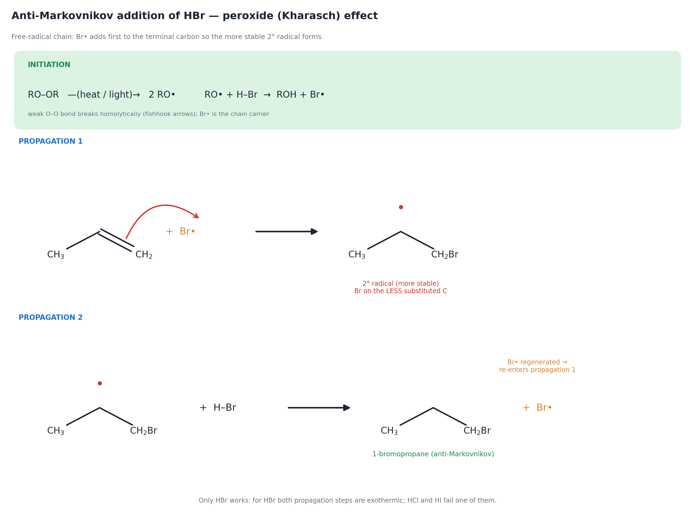

With ROOR, HBr adds by a free-radical chain; Br• attacks the terminal carbon to give the more stable 2° radical → **anti-Markovnikov** product. It fails for HCl (H–Cl too strong) and HI (I• adds reversibly/H–I step unfavourable).

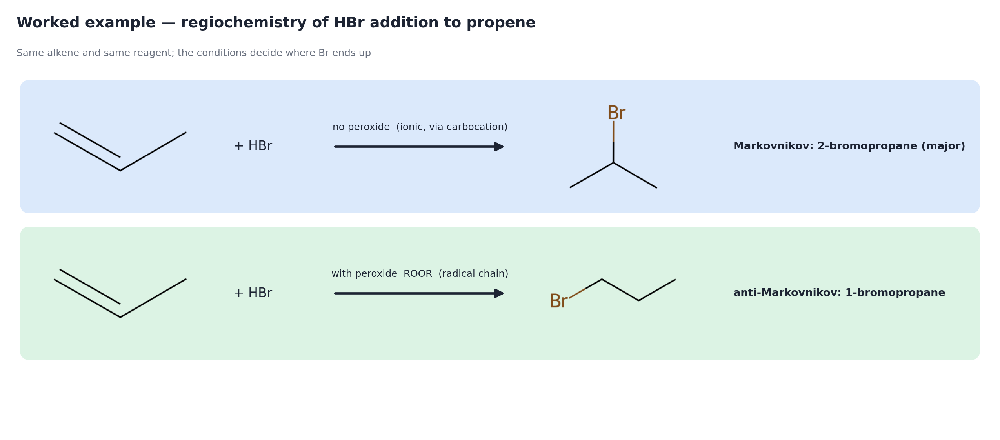

### 1.3 Nucleophilic addition to a carbonyl

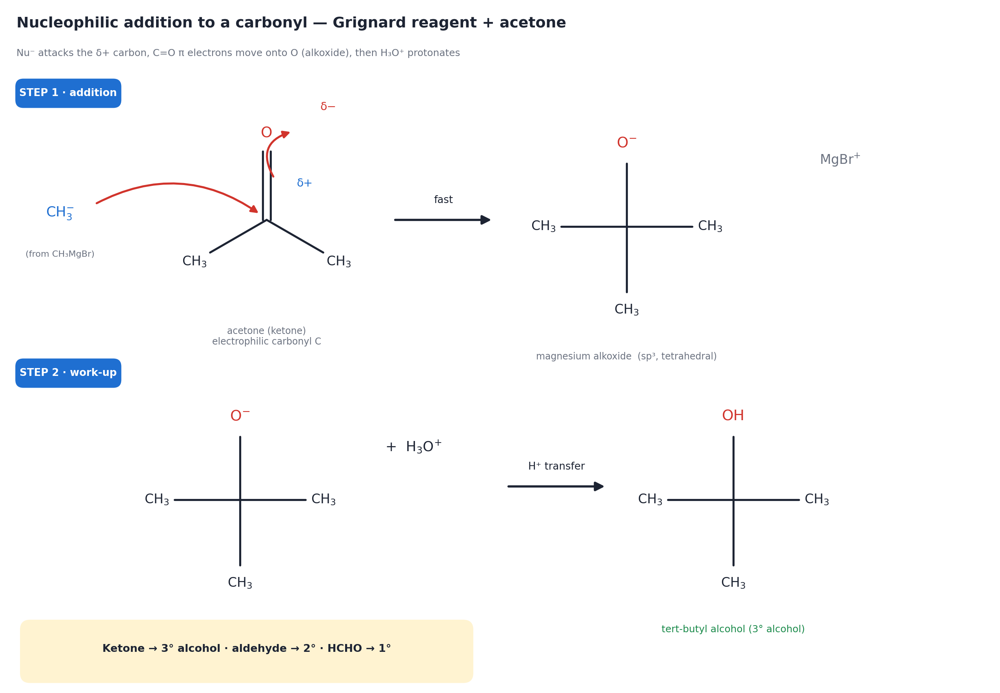

Aldehyde/ketone reactivity: HCHO > RCHO > R₂C=O (less steric hindrance and fewer electron-donating groups on C=O carbon).

---

## 2. Kinetics of SN1, SN2, E1, E2

### 2.1 SN2 — bimolecular, concerted, inversion

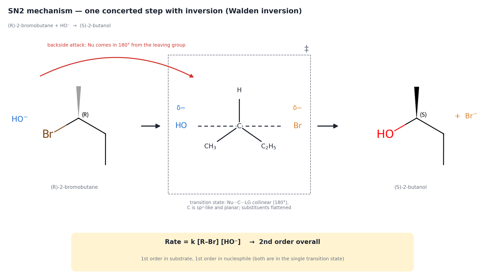

Single step; Nu and substrate are both in the transition state, so

$$\text{Rate}=k[\text{RX}][\text{Nu}^-]\quad(\text{2nd order})$$

Favoured by: methyl/1° substrate, strong Nu, polar aprotic solvent (DMSO, DMF, acetone).

### 2.2 SN1 — unimolecular, carbocation, racemisation

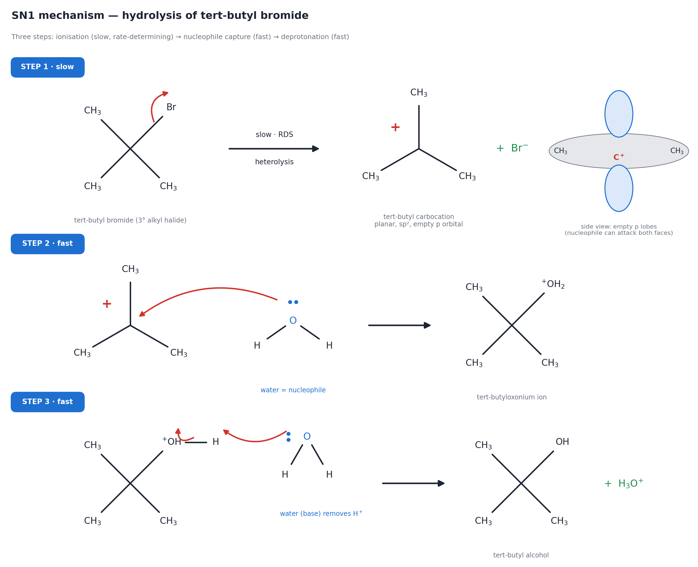

The slow step (ionisation) involves only RX; the nucleophile enters after the rate-determining step:

$$\text{Rate}=k[\text{RX}]\quad(\text{1st order})$$

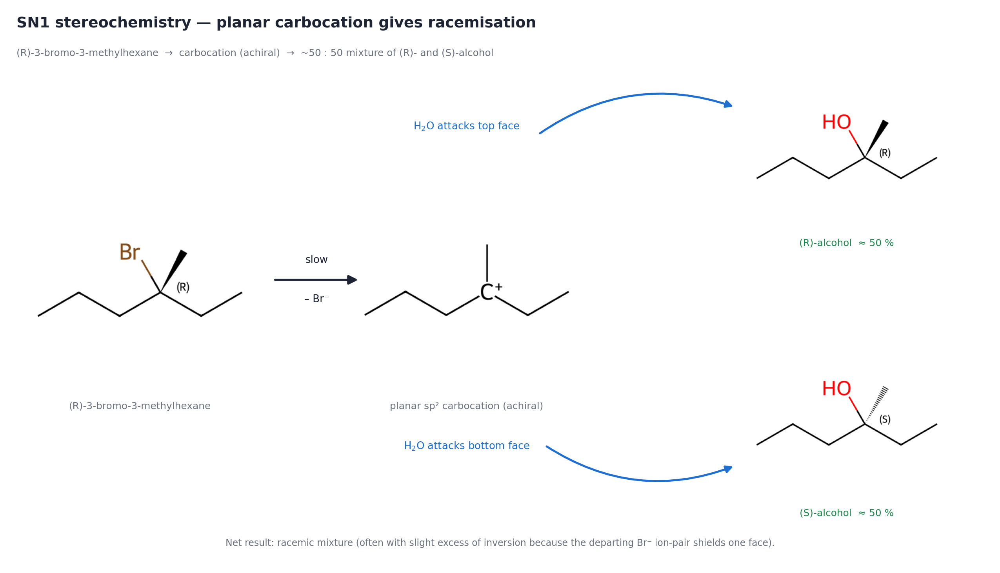

Favoured by: 3° (or allylic/benzylic) substrate, weak Nu, polar protic solvent.

### 2.3 E1 — unimolecular elimination

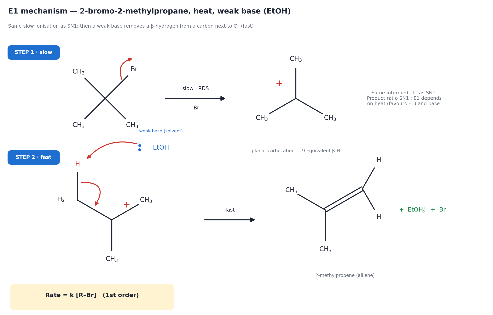

Same slow step as SN1 → $\text{Rate}=k[\text{RX}]$. Heat favours E1 over SN1.

### 2.4 E2 — bimolecular elimination

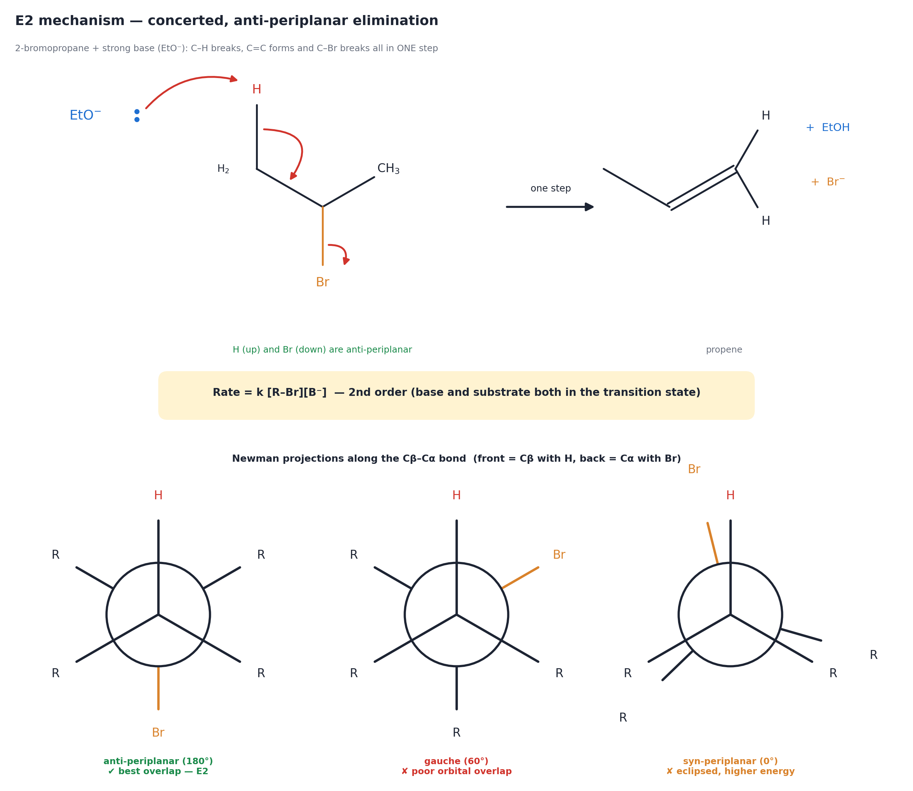

$\text{Rate}=k[\text{RX}][\text{B}^-]$. Needs **anti-periplanar** H and leaving group (best orbital overlap). Strong bases favoured; bulky bases (t-BuOK) promote E2 over SN2.

### 2.5 Why the orders differ — energy profiles and rate plots

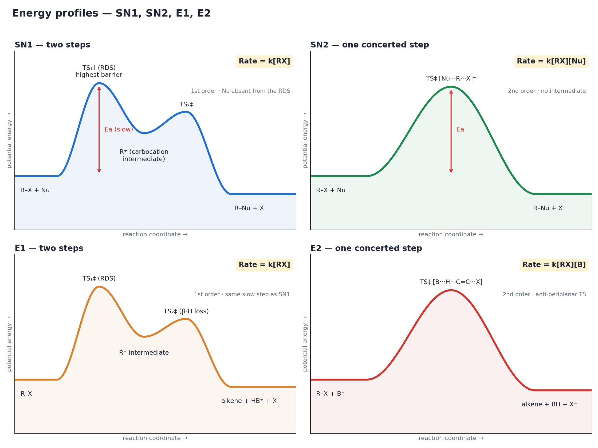

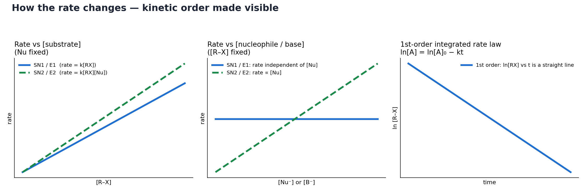

The order equals the molecularity of the rate-determining (or only) step: one-step SN2/E2 are bimolecular → 2nd order; for SN1/E1 the slow step is unimolecular → 1st order, independent of [Nu]/[B].

### 2.6 Comparison table

| Feature | SN1 | SN2 | E1 | E2 |
|---|---|---|---|---|
| Order | 1st | 2nd | 1st | 2nd |
| Rate law | k[RX] | k[RX][Nu] | k[RX] | k[RX][B] |
| Steps | 2 | 1 (concerted) | 2 | 1 (concerted) |
| Intermediate | Carbocation | None | Carbocation | None |
| Stereochemistry | Racemisation | Inversion | — | Anti-periplanar |
| Substrate | 3° > 2° | Me > 1° > 2° | 3° > 2° | 3° > 2° > 1° |
| Nu / base | Weak | Strong Nu | Weak base | Strong base |
| Solvent | Polar protic | Polar aprotic | Polar protic | Any |
| Rearrangement | Yes | No | Yes | No |

### 2.7 Carbocation stability

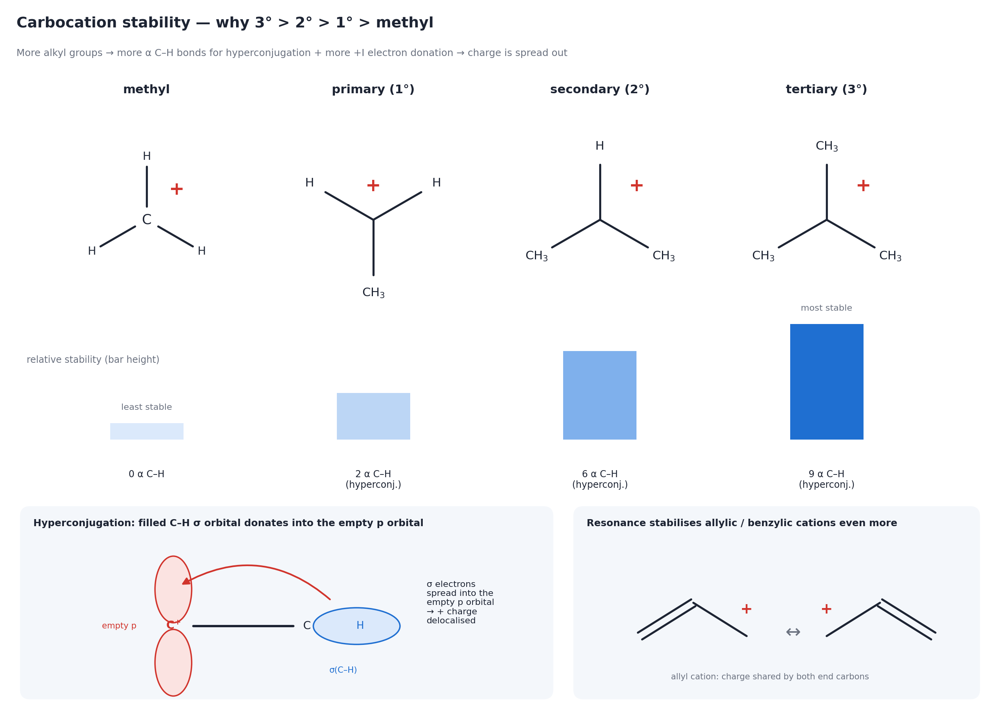

3° > 2° > 1° > methyl (hyperconjugation + +I effect); allylic and benzylic are further stabilised by resonance.

### 2.8 Which pathway? Decision chart

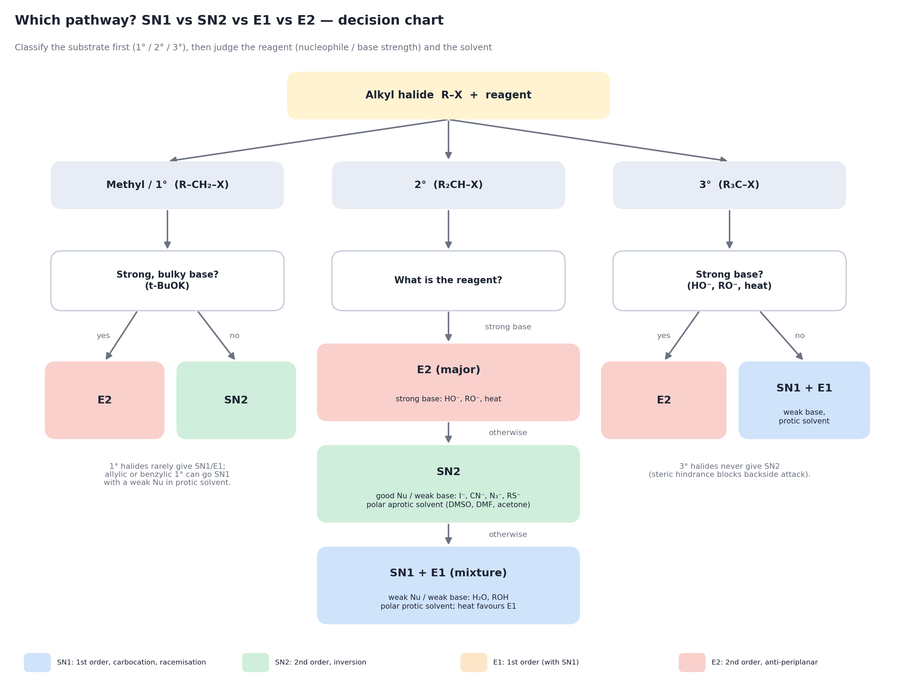

### 2.9 Worked examples

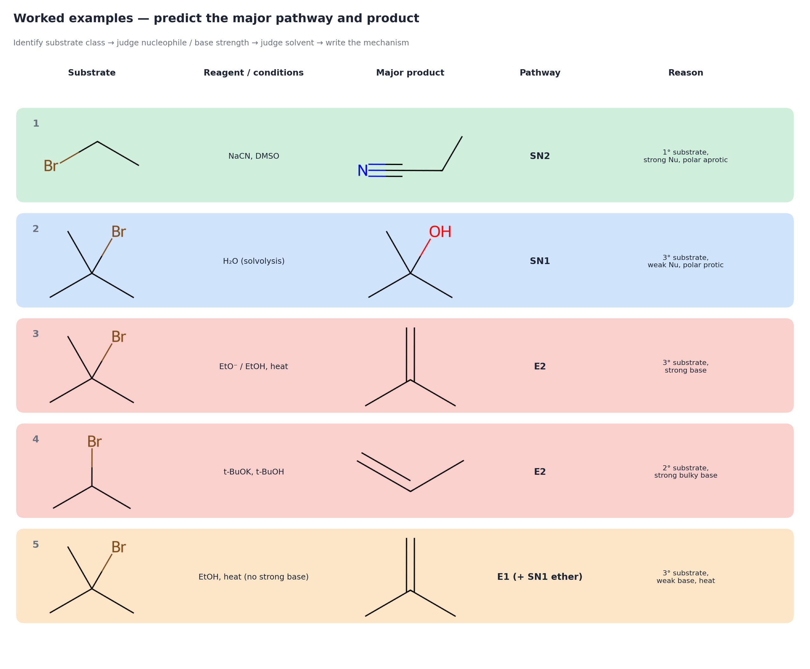

### 2.10 Common exam mistakes

- Confusing *molecularity* with *order* (they coincide only for elementary steps).
- Putting [Nu] in the SN1/E1 rate law — it acts after the RDS.
- Assuming every 1° halide gives SN2 — allylic/benzylic 1° can go SN1.
- Forgetting 3° halides never undergo SN2.

---

## 3. Grignard Reagents

**R–Mg–X** (R = alkyl/aryl; X = Cl, Br, I). C–Mg is polar (C δ−), so R acts as a carbanion nucleophile. Prepared from R–X + Mg in **dry ether/THF** under N₂; reactivity R–I > R–Br > R–Cl. Not isolated; used in situ.

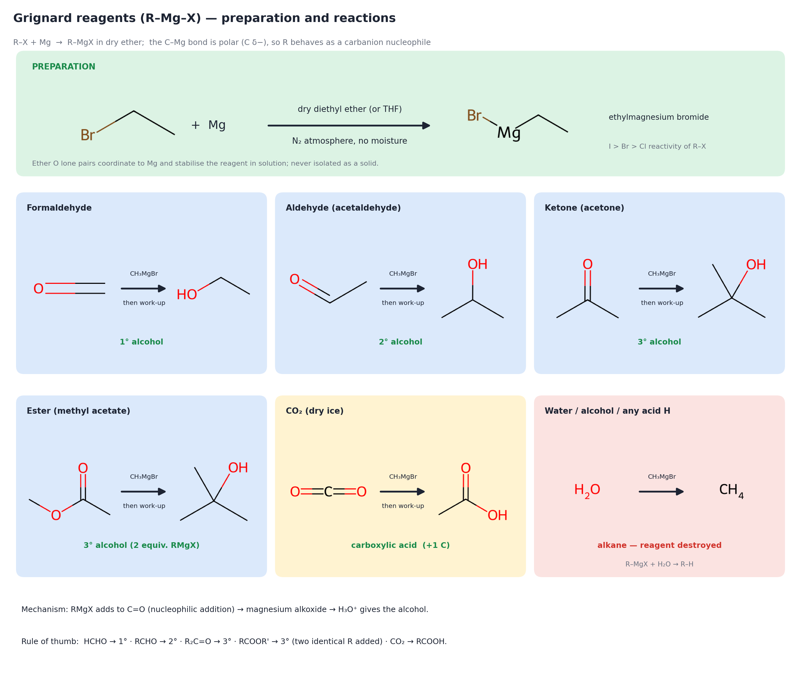

| Substrate | Product after H₃O⁺ |
|---|---|
| HCHO | 1° alcohol |
| RCHO | 2° alcohol |
| R₂C=O | 3° alcohol |
| Ester (2 equiv.) | 3° alcohol |
| CO₂ | Carboxylic acid |
| H₂O / ROH | Alkane (reagent destroyed) |

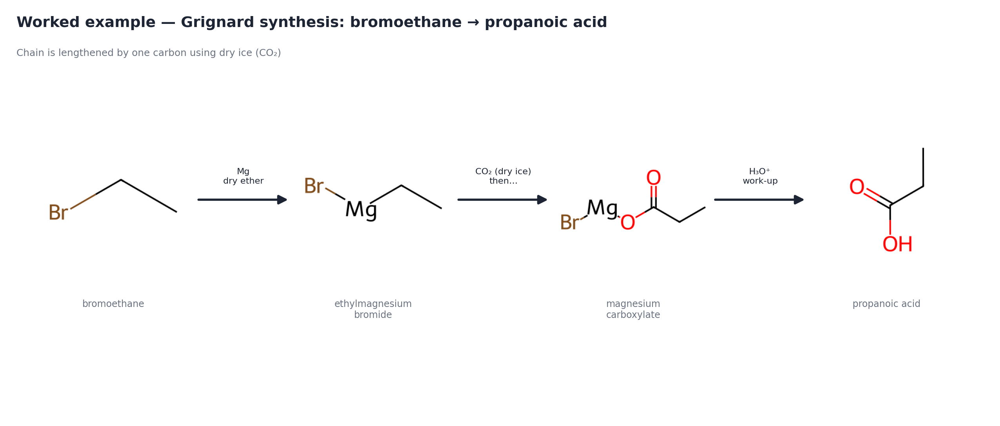

**Precautions:** oven-dried glassware, dry solvent, inert atmosphere (water and CO₂ destroy the reagent).

---

## 4. Tetraethyl Lead (TEL)

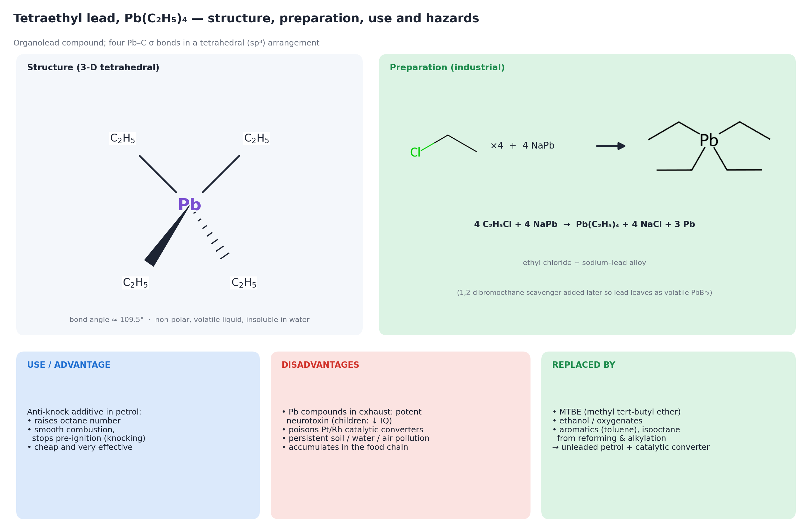

- **Formula:** Pb(C₂H₅)₄, tetrahedral.
- **Preparation:** 4 C₂H₅Cl + 4 NaPb → Pb(C₂H₅)₄ + 4 NaCl + 3 Pb
- **Use:** anti-knock additive (raises octane number).
- **Disadvantages:** neurotoxic lead in exhaust, poisons catalytic converters, persistent pollution → phased out (1970s–2000s).
- **Replacements:** MTBE, ethanol/oxygenates, aromatics, isooctane.

---

## 5. One-Page Revision Sheet

- **Electrophilic addition:** E⁺ first → carbocation → Nu⁻. Markovnikov; peroxide reverses for HBr only.
- **Nucleophilic addition:** Nu⁻ on C=O carbon → alkoxide → H₃O⁺.
- **SN1/E1:** 1st order, carbocation, 3°, weak Nu/base, protic. **SN2/E2:** 2nd order, concerted, strong Nu/base.
- **SN2 = inversion; SN1 = racemisation; E2 = anti-periplanar.**
- **Grignard:** RMgX, dry ether, adds to C=O; water destroys it.
- **TEL:** Pb(C₂H₅)₄, anti-knock, banned (neurotoxic).

---

## 6. Viva Questions

1. Why does SN2 give inversion?
2. Why is SN1 rate independent of [Nu]?
3. What decides SN1 vs SN2?
4. Why do polar protic solvents favour SN1?
5. What is the anti-periplanar requirement in E2?
6. Why do E1 and SN1 share an intermediate?
7. State Markovnikov's rule with an example.
8. Why is anti-Markovnikov addition seen only with HBr and peroxide?
9. Why must Grignard reagents be made anhydrous?
10. Product of RMgX + dry ice?
11. Why does HCHO give a 1° alcohol?
12. Why ether as solvent?
13. Molecular formula of TEL?
14. Why was TEL banned?
15. Two modern replacements for TEL?
16. Why does TEL poison catalytic converters?
17. Halide reactivity order for Grignard formation?
18. Why is a 3° carbocation more stable than 1°?
19. Differentiate molecularity and order using SN1/SN2.
20. Why prefer bulky t-BuO⁻ for E2 over SN2?

## 7. MCQs

1. SN2 proceeds with: (a) retention (b) inversion (c) racemisation (d) none — **b**
2. SN1 rate law: (a) k[RX][Nu] (b) k[RX] (c) k[Nu] (d) k[RX]² — **b**
3. Best SN1 substrate: (a) methyl (b) 1° (c) 2° (d) 3° — **d**
4. E2 geometry: (a) syn (b) anti-periplanar (c) gauche (d) eclipsed — **b**
5. Markovnikov's rule applies to: (a) substitution (b) electrophilic addition to unsymmetrical alkenes (c) elimination (d) oxidation — **b**
6. Anti-Markovnikov HBr addition is due to: (a) polar solvent (b) peroxide/radical mechanism (c) heat (d) base — **b**
7. Grignard formula: (a) R₂Mg (b) RMgX (c) RMgOH (d) R–Mg=O — **b**
8. Grignard solvent: (a) water (b) dry ether (c) ethanol (d) acetic acid — **b**
9. RMgX + CO₂ then H₃O⁺: (a) alcohol (b) carboxylic acid (c) ketone (d) alkane — **b**
10. RMgX + H₂O: (a) alcohol (b) alkane (c) ether (d) ester — **b**
11. TEL is: (a) trimethyl ethyl lead (b) tetraethyl lead (c) triethyl lead (d) tetramethyl lead — **b**
12. TEL in petrol acts as: (a) solvent (b) anti-knock (c) dye (d) preservative — **b**
13. TEL banned because: (a) cost (b) neurotoxicity/lead pollution (c) flammability (d) low octane — **b**
14. Modern TEL replacement: (a) MTBE (b) NaCl (c) reformulated TEL (d) H₂SO₄ — **a**
15. SN2 favoured by: (a) bulky substrate (b) strong Nu + polar aprotic solvent (c) weak Nu (d) 3° substrate — **b**
16. Carbocation intermediate occurs in: (a) SN2 (b) E2 (c) SN1 (d) none — **c**
17. Carbocation stability: (a) 1°>2°>3° (b) 3°>2°>1° (c) equal (d) methyl>1° — **b**
18. In nucleophilic addition to C=O the Nu attacks: (a) O (b) carbonyl C (c) H (d) none — **b**
19. Grignard + ketone gives: (a) 1° alcohol (b) 2° alcohol (c) 3° alcohol (d) acid — **c**
20. Reaction order is set by: (a) stoichiometry (b) the rate law, i.e. molecularity of the RDS for elementary steps (c) temperature (d) solvent colour — **b**

## 8. Short Questions

1. Define electrophile and nucleophile with examples.
2. Write the SN2 rate law and explain each term.
3. Why does SN1 give racemisation?
4. Two conditions favouring E2 over E1.
5. Write the reaction of a Grignard reagent with water.
6. Why dry ether in Grignard synthesis?
7. Give the structure and formula of TEL.
8. One advantage and one disadvantage of TEL.
9. What is the peroxide (Kharasch) effect?
10. Differentiate electrophilic and nucleophilic addition.

## 9. Long Questions

1. Derive the SN1 and SN2 rate laws and prove their orders.
2. Mechanism, stereochemistry and rate law of E1 and E2.
3. Markovnikov and anti-Markovnikov addition with mechanisms.
4. Preparation of Grignard reagents and reactions with aldehydes, ketones, esters, CO₂, water.
5. Factors (substrate, nucleophile, solvent) deciding SN1 vs SN2.
6. Preparation, uses, hazards and phase-out of TEL.
7. Compare SN1, SN2, E1, E2 (mechanism, kinetics, stereochemistry).
8. Electrophilic addition of HBr to propene including the peroxide effect.
9. Nucleophilic addition of a Grignard reagent to a carbonyl compound.
10. Carbocation stability and its role in SN1/E1 reactivity and rearrangement.
