# Amines — Chemistry-II Notes

> **Chem-103 · CT-2.** Structures are SVG diagrams stored in `../../assets/`. Equations use GitHub math (`$$ … $$`), and flowcharts use GitHub-native Mermaid. Where a handwritten equation was incomplete, a standard balanced form is given (see [Notes](#notes)).

## Contents

1. [Classification and definitions](#1-classification-and-definitions)
2. [Important terms and reactions](#2-important-terms-and-reactions)
3. [Separation of primary, secondary and tertiary amines](#3-separation-of-primary-secondary-and-tertiary-amines)
4. [Preparation of amines](#4-preparation-of-amines)
5. [Basicity constant](#5-basicity-constant)
6. [Comparison of primary, secondary and tertiary amines](#6-comparison-of-primary-secondary-and-tertiary-amines)
7. [Basicity of aniline and methylamine](#7-basicity-of-aniline-and-methylamine)
8. [Benzene diazonium chloride and azo compounds](#8-benzene-diazonium-chloride-and-azo-compounds)
9. [Hofmann and Curtius degradations](#9-hofmann-and-curtius-degradations)
10. [Quick revision](#10-quick-revision)
11. [Notes](#notes)

---

## 1. Classification and definitions

### 1.1 Primary, secondary and tertiary amines

Amines are derivatives of ammonia in which one or more hydrogen atoms are replaced by alkyl or aryl groups. The class depends on **how many carbon groups are bonded to nitrogen**.

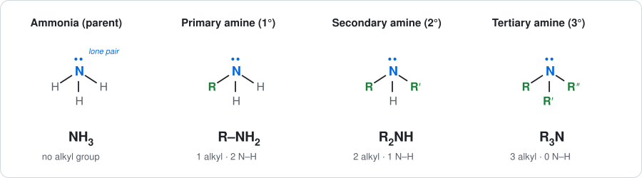

| Class | General formula | Groups on N | N–H bonds |
|---|---|---|---|
| Primary (1°) | R–NH2 | 1 | 2 |
| Secondary (2°) | R2NH | 2 | 1 |
| Tertiary (3°) | R3N | 3 | 0 |

### 1.2 Aliphatic amines

Aliphatic amines are organic compounds in which the nitrogen atom is bonded to one or more **alkyl groups**. Alkyl groups are hydrocarbon groups containing only single bonds between carbon atoms.

Examples: methylamine (CH3NH2) and ethylamine (C2H5NH2).

### 1.3 Aromatic amines

Aromatic amines are compounds in which nitrogen is **directly bonded to an aryl group** (a carbon of the benzene ring).

Examples: aniline (C6H5NH2, Ph–NH2) and benzylamine (C6H5CH2NH2, Ph–CH2–NH2).

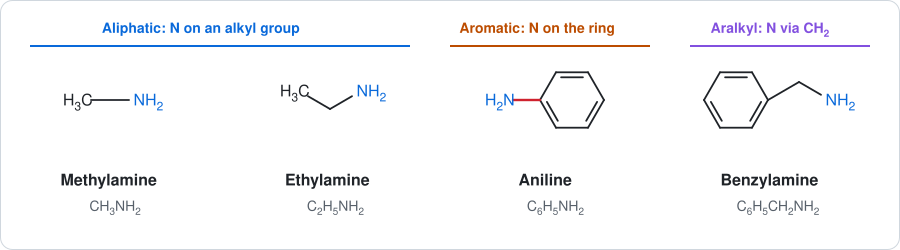

> [!NOTE]
> Aniline is a true aromatic amine because N is attached to the ring (red bond). In benzylamine, N is attached through a CH2 group, so it is technically an **aralkyl amine**.

### 1.4 E2 elimination

E2 elimination is a one-step, concerted reaction in which a base removes a hydrogen from the carbon next to the leaving group while the leaving group departs, forming a C=C double bond. It is called **bimolecular** because the rate depends on both the substrate and the base.

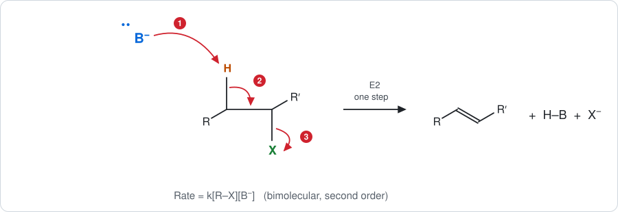

1. The base (B⁻) attacks the β-hydrogen.
2. The electrons of the C–H bond move in to form the new π bond.
3. The leaving group (X) departs with the electrons of the C–X bond.

$$
\mathrm{R{-}CH_2{-}CH(X){-}R' + B^- \longrightarrow R{-}CH{=}CH{-}R' + HB + X^-}
$$

$$
\text{Rate} = k\,[\text{R–X}]\,[\text{B}^-]
$$

### 1.5 Sulfa drugs

Sulfa drugs, also called **sulfonamides**, are synthetic antimicrobial agents containing the sulfonamide group. They were among the first widely used antibacterial drugs and are used to treat certain bacterial infections.

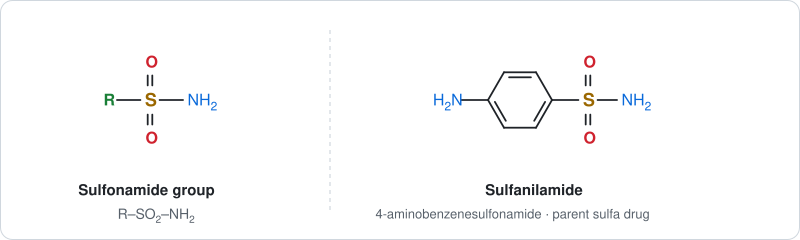

---

## 2. Important terms and reactions

### 2.1 Diazonium chloride

A diazonium chloride is an organic salt containing the diazonium group, –N2+. The aromatic general formula is Ar–N2+Cl−; the example is **benzene diazonium chloride**, C6H5N2+Cl− (structure in [2.5](#25-diazotization)).

### 2.2 Coupling reaction

A coupling reaction occurs when an aromatic diazonium salt reacts with an activated aromatic compound, such as **phenol** or an **aromatic amine**, to form an azo compound containing the –N=N– linkage.

$$
\mathrm{ArN_2^+ + Ar'H \longrightarrow Ar{-}N{=}N{-}Ar' + H^+}
$$

Structures and the phenol example are in [Section 8](#82-preparation-of-azo-compounds).

### 2.3 Sandmeyer reaction

The replacement of the diazonium group of an aromatic diazonium salt by **Cl, Br or CN** using a **cuprous salt** (CuCl, CuBr or CuCN) is called the Sandmeyer reaction.

$$
\mathrm{C_6H_5N_2^+Cl^- \xrightarrow{CuCl} C_6H_5Cl + N_2\uparrow}
$$

### 2.4 Gattermann reaction

In the Gattermann reaction, an aromatic diazonium salt is converted into an aryl chloride or bromide using the corresponding hydrogen halide in the presence of **copper powder**.

$$
\mathrm{C_6H_5N_2^+Cl^- \xrightarrow[Cu]{HCl} C_6H_5Cl + N_2\uparrow}
$$

> [!TIP]
> **Sandmeyer vs Gattermann:** Sandmeyer uses a *cuprous salt* (CuX) and can also introduce –CN. Gattermann uses *copper powder + HX* and gives only aryl halides.

### 2.5 Diazotization

Diazotization is the conversion of a **primary aromatic amine** into an aromatic diazonium salt using nitrous acid at low temperature, usually 0–5 °C. Nitrous acid is generated in situ:

$$
\mathrm{NaNO_2 + HCl \longrightarrow HNO_2 + NaCl}
$$

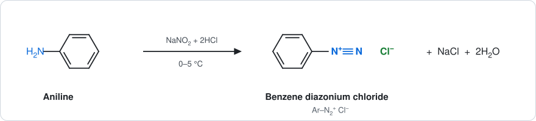

$$
\mathrm{C_6H_5NH_2 + NaNO_2 + 2HCl \xrightarrow{0\text{–}5^\circ C} C_6H_5N_2^+Cl^- + NaCl + 2H_2O}
$$

### 2.6 Azo compounds

Azo compounds contain two aryl groups joined by the **azo linkage**, Ar–N=N–Ar′. They are commonly prepared by coupling diazonium salts with phenols or aromatic amines. Many are strongly coloured and are used as **dyes**.

### 2.7 Overview of diazonium reactions

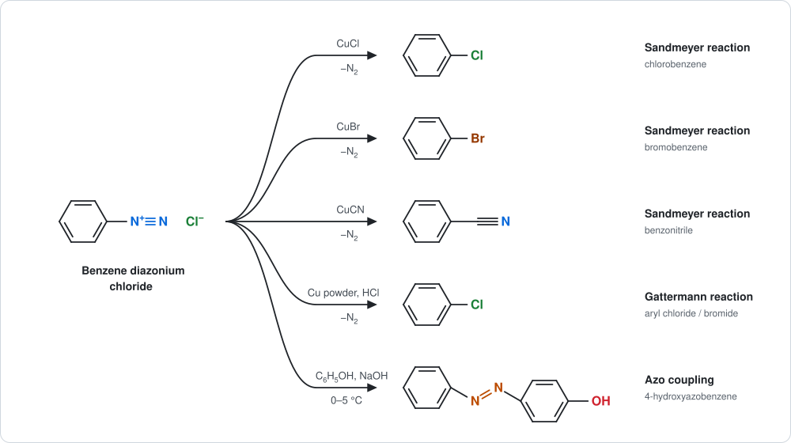

---

## 3. Separation of primary, secondary and tertiary amines

### Hofmann's method (diethyl oxalate method)

A mixture of primary, secondary and tertiary amines can be separated by treatment with **diethyl oxalate**, EtOOC–COOEt (Et = C2H5). Only the N–H bonds react.

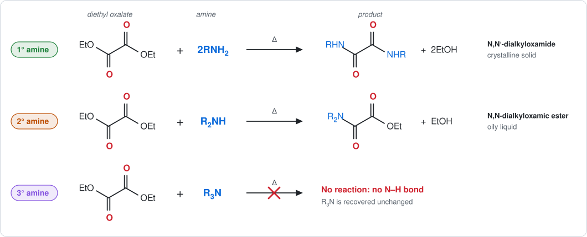

| Amine | Product | State | Reason |
|---|---|---|---|
| Primary | N,N′-dialkyloxamide | crystalline solid | two N–H bonds; both ester groups react |
| Secondary | N,N-dialkyloxamic ester | oily liquid | one N–H bond; only one ester group reacts |
| Tertiary | none | unchanged | no N–H bond |

**(i) Primary amine**

$$
\mathrm{EtOOC{-}COOEt + 2RNH_2 \xrightarrow{\Delta} RNHCO{-}CONHR + 2C_2H_5OH}
$$

**(ii) Secondary amine**

$$
\mathrm{EtOOC{-}COOEt + R_2NH \xrightarrow{\Delta} R_2NCO{-}COOEt + C_2H_5OH}
$$

**(iii) Tertiary amine:** no reaction.

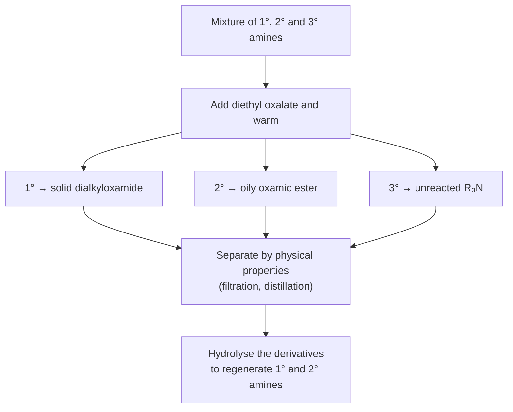

---

## 4. Preparation of amines

### 4.1 Aliphatic amines from alcohol and ammonia

Alcohol vapour reacts with ammonia (or an amine) over heated **alumina** to form amines. Each further methylation moves one step up the ladder: primary → secondary → tertiary.

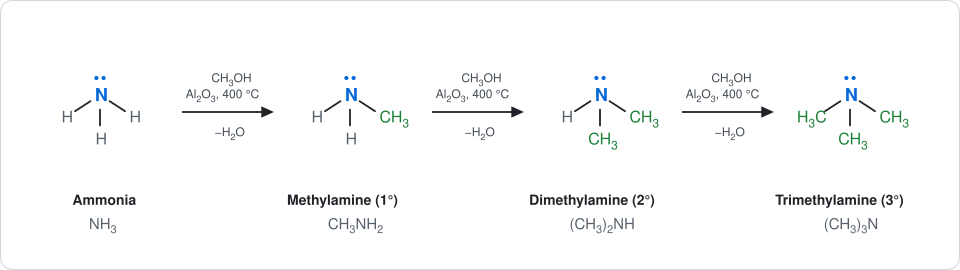

**Primary** (methylamine)

$$
\mathrm{CH_3OH + NH_3 \xrightarrow[400^\circ C]{Al_2O_3} CH_3NH_2 + H_2O}
$$

**Secondary** (dimethylamine)

$$
\mathrm{CH_3OH + CH_3NH_2 \xrightarrow[400^\circ C]{Al_2O_3} (CH_3)_2NH + H_2O}
$$

**Tertiary** (trimethylamine)

$$
\mathrm{CH_3OH + (CH_3)_2NH \xrightarrow[400^\circ C]{Al_2O_3} (CH_3)_3N + H_2O}
$$

### 4.2 Aromatic primary amine: reduction of a nitro compound

Aromatic primary amines are prepared by reducing nitro compounds with tin and hydrochloric acid.

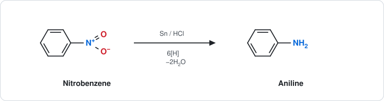

$$
\mathrm{C_6H_5NO_2 + 6[H] \xrightarrow{Sn/HCl} C_6H_5NH_2 + 2H_2O}
$$

### 4.3 Aromatic secondary and tertiary amines: N-methylation

Aniline reacts with methyl iodide to form N-methylaniline, which reacts again to give N,N-dimethylaniline.

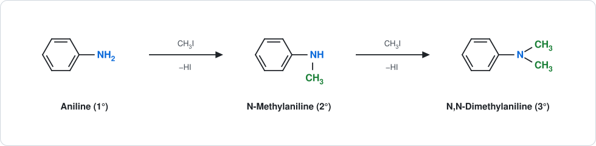

$$
\mathrm{C_6H_5NH_2 + CH_3I \longrightarrow C_6H_5NHCH_3 + HI}
$$

$$
\mathrm{C_6H_5NHCH_3 + CH_3I \longrightarrow C_6H_5N(CH_3)_2 + HI}
$$

> [!NOTE]
> Alkylation does not stop cleanly at one stage. In practice a mixture of 1°, 2°, 3° amines (and a quaternary ammonium salt) forms, so the equations show each step in isolation.

### 4.4 Summary by class

| Class | Aliphatic example | Aromatic example |
|---|---|---|
| Primary | CH3OH + NH3 → CH3NH2 | C6H5NO2 → C6H5NH2 (Sn/HCl) |
| Secondary | CH3OH + CH3NH2 → (CH3)2NH | C6H5NH2 + CH3I → C6H5NHCH3 |
| Tertiary | CH3OH + (CH3)2NH → (CH3)3N | C6H5NHCH3 + CH3I → C6H5N(CH3)2 |

---

## 5. Basicity constant

The basicity constant, $K_b$, measures the ability of an amine to accept a proton from water.

$$
\mathrm{RNH_2 + H_2O \rightleftharpoons RNH_3^+ + OH^-}
$$

$$
K_b = \frac{[\mathrm{RNH_3^+}][\mathrm{OH^-}]}{[\mathrm{RNH_2}]}
$$

Water is omitted because it is a pure liquid.

### Relation between $K_b$ and $pK_b$

$$
pK_b = -\log_{10} K_b \qquad\qquad K_b = 10^{-pK_b}
$$

**Example:** if $pK_b = 4.75$, then

$$
K_b = 10^{-4.75} \approx 1.78 \times 10^{-5}
$$

> [!IMPORTANT]
> **Larger $K_b$ = stronger base. Smaller $pK_b$ = stronger base.**

### Typical values in water (about 25 °C)

| Amine | $pK_b$ | $K_b$ |
|---|---|---|
| Ammonia | 4.75 | 1.8 × 10−5 |
| Methylamine | 3.36 | 4.4 × 10−4 |
| Dimethylamine | 3.27 | 5.4 × 10−4 |
| Trimethylamine | 4.19 | 6.5 × 10−5 |
| Ethylamine | 3.25 | 5.6 × 10−4 |
| Diethylamine | 3.02 | 9.5 × 10−4 |
| Triethylamine | 3.25 | 5.6 × 10−4 |
| Aniline | 9.38 | 4.2 × 10−10 |

Approximate textbook values; they differ slightly between sources.

---

## 6. Comparison of primary, secondary and tertiary amines

| Property | Primary amine | Secondary amine | Tertiary amine |
|---|---|---|---|
| General formula | RNH2 | R2NH | R3N |
| N–H bonds | 2 | 1 | 0 |
| Intermolecular hydrogen bonding | Strongest potential | Intermediate | Cannot donate N–H hydrogen bonds |
| Boiling point (similar molar mass) | Higher | Intermediate | Lower |
| Reaction with diethyl oxalate | Solid oxamide | Oily oxamic ester | No reaction |

> [!NOTE]
> The relative basicity of 1°, 2° and 3° amines is **not universal**. It depends on solvent, solvation, steric effects and the structure of the alkyl groups. In water the methylamines run 2° > 1° > 3° > NH3 (see the table in Section 5), but this order changes for other alkyl groups, so do not memorise one order for all amines.

---

## 7. Basicity of aniline and methylamine

Aniline is **less basic** than methylamine because the nitrogen lone pair in aniline is **delocalised into the benzene ring** by resonance, so it is less available to accept a proton.

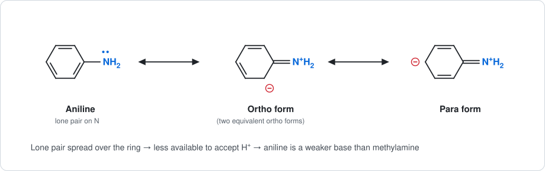

In methylamine, the lone pair is localised on nitrogen and more available for protonation, and the methyl group has an electron-releasing inductive effect.

| | Methylamine | Aniline |
|---|---|---|
| N lone pair | Localised on N | Delocalised into the ring |
| Effect of attached group | +I (electron-releasing) | Resonance withdrawal into ring |
| $pK_b$ | 3.36 | 9.38 |
| Basicity | **Stronger base** | Weaker base |

$$
\boxed{\text{Methylamine is more basic than aniline.}}
$$

---

## 8. Benzene diazonium chloride and azo compounds

### 8.1 Preparation of benzene diazonium chloride

Benzene diazonium chloride is prepared by **diazotization of aniline** with nitrous acid (NaNO2 + HCl) at 0–5 °C.

$$
\mathrm{C_6H_5NH_2 + NaNO_2 + 2HCl \xrightarrow{0\text{–}5^\circ C} C_6H_5N_2^+Cl^- + NaCl + 2H_2O}
$$

### 8.2 Preparation of azo compounds

Azo compounds are prepared by coupling an aromatic diazonium salt with phenol or an aromatic amine. Example: coupling with phenol in alkaline medium.

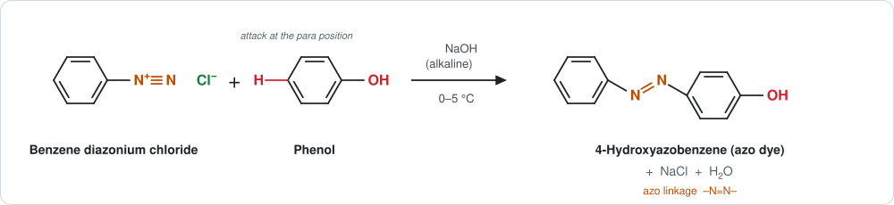

$$
\mathrm{C_6H_5N_2^+Cl^- + C_6H_5OH + NaOH \longrightarrow HO{-}C_6H_4{-}N{=}N{-}C_6H_5 + NaCl + H_2O}
$$

**Product:** *p*-hydroxyazobenzene (4-hydroxyazobenzene), an orange azo compound. The characteristic linkage is

$$
\boxed{\mathrm{Ar{-}N{=}N{-}Ar'}}
$$

---

## 9. Hofmann and Curtius degradations

Both reactions convert a carboxylic acid derivative into a **primary amine with one carbon atom fewer**, and both go through the same **isocyanate** intermediate.

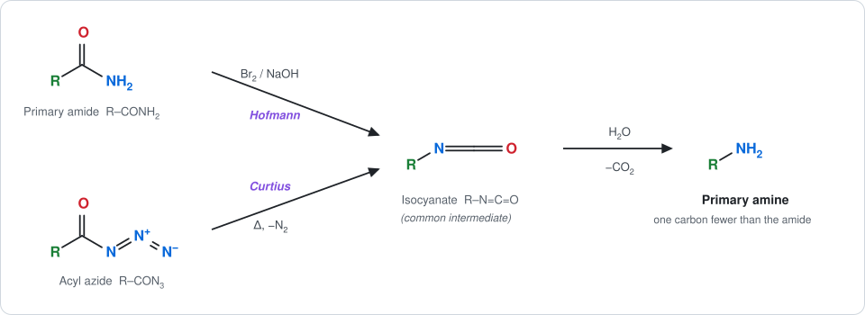

### 9.1 Hofmann degradation (Hofmann rearrangement)

A primary amide is treated with bromine and aqueous sodium hydroxide. The R group migrates from carbon to nitrogen, giving an isocyanate, which is hydrolysed to the amine.

$$
\mathrm{RCONH_2 + Br_2 + 4NaOH \longrightarrow RNH_2 + Na_2CO_3 + 2NaBr + 2H_2O}
$$

Example: acetamide gives methylamine.

$$
\mathrm{CH_3CONH_2 \xrightarrow{Br_2/NaOH} CH_3NH_2}
$$

### 9.2 Curtius degradation (Curtius rearrangement)

Thermal decomposition of an acyl azide gives an isocyanate. Hydrolysis of the isocyanate gives the primary amine.

$$
\mathrm{RCON_3 \xrightarrow{\Delta} R{-}N{=}C{=}O + N_2}
$$

$$
\mathrm{R{-}N{=}C{=}O + H_2O \longrightarrow RNH_2 + CO_2}
$$

### 9.3 Comparison

| | Hofmann | Curtius |
|---|---|---|
| Starting material | Primary amide, RCONH2 | Acyl azide, RCON3 |
| Reagent / condition | Br2 + NaOH | Heat, then H2O |
| Intermediate | Isocyanate, R–N=C=O | Isocyanate, R–N=C=O |
| By-products | Na2CO3, NaBr | N2, CO2 |
| Product | RNH2 (one C fewer) | RNH2 (one C fewer) |

---

## 10. Quick revision

### Key reactions

| Reaction | Reagent / condition | Main product |
|---|---|---|
| Diazotization | NaNO2/HCl, 0–5 °C | Aromatic diazonium salt |
| Sandmeyer reaction | CuCl, CuBr or CuCN | Aryl halide or nitrile |
| Gattermann reaction | HCl/HBr, Cu powder | Aryl chloride or bromide |
| Azo coupling | Diazonium salt + phenol / aryl amine | Azo compound |
| Nitro reduction | Sn/HCl | Primary aromatic amine |
| Alcohol + NH3 | Al2O3, 400 °C | 1° → 2° → 3° aliphatic amines |
| Diethyl oxalate test | Heat | 1° solid, 2° oily liquid, 3° none |
| Hofmann degradation | Br2/NaOH | Primary amine, one C fewer |
| Curtius rearrangement | Heat acyl azide, then hydrolysis | Primary amine, one C fewer |

### Reaction roadmap

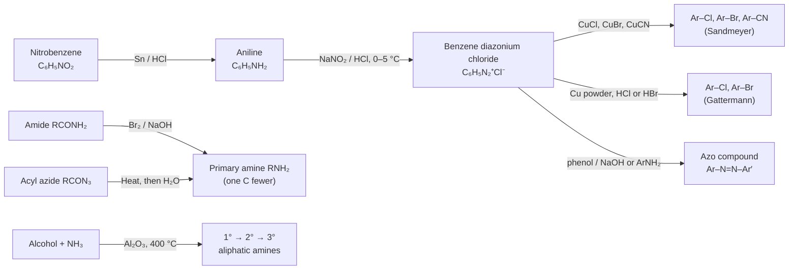

---

## Notes

- Order and scope follow the supplied 9-page handwritten note. Sections 4 and 6 of the source (both on preparation) are merged into [Section 4](#4-preparation-of-amines), and the sections that followed are renumbered.
- Some handwritten equations were abbreviated or incomplete. Standard balanced forms are written out where necessary.
- Added for clarity beyond the source: the sulfanilamide structure, the $pK_b$ table in Section 5, the comparison tables in Sections 7 and 9, and the roadmap flowchart.
- The boiling-point trend is a simplified comparison for amines of similar molar mass. Actual values depend on molecular structure.
- Basicity order depends on solvent, solvation and steric effects and should not be memorised as one universal order for all amines.
