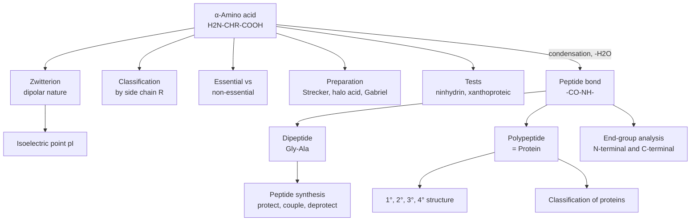
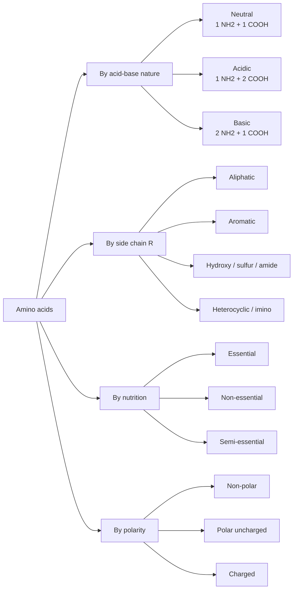
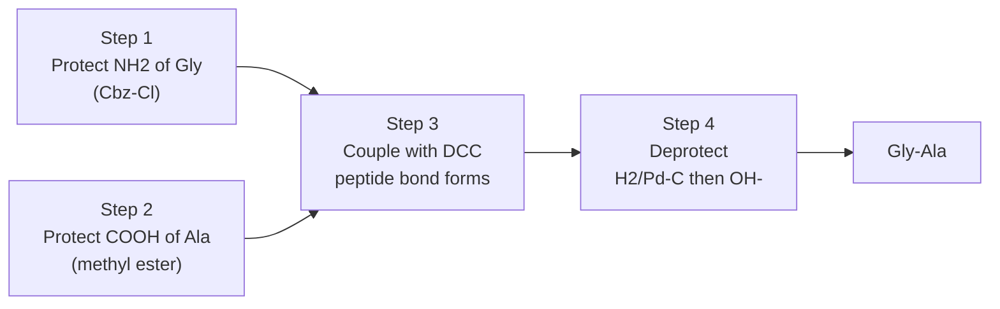
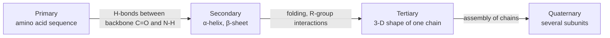
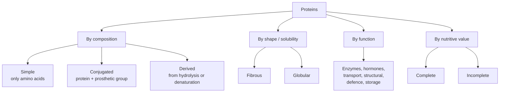
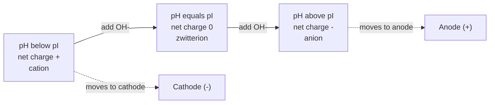
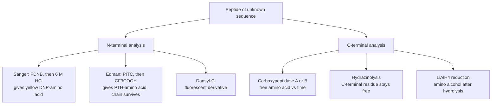
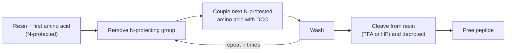
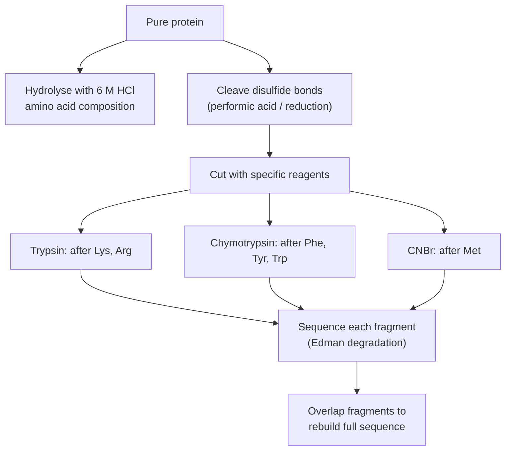

# Amino Acids & Proteins — Previous-Year Questions Solved

> **Course:** CHEM-103 (Chemistry-II) · **Topic:** Amino acids, peptides & proteins · **Question bank:** 2016 – 2023 (2016, 2017, 2018, 2019, 2020, 2021, 2023) · **Version:** `v261105-1`
>
> Every answer is written in **exam style** (definition → structure/equation → points → example), followed by *extra* sections (stereochemistry, pI calculations, protein structure, sequencing logic, 12 practice problems with spoiler solutions).
> All structure drawings are stored in `../../assets/amino-acids-and-proteins/`.

**Legend:** ✅ exam-ready answer · 🧪 example · 💡 extra / bonus · ⚠️ common mistake · 🧵 textile connection

---

## Contents

- [Concept map](#concept-map)
- [Question bank map & trend analysis](#question-bank-map)
- **Part A — Solutions in bank order**
  - [2016 — Question 6](#y2016-q6)
  - [2017 — Question 6](#y2017-q6)
  - [2018 — Questions 5 & 6(d)](#y2018-q5)
  - [2019 — Questions 4 & 6](#y2019-q4)
  - [2020 — Question 6](#y2020-q6)
  - [2021 — Question 8](#y2021-q8)
  - [2023 — Questions 6 & 7](#y2023-q6)
- **Part B — Extra sections**
  - [B1 · Stereochemistry (L/D, R/S)](#b1)
  - [B2 · The 20 amino acids — cheat-sheet](#b2)
  - [B3 · pKa, pI and worked calculations](#b3)
  - [B4 · The peptide bond in detail](#b4)
  - [B5 · Protein structure, denaturation & the textile link](#b5)
  - [B6 · Peptide synthesis toolkit (protecting groups, coupling, solid-phase)](#b6)
  - [B7 · Sequencing strategy — putting it together](#b7)
  - [B8 · Exam tips, mnemonics, common mistakes](#b8)
  - [B9 · Practice problems (spoiler solutions)](#b9)
  - [B10 · References](#b10)

---

## Concept map

---

## Question bank map & trend analysis

### Where is each question answered?

| Year | Q. | Sub-question (as asked) | Answer |
|:---:|:---:|---|:---:|
| 2016 | 6(a) | What is meant by amino acid and protein? | [→](#y2016-q6a) |
| 2016 | 6(b) | Name and structure of four essential amino acids | [→](#y2016-q6b) |
| 2016 | 6(c) | Classification of amino acids with examples | [→](#y2016-q6c) |
| 2016 | 6(d) | Essential vs non-essential amino acids | [→](#y2016-q6d) |
| 2017 | 6(a) | Two methods for preparation of α-amino acid | [→](#y2017-q6a) |
| 2017 | 6(b) | Identification of N- and C-terminal residues | [→](#y2017-q6b) |
| 2017 | 6(c) | Iso-electric pH of an amino acid | [→](#y2017-q6c) |
| 2018 | 5(a) | α-Amino acid and proteins | [→](#y2018-q5a) |
| 2018 | 5(b) | Synthesis of "Gly-Ala" dipeptide | [→](#y2018-q5b) |
| 2018 | 5(c) | Name and structure of three essential amino acids | [→](#y2018-q5c) |
| 2018 | 5(d) | "Dipolar nature" of amino acids | [→](#y2018-q5d) |
| 2018 | 6(d) | Essential vs non-essential amino acids | [→](#y2018-q6d) |
| 2019 | 4(a) | N- and C-terminal of amino acid residue | [→](#y2019-q4a) |
| 2019 | 4(b) | Preparation of α-amino acids | [→](#y2019-q4b) |
| 2019 | 6(a) | What are proteins? Give its structure | [→](#y2019-q6a) |
| 2019 | 6(b) | Classification of proteins | [→](#y2019-q6b) |
| 2020 | 6(a) | Essential and non-essential amino acids with examples | [→](#y2020-q6a) |
| 2020 | 6(b) | Synthesis of three amino acids | [→](#y2020-q6b) |
| 2020 | 6(c) | Peptide linkage, C-terminal and N-terminal residue | [→](#y2020-q6c) |
| 2020 | 6(d) | Test of α-amino acid | [→](#y2020-q6d) |
| 2021 | 8(a) | α-Amino acids and proteins | [→](#y2021-q8a) |
| 2021 | 8(b) | "Dipeptide" of amino acids | [→](#y2021-q8b) |
| 2021 | 8(c) | Essential vs non-essential amino acids | [→](#y2021-q8c) |
| 2021 | 8(d) | Dipolar nature of amino acids | [→](#y2021-q8d) |
| 2023 | 6(a) | α-Amino acids and non-essential amino acids | [→](#y2023-q6a) |
| 2023 | 6(b) | Essential vs non-essential amino acids | [→](#y2023-q6b) |
| 2023 | 6(c) | Identification of N- and C-terminal residues | [→](#y2023-q6c) |
| 2023 | 6(d) | Two methods for preparation of α-amino acid | [→](#y2023-q6d) |
| 2023 | 6(e) | "Iso-electronic pH" of amino acid (= iso-electric pH / pI) | [→](#y2023-q6e) |
| 2023 | 7(a) | Zwitter ion and iso-electric point | [→](#y2023-q7a) |
| 2023 | 7(b) | Synthesis of Gly-Ala with reactions | [→](#y2023-q7b) |
| 2023 | 7(c) | End-group analysis of peptides | [→](#y2023-q7c) |

> ⚠️ **Note on 2023 Q6(e):** the paper says "iso-*electronic* pH". This is a misprint of **iso-*electric* pH** (isoelectric point, pI) — answered as such.

### Trend analysis — what repeats?

| Topic | Years asked | Times | Priority |
|---|---|:---:|:---:|
| Essential vs non-essential amino acids | 2016, 2018, 2020, 2021, 2023 | 5 years | ⭐⭐⭐ |
| Definition of α-amino acid / protein | 2016, 2018, 2019, 2021, 2023 | 5 years | ⭐⭐⭐ |
| Zwitterion / dipolar nature / pI | 2017, 2018, 2021, 2023 | 4 years | ⭐⭐⭐ |
| Preparation of α-amino acids | 2017, 2019, 2020, 2023 | 4 years | ⭐⭐⭐ |
| N- and C-terminal residues (end-group analysis) | 2017, 2019, 2020, 2023 (×2) | 4 years | ⭐⭐⭐ |
| Synthesis of Gly-Ala dipeptide | 2018, 2023 | 2 years | ⭐⭐ |
| Classification of amino acids / proteins | 2016, 2019 | 2 years | ⭐⭐ |
| Dipeptide / peptide linkage | 2020, 2021 | 2 years | ⭐⭐ |
| Chemical test of α-amino acid (ninhydrin) | 2020 | 1 year | ⭐ |

---

# Part A — Solutions in bank order

## 2016 — Question 6

### (a) What is meant by amino acid and protein?

**Amino acid.** An organic compound that contains **both** a basic amino group (–NH₂) and an acidic carboxyl group (–COOH). In an **α-amino acid** both groups are attached to the *same* carbon — the **α-carbon** (the carbon next to –COOH):

$$\mathrm{R{-}CH(NH_2){-}COOH}$$

<em>General structure of an α-amino acid (R = side chain; R = H in glycine, CH₃ in alanine).</em>

- About **20 α-amino acids** are the building blocks of natural proteins (*proteinogenic* amino acids); they differ **only in R**.
- Except glycine (R = H), the α-carbon is a **chiral centre**; all natural protein amino acids have the **L-configuration** (see [B1](#b1)).
- In the solid state and in neutral water they exist as **zwitterions** (internal salts), not as the neutral H₂N–CHR–COOH form:

<em>The zwitterion (right) is the real form of an amino acid in the crystal and in water.</em>

🧪 **Examples:** glycine (simplest, R = H), alanine (R = CH₃), phenylalanine (R = CH₂C₆H₅).

**Protein.** A high-molecular-mass biopolymer (roughly 5 000 to several million daltons) made of **α-amino acids joined by peptide (amide) bonds**, –CO–NH–. A chain of two to ~50 residues is a *peptide*; larger chains (typically more than 50 residues) are *polypeptides/proteins*.

<em>A short polypeptide chain: residues R₁–R₄ linked by three peptide bonds.</em>

🧪 **Examples:** insulin (51 residues), haemoglobin (574 residues, four chains), keratin (hair, wool), fibroin (silk), enzymes such as pepsin.

| | Amino acid | Protein |
|---|---|---|
| Nature | Monomer | Polymer of amino acids |
| Linkage | – | Peptide bonds |
| Molar mass | 75 – 204 g mol⁻¹ | ≥ 5 000 g mol⁻¹ |
| Example | Glycine | Insulin, keratin |

---

### (b) Write the name and structure of four essential amino acids

**Essential amino acids** cannot be synthesised by the human body in sufficient amounts and must come from the diet. Four of them:

<em>Valine, leucine, phenylalanine (benzene ring) and lysine — all L-(S)-configured.</em>

| Amino acid | Code | IUPAC name | Condensed formula | Side-chain type |
|---|:---:|---|---|---|
| Valine | Val, V | (S)-2-amino-3-methylbutanoic acid | $\mathrm{(CH_3)_2CH{-}CH(NH_2)COOH}$ | Branched aliphatic |
| Leucine | Leu, L | (S)-2-amino-4-methylpentanoic acid | $\mathrm{(CH_3)_2CH{-}CH_2{-}CH(NH_2)COOH}$ | Branched aliphatic |
| Phenylalanine | Phe, F | (S)-2-amino-3-phenylpropanoic acid | $\mathrm{C_6H_5{-}CH_2{-}CH(NH_2)COOH}$ | Aromatic (benzene ring) |
| Lysine | Lys, K | (S)-2,6-diaminohexanoic acid | $\mathrm{H_2N(CH_2)_4{-}CH(NH_2)COOH}$ | Basic (second –NH₂) |

💡 All **nine** essential amino acids for adults (Val, Leu, Ile, Phe, Trp, Met, Thr, Lys, His):

---

### (c) Discuss the classification of amino acids with examples

Amino acids can be classified in several ways; the **structural / acid–base** classification (by the nature of R and the number of –NH₂ and –COOH groups) is the one expected in the exam.

**1. Classification by acid–base nature (number of –NH₂ / –COOH groups)**

| Class | Groups | Isoelectric point | Examples |
|---|---|:---:|---|
| **Neutral** | 1 –NH₂ and 1 –COOH | ≈ 5 – 6.3 | Gly, Ala, Val, Leu, Ile, Ser, Thr, Phe, Met |
| **Acidic** | 1 –NH₂ and 2 –COOH | ≈ 2.8 – 3.2 | Aspartic acid, glutamic acid |
| **Basic** | 2 –NH₂ (or guanidino/imidazole) and 1 –COOH | ≈ 7.6 – 10.8 | Lysine, arginine, histidine |

**2. Classification by the structure of the side chain R**

*(i) Aliphatic (non-polar) side chains* — glycine, alanine, valine, leucine, isoleucine, proline (cyclic, imino acid) and methionine (thioether):

*(ii) Aromatic side chains* — phenylalanine (benzene), tyrosine (phenol), tryptophan (indole):

*(iii) Polar, uncharged side chains* — hydroxy (Ser, Thr), sulfhydryl (Cys), amide (Asn, Gln):

*(iv) Charged side chains* — acidic (Asp, Glu) and basic (Lys, Arg, His):

**3. Other classifications (one line each)**

- **Nutritional:** essential (Val, Leu, Ile, Phe, Trp, Met, Thr, Lys, His), semi-essential (Arg), non-essential (the rest) — see [(d)](#y2016-q6d).
- **Metabolic fate:** *glucogenic* (Ala, Gly, Ser, Asp …), *ketogenic* (Leu, Lys only) and *both* (Ile, Phe, Tyr, Trp, Thr).
- **Position of –NH₂:** α-, β-, γ-amino acids (only α occur in proteins; β-alanine occurs in coenzyme A).

---

### (d) Differentiate between essential and non-essential amino acids

| Basis | Essential amino acids | Non-essential amino acids |
|---|---|---|
| **Definition** | Cannot be synthesised by the body in adequate amount | Can be synthesised by the body from other metabolites |
| **Dietary need** | Must be supplied in the diet | Not required in the diet |
| **Number (adult)** | 9 | 11 (incl. semi-essential Arg) |
| **Names** | His, Ile, Leu, Lys, Met, Phe, Thr, Trp, Val | Gly, Ala, Ser, Cys, Tyr, Asp, Glu, Asn, Gln, Pro, Arg |
| **Origin of carbon skeleton** | Absent from human biosynthetic pathways | Made from glycolysis / citric-acid-cycle intermediates, e.g. Ala from pyruvate, Asp from oxaloacetate, Glu from α-ketoglutarate |
| **Deficiency** | Growth failure, negative nitrogen balance, kwashiorkor | Rarely deficient; shortage is compensated by synthesis |
| **Food sources** | Eggs, milk, meat, fish, soy | Made in the body; also present in most foods |
| **Conditional cases** | – | Arg, Cys, Tyr, Gln, Gly, Pro may become *conditionally essential* in infants, illness, or stress (Tyr is made from Phe; Cys from Met) |
| **Examples** | Lysine, valine | Glycine, alanine |

🧪 **Memory aid:** **PVT TIM HALL** — **P**he, **V**al, **T**hr, **T**rp, **I**le, **M**et, **H**is, **A**rg, **L**eu, **L**ys (the mnemonic also contains Arg, which is only *semi*-essential in adults).

---

## 2017 — Question 6

### (a) Write two methods for the preparation of α-amino acids

**Method 1 — Ammonolysis of α-halo acids (Hell–Volhard–Zelinsky route)**

A carboxylic acid is halogenated at the α-carbon (Cl₂ or Br₂ with red phosphorus — the **HVZ reaction**) and the α-halogen is replaced by –NH₂ using a large excess of ammonia (SN2).

$$\mathrm{CH_3COOH} \xrightarrow{\ \mathrm{Cl_2,\ red\ P}\ } \mathrm{ClCH_2COOH} \xrightarrow{\ \mathrm{excess\ NH_3}\ } \mathrm{H_2N{-}CH_2{-}COOH} + \mathrm{NH_4Cl}$$

<em>Glycine from acetic acid via chloroacetic acid.</em>

- 🧪 Higher members: propanoic acid → 2-bromopropanoic acid → (NH₃) → alanine.
- ⚠️ A **large excess of NH₃** is essential; otherwise the product amine attacks another molecule of halo acid and gives secondary/tertiary amines (e.g. iminodiacetic acid).

**Method 2 — Strecker synthesis**

An aldehyde reacts with ammonia (or NH₄Cl) and hydrogen cyanide (KCN) to give an **α-aminonitrile**, which is hydrolysed by hot aqueous acid to the α-amino acid. The product has **one more carbon** than the aldehyde.

$$\mathrm{R{-}CHO} \xrightarrow{\ \mathrm{NH_3,\ HCN}\ } \mathrm{R{-}CH(NH_2){-}CN} \xrightarrow{\ \mathrm{H_3O^+,\ \Delta}\ } \mathrm{R{-}CH(NH_2){-}COOH}$$

<em>Strecker synthesis of (±)-alanine from acetaldehyde.</em>

**Mechanism in three steps:** (1) RCHO + NH₃ → imine (R–CH=NH) + H₂O; (2) cyanide adds to the imine carbon → α-aminonitrile; (3) acid hydrolysis converts –C≡N → –COOH (via amide).

- 🧪 Glycine ← HCHO; alanine ← CH₃CHO; phenylalanine ← C₆H₅CH₂CHO (phenylacetaldehyde); valine ← (CH₃)₂CHCHO.
- ⚠️ Both methods give a **racemic (±)** amino acid because no chiral reagent or catalyst controls the new stereocentre. Resolution (or an enzyme) is needed to obtain the pure L-form.

💡 Two more methods (needed for 2020 Q6(b)) are given in [2020 Q6(b)](#y2020-q6b): the **Gabriel phthalimidomalonate** synthesis and the **reductive amination of α-keto acids**.

---

### (b) Describe the identification of N- and C-terminal amino acid residues

In a peptide chain the **N-terminal residue** carries the free α-amino group (–NH₃⁺) and the **C-terminal residue** carries the free α-carboxyl group (–COO⁻). Identifying them is the first step in finding the amino acid *sequence*.

<em>In Gly–Ala the N-terminal residue is Gly and the C-terminal residue is Ala.</em>

#### I. N-terminal analysis

**1. Sanger's method (FDNB, 1-fluoro-2,4-dinitrobenzene)**

1. The peptide is treated with FDNB in mild alkali (NaHCO₃). The free N-terminal –NH₂ displaces F⁻ (nucleophilic aromatic substitution) giving a **DNP-peptide** (the DNP–N bond is stable to acid).
2. Complete hydrolysis with 6 M HCl breaks all peptide bonds. All residues become free amino acids, but the **N-terminal one stays tagged as DNP-amino acid** (yellow).
3. The yellow DNP-amino acid is extracted into ether and identified by chromatography against standards.

<em>Sanger's method applied to Gly–Ala: the yellow DNP–glycine identifies Gly as the N-terminal residue.</em>

**2. Edman degradation (PITC, phenyl isothiocyanate)**

1. PITC couples with the N-terminal –NH₂ at pH ≈ 9 → **phenylthiocarbamoyl (PTC) peptide**.
2. Anhydrous CF₃COOH cleaves *only* the first peptide bond → anilinothiazolinone (ATZ) derivative + peptide **shortened by one residue**.
3. ATZ rearranges in aqueous acid to the stable **phenylthiohydantoin (PTH) amino acid**, identified by HPLC.
4. The shortened peptide re-enters the cycle → **stepwise sequencing** (automated sequencers read 30–50 residues).

<em>Edman degradation: the rest of the chain survives, so the cycle can be repeated.</em>

**3. Other N-terminal methods**

- **Dansyl chloride** (5-dimethylaminonaphthalene-1-sulfonyl chloride) — like Sanger's method but the product is **fluorescent**, so picomole amounts can be detected.
- **Aminopeptidases** (e.g. leucine aminopeptidase) — enzymes that remove the N-terminal residue one at a time.

#### II. C-terminal analysis

**1. Enzymatic: carboxypeptidases.** Carboxypeptidase A removes the C-terminal residue (not Arg, Lys, Pro); carboxypeptidase B removes C-terminal Arg or Lys. Following the amino acid released *versus time* gives the C-terminal sequence.

**2. Hydrazinolysis (Akabori method).** Heating the peptide with anhydrous hydrazine converts every residue **except the C-terminal one** into an amino acid hydrazide (R–CO–NHNH₂); the **C-terminal amino acid is liberated as the free acid** and is identified.

**3. Reduction with LiAlH₄ (Chibnall–Rees).** The free –COOH of the C-terminal residue is reduced to –CH₂OH; after hydrolysis the C-terminal residue appears as an **amino alcohol** (e.g. Ala → alaninol) and is identified.

<em>Reagent gallery used in end-group analysis (FDNB, PITC, dansyl chloride, hydrazine) and in peptide synthesis (DCC, Cbz–Cl, Boc₂O); ninhydrin is the colour reagent.</em>

**Summary**

| Terminal | Method | Reagent | Tagged product | Sequential? |
|---|---|---|---|:---:|
| N | Sanger | FDNB | DNP-amino acid (yellow) | ✗ (peptide destroyed) |
| N | Edman | PITC | PTH-amino acid | ✓ |
| N | Dansyl | Dansyl-Cl | Dansyl-amino acid (fluorescent) | ✗ |
| N | Enzyme | Aminopeptidase | Free amino acids with time | ✓ |
| C | Enzyme | Carboxypeptidase A/B | Free amino acids with time | ✓ |
| C | Hydrazinolysis | NH₂NH₂ | Free C-terminal amino acid | ✗ |
| C | Reduction | LiAlH₄, then hydrolysis | Amino alcohol | ✗ |

---

### (c) What is iso-electric pH of an amino acid?

The **iso-electric pH (isoelectric point, pI)** of an amino acid is the **pH at which the molecule carries no net electric charge** — i.e. it exists almost entirely as the **zwitterion**, and its mobility in an electric field is zero.

For an amino acid with only two ionisable groups (α-COOH and α-NH₃⁺) the pI is the average of their pKa values. At the pI, [cation] = [anion], so $K_1K_2=[\mathrm{H^+}]^2$:

$$\mathrm{pI}=\frac{\mathrm{p}K_{a1}+\mathrm{p}K_{a2}}{2}$$

🧪 **Glycine:** $\mathrm{p}K_{a1}=2.34$, $\mathrm{p}K_{a2}=9.60$, so $\mathrm{pI}=\dfrac{2.34+9.60}{2}=5.97$.

<em>Left: titration curve of glycine. Right: fraction of cation, zwitterion and anion against pH — the zwitterion dominates at the pI.</em>

**Properties at the pI:** minimum solubility (so the amino acid precipitates), no migration in electrophoresis, minimum buffering capacity, maximum zwitterion concentration.

**Effect of side chain on pI**

| Type | Rule | Example |
|---|---|---|
| Neutral | Average of the two α-pKa values | Gly 5.97, Ala 6.00 |
| Acidic (extra –COOH) | Average of the **two acidic** pKa values | Asp: (1.88 + 3.65)/2 = 2.77 |
| Basic (extra –NH₃⁺ / guanidinium / imidazolium) | Average of the **two basic** pKa values | Lys: (8.95 + 10.53)/2 = 9.74 |

(Worked pI problems are in [B3](#b3).)

---

## 2018 — Question 5

### (a) What is meant by α-amino acid and proteins?

✅ **Short answer.**

- **α-Amino acid:** a carboxylic acid with an –NH₂ group on the **α-carbon**, general formula $\mathrm{R{-}CH(NH_2){-}COOH}$; the building block of proteins (e.g. glycine, alanine).
- **Protein:** a high-molecular-mass polymer in which hundreds of α-amino acid residues are linked by **peptide bonds (–CO–NH–)**, e.g. keratin, insulin, haemoglobin.

*(Full answer with structures: [2016 Q6(a)](#y2016-q6a).)*

---

### (b) Explain the synthesis of "Gly-Ala" dipeptide

**Problem.** Gly–Ala means glycine is the **N-terminal** residue (its –COOH forms the amide) and alanine is the **C-terminal** residue (its –NH₂ forms the amide). If glycine and alanine are simply heated together, **four** dipeptides form — Gly–Gly, Ala–Ala, Gly–Ala and Ala–Gly. So the groups that must *not* react are **blocked (protected)**, the desired bond is made with an **activating (coupling) agent**, and the protecting groups are then removed.

**Step 1 — Protect the –NH₂ of glycine and the –COOH of alanine**

- Glycine's amino group is converted to a **benzyloxycarbonyl (Cbz or Z) carbamate** with benzyl chloroformate (Cbz–Cl) in NaOH.
- Alanine's carboxyl group is converted to its **methyl ester** by CH₃OH/dry HCl.

**Step 2 — Coupling with DCC**

The free –COOH of Cbz-Gly is activated by **dicyclohexylcarbodiimide (DCC)** (it forms a reactive O-acylisourea) and attacked by the free –NH₂ of Ala–OMe. The by-product **dicyclohexylurea (DCU)** is insoluble and is filtered off. The result is the fully protected dipeptide **Cbz–Gly–Ala–OMe**.

**Step 3 — Deprotection**

- **H₂, Pd/C** (hydrogenolysis) cleaves the Cbz group: toluene and CO₂ are lost and the free –NH₂ appears.
- **Mild NaOH, then H₃O⁺** hydrolyses the methyl ester to the free –COOH.

**Overall equation**

$$\mathrm{Cbz{-}NH{-}CH_2{-}COOH}+\mathrm{H_2N{-}CH(CH_3){-}COOCH_3}\xrightarrow{\ \mathrm{DCC}\ }\mathrm{Cbz{-}Gly{-}Ala{-}OMe}\xrightarrow{\ \mathrm{H_2/Pd\text{-}C;\ OH^-}\ }\mathrm{H_2N{-}CH_2{-}CO{-}NH{-}CH(CH_3){-}COOH}$$

| Stage | Reagent | Purpose | By-product |
|---|---|---|---|
| N-protection | Cbz–Cl / NaOH | Block Gly –NH₂ | HCl |
| C-protection | CH₃OH / H⁺ | Block Ala –COOH | H₂O |
| Coupling | DCC | Activate Gly –COOH, form amide | DCU |
| N-deprotection | H₂, Pd/C | Remove Cbz | Toluene, CO₂ |
| C-deprotection | NaOH, then H₃O⁺ | Remove methyl ester | CH₃OH |

💡 Alternatives: **Boc** (removed by CF₃COOH) or **Fmoc** (removed by piperidine) instead of Cbz; **solid-phase peptide synthesis** (Merrifield) — see [B6](#b6).

---

### (c) Write the name and structure of three essential amino acids

✅ Any three of the four given in [2016 Q6(b)](#y2016-q6b); e.g. **valine, leucine and phenylalanine**.

| Name | Formula | IUPAC name |
|---|---|---|
| Valine (Val) | $\mathrm{(CH_3)_2CH{-}CH(NH_2)COOH}$ | (S)-2-amino-3-methylbutanoic acid |
| Leucine (Leu) | $\mathrm{(CH_3)_2CHCH_2{-}CH(NH_2)COOH}$ | (S)-2-amino-4-methylpentanoic acid |
| Phenylalanine (Phe) | $\mathrm{C_6H_5CH_2{-}CH(NH_2)COOH}$ | (S)-2-amino-3-phenylpropanoic acid |

---

### (d) Explain the "dipolar nature" of amino acids

An amino acid contains a **basic** group (–NH₂) and an **acidic** group (–COOH) in the same molecule. The proton of –COOH is transferred to –NH₂ (an *intramolecular acid–base reaction*), giving a **dipolar ion (zwitterion)** with a positive end (–NH₃⁺) and a negative end (–COO⁻) and **zero net charge**:

$$\mathrm{H_2N{-}CHR{-}COOH}\ \rightleftharpoons\ \mathrm{{}^+H_3N{-}CHR{-}COO^-}$$

**Evidence for the dipolar structure**

1. **High melting point** (glycine ≈ 233 °C with decomposition) — typical of ionic crystals, not of small neutral organic molecules.
2. **Solubility:** soluble in water (a polar solvent), almost insoluble in non-polar solvents such as ether and benzene.
3. **Very high dipole moment** and a large increase in the dielectric constant of water on dissolving amino acids.
4. **IR spectra:** no carboxylic C=O band near 1700 cm⁻¹; instead a carboxylate band near 1600 cm⁻¹ and broad –NH₃⁺ absorption (≈ 3000 cm⁻¹).
5. **Unusual acidity/basicity:** pKa of –COOH ≈ 2.3 (ordinary acids ≈ 4.8) and pKa of –NH₃⁺ ≈ 9.6 — consistent with an –NH₃⁺ that is a weak acid, not with a free –NH₂.

**Behaviour in acid and alkali (amphoteric nature)**

<em>In acid the zwitterion takes up H⁺ (→ cation); in alkali it loses H⁺ from –NH₃⁺ (→ anion). At the pI only the zwitterion predominates.</em>

- **Strongly acidic solution:** cation, $\mathrm{{}^+H_3N{-}CH_2{-}COOH}$ — migrates to the **cathode**.
- **pH = pI:** zwitterion — **does not migrate**.
- **Strongly alkaline solution:** anion, $\mathrm{H_2N{-}CH_2{-}COO^-}$ — migrates to the **anode**.

Thus an amino acid behaves as both an acid and a base and acts as a **buffer** near its pKa values.

---

## 2018 — Question 6(d)

### Write down the differences between essential and non-essential amino acids

✅ **Short answer** (full table in [2016 Q6(d)](#y2016-q6d)):

| Essential amino acids | Non-essential amino acids |
|---|---|
| Cannot be synthesised in the body | Synthesised in the body |
| Must be taken in the diet | Not needed in the diet |
| 9 in adults (Val, Leu, Ile, Phe, Trp, Met, Thr, Lys, His) | 11 (Gly, Ala, Ser, Cys, Tyr, Asp, Glu, Asn, Gln, Pro, Arg) |
| Deficiency causes growth failure / kwashiorkor | Deficiency is rare |
| Sources: eggs, milk, meat, soy | Made from glycolysis / citric-acid-cycle intermediates |
| e.g. lysine | e.g. glycine |

---

## 2019 — Question 4

### (a) What is N and C terminal of amino acid residue?

When amino acids join through peptide bonds, each unit in the chain is called an **amino acid residue**. A peptide chain has two *different* ends:

- **N-terminal residue** — the end residue that still has a **free α-amino group** (–NH₂, present as –NH₃⁺ at physiological pH).
- **C-terminal residue** — the end residue that still has a **free α-carboxyl group** (–COOH, present as –COO⁻).

**Convention:** a peptide sequence is written with the **N-terminal residue on the left** and the **C-terminal residue on the right**, and the chain is named from the N-terminus: Gly–Ala = *glycylalanine*; Ala–Gly–Ser = *alanylglycylserine* (all residues except the last take the ending **-yl**).

🧪 In Gly–Ala: N-terminal = **Gly** (free –NH₂), C-terminal = **Ala** (free –COOH). How they are *identified* is described in [2017 Q6(b)](#y2017-q6b).

---

### (b) How are α-amino acids prepared?

✅ **Summary of laboratory methods** (details and schemes in [2017 Q6(a)](#y2017-q6a) and [2020 Q6(b)](#y2020-q6b)):

| # | Method | Starting materials | Key reagents | Example |
|:-:|---|---|---|---|
| 1 | Ammonolysis of α-halo acids | RCH₂COOH | (i) X₂ / red P (HVZ) (ii) excess NH₃ | Glycine |
| 2 | Strecker synthesis | RCHO | NH₃, HCN; then H₃O⁺ | Alanine |
| 3 | Gabriel phthalimidomalonate | Diethyl phthalimidomalonate + RX | NaOEt, RX; H₃O⁺, Δ | Phenylalanine |
| 4 | Reductive amination | α-Keto acid | NH₃, H₂/Ni | Alanine from pyruvic acid |

Other routes: acetamidomalonate synthesis, Erlenmeyer azlactone synthesis, Bucherer–Bergs hydantoin synthesis, and isolation by hydrolysis of natural proteins (the commercial source of many L-amino acids).

---

## 2019 — Question 6

### (a) What are proteins? Give its structure

**Proteins** are naturally occurring **polyamides** — polymers of α-amino acids joined by **peptide bonds** (–CO–NH–). They contain C, H, O, N (and often S) and are essential to every living cell.

**Primary structure — the chemical structure:**

$$\mathrm{H_2N{-}CHR_1{-}CO{-}[NH{-}CHR_2{-}CO]_{n}{-}NH{-}CHR_3{-}COOH}$$

**Four levels of protein structure**

| Level | What it describes | Stabilised by | Example |
|---|---|---|---|
| **Primary (1°)** | Sequence of residues from N- to C-terminus | Covalent **peptide bonds** (and S–S bridges) | Insulin: A-chain (21) + B-chain (30) |
| **Secondary (2°)** | Local regular folding of the backbone | **H-bonds** C=O ··· H–N between backbone atoms | α-Helix (keratin), β-sheet (silk fibroin) |
| **Tertiary (3°)** | Overall 3-D fold of one polypeptide | H-bonds, ionic (salt) bridges, hydrophobic interactions, van der Waals, **disulfide bonds** | Myoglobin |
| **Quaternary (4°)** | Arrangement of two or more chains (subunits) | Same non-covalent forces between subunits | Haemoglobin (α₂β₂) |

<em>Secondary structures: α-helix (H-bond from residue i to i+4) and antiparallel β-pleated sheet (H-bonds between strands).</em>

---

### (b) How are proteins classified?

**1. Classification by composition (chemical nature) — most important**

| Class | Definition | Sub-classes (examples) |
|---|---|---|
| **Simple proteins** | Give only α-amino acids on hydrolysis | **Albumins** (egg albumin, serum albumin — water-soluble, coagulate on heating); **globulins** (serum globulin, myosin — soluble in dilute salt solution); **glutelins** (glutenin of wheat); **prolamins** (gliadin of wheat, zein of maize — soluble in 70–80 % ethanol); **scleroproteins/albuminoids** (keratin, collagen, elastin, silk fibroin — insoluble, structural); **histones** and **protamines** (basic proteins associated with nucleic acids) |
| **Conjugated proteins** | Simple protein + non-protein **prosthetic group** | **Nucleoproteins** (nucleic acid), **glycoproteins** (carbohydrate; mucin), **lipoproteins** (lipid; LDL), **chromoproteins** (pigment; haemoglobin, cytochromes), **phosphoproteins** (phosphate; casein), **metalloproteins** (metal; ferritin) |
| **Derived proteins** | Products of partial hydrolysis/denaturation of the above | *Primary:* proteans, metaproteins, coagulated proteins (cooked egg white). *Secondary:* proteoses, peptones, peptides |

**2. Classification by shape and solubility**

| | Fibrous proteins | Globular proteins |
|---|---|---|
| Shape | Long, thread-like, parallel chains | Compact, spherical / ellipsoidal |
| Solubility | Insoluble in water | Soluble in water / salt solutions |
| Secondary structure | α-helix or β-sheet predominates | Mixture of helix, sheet, turns |
| Role | Structural | Functional (enzymes, hormones, transport) |
| Examples | Keratin (hair, **wool**), collagen, fibroin (**silk**), myosin | Albumin, haemoglobin, insulin, enzymes |

**3. Classification by biological function:** enzymes (pepsin, amylase), structural (keratin, collagen), transport (haemoglobin), hormonal (insulin), defence (antibodies), storage (casein, ferritin), contractile (actin, myosin).

**4. Classification by nutritive value:** *complete* proteins contain all essential amino acids in proper proportion (egg, milk, meat); *incomplete* proteins lack one or more (zein lacks Lys and Trp; gelatin lacks Trp).

---

## 2020 — Question 6

### (a) Define essential and non-essential amino acids with examples

- **Essential amino acids** — α-amino acids that the body **cannot synthesise** (or not in sufficient quantity) and which must therefore be obtained from the diet. 🧪 **Examples:** valine, leucine, isoleucine, phenylalanine, tryptophan, methionine, threonine, lysine, histidine.
- **Non-essential amino acids** — α-amino acids that the body **can synthesise** from other metabolites, so they need not be present in the diet. 🧪 **Examples:** glycine, alanine, serine, aspartic acid, glutamic acid, proline.

*(Comparison table: [2016 Q6(d)](#y2016-q6d).)*

---

### (b) Write the synthesis of three amino acids

Three syntheses using three *different* methods: **glycine** (α-halo acid ammonolysis), **alanine** (Strecker), **phenylalanine** (Gabriel phthalimidomalonate).

**1. Glycine — from acetic acid**

$$\mathrm{CH_3COOH}\xrightarrow{\ \mathrm{Cl_2,\ red\ P}\ }\mathrm{ClCH_2COOH}\xrightarrow{\ \mathrm{excess\ NH_3}\ }\mathrm{H_2N{-}CH_2{-}COOH}$$

**2. Alanine — Strecker synthesis from acetaldehyde**

$$\mathrm{CH_3CHO}\xrightarrow{\ \mathrm{NH_3,\ HCN}\ }\mathrm{CH_3CH(NH_2)CN}\xrightarrow{\ \mathrm{H_3O^+,\ \Delta}\ }\mathrm{CH_3CH(NH_2)COOH}$$

**3. Phenylalanine — Gabriel phthalimidomalonate synthesis**

The nitrogen is introduced as a protected phthalimide; the malonate carbon is alkylated with **benzyl chloride** (which supplies the C₆H₅CH₂– side chain containing the **benzene ring**); acid hydrolysis removes the phthaloyl group and both ester groups, and the resulting malonic acid decarboxylates.

$$\mathrm{PhthN{-}CH(COOEt)_2}\xrightarrow[\ \mathrm{(ii)\ C_6H_5CH_2Cl}\ ]{\ \mathrm{(i)\ NaOEt}\ }\mathrm{PhthN{-}C(CH_2C_6H_5)(COOEt)_2}\xrightarrow{\ \mathrm{H_3O^+,\ \Delta}\ }\mathrm{C_6H_5CH_2{-}CH(NH_2){-}COOH}$$

💡 **Alternative — reductive amination of an α-keto acid** (pyruvic acid → alanine; the same chemistry as the biological conversion α-ketoglutarate → glutamate):

| Amino acid | Method | Alkyl halide / aldehyde needed |
|---|---|---|
| Glycine | α-Halo acid | ClCH₂COOH |
| Alanine | Strecker | CH₃CHO |
| Phenylalanine | Gabriel | C₆H₅CH₂Cl |
| Leucine | Gabriel | (CH₃)₂CHCH₂Br |
| Valine | Strecker | (CH₃)₂CHCHO |

---

### (c) Show the peptide linkage, C-terminal and N-terminal residue

**Peptide linkage.** The –COOH of one amino acid condenses with the –NH₂ of another with loss of water, forming the **amide (peptide) bond**, –CO–NH–:

$$\mathrm{H_2N{-}CH_2{-}COOH}+\mathrm{H_2N{-}CH(CH_3){-}COOH}\xrightarrow{\ -\mathrm{H_2O}\ }\mathrm{H_2N{-}CH_2{-}\underline{CO{-}NH}{-}CH(CH_3){-}COOH}$$

**N-terminal and C-terminal residues** in the resulting dipeptide:

**Character of the peptide bond.** It is a **resonance hybrid** with partial C=N double-bond character, which makes it **planar and rigid** (trans arrangement) — see [B4](#b4).

---

### (d) Write the test of α-amino acid

**Ninhydrin test (the standard test for free α-amino acids)**

*Procedure:* a few drops of 0.2 % ninhydrin solution are added to the amino acid solution and heated in a boiling water bath for 2–3 minutes. *Observation:* a **blue-violet (purple) colour** — **Ruhemann's purple** — appears.

*Reaction:* the α-amino acid is oxidatively deaminated and decarboxylated by ninhydrin to an aldehyde (RCHO), CO₂ and NH₃; the ammonia then condenses with a second ninhydrin molecule and the reduced ninhydrin (hydrindantin) to form Ruhemann's purple.

- ⚠️ **Proline and hydroxyproline** (secondary amines) give a **yellow-orange** colour instead of purple.
- The test is also positive for peptides/proteins with a free α-NH₂ and for ammonia/primary amines, so it is a *general* (not specific) test.

**Other useful tests**

| Test | Reagent | Positive result | Detects |
|---|---|---|---|
| Ninhydrin | Ninhydrin, heat | Blue-violet | Free α-amino group |
| Xanthoproteic | Conc. HNO₃, then NaOH | Yellow → orange | Aromatic ring (Phe, Tyr, Trp) |
| Millon's | Hg/HNO₃ reagent | Red precipitate/colour | Phenol group (Tyr) |
| Hopkins–Cole | Glyoxylic acid + conc. H₂SO₄ | Violet ring | Indole (Trp) |
| Lead acetate | Pb(OAc)₂, NaOH | Black PbS | –SH / S–S (Cys, cystine) |
| Sakaguchi | α-Naphthol + NaOBr | Red colour | Guanidino group (Arg) |
| Biuret | CuSO₄, NaOH | Violet | **Peptide bonds** (≥ 2) — *negative* for free amino acids |
| Van Slyke (HNO₂) | NaNO₂ + HCl | N₂ gas evolved | Primary –NH₂ |

<em>Van Slyke reaction: a primary –NH₂ is replaced by –OH with evolution of N₂.</em>

---

## 2021 — Question 8

### (a) What are α-amino acids and proteins?

✅ **Short answer.** See [2016 Q6(a)](#y2016-q6a).

- **α-Amino acids** — organic compounds with –NH₂ and –COOH on the same carbon; $\mathrm{R{-}CH(NH_2){-}COOH}$; 20 occur in proteins (e.g. Gly, Ala).
- **Proteins** — polymers of α-amino acids linked by peptide bonds (–CO–NH–); examples: keratin, insulin, haemoglobin.

---

### (b) Explain about "dipeptide" of amino acids

A **dipeptide** is the product of condensation of **two α-amino acids** by **one peptide bond**, with loss of one molecule of water.

- **Two ends:** one free –NH₂ (N-terminal) and one free –COOH (C-terminal).
- **Isomerism:** two *different* amino acids A and B give **two** dipeptides, A–B and B–A, which are **constitutional isomers** with different properties.

- **Number of possible dipeptides:** from the 20 amino acids there are 20 × 20 = **400** dipeptides (and 20³ = 8 000 tripeptides).
- **Naming:** N-terminal residue first with the ending **-yl**, C-terminal residue keeps its name: Gly–Ala = glycylalanine.
- 🧪 **Real-life dipeptides:** **aspartame** (L-Asp–L-Phe methyl ester, an artificial sweetener — contains a benzene ring), carnosine (β-Ala–His) in muscle, glycylglycine.

- **Synthesis:** requires protection / coupling / deprotection — [2018 Q5(b)](#y2018-q5b).

---

### (c) Differentiate between essential and non-essential amino acids

✅ See the full comparison in [2016 Q6(d)](#y2016-q6d). Short version:

| Essential | Non-essential |
|---|---|
| Not synthesised by the body | Synthesised by the body |
| Must come from the diet | Dietary supply not required |
| Val, Leu, Ile, Phe, Trp, Met, Thr, Lys, His | Gly, Ala, Ser, Asp, Glu, Pro … |

---

### (d) State the dipolar nature of amino acids

✅ In the solid state and in solution (near neutral pH) an amino acid is a **dipolar ion (zwitterion)**, $\mathrm{{}^+H_3N{-}CHR{-}COO^-}$, formed by transfer of a proton from –COOH to –NH₂. It has both a positive and a negative charge, so its net charge is zero at the pI. Evidence: high melting point, solubility in water but not in ether, large dipole moment, IR bands of –COO⁻ and –NH₃⁺.

*(Complete answer: [2018 Q5(d)](#y2018-q5d).)*

---

## 2023 — Question 6

### (a) What is meant by α-amino acids and non-essential amino acids?

- **α-Amino acids:** carboxylic acids having an –NH₂ group on the carbon adjacent to –COOH (the α-carbon): $\mathrm{R{-}CH(NH_2){-}COOH}$. They are the monomers of proteins (e.g. glycine, alanine, phenylalanine).
- **Non-essential amino acids:** α-amino acids that the body **can make itself** (from carbohydrate/fat metabolites plus nitrogen from transamination), so they are **not required in the diet**. 🧪 Examples: glycine, alanine, serine, aspartic acid, glutamic acid, proline, asparagine, glutamine, cysteine, tyrosine (arginine is semi-essential).

*(General structure: [2016 Q6(a)](#y2016-q6a).)*

---

### (b) Differentiate between essential amino acids and non-essential amino acids

✅ Full table: [2016 Q6(d)](#y2016-q6d). Quick version:

| Point | Essential | Non-essential |
|---|---|---|
| Synthesis in body | Not possible (or too slow) | Possible |
| Diet | Compulsory | Not compulsory |
| Number | 9 | 11 |
| Examples | Leu, Lys, Phe, Trp | Gly, Ala, Ser, Glu |
| Deficiency | Retarded growth, kwashiorkor | Rare |

---

### (c) Describe the identification of N- and C-terminal amino acid residues

✅ Full answer with reactions and figures: [2017 Q6(b)](#y2017-q6b). **Exam summary:**

- **N-terminal:** *Sanger's method* — FDNB gives a yellow DNP-peptide; acid hydrolysis liberates the **DNP-amino acid**, identified by chromatography. *Edman degradation* — PITC gives a PTC-peptide; anhydrous CF₃COOH cleaves the N-terminal residue as a **PTH-amino acid** while the rest of the chain is left intact (repeatable). *Dansyl chloride* — fluorescent tag.
- **C-terminal:** *Carboxypeptidase* releases the C-terminal residue enzymatically; *hydrazinolysis* converts all other residues into hydrazides and leaves the **C-terminal amino acid free**; *LiAlH₄ reduction* converts the terminal –COOH to –CH₂OH (amino alcohol).

---

### (d) Write the two methods for the preparation of α-amino acids

✅ **Two methods** — details in [2017 Q6(a)](#y2017-q6a):

**1. From α-halo acids:** $\mathrm{RCH_2COOH}\xrightarrow{\ \mathrm{X_2,\ red\ P}\ }\mathrm{RCHXCOOH}\xrightarrow{\ \mathrm{excess\ NH_3}\ }\mathrm{RCH(NH_2)COOH}$

**2. Strecker synthesis:** $\mathrm{RCHO}\xrightarrow{\ \mathrm{NH_3,\ HCN}\ }\mathrm{RCH(NH_2)CN}\xrightarrow{\ \mathrm{H_3O^+}\ }\mathrm{RCH(NH_2)COOH}$

---

### (e) What is the iso-electronic [iso-electric] pH of amino acid?

✅ The **iso-electric pH (pI)** is the pH at which an amino acid exists as the neutral zwitterion with **zero net charge**; at this pH it does not move in an electric field and is least soluble.

$$\mathrm{pI}=\tfrac{1}{2}\left(\mathrm{p}K_{a1}+\mathrm{p}K_{a2}\right)\qquad\text{e.g. glycine: }\ \tfrac{1}{2}(2.34+9.60)=5.97$$

*(Derivation, titration curve and pI of acidic/basic amino acids: [2017 Q6(c)](#y2017-q6c) and [B3](#b3).)*

---

## 2023 — Question 7

### (a) What is meant by zwitter ion and iso-electric point?

**Zwitterion (dipolar ion).** A molecule that carries **both a positive and a negative charge** but is overall **electrically neutral**. Amino acids exist in this form because the acidic –COOH protonates the basic –NH₂ of the same molecule:

$$\mathrm{H_2N{-}CHR{-}COOH}\ \rightleftharpoons\ \mathrm{{}^+H_3N{-}CHR{-}COO^-}$$

*(German: zwitter = hybrid.)*

**Iso-electric point (pI).** The pH at which the **zwitterion concentration is maximum** and the net charge of the amino acid is zero (formula and derivation in [2017 Q6(c)](#y2017-q6c)).

**Behaviour in an electric field depends on pH relative to pI**

<em>pI values of common amino acids; in electrophoresis at pH 6.0 Asp moves to the anode, Lys to the cathode and Gly stays near the origin.</em>

---

### (b) Explain the synthesis of Gly-Ala peptide with reactions

✅ Same answer as [2018 Q5(b)](#y2018-q5b). **Reaction sequence:**

1. **N-Protection of Gly:** $\mathrm{H_2NCH_2COOH}+\mathrm{C_6H_5CH_2OCOCl}\xrightarrow{\ \mathrm{NaOH}\ }\mathrm{C_6H_5CH_2OCO{-}NHCH_2COOH}+\mathrm{HCl}$ (Cbz-Gly)
2. **C-Protection of Ala:** $\mathrm{CH_3CH(NH_2)COOH}+\mathrm{CH_3OH}\xrightarrow{\ \mathrm{H^+}\ }\mathrm{CH_3CH(NH_2)COOCH_3}+\mathrm{H_2O}$ (Ala-OMe)
3. **Coupling:** Cbz-Gly + Ala-OMe $\xrightarrow{\ \mathrm{DCC}\ }$ Cbz–Gly–Ala–OMe + DCU
4. **Deprotection:** Cbz–Gly–Ala–OMe $\xrightarrow{\ \mathrm{H_2/Pd\text{-}C}\ }$ Gly–Ala–OMe $\xrightarrow{\ \mathrm{OH^-;\ H_3O^+}\ }$ **Gly–Ala**

---

### (c) How will you do end-group analysis of peptides?

**End-group analysis** = identifying the N-terminal and C-terminal residues of a peptide (and counting chains). Method summary — full mechanisms and figures in [2017 Q6(b)](#y2017-q6b).

🧪 **Worked example.** A tripeptide gives DNP–Gly on Sanger analysis, and carboxypeptidase releases Ala first; amino acid analysis shows Gly : Ser : Ala = 1 : 1 : 1. N-terminal = Gly, C-terminal = Ala, so the middle residue is Ser: **Gly–Ser–Ala**.

---

# Part B — Extra sections

## B1 · Stereochemistry of amino acids (L/D and R/S)

- Every α-amino acid except glycine has a **chiral α-carbon** (four different groups: –NH₂, –COOH, –R, –H).
- **D/L system** (relative configuration, Fischer projection with –COOH at the top and R at the bottom): –NH₂ on the **left → L**, on the right → D. Naturally occurring protein amino acids are **L**.
- **R/S system** (CIP priority: –NH₂ > –COOH > –R > –H): most L-amino acids are **(S)**. **Cysteine is (R)** because –CH₂SH outranks –COOH. Ile and Thr have a *second* stereocentre: L-Ile is (2S,3S); L-Thr is (2S,3R).
- ⚠️ "L" does **not** mean laevorotatory: the L/D label is structural, the sign of rotation [α] is measured experimentally (L-Ala is dextrorotatory, +; L-Phe is laevorotatory, −).

---

## B2 · The 20 amino acids — cheat-sheet

| Amino acid | 3-letter | 1-letter | Side chain (R) type | Class (at pH 7) | pI | Essential? |
|---|:---:|:---:|---|---|:---:|:---:|
| Glycine | Gly | G | –H | Non-polar | 5.97 | No |
| Alanine | Ala | A | –CH₃ | Non-polar | 6.00 | No |
| Valine | Val | V | –CH(CH₃)₂ | Non-polar | 5.96 | **Yes** |
| Leucine | Leu | L | –CH₂CH(CH₃)₂ | Non-polar | 5.98 | **Yes** |
| Isoleucine | Ile | I | –CH(CH₃)CH₂CH₃ | Non-polar | 6.02 | **Yes** |
| Proline | Pro | P | cyclic (imino acid) | Non-polar | 6.30 | No |
| Methionine | Met | M | –CH₂CH₂SCH₃ | Non-polar | 5.74 | **Yes** |
| Phenylalanine | Phe | F | –CH₂C₆H₅ | Aromatic, non-polar | 5.48 | **Yes** |
| Tryptophan | Trp | W | –CH₂-indolyl | Aromatic, non-polar | 5.89 | **Yes** |
| Tyrosine | Tyr | Y | –CH₂C₆H₄OH | Aromatic, polar | 5.66 | No |
| Serine | Ser | S | –CH₂OH | Polar uncharged | 5.68 | No |
| Threonine | Thr | T | –CH(OH)CH₃ | Polar uncharged | 5.60 | **Yes** |
| Cysteine | Cys | C | –CH₂SH | Polar uncharged | 5.07 | No |
| Asparagine | Asn | N | –CH₂CONH₂ | Polar uncharged | 5.41 | No |
| Glutamine | Gln | Q | –CH₂CH₂CONH₂ | Polar uncharged | 5.65 | No |
| Aspartic acid | Asp | D | –CH₂COOH | Acidic (–) | 2.77 | No |
| Glutamic acid | Glu | E | –CH₂CH₂COOH | Acidic (–) | 3.22 | No |
| Lysine | Lys | K | –(CH₂)₄NH₂ | Basic (+) | 9.74 | **Yes** |
| Arginine | Arg | R | –(CH₂)₃NHC(=NH)NH₂ | Basic (+) | 10.76 | Semi |
| Histidine | His | H | –CH₂-imidazolyl | Basic (+) | 7.59 | **Yes** |

---

## B3 · pKa values, pI and worked calculations

| Amino acid | pKa1 (α-COOH) | pKa2 (α-NH₃⁺) | pKR (side chain) |
|---|:---:|:---:|:---:|
| Gly | 2.34 | 9.60 | – |
| Ala | 2.34 | 9.69 | – |
| Asp | 1.88 | 9.60 | 3.65 (–COOH) |
| Glu | 2.19 | 9.67 | 4.25 (–COOH) |
| His | 1.82 | 9.17 | 6.00 (imidazolium) |
| Lys | 2.18 | 8.95 | 10.53 (ε-NH₃⁺) |
| Arg | 2.17 | 9.04 | 12.48 (guanidinium) |

**Rule:** write the ionisation sequence from the most acidic form to the most basic form, find the **zwitterion (net charge 0)** and average the **two pKa values on either side of it**.

**Worked example 1 — aspartic acid.** Charge sequence: +1 → **0** → −1 → −2 with pKa = 1.88, 3.65, 9.60. The neutral species lies between 1.88 and 3.65:

$$\mathrm{pI}=\frac{1.88+3.65}{2}=2.77$$

**Worked example 2 — lysine.** Charge sequence: +2 → +1 → **0** → −1 with pKa = 2.18, 8.95, 10.53. The neutral species lies between 8.95 and 10.53:

$$\mathrm{pI}=\frac{8.95+10.53}{2}=9.74$$

**Worked example 3 — Henderson–Hasselbalch.** For glycine at pH = 3.34 (pKa1 = 2.34):

$$\mathrm{pH}=\mathrm{p}K_{a1}+\log\frac{[\text{zwitterion}]}{[\text{cation}]}\ \Rightarrow\ \log\frac{[\text{zwitterion}]}{[\text{cation}]}=1\ \Rightarrow\ \frac{[\text{zwitterion}]}{[\text{cation}]}=10$$

---

## B4 · The peptide bond in detail

| Property | Value / fact | Consequence |
|---|---|---|
| C–N bond length | ≈ 1.32 Å (between C–N 1.47 Å and C=N 1.27 Å) | Partial double-bond character |
| C=O bond length | ≈ 1.24 Å (longer than a ketone C=O, 1.21 Å) | Resonance moves electron density to O |
| Rotation about C–N | Restricted (≈ 75 kJ mol⁻¹ barrier) | Six atoms (Cα, C, O, N, H, Cα′) lie in **one plane** |
| Configuration | **trans** (Cα atoms on opposite sides, ω ≈ 180°) | Cis is ~ 1000× less favourable except before **Pro** |
| Polarity | O is δ⁻ and N–H is δ⁺ | The H-bond donor/acceptor pair that builds α-helix and β-sheet |
| Basicity of N | Practically non-basic | Amide N is not protonated at physiological pH |
| Hydrolysis | Slow in water; fast in 6 M HCl, 110 °C or by proteases | Basis of amino-acid analysis and digestion |

---

## B5 · Protein structure, denaturation & the textile link

**Forces that hold 3-D structure**

| Interaction | Between | Strength |
|---|---|---|
| **Disulfide bridge** (covalent S–S) | Two Cys side chains | Strongest (≈ 200 kJ mol⁻¹) |
| Ionic (salt bridge) | –NH₃⁺ (Lys, Arg) and –COO⁻ (Asp, Glu) | Strong (pH-sensitive) |
| Hydrogen bonds | Backbone C=O ··· H–N, and polar side chains | Moderate |
| Hydrophobic interactions | Non-polar side chains (Leu, Val, Phe) buried inside | Main driving force for folding |
| van der Waals | Any close atoms | Weak, but numerous |

**Denaturation** is the loss of 2°, 3° (and 4°) structure **without breaking peptide bonds**. Causes: heat, strong acid/alkali, urea, organic solvents, heavy-metal ions, mechanical agitation. 🧪 Boiling an egg (albumin coagulates) is irreversible denaturation.

🧵 **Textile connection**

- **Wool and hair (α-keratin)** — a fibrous protein rich in **cystine**; α-helices are bundled and cross-linked by disulfide bridges, which makes wool elastic (it stretches as H-bonds open and recovers as the cross-links pull the chain back). *Permanent setting / perming* works by reducing and then re-forming S–S bonds; alkaline scouring and bleaching attack them.
- **Silk (fibroin)** — a fibrous protein dominated by **β-sheets**; the repeat sequence **–Gly–Ala–Gly–Ala–Gly–Ser–** (compare the dipeptide Gly–Ala in this question bank) packs tightly, giving high crystallinity, strength and low extensibility.

---

## B6 · Peptide synthesis toolkit

| Role | Reagent | Group formed | Removed by |
|---|---|---|---|
| N-protection | Cbz–Cl (benzyl chloroformate) | Cbz (Z), carbamate | H₂, Pd/C (or HBr/AcOH) |
| N-protection | Boc₂O (di-*tert*-butyl dicarbonate) | Boc | CF₃COOH (TFA) |
| N-protection | Fmoc–Cl | Fmoc | Piperidine (base) |
| C-protection | CH₃OH / H⁺ or EtOH / H⁺ | Methyl / ethyl ester | Mild NaOH, then H₃O⁺ |
| C-protection | Benzyl alcohol / H⁺ | Benzyl ester | H₂, Pd/C |
| Coupling | DCC (or DIC, EDC) | Activates –COOH → amide | DCU removed by filtration |

**Solid-phase peptide synthesis (Merrifield, Nobel Prize 1984)** — the chain is built from the C-terminus on an insoluble polystyrene resin, so excess reagents and by-products are simply washed away.

---

## B7 · Sequencing strategy — putting it together

Overlapping fragments from *two different* cleavages are needed because each cleavage produces a different set of pieces, and the overlaps fix the order.

---

## B8 · Exam tips, mnemonics, common mistakes

**Answer template for a 5-mark amino-acid question:** definition (1) → general formula/structure drawn (1) → key reaction/equation (1–2) → one example (1) → one extra point (properties or use) (1).

**Mnemonics**

- Essential amino acids: **PVT TIM HALL** (Phe, Val, Thr, Trp, Ile, Met, His, Arg\*, Leu, Lys) — \*Arg is semi-essential.
- Acidic amino acids: **Asp, Glu** → "**D**on't **E**at" (negatively charged side chains).
- Basic amino acids: **Lys, Arg, His** → "**K**ids **R**un **H**ome".
- Aromatic amino acids: **Phe, Tyr, Trp** ("**FYW**").
- N-terminal reagent: **Sanger = FDNB; Edman = PITC** ("**E**dman = **P**ITC → **E**-**P**"; Sanger = "**S**ang **F**inely").

**⚠️ Common mistakes**

| Mistake | Correct |
|---|---|
| Drawing the amino acid as H₂N–CHR–COOH only | Show the **zwitterion** $\mathrm{{}^+H_3N{-}CHR{-}COO^-}$ when asked for dipolar nature |
| Using pI = ½(pK1 + pK2) for Asp/Lys | For acidic/basic amino acids average the **two pKa values on either side of the neutral species** |
| Forgetting that Strecker adds one carbon | Amino acid has **one more C** than the aldehyde |
| Forgetting "excess NH₃" in the halo-acid method | Without it, secondary/tertiary amines form |
| Not protecting groups in dipeptide synthesis | Without protection **four** dipeptides result |
| Mixing up the terminal ends | N-terminal = free **–NH₂**; C-terminal = free **–COOH** |
| Saying Edman destroys the peptide | Edman removes **one residue only**; Sanger's acid hydrolysis destroys the chain |
| Calling Arg essential in adults | Semi-essential (essential in growing children) |

---

## B9 · Practice problems (with spoiler solutions)

<b>Problem 1</b> — Calculate the pI of glutamic acid (pKa = 2.19, 4.25, 9.67).

Charge sequence: +1 → **0** → −1 → −2. The neutral form lies between the first two pKa values (α-COOH and side-chain –COOH):

$$\mathrm{pI}=\frac{2.19+4.25}{2}=3.22$$

<b>Problem 2</b> — Calculate the pI of histidine (pKa = 1.82, 6.00, 9.17).

Charge sequence: +2 → +1 → **0** → −1. Neutral species is between 6.00 (imidazolium) and 9.17 (α-NH₃⁺):

$$\mathrm{pI}=\frac{6.00+9.17}{2}=7.585\approx 7.59$$

<b>Problem 3</b> — State the net charge of alanine (pKa 2.34 and 9.69) at pH 1, 6 and 11.

- pH 1 (below 2.34): fully protonated → **+1** (cation).
- pH 6 (between the pKa values; pI = 6.02): **0** (zwitterion).
- pH 11 (above 9.69): **−1** (anion).

<b>Problem 4</b> — In electrophoresis at pH 7.0, in which direction do Asp (pI 2.77), Lys (pI 9.74) and Ala (pI 6.00) move?

- Asp: pH &gt; pI → net negative → moves to the **anode (+)**.
- Lys: pH &lt; pI → net positive → moves to the **cathode (−)**.
- Ala: pH slightly above pI (6.00) → very slightly negative → essentially **stays near the origin** (very slow drift to anode).

<b>Problem 5</b> — Glycine is in a buffer of pH 3.34. What is the ratio [zwitterion]/[cation]? (pKa1 = 2.34)

$$\log\frac{[\mathrm{Z}]}{[\mathrm{C}]}=\mathrm{pH}-\mathrm{p}K_{a1}=3.34-2.34=1\ \Rightarrow\ \frac{[\mathrm{Z}]}{[\mathrm{C}]}=10:1$$

<b>Problem 6</b> — Which aldehyde is required in the Strecker synthesis of (a) valine, (b) leucine, (c) phenylalanine?

The aldehyde's R group becomes the amino acid side chain (R–CHO → R–CH(NH₂)–COOH):

- (a) Valine (R = (CH₃)₂CH–): **2-methylpropanal** (isobutyraldehyde), (CH₃)₂CHCHO.
- (b) Leucine (R = (CH₃)₂CHCH₂–): **3-methylbutanal** (isovaleraldehyde), (CH₃)₂CHCH₂CHO.
- (c) Phenylalanine (R = C₆H₅CH₂–): **phenylacetaldehyde**, C₆H₅CH₂CHO.

<b>Problem 7</b> — Name the alkyl halide needed in the Gabriel phthalimidomalonate synthesis of (a) alanine, (b) leucine, (c) methionine.

The alkyl group R of R–X becomes the side chain:

- (a) Alanine: **CH₃I** (or CH₃Br).
- (b) Leucine: **(CH₃)₂CHCH₂Br** (isobutyl bromide).
- (c) Methionine: **CH₃SCH₂CH₂Cl** (2-chloroethyl methyl sulfide).

<b>Problem 8</b> — A tripeptide gives DNP–Ser with FDNB/HCl. Carboxypeptidase releases Gly first. Amino-acid analysis: Ser, Ala, Gly (1 : 1 : 1). Deduce the sequence.

N-terminal = **Ser** (DNP–Ser); C-terminal = **Gly** (released first); middle = **Ala**.

**Sequence: Ser–Ala–Gly** (seryl-alanyl-glycine).

<b>Problem 9</b> — How many different tripeptides can be made from Gly, Ala and Ser if (a) each amino acid is used exactly once, (b) amino acids may be repeated?

(a) 3! = **6** (Gly-Ala-Ser, Gly-Ser-Ala, Ala-Gly-Ser, Ala-Ser-Gly, Ser-Gly-Ala, Ser-Ala-Gly).
(b) 3³ = **27**.

<b>Problem 10</b> — Why does proline give a yellow (not purple) colour with ninhydrin?

Proline is a **secondary amine** (an imino acid): its nitrogen has no second N–H. It condenses with ninhydrin to give an iminium-type chromophore that absorbs near 440 nm (yellow-orange) and cannot lose the nitrogen as free NH₃ to build Ruhemann's purple.

<b>Problem 11</b> — Why can the Edman degradation be repeated on the same sample but the Sanger method cannot?

In **Edman degradation** the PTC group is removed under anhydrous acid conditions that cleave **only the first peptide bond**, so a peptide shortened by one residue is recovered and re-used. In **Sanger's method** the DNP-peptide must be completely hydrolysed in 6 M HCl to release the DNP-amino acid, which **destroys** the rest of the chain.

<b>Problem 12</b> — Why do four dipeptides form when Gly and Ala are heated together, and how many protecting/coupling steps avoid this?

Each amino acid has both –NH₂ and –COOH, so Gly can couple with Gly or Ala, and Ala can couple with Ala or Gly: **Gly–Gly, Ala–Ala, Gly–Ala, Ala–Gly**. Blocking Gly's –NH₂ (Cbz) and Ala's –COOH (methyl ester) leaves only **one** possible amide bond — Cbz-Gly's –COOH with Ala-OMe's –NH₂. Sequence: 2 protections → 1 coupling (DCC) → 2 deprotections.

<b>Problem 13</b> — Draw the species of alanine present in strongly acidic solution (pH 0).

At pH 0 both groups are protonated: $\mathrm{{}^+H_3N{-}CH(CH_3){-}COOH}$, the **cation** (net charge +1). (Compare the glycine cation in the species figure.)

---

## B10 · References

1. R. T. Morrison & R. N. Boyd, *Organic Chemistry*, Pearson — chapter on amino acids, peptides and proteins.
2. B. S. Bahl & A. Bahl, *Advanced Organic Chemistry*, S. Chand.
3. T. W. G. Solomons & C. B. Fryhle, *Organic Chemistry*, Wiley.
4. J. Clayden, N. Greeves & S. Warren, *Organic Chemistry*, 2nd ed., Oxford University Press.
5. J. McMurry, *Organic Chemistry*, Cengage.
6. D. L. Nelson & M. M. Cox, *Lehninger Principles of Biochemistry*, W. H. Freeman (source of the pKa and pI values used here).
7. I. L. Finar, *Organic Chemistry, Vol. 2: Stereochemistry and the Chemistry of Natural Products*, Longman.
8. IUPAC–IUBMB Joint Commission on Biochemical Nomenclature, *Nomenclature and Symbolism for Amino Acids and Peptides* (1983).
9. F. Sanger, *Biochem. J.* **1945**, 39, 507 (N-terminal analysis with FDNB); P. Edman, *Acta Chem. Scand.* **1950**, 4, 283 (PITC degradation); R. B. Merrifield, *J. Am. Chem. Soc.* **1963**, 85, 2149 (solid-phase synthesis).

> Values of pKa and pI vary by ±0.1–0.2 between textbooks; use the numbers from your course text if they differ.

---

*End of file — `chem-103-amino-acids-and-proteins-2016-2023-ques-solve-v261105-1.md`*
