# CHEM-103 · Chapter 4 · Amino Acids and Proteins

### Previous-Question Solve (2016–2023 bank) — Question 1 (i)–(v)

| Item | Detail |
|---|---|
| **Course** | CHEM-103 (Organic / Bio-organic Chemistry) |
| **Chapter** | 4 — Amino Acids and Proteins |
| **Questions solved** | Q1 (i) definitions · (ii) synthesis of α-amino acids · (iii) end-group analysis · (iv) Gly–Ala synthesis · (v) essential vs non-essential |
| **Style** | Exam-style answers + extra sections, worked examples and 12 practice problems (spoiler solutions) |
| **Version** | `v261107-1` |
| **Figures** | Rendered from SMILES (RDKit) / Matplotlib and stored in `../../assets/` as `chem103-aa-NN-*.png`; Mermaid diagrams are inline |

> [!NOTE]
> All structures are drawn as proper skeletal (line-bond) structures with benzene rings, imidazole, indole, etc. — no ASCII art. Stereochemistry is shown for L-amino acids (wedge/hash bonds).

## Table of Contents

- [Overview and Roadmap](#overview-and-roadmap)
- [Q1(i) Definitions with Examples](#q1i-definitions-with-examples)
- [Q1(ii) Synthesis of Alpha-Amino Acids](#q1ii-synthesis-of-alpha-amino-acids)
- [Q1(iii) End-Group Analysis of Peptides](#q1iii-end-group-analysis-of-peptides)
- [Q1(iv) Synthesis of the Dipeptide Gly-Ala](#q1iv-synthesis-of-the-dipeptide-gly-ala)
- [Q1(v) Essential vs Non-Essential Amino Acids](#q1v-essential-vs-non-essential-amino-acids)
- [Extra Section A Stereochemistry of Amino Acids](#extra-section-a-stereochemistry-of-amino-acids)
- [Extra Section B Classification and Structure of Proteins](#extra-section-b-classification-and-structure-of-proteins)
- [Extra Section C Colour Tests and Denaturation](#extra-section-c-colour-tests-and-denaturation)
- [Extra Section D pI Calculations and Electrophoresis](#extra-section-d-pi-calculations-and-electrophoresis)
- [Quick Revision Sheet](#quick-revision-sheet)
- [Practice Problems with Spoiler Solutions](#practice-problems-with-spoiler-solutions)
- [References](#references)

---

## Overview and Roadmap

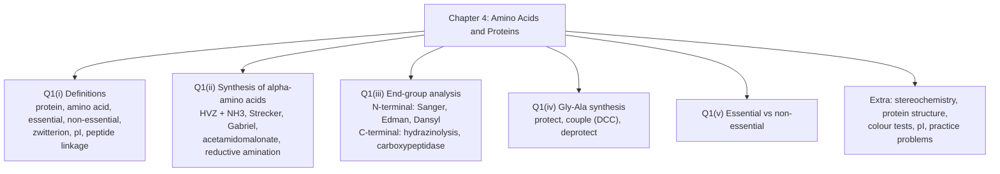

---

## Q1(i) Definitions with Examples

### 1. Protein

**Definition.** A protein is a high-molecular-mass biopolymer (conventionally *M* > 10 000 Da, or more than about 50 residues) built from **α-amino acids joined by peptide (amide) bonds**. Proteins contain C, H, O, N (≈ 16 % N by mass) and often S.

**Examples.**

| Protein | Role |
|---|---|
| Haemoglobin | O₂ transport (4 chains, *M* ≈ 64 500) |
| Keratin | Structural protein of hair, nails, wool |
| Collagen | Structural protein of skin, bone, tendon |
| Pepsin, amylase | Enzymes (biological catalysts) |
| Insulin | Hormone (2 chains joined by disulfide bridges; borderline peptide/protein, 51 residues) |

> [!TIP]
> Nitrogen is ≈ 16 % of protein mass, so crude protein = %N × 6.25 (Kjeldahl method).

### 2. Amino acid

**Definition.** An amino acid is an organic compound that contains **both an amino group (–NH₂) and a carboxyl group (–COOH)**. In an **α-amino acid** both groups are attached to the **same (α) carbon**:

$$\mathrm{R{-}CH(NH_2){-}COOH}$$

The 20 standard protein amino acids differ only in the side chain **R**. All except glycine (R = H) are chiral and occur as the **L-enantiomer** in proteins.

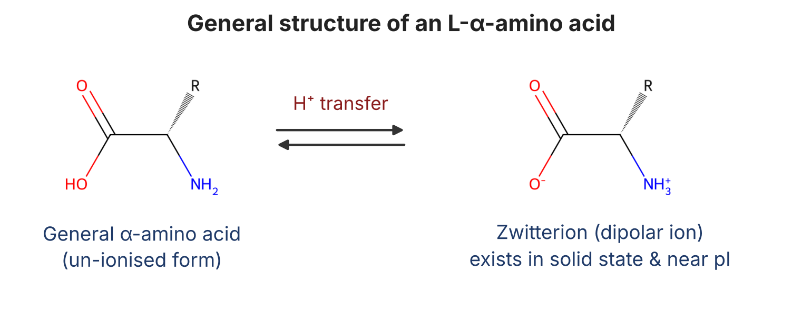

*Fig. 1 — General α-amino acid (left) and its dipolar-ion form (right).*

**Examples.** Glycine (R = H), alanine (R = CH₃), phenylalanine (R = CH₂C₆H₅). β-Alanine (H₂N–CH₂CH₂–COOH) is an amino acid but **not** an α-amino acid and is not a protein constituent.

The 20 amino acids can be grouped by side chain:

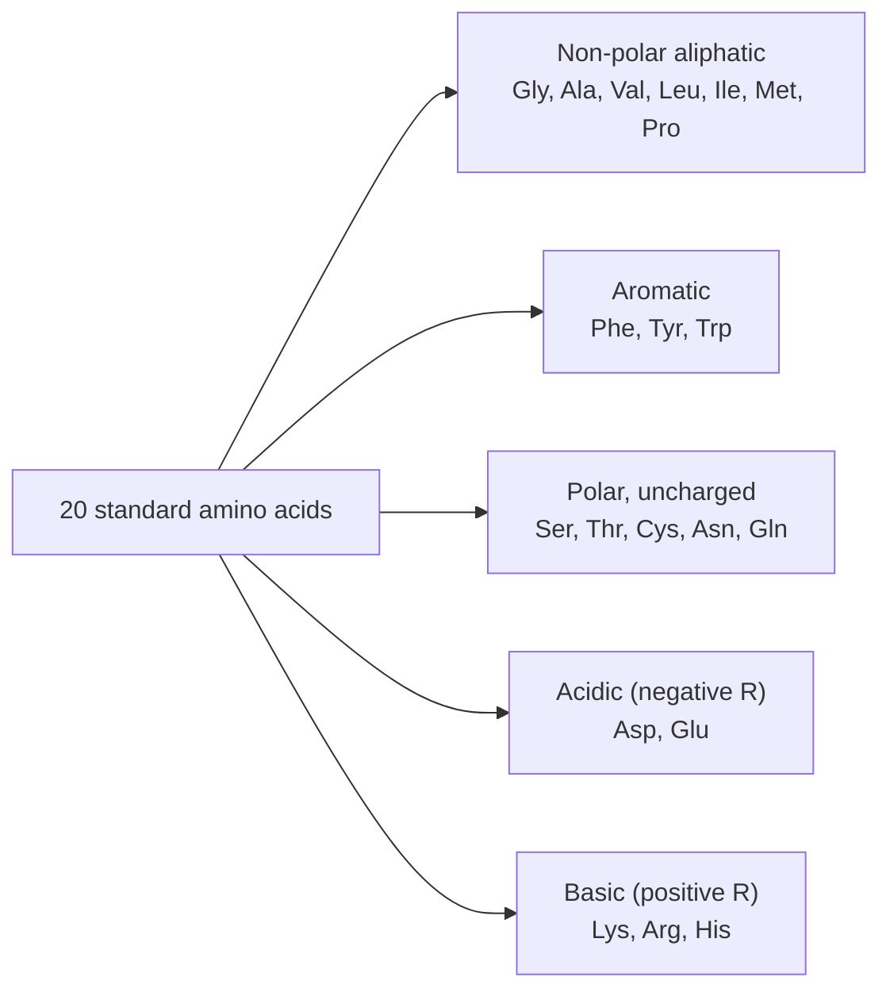

### 3. Essential amino acid

**Definition.** An amino acid that the human body **cannot synthesise (or cannot make in sufficient amount)** and which must therefore be **supplied by the diet**.

**Examples (9 for adults).** Valine, leucine, isoleucine, methionine, phenylalanine, tryptophan, threonine, lysine, histidine (see Fig. 18). Arginine is *semi-/conditionally essential* (older textbooks count 10 essential amino acids by including it).

### 4. Non-essential amino acid

**Definition.** An amino acid that the body **can synthesise** from other metabolites (e.g., by transamination of α-keto acids), so it is **not required in the diet**.

**Examples.** Glycine, alanine, serine, aspartic acid, glutamic acid, asparagine (see Fig. 19).

### 5. Zwitterion

**Definition.** A zwitterion (dipolar ion) is a molecule that carries **both a positive and a negative charge but has zero net charge**. In an amino acid the acidic –COOH transfers its proton to the basic –NH₂:

$$\mathrm{H_2N{-}CHR{-}COOH} \;\rightleftharpoons\; \mathrm{{}^{+}H_3N{-}CHR{-}COO^{-}}$$

**Example.** Glycine exists as ⁺H₃N–CH₂–COO⁻ in the solid state and in water near neutral pH.

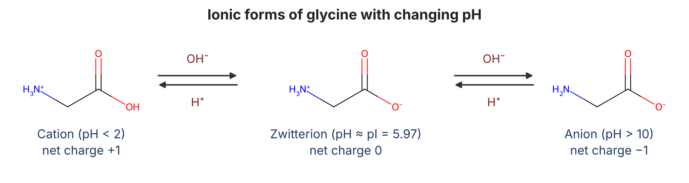

*Fig. 2 — Glycine as cation, zwitterion and anion.*

**Evidence for the zwitterionic structure**

1. High melting point (glycine ≈ 233 °C with decomposition) compared with similar-mass acids such as propanoic acid (m.p. −21 °C) — consistent with an **ionic crystal lattice**.
2. Good solubility in water but poor solubility in non-polar solvents (ether, benzene).
3. Very large dipole moment.
4. Observed pK values (glycine: pK₁ = 2.34, pK₂ = 9.60). A normal carboxylic acid has pKₐ ≈ 4.8 and a normal alkylammonium ion ≈ 10.6. The –COOH of glycine is a **stronger** acid because the adjacent –NH₃⁺ is electron-withdrawing; the group titrating near 9.6 is –NH₃⁺, not a free –NH₂.

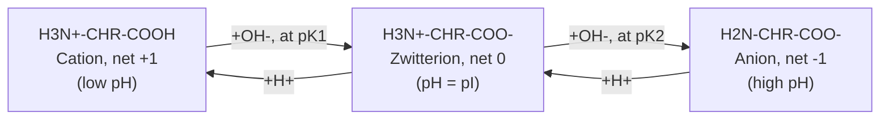

### 6. Isoelectric point (pI)

**Definition.** The pI is the **pH at which an amino acid (or protein) has zero net charge**, i.e., the zwitterion predominates and the molecule does **not migrate** in an electric field. Solubility is **minimum** at the pI, which is used to precipitate proteins (e.g., casein from milk at pH ≈ 4.6).

$$\mathrm{p}I=\frac{\mathrm{p}K_{1}+\mathrm{p}K_{2}}{2}\quad\text{(neutral amino acids)}$$

$$\mathrm{p}I=\frac{\mathrm{p}K_{1}+\mathrm{p}K_{R}}{2}\quad\text{(acidic)}\qquad\qquad \mathrm{p}I=\frac{\mathrm{p}K_{2}+\mathrm{p}K_{R}}{2}\quad\text{(basic)}$$

**Example (glycine).**

$$\mathrm{p}I=\frac{2.34+9.60}{2}=5.97$$

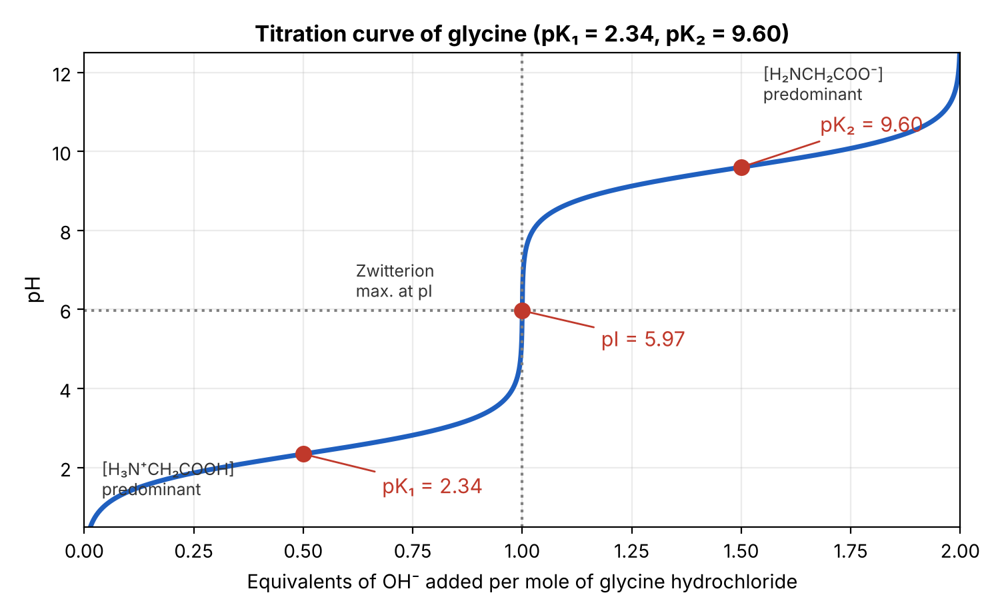

*Fig. 3 — Titration curve of glycine. The flat regions at pK₁ and pK₂ are buffer zones; the steep rise at pI = 5.97 corresponds to complete conversion to the zwitterion.*

| pH relative to pI | Net charge | Direction in electrophoresis |
|---|---|---|
| Below pI | Positive | Towards cathode (–) |
| At pI | Zero | Does not move |
| Above pI | Negative | Towards anode (+) |

### 7. Peptide linkage (peptide bond)

**Definition.** The peptide linkage is the **amide bond (–CO–NH–)** formed by a condensation reaction (loss of H₂O) between the **–COOH of one amino acid and the –NH₂ of another**.

**Example.** Glycine + alanine → glycylalanine (Gly–Ala) + H₂O.

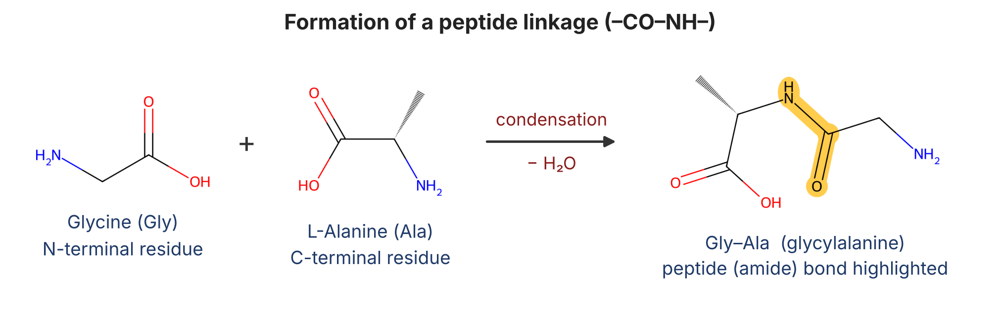

*Fig. 4 — Peptide bond formation; the new –CO–NH– group is highlighted.*

**Characteristics of the peptide bond**

- Partial **double-bond character** (≈ 40 %) because of resonance, so C–N ≈ 1.33 Å (single ≈ 1.47 Å, double ≈ 1.25 Å).
- Rotation about C–N is restricted; the six atoms Cα–C(=O)–N(H)–Cα lie in **one plane**.
- Usually **trans** (Cα atoms on opposite sides), except sometimes before proline.
- A linear chain of *n* residues contains **(*n* − 1)** peptide bonds.

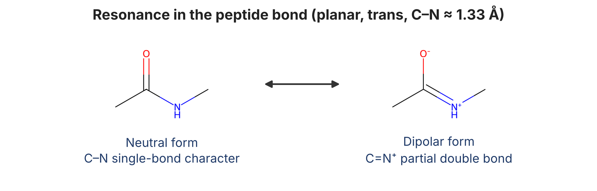

*Fig. 5 — Resonance in the amide (peptide) group.*

---

## Q1(ii) Synthesis of Alpha-Amino Acids

> [!IMPORTANT]
> Laboratory syntheses (methods 1–5 below) give the **racemic (±)/DL mixture**. A resolution step (e.g., N-acetyl-DL-amino acid + acylase enzyme, which hydrolyses only the L-isomer) is needed to obtain pure L-amino acid.

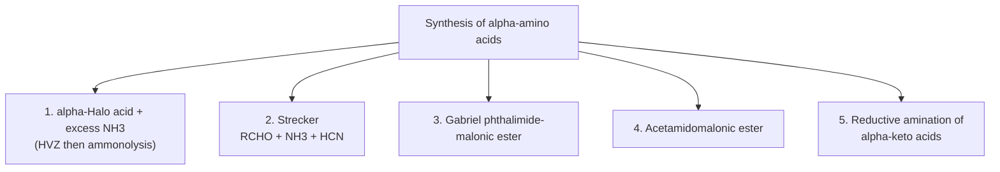

### Method 1 — Halogenation of an acid followed by ammonolysis

**Principle.** A carboxylic acid is brominated at the α-position (Hell–Volhard–Zelinsky reaction) and the α-bromo acid is converted to the amino acid by nucleophilic substitution with ammonia.

$$\mathrm{RCH_2COOH}\xrightarrow[\ \text{red P}\ ]{\ \mathrm{Br_2}\ }\mathrm{RCHBrCOOH}\xrightarrow{\ \text{excess } \mathrm{NH_3}\ }\mathrm{RCH(NH_2)COOH}$$

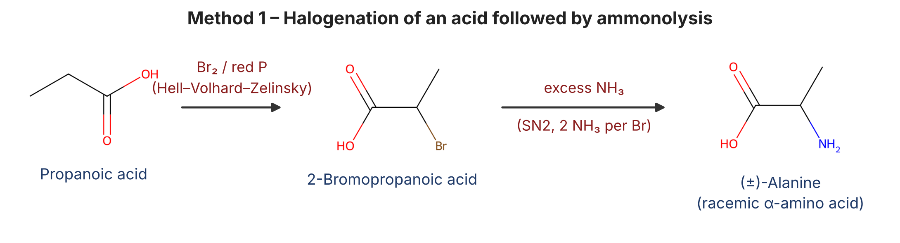

*Fig. 6 — Synthesis of (±)-alanine from propanoic acid.*

**Notes**

- Red phosphorus + Br₂ generates PBr₃ in situ; the acyl bromide enolises and is brominated at the α-carbon; hydrolysis then gives the α-bromo acid.
- A **large excess of NH₃** is essential; with little NH₃ the product amine reacts again with the bromo acid to give secondary and tertiary amines.

### Method 2 — Strecker synthesis

**Principle.** An aldehyde reacts with ammonia and hydrogen cyanide (practically NH₄Cl + KCN) to give an α-aminonitrile, which is hydrolysed to the amino acid. The product has **one more carbon** than the aldehyde.

$$\mathrm{RCHO}\xrightarrow{\ \mathrm{NH_3}\ }\mathrm{RCH{=}NH}\xrightarrow{\ \mathrm{HCN}\ }\mathrm{RCH(NH_2)CN}\xrightarrow{\ \mathrm{H_3O^+},\ \Delta\ }\mathrm{RCH(NH_3^+)COOH}$$

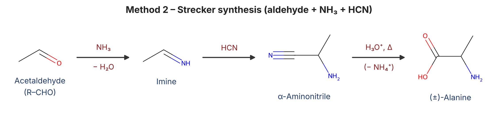

*Fig. 7 — Strecker synthesis of (±)-alanine.*

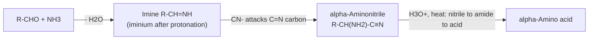

**Examples.** CH₃CHO → alanine; (CH₃)₂CHCHO → valine; CH₃SCH₂CH₂CHO → methionine; C₆H₅CH₂CHO → phenylalanine.

### Method 3 — Gabriel phthalimide–malonic ester synthesis

**Principle.** Potassium phthalimide is a protected, non-over-alkylating nitrogen nucleophile. It displaces bromide from diethyl bromomalonate; the resulting phthalimidomalonate is a C–H acid that is alkylated with R–X; acid hydrolysis then removes the phthaloyl group, hydrolyses the esters and decarboxylates.

$$\mathrm{PhthN^{-}K^{+}}+\mathrm{BrCH(CO_2Et)_2}\longrightarrow\mathrm{PhthN{-}CH(CO_2Et)_2}\xrightarrow[\ \text{2) RX}\ ]{\ \text{1) NaOEt}\ }\mathrm{PhthN{-}CR(CO_2Et)_2}\xrightarrow{\ \mathrm{H_3O^+},\ \Delta\ }\mathrm{RCH(NH_3^+)COOH}$$

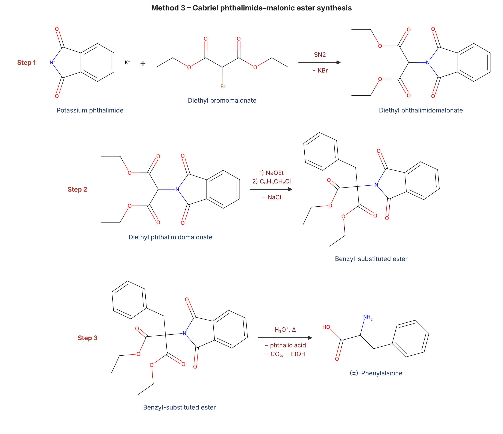

*Fig. 8 — Gabriel synthesis of (±)-phenylalanine (R = CH₂C₆H₅).*

**Notes.** Phthalimide (pKₐ ≈ 8.3) is deprotonated easily by KOH. R–X must be a **primary** (or benzylic/allylic) halide; tertiary halides eliminate and aryl halides do not react. Hydrazine (Ing–Manske) can be used instead of strong acid to remove the phthaloyl group.

### Method 4 — Acetamidomalonic ester synthesis

**Principle.** Diethyl acetamidomalonate already carries the protected nitrogen. Its acidic C–H (pKₐ ≈ 13) is removed by NaOEt and alkylated; hydrolysis + decarboxylation gives the amino acid.

$$\mathrm{AcNH{-}CH(CO_2Et)_2}\xrightarrow[\ \text{2) RX}\ ]{\ \text{1) NaOEt}\ }\mathrm{AcNH{-}CR(CO_2Et)_2}\xrightarrow{\ \mathrm{H_3O^+},\ \Delta\ }\mathrm{RCH(NH_3^+)COOH}+\mathrm{CO_2}$$

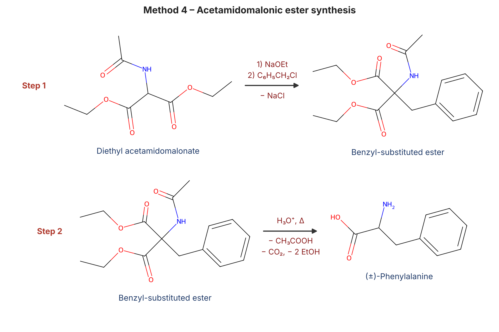

*Fig. 9 — Acetamidomalonic ester synthesis of (±)-phenylalanine.*

**Examples.** R–X = benzyl chloride → Phe; isobutyl bromide → Leu; CH₂=CHCN (Michael addition, then hydrolysis) → Glu.

### Method 5 — Reductive amination of α-keto acids

**Principle.** An α-keto acid condenses with ammonia to an imino acid, which is reduced.

$$\mathrm{RCOCOOH}+\mathrm{NH_3}\xrightarrow{\ -\mathrm{H_2O}\ }\mathrm{RC(=NH)COOH}\xrightarrow{\ \mathrm{H_2},\,\mathrm{Pd/C}\ }\mathrm{RCH(NH_2)COOH}$$

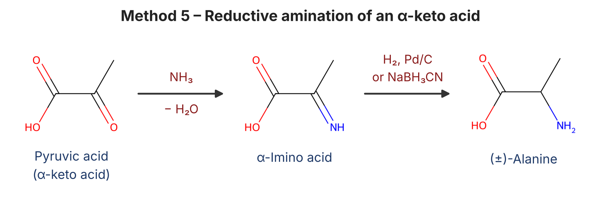

*Fig. 10 — Pyruvic acid → (±)-alanine.*

The biological counterpart is glutamate dehydrogenase: α-ketoglutarate + NH₄⁺ + NADPH → L-glutamate.

### Comparison of the methods

| Method | Starting material | Key reagents | Product type | Limitation |
|---|---|---|---|---|
| 1. HVZ + NH₃ | RCH₂COOH | Br₂/P; excess NH₃ | α-Amino acid | Over-alkylation if NH₃ is not in excess |
| 2. Strecker | RCHO | NH₃ (NH₄Cl), HCN (KCN); H₃O⁺ | α-Amino acid with extra C | Toxic cyanide |
| 3. Gabriel–malonic ester | PhthN⁻K⁺, BrCH(CO₂Et)₂ | NaOEt, RX; H₃O⁺ | α-Amino acid | Needs 1° R–X |
| 4. Acetamidomalonate | AcNHCH(CO₂Et)₂ | NaOEt, RX; H₃O⁺ | α-Amino acid | Needs 1° R–X |
| 5. Reductive amination | RCOCOOH | NH₃, H₂/Pd or NaBH₃CN | α-Amino acid | Keto acid must be available |

> [!TIP]
> For a 5-mark answer, write **two methods** (usually Strecker and Gabriel/acetamidomalonate) with equations, reagents and one example each, and mention that the product is racemic.

---

## Q1(iii) End-Group Analysis of Peptides

**Aim.** A peptide chain has a free α-NH₂ at the **N-terminus** and a free α-COOH at the **C-terminus**. End-group analysis identifies the **terminal residues** and (from the number of different N-terminal residues) the **number of chains**. By convention a peptide is written from N-terminus (left) to C-terminus (right).

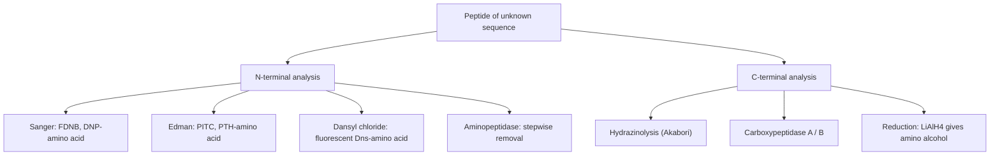

### A. N-terminal analysis

#### 1. Sanger's method (FDNB)

**Reagent.** 1-Fluoro-2,4-dinitrobenzene (FDNB, Sanger's reagent).

1. The free N-terminal –NH₂ attacks FDNB (nucleophilic aromatic substitution, mild base such as NaHCO₃), displacing F⁻ to give a **DNP-peptide** (yellow).
2. Complete acid hydrolysis (6 M HCl, Δ) cleaves all peptide bonds but **not** the stable N-aryl bond.
3. The **yellow DNP-amino acid** is separated from the free amino acids (extraction/chromatography) and identified.

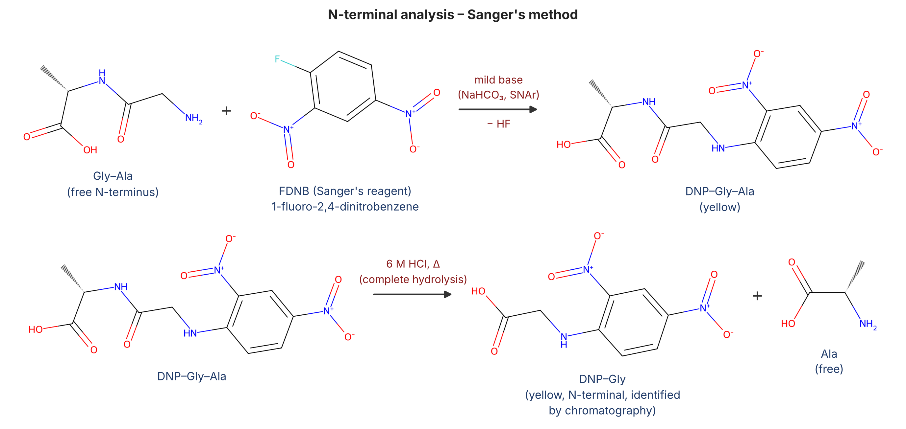

*Fig. 11 — Sanger analysis of Gly–Ala: DNP–Gly identifies glycine as N-terminal.*

- Limitation: the peptide is destroyed, so only **one** residue per sample is identified. Lysine's ε-NH₂ also reacts (giving α,ε-di-DNP-lysine); Tyr, His and Cys side chains may react too.
- Historical importance: F. Sanger (1945) identified Gly and Phe as the N-terminal residues of insulin, proving it has **two** chains.

#### 2. Edman degradation (PITC)

**Reagent.** Phenyl isothiocyanate (PITC, Edman's reagent).

1. Mild base (pH ≈ 9): PITC couples to the N-terminal –NH₂ → **PTC-peptide**.
2. Anhydrous acid (CF₃COOH): the sulfur attacks the first carbonyl carbon and **only the N-terminal residue is cleaved off** as an anilinothiazolinone (ATZ); the rest of the peptide, now one residue shorter, is intact.
3. Aqueous acid rearranges ATZ to the stable **PTH-amino acid** (phenylthiohydantoin), identified by HPLC.
4. The shortened peptide re-enters the cycle (automated "sequenator", ≈ 30–50 residues).

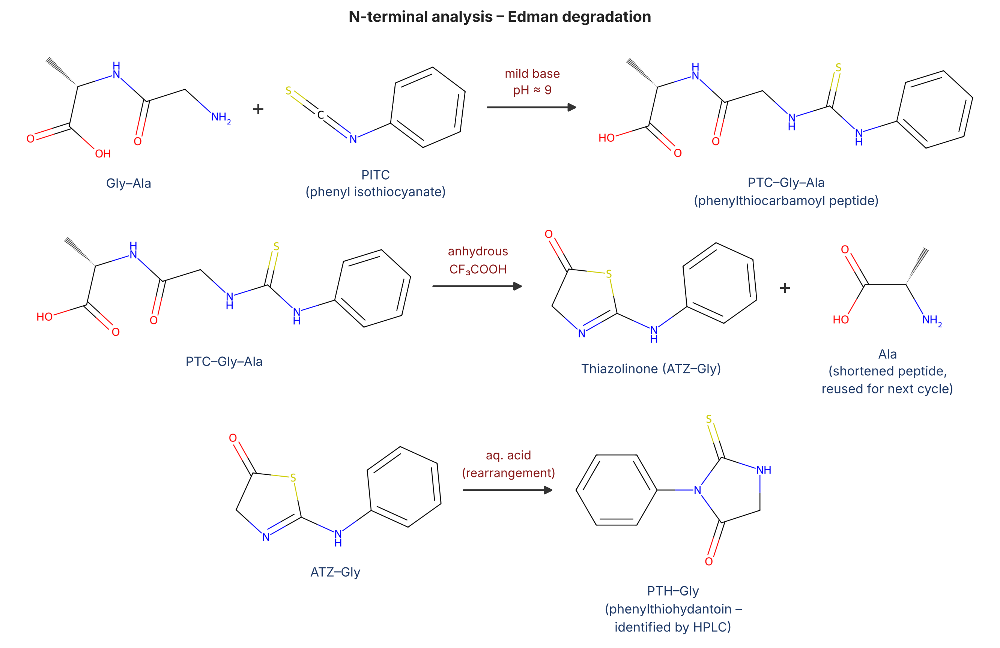

*Fig. 12 — Edman degradation: PTC-peptide → ATZ → PTH-amino acid.*

**Advantage over Sanger:** the rest of the chain survives, so repeated cycles give the **sequence**. It fails if the N-terminus is blocked (e.g., N-acetyl or pyroglutamyl).

#### 3. Dansyl chloride method

Dansyl chloride (5-dimethylaminonaphthalene-1-sulfonyl chloride) reacts with the free –NH₂ to give a sulfonamide that **survives acid hydrolysis**. The Dns-amino acid is **intensely fluorescent**, detectable at picomole level (much more sensitive than Sanger).

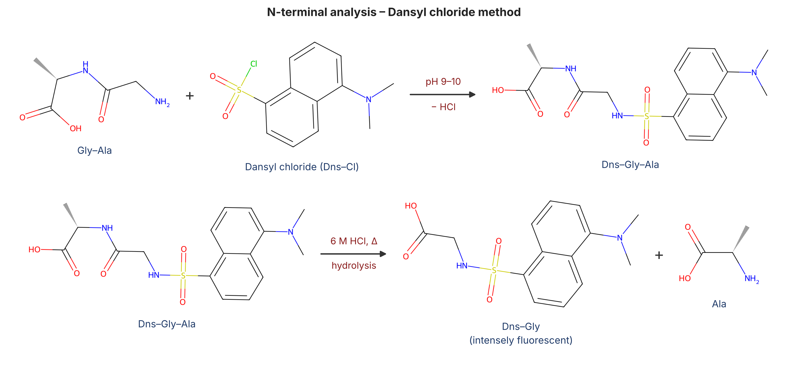

*Fig. 13 — Dansylation of Gly–Ala and release of Dns–Gly.*

#### 4. Aminopeptidase

Leucine aminopeptidase removes residues one at a time from the N-terminus; timed samples show which amino acid appears first.

### B. C-terminal analysis

#### 1. Hydrazinolysis (Akabori method)

Heating the peptide with **anhydrous hydrazine** converts every residue except the C-terminal one into an **amino acid hydrazide** (–CO–NHNH₂). The C-terminal residue retains its free –COOH and is released as the **free amino acid**; the hydrazides are removed (e.g., converted to benzylidene derivatives with benzaldehyde) and the free amino acid is identified.

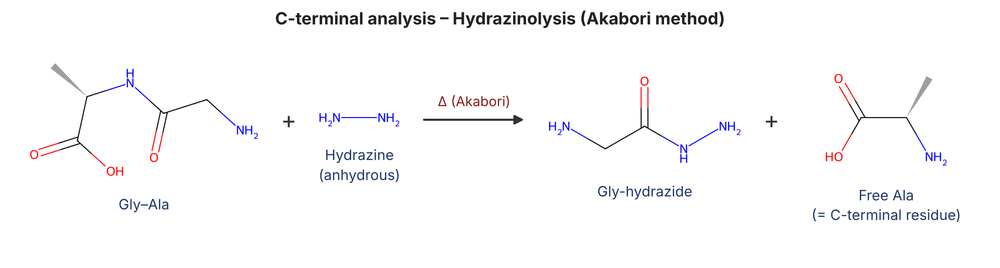

*Fig. 14 — Hydrazinolysis: free Ala identifies alanine as C-terminal.*

Limitation: Gln, Asn, Cys and Arg residues are partly altered, and the method is not very quantitative.

#### 2. Carboxypeptidases

Exopeptidases that remove residues from the **C-terminus**:

- **Carboxypeptidase A** — residues with aromatic or bulky aliphatic side chains.
- **Carboxypeptidase B** — C-terminal Lys or Arg.
- Neither cleaves a C-terminal proline.

Following the amino acids released with time gives the C-terminal sequence.

#### 3. Reduction

The C-terminal –COOH (as ester) is reduced with LiAlH₄ (or NaBH₄) to –CH₂OH; hydrolysis then gives an **amino alcohol** (e.g., Ala → alaninol, CH₃CH(NH₂)CH₂OH), which identifies the C-terminal residue.

### Summary table

| Method | Terminus | Reagent | Species identified | Destroys peptide? |
|---|---|---|---|---|
| Sanger | N | FDNB | DNP-amino acid (yellow) | Yes |
| Edman | N | PhNCS | PTH-amino acid | No (stepwise) |
| Dansyl | N | Dns–Cl | Dns-amino acid (fluorescent) | Yes |
| Hydrazinolysis | C | N₂H₄ | Free amino acid | Yes |
| Carboxypeptidase | C | Enzyme | Released amino acids | Stepwise |

### Worked example

> A tripeptide contains Ala, Gly and Val. Sanger's method (FDNB, then hydrolysis) gives **DNP–Val**; hydrazinolysis leaves **free Gly** (others as hydrazides). Deduce the sequence.

**Solution.** N-terminal = Val, C-terminal = Gly, so the middle residue is Ala:

$$\mathrm{Val{-}Ala{-}Gly}$$

### Extra: cleaving large proteins before sequencing

| Reagent | Cleaves on the carboxyl side of |
|---|---|
| Trypsin | Lys, Arg (not before Pro) |
| Chymotrypsin | Phe, Tyr, Trp |
| Cyanogen bromide (CNBr) | Met |

---

## Q1(iv) Synthesis of the Dipeptide Gly-Ala

**Problem.** If Gly and Ala are simply heated together, **four** dipeptides form because each amino acid has both a nucleophilic –NH₂ and an electrophilic –COOH:

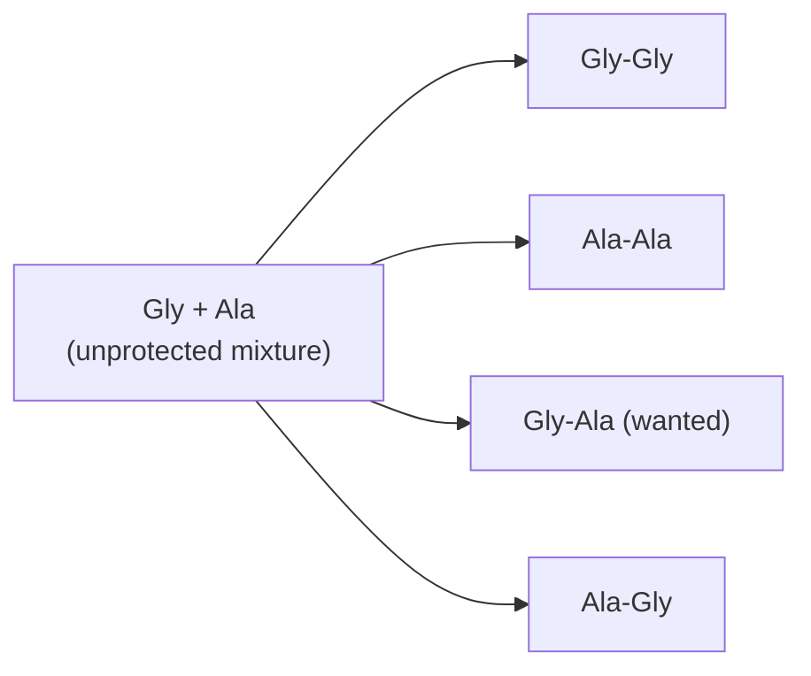

**Strategy.** In Gly–Ala, Gly is N-terminal (its –COOH forms the bond) and Ala is C-terminal (its –NH₂ forms the bond). Therefore:

1. **Protect** the –NH₂ of Gly (benzyloxycarbonyl, Z) and the –COOH of Ala (ethyl ester).
2. **Couple** with a condensing agent (DCC).
3. **Deprotect** both ends.

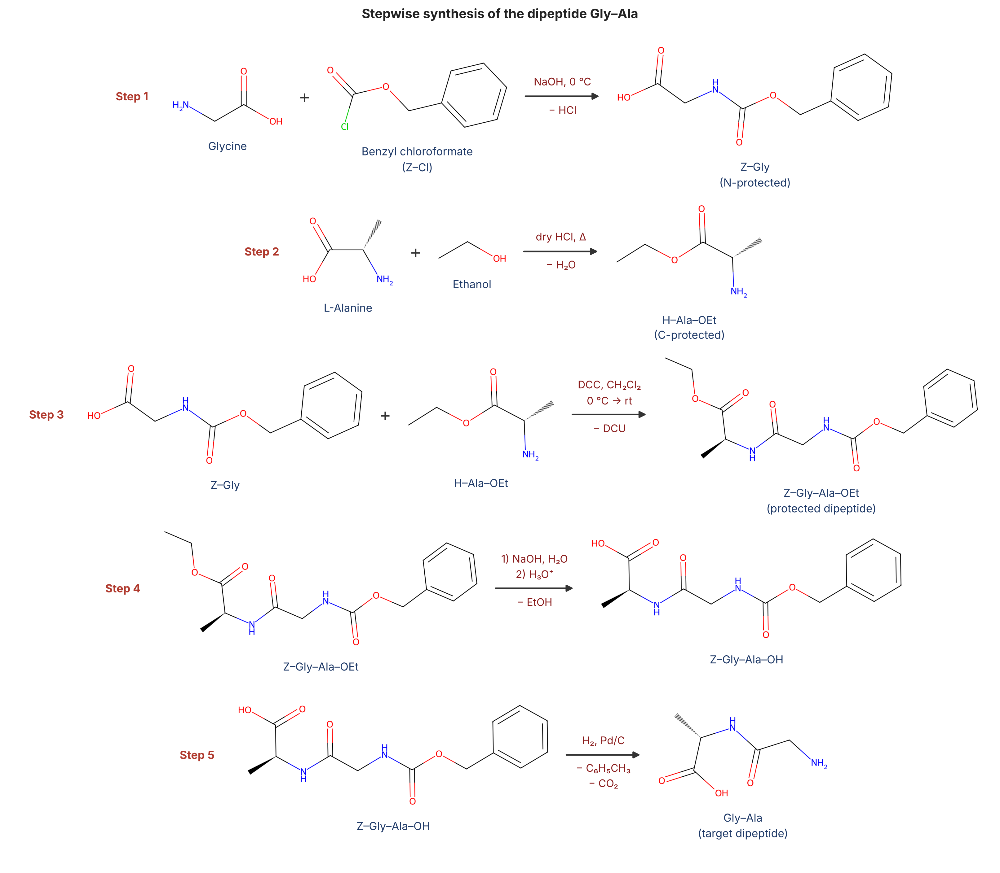

*Fig. 15 — Complete five-step synthesis of Gly–Ala.*

### Step-by-step answer

| Step | Operation | Reagents | Product |
|---|---|---|---|
| 1 | Protect N of Gly | Benzyl chloroformate (Z–Cl), NaOH, 0 °C | Z–Gly (C₆H₅CH₂O–CO–NH–CH₂COOH) |
| 2 | Protect C of Ala | EtOH, dry HCl | H–Ala–OEt |
| 3 | Couple | DCC, CH₂Cl₂, 0 °C → rt | Z–Gly–Ala–OEt + DCU |
| 4 | Remove ester | NaOH/H₂O, then H₃O⁺ | Z–Gly–Ala–OH |
| 5 | Remove Z | H₂, Pd/C | **Gly–Ala** + toluene + CO₂ |

### Role of DCC

DCC (dicyclohexylcarbodiimide) converts the –COOH of Z–Gly into a highly reactive **O-acylisourea**, an activated acyl donor; the –NH₂ of Ala–OEt attacks it to form the peptide bond. The by-product **N,N′-dicyclohexylurea (DCU)** is insoluble and is filtered off.

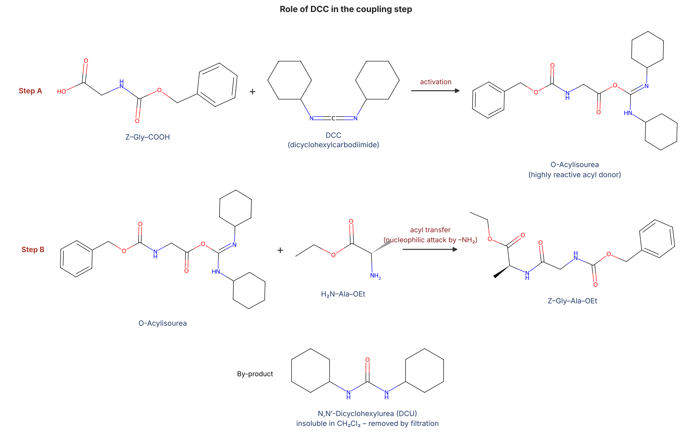

*Fig. 16 — DCC activation and acyl transfer.*

**Why Z-protection?** The Z group is a urethane (carbamate) that reduces racemisation of the activated amino acid, and is removed by **neutral hydrogenolysis**, which does not hydrolyse peptide bonds.

### Common protecting groups

| Group | Protects | Introduced with | Removed by |
|---|---|---|---|
| Z (Cbz) | N-terminus | Benzyl chloroformate | H₂, Pd/C; HBr/AcOH |
| Boc | N-terminus | (Boc)₂O | CF₃COOH (TFA) |
| Fmoc | N-terminus | Fmoc–Cl / Fmoc–OSu | 20 % piperidine in DMF |
| Methyl / ethyl ester | C-terminus | ROH, H⁺ | NaOH (saponification) |
| Benzyl ester | C-terminus | BnOH, H⁺ | H₂, Pd/C |

### Extra: solid-phase peptide synthesis (Merrifield)

R. B. Merrifield (Nobel Prize in Chemistry, 1984) anchored the C-terminal residue to an insoluble polystyrene resin so that excess reagents are removed by simple washing:

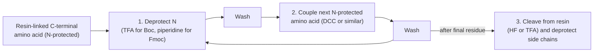

> [!NOTE]
> Gly–Ala and Ala–Gly are **different compounds** (sequence isomers). Making Ala–Gly would use Z–Ala and H–Gly–OEt instead.

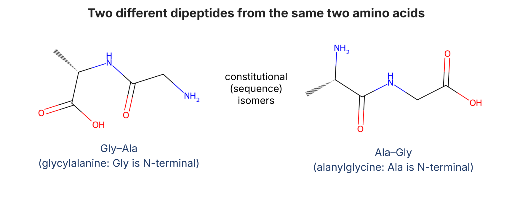

*Fig. 17 — Sequence isomers: the N-terminal residue is written first.*

---

## Q1(v) Essential vs Non-Essential Amino Acids

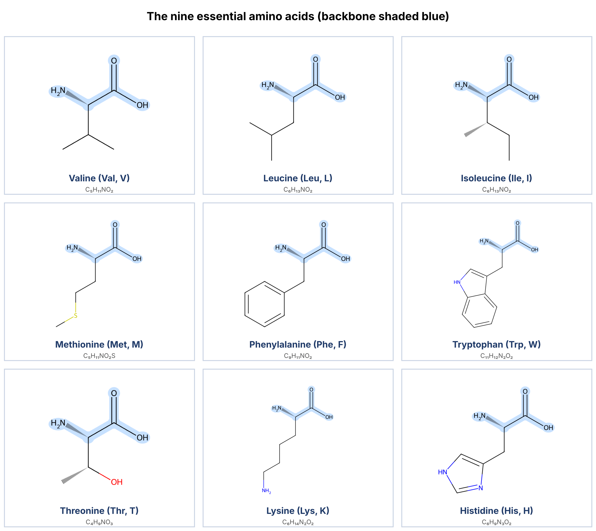

*Fig. 18 — The nine essential amino acids (the common –NH–CH–COOH backbone is shaded; the side chain R is the part that differs).*

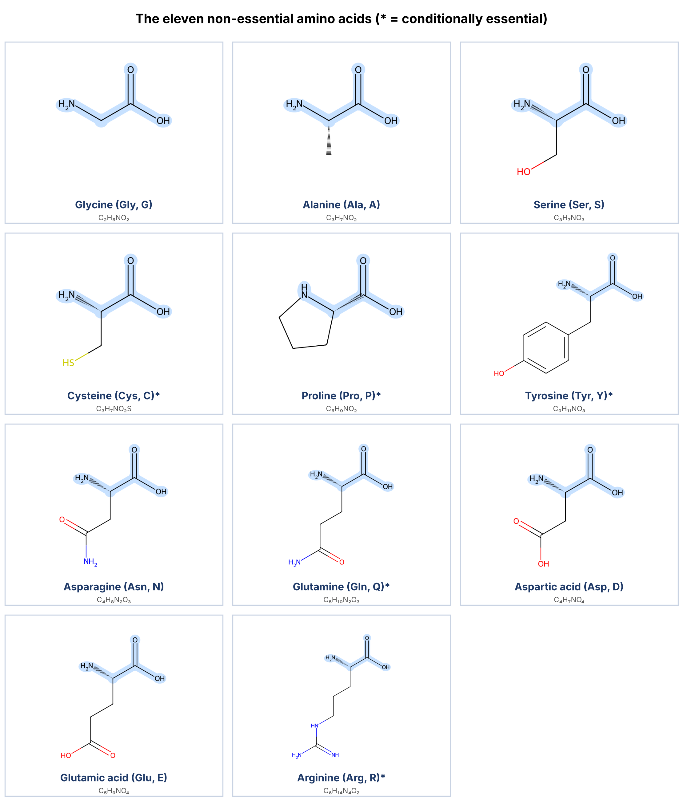

*Fig. 19 — Non-essential amino acids. Names marked with an asterisk are conditionally essential (the body may not make enough during illness, stress, or in infancy).*

### Differences

| Feature | Essential amino acids | Non-essential amino acids |
|---|---|---|
| Synthesis in the body | **Cannot** be synthesised (or not in sufficient amount) | **Can** be synthesised from other metabolites |
| Dietary requirement | Must be supplied by food | Not required in the diet |
| Number (adults) | 9 (10 if Arg is counted) | 11 of the standard 20 |
| Examples | Val, Leu, Ile, Met, Phe, Trp, Thr, Lys, His | Gly, Ala, Ser, Asp, Glu, Asn, Gln, Pro, Cys, Tyr, Arg |
| Deficiency effect | Growth failure, protein-energy malnutrition (e.g., kwashiorkor) | Seldom, since the body compensates |
| Typical sources | Eggs, milk, meat, fish, soy, legumes | Made endogenously; also abundant in protein foods |
| Protein quality | "Complete" proteins contain all nine in adequate proportions | Not limiting |

**Key points for the answer**

- **Mnemonic for the classical 10:** *PVT TIM HALL* — **P**henylalanine, **V**aline, **T**hreonine, **T**ryptophan, **I**soleucine, **M**ethionine, **H**istidine, **A**rginine, **L**eucine, **L**ysine.
- Limiting amino acid: lysine in cereals, methionine in legumes — eating both together gives a complete protein.
- Histidine and arginine were once called "semi-essential"; histidine is now regarded as essential for adults.

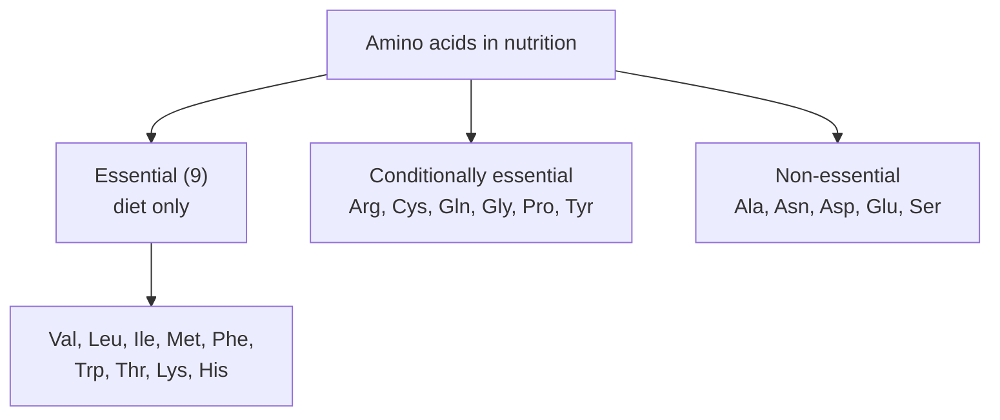

---

## Extra Section A Stereochemistry of Amino Acids

Every standard amino acid except glycine has a stereogenic α-carbon. Natural protein amino acids have the **L-configuration** (NH₂ on the left in the Fischer projection with COOH at the top). In CIP terms most L-amino acids are **(S)**; L-cysteine is **(R)** because the –CH₂SH group outranks –COOH in priority; L-isoleucine and L-threonine have a second stereocentre [(2S,3S) and (2S,3R) respectively].

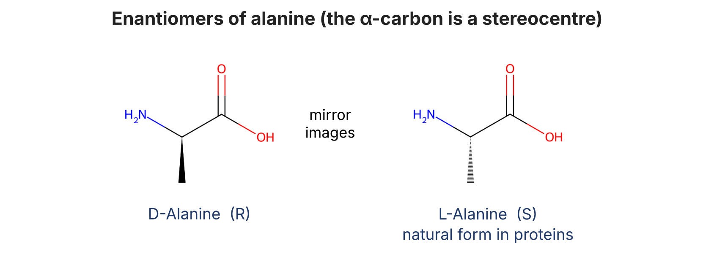

*Fig. 20 — D-Alanine (R) and L-alanine (S).*

---

## Extra Section B Classification and Structure of Proteins

### Classification

| Class | Sub-class | Examples |
|---|---|---|
| **Simple** (amino acids only) | Albumins, globulins, glutelins, prolamins, scleroproteins | Egg albumin, serum globulin, glutenin, zein, keratin, collagen |
| **Conjugated** (protein + non-protein part) | Chromoproteins, glycoproteins, lipoproteins, phosphoproteins, nucleoproteins, metalloproteins | Haemoglobin, mucin, LDL, casein, chromatin, ferritin |
| **Derived** (hydrolysis products) | Proteoses, peptones, peptides | Partial hydrolysates of proteins |

By shape: **fibrous** (long, insoluble, structural: keratin, collagen, silk fibroin) and **globular** (compact, soluble: enzymes, haemoglobin, albumin).

### Levels of structure

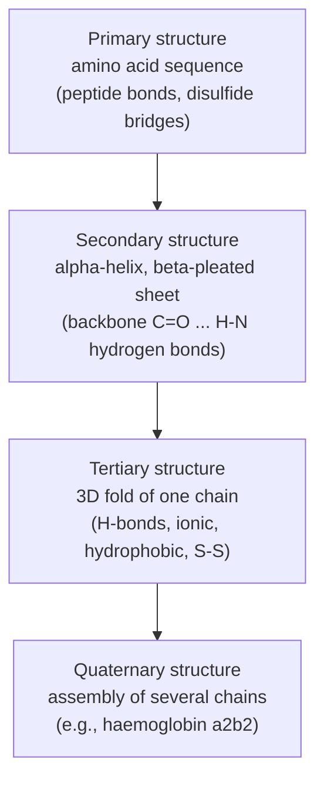

- **α-Helix:** right-handed, 3.6 residues per turn, pitch 5.4 Å; C=O of residue *i* hydrogen-bonded to N–H of residue *i* + 4.
- **β-Sheet:** extended strands linked side-by-side by inter-strand hydrogen bonds (parallel or antiparallel).

---

## Extra Section C Colour Tests and Denaturation

### Ninhydrin test

All free α-amino acids (and amines/ammonia) react with two molecules of ninhydrin on heating to give the blue-violet **Ruhemann's purple** (λmax ≈ 570 nm), with loss of the aldehyde RCHO, CO₂ and water. Proline and hydroxyproline (secondary amines) give a yellow product.

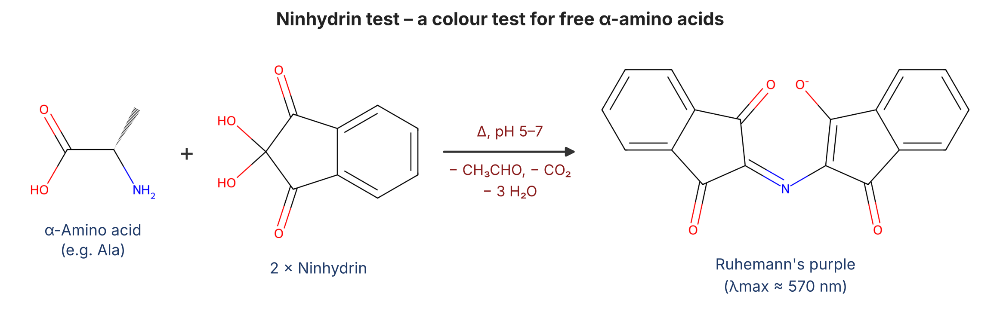

*Fig. 21 — Ninhydrin reaction of alanine.*

### Other tests

| Test | Reagent | Positive result | Detects |
|---|---|---|---|
| Biuret | CuSO₄ + NaOH | Violet/purple | ≥ 2 peptide bonds (proteins, tripeptides and longer); not free amino acids |
| Xanthoproteic | Conc. HNO₃ then NaOH | Yellow → orange | Aromatic rings (Tyr, Trp, Phe) via nitration |
| Millon's | Hg(NO₃)₂/HNO₃, heat | Red precipitate/colour | Tyrosine (phenolic –OH) |
| Hopkins–Cole | Glyoxylic acid + conc. H₂SO₄ | Violet ring | Tryptophan (indole) |
| Sakaguchi | α-Naphthol + hypobromite | Red | Arginine (guanidino group) |
| Lead acetate | Pb(CH₃COO)₂ + NaOH, heat | Black PbS | Cysteine/cystine (sulfur) |

### Denaturation

Denaturation is the loss of secondary, tertiary and quaternary structure (and biological activity) **without breaking peptide bonds**, so the primary structure is unchanged. Causes: heat, strong acid/base, urea or guanidinium salts, heavy-metal ions (Hg²⁺, Pb²⁺), organic solvents (ethanol), UV light, vigorous agitation.

**Examples.** Boiling an egg (albumin coagulates irreversibly); curdling of milk; ethanol as a disinfectant (denatures bacterial proteins). Some proteins renature when the agent is removed (Anfinsen's ribonuclease experiment).

---

## Extra Section D pI Calculations and Electrophoresis

### pI values from pK data

| Amino acid | Type | pK₁ (–COOH) | pK₂ (–NH₃⁺) | pKR | pI (calculated) |
|---|---|---|---|---|---|
| Glycine | Neutral | 2.34 | 9.60 | – | 5.97 |
| Alanine | Neutral | 2.34 | 9.69 | – | ≈ 6.02 |
| Aspartic acid | Acidic | 1.88 | 9.60 | 3.65 | 2.77 |
| Glutamic acid | Acidic | 2.19 | 9.67 | 4.25 | 3.22 |
| Histidine | Basic | 1.82 | 9.17 | 6.00 | 7.59 |
| Lysine | Basic | 2.18 | 8.95 | 10.53 | 9.74 |
| Arginine | Basic | 2.17 | 9.04 | 12.48 | 10.76 |

(Values from standard biochemistry tables; pI computed from the formulas in Q1(i); exact tabulated pI may differ in the second decimal.)

**Example — lysine (basic amino acid).** At the pI the species is the one with net charge zero, which lies between the +1 and −1 forms, so the two relevant pK values are pK₂ and pKR:

$$\mathrm{p}I=\frac{8.95+10.53}{2}=9.74$$

### Electrophoresis of a mixture

At pH 6.0 a mixture of Asp, Gly and Lys separates on paper/gel electrophoresis:

- **Asp** (pI 2.77): pH above pI → net negative → moves to the **anode**.
- **Gly** (pI 5.97): pH ≈ pI → essentially neutral → stays near the **origin**.
- **Lys** (pI 9.74): pH below pI → net positive → moves to the **cathode**.

---

## Quick Revision Sheet

| Topic | One-liner |
|---|---|
| α-Amino acid | R–CH(NH₂)–COOH; L-form in proteins; Gly achiral |
| Zwitterion | ⁺H₃N–CHR–COO⁻, net 0, high m.p., water-soluble |
| pI (neutral) | (pK₁ + pK₂)/2 |
| Peptide bond | –CO–NH–, planar, trans, partial double bond (≈ 1.33 Å) |
| *n* residues | (*n* − 1) peptide bonds; 20ⁿ possible sequences |
| Synthesis | HVZ/NH₃ · Strecker · Gabriel · acetamidomalonate · reductive amination |
| N-terminal | Sanger (FDNB), Edman (PITC), Dansyl |
| C-terminal | Hydrazinolysis, carboxypeptidase, LiAlH₄ |
| Peptide synthesis | Protect → DCC couple → deprotect (Z by H₂/Pd–C) |
| Essential (9) | Val, Leu, Ile, Met, Phe, Trp, Thr, Lys, His |

> [!WARNING]
> **Common mistakes:** (1) writing Gly–Ala when you mean Ala–Gly — the N-terminal residue is written **first**; (2) forgetting that laboratory α-amino acid syntheses give **racemic** products; (3) using too little NH₃ in ammonolysis; (4) saying Edman destroys the peptide (it does not; Sanger does); (5) using the pK₁/pK₂ average for acidic or basic amino acids instead of including pKR.

---

## Practice Problems with Spoiler Solutions

<b>Problem 1.</b> Calculate the isoelectric point of glutamic acid (pK₁ = 2.19, pKR = 4.25, pK₂ = 9.67).

Glutamic acid is acidic, so the neutral species lies between the pK₁ and pKR ionisations:

$$\mathrm{p}I=\frac{2.19+4.25}{2}=3.22$$

<b>Problem 2.</b> Calculate the pI of lysine (pK₁ = 2.18, pK₂ = 8.95, pKR = 10.53).

Lysine is basic, so use pK₂ and pKR:

$$\mathrm{p}I=\frac{8.95+10.53}{2}=9.74$$

<b>Problem 3.</b> At pH 7, in which direction do Ala (pI 6.02), Asp (pI 2.77) and Arg (pI 10.76) migrate in an electric field?

- Ala: pH 7 is above pI 6.02, so slightly negative → slowly towards the **anode**.
- Asp: pH well above pI → strongly negative → **anode**.
- Arg: pH below pI → positive → **cathode**.

<b>Problem 4.</b> How many different tripeptides can be made from (a) three different amino acids, each used once; (b) the 20 standard amino acids, with repetition allowed?

(a) 3! = **6** (e.g., Gly–Ala–Ser, Gly–Ser–Ala, Ala–Gly–Ser, Ala–Ser–Gly, Ser–Gly–Ala, Ser–Ala–Gly).

(b) 20³ = **8000**.

<b>Problem 5.</b> A tripeptide (Val, Ala, Gly) gives DNP–Val with FDNB and free Gly on hydrazinolysis. Write its sequence.

N-terminal Val, C-terminal Gly, so **Val–Ala–Gly**.

<b>Problem 6.</b> Why is benzyl chloroformate (Z–Cl) preferred to acetyl chloride as an N-protecting group in peptide synthesis?

The Z group is removed under **mild, neutral conditions** (H₂, Pd/C) that do not hydrolyse peptide bonds. An N-acetyl amide needs vigorous acidic or basic hydrolysis, which would also cleave the newly formed peptide bonds. In addition, the urethane Z group reduces racemisation during activation.

<b>Problem 7.</b> Which aldehyde is used in the Strecker synthesis of methionine?

**3-(Methylthio)propanal, CH₃SCH₂CH₂CHO.** Strecker gives an amino acid with one more carbon than the aldehyde: CH₃SCH₂CH₂–CH(NH₂)–COOH.

<b>Problem 8.</b> Which alkyl halide is used in the acetamidomalonic ester route to leucine? Why can a tertiary halide not be used?

Leucine side chain is –CH₂CH(CH₃)₂, so use **isobutyl (2-methylpropyl) bromide, (CH₃)₂CHCH₂Br**. Tertiary halides undergo E2 elimination with the strongly basic malonate enolate instead of SN2 substitution.

<b>Problem 9.</b> How many grams of glycine (M = 75.07 g/mol) are needed to make 100 mL of a 0.10 M solution?

$$m = 0.10\ \mathrm{mol\,L^{-1}}\times 0.100\ \mathrm{L}\times 75.07\ \mathrm{g\,mol^{-1}} = 0.751\ \mathrm{g}$$

<b>Problem 10.</b> Write the predominant form of alanine at pH 1, 6 and 12.

- pH 1 (below pK₁ = 2.34): CH₃CH(NH₃⁺)COOH, net +1.
- pH 6 (≈ pI): CH₃CH(NH₃⁺)COO⁻, net 0 (zwitterion).
- pH 12 (above pK₂ = 9.69): CH₃CH(NH₂)COO⁻, net −1.

<b>Problem 11.</b> Glycine does not give a positive biuret test, but Gly–Ala–Gly does. Explain.

The biuret reaction requires a complex of Cu²⁺ with **at least two peptide bonds**. Glycine has none; Gly–Ala–Gly has two, so it gives the violet colour.

<b>Problem 12.</b> For glycine (pK₁ = 2.34), what is the ratio [zwitterion]/[cation] at pH 3.34? (Ignore the anion.)

From the Henderson–Hasselbalch equation:

$$\mathrm{pH}=\mathrm{p}K_1+\log\frac{[\text{zwitterion}]}{[\text{cation}]}\;\Rightarrow\;3.34=2.34+\log\frac{[Z]}{[C]}\;\Rightarrow\;\frac{[Z]}{[C]}=10$$

The zwitterion is present in **10-fold excess** over the cation.

---

## References

1. R. T. Morrison and R. N. Boyd, *Organic Chemistry*, Prentice-Hall — amino acids, peptides and proteins chapter.
2. T. W. G. Solomons and C. B. Fryhle, *Organic Chemistry*, Wiley.
3. P. Y. Bruice, *Organic Chemistry*, Pearson.
4. D. L. Nelson and M. M. Cox, *Lehninger Principles of Biochemistry*, W. H. Freeman — pK values, protein structure.
5. J. Clayden, N. Greeves and S. Warren, *Organic Chemistry*, Oxford University Press.
6. A. Strecker, *Ann. Chem. Pharm.* **75**, 27 (1850) — Strecker synthesis.
7. F. Sanger, *Biochem. J.* **39**, 507 (1945) — FDNB method.
8. P. Edman, *Acta Chem. Scand.* **4**, 283 (1950) — Edman degradation.
9. R. B. Merrifield, *J. Am. Chem. Soc.* **85**, 2149 (1963) — solid-phase peptide synthesis.

> [!NOTE]
> The structure drawings and plots in `../../assets/` (files `chem103-aa-01` … `chem103-aa-21`) were generated for this note with RDKit and Matplotlib.
