# Carbohydrates — Chemistry-II (CHEM-103)
### All previous-year questions, 2016 – 2022 · exam-style solutions with diagrams

> **Compiled by:** sigkill0x00 &nbsp;|&nbsp; **Course:** CHEM-103 (Chemistry-II) &nbsp;|&nbsp; **Topic:** Carbohydrates &nbsp;|&nbsp; **Compiled on:** 2026-11-05
>
> Every structure is a vector drawing stored in `../../assets/` (Fischer, Haworth, benzene rings drawn as proper Kekulé hexagons). Answers are written the way they should appear in an answer script: *definition → structure/diagram → equations → conclusion*. Sections marked **Extra** go beyond the questions for deeper revision.

**How to read the diagrams:** red `OH` = hydroxyl, blue = carbonyl / nitrogen groups, orange dashed circle = anomeric carbon, green = configurational carbon. In Haworth rings the thick bond is the edge nearest to you; groups drawn *down* are below the ring plane, groups *up* are above it. Hydrogen atoms on ring carbons are omitted.

---

## Table of contents
- [1. What are carbohydrates?](#1-what-are-carbohydrates)
- [2. Classification of carbohydrates](#2-classification-of-carbohydrates)
- [3. Open-chain structure of D-glucose](#3-open-chain-structure-of-d-glucose)
- [4. Cyclic structure of D-glucose](#4-cyclic-structure-of-d-glucose)
- [5. Mutarotation](#5-mutarotation)
- [6. Important reactions of glucose](#6-important-reactions-of-glucose)
- [7. Distinguishing glucose from fructose and glucose from sucrose](#7-distinguishing-glucose-from-fructose-and-glucose-from-sucrose)
- [8. Conversion of glucose into fructose](#8-conversion-of-glucose-into-fructose)
- [9. Glycosides and glycosidic linkage](#9-glycosides-and-glycosidic-linkage)
- [10. Reducing and non-reducing sugars](#10-reducing-and-non-reducing-sugars)
- [11. Structure of sucrose](#11-structure-of-sucrose)
- [12. Polysaccharides: starch and cellulose](#12-polysaccharides-starch-and-cellulose)
- [13. Diazotization](#13-diazotization)
- [14. Extra: epimers, anomers and quick facts](#14-extra-epimers-anomers-and-quick-facts)
- [15. Extra: practice questions with solutions](#15-extra-practice-questions-with-solutions)
- [16. Quick revision checklist](#16-quick-revision-checklist)

---

## Question map (which question is answered where)

| Year | Q | Part | Question (short) | Answered in |
|---|---|---|---|---|
| 2016 | 5 | a | Classification of carbohydrates | [Section 2](#2-classification-of-carbohydrates) |
| 2016 | 5 | b | Identify glucose and fructose in a mixture | [Section 7](#7-distinguishing-glucose-from-fructose-and-glucose-from-sucrose) |
| 2016 | 5 | c | Open-chain structure of D-glucose | [Section 3](#3-open-chain-structure-of-d-glucose) |
| 2016 | 5 | d | Glucose + acetic anhydride | [Section 6](#6-important-reactions-of-glucose) |
| 2016 | 7 | a | Structure and uses of cellulose | [Section 12](#12-polysaccharides-starch-and-cellulose) |
| 2016 | 7 | b | Reducing vs non-reducing sugars | [Section 10](#10-reducing-and-non-reducing-sugars) |
| 2016 | 7 | c | Diazotization with example | [Section 13](#13-diazotization) |
| 2017 | 5 | a | What are carbohydrates? | [Section 1](#1-what-are-carbohydrates) |
| 2017 | 5 | b | Linear structure of D-glucose | [Section 3](#3-open-chain-structure-of-d-glucose) |
| 2017 | 5 | c | Mutarotation of glucose | [Section 5](#5-mutarotation) |
| 2017 | 5 | d | Fructose from glucose | [Section 8](#8-conversion-of-glucose-into-fructose) |
| 2018 | 6 | a | Identify glucose and fructose in a mixture | [Section 7](#7-distinguishing-glucose-from-fructose-and-glucose-from-sucrose) |
| 2018 | 7 | b | Reducing / non-reducing sugar features | [Section 10](#10-reducing-and-non-reducing-sugars) |
| 2018 | 7 | c | Uses of starch | [Section 12](#12-polysaccharides-starch-and-cellulose) |
| 2019 | 5 | a | Detect –CHO group in glucose | [Section 6](#6-important-reactions-of-glucose) |
| 2019 | 5 | b | Starch vs cellulose | [Section 12](#12-polysaccharides-starch-and-cellulose) |
| 2020 | 5 | a | Classification of carbohydrates | [Section 2](#2-classification-of-carbohydrates) |
| 2020 | 5 | b | Evidence for cyclic structure of D-glucose | [Section 4](#4-cyclic-structure-of-d-glucose) |
| 2020 | 5 | c | Glycosides and glycosidic linkage | [Section 9](#9-glycosides-and-glycosidic-linkage) |
| 2020 | 5 | d | Distinguish glucose and sucrose | [Section 7](#7-distinguishing-glucose-from-fructose-and-glucose-from-sucrose) |
| 2021 | 7 | a | What are carbohydrates? | [Section 1](#1-what-are-carbohydrates) |
| 2021 | 7 | b | Glucose → fructose | [Section 8](#8-conversion-of-glucose-into-fructose) |
| 2021 | 7 | c | Structure of sucrose | [Section 11](#11-structure-of-sucrose) |
| 2021 | 7 | d | Glucose + bromine water | [Section 6](#6-important-reactions-of-glucose) |
| 2022 | 7 | a | Classification | [Section 2](#2-classification-of-carbohydrates) |
| 2022 | 7 | b | Cyclic structure of D-glucose | [Section 4](#4-cyclic-structure-of-d-glucose) |
| 2022 | 7 | c | Distinguish glucose and fructose | [Section 7](#7-distinguishing-glucose-from-fructose-and-glucose-from-sucrose) |
| 2022 | 8 | a | Structure and uses of cellulose | [Section 12](#12-polysaccharides-starch-and-cellulose) |
| 2022 | 8 | b | Glycosides and glycosidic linkage | [Section 9](#9-glycosides-and-glycosidic-linkage) |
| 2022 | 8 | c | Reducing / non-reducing sugars | [Section 10](#10-reducing-and-non-reducing-sugars) |
| 2022 | 8 | d | Mutarotation of D-glucose | [Section 5](#5-mutarotation) |

> **Frequency:** classification, cyclic structure, mutarotation, reducing/non-reducing sugars, glucose-vs-fructose, glycosides and cellulose each appear **two or more times** — treat these as certain-to-come topics.

---

## 1. What are carbohydrates?
*(2017 Q5(a) · 2021 Q7(a))*

**Definition.** Carbohydrates are **polyhydroxy aldehydes or polyhydroxy ketones**, or compounds that yield them on hydrolysis. The name arises because many members have the empirical formula **C<sub>n</sub>(H<sub>2</sub>O)<sub>n</sub>** ("hydrates of carbon"), e.g. glucose C<sub>6</sub>H<sub>12</sub>O<sub>6</sub>, sucrose C<sub>12</sub>H<sub>22</sub>O<sub>11</sub>.

**Points to note**

1. Functional groups: several –OH groups **plus** one aldehyde (–CHO) or ketone (>C=O) group, free or masked as a hemiacetal/acetal.
2. Not every carbohydrate fits C<sub>n</sub>(H<sub>2</sub>O)<sub>n</sub>: rhamnose is C<sub>6</sub>H<sub>12</sub>O<sub>5</sub> and deoxyribose is C<sub>5</sub>H<sub>10</sub>O<sub>4</sub>; conversely acetic acid, C<sub>2</sub>H<sub>4</sub>O<sub>2</sub>, fits the formula but is not a carbohydrate.
3. They are the most abundant organic compounds of nature, formed by photosynthesis:

```text
6 CO₂ + 6 H₂O  --(sunlight, chlorophyll)-->  C₆H₁₂O₆ + 6 O₂
```

4. **Examples:** glucose, fructose, sucrose, lactose, starch, cellulose, glycogen.
5. **Biological role:** energy source (glucose, starch, glycogen), structural material (cellulose, chitin), components of nucleic acids (ribose, deoxyribose).

---

## 2. Classification of carbohydrates
*(2016 Q5(a) · 2020 Q5(a) · 2022 Q7(a))*

Carbohydrates are classified on the basis of **hydrolysis**:

<p align="center">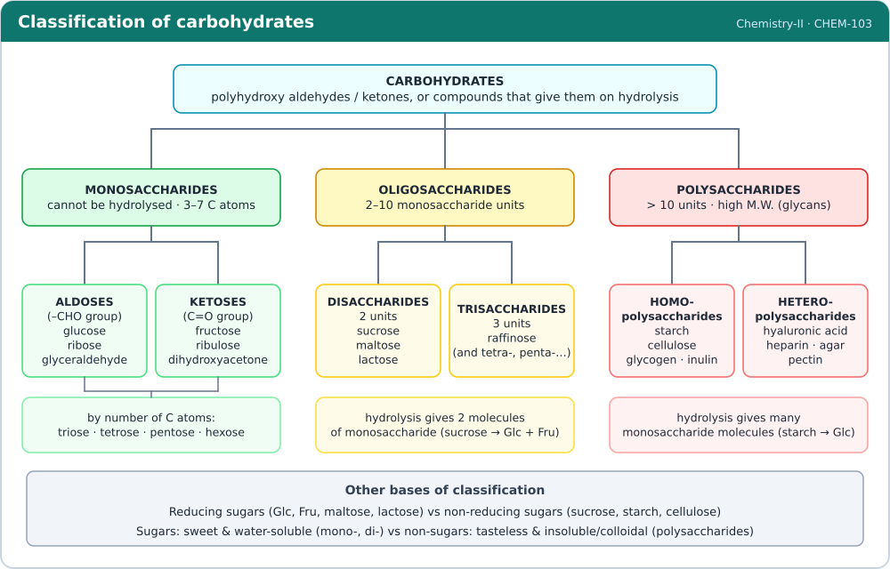</p>
<p align="center"><em>Fig. 1 — classification of carbohydrates</em></p>


| Class | Definition | Examples |
|---|---|---|
| **Monosaccharides** | Simplest sugars; **cannot be hydrolysed** further. Named by carbon number (triose, tetrose, pentose, hexose) and by group: **aldose** (–CHO) or **ketose** (C=O). | Glucose (aldohexose), fructose (ketohexose), ribose (aldopentose), glyceraldehyde (aldotriose) |
| **Oligosaccharides** | Give **2–10** monosaccharide units on hydrolysis. Disaccharides (2), trisaccharides (3), … | Sucrose (Glc + Fru), maltose (Glc + Glc), lactose (Gal + Glc), raffinose (trisaccharide) |
| **Polysaccharides** | Give **more than 10** (hundreds to thousands) units; high molecular mass; **homo**-polysaccharides (one kind of unit) or **hetero**-polysaccharides (different units). | Starch, cellulose, glycogen (homo); hyaluronic acid, heparin (hetero) |

**Other classifications**

* **Reducing vs non-reducing:** reduce Fehling's / Tollens' reagent (all monosaccharides, maltose, lactose) or not (sucrose, starch, cellulose).
* **Sugars vs non-sugars:** sugars are crystalline, sweet and water-soluble (mono- and disaccharides); polysaccharides are tasteless and insoluble or colloidal.

**Example (for the marks):** *sucrose* + H<sub>2</sub>O → *glucose* + *fructose* shows a disaccharide splitting into two monosaccharides; *starch* + H<sub>2</sub>O → many glucose units shows a polysaccharide.

---

## 3. Open-chain structure of D-glucose
*(2016 Q5(c) — brief · 2017 Q5(b) — establish the linear structure)*

### 3.1 Short answer (2016 Q5(c))

D-Glucose, C<sub>6</sub>H<sub>12</sub>O<sub>6</sub>, is a straight-chain **aldohexose**: C-1 is an aldehyde group, C-2 to C-5 each carry one –OH, and C-6 is a primary alcohol group. Its open-chain (Fischer) structure is

<p align="center">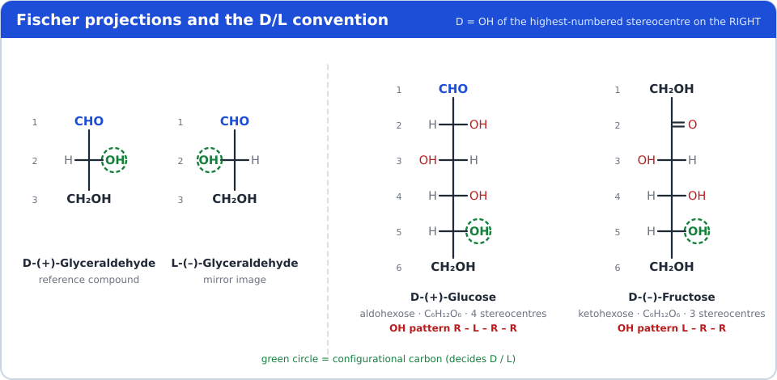</p>
<p align="center"><em>Fig. 2 — Fischer projections; D = OH of the highest-numbered stereocentre (C-5 in glucose) on the right</em></p>


```text
 CHO              1   aldehyde
 |
H–C–OH            2
 |
HO–C–H            3     D-(+)-glucose
 |                      (2R,3S,4R,5R)-2,3,4,5,6-pentahydroxyhexanal
H–C–OH            4
 |
H–C–OH            5   <- OH on the right  => D-series
 |
 CH₂OH            6   primary alcohol
```

### 3.2 Establishing the linear structure (2017 Q5(b))

**Step 1 — Molecular formula.** Elemental analysis and molar mass (180) give **C<sub>6</sub>H<sub>12</sub>O<sub>6</sub>**.

**Step 2 — Straight six-carbon chain.** Prolonged reduction with HI and red phosphorus at 140 °C gives **n-hexane**, so the six carbons are unbranched.

```text
C₆H₁₂O₆  --(HI, red P, 140 °C)-->  CH₃–CH₂–CH₂–CH₂–CH₂–CH₃   (n-hexane)
```

**Step 3 — A carbonyl group is present.** Glucose adds HCN to give a cyanohydrin and reacts with hydroxylamine to give an oxime.

```text
R–CHO + HCN → R–CH(OH)–CN          R–CHO + NH₂OH → R–CH=N–OH + H₂O
```

**Step 4 — The carbonyl is an aldehyde (at the end of the chain).** Mild oxidation with bromine water gives **gluconic acid** (same number of carbons); the cyanohydrin, on hydrolysis and reduction with HI, gives **n-heptanoic acid** (not a branched acid), placing –CHO at the end of the chain.

```text
CH₂OH(CHOH)₄CHO --(Br₂/H₂O)--> CH₂OH(CHOH)₄COOH         gluconic acid
cyanohydrin --(H₃O⁺)--> heptonic acid --(HI/Δ)--> CH₃(CH₂)₅COOH   n-heptanoic acid
```

**Step 5 — Five hydroxyl groups.** Acetylation with acetic anhydride gives a **pentaacetate** ⇒ five –OH groups. They are on different carbon atoms (a compound with two –OH on one carbon would be unstable).

**Step 6 — One primary –OH.** Oxidation with conc. HNO<sub>3</sub> gives **saccharic (glucaric) acid**, a dicarboxylic acid ⇒ the terminal –CH<sub>2</sub>OH is also present.

<p align="center">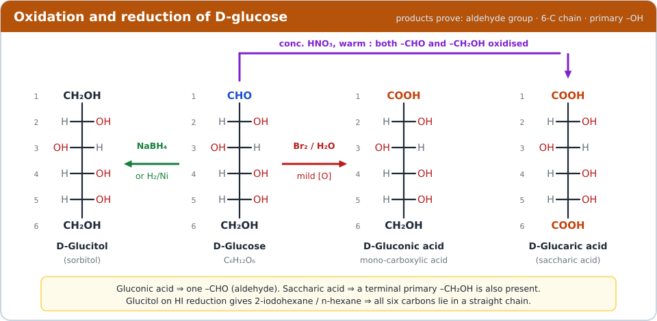</p>
<p align="center"><em>Fig. 3 — glucitol, gluconic acid and glucaric acid from D-glucose</em></p>


<p align="center">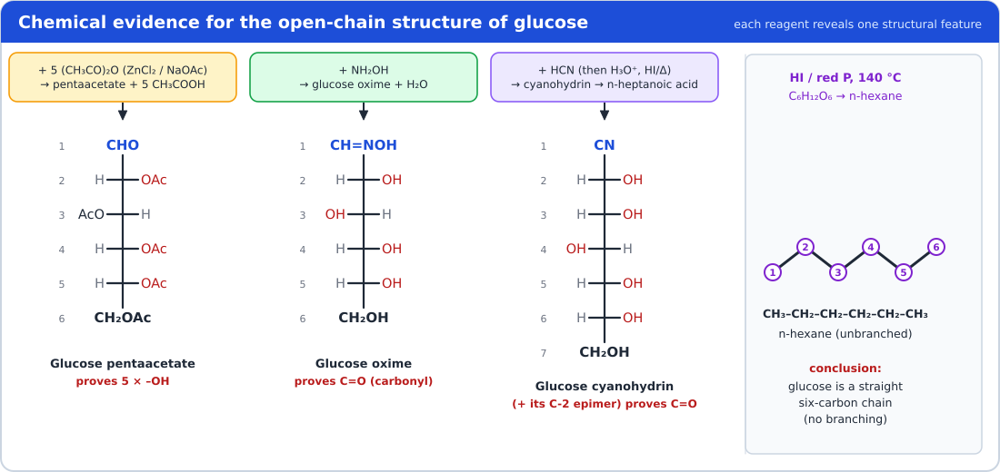</p>
<p align="center"><em>Fig. 4 — each reagent proves one structural feature</em></p>


**Step 7 — Adjacent –CHOH–CO.** With excess phenylhydrazine glucose gives a **glucosazone** (reaction at C-1 and C-2) ([Section 6.4](#64-osazone-formation)).

**Step 8 — Configuration.** Glucose has four stereocentres (C-2 to C-5), so 2<sup>4</sup> = 16 stereoisomers (8 D + 8 L). E. Fischer assigned the arrangement shown (R–L–R–R for C-2 to C-5, OH on right/left). Structure given by Fischer in 1891 (Nobel Prize 1902).

**Summary table**

| Observation | Conclusion |
|---|---|
| C<sub>6</sub>H<sub>12</sub>O<sub>6</sub> | molecular formula |
| HI → n-hexane | straight six-carbon chain |
| HCN → cyanohydrin; NH<sub>2</sub>OH → oxime | carbonyl group |
| Br<sub>2</sub>/H<sub>2</sub>O → gluconic acid (6 C) | aldehyde (–CHO) |
| (CH<sub>3</sub>CO)<sub>2</sub>O → pentaacetate | five –OH groups |
| HNO<sub>3</sub> → saccharic acid | primary –CH<sub>2</sub>OH at the other end |
| PhNHNH<sub>2</sub> → osazone | –CHOH next to –CHO |

> **Limitation:** the open-chain formula cannot explain why glucose fails the Schiff and NaHSO<sub>3</sub> tests, why its pentaacetate has no –CHO reactions, or why two crystalline forms and mutarotation exist ⇒ cyclic structure (next section).

---

## 4. Cyclic structure of D-glucose
*(2020 Q5(b) · 2022 Q7(b))*

### 4.1 Evidence for the cyclic (hemiacetal) structure

1. **Schiff's test and NaHSO<sub>3</sub> addition fail.** A free aldehyde gives a pink colour with Schiff's reagent and a bisulphite addition product; glucose does so only feebly or not at all.
2. **No –CHO reactions of the pentaacetate.** Glucose pentaacetate does not react with NH<sub>2</sub>OH or HCN ⇒ no free –CHO group; the fifth acetyl group is on the anomeric hemiacetal –OH.
3. **Two crystalline forms and mutarotation.** Crystallisation from water below 98 °C gives **α-glucose** (m.p. 146 °C, [α]<sub>D</sub> = +112.2°); from water above 98 °C (or from pyridine) gives **β-glucose** (m.p. 150 °C, [α]<sub>D</sub> = +18.7°). An open-chain aldehyde cannot give two isomers, but a ring with a new stereocentre at C-1 can ([Section 5](#5-mutarotation)).
4. **Methyl glucosides.** Glucose reacts with **one** mole of methanol (dry HCl) to give **two** isomeric methyl glucosides (α and β) that show no aldehyde reactions. An aldehyde would take **two** moles of alcohol to give an acetal; only a hemiacetal –OH reacts with one ([Section 9](#9-glycosides-and-glycosidic-linkage)).
5. **Haworth's methylation proof of ring size.** Methylation (Me<sub>2</sub>SO<sub>4</sub>/NaOH) gives penta-O-methylglucose; mild hydrolysis gives **2,3,4,6-tetra-O-methylglucose**; its oxidation gives **2,3,4-trimethoxyglutaric acid** (a five-carbon dicarboxylic acid) — so the ring oxygen links C-1 and C-5, i.e. a **six-membered pyranose ring**.

### 4.2 Ring closure

The C-5 hydroxyl adds to the C-1 aldehyde (intramolecular hemiacetal formation). This creates a **new stereocentre, C-1 (the anomeric carbon)**, giving two **anomers**, α and β.

<p align="center">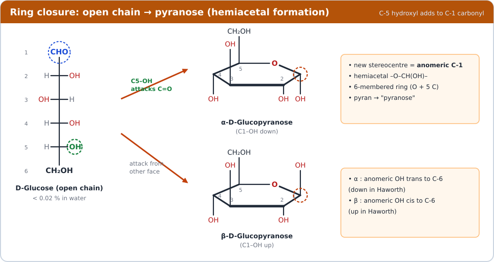</p>
<p align="center"><em>Fig. 5 — hemiacetal formation: open chain → α- and β-D-glucopyranose</em></p>


### 4.3 Converting a Fischer to a Haworth projection

<p align="center">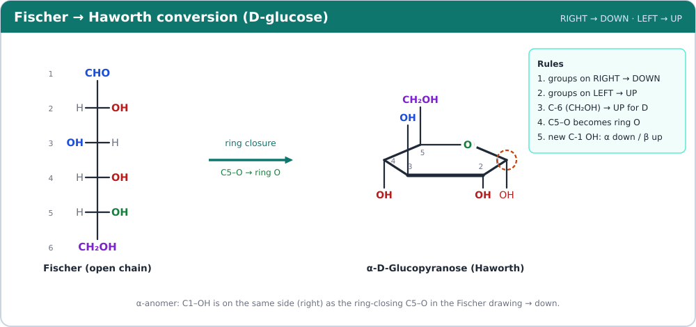</p>
<p align="center"><em>Fig. 6 — groups on the right go down, groups on the left go up</em></p>


**Rules:** (1) turn the Fischer chain so C-1 is on the right and C-5–O closes the ring; (2) **right → down, left → up**; (3) C-6 is **up** for the D-series; (4) α-anomer: anomeric –OH **down** (trans to C-6); β-anomer: anomeric –OH **up** (cis to C-6). Because glucose has a six-membered ring (like pyran) the names are **α-D-glucopyranose** and **β-D-glucopyranose**.

**Anomers** are diastereomers that differ only at the anomeric carbon.

---

## 5. Mutarotation
*(2017 Q5(c) · 2022 Q8(d))*

**Definition.** *Mutarotation is the spontaneous change in the specific rotation of a freshly prepared solution of an optically active sugar until a constant equilibrium value is reached.*

<p align="center">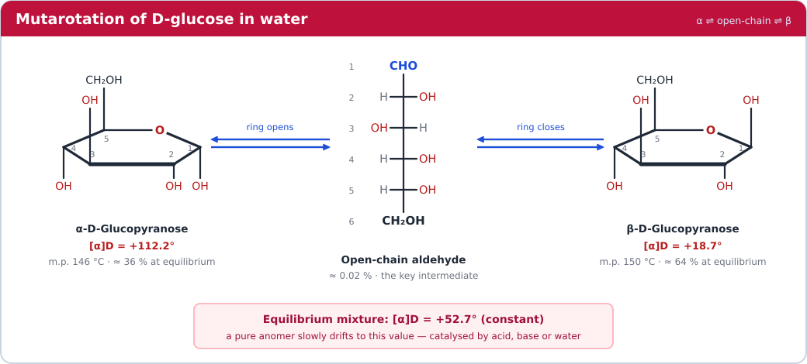</p>
<p align="center"><em>Fig. 7 — α-pyranose ⇌ open-chain aldehyde ⇌ β-pyranose</em></p>


**Observations**

| Form | [α]<sub>D</sub> (fresh) | m.p. | Final value |
|---|---|---|---|
| α-D-glucopyranose | **+112.2°** | 146 °C | **+52.7°** |
| β-D-glucopyranose | **+18.7°** | 150 °C | **+52.7°** |

<p align="center">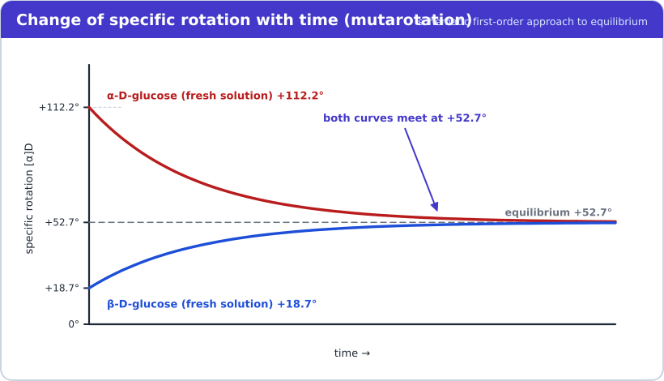</p>
<p align="center"><em>Fig. 8 — both solutions drift to +52.7°</em></p>


**Explanation (mechanism).** In water the hemiacetal ring of either anomer opens (acid/base/water catalysed) to the **free open-chain aldehyde**; rotation about the C-1–C-2 bond lets the –CHO group be attacked by the C-5 hydroxyl from either face, and the ring closes again to α or β. At equilibrium α : β ≈ **36 : 64** (open chain ≈ 0.02 %).

```text
α-D-glucopyranose  ⇌  open-chain aldehyde  ⇌  β-D-glucopyranose
   (+112.2°)                                      (+18.7°)
                   equilibrium  [α]D = +52.7°
```

**Worked example (extra).** Let *x* = fraction of α-form at equilibrium:

```text
112.2 x + 18.7 (1 – x) = 52.7
93.5 x = 34.0   →   x = 0.364 = 36.4 % α   and 63.6 % β
```

**Conditions / notes.** Catalysed by acids, bases and bifunctional catalysts (e.g. 2-pyridone); is shown by all reducing sugars with a free anomeric –OH (glucose, fructose, maltose, lactose), **not** by sucrose or glycosides.

---

## 6. Important reactions of glucose
*(2016 Q5(d) · 2019 Q5(a) · 2021 Q7(d))*

### 6.1 Glucose + acetic anhydride (2016 Q5(d))

Glucose reacts with excess acetic anhydride (anhydrous ZnCl<sub>2</sub> or sodium acetate / pyridine as catalyst) to give **glucose pentaacetate** — all **five** –OH groups are acetylated.

```text
C₆H₇O(OH)₅ + 5 (CH₃CO)₂O  --(ZnCl₂ or NaOAc)-->  C₆H₇O(OCOCH₃)₅ + 5 CH₃COOH
glucose                                           glucose pentaacetate
```

* Acetylation proves the presence of **five hydroxyl groups** ([Fig. 4](#31-short-answer-2016-q5c)).
* The pentaacetate gives no oxime / Fehling test ⇒ the fifth acetyl is on the hemiacetal –OH ⇒ **cyclic structure**. With NaOAc the β-acetate predominates, with ZnCl<sub>2</sub> the α-acetate.
* Hydrolysis with aqueous base / acid restores glucose.

### 6.2 Detecting the –CHO group of glucose (2019 Q5(a))

| Test | Reagent | Observation with glucose | Equation |
|---|---|---|---|
| **Tollens'** | ammoniacal AgNO<sub>3</sub>, warm | **silver mirror** | RCHO + 2[Ag(NH<sub>3</sub>)<sub>2</sub>]<sup>+</sup> + 3 OH<sup>–</sup> → RCOO<sup>–</sup> + 2 Ag↓ + 4 NH<sub>3</sub> + 2 H<sub>2</sub>O |
| **Fehling's** | alkaline Cu<sup>2+</sup> tartrate, boil | **brick-red ppt** of Cu<sub>2</sub>O | RCHO + 2 Cu<sup>2+</sup> + 5 OH<sup>–</sup> → RCOO<sup>–</sup> + Cu<sub>2</sub>O↓ + 3 H<sub>2</sub>O |
| **Benedict's** | alkaline Cu<sup>2+</sup> citrate | red / orange ppt | same as Fehling's |
| **Bromine water** | Br<sub>2</sub>/H<sub>2</sub>O | brown colour **discharged** → gluconic acid | RCHO + Br<sub>2</sub> + H<sub>2</sub>O → RCOOH + 2 HBr |
| **Hydroxylamine / phenylhydrazine** | NH<sub>2</sub>OH / PhNHNH<sub>2</sub> | oxime / osazone | RCHO + NH<sub>2</sub>OH → RCH=NOH + H<sub>2</sub>O |

> Note: glucose gives a **negative or very weak Schiff test** because it exists mainly as the cyclic hemiacetal; the tests above work because the ring slowly opens (R = HOCH<sub>2</sub>(CHOH)<sub>4</sub>–).

### 6.3 Glucose + bromine water (2021 Q7(d))

Bromine water is a mild oxidant that converts only the aldehyde group; the product is **D-gluconic acid** (six carbons retained).

```text
CH₂OH–(CHOH)₄–CHO + [O] (Br₂ + H₂O) → CH₂OH–(CHOH)₄–COOH       (D-gluconic acid)
Br₂ + H₂O → 2 HBr + [O]
```

* The brown colour of bromine is discharged.
* **Importance:** proves that glucose is an **aldose** (ketoses such as fructose are *not* oxidised by Br<sub>2</sub>/H<sub>2</sub>O in acid) and that –CHO is oxidised without breaking the carbon chain. Under stronger conditions (HNO<sub>3</sub>) saccharic acid forms ([Fig. 3](#32-establishing-the-linear-structure-2017-q5b)).

### 6.4 Osazone formation

Glucose with **excess phenylhydrazine** (3 mol) on warming gives yellow needle-shaped **glucosazone**; only C-1 and C-2 react.

<p align="center">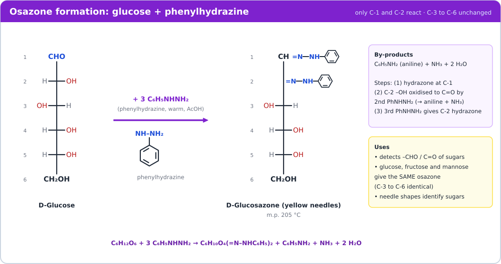</p>
<p align="center"><em>Fig. 9 — glucosazone; phenylhydrazine and phenyl rings drawn as benzene</em></p>


```text
C₆H₁₂O₆ + 3 C₆H₅NHNH₂ → C₆H₁₀O₄(=N–NHC₆H₅)₂ + C₆H₅NH₂ + NH₃ + 2 H₂O
```

Glucose, fructose and mannose give the **same osazone** because C-3 to C-6 are identical (and C-1/C-2 are converted into identical groups).

### 6.5 Summary of other reactions

| Reagent | Product | Information |
|---|---|---|
| NaBH<sub>4</sub> or H<sub>2</sub>/Ni | D-glucitol (sorbitol) | –CHO → –CH<sub>2</sub>OH |
| conc. HNO<sub>3</sub> | saccharic acid | –CHO and –CH<sub>2</sub>OH oxidised |
| HCN | cyanohydrin | carbonyl present (chain lengthening, Kiliani–Fischer) |
| MeOH / dry HCl | methyl glucosides | cyclic hemiacetal |
| conc. H<sub>2</sub>SO<sub>4</sub> | charring (dehydration to HMF/furfural derivatives) | – |
| dil. NaOH | enediol → fructose + mannose | [Section 8](#8-conversion-of-glucose-into-fructose) |

---

## 7. Distinguishing glucose from fructose and glucose from sucrose
*(2016 Q5(b) · 2018 Q6(a) · 2020 Q5(d) · 2022 Q7(c))*

### 7.1 Glucose vs fructose (also: identify them in a mixture)

Glucose is an **aldose** and fructose a **ketose**; both reduce Fehling's / Tollens' (fructose first rearranges to an aldose via an enediol in alkali) and both give the same osazone, so those tests **cannot** discriminate. Use:

<p align="center">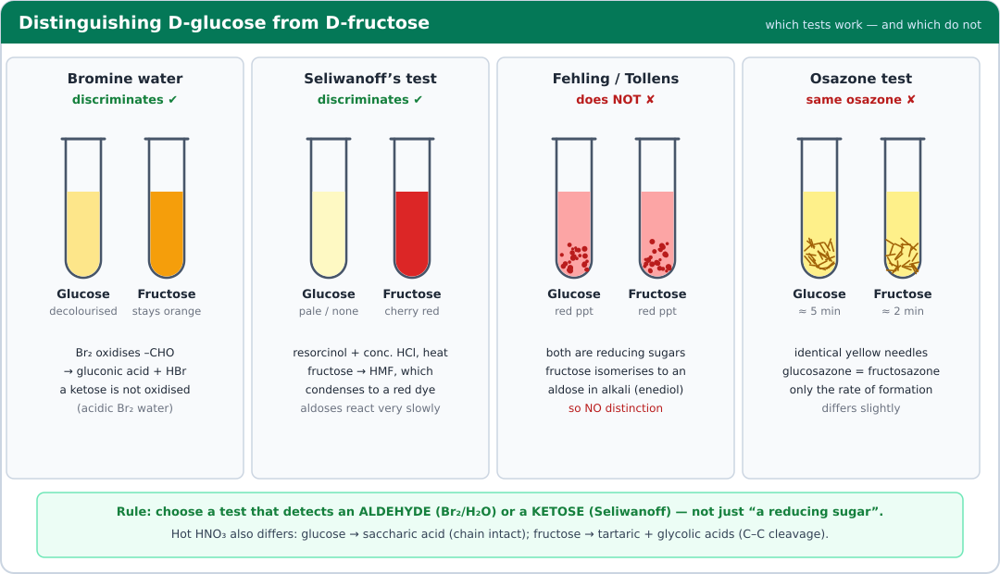</p>
<p align="center"><em>Fig. 10 — bromine water and Seliwanoff's test discriminate; Fehling and osazone do not</em></p>


**(a) Bromine water test.** Glucose (aldose) decolourises bromine water, giving gluconic acid; fructose (ketose) does not.

```text
C₅H₁₁O₅–CHO + Br₂ + H₂O → C₅H₁₁O₅–COOH + 2 HBr        (glucose: positive)
fructose: no reaction in acid bromine water               (negative)
```

**(b) Seliwanoff's test.** Heat with resorcinol and conc. HCl: **fructose** (ketose) is dehydrated rapidly to 5-hydroxymethylfurfural (HMF), which condenses with resorcinol to give a **cherry-red** colour within a minute or two; glucose gives only a faint pink colour after prolonged heating.

**(c) Oxidation with hot HNO<sub>3</sub>.** Glucose → saccharic acid (6 C, optically active); fructose → **tartaric + glycolic (and trihydroxyglutaric) acids** because C–C cleavage occurs next to the keto group.

**(d) Osazone.** Same osazone, but fructose gives it faster (≈ 2 min vs ≈ 5 min).

| Property | D-Glucose | D-Fructose |
|---|---|---|
| Functional group | aldehyde (aldohexose) | ketone (ketohexose) |
| Ring (usual) | pyranose (6-membered) | furanose (5-membered, in combined form) |
| [α]<sub>D</sub> | **+52.7°** (dextro) | **–92.4°** (laevo) |
| Br<sub>2</sub>/H<sub>2</sub>O | decolourised | no reaction |
| Seliwanoff | negative / slow | **cherry red** |
| HNO<sub>3</sub> | saccharic acid | tartaric + glycolic acids |
| Fehling/Tollens | +ve | +ve |
| Osazone | same, slower | same, faster |

**Identifying them in a mixture:** add Seliwanoff's reagent → a rapid cherry-red colour shows fructose is present; to a separate portion add bromine water → decolourisation shows glucose is present (a ketose does not consume Br<sub>2</sub>).

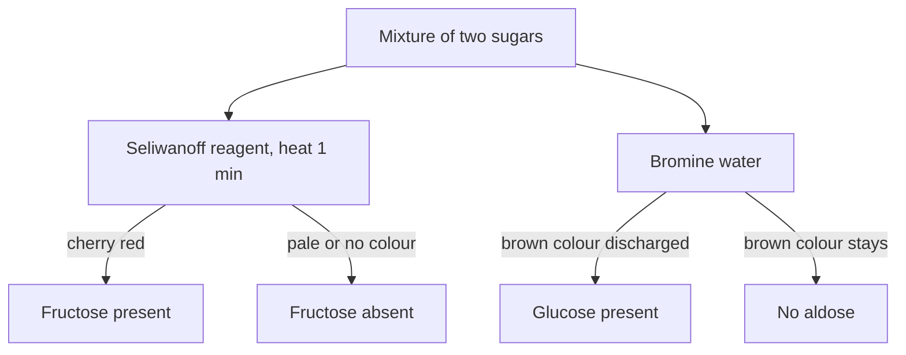

### 7.2 Glucose vs sucrose (2020 Q5(d))

Glucose is a **reducing** monosaccharide; sucrose is a **non-reducing** disaccharide with no free anomeric –OH.

| Test | Glucose | Sucrose |
|---|---|---|
| Fehling / Tollens / Benedict | red ppt / silver mirror | **no reaction** |
| Br<sub>2</sub>/H<sub>2</sub>O | decolourised | no reaction |
| Phenylhydrazine (osazone) | yellow needles | no osazone |
| Mutarotation | shown | none |
| After boiling with dil. HCl then neutralising | no change | **now gives Fehling's** (hydrolysed to Glc + Fru) |

```text
glucose  + 2 Cu²⁺ + 5 OH⁻ → gluconate + Cu₂O↓ (red)         (positive)
sucrose  + Fehling's solution → no red ppt                    (negative)
sucrose  + H₂O --(dil. HCl, Δ)--> glucose + fructose --(Fehling's)--> red ppt
```

---

## 8. Conversion of glucose into fructose
*(2017 Q5(d) · 2021 Q7(b))*

**Principle.** Move the carbonyl from C-1 (aldose) to C-2 (ketose).

### 8.1 Osazone → osone → fructose (classical method)

<p align="center">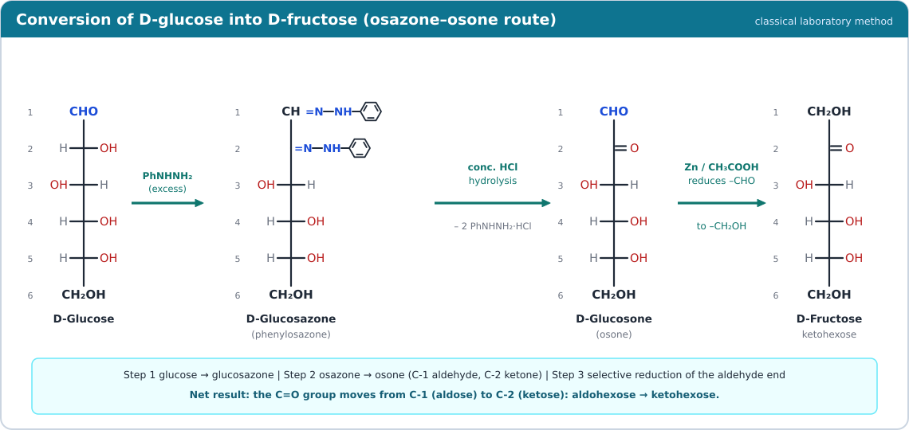</p>
<p align="center"><em>Fig. 11 — osazone route</em></p>


1. **Glucosazone:** glucose + excess PhNHNH<sub>2</sub> → glucosazone (C-1 and C-2 converted to =N–NHPh).
2. **Osone:** glucosazone + conc. HCl (hydrolysis) → **D-glucosone** (C-1 –CHO, C-2 C=O) + 2 PhNHNH<sub>2</sub>·HCl.
3. **Reduction:** glucosone + Zn / CH<sub>3</sub>COOH → only the more reactive aldehyde is reduced → **D-fructose**.

```text
C₆H₁₂O₆ --3PhNHNH₂--> glucosazone --HCl--> glucosone (C₆H₁₀O₆) --Zn/AcOH--> fructose
```

### 8.2 Enediol route (Lobry de Bruyn–van Ekenstein transformation)

Warm with **dilute alkali** (Ba(OH)<sub>2</sub> or Ca(OH)<sub>2</sub>): the α-hydrogen at C-2 is removed to give a common **enediol** intermediate that re-ketonises to fructose (also to mannose).

<p align="center">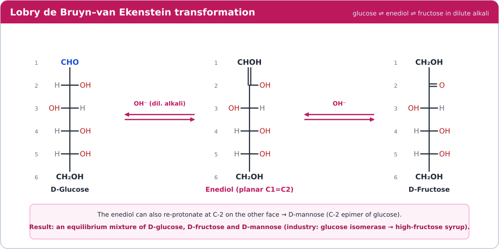</p>
<p align="center"><em>Fig. 12 — glucose ⇌ enediol ⇌ fructose</em></p>


The result is an **equilibrium mixture** of D-glucose, D-fructose and D-mannose (that is why fructose also reduces Fehling's / Tollens'). Industrially, glucose isomerase converts glucose to **high-fructose syrup**.

---

## 9. Glycosides and glycosidic linkage
*(2020 Q5(c) · 2022 Q8(b))*

**Glycoside.** An **acetal** formed when the anomeric hemiacetal –OH of a cyclic sugar is replaced by an –OR (alkyl, aryl or another sugar) group. The sugar part is the **glycone**, the non-sugar part the **aglycone**.

**Glycosidic linkage.** The **C–O–C bond** between the anomeric carbon (C-1) of one sugar and the oxygen of the aglycone or of another sugar unit. Types: O-, N- (nucleosides), S- and C-glycosides; α- or β- according to the anomeric configuration.

<p align="center">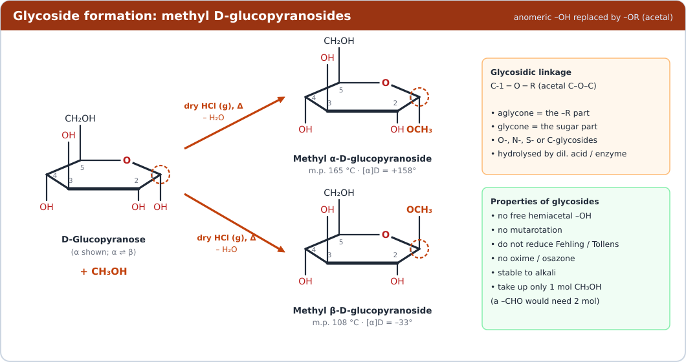</p>
<p align="center"><em>Fig. 13 — methyl α- and β-D-glucopyranoside from glucose</em></p>


```text
D-glucose + CH₃OH --(dry HCl, Δ)--> methyl α-D-glucopyranoside + methyl β-D-glucopyranoside + H₂O
```

**Mechanism in brief.** Protonation of the anomeric –OH → loss of H<sub>2</sub>O → **oxocarbenium ion** → attack of CH<sub>3</sub>OH from either face → α and β glycosides.

**Examples**

* **Glycosides:** methyl glucosides, **salicin** (willow bark), **amygdalin** (bitter almond), digitoxin (heart drug), anthocyanins, nucleosides (adenosine).
* **Glycosidic linkage in disaccharides:** maltose α-1,4; lactose β-1,4; sucrose α-1,2-β; cellobiose β-1,4.

<p align="center">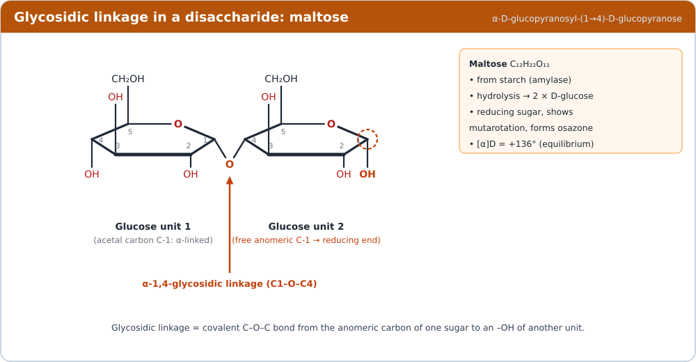</p>
<p align="center"><em>Fig. 14 — α-1,4-glycosidic linkage in maltose</em></p>


**Properties of glycosides:** no free hemiacetal –OH ⇒ non-reducing, no mutarotation, no osazone; stable to alkali; hydrolysed by dilute acid or specific enzymes (α-glucosidase cleaves α-glycosides, β-glucosidase β-glycosides).

---

## 10. Reducing and non-reducing sugars
*(2016 Q7(b) · 2018 Q7(b) · 2022 Q8(c))*

<p align="center">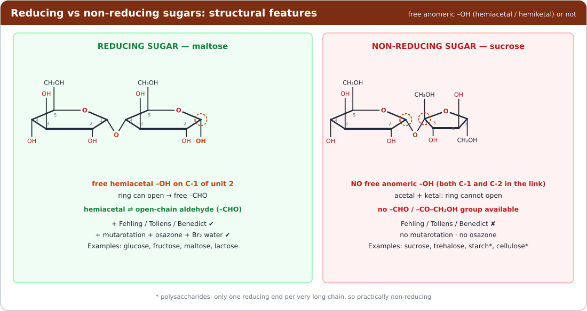</p>
<p align="center"><em>Fig. 15 — maltose (reducing) vs sucrose (non-reducing)</em></p>


| | **Reducing sugars** | **Non-reducing sugars** |
|---|---|---|
| **Structural feature** | contain a **free (or potentially free) aldehyde / α-hydroxy-ketone group**, i.e. a **free hemiacetal or hemiketal –OH at the anomeric carbon** | **no free anomeric –OH**: the anomeric carbons are all involved in the glycosidic link (acetal / ketal) |
| In solution | ring opens → –CHO / –CO–CH<sub>2</sub>OH | ring cannot open |
| Fehling / Tollens / Benedict | **positive** | **negative** |
| Mutarotation, osazone, Br<sub>2</sub> water | shown | not shown |
| Examples | glucose, fructose, galactose, maltose, lactose | sucrose, trehalose (α,α-1,1), starch*, cellulose* |

\* only one reducing end per very long chain.

**Why fructose, a ketone, reduces Fehling's:** in alkaline medium the α-hydroxy-ketone –CO–CH<sub>2</sub>OH tautomerises through an enediol to an aldehyde ([Section 8.2](#82-enediol-route-lobry-de-bruynvan-ekenstein-transformation)).

**Why sucrose does not:** α-glucose C-1 is bonded to fructose C-2 (α-1→β-2); both anomeric carbons are tied up, so there is no hemiacetal –OH ([Section 11](#11-structure-of-sucrose)).

---

## 11. Structure of sucrose
*(2021 Q7(c))*

**Molecular formula:** C<sub>12</sub>H<sub>22</sub>O<sub>11</sub> (cane/beet sugar).

### Evidence

1. **Hydrolysis.** Boiling with dilute acid or invertase gives **equimolar D-glucose + D-fructose** ⇒ a disaccharide of these two units.
2. **Non-reducing.** It does not reduce Fehling's / Tollens', forms no osazone and shows no mutarotation ⇒ **both anomeric carbons (C-1 of glucose, C-2 of fructose) are involved in the glycosidic bond**.
3. **Eight –OH groups.** Acetylation gives **sucrose octaacetate**; methylation gives **octa-O-methylsucrose**.
4. **Ring sizes (methylation analysis).** Hydrolysis of octamethylsucrose gives **2,3,4,6-tetra-O-methyl-D-glucose** (free –OH only at C-1, so glucose is a pyranose linked through C-1) and **1,3,4,6-tetra-O-methyl-D-fructose** (free –OH at C-2; C-5 not methylated, so ring O is on C-5: a **furanose**, linked through C-2).
5. **Configuration of the link.** Sucrose is hydrolysed by **α-glucosidase (maltase)** and by **β-fructosidase (invertase)** ⇒ α-glucoside and β-fructoside.

**Structure:** **α-D-glucopyranosyl-(1→2)-β-D-fructofuranoside**.

<p align="center">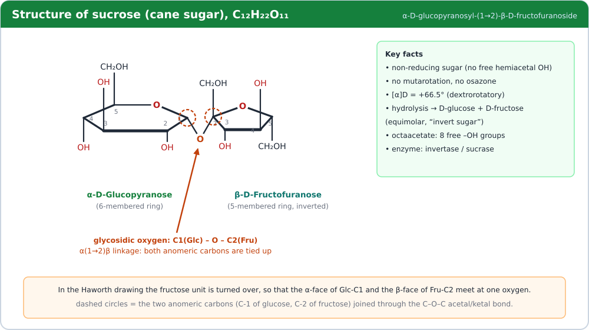</p>
<p align="center"><em>Fig. 16 — sucrose: α-D-glucopyranose joined to β-D-fructofuranose through C1–O–C2</em></p>


**Inversion of sucrose.** Specific rotation +66.5° → after hydrolysis –19.9°; the product is **invert sugar**.

<p align="center">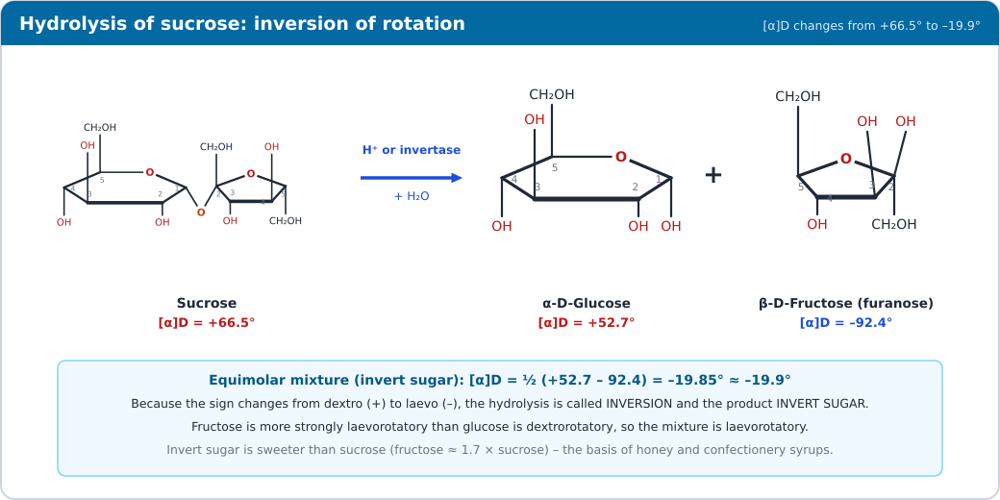</p>
<p align="center"><em>Fig. 17 — [α]D of the mixture = ½(+52.7 – 92.4) = –19.85°</em></p>


---

## 12. Polysaccharides: starch and cellulose
*(2016 Q7(a) · 2018 Q7(c) · 2019 Q5(b) · 2022 Q8(a))*

### 12.1 Cellulose — structure and uses (2016 Q7(a), 2022 Q8(a))

**Structure.** Cellulose is a **linear, unbranched polymer of β-D-glucose** joined by **β-1,4-glycosidic bonds** (formula (C<sub>6</sub>H<sub>10</sub>O<sub>5</sub>)<sub>n</sub>, n = several thousand). Successive glucose units are rotated by 180° so the chain is straight and ribbon-like; chains pack side by side and are held by **intra- and inter-chain hydrogen bonds** into rigid **microfibrils**.

<p align="center">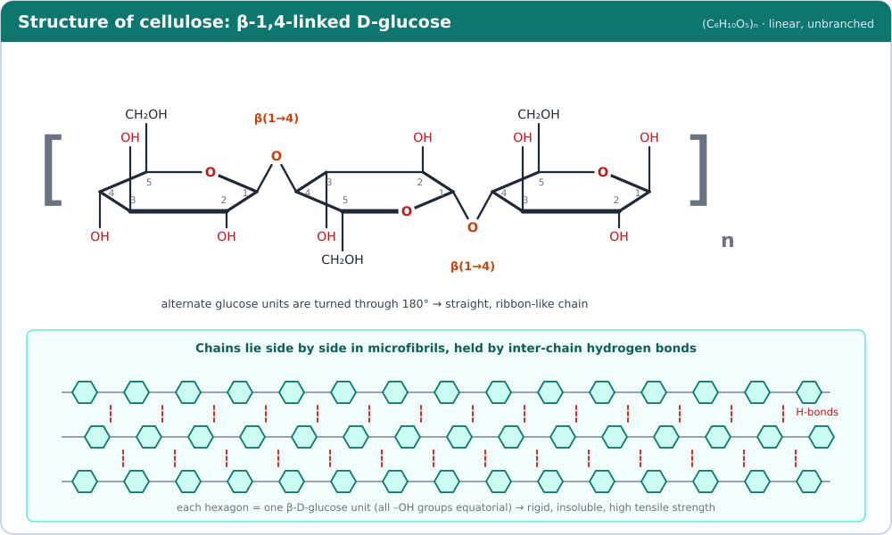</p>
<p align="center"><em>Fig. 18 — cellulose: β(1→4) chain and hydrogen-bonded microfibrils</em></p>


* Hydrolysis: (C<sub>6</sub>H<sub>10</sub>O<sub>5</sub>)<sub>n</sub> --(conc. H<sub>2</sub>SO<sub>4</sub> or HCl, Δ)--> cellobiose --> **β-D-glucose**.
* Each glucose unit has three free –OH groups (C-2, C-3, C-6): **acetylation** → cellulose triacetate; **nitration** → cellulose nitrates; **xanthation with CS<sub>2</sub>/NaOH** → viscose.
* Insoluble in water; dissolves in Schweitzer's reagent [Cu(NH<sub>3</sub>)<sub>4</sub>](OH)<sub>2</sub>. Humans cannot digest it (no cellulase) — it acts as **dietary fibre**.

**Uses of cellulose**

1. Paper and cardboard (wood pulp), cotton / linen textiles.
2. **Rayon** (viscose) and **cellophane** from regenerated cellulose.
3. **Cellulose acetate** — photographic film, lacquers, fibres.
4. **Cellulose nitrate** — guncotton (explosive), celluloid (plastic), collodion, lacquers.
5. **Carboxymethyl cellulose** — thickener in food, detergents and medicines.
6. Building material (wood), insulation, bio-ethanol from cellulosic waste, dietary fibre.

### 12.2 Starch — structure and uses (2018 Q7(c))

**Structure.** Starch is the **storage polysaccharide of plants** (cereals, potato). It is a mixture of two polymers of **α-D-glucose**:

* **Amylose (20–30 %)** — unbranched, α-1,4 links, coiled into a helix; soluble in hot water; gives a **deep blue** colour with iodine.
* **Amylopectin (70–80 %)** — branched, α-1,4 chains with **α-1,6 branch points** about every 24–30 units; gives a red-violet colour with iodine.

<p align="center">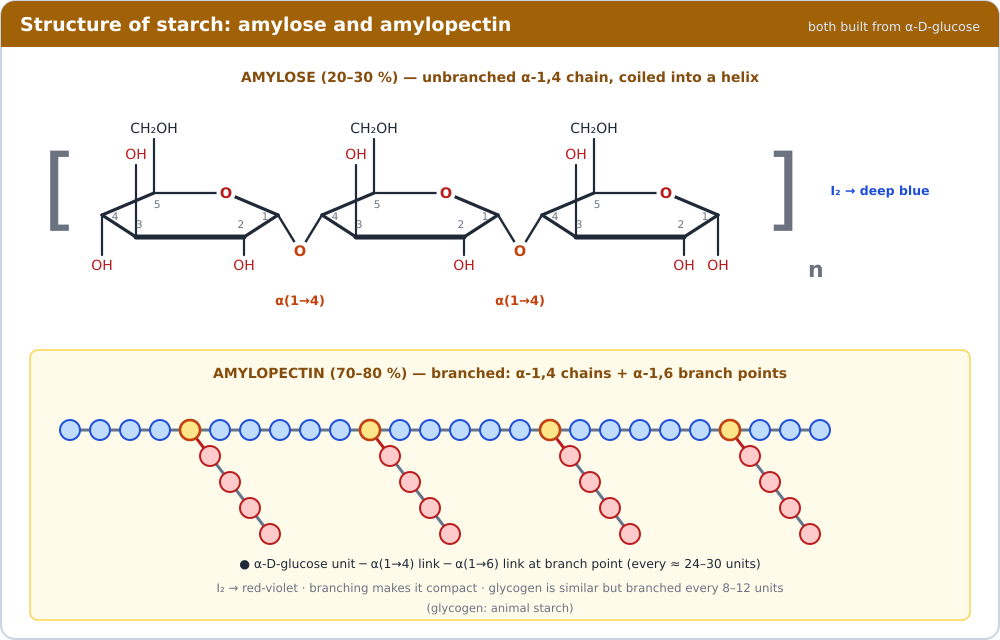</p>
<p align="center"><em>Fig. 19 — starch: amylose (α-1,4) and branched amylopectin</em></p>


```text
starch --(dil. acid / amylase)--> dextrins --> maltose --(maltase)--> D-glucose
```

**Uses of starch**

1. Main **food** source of energy (rice, wheat, potato, maize).
2. Manufacture of **glucose, dextrin and maltose syrups**, and of **ethanol** by fermentation.
3. **Adhesive / paste**, laundry stiffener, sizing in textile and paper industries.
4. Pharmaceutical **binder and filler** for tablets; dusting powder.
5. **Indicator** (blue colour with iodine) in iodometric titrations.
6. Biodegradable plastics and packaging, thickener in foods.

### 12.3 Starch vs cellulose (2019 Q5(b))

| Property | **Starch** | **Cellulose** |
|---|---|---|
| Monomer | **α**-D-glucose | **β**-D-glucose |
| Linkage | α-1,4 (+ α-1,6 branches in amylopectin) | **β-1,4 only** |
| Shape | helical (amylose) / branched (amylopectin) | **straight, linear** chains |
| Occurrence | storage in plants (grains, tubers) | **structural** (cell walls) |
| Solubility in water | amylose soluble (hot); amylopectin swells | **insoluble** |
| Iodine test | blue / red-violet | **no colour** |
| Hydrolysis | amylase → maltose → glucose | cellulase → cellobiose → glucose |
| Digestion by humans | **digestible** | **not digestible** (fibre) |
| Hydrolysis by dil. acid | easy | difficult (needs conc. acid) |

---

## 13. Diazotization
*(2016 Q7(c))*

**Definition.** *Diazotization is the conversion of a primary aromatic amine into a diazonium salt by treatment with nitrous acid (NaNO<sub>2</sub> + HCl) at 0–5 °C.*

<p align="center">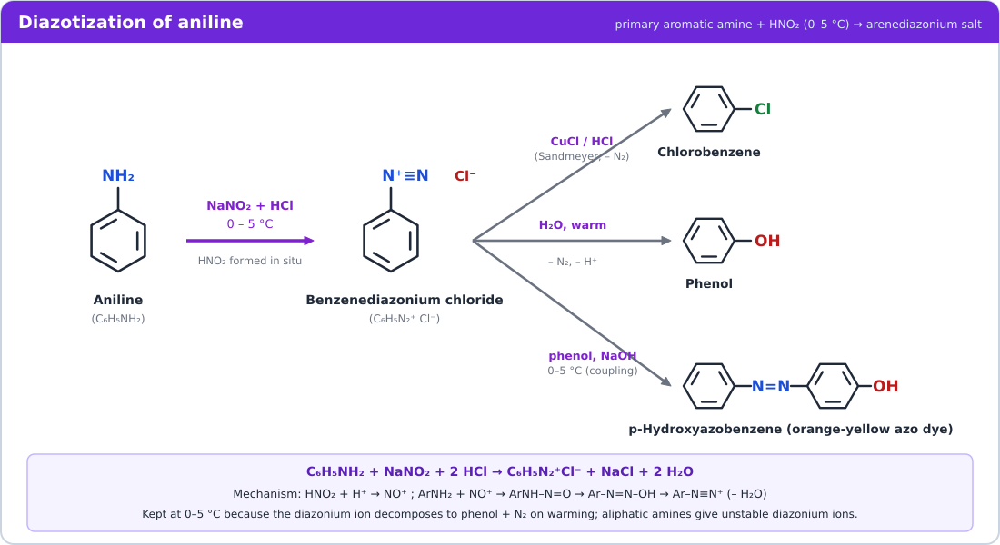</p>
<p align="center"><em>Fig. 20 — aniline → benzenediazonium chloride and its reactions</em></p>


**Example.** Aniline gives **benzenediazonium chloride**:

```text
C₆H₅NH₂ + NaNO₂ + 2 HCl --(0–5 °C)--> C₆H₅–N⁺≡N Cl⁻ + NaCl + 2 H₂O
```

HNO<sub>2</sub> is generated in situ (NaNO<sub>2</sub> + HCl → HNO<sub>2</sub> + NaCl).

**Mechanism.** HNO<sub>2</sub> + H<sup>+</sup> → NO<sup>+</sup> + H<sub>2</sub>O; ArNH<sub>2</sub> + NO<sup>+</sup> → ArNH–N=O (N-nitrosamine) → Ar–N=N–OH (diazohydroxide) → Ar–N<sup>+</sup>≡N (– H<sub>2</sub>O).

**Conditions.** Low temperature (0–5 °C) because the diazonium ion decomposes above 5 °C to phenol and N<sub>2</sub>; excess HCl prevents coupling of unreacted amine. Aliphatic amines give unstable diazonium ions.

**Synthetic importance:** Sandmeyer reaction (ArN<sub>2</sub>Cl + CuCl → ArCl), phenol formation (warm water), and **azo coupling** with phenols or amines to azo dyes, e.g. p-hydroxyazobenzene from phenol.

---

## 14. Extra: epimers, anomers and quick facts

<p align="center">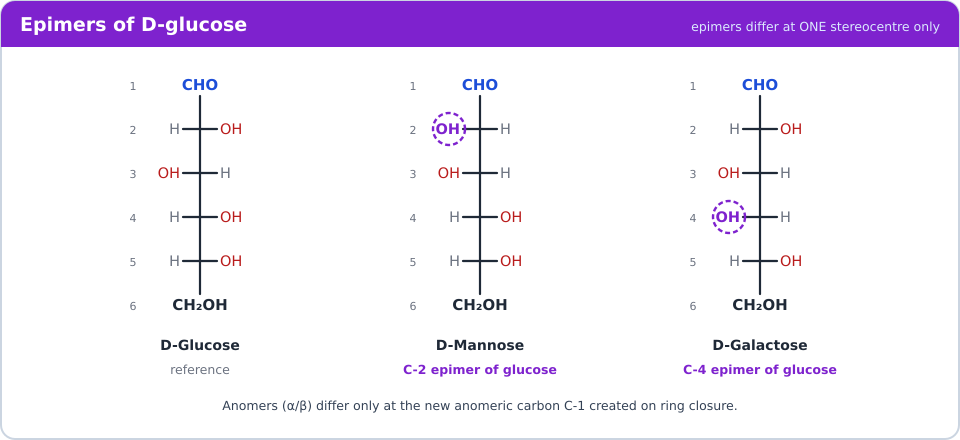</p>
<p align="center"><em>Fig. 21 — mannose is the C-2 epimer and galactose the C-4 epimer of glucose</em></p>


| Term | Meaning | Example |
|---|---|---|
| **Epimers** | differ in configuration at **one** stereocentre (not C-1) | glucose / mannose (C-2); glucose / galactose (C-4) |
| **Anomers** | differ only at the new anomeric C-1 | α- and β-D-glucopyranose |
| **Enantiomers** | non-superimposable mirror images | D-glucose / L-glucose |
| **Pyranose / furanose** | 6- / 5-membered ring | glucose / fructose (in sucrose) |

**Mnemonics**

* **Aldohexoses (D):** *All Altruists Gladly Make Gum In Gallon Tanks* = Allose, Altrose, Glucose, Mannose, Gulose, Idose, Galactose, Talose.
* **D-glucose OH pattern:** *RLRR* (C-2 to C-5, right–left–right–right).
* **Haworth:** *right → down, left → up*.
* Number of stereoisomers = 2<sup>n</sup>: aldohexose n = 4 → **16**; ketohexose n = 3 → **8**.

**Specific rotations to remember**

| Compound | [α]<sub>D</sub> |
|---|---|
| α-D-glucose / β-D-glucose / equilibrium | +112.2° / +18.7° / **+52.7°** |
| D-fructose | –92.4° |
| sucrose / invert sugar | +66.5° / –19.9° |

**Common exam mistakes**

* Drawing the aldehyde Fischer structure for a "cyclic structure" question — always draw Haworth rings.
* Saying fructose does not reduce Fehling's solution (it does, via the enediol).
* Writing "fructose gives a different osazone" (it gives the **same** one as glucose).
* Forgetting that α-anomer = anomeric –OH **down** (D-series Haworth).

---

## 15. Extra: practice questions with solutions

<details>
<summary><b>Q1.</b> A freshly prepared solution of pure β-D-glucose has [α]<sub>D</sub> = +18.7°; at equilibrium it is +52.7°. Calculate the % of α-form at equilibrium (α = +112.2°).</summary>

&nbsp;

```text
x(112.2) + (1 – x)(18.7) = 52.7   →   x = 34.0 / 93.5 = 0.364
α ≈ 36.4 %,  β ≈ 63.6 %
```
</details>

<details>
<summary><b>Q2.</b> Show that hydrolysis of sucrose gives a laevorotatory mixture.</summary>

&nbsp;

Equimolar glucose (+52.7°) and fructose (–92.4°): ½(52.7 – 92.4) = –19.85° ≈ –19.9° (negative ⇒ inversion).
</details>

<details>
<summary><b>Q3.</b> How many acetyl groups are present in glucose pentaacetate and in sucrose octaacetate? Why?</summary>

&nbsp;

Five and eight — equal to the number of free –OH groups in glucose (pyranose form: 4 secondary + 1 primary, hemiacetal –OH included) and in sucrose (8 free –OH).
</details>

<details>
<summary><b>Q4.</b> A compound C<sub>6</sub>H<sub>12</sub>O<sub>6</sub> gives a red ppt with Fehling's solution, decolourises bromine water and gives saccharic acid with HNO<sub>3</sub>. Identify it.</summary>

&nbsp;

An aldohexose with the glucose configuration: **D-glucose** (Br<sub>2</sub>/H<sub>2</sub>O ⇒ aldehyde; HNO<sub>3</sub> ⇒ saccharic acid). Fructose would not decolourise bromine water.
</details>

<details>
<summary><b>Q5.</b> Why does sucrose not show mutarotation?</summary>

&nbsp;

No free hemiacetal –OH: both anomeric carbons form the glycosidic bond, so the rings cannot open to the aldehyde and no α ⇌ β interconversion occurs.
</details>

<details>
<summary><b>Q6.</b> Why must diazotization be done at 0–5 °C?</summary>

&nbsp;

Above 5 °C benzenediazonium chloride decomposes: C<sub>6</sub>H<sub>5</sub>N<sub>2</sub>Cl + H<sub>2</sub>O → C<sub>6</sub>H<sub>5</sub>OH + N<sub>2</sub> + HCl.
</details>

<details>
<summary><b>Q7.</b> Why does amylose give a blue colour with iodine but cellulose does not?</summary>

&nbsp;

Amylose coils into a helix whose core holds I<sub>3</sub><sup>–</sup>/I<sub>5</sub><sup>–</sup> chains (charge-transfer complex, blue). Cellulose is a straight, hydrogen-bonded ribbon with no such cavity.
</details>

---

## 16. Quick revision checklist

- [ ] Definition of carbohydrate; three classes with examples
- [ ] Fischer structure of D-glucose and fructose; D/L rule
- [ ] Eight pieces of evidence for the open chain (table in Section 3)
- [ ] Five pieces of evidence for the ring; Haworth α/β pyranose
- [ ] Mutarotation values +112.2° / +18.7° / +52.7° and mechanism
- [ ] Br<sub>2</sub>/H<sub>2</sub>O, Seliwanoff, Fehling, osazone: which discriminates glucose/fructose
- [ ] Glucose → fructose (osazone route and enediol route)
- [ ] Glycoside / glycosidic linkage definitions with methyl glucoside
- [ ] Reducing vs non-reducing structural features
- [ ] Sucrose: α-D-Glc-(1→2)-β-D-Fru; methylation evidence; inversion
- [ ] Cellulose β-1,4 and starch α-1,4 / α-1,6; uses; comparison table
- [ ] Diazotization: reagent, 0–5 °C, equation, benzene-ring example

---

<p align="center"><sub>Compiled by <b>sigkill0x00</b> · CHEM-103 Carbohydrates · figures in <code>../../assets/</code></sub></p>
