# CHEM-103 · Chapter 5 · Carbohydrates

**Previous Questions (2015-2023) - Solved, Exam Style, with Extra Sections**

| | |
|---|---|
| **Course** | CHEM-103 (Organic Chemistry) |
| **Chapter** | 5 - Carbohydrates |
| **Question solved** | Q1 (i) - (iv) |
| **File version** | `v261108-1` |
| **Assets** | `../../assets/chem103-carb-*.svg` |

> **Question 1.** Answer the following:
> **(i)** What is an asymmetric carbon atom? What is mutarotation?
> **(ii)** Write the cyclic structures of D-glucose, sucrose, cellulose and starch.
> **(iii)** Explain the conversion of an aldose into the next higher aldose and the next lower aldose.
> **(iv)** How can the ring size of D-glucose be determined?

## Table of Contents

- [0. Quick Revision: Carbohydrate Basics](#0-quick-revision-carbohydrate-basics)
- [1. Answer to Q1 (i): Asymmetric Carbon and Mutarotation](#1-answer-to-q1-i-asymmetric-carbon-and-mutarotation)
  - [1.1 Asymmetric carbon atom](#11-asymmetric-carbon-atom)
  - [1.2 Mutarotation](#12-mutarotation)
- [2. Answer to Q1 (ii): Cyclic Structures](#2-answer-to-q1-ii-cyclic-structures)
  - [2.1 How cyclic structures are drawn](#21-how-cyclic-structures-are-drawn)
  - [2.2 D-Glucose](#22-d-glucose)
  - [2.3 Sucrose](#23-sucrose)
  - [2.4 Cellulose](#24-cellulose)
  - [2.5 Starch](#25-starch)
  - [2.6 Summary table](#26-summary-table)
- [3. Answer to Q1 (iii): Ascending and Descending the Aldose Series](#3-answer-to-q1-iii-ascending-and-descending-the-aldose-series)
  - [3.1 Aldose to the next HIGHER aldose: Kiliani-Fischer synthesis](#31-aldose-to-the-next-higher-aldose-kiliani-fischer-synthesis)
  - [3.2 Aldose to the next LOWER aldose](#32-aldose-to-the-next-lower-aldose)
- [4. Answer to Q1 (iv): Determination of the Ring Size of D-Glucose](#4-answer-to-q1-iv-determination-of-the-ring-size-of-d-glucose)
  - [4.1 Haworth's methylation-oxidation method](#41-haworths-methylation-oxidation-method)
  - [4.2 Supporting evidence](#42-supporting-evidence)
- [5. Extra Sections](#5-extra-sections)
  - [5.1 Epimers, anomers and other stereo-relationships](#51-epimers-anomers-and-other-stereo-relationships)
  - [5.2 Family tree of the D-aldoses (Kiliani-Fischer)](#52-family-tree-of-the-d-aldoses-kiliani-fischer)
  - [5.3 Reducing and non-reducing sugars](#53-reducing-and-non-reducing-sugars)
  - [5.4 Why is β-D-glucose more abundant at equilibrium?](#54-why-is-β-d-glucose-more-abundant-at-equilibrium)
  - [5.5 Common mistakes to avoid in the exam](#55-common-mistakes-to-avoid-in-the-exam)
- [6. Practice Problems (with Solutions)](#6-practice-problems-with-solutions)
- [7. References](#7-references)

---

## 0. Quick Revision: Carbohydrate Basics

Carbohydrates are **polyhydroxy aldehydes or ketones**, or compounds that give these on hydrolysis. General formula of many simple sugars: $C_n(H_2O)_n$.

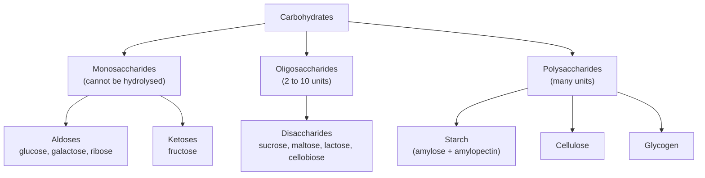

**D / L notation.** In a Fischer projection (CHO at the top), if the OH on the **highest-numbered stereocentre** is on the **right**, the sugar is **D**; if on the left, **L**. Natural sugars are mostly D.

**Fischer / Haworth key rules** (used throughout this file):

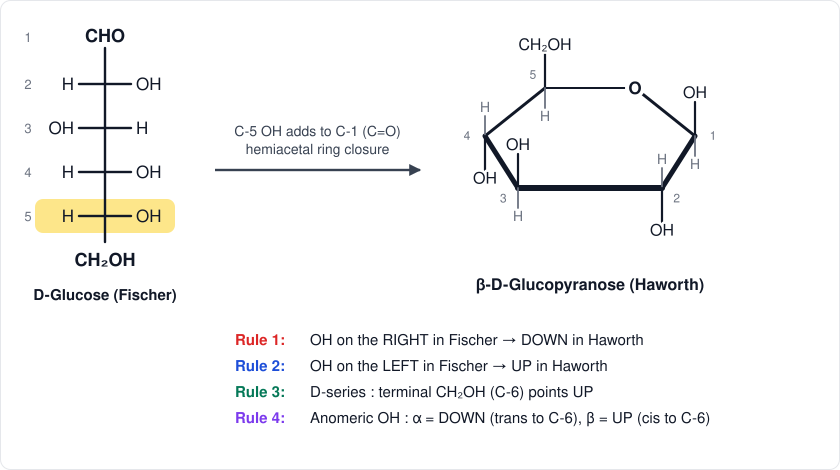

---

## 1. Answer to Q1 (i): Asymmetric Carbon and Mutarotation

### 1.1 Asymmetric carbon atom

**Definition.** An **asymmetric carbon atom** (chiral centre or stereocentre, often marked with an asterisk) is a carbon atom bonded to **four different atoms or groups**. Such a carbon has no plane of symmetry through it, so its molecule can exist as two non-superimposable mirror images (**enantiomers**), which rotate plane-polarised light in opposite directions.

**How to identify one**

1. The carbon must be $sp^3$ hybridised (four single bonds).
2. All four attached groups must be different (compare the whole group, not just the first atom).

**Examples**

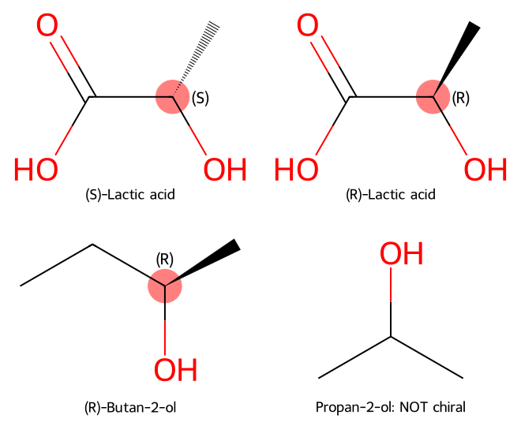

| Compound | Asymmetric C? | Reason |
|---|---|---|
| Lactic acid, $CH_3CH(OH)COOH$ | Yes (C-2) | H, OH, $CH_3$, COOH all different |
| Butan-2-ol, $CH_3CH_2CH(OH)CH_3$ | Yes (C-2) | H, OH, $CH_3$, $C_2H_5$ all different |
| Propan-2-ol, $(CH_3)_2CHOH$ | No | two identical $CH_3$ groups |
| Glyceraldehyde, $HOCH_2CH(OH)CHO$ | Yes (C-2) | H, OH, CHO, $CH_2OH$ all different |

**In carbohydrates.** The open-chain form of D-glucose has **four** asymmetric carbons (C-2, C-3, C-4, C-5):

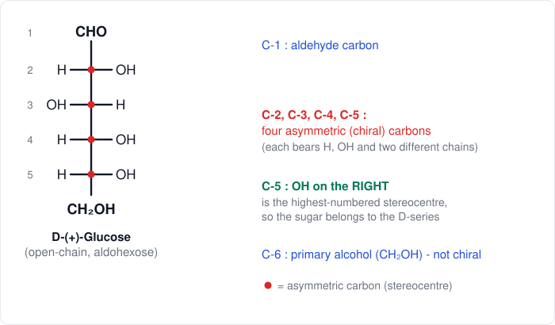

The maximum number of stereoisomers for $n$ different stereocentres is

$$N = 2^{n}$$

so an aldohexose ($n = 4$) has $2^4 = 16$ stereoisomers (8 D- and 8 L-), and a ketohexose ($n = 3$) has $2^3 = 8$. When glucose cyclises, C-1 also becomes asymmetric (the anomeric carbon), so a pyranose has $n = 5$ and $2^5 = 32$ stereoisomers.

> **Important exam point:** the presence of asymmetric carbons does not always make a molecule chiral (e.g. meso-tartaric acid has two asymmetric carbons but is optically inactive because of an internal plane of symmetry).

### 1.2 Mutarotation

**Definition.** **Mutarotation** is the **spontaneous change in the specific rotation of a freshly prepared solution of an optically active sugar until a constant (equilibrium) value is reached.**

**Classic data for D-glucose**

| Form | m.p. | Specific rotation (fresh) |
|---|---|---|
| α-D-(+)-glucopyranose | 146 °C | $+112.2^\circ$ |
| β-D-(+)-glucopyranose | 150 °C | $+18.7^\circ$ |
| Equilibrium mixture (in water) | - | $+52.7^\circ$ |

When pure α-D-glucose ($+112.2^\circ$) is dissolved in water, its rotation **falls** to $+52.7^\circ$; when pure β-D-glucose ($+18.7^\circ$) is dissolved, its rotation **rises** to $+52.7^\circ$.

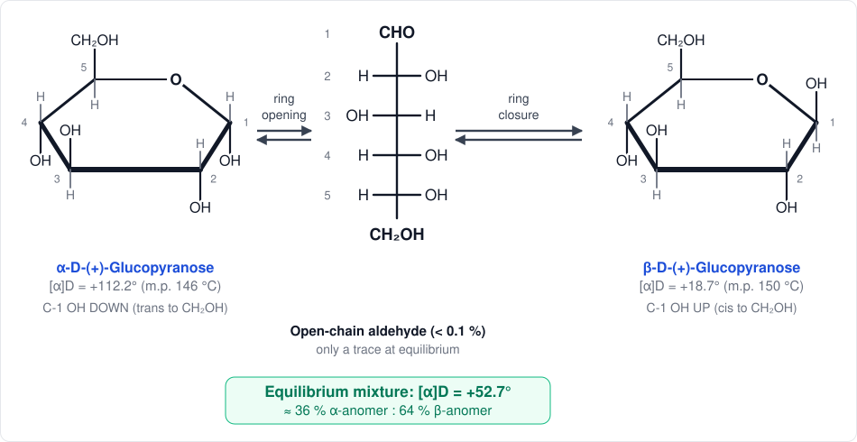

**Explanation.** In solution the cyclic hemiacetal slowly opens to the free aldehyde (free CHO), and the C-5 hydroxyl can re-attack C-1 from either face of the carbonyl group. This gives both anomers, which interconvert until equilibrium is established:

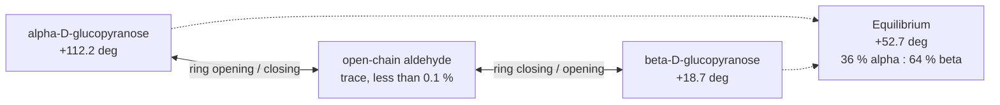

**Mechanism (acid or base catalysed).**

1. *Base:* $OH^-$ removes the proton of the anomeric OH; the electrons push to form $C=O$ and the C-1-O(ring) bond breaks, giving an alkoxide at C-5 (open chain).
   *Acid:* the ring oxygen is protonated, the C-1-O(ring) bond breaks and the free aldehyde forms.
2. The open chain rotates about C-4-C-5, and the C-5 oxygen re-adds to the planar $C=O$ at C-1 from the top or bottom face.
3. Top-face attack gives the β-anomer, bottom-face attack gives the α-anomer.

**Calculation of the composition.** If $x$ is the fraction of α-anomer at equilibrium:

$$x(112.2) + (1-x)(18.7) = 52.7 \quad\Rightarrow\quad x = \frac{52.7-18.7}{112.2-18.7} = 0.364$$

So the equilibrium mixture contains about **36.4 % α** and **63.6 % β**. The equilibrium constant is $K = [\beta]/[\alpha] \approx 1.75$, i.e. $\Delta G^\circ = -RT\ln K \approx -1.4\ \text{kJ mol}^{-1}$ at 298 K.

**Kinetics (extra).** Mutarotation follows reversible first-order kinetics. With $\alpha_0$, $\alpha_t$ and $\alpha_\infty$ the observed rotations at start, time $t$ and equilibrium:

$$\ln\frac{\alpha_0-\alpha_\infty}{\alpha_t-\alpha_\infty} = (k_1+k_2)\,t$$

where $k_1$ is the rate constant for α→β and $k_2$ for β→α, and $K = k_1/k_2$.

**Conditions and significance**

- Catalysed by acids and bases (and by amphoteric catalysts such as 2-pyridone); very slow in a neutral, non-polar solvent.
- Only sugars with a **free hemiacetal (anomeric) OH** show mutarotation. **Sucrose, methyl glucosides and trehalose do not.**
- Mutarotation is strong evidence that glucose exists mainly in cyclic hemiacetal forms and that the two forms (anomers) differ only at C-1.

---

## 2. Answer to Q1 (ii): Cyclic Structures

### 2.1 How cyclic structures are drawn

The open-chain structure of glucose cannot explain: (a) failure to give the Schiff and $NaHSO_3$ tests, (b) existence of two anomers, (c) mutarotation, (d) the pentaacetate having no free CHO. All are explained by a **cyclic hemiacetal**, formed when the C-5 OH adds to the C-1 carbonyl, giving a six-membered **pyranose** ring (a five-membered ring is called a **furanose**).

### 2.2 D-Glucose

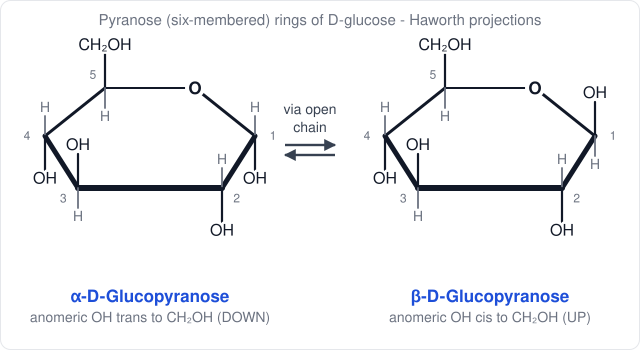

- Ring: C-1 to C-5 plus the ring oxygen (six-membered, pyran type).
- The new asymmetric carbon C-1 is the **anomeric carbon**; the two forms are **anomers** (α: OH down; β: OH up).
- In the D-series, the $CH_2OH$ group (C-6) is **up**.

**Chair (conformational) formula.** The six-membered ring is not flat; it prefers the chair.

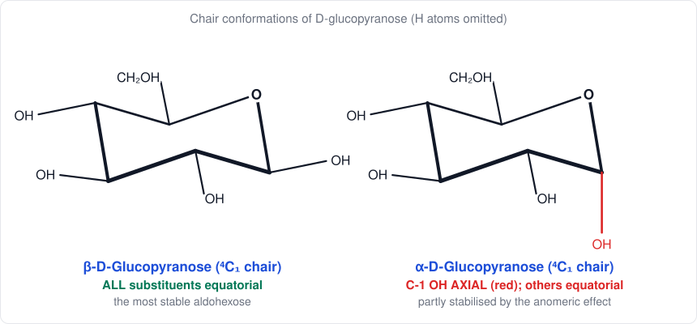

In β-D-glucopyranose **every** substituent (including $CH_2OH$) is equatorial, which makes it the most stable aldohexose.

### 2.3 Sucrose

Sucrose (cane sugar, $C_{12}H_{22}O_{11}$) is a disaccharide made of **α-D-glucopyranose** and **β-D-fructofuranose** joined by an **α(1→2)β glycosidic bond** between C-1 of glucose and C-2 of fructose.

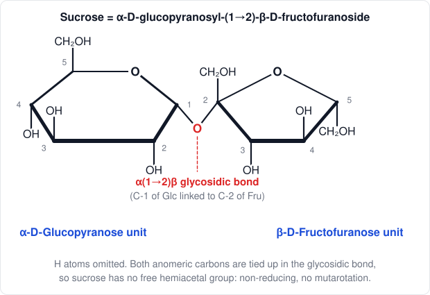

Key facts:

- Both anomeric carbons are used in the glycosidic bond, so there is **no free hemiacetal group**: sucrose is **non-reducing** (no Fehling/Tollens reaction, no osazone, no mutarotation).
- Hydrolysis ($H^+$ or invertase) gives equal amounts of D-glucose ($+52.7^\circ$) and D-fructose ($-92.4^\circ$). The mixture is levorotatory ($\approx -19.9^\circ$), whereas sucrose is $+66.5^\circ$, so the change is called **inversion** and the product is **invert sugar**.

### 2.4 Cellulose

Cellulose is an unbranched polymer of **β-D-glucopyranose** units joined by **β(1→4) glycosidic bonds**. The repeating disaccharide unit is **cellobiose**.

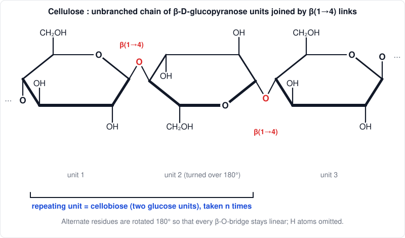

Key facts:

- Every second glucose unit is turned over by 180° so that the chain stays straight; the molecule is a long, rigid ribbon.
- Extensive intra- and inter-chain hydrogen bonding packs chains into **microfibrils**, giving high tensile strength (cotton, jute, flax, wood).
- Complete hydrolysis (conc. $H_2SO_4$ or cellulase) gives only **D-glucose**; partial hydrolysis gives **cellobiose**.
- Humans lack cellulase (a β-1,4-glucanase), so cellulose is not digested.

### 2.5 Starch

Starch is a mixture of two polysaccharides, both built only from **α-D-glucopyranose**:

| | Amylose | Amylopectin |
|---|---|---|
| Share of starch | 20-30 % | 70-80 % |
| Linkage | α(1→4) only | α(1→4) with α(1→6) branches |
| Shape | linear, coiled helix | highly branched |
| Water solubility | soluble | insoluble (swells) |
| Colour with $I_2$ | deep blue | red-violet |

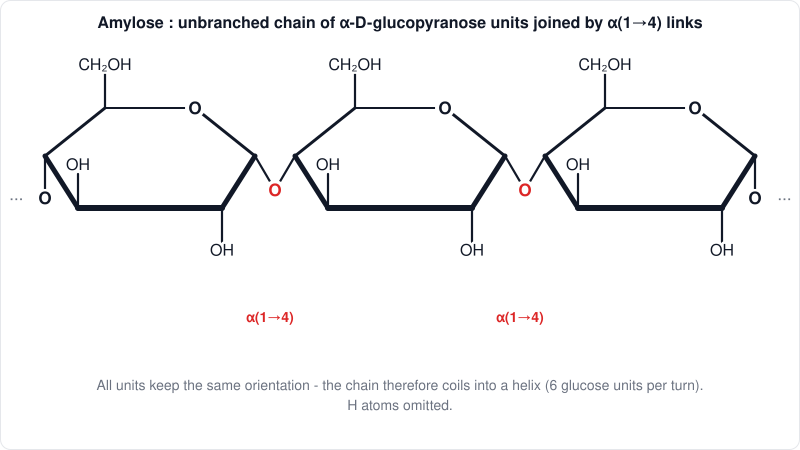

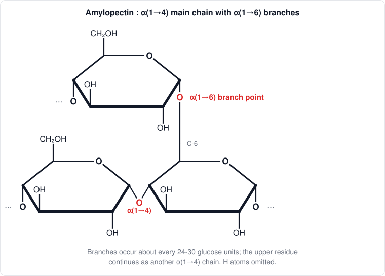

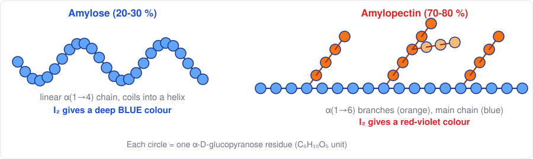

Hydrolysis: starch $\xrightarrow{\text{amylase}}$ dextrins $\rightarrow$ **maltose** $\xrightarrow{\text{maltase}}$ **D-glucose**.

### 2.6 Summary table

| Carbohydrate | Units | Linkage | Reducing? | Hydrolysis product |
|---|---|---|---|---|
| D-Glucose | 1 | - (cyclic hemiacetal) | Yes | - |
| Sucrose | Glc + Fru | α(1→2)β | **No** | glucose + fructose |
| Cellulose | β-Glc ×n | β(1→4) | Only at one chain end | glucose (cellobiose first) |
| Amylose | α-Glc ×n | α(1→4) | Only at one chain end | maltose, then glucose |
| Amylopectin | α-Glc ×n | α(1→4), α(1→6) | Only at chain ends | maltose, glucose |

---

## 3. Answer to Q1 (iii): Ascending and Descending the Aldose Series

### 3.1 Aldose to the next HIGHER aldose: Kiliani-Fischer synthesis

**Principle.** One carbon is added at the aldehyde end through a cyanohydrin; the old C-1 becomes C-2. Since the new C-2 may have either configuration, **two epimeric aldoses** are formed.

**Steps**

1. **Cyanohydrin formation:** the aldose adds HCN (NaCN, $H^+$) to give two epimeric cyanohydrins.
2. **Hydrolysis:** the nitrile ($-CN$) is hydrolysed ($H_3O^+$, heat) to the aldonic acid, which forms the lactone and is separated from its epimer.
3. **Reduction:** the lactone is reduced (Na-Hg amalgam at pH 3-5, or $H_2$/Pd-$BaSO_4$ on the nitrile) to the aldose.

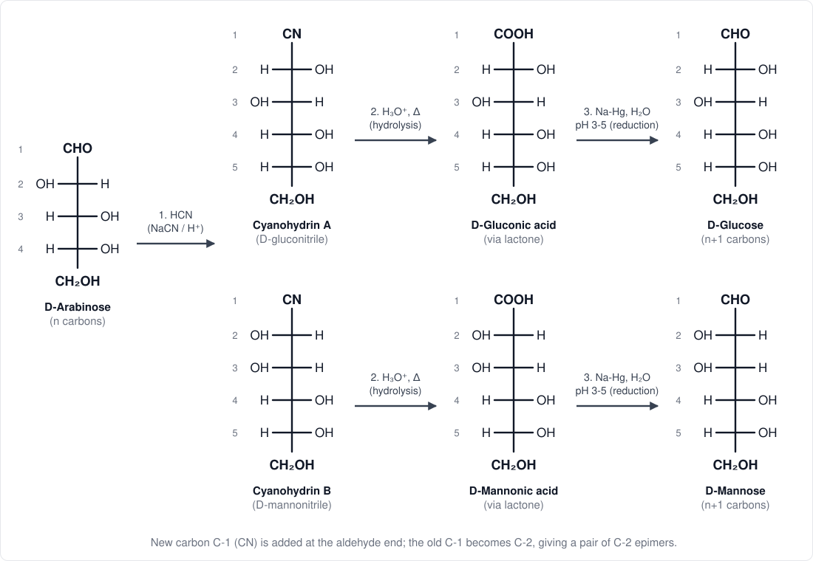

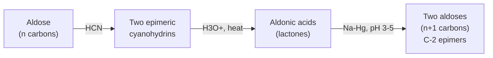

**Example.** D-Arabinose (5 C) gives **D-glucose** and **D-mannose** (6 C), which are C-2 epimers.

### 3.2 Aldose to the next LOWER aldose

#### (a) Ruff degradation

1. The aldose is oxidised with bromine water to the **aldonic acid**.
2. The acid is converted to its **calcium salt**.
3. The salt is oxidised with $H_2O_2$ and $Fe^{3+}$ (Fenton type): C-1 is lost as $CO_2$ and C-2 becomes the new aldehyde carbon.

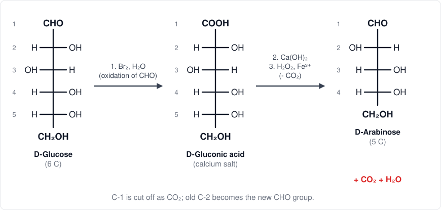

#### (b) Wohl degradation

1. The aldose reacts with hydroxylamine to give the **oxime**.
2. Acetic anhydride and sodium acetate (heat) dehydrate the oxime to the nitrile and acetylate all OH groups (**acetylated aldononitrile**).
3. Sodium methoxide in methanol removes the acetyl groups; the cyanohydrin so formed loses **HCN**, giving the lower aldose.

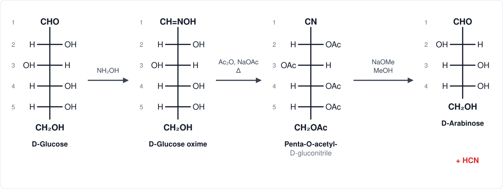

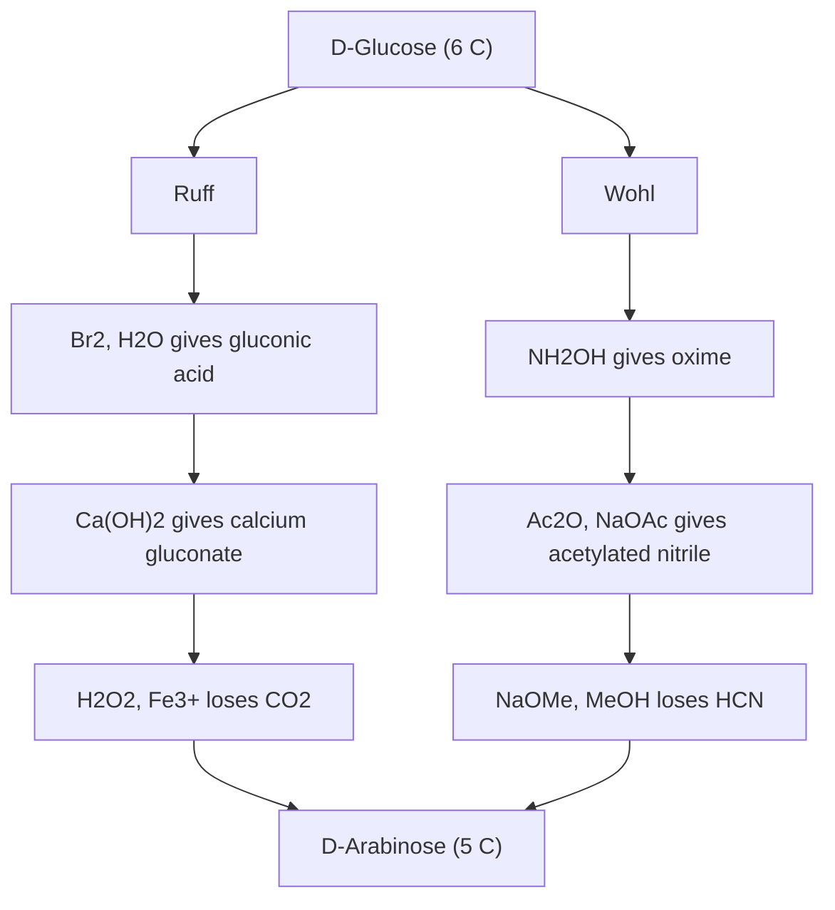

> **Remember:** Kiliani-Fischer *creates* a new C-2 stereocentre (two products); Ruff and Wohl *destroy* the C-2 stereocentre, so **C-2 epimers give the same lower aldose** (e.g. D-glucose and D-mannose both give D-arabinose).

---

## 4. Answer to Q1 (iv): Determination of the Ring Size of D-Glucose

**Aim.** To show that the ring oxygen links C-1 and C-5 (six-membered, **pyranose**) and not C-1 and C-4 (five-membered, furanose). This was done by **Haworth** using methylation and oxidation.

### 4.1 Haworth's methylation-oxidation method

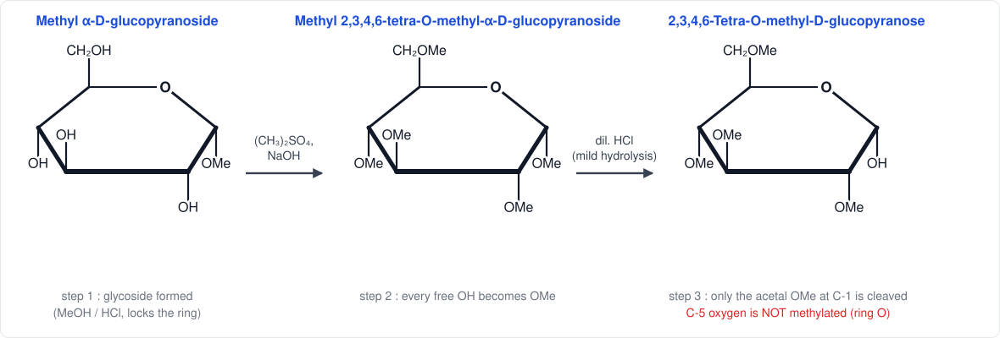

**Step 1 - Glycoside formation.** D-Glucose is heated with methanol and dry HCl to give **methyl D-glucoside** (α and β). The anomeric OH becomes an OMe (acetal), which fixes the ring: the product shows no mutarotation and no reducing properties.

**Step 2 - Exhaustive methylation.** Treatment with dimethyl sulfate and NaOH (or $CH_3I/Ag_2O$) converts all free OH groups into OMe, giving **methyl 2,3,4,6-tetra-O-methyl-D-glucoside** (five OMe groups in all, with the ring oxygen unmethylated).

**Step 3 - Mild acid hydrolysis.** Only the acetal OMe at C-1 is cleaved, giving **2,3,4,6-tetra-O-methyl-D-glucose**. Methoxyl groups are present on C-2, C-3, C-4 and C-6 only; the oxygen on C-5 was the ring oxygen, so it was never methylated and becomes the free OH of the open-chain (hemiacetal) form.

**Step 4 - Oxidation.** Oxidation with conc. $HNO_3$ first converts CHO to COOH (tetramethylgluconic acid), and the free secondary OH at C-5 is then oxidised to a ketone and the chain cleaves. The diagnostic product is

- **2,3,4-trimethoxyglutaric acid** (a five-carbon dicarboxylic acid, C-1 to C-5 intact).

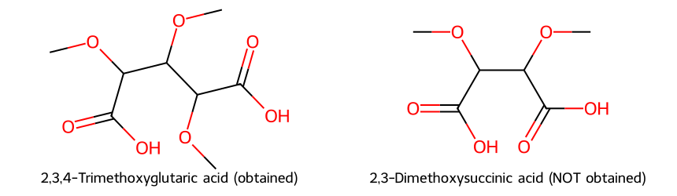

**Conclusion.** The five-carbon acid carries OMe on its C-2, C-3 and C-4, so the C-5 oxygen must have been the free (ring) oxygen. If the ring had been five-membered (C-1 to C-4 bridged), the free OH would be on C-4 and the product would have been **2,3-dimethoxysuccinic acid** (four carbons), which was **not** obtained. Hence D-glucose has a **six-membered pyranose** ring.

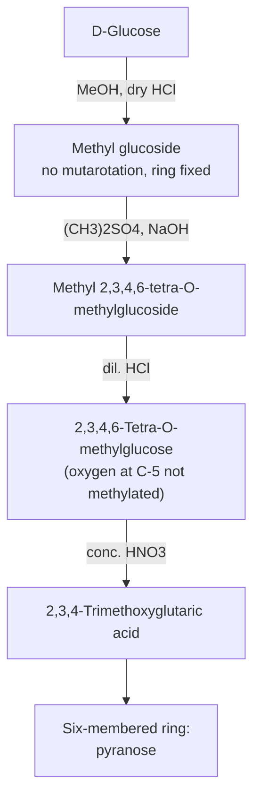

### 4.2 Supporting evidence

**Periodate oxidation of the methyl glucoside** ($HIO_4$ cleaves vicinal diols):

| Methyl glucoside type | Free vicinal OH groups | $HIO_4$ used | By-product |
|---|---|---|---|
| Pyranoside (ring C-1 to C-5) | C-2, C-3, C-4 (triol) | 2 mol | 1 mol HCOOH, no HCHO |
| Furanoside (ring C-1 to C-4) | C-2/C-3 and C-5/C-6 (two diols) | 2 mol | 1 mol HCHO, no HCOOH |

Methyl glucoside gives 2 mol $HIO_4$ consumed and **formic acid** (not formaldehyde), again showing the pyranose ring.

**Other evidence:** X-ray crystallography and NMR studies of crystalline glucose and its derivatives confirm the chair-shaped pyranose ring.

---

## 5. Extra Sections

### 5.1 Epimers, anomers and other stereo-relationships

| Term | Meaning | Example |
|---|---|---|
| **Enantiomers** | non-superimposable mirror images | D-glucose / L-glucose |
| **Diastereomers** | stereoisomers that are not mirror images | D-glucose / D-mannose |
| **Epimers** | diastereomers differing at **one** stereocentre | glucose / mannose (C-2), glucose / galactose (C-4) |
| **Anomers** | epimers differing only at the anomeric carbon (C-1) | α- / β-D-glucopyranose |
| **Functional isomers** | aldose / ketose | glucose / fructose |

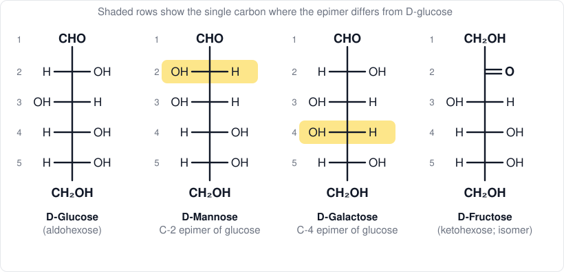

### 5.2 Family tree of the D-aldoses (Kiliani-Fischer)

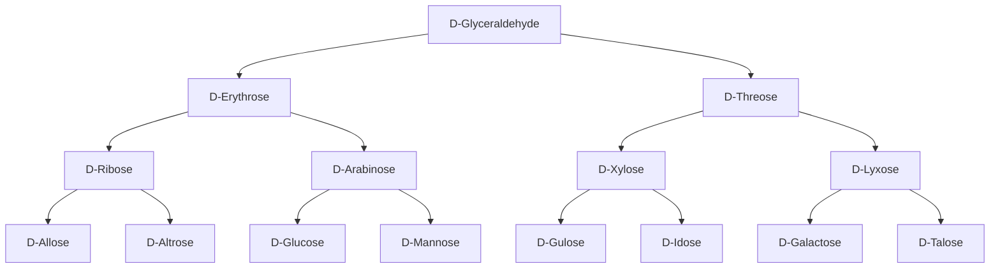

Each downward step is one Kiliani-Fischer cycle (+1 carbon, two C-2 epimers).

### 5.3 Reducing and non-reducing sugars

| Sugar | Linkage | Free hemiacetal? | Reducing? | Mutarotation? |
|---|---|---|---|---|
| Glucose, fructose | - | Yes | Yes | Yes |
| Maltose | α(1→4) | Yes (one end) | Yes | Yes |
| Lactose | β(1→4) (Gal-Glc) | Yes (one end) | Yes | Yes |
| Cellobiose | β(1→4) | Yes (one end) | Yes | Yes |
| **Sucrose** | α(1→2)β | **No** | **No** | **No** |
| Trehalose | α(1→1)α | No | No | No |

### 5.4 Why is β-D-glucose more abundant at equilibrium?

In the chair form all substituents of the β-anomer are equatorial; in the α-anomer the anomeric OH is axial, which causes 1,3-diaxial strain. The **anomeric effect** (stabilisation of an axial electronegative substituent at C-1) partly offsets this strain, which is why a sizeable 36 % of the α-form remains rather than 0 %.

### 5.5 Common mistakes to avoid in the exam

1. Writing the $CH_2OH$ of D-sugars **down** in Haworth (it must be **up**).
2. Mixing up the rule: Fischer right = Haworth **down**, left = **up**.
3. Calling sucrose reducing.
4. Forgetting that Kiliani-Fischer gives **two** epimers.
5. Forgetting to show the **anomeric carbon** with a different shape of OH for α and β.
6. Missing the notation of glycosidic bond (e.g. α(1→4), β(1→4)).

---

## 6. Practice Problems (with Solutions)

> Tap each *Show solution* to reveal the answer.

**P1.** How many asymmetric carbons are present in open-chain D-fructose, and how many stereoisomers are possible?

Show solution

D-Fructose is a 2-ketohexose: C-3, C-4 and C-5 are asymmetric (C-1, C-2 and C-6 are not). $n = 3$, so $2^3 = 8$ stereoisomers (4 D- and 4 L-).

**P2.** A freshly prepared solution of pure α-D-glucose ($[\alpha]_D = +112.2^\circ$) reaches an equilibrium rotation of $+52.7^\circ$. If pure β-D-glucose is $+18.7^\circ$, find the percentage of each anomer at equilibrium.

Show solution

$x(112.2) + (1-x)(18.7) = 52.7$, so $93.5x = 34.0$ and $x = 0.364$.
**36.4 % α and 63.6 % β.**

**P3.** The specific rotation is $[\alpha] = \dfrac{\alpha_{obs}}{l\,c}$ ($l$ in dm, $c$ in g/mL). A solution of 10 g glucose in 100 mL in a 2 dm tube shows $+10.54^\circ$ at equilibrium. Find $[\alpha]_D$.

Show solution

$c = 10/100 = 0.10$ g/mL, $l = 2$ dm.
$[\alpha] = \dfrac{10.54}{2 \times 0.10} = +52.7^\circ$ (equilibrium glucose).

**P4.** Sucrose ($[\alpha]_D = +66.5^\circ$) is hydrolysed completely. Glucose is $+52.7^\circ$ and fructose $-92.4^\circ$. Calculate the rotation of the equimolar product and explain "inversion".

Show solution

$[\alpha] = \tfrac12(52.7) + \tfrac12(-92.4) = -19.85^\circ \approx -19.9^\circ$.
The sign changes from dextro ($+$) to laevo ($-$), so the hydrolysis is called inversion and the mixture is invert sugar.

**P5.** Draw the Haworth structure of β-D-galactopyranose by changing one position of β-D-glucopyranose.

Show solution

Galactose is the **C-4 epimer** of glucose. Starting from β-D-glucopyranose (C-1 OH up, C-2 OH down, C-3 OH up, C-4 OH down, C-5 $CH_2OH$ up), flip only C-4:
**C-1 OH up, C-2 OH down, C-3 OH up, C-4 OH UP, C-5 $CH_2OH$ up.**

**P6.** What products are formed when D-erythrose undergoes Kiliani-Fischer synthesis?

Show solution

D-Ribose and D-arabinose (C-2 epimers, both pentoses).

**P7.** What does Ruff degradation of D-galactose give? Does Ruff degradation of D-mannose give the same product as D-glucose?

Show solution

D-Galactose gives **D-lyxose**. D-Glucose and D-mannose (C-2 epimers) both give **D-arabinose**, because C-2 becomes the aldehyde carbon and its configuration is lost.

**P8.** Why does sucrose not show mutarotation or reduce Tollens' reagent?

Show solution

Both anomeric carbons (C-1 of glucose and C-2 of fructose) form the glycosidic bond, so no free hemiacetal OH exists; it cannot open to a free CHO or C=O, therefore it is non-reducing and does not mutarotate.

**P9.** Distinguish between maltose and cellobiose.

Show solution

Both are glucose-glucose disaccharides with a (1→4) link and both are reducing. Maltose has an **α(1→4)** link (hydrolysed by maltase, an α-glucosidase); cellobiose has a **β(1→4)** link (hydrolysed by emulsin, a β-glucosidase). Maltose comes from starch, cellobiose from cellulose.

**P10.** What colour does iodine give with (a) amylose, (b) amylopectin? Why?

Show solution

(a) Deep **blue**, because iodine sits inside the long helical channel of amylose. (b) **Red-violet**, because the branches are short, so only short helical segments form.

**P11.** A methylated methyl hexoside, on hydrolysis and oxidation, gives 2,3-dimethoxysuccinic acid. What is the ring size of the sugar?

Show solution

A four-carbon (succinic) diacid with OMe on C-2 and C-3 means the free OH was on C-4, so the ring was closed through C-4: **five-membered (furanose) ring**.

**P12.** Calculate the $HIO_4$ consumed by methyl α-D-glucopyranoside, and state the by-product.

Show solution

Free OH on C-2, C-3, C-4 form a vicinal triol (C-6 OH is separated by the ring carbon C-5), so **2 mol $HIO_4$** are consumed and **1 mol HCOOH** is formed (from C-3).

**P13.** Why do D-glucose, D-mannose and D-fructose give the same osazone?

Show solution

Phenylhydrazine reacts at C-1 and C-2 only, destroying the stereochemistry at C-2. Glucose and mannose differ only at C-2, and fructose has the same C-3 to C-5 configuration, so all three give the same **D-glucosazone**.

**P14.** Draw the chair form of α-D-glucopyranose and explain which anomer is more stable.

Show solution

Chair drawing: see the chair figure in Section 2.2 - in the α-anomer the C-1 OH is axial and all other groups are equatorial. The β-anomer (all equatorial) is intrinsically more stable (about 64 % at equilibrium); the α-anomer persists (36 %) due to the anomeric effect.

---

## 7. References

1. R. T. Morrison and R. N. Boyd, *Organic Chemistry*, Prentice-Hall (chapter on carbohydrates).
2. T. W. G. Solomons and C. B. Fryhle, *Organic Chemistry*, Wiley.
3. P. Y. Bruice, *Organic Chemistry*, Pearson.
4. J. McMurry, *Organic Chemistry*, Cengage.
5. I. L. Finar, *Organic Chemistry, Vol. 1: The Fundamental Principles*, Longman.
6. B. S. Bahl and A. Bahl, *Advanced Organic Chemistry*, S. Chand.
7. IUPAC-IUBMB Joint Commission on Biochemical Nomenclature, *Nomenclature of Carbohydrates* (1996).

---

*Notes: BUTEX CHEM-103, Chapter 5 (Carbohydrates). Structures were generated as SVG and stored in `../../assets/`. File version `v261108-1`.*
