# Carbonyl Compounds — Chemistry-II (CHEM-103) Previous-Year Questions Solved, 2016–2023

*Aldehydes, ketones and related reactions — every question from the supplied paper set, answered in exam style with structural diagrams, mechanisms and worked examples.*

> **Conventions.** All structures are drawn as skeletal formulas (benzene rings shown as Kekulé hexagons). In mechanisms, **red curved arrows** show the movement of an electron pair; yellow circles highlight the C=O group. Figures are stored in `../../assets/` and are named `chem-carbonyl-*.svg`.

---

## Table of Contents

- [Question Map (year → answer)](#question-map-year--answer)
- [1. Carbonyl Group, Structure and Classification](#1-carbonyl-group-structure-and-classification)
- [2. Preparation of Aliphatic Aldehydes and Ketones](#2-preparation-of-aliphatic-aldehydes-and-ketones)
- [3. Reactivity of Aldehydes and Ketones](#3-reactivity-of-aldehydes-and-ketones)
- [4. Distinguishing Aldehydes from Ketones](#4-distinguishing-aldehydes-from-ketones)
- [5. Distinguishing Acetaldehyde from Acetone](#5-distinguishing-acetaldehyde-from-acetone)
- [6. Nucleophilic Addition and the Reactions of Benzaldehyde](#6-nucleophilic-addition-and-the-reactions-of-benzaldehyde)
- [7. Cannizzaro Reaction](#7-cannizzaro-reaction)
- [8. Aldol Condensation](#8-aldol-condensation)
- [9. Haloform Reaction](#9-haloform-reaction)
- [10. Rosenmund Reduction](#10-rosenmund-reduction)
- [11. Reimer–Tiemann Reaction](#11-reimertiemann-reaction)
- [12. Acid Strength of Carboxylic Acids and Glacial Acetic Acid](#12-acid-strength-of-carboxylic-acids-and-glacial-acetic-acid)
- [13. Synthesis of Acetophenone from Benzene](#13-synthesis-of-acetophenone-from-benzene)
- [14. Ethanol / Ethanal with Dilute NaOH and 2,4-DNP](#14-ethanol--ethanal-with-dilute-naoh-and-24-dnp)
- [15. Amino Acid with Formaldehyde and Benzoyl Chloride](#15-amino-acid-with-formaldehyde-and-benzoyl-chloride)
- [Extra A. Reaction Map of Ethanal](#extra-a-reaction-map-of-ethanal)
- [Extra B. Physical Properties and Spectroscopy](#extra-b-physical-properties-and-spectroscopy)
- [Extra C. Reduction of Carbonyl Compounds](#extra-c-reduction-of-carbonyl-compounds)
- [Extra D. Named Reactions Cheat-Sheet](#extra-d-named-reactions-cheat-sheet)
- [Extra E. Common Mistakes and Exam Tips](#extra-e-common-mistakes-and-exam-tips)
- [Extra F. Practice Questions with Answers](#extra-f-practice-questions-with-answers)
- [References](#references)

---

## Question Map (year → answer)

Several questions repeat across years, so each topic is answered **once in full** in the section shown below. Quote the section in your answer script, adjusting the order of parts to match the question.

| Year | Question | Part | Topic | Answer in |
|------|----------|------|-------|-----------|
| 2016 | Q2 | (a) | Two general methods for aliphatic aldehydes and ketones | [Section 2](#2-preparation-of-aliphatic-aldehydes-and-ketones) |
| 2016 | Q2 | (b) | Distinguish acetaldehyde and acetone (three reactions) | [Section 5](#5-distinguishing-acetaldehyde-from-acetone) |
| 2016 | Q2 | (c) | Acetic acid vs propionic acid vs chloroacetic acid | [Section 12](#12-acid-strength-of-carboxylic-acids-and-glacial-acetic-acid) |
| 2016 | Q2 | (d) | Acetophenone from benzene | [Section 13](#13-synthesis-of-acetophenone-from-benzene) |
| 2017 | Q4 | (a) | Mechanism of Cannizzaro reaction | [Section 7](#7-cannizzaro-reaction) |
| 2017 | Q4 | (b) | Reactivity of HCHO, CH₃CHO, CH₃COCH₃ | [Section 3](#3-reactivity-of-aldehydes-and-ketones) |
| 2017 | Q4 | (c) | Ethanol with (i) dil. NaOH (ii) DNP | [Section 14](#14-ethanol--ethanal-with-dilute-naoh-and-24-dnp) |
| 2018 | Q3 | (a) | Aliphatic and aromatic aldehyde and ketone | [Section 1](#1-carbonyl-group-structure-and-classification) |
| 2018 | Q3 | (b) | Preparation of aliphatic aldehyde and ketone | [Section 2](#2-preparation-of-aliphatic-aldehydes-and-ketones) |
| 2018 | Q3 | (c) | Benzaldehyde with H₂NOH, HCN, phenylhydrazine | [Section 6](#6-nucleophilic-addition-and-the-reactions-of-benzaldehyde) |
| 2018 | Q3 | (d) | Distinguish aldehyde and ketone | [Section 4](#4-distinguishing-aldehydes-from-ketones) |
| 2018 | Q6 | (c) | Amino acid with formaldehyde and benzoyl chloride | [Section 15](#15-amino-acid-with-formaldehyde-and-benzoyl-chloride) |
| 2019 | Q3 | (b) | Distinguish acetaldehyde and acetone | [Section 5](#5-distinguishing-acetaldehyde-from-acetone) |
| 2020 | Q4 | (a) | Distinguish aldehydes and ketones | [Section 4](#4-distinguishing-aldehydes-from-ketones) |
| 2020 | Q4 | (b) | Why aldehydes are more reactive than ketones | [Section 3](#3-reactivity-of-aldehydes-and-ketones) |
| 2020 | Q4 | (c) | Glacial acetic acid; acid-strength order | [Section 12](#12-acid-strength-of-carboxylic-acids-and-glacial-acetic-acid) |
| 2020 | Q4 | (d) | Notes: Rosenmund reduction, Reimer–Tiemann reaction | [Section 10](#10-rosenmund-reduction), [Section 11](#11-reimertiemann-reaction) |
| 2021 | Q2 | (a) | Aliphatic and aromatic aldehyde and ketone | [Section 1](#1-carbonyl-group-structure-and-classification) |
| 2021 | Q2 | (b) | Preparation of aliphatic aldehyde and ketone | [Section 2](#2-preparation-of-aliphatic-aldehydes-and-ketones) |
| 2021 | Q2 | (c) | Benzaldehyde with PCl₅, HCN, H₂NOH | [Section 6](#6-nucleophilic-addition-and-the-reactions-of-benzaldehyde) |
| 2021 | Q2 | (d) | Distinguish aldehyde and ketone | [Section 4](#4-distinguishing-aldehydes-from-ketones) |
| 2022 | Q2 | (a) | Aliphatic and aromatic aldehyde and ketone | [Section 1](#1-carbonyl-group-structure-and-classification) |
| 2022 | Q2 | (b) | Preparation of aliphatic aldehyde and ketone | [Section 2](#2-preparation-of-aliphatic-aldehydes-and-ketones) |
| 2022 | Q2 | (c) | Cannizzaro, aldol condensation, haloform reaction | [Section 7](#7-cannizzaro-reaction), [Section 8](#8-aldol-condensation), [Section 9](#9-haloform-reaction) |
| 2022 | Q2 | (d) | Distinguish aldehyde and ketone | [Section 4](#4-distinguishing-aldehydes-from-ketones) |
| 2023 | Q3 | (a) | Why aldehydes are more reactive than ketones | [Section 3](#3-reactivity-of-aldehydes-and-ketones) |
| 2023 | Q3 | (b) | Preparation of aliphatic aldehydes and ketones | [Section 2](#2-preparation-of-aliphatic-aldehydes-and-ketones) |
| 2023 | Q3 | (c) | Notes: Rosenmund reduction, Cannizzaro reaction | [Section 10](#10-rosenmund-reduction), [Section 7](#7-cannizzaro-reaction) |
| 2023 | Q3 | (d) | Distinguish acetaldehyde and acetone | [Section 5](#5-distinguishing-acetaldehyde-from-acetone) |

> **Note on 2017 Q4(c).** The paper prints "Ethanol", but the reagents (dil. NaOH, 2,4-DNP) are tests for a carbonyl compound, so *ethanal* was almost certainly intended. Section 14 answers **both** readings.

---

## 1. Carbonyl Group, Structure and Classification

**Asked in:** 2018 Q3(a) · 2021 Q2(a) · 2022 Q2(a)

### The carbonyl group

The **carbonyl group** is a carbon atom joined to oxygen by a double bond, **C=O**. The carbon is *sp²*-hybridised: it forms three σ bonds in one plane at about 120° (trigonal planar) and one π bond (p–p overlap) with oxygen. Because oxygen is more electronegative than carbon, the π electrons are pulled towards oxygen: the carbon is **δ+ (electrophilic)** and the oxygen is **δ− (nucleophilic/basic)**. This polarity explains almost all the chemistry of aldehydes and ketones — nucleophiles attack carbon, electrophiles (H⁺) attack oxygen.

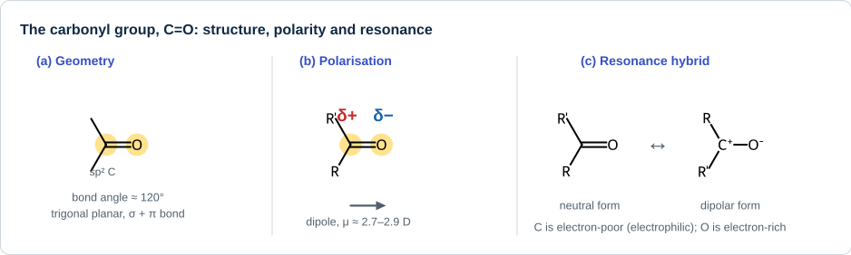

*Figure 1. The carbonyl group — (a) planar sp² geometry, (b) bond polarisation and dipole, (c) resonance contribution of the dipolar form.*

### Definitions

| Class | General formula | Definition |
|-------|-----------------|------------|
| Aldehyde | R–CHO | Carbonyl carbon bonded to **at least one hydrogen** (and to H or one alkyl/aryl group). The –CHO group is always at the end of a carbon chain. |
| Ketone | R–CO–R′ | Carbonyl carbon bonded to **two carbon groups** (alkyl or aryl). The C=O lies inside the chain. |
| **Aliphatic** aldehyde / ketone | R, R′ = H or alkyl | The carbonyl carbon is attached only to hydrogen and/or **alkyl** groups; no benzene ring is bonded directly to the C=O. |
| **Aromatic** aldehyde / ketone | Ar–CHO, Ar–CO–R, Ar–CO–Ar′ | The carbonyl carbon is attached **directly to a benzene (aryl) ring**. |

> A compound such as phenylacetaldehyde, C₆H₅CH₂CHO, is **aliphatic** (the CHO is bonded to CH₂, not to the ring), even though it contains a ring.

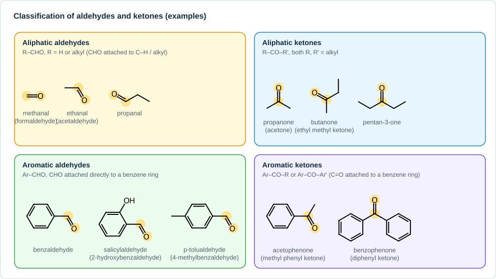

*Figure 2. Examples of the four classes with IUPAC and common names.*

### Nomenclature

| Structure | Common name | IUPAC name | Rule |
|-----------|-------------|------------|------|
| HCHO | formaldehyde | methanal | alkane **-e** → **-al** |
| CH₃CHO | acetaldehyde | ethanal | the CHO carbon is C-1 |
| CH₃CH₂CHO | propionaldehyde | propanal | |
| CH₃COCH₃ | acetone | propanone | alkane **-e** → **-one** |
| CH₃COCH₂CH₃ | ethyl methyl ketone | butanone | number to give C=O lowest locant |
| C₆H₅CHO | benzaldehyde | benzaldehyde | ring + CHO |
| C₆H₅COCH₃ | acetophenone | 1-phenylethanone | |
| C₆H₅COC₆H₅ | benzophenone | diphenylmethanone | |

---

## 2. Preparation of Aliphatic Aldehydes and Ketones

**Asked in:** 2016 Q2(a) *(two general methods)* · 2018 Q3(b) · 2021 Q2(b) · 2022 Q2(b) · 2023 Q3(b)

> **Answer plan.** For "describe two general methods" (2016) write **Method 1 and Method 2** below in full. For "explain the methods of preparation" (2018, 2021, 2022, 2023) write Methods 1–6 with one equation each, and mention 7–8 briefly.

### Method 1 — Oxidation or dehydrogenation of alcohols *(general: gives both)*

| Alcohol | Product | Reagent |
|---------|---------|---------|
| **Primary** (RCH₂OH) | **Aldehyde** (RCHO) | K₂Cr₂O₇ / dil. H₂SO₄ with the aldehyde **distilled out as it forms**, or PCC in CH₂Cl₂ |
| **Secondary** (R₂CHOH) | **Ketone** (R₂C=O) | K₂Cr₂O₇ / H₂SO₄ or CrO₃ |
| 1° or 2° alcohol vapour | aldehyde / ketone + H₂ | **Dehydrogenation** over Cu at 573 K |

CH₃CH₂OH + [O] → CH₃CHO + H₂O   (ethanol → ethanal)

(CH₃)₂CHOH + [O] → (CH₃)₂CO + H₂O   (propan-2-ol → propanone)

If the aldehyde is not removed (distilled, b.p. lower than the alcohol) it is oxidised further to the carboxylic acid. Ketones resist further oxidation.

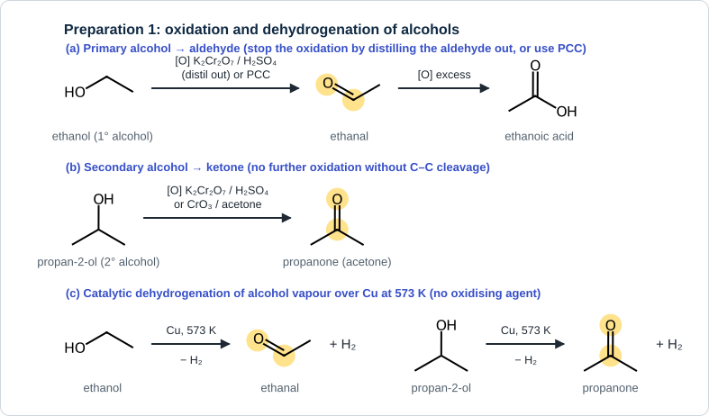

*Figure 3. Preparation by oxidation (a, b) and dehydrogenation (c) of alcohols.*

### Method 2 — Dry distillation of calcium salts of carboxylic acids *(general: gives both)*

* Calcium salt of **one** acid → **ketone**: (CH₃COO)₂Ca → CH₃COCH₃ + CaCO₃
* Calcium formate + calcium salt of another acid (1 : 1) → **aldehyde**: (HCOO)₂Ca + (CH₃COO)₂Ca → 2 CH₃CHO + 2 CaCO₃
* Calcium formate alone → methanal: (HCOO)₂Ca → HCHO + CaCO₃

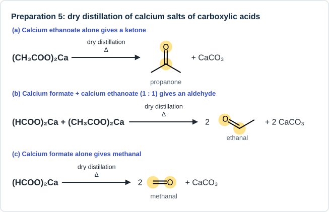

*Figure 4. Dry distillation of calcium carboxylates.*

### Method 3 — Ozonolysis of alkenes *(general: gives both)*

The alkene adds ozone to form an **ozonide**, which is cleaved by **Zn / H₂O** (reductive work-up; Zn prevents oxidation of the aldehyde to acid). Every **=CH–R** end becomes an **aldehyde**; every **=CR₂** end becomes a **ketone**.

(CH₃)₂C=CHCH₃ + O₃ → ozonide → (CH₃)₂C=O + CH₃CHO

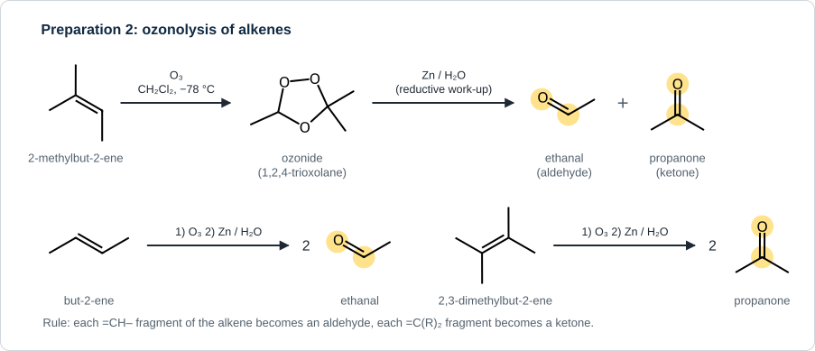

*Figure 5. Ozonolysis: 2-methylbut-2-ene gives propanone + ethanal.*

### Method 4 — Hydration of alkynes (Kucherov reaction) *(general: gives both)*

Water adds across the triple bond (Markovnikov) in the presence of **HgSO₄ / dil. H₂SO₄** at 333 K to give an unstable **enol**, which tautomerises to the carbonyl compound. **Ethyne gives the only aldehyde** (ethanal); every other alkyne gives a **ketone**.

HC≡CH + H₂O → [CH₂=CHOH] → CH₃CHO   ·   CH₃C≡CH + H₂O → [CH₃C(OH)=CH₂] → CH₃COCH₃

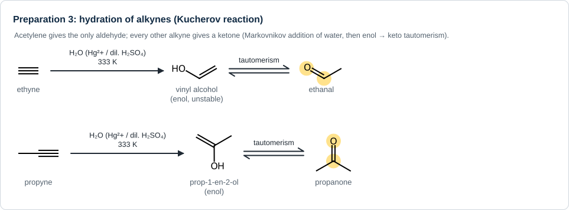

*Figure 6. Kucherov hydration followed by enol → keto tautomerism.*

### Method 5 — Rosenmund reduction *(aldehydes only)*

Acid chloride + H₂ over **Pd / BaSO₄** (poisoned with quinoline or sulphur) → aldehyde + HCl. Details in [Section 10](#10-rosenmund-reduction).

CH₃COCl + H₂ → CH₃CHO + HCl

### Method 6 — Stephen reduction *(aldehydes only)*

Alkyl cyanide is reduced with **SnCl₂ / HCl** to the aldimine hydrochloride, which is hydrolysed by warm water.

CH₃C≡N + 2[H] + HCl → CH₃CH=NH·HCl → (H₂O) → CH₃CHO + NH₄Cl

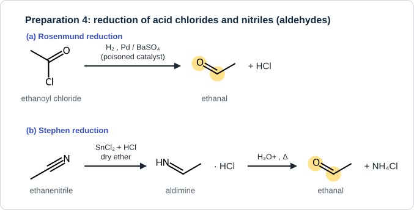

*Figure 7. Rosenmund (a) and Stephen (b) reductions.*

### Method 7 — From nitriles or acid chlorides with organometallics *(ketones)*

* Nitrile + Grignard reagent, then hydrolysis: CH₃CN + C₂H₅MgBr → CH₃C(=NMgBr)C₂H₅ → (H₃O⁺) → CH₃COC₂H₅
* Acid chloride + dialkylcadmium: 2 CH₃COCl + (C₂H₅)₂Cd → 2 CH₃COC₂H₅ + CdCl₂

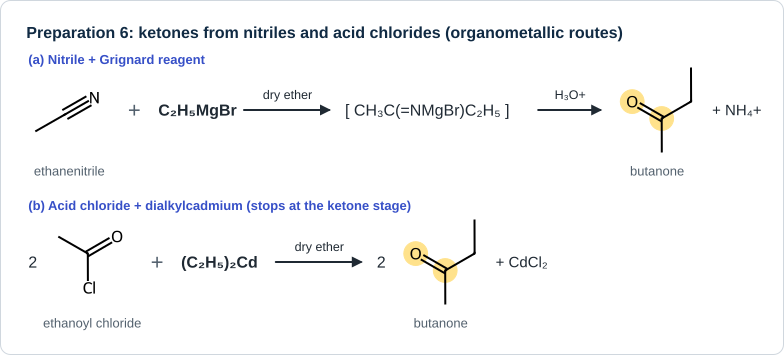

*Figure 8. Organometallic routes to ketones (the reaction stops at the ketone).*

### Method 8 — Industrial: Wacker oxidation

Ethene + O₂ with PdCl₂ / CuCl₂ catalyst in water gives **ethanal** directly: 2 CH₂=CH₂ + O₂ → 2 CH₃CHO.

### Summary

| Method | Gives aldehyde | Gives ketone | Key reagent |
|--------|:--------------:|:------------:|-------------|
| 1. Oxidation / dehydrogenation of alcohols | 1° alcohol | 2° alcohol | K₂Cr₂O₇ / H⁺, PCC, Cu 573 K |
| 2. Ca salts dry distillation | with Ca formate | alone | heat |
| 3. Ozonolysis | yes | yes | O₃, then Zn / H₂O |
| 4. Alkyne hydration | ethyne only | all other alkynes | Hg²⁺ / H₂SO₄ |
| 5. Rosenmund | yes | – | H₂, Pd / BaSO₄ |
| 6. Stephen | yes | – | SnCl₂ / HCl |
| 7. Organometallic | – | yes | RMgX + RCN; R₂Cd + RCOCl |

---

## 3. Reactivity of Aldehydes and Ketones

**Asked in:** 2017 Q4(b) · 2020 Q4(b) · 2023 Q3(a)

Aldehydes and ketones mainly undergo **nucleophilic addition** at the C=O carbon (see [Section 6](#6-nucleophilic-addition-and-the-reactions-of-benzaldehyde)). The rate depends on how electrophilic and how accessible that carbon is.

### (a) Why aldehydes are more reactive than ketones  *(2020 Q4b, 2023 Q3a)*

1. **Steric (space) factor.** An aldehyde has one small H and only one alkyl group on the carbonyl carbon, so an incoming nucleophile meets little hindrance. A ketone has **two alkyl groups**, which shield the carbon.
2. **Crowding in the transition state / product.** Addition changes the carbon from planar **sp² (120°)** to tetrahedral **sp³ (109.5°)**, bringing the four groups closer. In an aldehyde the groups are R, H, Nu and O⁻ (small H, little strain). In a ketone they are R, R′, Nu and O⁻ — a much more crowded, higher-energy transition state.
3. **Electronic (inductive) factor.** Alkyl groups are electron-releasing (+I). A ketone has **two** +I groups that reduce the partial positive charge (δ+) on carbon; an aldehyde has only one, so its carbon is **more electrophilic**.

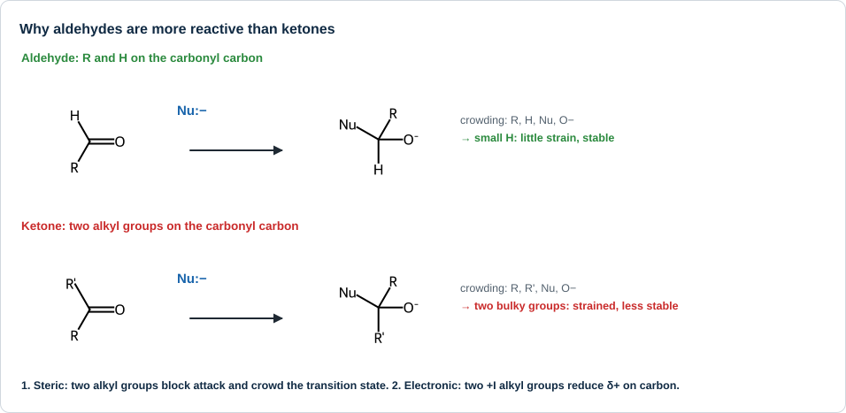

*Figure 9. Aldehyde (R, H) forms a less crowded tetrahedral intermediate than a ketone (R, R′).*

### (b) Reactivity order HCHO > CH₃CHO > CH₃COCH₃  *(2017 Q4b)*

| | HCHO | CH₃CHO | CH₃COCH₃ |
|---|------|--------|----------|
| Groups on C=O | H, H | H, CH₃ | CH₃, CH₃ |
| +I donors | none | one | two |
| Steric hindrance | least | medium | most |
| δ+ on carbon | highest | medium | lowest |
| K for hydration (approx.) | 2300 | 1 | 0.0014 |

Methanal has **no alkyl group** at all, so it is both the least hindered and the most electron-poor; propanone has two alkyl groups and is the least reactive.

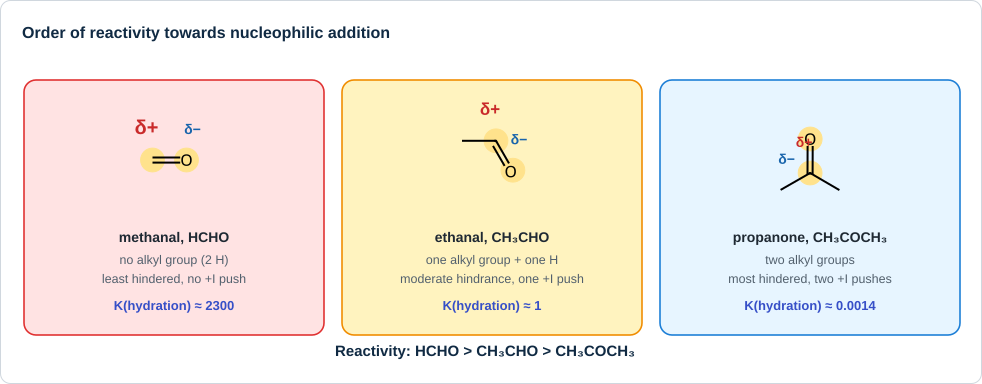

*Figure 10. Reactivity towards nucleophiles falls as alkyl groups are added.*

> **Aromatic carbonyls** (benzaldehyde, acetophenone) are less reactive than their aliphatic analogues: the ring donates electrons by resonance into C=O, lowering δ+ on carbon.

---

## 4. Distinguishing Aldehydes from Ketones

**Asked in:** 2018 Q3(d) · 2020 Q4(a) · 2021 Q2(d) · 2022 Q2(d)

Aldehydes have a **hydrogen on the carbonyl carbon** and are therefore **easily oxidised** (they are reducing agents); ketones have none and resist mild oxidants. This difference is the basis of all the tests.

| Test | Aldehyde (RCHO) | Ketone (R₂C=O) |
|------|-----------------|----------------|
| **Tollens' reagent** (ammoniacal AgNO₃), warm | **Silver mirror** on the tube wall | No reaction |
| **Fehling's solution** (alkaline Cu²⁺ tartrate), boil | **Red-brown Cu₂O precipitate** (aliphatic aldehydes only) | No reaction (blue stays) |
| **Benedict's solution**, boil | Red / orange precipitate | No reaction |
| **Schiff's reagent** (decolourised magenta) | **Pink-violet colour restored** in the cold | No colour |
| Oxidation with K₂Cr₂O₇ / H⁺ | Easily gives acid with the **same** number of carbons | Resists; strong oxidation cleaves the C–C bond to give a **mixture of acids** with fewer carbons |
| Reaction with 2,4-DNP | Orange precipitate | Orange precipitate (**same – not a distinguishing test**) |

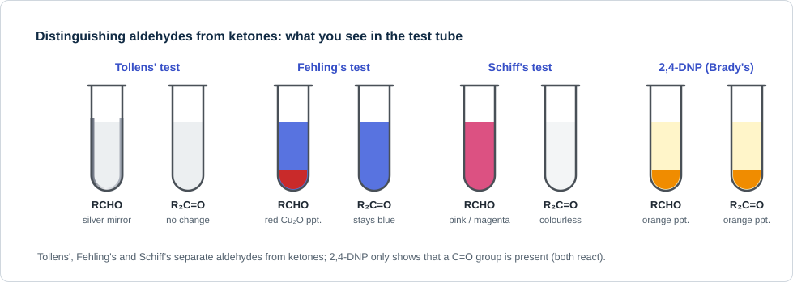

*Figure 11. What is observed in each test. 2,4-DNP only proves that a carbonyl group is present.*

### Equations

**Tollens' test:** RCHO + 2[Ag(NH₃)₂]⁺ + 3OH⁻ → RCOO⁻ + 2Ag↓ + 4NH₃ + 2H₂O

**Fehling's test:** RCHO + 2Cu²⁺ + 5OH⁻ → RCOO⁻ + Cu₂O↓ + 3H₂O

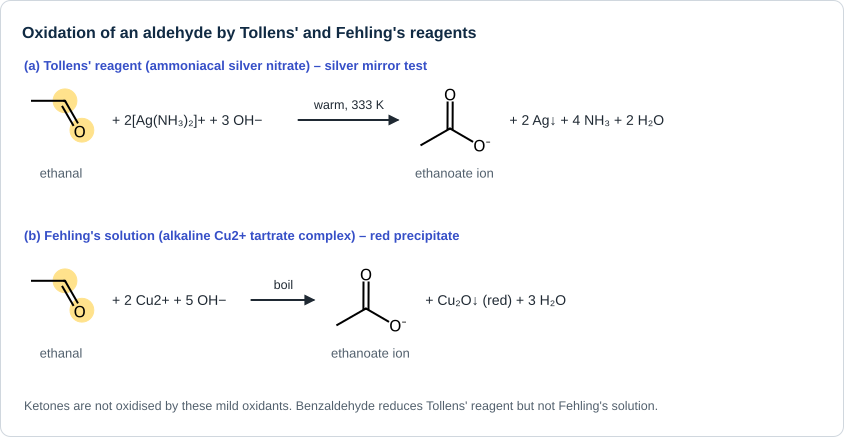

*Figure 12. Oxidation of ethanal by Tollens' and Fehling's reagents.*

> **Exception to remember:** benzaldehyde (an aromatic aldehyde) gives Tollens' test but **not** Fehling's test.

---

## 5. Distinguishing Acetaldehyde from Acetone

**Asked in:** 2016 Q2(b) *(three reactions)* · 2019 Q3(b) · 2023 Q3(d)

Both are C=O compounds (CH₃CHO is an aldehyde, CH₃COCH₃ a ketone), so tests for the carbonyl group (2,4-DNP, NaHSO₃, HCN, NH₂OH) and the iodoform test are **positive for both** and cannot be used. Use the following.

| # | Reaction | Acetaldehyde, CH₃CHO | Acetone, CH₃COCH₃ |
|---|----------|----------------------|-------------------|
| 1 | **Tollens' reagent**, warm | Silver mirror: CH₃CHO + 2[Ag(NH₃)₂]⁺ + 3OH⁻ → CH₃COO⁻ + 2Ag↓ + 4NH₃ + 2H₂O | No change |
| 2 | **Fehling's solution**, boil | Red Cu₂O precipitate: CH₃CHO + 2Cu²⁺ + 5OH⁻ → CH₃COO⁻ + Cu₂O↓ + 3H₂O | No change |
| 3 | **Schiff's reagent**, cold | Pink / magenta colour | Colourless |
| 4 | **Dilute NaOH**, heat | Aldol condensation; a **brown resinous mass** (aldehyde resin) forms | Only a trace of diacetone alcohol; solution stays clear |
| 5 | Oxidation K₂Cr₂O₇ / H₂SO₄ | CH₃COOH (same carbon number) | Needs drastic conditions; gives CH₃COOH + CO₂ (C–C cleavage) |
| 6 | Boiling point | 20 °C | 56 °C |

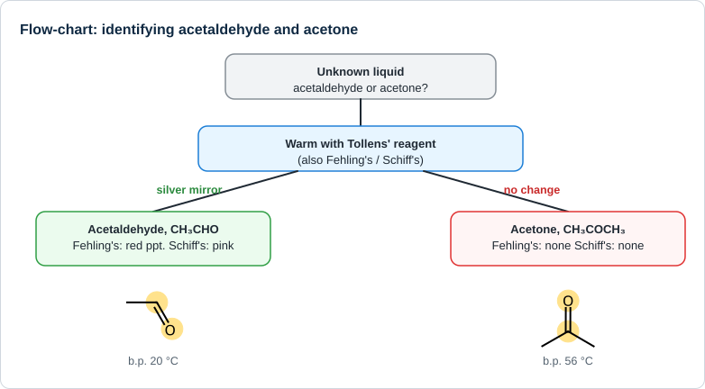

*Figure 13. Warm with Tollens' reagent: silver mirror = acetaldehyde, no change = acetone.*

> **Three reactions for 2016 Q2(b):** write rows 1, 2 and 3 with equations and observations; add row 4 if time allows. For a quick visual, refer to Figure 11.

---

## 6. Nucleophilic Addition and the Reactions of Benzaldehyde

**Asked in:** 2018 Q3(c) — benzaldehyde with (i) H₂NOH, (ii) HCN, (iii) H₂N–NH–C₆H₅ · 2021 Q2(c) — benzaldehyde with (i) PCl₅, (ii) HCN, (iii) H₂NOH

### General mechanism of nucleophilic addition

Step 1 (slow): the nucleophile attacks the electrophilic C=O carbon; the π electrons move to oxygen, giving a tetrahedral alkoxide ion. Step 2 (fast): the alkoxide is protonated.

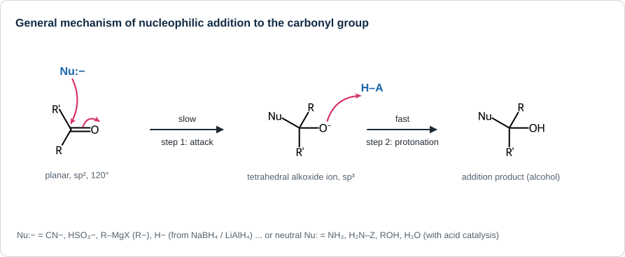

*Figure 14. Nucleophilic addition to C=O (sp² → sp³).*

### (i) Benzaldehyde + hydroxylamine → benzaldoxime

C₆H₅CHO + H₂N–OH → C₆H₅CH=N–OH + H₂O

Addition–elimination: the nitrogen lone pair attacks C=O, then water is lost to give the C=N bond of the **oxime**. Weakly acidic medium (pH ≈ 4.5) is best.

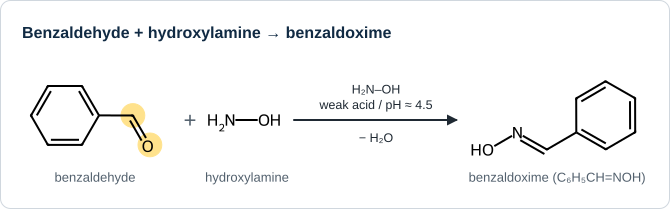

*Figure 15. Formation of benzaldoxime.*

### (ii) Benzaldehyde + HCN → benzaldehyde cyanohydrin (mandelonitrile)

C₆H₅CHO + HCN → C₆H₅CH(OH)CN

HCN is a weak acid, so a trace of base is added to produce the nucleophile **CN⁻**.

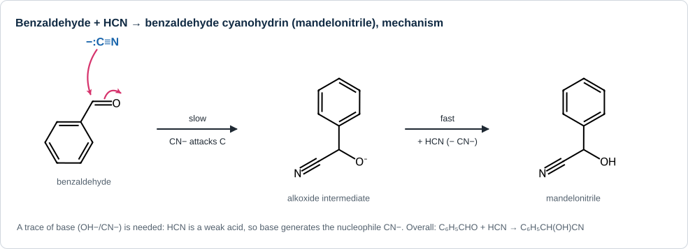

*Figure 16. CN⁻ adds to C=O (slow), then the alkoxide takes H⁺ from HCN (fast).* Hydrolysis of the cyanohydrin gives **mandelic acid**, C₆H₅CH(OH)COOH.

### (iii) Benzaldehyde + phenylhydrazine → benzaldehyde phenylhydrazone

C₆H₅CHO + H₂N–NH–C₆H₅ → C₆H₅CH=N–NH–C₆H₅ + H₂O

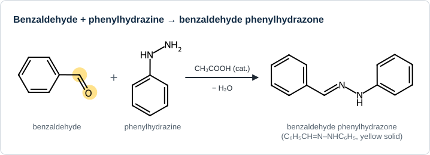

*Figure 17. Formation of the phenylhydrazone (a crystalline derivative used to identify the aldehyde).*

### (iv) Benzaldehyde + PCl₅ → benzal chloride

The C=O oxygen is replaced by two chlorine atoms (the carbonyl group behaves like an oxygen-donor towards PCl₅):

C₆H₅CHO + PCl₅ → C₆H₅CHCl₂ + POCl₃

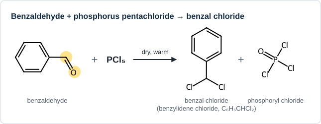

*Figure 18. Replacement of =O by two Cl atoms.*

### Other ammonia derivatives (extra)

All H₂N–Z reagents condense with C=O to give R₂C=N–Z + H₂O.

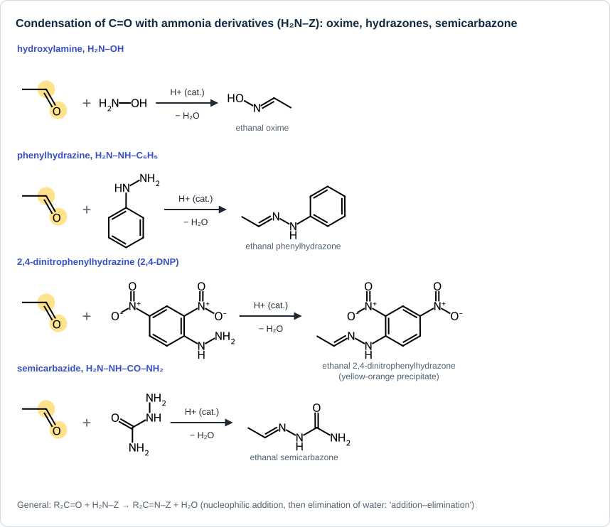

*Figure 19. Oxime, phenylhydrazone, 2,4-DNP hydrazone and semicarbazone of ethanal.*

---

## 7. Cannizzaro Reaction

**Asked in:** 2017 Q4(a) *(mechanism)* · 2022 Q2(c)(i) · 2023 Q3(c)(ii)

**Statement.** Aldehydes that have **no α-hydrogen** (HCHO, C₆H₅CHO, (CH₃)₃CCHO, furfural) undergo **disproportionation** on treatment with **concentrated alkali**: one molecule is **oxidised** to the carboxylate salt and a second is **reduced** to the alcohol.

2 C₆H₅CHO + NaOH (conc.) → C₆H₅CH₂OH + C₆H₅COONa

2 HCHO + NaOH (conc.) → CH₃OH + HCOONa

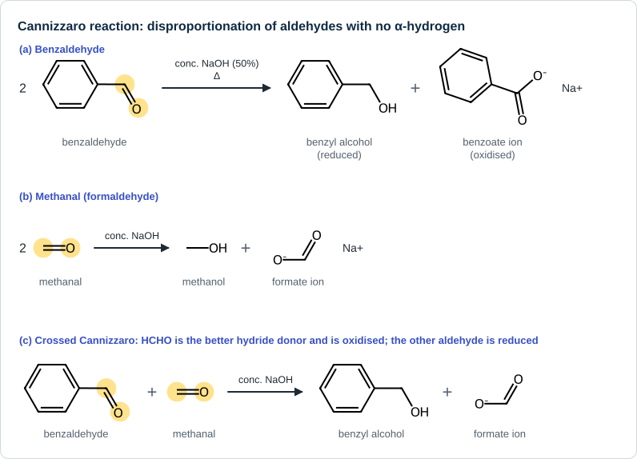

*Figure 20. Cannizzaro reaction of benzaldehyde and methanal; crossed Cannizzaro with HCHO as hydride donor.*

### Mechanism

1. **Nucleophilic addition.** OH⁻ adds to the carbonyl carbon of one molecule, forming the tetrahedral anion **A**.
2. **Hydride transfer (rate-determining).** The O⁻ of **A** pushes electrons to re-form C=O, expelling the C–H hydrogen as **hydride (H⁻)**, which attacks the carbonyl carbon of a second aldehyde molecule. This gives the carboxylic acid and an alkoxide ion.
3. **Proton transfer.** The acid protonates the alkoxide: carboxylate ion + alcohol. Acidification of the carboxylate liberates the free acid.

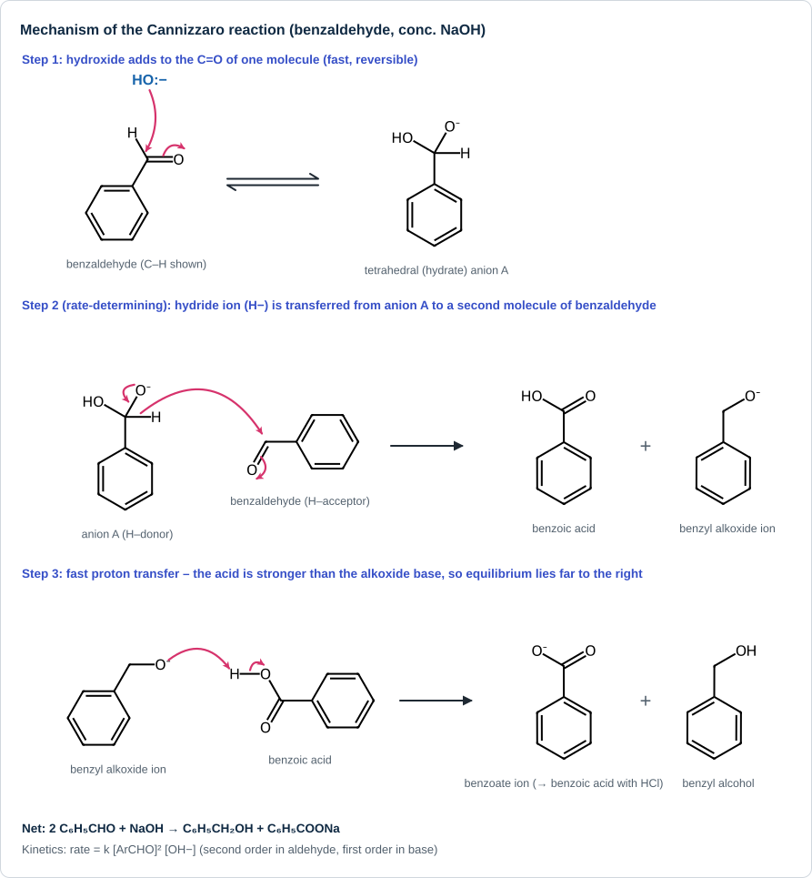

*Figure 21. Mechanism of the Cannizzaro reaction.*

**Evidence.** The rate = k[ArCHO]²[OH⁻]; in D₂O the alcohol formed contains **no** C–D bond from the solvent, proving that the hydrogen moves directly as hydride from one molecule to another.

**Crossed Cannizzaro.** With a mixture of methanal and another aldehyde, **methanal is oxidised** (it is the better hydride donor) and the other aldehyde is reduced: C₆H₅CHO + HCHO + NaOH → C₆H₅CH₂OH + HCOONa — a good preparation of benzyl alcohol.

> Aldehydes **with** α-hydrogen do not give the Cannizzaro reaction; they undergo aldol condensation instead ([Section 8](#8-aldol-condensation)).

---

## 8. Aldol Condensation

**Asked in:** 2022 Q2(c)(ii)

**Statement.** Aldehydes and ketones that have **α-hydrogen** react in the presence of **dilute alkali** (NaOH, Ba(OH)₂) to give a **β-hydroxy aldehyde/ketone** (the *aldol*). On heating, the aldol loses water to give an **α,β-unsaturated** carbonyl compound (the *condensation* product).

2 CH₃CHO →(dil. NaOH, 278 K)→ CH₃CH(OH)CH₂CHO →(Δ, − H₂O)→ CH₃CH=CHCHO

ethanal → 3-hydroxybutanal (aldol) → but-2-enal (crotonaldehyde)

### Mechanism

1. **Enolate formation:** OH⁻ removes an acidic α-H, giving a resonance-stabilised enolate ion.
2. **C–C bond formation:** the nucleophilic α-carbon of the enolate attacks the C=O carbon of a second molecule → alkoxide ion.
3. **Protonation:** the alkoxide takes H⁺ from water → **aldol**; OH⁻ is regenerated (catalyst).
4. **Dehydration (heat):** OH⁻ removes the remaining α-H (now acidic) giving an enolate, which expels OH⁻ (E1cB) to form the conjugated C=C.

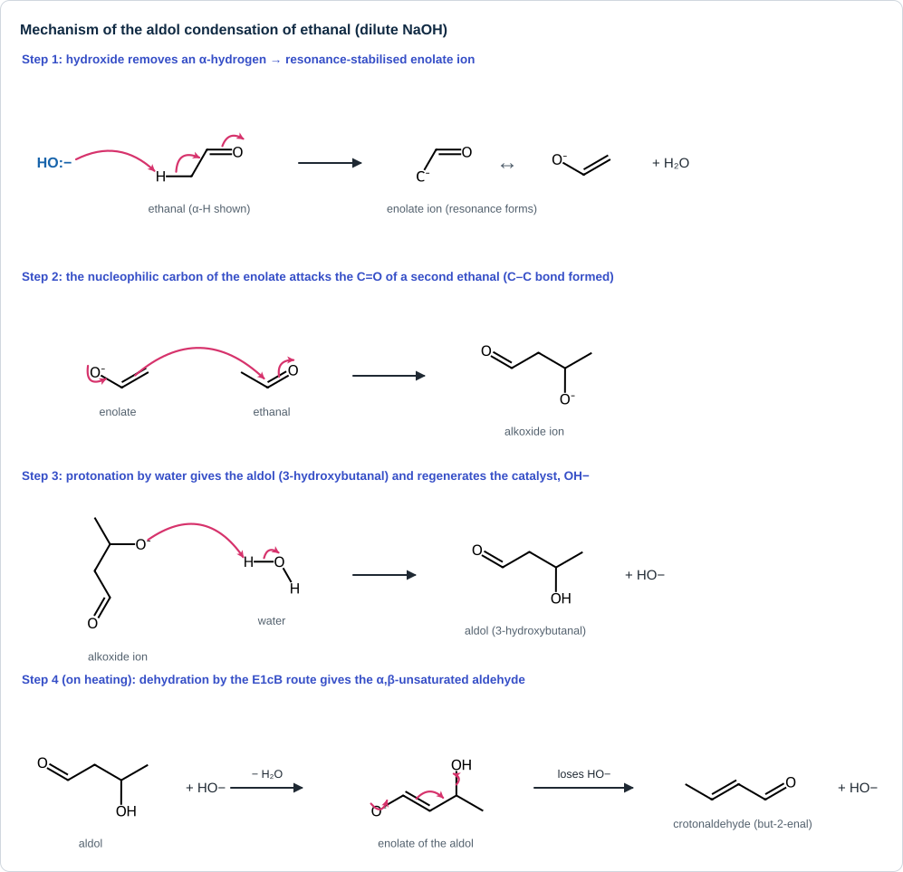

*Figure 22. Mechanism of the aldol condensation of ethanal.*

### Examples

* **Propanone:** 2 CH₃COCH₃ → (CH₃)₂C(OH)CH₂COCH₃ (diacetone alcohol) → (CH₃)₂C=CHCOCH₃ (mesityl oxide).
* **Crossed aldol (Claisen–Schmidt):** C₆H₅CHO + CH₃CHO → C₆H₅CH=CHCHO (cinnamaldehyde); C₆H₅CHO + CH₃COCH₃ → C₆H₅CH=CHCOCH₃ (benzalacetone).

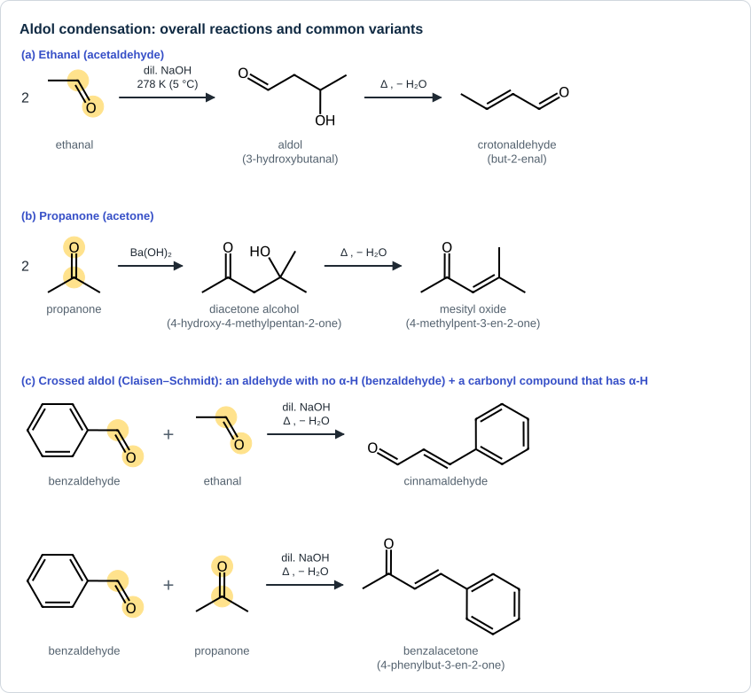

*Figure 23. Aldol condensation of ethanal and propanone, and crossed aldol reactions.*

**Conditions summary:** α-H required · dilute base · cold gives aldol, heat gives the unsaturated product. Methanal and benzaldehyde (no α-H) cannot form an enolate, so they act only as the electrophilic partner in crossed aldol reactions.

---

## 9. Haloform Reaction

**Asked in:** 2022 Q2(c)(iii)

**Statement.** Compounds containing the **CH₃–CO–** group (ethanal, methyl ketones) or the **CH₃–CH(OH)–** group (ethanol, secondary methyl carbinols) react with a halogen and alkali (X₂ + NaOH, or NaOX) to give a **haloform** (CHX₃) and the sodium salt of a carboxylic acid with **one carbon fewer**. With I₂ / NaOH the product is yellow **iodoform** (CHI₃, m.p. 119 °C), the basis of the **iodoform test**.

CH₃COCH₃ + 3 I₂ + 4 NaOH → CHI₃↓ + CH₃COONa + 3 NaI + 3 H₂O

CH₃CHO + 3 I₂ + 4 NaOH → CHI₃↓ + HCOONa + 3 NaI + 3 H₂O

CH₃CH₂OH + 4 I₂ + 6 NaOH → CHI₃↓ + HCOONa + 5 NaI + 5 H₂O   (I₂/NaOH first oxidises ethanol to ethanal)

### Mechanism (propanone)

**Part A – exhaustive α-halogenation.** OH⁻ forms the enolate; the enolate attacks I₂; repeating three times replaces all three H atoms of the CH₃ group (each iodine makes the next H more acidic).

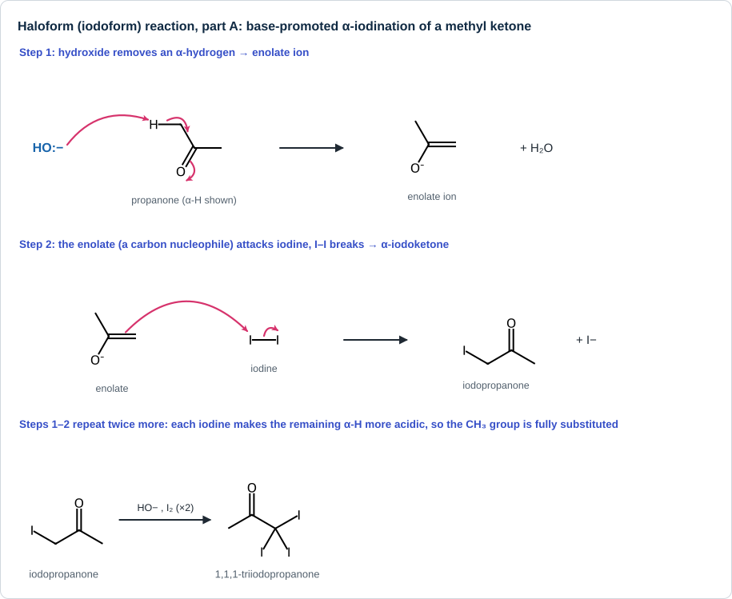

*Figure 24. Base-promoted α-iodination.*

**Part B – cleavage.** OH⁻ adds to the very electrophilic C=O of CH₃COCI₃; the tetrahedral ion expels the stable **CI₃⁻** (a good leaving group because of three iodine atoms) giving acetic acid, which immediately protonates CI₃⁻ to give iodoform and acetate.

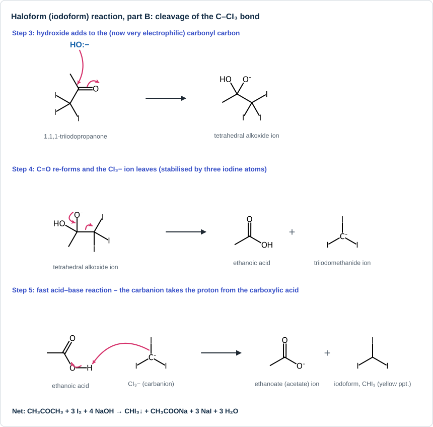

*Figure 25. Cleavage of the C–CI₃ bond.*

### Which compounds respond?

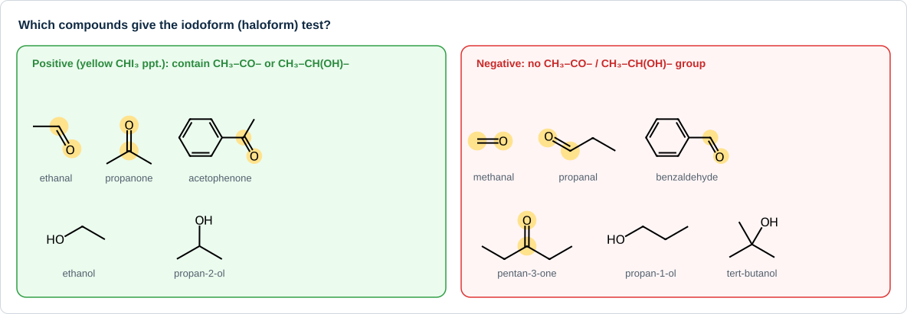

*Figure 26. Positive and negative substrates. Methanal, other aldehydes, and ketones lacking a CH₃CO– group do not respond; ethanol is the only primary alcohol that does.*

---

## 10. Rosenmund Reduction

**Asked in:** 2020 Q4(d)(i) · 2023 Q3(c)(i)

**Definition.** Catalytic hydrogenation of an **acid chloride** to the corresponding **aldehyde** using **palladium on barium sulphate (Pd / BaSO₄)** that has been *partially poisoned* with quinoline or sulphur, in boiling xylene.

RCOCl + H₂ →(Pd / BaSO₄, quinoline-S)→ RCHO + HCl

Examples: C₆H₅COCl → C₆H₅CHO (benzaldehyde); CH₃COCl → CH₃CHO; CH₃CH₂COCl → CH₃CH₂CHO.

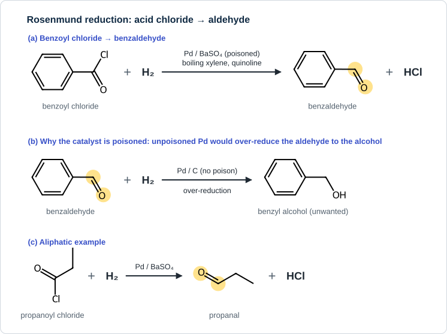

*Figure 27. Rosenmund reduction and the role of the catalyst poison.*

**Points to write**

* **BaSO₄** is a low-surface-area support, and the **poison** (quinoline–S) lowers the activity of Pd so that the reaction **stops at the aldehyde** — an active catalyst would reduce the aldehyde on to the primary alcohol.
* Mechanism: heterogeneous catalysis — H₂ and RCOCl are adsorbed on the Pd surface; C–Cl is hydrogenolysed to C–H.
* **Limitation:** methanal cannot be made, because HCOCl is unstable.
* Use: preparation of aromatic and aliphatic aldehydes from carboxylic acids (acid → RCOCl with SOCl₂ → Rosenmund).

---

## 11. Reimer–Tiemann Reaction

**Asked in:** 2020 Q4(d)(ii)

**Definition.** Phenol, on heating with **chloroform and aqueous sodium (or potassium) hydroxide** at about 340 K followed by acidification, gives **salicylaldehyde (2-hydroxybenzaldehyde)** as the major product — a way of introducing a –CHO group **ortho** to the –OH group of a phenol.

C₆H₅OH + CHCl₃ + 3 NaOH → o-HOC₆H₄CHO (as sodium salt) + 3 NaCl + 2 H₂O, then H⁺ liberates the free aldehyde. The *para* isomer (4-hydroxybenzaldehyde) is a minor product.

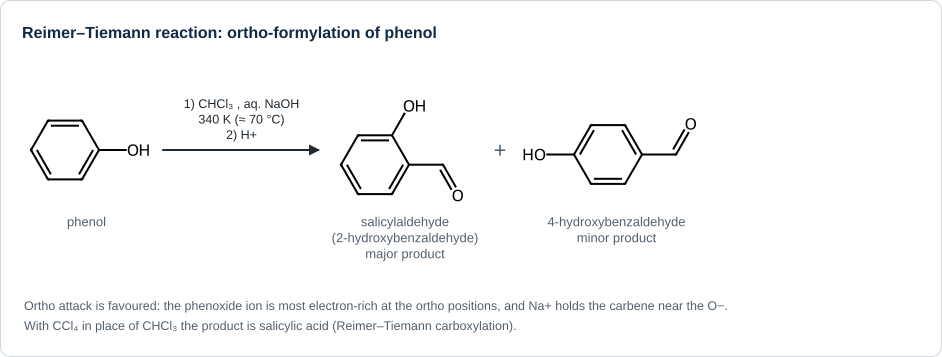

*Figure 28. Reimer–Tiemann formylation of phenol.*

### Mechanism

1. **Dichlorocarbene is generated:** CHCl₃ + OH⁻ ⇌ ⁻CCl₃ + H₂O, then ⁻CCl₃ → :CCl₂ + Cl⁻ (slow).
2. **Electrophilic attack:** the phenoxide ion (very electron-rich at the ortho carbon) attacks the electron-deficient :CCl₂ → intermediate with a –CCl₂⁻ group.
3. **Proton shift** restores the ring → dichloromethyl phenoxide, ArCHCl₂.
4. **Hydrolysis** of ArCHCl₂ by hydroxide gives the aldehyde (as its phenoxide salt); **acidification** gives salicylaldehyde.

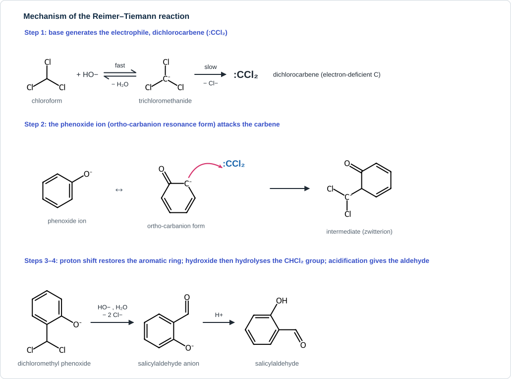

*Figure 29. Mechanism through dichlorocarbene.*

**Variation.** With CCl₄ instead of CHCl₃ the product is **salicylic acid**. Salicylaldehyde is used to make coumarin and as a chelating agent.

---

## 12. Acid Strength of Carboxylic Acids and Glacial Acetic Acid

**Asked in:** 2016 Q2(c) · 2020 Q4(c)

### Glacial acetic acid

**Glacial acetic acid** is **pure (anhydrous, ≥ 99.5 %) ethanoic acid**, CH₃COOH. It is called "glacial" because below its melting point, **16.6 °C**, it freezes into ice-like crystals. It boils at 118 °C and is a colourless, pungent, hygroscopic liquid.

### Why CH₃COOH is stronger than C₂H₅COOH but weaker than ClCH₂COOH

Acid strength is controlled by the stability of the **carboxylate anion** formed on ionisation: RCOOH ⇌ RCOO⁻ + H⁺. Anything that **disperses the negative charge** stabilises the anion and makes the acid stronger (smaller pKa); anything that **intensifies** the charge makes it weaker.

* **Propionic acid vs acetic acid.** The ethyl group of C₂H₅COOH has a **stronger +I (electron-releasing) effect** than the methyl group of CH₃COOH. It pushes more electron density onto the COO⁻ group, **destabilising** the anion → propionic acid is the **weaker** acid (pKa 4.87 vs 4.76).
* **Chloroacetic acid vs acetic acid.** Chlorine is highly electronegative and exerts a strong **−I (electron-withdrawing) effect** through the σ bonds. It pulls electron density away from COO⁻, **dispersing the charge** and stabilising the anion → ClCH₂COOH is **much stronger** (pKa 2.86).

**Order of acidity: ClCH₂COOH (2.86) > CH₃COOH (4.76) > CH₃CH₂COOH (4.87)**

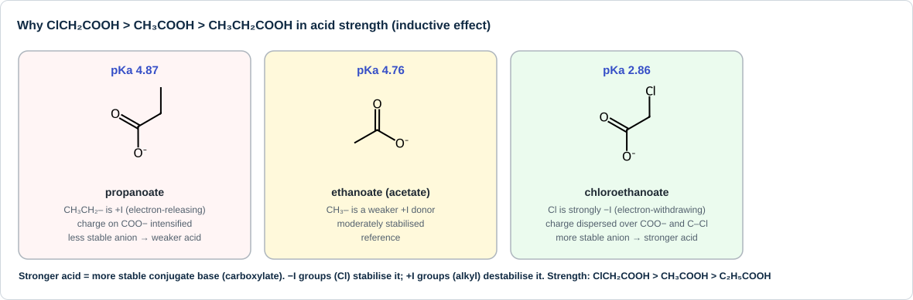

*Figure 30. +I groups destabilise and −I groups stabilise the carboxylate ion.*

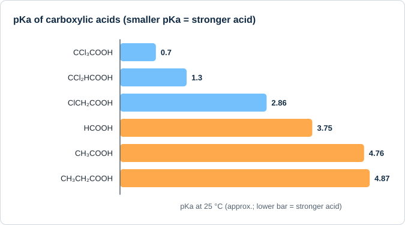

*Figure 31. pKa values (lower = stronger acid). Each extra Cl atom adds to the effect: CCl₃COOH is a very strong organic acid.*

---

## 13. Synthesis of Acetophenone from Benzene

**Asked in:** 2016 Q2(d)

**Method: Friedel–Crafts acylation.** Benzene is treated with **acetyl chloride** (or acetic anhydride) in the presence of **anhydrous AlCl₃** (a Lewis acid); the –COCH₃ group replaces one ring hydrogen.

C₆H₆ + CH₃COCl →(anhydrous AlCl₃, ≈ 323 K)→ C₆H₅COCH₃ + HCl

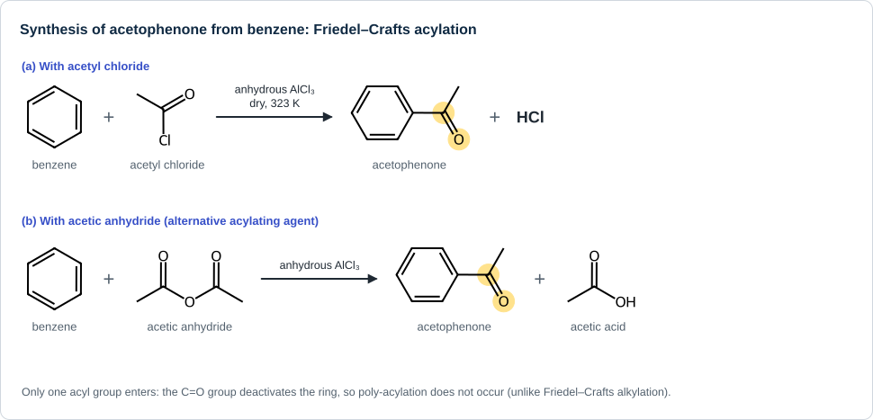

*Figure 32. Synthesis of acetophenone.*

### Mechanism (electrophilic aromatic substitution)

1. AlCl₃ abstracts Cl⁻ from CH₃COCl → **acylium ion** CH₃–C≡O⁺ (electrophile) + AlCl₄⁻.
2. A π bond of benzene attacks the acylium ion → resonance-stabilised **σ-complex** (arenium ion) — slow step.
3. AlCl₄⁻ removes H⁺ from the sp³ carbon → aromatic ring restored: acetophenone + HCl + AlCl₃ (catalyst regenerated).

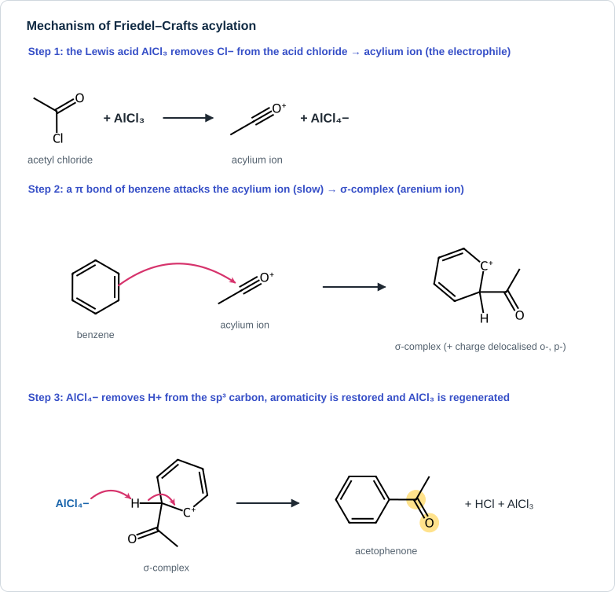

*Figure 33. Mechanism of Friedel–Crafts acylation.*

**Notes.** More than one equivalent of AlCl₃ is actually needed because the ketone product complexes with it; water must be excluded. Acylation stops after one substitution because C=O deactivates the ring.

---

## 14. Ethanol / Ethanal with Dilute NaOH and 2,4-DNP

**Asked in:** 2017 Q4(c) — "What happens when Ethanol reacts with (i) dil. NaOH (ii) D.N.P?"

### As printed (ethanol, CH₃CH₂OH)

| Reagent | Result | Reason |
|---------|--------|--------|
| (i) dil. NaOH | **No reaction** (ethanol simply mixes; only a negligible trace of ethoxide) | Ethanol (pKa ≈ 16) is a weaker acid than water, so hydroxide cannot deprotonate it appreciably; there is no C=O or α-hydrogen next to a carbonyl. |
| (ii) 2,4-DNP | **No reaction**, no precipitate | 2,4-DNP condenses only with C=O groups; ethanol has none. |

### If ethanal (CH₃CHO) was intended

**(i) Dilute NaOH → aldol condensation.** Cold: 2 CH₃CHO → CH₃CH(OH)CH₂CHO (3-hydroxybutanal, aldol). On heating: CH₃CH=CHCHO (crotonaldehyde), which polymerises to a brown resin. Mechanism in [Section 8](#8-aldol-condensation).

**(ii) 2,4-DNP (Brady's reagent) → yellow-orange precipitate** of ethanal 2,4-dinitrophenylhydrazone (addition–elimination, loss of H₂O). Used to identify carbonyl compounds by the melting point of the derivative.

CH₃CHO + H₂N–NH–C₆H₃(NO₂)₂ → CH₃CH=N–NH–C₆H₃(NO₂)₂ + H₂O

See Figure 19 (third row) for the structures.

---

## 15. Amino Acid with Formaldehyde and Benzoyl Chloride

**Asked in:** 2018 Q6(c)

An α-amino acid, R–CH(NH₂)–COOH, has a nucleophilic **–NH₂** group and an acidic **–COOH** group. Glycine (R = H) is used as the example.

**(i) With formaldehyde (methanal).** The –NH₂ group adds to HCHO to form **N-hydroxymethyl (methylol) derivatives**; with excess HCHO both N–H bonds react:

H₂N–CH₂COOH + 2 HCHO → (HOCH₂)₂N–CH₂COOH

The basic amino group is thereby **blocked**, so the free –COOH group can be sharply titrated with standard NaOH using phenolphthalein. This is the **Sørensen formol titration** for estimating amino acids (and for following protein hydrolysis).

**(ii) With benzoyl chloride (Schotten–Baumann reaction).** In presence of aqueous NaOH, the –NH₂ group is **N-benzoylated** (acyl substitution) giving an amide; glycine gives **hippuric acid**:

H₂N–CH₂COOH + C₆H₅COCl →(NaOH)→ C₆H₅CO–NH–CH₂COOH + HCl

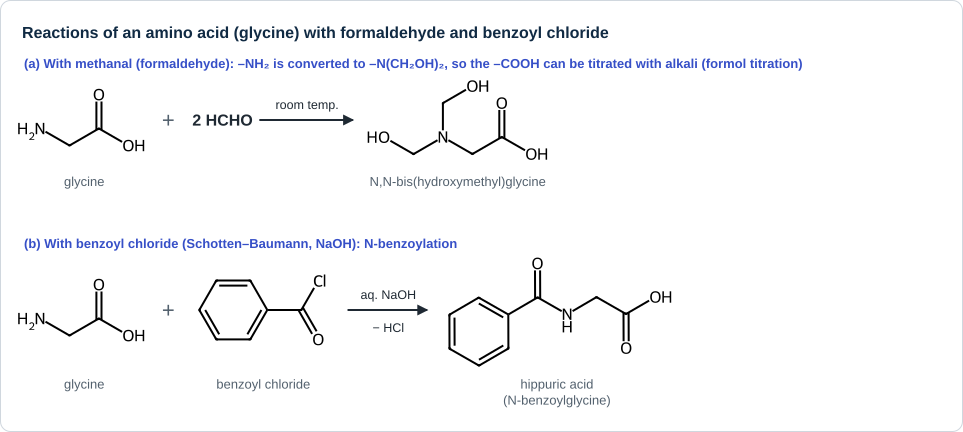

*Figure 34. Glycine with formaldehyde (a) and with benzoyl chloride (b).*

---

## Extra A. Reaction Map of Ethanal

A one-page revision picture: eight characteristic reactions of the aldehyde group, using ethanal as the model.

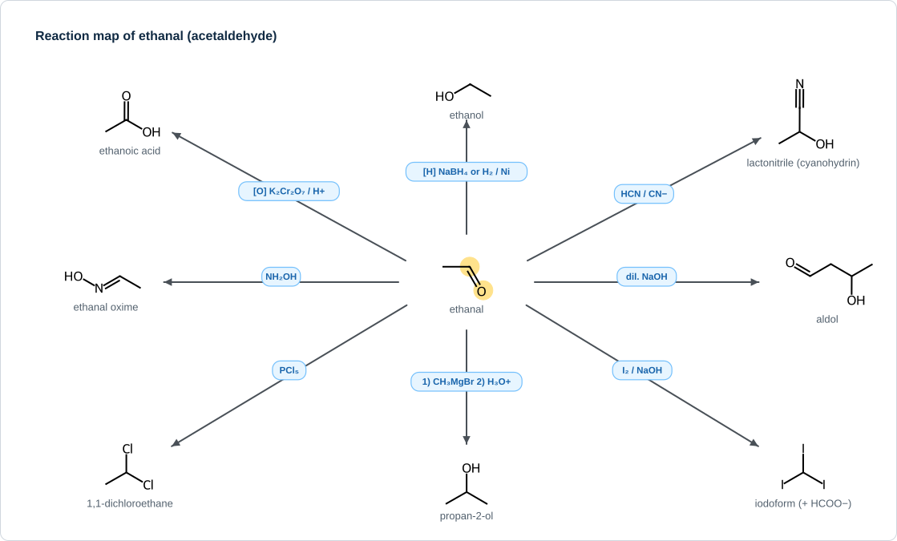

*Figure 35. Reactions of ethanal: oxidation, reduction, additions (HCN, Grignard), condensations (NH₂OH, aldol), substitution (PCl₅) and the iodoform reaction.*

Additional reactions of ethanal: polymerisation with a trace of acid at 0 °C gives **paraldehyde** (cyclic trimer, a hypnotic); with NaHSO₃ it forms a crystalline **bisulphite addition product**, CH₃CH(OH)SO₃Na (used to purify carbonyl compounds); with Tollens'/Fehling's it acts as a reducing agent.

---

## Extra B. Physical Properties and Spectroscopy

### Physical properties

* **Boiling points.** Aldehydes and ketones are polar (dipole–dipole attraction) so they boil **higher than alkanes of similar mass**, but they cannot form hydrogen bonds with each other (no O–H), so they boil **lower than alcohols and carboxylic acids**.
* **Solubility.** Lower members (up to about C₄) dissolve in water because the C=O oxygen accepts hydrogen bonds from water; solubility falls as the hydrocarbon part grows. All dissolve in organic solvents.
* **Odour.** Lower aldehydes have sharp odours; benzaldehyde smells of almonds; ketones are pleasant (acetone, solvent).

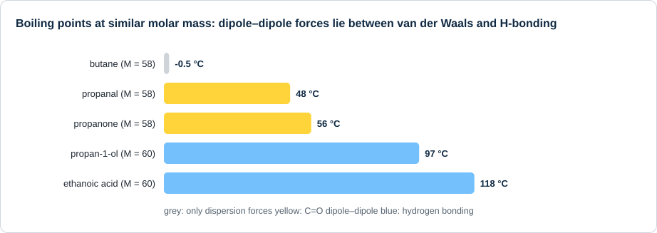

*Figure 36. Boiling points of compounds of similar molar mass.*

| Compound | Formula | b.p. (°C) |
|----------|---------|-----------|
| Methanal | HCHO | −19 (gas) |
| Ethanal | CH₃CHO | 20 |
| Propanal | CH₃CH₂CHO | 48 |
| Propanone | CH₃COCH₃ | 56 |
| Butanone | CH₃COC₂H₅ | 80 |
| Benzaldehyde | C₆H₅CHO | 178 |
| Acetophenone | C₆H₅COCH₃ | 202 |

### Spectroscopy

| Technique | Aldehyde | Ketone |
|-----------|----------|--------|
| IR, C=O stretch | about 1725–1740 cm⁻¹ (strong); conjugated with ring about 1700 | about 1710–1715 cm⁻¹; conjugated about 1685–1690 |
| IR, aldehydic C–H | two weak bands near 2720 and 2820 cm⁻¹ | absent |
| ¹H NMR | CHO proton at δ 9–10 ppm (distinct singlet/triplet) | none; α-H at δ 2.0–2.5 ppm |
| ¹³C NMR, C=O | about 190–205 ppm | about 200–220 ppm |

---

## Extra C. Reduction of Carbonyl Compounds

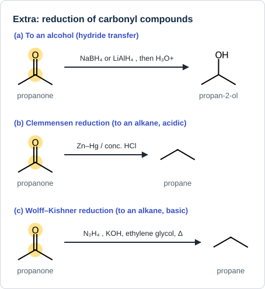

*Figure 37. Three reductions of propanone.*

* **To alcohols:** NaBH₄ (in ethanol / water) or LiAlH₄ (dry ether, then H₃O⁺) transfer H⁻ to carbon: aldehydes → primary alcohols, ketones → secondary alcohols. Catalytic H₂ / Ni gives the same.
* **To alkanes (C=O → CH₂):** **Clemmensen** (Zn–Hg / conc. HCl, acid conditions) or **Wolff–Kishner** (N₂H₄, KOH, glycol, heat; for acid-sensitive compounds).
* **Oxidation:** aldehydes → acids easily (KMnO₄, K₂Cr₂O₇, Tollens', Fehling's); ketones need strong oxidants and break the C–C bond (Popoff's rule: the C=O stays with the smaller alkyl group).

---

## Extra D. Named Reactions Cheat-Sheet

| Reaction | Substrate | Reagent | Product | Key idea |
|----------|-----------|---------|---------|----------|
| Rosenmund | RCOCl | H₂, Pd / BaSO₄ (poisoned) | RCHO | stops at aldehyde |
| Stephen | RCN | SnCl₂ / HCl, then H₂O | RCHO | nitrile → aldimine → aldehyde |
| Kucherov | alkyne | H₂O, Hg²⁺ / H₂SO₄ | aldehyde (ethyne) or ketone | enol → keto tautomerism |
| Cannizzaro | RCHO with no α-H | conc. NaOH | RCH₂OH + RCOO⁻ | hydride transfer, disproportionation |
| Aldol | carbonyl with α-H | dil. NaOH | β-hydroxy carbonyl → enone | enolate attacks C=O |
| Haloform | CH₃CO– / CH₃CH(OH)– | X₂ / NaOH | CHX₃ + RCOO⁻ | triple α-halogenation, then cleavage |
| Reimer–Tiemann | phenol | CHCl₃ / aq. NaOH | o-hydroxybenzaldehyde | dichlorocarbene |
| Friedel–Crafts acylation | arene | RCOCl / AlCl₃ | aryl ketone | acylium ion |
| Clemmensen | C=O | Zn–Hg / HCl | CH₂ | acidic reduction |
| Wolff–Kishner | C=O | N₂H₄ / KOH, Δ | CH₂ | basic reduction |
| Schotten–Baumann | amine / alcohol | RCOCl / NaOH | amide / ester | acylation in aqueous base |

---

## Extra E. Common Mistakes and Exam Tips

1. **Cannizzaro needs NO α-hydrogen; aldol needs α-hydrogen.** Never mix them up; benzaldehyde → Cannizzaro, ethanal → aldol.
2. **Ketones also give 2,4-DNP, NaHSO₃ and HCN adducts.** Only Tollens', Fehling's, Benedict's and Schiff's tests separate aldehydes from ketones.
3. **Fehling's does not oxidise benzaldehyde**; Tollens' does.
4. **Iodoform test is positive for both ethanal and propanone** — so it cannot distinguish them. It is also positive for ethanol and propan-2-ol (not methanol, not propan-1-ol).
5. **Only ethyne gives an aldehyde** on hydration; propyne and all higher alkynes give ketones.
6. **Show curved arrows** in every mechanism: tail on the electron source (lone pair or bond), head on the atom that receives the electrons.
7. **Write the state / condition over each arrow:** dil. vs conc. NaOH, Δ, dry ether, Zn / H₂O.
8. In *"What happens when …"* answers give **equation + observation + name of product**.
9. Use **IUPAC names beside common names** (ethanal / acetaldehyde, propanone / acetone).
10. For comparison questions (aldehyde vs ketone, acetaldehyde vs acetone), a **table** is faster to write and easier for the examiner to mark.

---

## Extra F. Practice Questions with Answers

**1. Why does benzaldehyde not give the aldol condensation by itself?**
It has no α-hydrogen, so it cannot form an enolate. It can only act as the electrophilic component in a crossed aldol (Claisen–Schmidt) reaction.

**2. Convert ethyne into propanone.**
HC≡CH + H₂O →(Hg²⁺ / H⁺)→ CH₃CHO →(1) CH₃MgBr, 2) H₃O⁺)→ CH₃CH(OH)CH₃ →([O], K₂Cr₂O₇)→ CH₃COCH₃. Alternatively: ethyne → ethanal → ethanoic acid → calcium ethanoate → dry distillation → propanone.

**3. How would you distinguish pentan-2-one from pentan-3-one?**
Iodoform test: pentan-2-one has CH₃CO– and gives yellow CHI₃; pentan-3-one does not.

**4. An organic compound (C₃H₆O) gives a silver mirror and a positive 2,4-DNP test. Identify it.**
Propanal, CH₃CH₂CHO (an aldehyde; propanone gives no silver mirror).

**5. Why is the C=O of an aldehyde a stronger electrophile than that of an amide or ester?**
In esters and amides the lone pair on O or N is donated into C=O by resonance, reducing δ+ on carbon.

**6. Write the product of benzaldehyde with conc. NaOH and then with HCl.**
2 C₆H₅CHO + NaOH → C₆H₅CH₂OH + C₆H₅COONa; acidification: C₆H₅COONa + HCl → C₆H₅COOH + NaCl.

**7. Account for the higher boiling point of propanone (56 °C) than butane (−0.5 °C) of the same molar mass.**
C=O dipole–dipole attractions are stronger than the dispersion forces alone in butane.

**8. Name the reaction: phenol + CHCl₃ + NaOH.**
Reimer–Tiemann reaction; product salicylaldehyde.

---

## References

* R. T. Morrison and R. N. Boyd, *Organic Chemistry* — chapters on aldehydes and ketones, carboxylic acids.
* T. W. G. Solomons and C. B. Fryhle, *Organic Chemistry* — nucleophilic addition to the carbonyl group; reactions at the α-carbon.
* J. Clayden, N. Greeves and S. Warren, *Organic Chemistry* — mechanisms of addition, enolate chemistry.
* B. S. Bahl and A. Bahl, *Advanced Organic Chemistry* — named reactions and distinguishing tests.
* Previous-year question paper: *Chemistry-II — Carbonyl Compounds* (supplied document, pp. 6–7).
