# CHEM-103 · Color, Dyes & Pigments — Solved Question Bank (2016–2023)

*Chemistry-II · all previous-year questions answered exam-style, with structures, diagrams, worked examples and quick-revision extras.*

> **How to use this file**
> 1. Find your question in the [Year-wise index](#year-wise-index) and jump to its answer.
> 2. Repeated questions are answered **once** in full (Answers A1–A12) and linked from every year they appeared in.
> 3. Where the wording differs (e.g. *"four dyes"* vs *"three dyes"*), the answer says exactly what to write.
> 4. All structures are drawn as proper skeletal formulae (SVG, stored in `../../assets/`). 🔴 red highlight = chromophore, 🟢 green highlight = auxochrome.

---

## Table of contents

- [Exam-frequency map](#exam-frequency-map)
- [Year-wise index](#year-wise-index)
- **Part A — Answers**
  - [A1. Colour, dye and pigment](#a1)
  - [A2. Witt's theory of colour](#a2)
  - [A3. Chromophore and auxochrome](#a3)
  - [A4. Modern theory of colour](#a4)
  - [A5. Classification of dyes with examples](#a5)
  - [A6. Name and structure of dyes](#a6)
  - [A7. Mordant dyes](#a7)
  - [A8. Coupling reaction](#a8)
  - [A9. Indigo: preparation and uses](#a9)
  - [A10. Raw materials for dye manufacture](#a10)
  - [A11. Dye intermediates](#a11)
  - [A12. Non-textile uses of dyes](#a12)
- **Part B — Extra work**
  - [B1. Comparison tables](#b1)
  - [B2. Mnemonics](#b2)
  - [B3. Quick-revision sheet](#b3)
  - [B4. Likely questions not yet asked](#b4)
  - [B5. Practice MCQs](#b5)
  - [B6. Common mistakes](#b6)
  - [B7. Glossary](#b7)

---

## Exam-frequency map

| Topic | 2016 | 2017 | 2018 | 2020 | 2021 | 2022 | 2023 | Times |
|---|:-:|:-:|:-:|:-:|:-:|:-:|:-:|:-:|
| Colour / dye / pigment definitions ([A1](#a1)) | ✅ | | ✅ | ✅ | ✅ | | | 4 |
| Witt's theory ([A2](#a2)) | ✅ | | ✅ | | ✅ | | | 3 |
| Chromophore & auxochrome ([A3](#a3)) | | ✅ | | ✅ | | ✅ | ✅ | 4 |
| Modern theory of colour ([A4](#a4)) | ✅ | ✅ | | | | ✅ | ✅ | 4 |
| Classification of dyes ([A5](#a5)) | | | | | | ✅ | ✅ | 2 |
| Name & structure of dyes ([A6](#a6)) | ✅ | | ✅ | | ✅ | | | 3 |
| Mordant dyes ([A7](#a7)) | ✅ | | | | | | | 1 |
| Coupling reaction ([A8](#a8)) | ✅ | | | | | | | 1 |
| Indigo ([A9](#a9)) | | | | ✅ | | | ✅ | 2 |
| Raw materials ([A10](#a10)) | | ✅ | | | | | | 1 |
| Dye intermediates ([A11](#a11)) | | | ✅ | | ✅ | | | 2 |
| Non-textile uses ([A12](#a12)) | ✅ | ✅ | | ✅ | | ✅ | ✅ | 5 |

**Must-prepare:** A12 (every paper but two), A1, A3, A4, A2, A6. Do A9 and A5 next.

---

## Year-wise index

### 2016

| Q | Part | Question | Answer |
|---|---|---|---|
| 7 | (d)(i) | Short note: Mordant dyes | [A7](#a7) |
| 7 | (d)(ii) | Short note: Coupling reaction | [A8](#a8) |
| 8 | (a) | What is meant by colour, dyes and pigments? | [A1](#a1) |
| 8 | (b) | Discuss Witt's and modern theory of colour | [A2](#a2) + [A4](#a4) |
| 8 | (c) | Name and structure of any **four** dyes | [A6](#a6) |
| 8 | (d) | Non-textile uses of dyes | [A12](#a12) |

### 2017

| Q | Part | Question | Answer |
|---|---|---|---|
| 8 | (a) | Chromophore and auxochrome | [A3](#a3) |
| 8 | (b) | Modern theory of colour | [A4](#a4) |
| 8 | (c) | Raw materials for the manufacture of dyes | [A10](#a10) |
| 8 | (d) | Non-textile uses of dyes | [A12](#a12) |

### 2018

| Q | Part | Question | Answer |
|---|---|---|---|
| 8 | (a) | Colour, dyes and pigment | [A1](#a1) |
| 8 | (b) | Witt's theory of colour | [A2](#a2) |
| 8 | (c) | Name and structure of **three** dyes | [A6](#a6) |
| 8 | (d) | Dye intermediates | [A11](#a11) |

### 2020

| Q | Part | Question | Answer |
|---|---|---|---|
| 7 | (a) | Define colour, dye and pigment | [A1](#a1) |
| 7 | (b) | Chromophore and auxochrome | [A3](#a3) |
| 7 | (c) | Preparation and uses of indigo | [A9](#a9) |
| 7 | (d) | Non-textile uses of dyes | [A12](#a12) |

### 2021

| Q | Part | Question | Answer |
|---|---|---|---|
| 6 | (a) | Colour, dyes and pigment | [A1](#a1) |
| 6 | (b) | Witt's theory of colour | [A2](#a2) |
| 6 | (c) | Name and structure of **three** dyes | [A6](#a6) |
| 6 | (d) | Dye intermediates | [A11](#a11) |

### 2022

| Q | Part | Question | Answer |
|---|---|---|---|
| 6 | (a) | Chromophore and auxochrome | [A3](#a3) |
| 6 | (b) | Modern theory of colour | [A4](#a4) |
| 6 | (c) | Classification of dyes with examples | [A5](#a5) |
| 6 | (d) | Non-textile use of dyes | [A12](#a12) |

### 2023

| Q | Part | Question | Answer |
|---|---|---|---|
| 7 | (d) | Preparation and uses of indigo dye | [A9](#a9) |
| 8 | (a) | Chromophore and auxochrome | [A3](#a3) |
| 8 | (b) | Modern theory of colour | [A4](#a4) |
| 8 | (c) | Classification of dyes with examples | [A5](#a5) |
| 8 | (d) | Non-textile use of dyes | [A12](#a12) |

---

# Part A — Answers

## A1. What is meant by colour, dyes and pigments?

*(2016 Q8a · 2018 Q8a · 2020 Q7a · 2021 Q6a)*

### Colour

**Colour** is the sensation produced in the eye–brain system when light of certain wavelengths in the **visible region (≈ 400–700 nm)** reaches the retina. A substance appears coloured when it **selectively absorbs** part of the visible light; the colour seen is that of the **remaining (transmitted or reflected) light**, i.e. the **complement** of the absorbed colour.

$$E = h\nu = \frac{hc}{\lambda} \approx \frac{1240}{\lambda\,(\text{nm})}\ \text{eV}$$

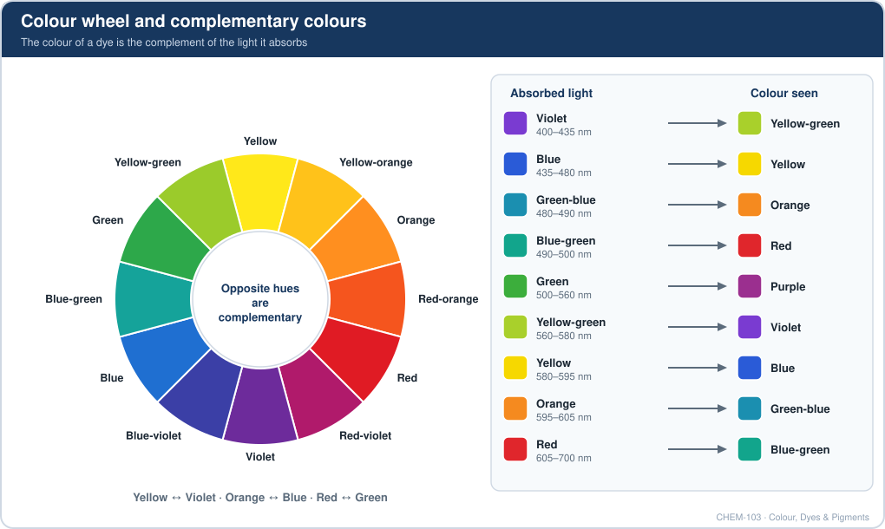

| Absorbed colour | λ absorbed (nm) | Colour seen |
|---|---|---|
| Violet | 400–435 | Yellow-green |
| Blue | 435–480 | Yellow |
| Green-blue | 480–490 | Orange |
| Blue-green | 490–500 | Red |
| Green | 500–560 | Purple |
| Yellow-green | 560–580 | Violet |
| Yellow | 580–595 | Blue |
| Orange | 595–605 | Green-blue |
| Red | 605–700 | Blue-green |

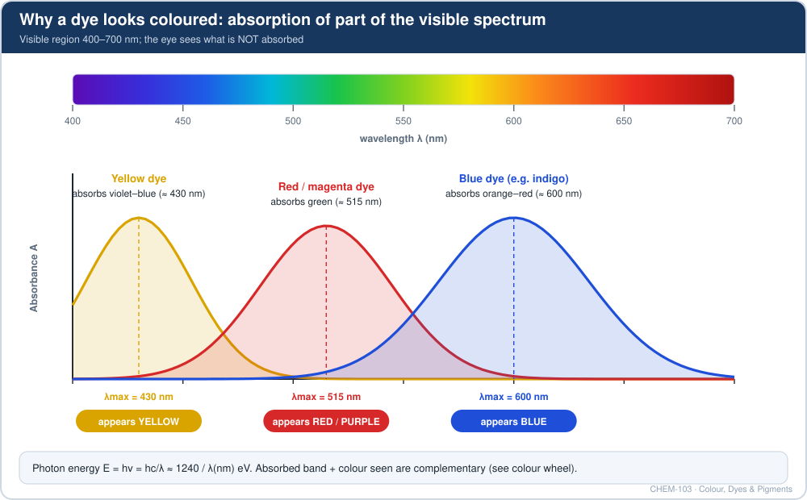

### Dye

A **dye** is a **coloured organic compound** that can be applied to a substrate (fibre, leather, paper …) from a **solution or fine dispersion**, in which it is **retained by physical adsorption or chemical bonding** (ionic, H-bond, van der Waals, covalent or metal complex) so that the substrate acquires a **fairly permanent colour**.

Essential requirements: (i) colour (chromophore), (ii) fibre affinity (auxochrome/ionic or H-bonding groups), (iii) solubility or dispersibility in the dye bath, (iv) fastness to light, washing and rubbing.

### Pigment

A **pigment** is a finely divided **coloured, white or black solid that is insoluble** in the medium in which it is used. It has **no affinity** for the substrate and is held on the surface by a **binder** (oil, resin, polymer). Examples: TiO₂ (white), carbon black, Fe₂O₃ (red), copper phthalocyanine (blue), chrome yellow (PbCrO₄).

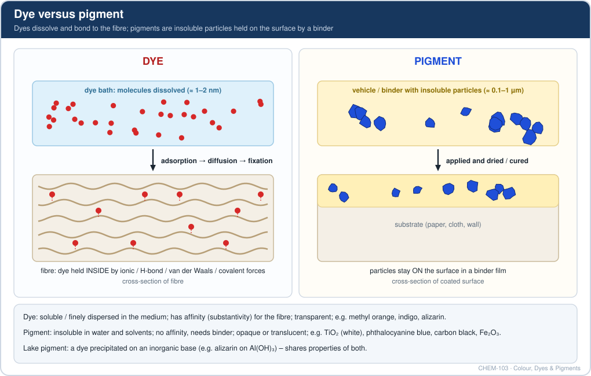

### Difference at a glance

| Property | Dye | Pigment |
|---|---|---|
| Solubility | Soluble / molecularly dispersed | Insoluble |
| Particle size | Molecular (~1–2 nm) | ≈ 0.1–1 µm |
| Affinity for substrate | Yes (substantive) | None, binder needed |
| Application | Dyeing from bath | Paints, inks, plastics, coatings |
| Penetration | Enters fibre | Stays on surface |
| Nature | Organic | Organic or inorganic |
| Examples | Methyl orange, indigo, alizarin | TiO₂, carbon black, phthalocyanine blue |

> **Lake pigment** = a dye precipitated on an inorganic base (e.g. alizarin on Al(OH)₃) — it connects the two classes.

---

## A2. Witt's theory of colour

*(2016 Q8b · 2018 Q8b · 2021 Q6b)*

**Proposed by:** O. N. Witt, **1876** — the first systematic electronic-structure theory of colour.

### Postulates

1. Colour is due to the presence in the molecule of certain **unsaturated groups** called **chromophores** (Greek *chroma* = colour, *phoros* = bearer), e.g. –N=N–, –NO₂, –N=O, >C=O, >C=C<, quinoid ring.
2. A compound containing a chromophore is called a **chromogen**. A chromogen is **coloured but not necessarily a dye**.
3. Colour is **intensified/deepened**, and the chromogen is made a **dye** (fibre affinity, solubility), by groups called **auxochromes** (*auxein* = to increase): –OH, –NH₂, –NHR, –NR₂, –COOH, –SO₃H. An auxochrome alone gives **no** colour.
4. **Chromogen + auxochrome = dye.**
5. Increasing the number of chromophores (or conjugation) **deepens** the colour.

$$\text{Chromogen} = \text{aromatic nucleus} + \text{chromophore}\qquad\text{Dye} = \text{chromogen} + \text{auxochrome}$$

### Worked illustration

| Compound | Features | Colour | Dye? |
|---|---|---|---|
| Benzene | no chromophore | colourless | no |
| Azobenzene | + chromophore –N=N– | orange-red | no (chromogen only) |
| p-Aminoazobenzene (Aniline Yellow) | + auxochrome –NH₂ | yellow | **yes** |
| Methyl orange | + –NMe₂ and –SO₃Na | orange | **yes** (acid dye) |

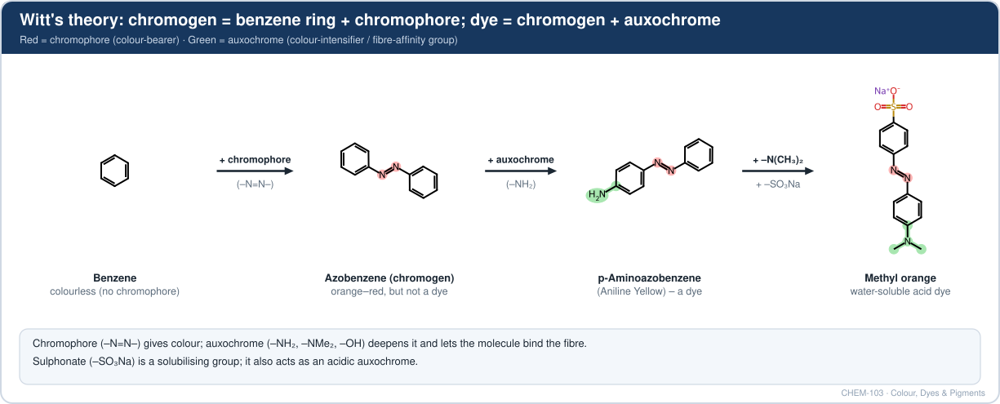

### Merits
Simple, explains the role of azo, nitro, quinoid groups; guided early dye design.

### Limitations
- Gives **no reason** *why* a chromophore absorbs visible light.
- Cannot explain colour of compounds lacking classical chromophores (e.g. triarylmethane, carotenoids need long conjugation) or the **shift in colour** produced by substituents.
- Treats auxochrome only as an "intensifier"; modern theory shows it is an **electron donor** interacting with the π-system.
- Does not allow prediction of λmax.

→ These gaps led to the [modern theory (A4)](#a4).

---

## A3. Chromophore and auxochrome

*(2017 Q8a · 2020 Q7b · 2022 Q6a · 2023 Q8a)*

### Chromophore

A **chromophore** is an **unsaturated covalent group** in a molecule that is responsible for **absorption of light in the near-UV/visible region** (π → π\* and n → π\* transitions), thereby imparting colour.

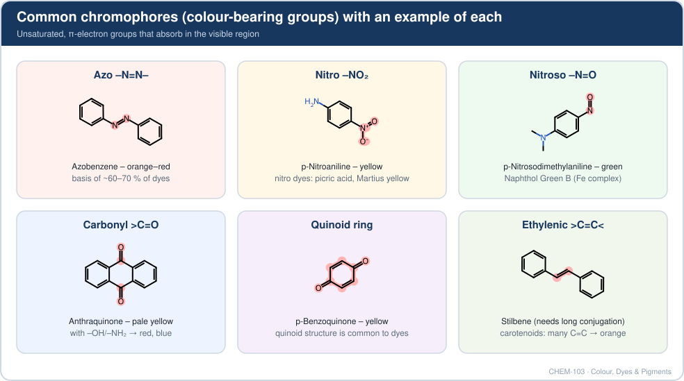

| Chromophore | Formula | Example (colour) |
|---|---|---|
| Azo | –N=N– | Azobenzene (orange-red) |
| Nitro | –NO₂ | p-Nitroaniline (yellow) |
| Nitroso | –N=O | p-Nitrosodimethylaniline (green) |
| Carbonyl | >C=O | Anthraquinone (pale yellow) |
| Thiocarbonyl | >C=S | Thiobenzophenone (blue) |
| Ethylenic | >C=C< | β-Carotene (many C=C, orange) |
| Quinoid ring | O=C₆H₄=O | p-Benzoquinone (yellow) |
| Azomethine | –CH=N– | Schiff bases (yellow) |

A single chromophore usually gives weak/pale colour; **several conjugated chromophores** (or one with a donor) shift absorption into the visible.

### Auxochrome

An **auxochrome** is a **saturated group with a lone pair** that, when attached to a chromophore (or conjugated system), **shifts and intensifies** the absorption (bathochromic + hyperchromic effect) and often provides **fibre affinity / solubility**. By itself it does not colour the compound.

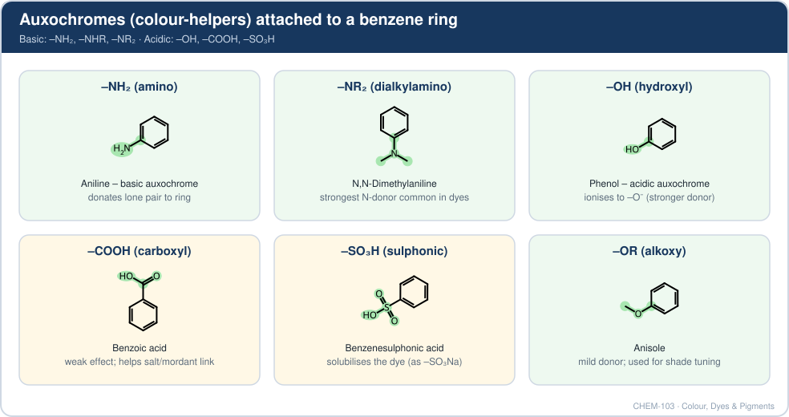

| Type | Groups | Role |
|---|---|---|
| **Basic** (electron-donating) | –NH₂, –NHR, –NR₂, –OH, –OR | donate lone pair → deepen colour; bind acidic fibre sites |
| **Acidic** | –COOH, –SO₃H, –OH (phenolic) | give solubility; form salts / metal chelates with fibre or mordant |

**Mechanism:** the lone pair is delocalised into the π-system (**+M effect**), raising the HOMO and lowering the HOMO–LUMO gap → absorption moves to longer λ.

**Example:** nitrobenzene (pale yellow) → **p-nitroaniline** (deep yellow) → **p-nitro-N,N-dimethylaniline** (orange-yellow): the stronger the donor, the larger the red shift.

### Chromophore vs auxochrome

| | Chromophore | Auxochrome |
|---|---|---|
| Nature | Unsaturated, π-bonded | Saturated, lone-pair-bearing |
| Alone | Gives (weak) colour | Gives no colour |
| Effect | Source of colour | Deepens colour, gives affinity/solubility |
| Examples | –N=N–, –NO₂, >C=O | –NH₂, –OH, –SO₃H |
| Spectral effect | Absorbs in UV/visible | Bathochromic + hyperchromic shift |

---

## A4. Modern theory of colour

*(2016 Q8b · 2017 Q8b · 2022 Q6b · 2023 Q8b)*

The modern (electronic) theories explain **why** molecules absorb visible light by relating colour to **π-electron delocalisation** and the **energy gap between the ground and excited states**. Two equivalent approaches are used.

**Contributors:** Dilthey & Wizinger (1928, donor–acceptor), Lewis & Calvin (1939, resonance and spectra), Pauling (valence-bond resonance), Mulliken and Dewar (molecular-orbital theory).

### 1. Molecular-orbital (MO) approach

- Light is absorbed when a **π electron is promoted from the HOMO to the LUMO**: ΔE = E(LUMO) − E(HOMO) = hc/λ.
- Colour appears when ΔE falls to **1.8–3.1 eV** (λ ≈ 400–700 nm).
- ΔE **decreases as conjugation increases**: more atoms in the π-system → more MOs packed closer → HOMO rises, LUMO falls.

| Compound | Conjugated C=C | λmax (nm) | ΔE (eV) | Colour |
|---|:-:|:-:|:-:|---|
| Ethene | 1 | 165 | 7.5 | colourless |
| 1,3-Butadiene | 2 | 217 | 5.7 | colourless |
| 1,3,5-Hexatriene | 3 | 258 | 4.8 | colourless |
| β-Carotene | 11 | ≈ 450 | 2.8 | orange |

Particle-in-a-box model for a chain of length $L$ with $N$ π electrons:

$$\Delta E = \frac{(N+1)\,h^2}{8\,m\,L^2}$$

Longer $L$ → smaller $\Delta E$ → longer $\lambda$.

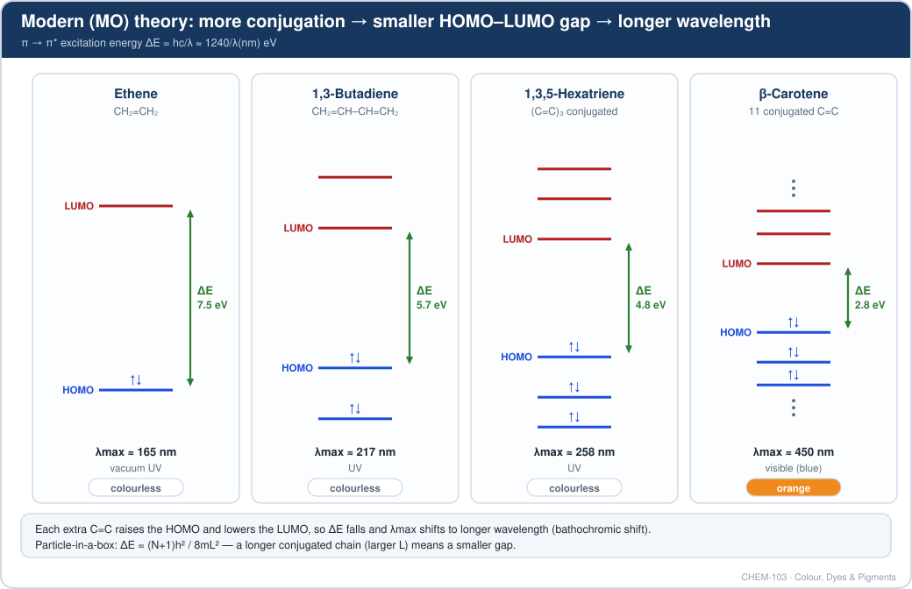

### 2. Resonance (valence-bond) approach

- A coloured molecule is a **resonance hybrid** of several canonical forms; the **excited state is a polar, charge-separated form** (e.g. quinoid) that is stabilised more than the ground state.
- The more and the better the contributing polar forms (donor **D** at one end, acceptor **A** at the other, linked by a conjugated bridge), the **lower the excitation energy**, the **longer the wavelength absorbed**.
- **Chromophore = acceptor (–N=N–, –NO₂, C=O); auxochrome = donor (–NR₂, –OH).** A **push–pull** system D–π–A is the usual origin of strong colour.

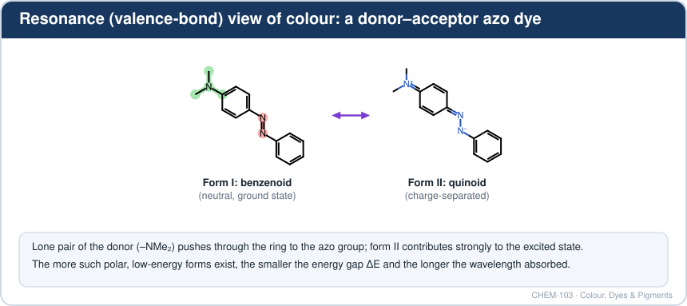

### Application: methyl orange as indicator

Protonation of the azo group gives a **quinoid** structure with greater delocalisation, so λmax shifts from yellow-absorbing to green-absorbing → **red** in acid.

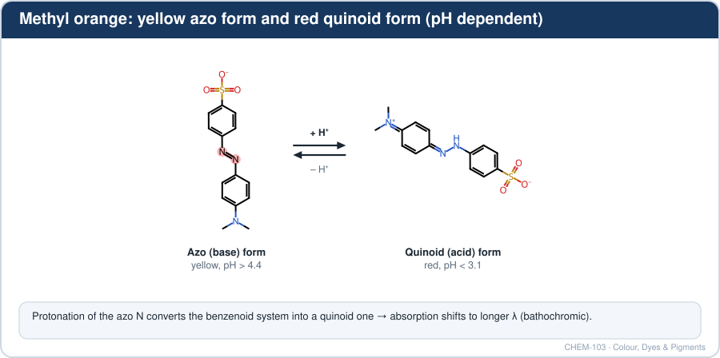

### Spectral shift terms (modern language)

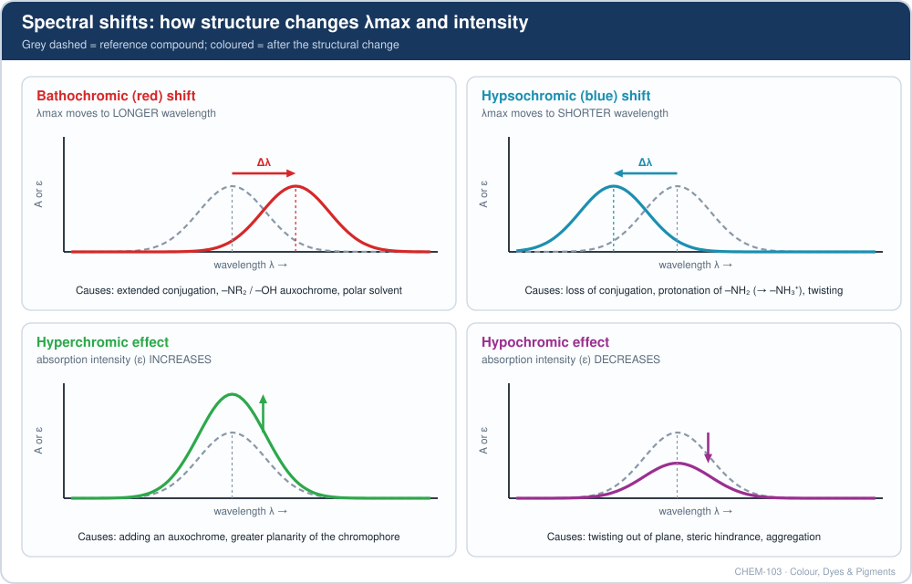

| Term | Meaning | Typical cause |
|---|---|---|
| **Bathochromic** (red shift) | λmax ↑ | more conjugation, donor auxochrome, polar solvent |
| **Hypsochromic** (blue shift) | λmax ↓ | loss of conjugation, protonation of –NH₂ |
| **Hyperchromic** | ε ↑ | auxochrome, planarity |
| **Hypochromic** | ε ↓ | twisting, steric hindrance |

### Other conditions for colour (summary)
1. Extended conjugation with **alternating single and double bonds**.
2. **Planarity** of the molecule (twisting destroys overlap).
3. Presence of **donor and acceptor** groups (push–pull).
4. Ionisation or metal complexation (changes the donor/acceptor strength).

### Witt vs modern theory

| | Witt's theory (1876) | Modern theory |
|---|---|---|
| Basis | Empirical groups | Electronic structure (MO / resonance) |
| Explains *why* | No | Yes |
| Auxochrome | colour intensifier | electron donor in push–pull system |
| Predicts shifts | No | Yes (conjugation, substituents, pH, solvent) |

---

## A5. Classification of dyes with examples

*(2022 Q6c · 2023 Q8c)*

Dyes are classified in **two** ways: (A) by **method of application** (used in dyeing practice) and (B) by **chemical structure** (chromophore).

### A. By method of application

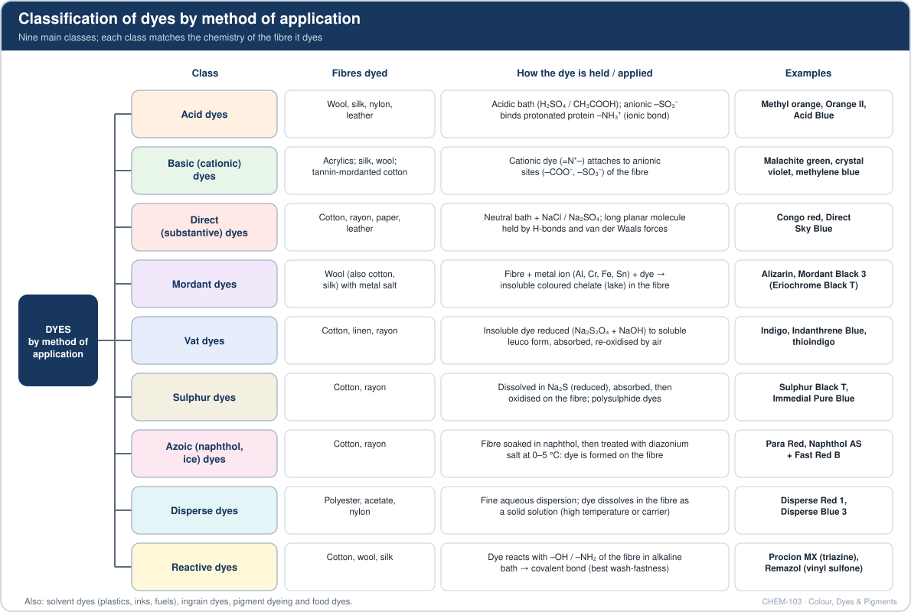

| Class | Fibre | Bonding / method | Example |
|---|---|---|---|
| **Acid** | wool, silk, nylon | acid bath; anionic dye ↔ –NH₃⁺ (ionic) | Methyl orange, Orange II |
| **Basic (cationic)** | acrylics, silk, tannin-mordanted cotton | cationic dye ↔ –COO⁻ of fibre | Malachite green, crystal violet |
| **Direct (substantive)** | cotton, rayon, paper | neutral bath + electrolyte, H-bonds | Congo red |
| **Mordant** | wool, cotton | metal–dye chelate (lake) | Alizarin |
| **Vat** | cotton, linen | reduce → soluble leuco form → air-oxidise | Indigo, Indanthrene |
| **Sulphur** | cotton | dissolved in Na₂S, oxidised on fibre | Sulphur Black T |
| **Azoic (ice colours)** | cotton | naphthol + diazonium salt coupled on the fibre at 0–5 °C | Para Red |
| **Disperse** | polyester, acetate | fine dispersion; solid solution in fibre | Disperse Red 1 |
| **Reactive** | cotton, wool | covalent bond with –OH/–NH₂ | Procion MX, Remazol |

Representative structures:

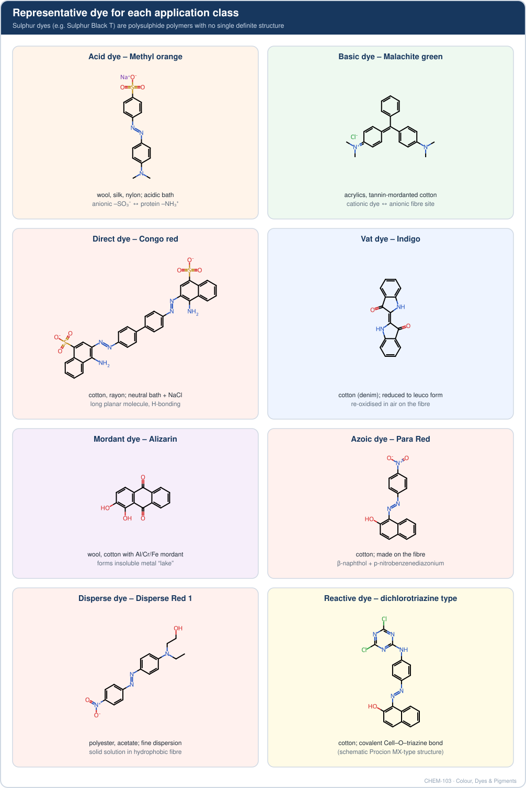

### B. By chemical structure

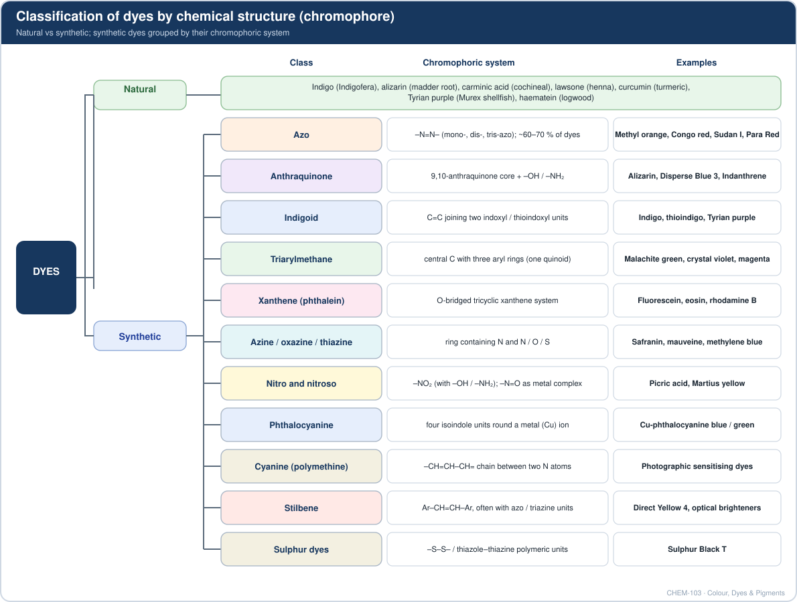

| Chemical class | Chromophoric system | Examples |
|---|---|---|
| Azo | –N=N– | Methyl orange, Congo red, Sudan I |
| Anthraquinone | quinone C=O | Alizarin, Disperse Blue 3 |
| Indigoid | C=C between two indoxyl units | Indigo, thioindigo |
| Triarylmethane | quinoid carbonium ion | Malachite green, crystal violet |
| Xanthene | O-bridged tricycle | Fluorescein, eosin, rhodamine |
| Azine / oxazine / thiazine | ring N / O / S | Safranin, methylene blue |
| Nitro / nitroso | –NO₂ / –N=O | Picric acid, Naphthol Green B |
| Phthalocyanine | 4 isoindoles + metal | Copper phthalocyanine |
| Sulphur | –S–S– polymeric | Sulphur Black T |

> **Exam tip:** write the application-wise table (A) in full with one example each; add B as a short table. Azo dyes account for roughly 60–70 % of commercial dyes.

---

## A6. Name and structure of dyes

*(2016 Q8c — any **four** · 2018 Q8c — **three** · 2021 Q6c — **three**)*

> **What to write:** for *four* dyes use 1–4, for *three* use 1–3 (methyl orange, indigo, alizarin). Extra cards (Congo red, malachite green, crystal violet) are given for choice.

### 1. Methyl orange (acid, monoazo)

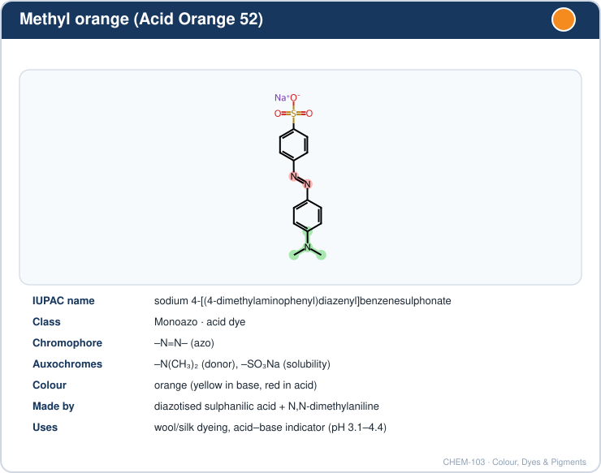

Prepared by diazotising sulphanilic acid and coupling with N,N-dimethylaniline ([A8](#a8)).

### 2. Indigo (vat, indigoid)

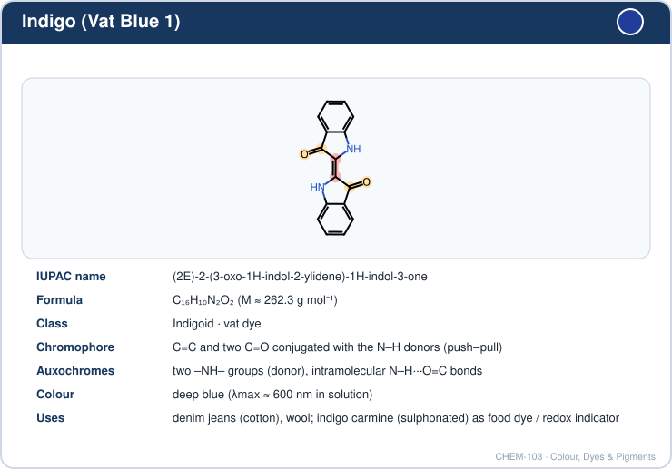

### 3. Alizarin (mordant, anthraquinone)

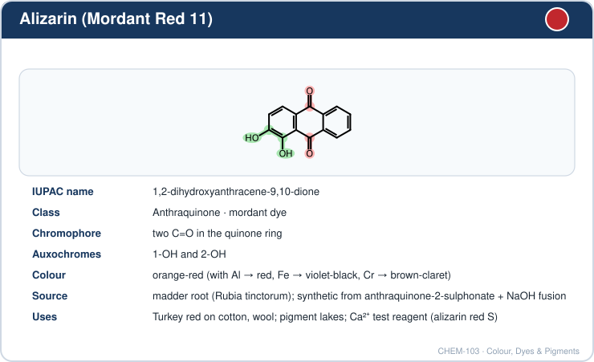

### 4. Malachite green (basic, triarylmethane)

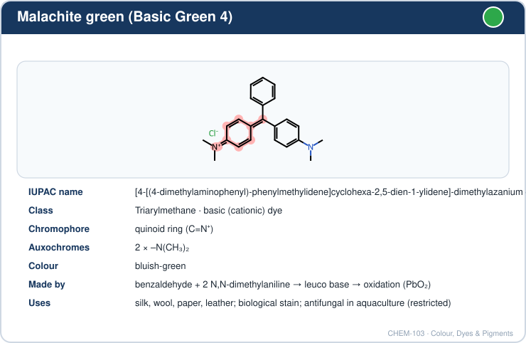

### Additional dyes

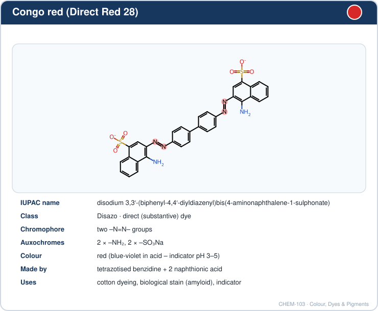

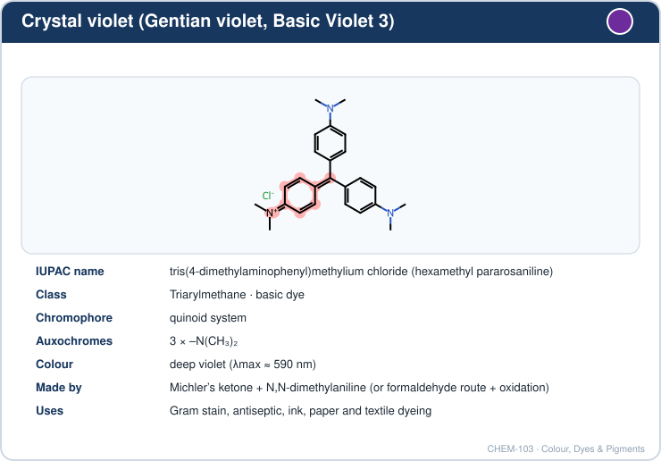

### Summary table

| Dye | Class (application) | Class (structure) | Colour |
|---|---|---|---|
| Methyl orange | Acid | Monoazo | Orange |
| Congo red | Direct | Disazo | Red |
| Indigo | Vat | Indigoid | Blue |
| Alizarin | Mordant | Anthraquinone | Red (with Al) |
| Malachite green | Basic | Triarylmethane | Green |
| Crystal violet | Basic | Triarylmethane | Violet |

---

## A7. Mordant dyes

*(2016 Q7d-i · short note)*

**Definition.** Mordant dyes are dyes that have **little or no direct affinity** for the fibre and are fixed by first (or later) treating the fibre with a **mordant** — a **metal salt** (Al³⁺, Cr³⁺, Fe³⁺, Sn²⁺, Cu²⁺, Co³⁺) — which forms an **insoluble coloured metal–dye complex (lake)** inside the fibre. (*Mordant* = Latin *mordere*, to bite.)

**Structural requirement.** The dye must contain **adjacent chelating groups**: *o*-hydroxy-carbonyl (as in alizarin) or *o*-hydroxy-azo, *o*-hydroxy-carboxylic acid, etc., so a five- or six-membered chelate ring forms with the metal.

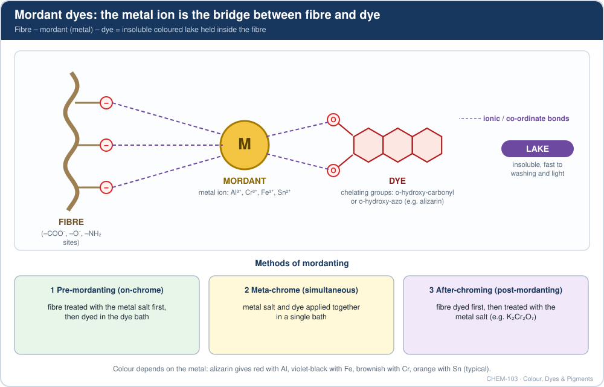

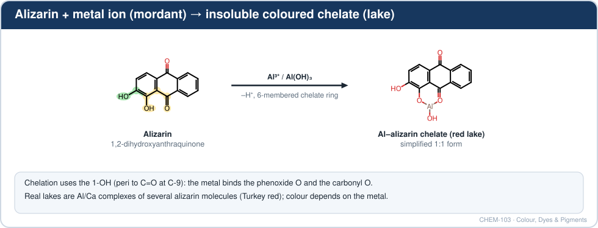

**Methods**
1. **Pre-mordanting (on-chrome):** mordant first, then dye.
2. **Meta-chrome:** mordant and dye in one bath.
3. **After-chroming:** dye first, then mordant (e.g. K₂Cr₂O₇).

**Colour depends on the metal** (alizarin): Al → red (Turkey red), Fe → violet-black, Cr → brownish/claret, Sn → orange.

**Examples:** alizarin, Mordant Black 3 (Eriochrome Black T), natural logwood (haematein), cochineal (carmine with Al).

**Advantages:** very good wash- and light-fastness; wide shade range from one dye. **Disadvantages:** time-consuming, chromium effluent is toxic (modern dyeing uses less Cr).

---

## A8. Coupling reaction

*(2016 Q7d-ii · short note)*

**Definition.** **Azo coupling** is the reaction of an **aryl diazonium salt** (electrophile) with an **electron-rich aromatic compound** — phenol, naphthol or aromatic amine (the *coupling component*) — to give an **azo compound** Ar–N=N–Ar′. It is the key step in making **azo dyes**, the largest dye class.

### Step 1 — Diazotisation (make the electrophile)

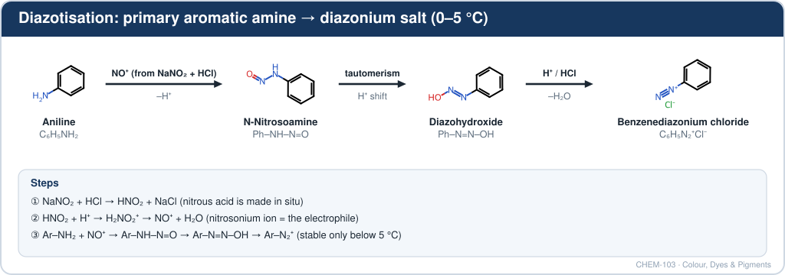

$$\mathrm{ArNH_2 + NaNO_2 + 2\,HCl \xrightarrow{0\text{–}5\,^\circ C} ArN_2^+Cl^- + NaCl + 2\,H_2O}$$

Temperature must stay **below 5 °C**, otherwise the diazonium salt decomposes to phenol + N₂.

### Step 2 — Coupling (electrophilic aromatic substitution)

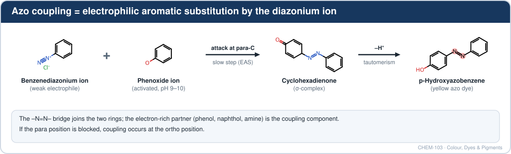

- The diazonium ion is a **weak electrophile**, so only **strongly activated** rings react.
- Attack is at the **para** position to –OH/–NR₂; if para is blocked, at **ortho**.
- β-Naphthol couples at C-1 (adjacent to OH).

### Conditions (pH is critical)

| Coupling component | Optimum pH | Reason |
|---|---|---|
| Phenols, naphthols | **9–10 (mild alkali)** | phenoxide ion is far more reactive; pH > 10 converts ArN₂⁺ to unreactive diazotate |
| Aromatic amines | **4–5 (weak acid)** | free amine is available; strong acid protonates –NH₂ (deactivates), alkali destroys the diazonium salt |

### Examples

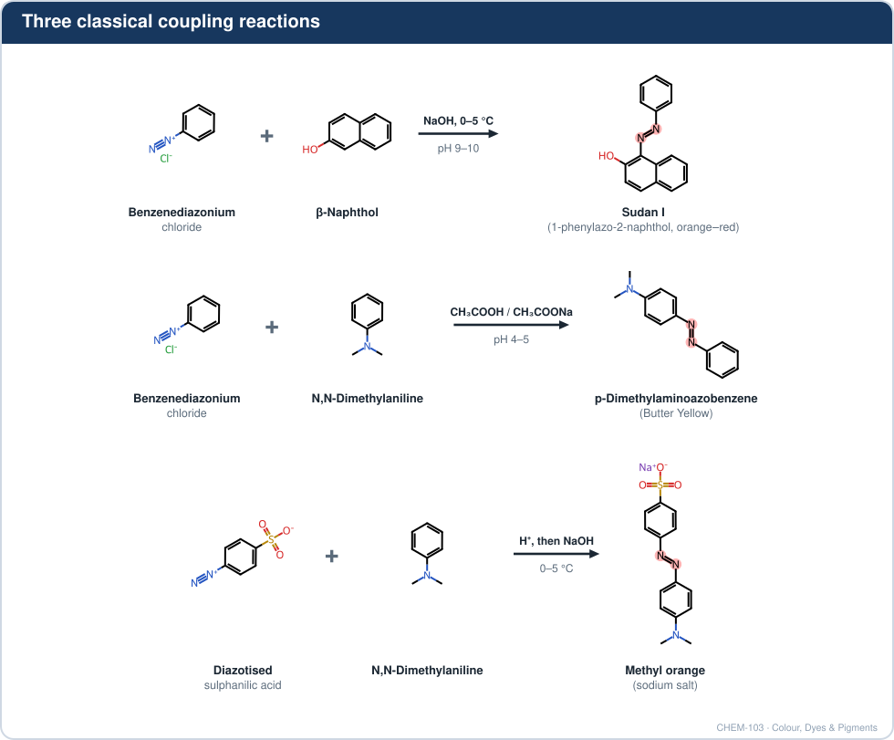

| Diazo component | Coupling component | Product |
|---|---|---|
| Benzenediazonium chloride | β-Naphthol | **Sudan I** (orange-red) |
| Benzenediazonium chloride | N,N-Dimethylaniline | **Butter Yellow** |
| Diazotised sulphanilic acid | N,N-Dimethylaniline | **Methyl orange** |
| p-Nitrobenzenediazonium | β-Naphthol | **Para Red** (azoic dye) |

### Uses
Manufacture of azo dyes (acid, direct, disperse, azoic); **dye test** for primary aromatic amines (diazotise, couple with β-naphthol → orange-red dye); in-situ dyeing of cotton (ice colours).

**Side reaction (N-coupling).** Primary/secondary amines in neutral media may give **diazoamino (triazene) compounds** Ar–N=N–NHAr′, which rearrange on warming with acid to the C-coupled aminoazo compound.

---

## A9. Indigo: preparation and uses

*(2020 Q7c · 2023 Q7d)*

**Indigo** — C₁₆H₁₀N₂O₂ (M ≈ 262.3), the oldest and most important **vat dye**, deep blue, **insoluble in water**, mp ≈ 390 °C (decomposes), sublimes ≈ 300 °C. IUPAC: (2*E*)-2-(3-oxo-1*H*-indol-2-ylidene)-1*H*-indol-3-one.

### Preparation

#### 1. Natural indigo (Indigofera tinctoria)

Leaves contain **indican** (indoxyl β-D-glucoside). Steeped in water, enzymic hydrolysis gives indoxyl, which air-oxidises to indigo.

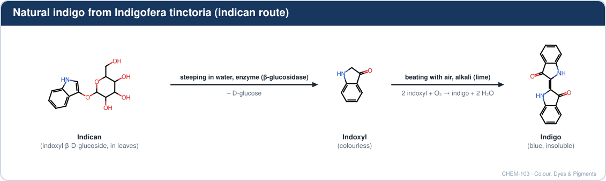

$$\text{Indican} + \mathrm{H_2O} \to \text{indoxyl} + \text{D-glucose};\qquad 2\ \text{indoxyl} + \mathrm{O_2} \to \text{indigo} + 2\,\mathrm{H_2O}$$

#### 2. Synthetic: Heumann–Pfleger process (industrial)

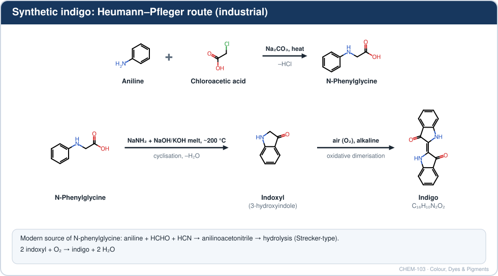

1. Aniline + chloroacetic acid → **N-phenylglycine**.
2. Fusion with NaNH₂ + NaOH/KOH at ≈ 200 °C → **indoxyl** (as sodium salt).
3. Air oxidation → **indigo** (precipitates).

#### 3. Laboratory: Baeyer–Drewsen (1882)

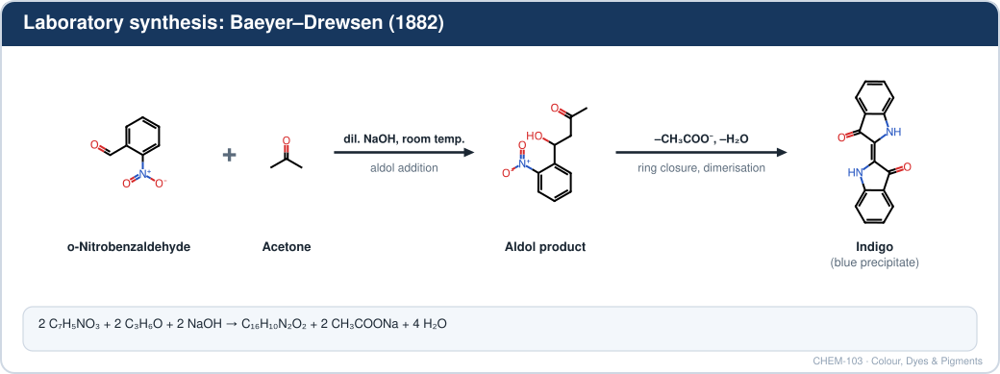

$$\mathrm{2\,o\text{-}O_2NC_6H_4CHO + 2\,CH_3COCH_3 + 2\,NaOH \to indigo + 2\,CH_3COONa + 4\,H_2O}$$

### Vat dyeing with indigo

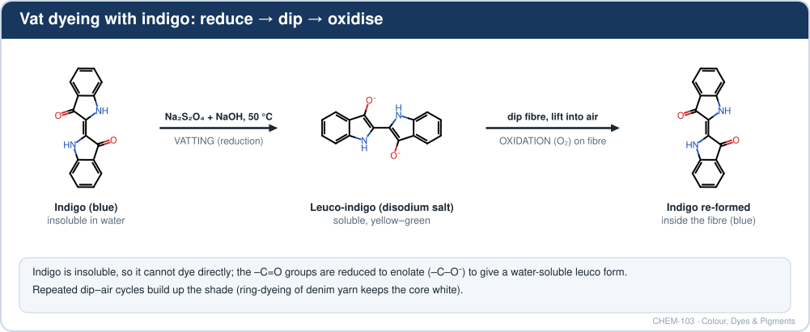

Indigo is reduced (Na₂S₂O₄ + NaOH) to the **soluble yellow-green leuco form**; the fibre is dipped, lifted into air and the leuco form oxidises back to **blue indigo trapped in the fibre**.

### Uses
1. **Denim / blue jeans** (cotton warp yarn) — the largest use.
2. Dyeing of wool, silk and cotton; printing.
3. **Indigo carmine** (sulphonated indigo, E132): food and drug colour; redox indicator; surgical/urological dye.
4. Artist's pigment and ink; 6,6′-dibromoindigo is **Tyrian purple**.

---

## A10. Raw materials for the manufacture of dyes

*(2017 Q8c)*

The dye industry builds dyes from **cheap aromatic hydrocarbons and phenols** ("crudes") plus **inorganic reagents**.

### 1. Organic raw materials — coal tar (main) and petroleum

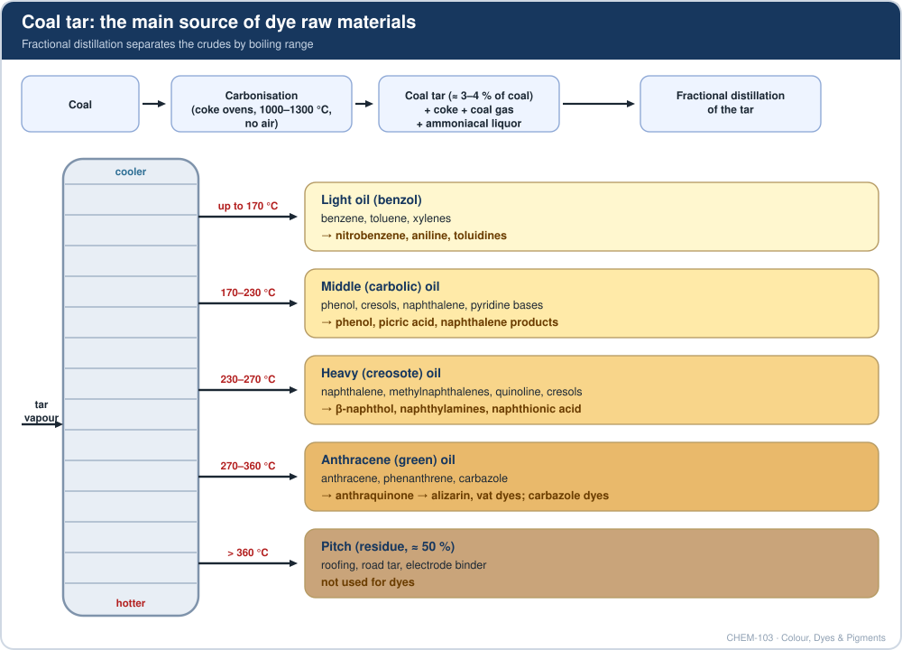

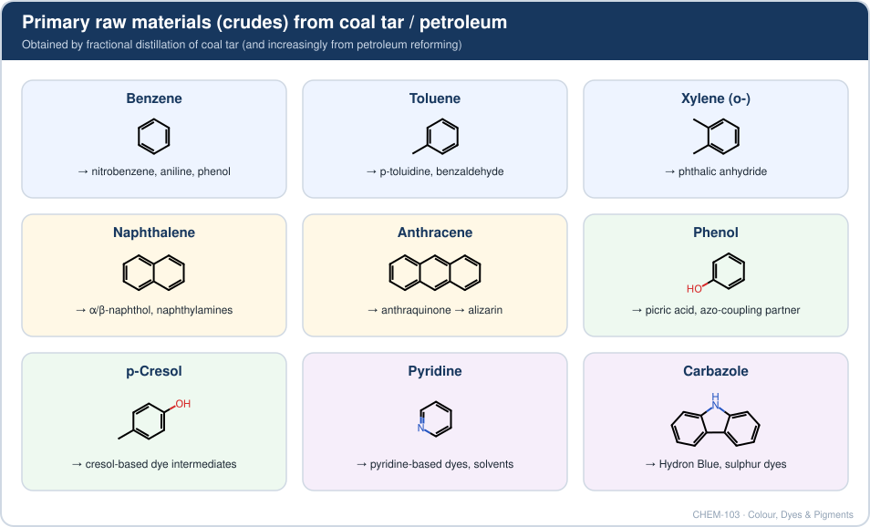

| Fraction (approx. b.p.) | Main components | Dye-related use |
|---|---|---|
| Light oil (< 170 °C) | benzene, toluene, xylenes | nitrobenzene, aniline, toluidines |
| Middle oil (170–230 °C) | phenol, cresols, naphthalene, pyridine | phenol, picric acid, naphthalene derivatives |
| Heavy oil (230–270 °C) | naphthalene, methylnaphthalenes, quinoline | β-naphthol, naphthylamines |
| Anthracene oil (270–360 °C) | anthracene, phenanthrene, carbazole | anthraquinone → alizarin, vat dyes |
| Pitch (> 360 °C) | residue (≈ 50 %) | roofing, electrodes (not for dyes) |

Today **petroleum reforming** supplies most benzene, toluene and xylenes (BTX); coal tar remains important for naphthalene, anthracene and carbazole.

### 2. Inorganic raw materials

| Reagent | Use |
|---|---|
| H₂SO₄ (oleum) | sulphonation, nitrating mixture |
| HNO₃ | nitration |
| HCl | diazotisation, reduction with Fe |
| NaOH / KOH | alkali fusion, coupling |
| NaNO₂ | diazotisation |
| Cl₂ / Br₂ | halogenation |
| Fe powder, Na₂S, Na₂S₂O₄ | reduction |
| NaCl | salting out of dyes |
| Na₂CO₃, CaO | neutralisation |

### 3. Other materials
Solvents (water, ethanol), catalysts (Cu, V₂O₅), diluents and dispersing agents for finishing.

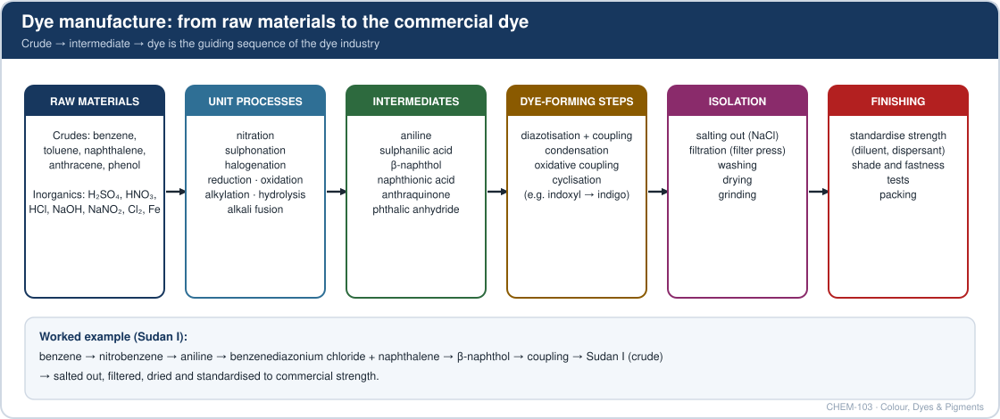

---

## A11. Dye intermediates

*(2018 Q8d · 2021 Q6d)*

**Definition.** **Intermediates** are **organic compounds prepared from the primary raw materials (crudes) by one or more chemical (unit) processes**, which are **not themselves dyes** but are converted into dyes by further reactions.

$$\text{Crudes} \xrightarrow{\text{unit processes}} \text{Intermediates} \xrightarrow{\text{diazotisation, coupling, condensation}} \text{Dyes}$$

### Unit processes used

| Unit process | Reagent | Example |
|---|---|---|
| **Nitration** | HNO₃ / H₂SO₄ | benzene → nitrobenzene |
| **Reduction** | Fe/HCl, H₂/cat | nitrobenzene → aniline |
| **Sulphonation** | H₂SO₄ / oleum | naphthalene → naphthalene-2-sulphonic acid; aniline → sulphanilic acid |
| **Halogenation** | Cl₂ / Br₂ | benzene → chlorobenzene |
| **Alkylation** | CH₃OH/H⁺, alkyl halide | aniline → N,N-dimethylaniline |
| **Oxidation** | CrO₃, air/V₂O₅ | anthracene → anthraquinone |
| **Hydrolysis / alkali fusion** | NaOH | naphthalenesulphonate → β-naphthol |
| **Diazotisation** | NaNO₂ / HCl | aniline → diazonium salt |
| **Condensation** | various | phthalic anhydride + phenol → phenolphthalein |

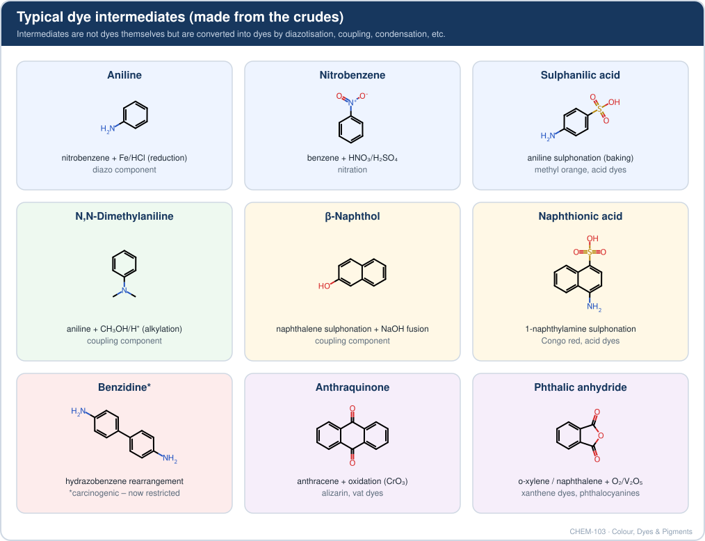

### From crude to dye (worked example)

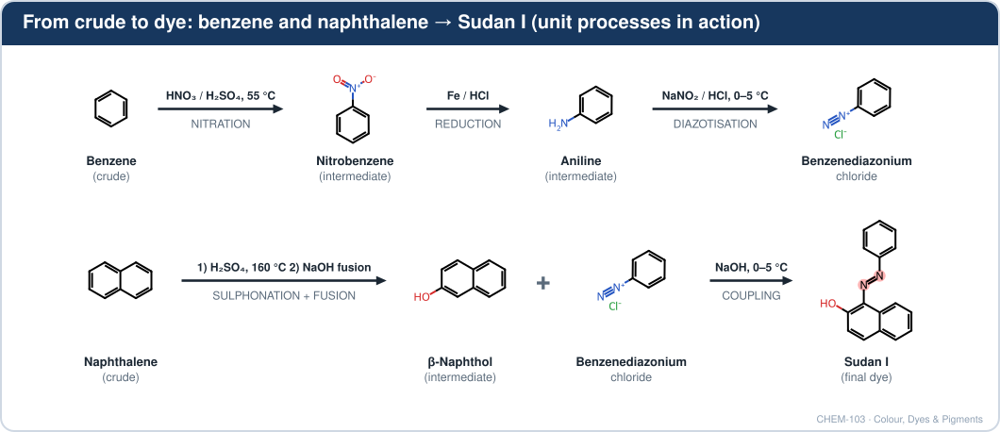

### Importance
1. Same intermediate serves many dyes (aniline, naphthols).
2. Purity of intermediates decides shade and yield of the dye.
3. Intermediates can be made centrally and shipped (separate industry).

> **Note:** benzidine and 2-naphthylamine are **carcinogenic** and now restricted; safer alternatives are used.

---

## A12. Non-textile uses of dyes

*(2016 Q8d · 2017 Q8d · 2020 Q7d · 2022 Q6d · 2023 Q8d)*

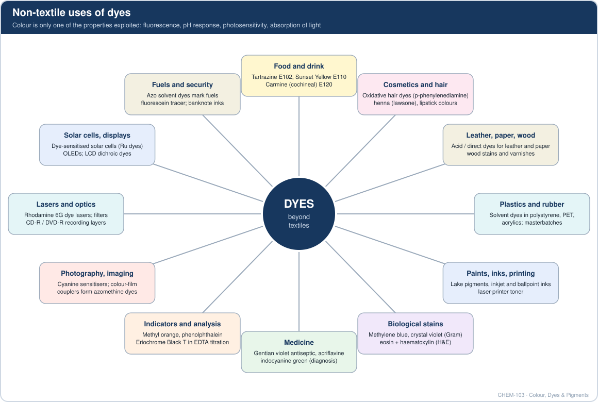

| # | Field | Use and dye examples |
|---|---|---|
| 1 | **Food, drinks, drugs** | Tartrazine (E102), Sunset Yellow (E110), carmine (E120), indigo carmine |
| 2 | **Cosmetics, hair** | oxidative hair dyes (p-phenylenediamine), henna (lawsone), lipstick eosin |
| 3 | **Leather, paper, wood** | acid/direct dyes for leather and paper; wood stains |
| 4 | **Plastics, rubber** | solvent and disperse dyes in polystyrene, PET, acrylics |
| 5 | **Paints, inks, printing** | lake pigments, inkjet and ballpoint inks (methyl violet), toner |
| 6 | **Biological stains** | methylene blue, crystal violet (Gram stain), eosin + haematoxylin |
| 7 | **Medicine** | gentian violet (antiseptic), acriflavine, methylene blue, indocyanine green |
| 8 | **Indicators / analysis** | methyl orange, phenolphthalein, Eriochrome Black T (EDTA titration), litmus |
| 9 | **Photography, imaging** | cyanine sensitisers, colour-film couplers, thermal transfer |
| 10 | **Lasers, optics** | rhodamine 6G dye lasers, optical filters, CD-R/DVD-R recording layers |
| 11 | **Solar cells, electronics** | dye-sensitised solar cells (Ru bipyridyl dyes), OLEDs, LCD dichroic dyes |
| 12 | **Fuels, security, tracing** | solvent azo dyes to mark fuels, fluorescein tracer, banknote inks |

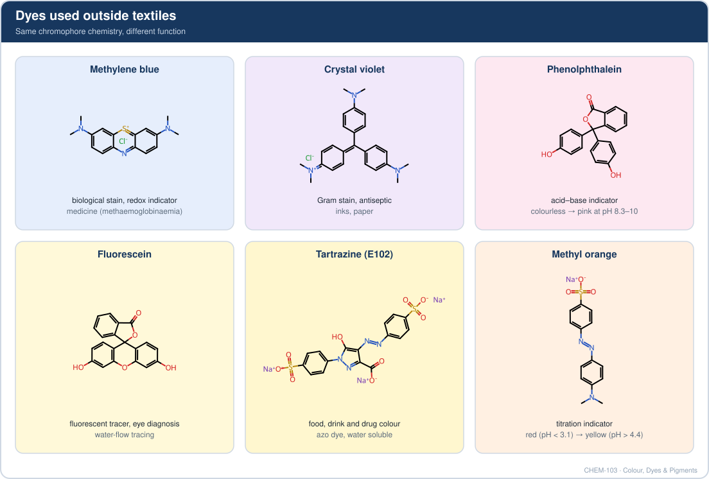

**Short-answer version (5 marks):** food colouring, biological staining, acid–base indicators, paints/inks/plastics, leather and paper colouring, photography, lasers, solar cells and medicine — one dye example each.

---

# Part B — Extra work

## B1. Comparison tables

### Chromogen vs dye vs pigment

| | Chromogen | Dye | Pigment |
|---|---|---|---|
| Has chromophore | yes | yes | yes/inorganic |
| Has auxochrome / affinity | not necessarily | yes | no |
| Soluble | no need | yes | no |
| Example | azobenzene | aniline yellow | TiO₂ |

### Natural vs synthetic dyes

| | Natural | Synthetic |
|---|---|---|
| Source | plants, insects, shellfish | coal tar / petroleum |
| Range of shades | limited, dull | very wide, bright |
| Fastness | mostly low (mordant needed) | good to excellent |
| Cost, reproducibility | high, variable | low, reproducible |
| Examples | indigo (plant), alizarin, carmine | methyl orange, Congo red |

### Vat vs sulphur vs azoic vs reactive

| | Vat | Sulphur | Azoic | Reactive |
|---|---|---|---|---|
| Fibre | cotton | cotton | cotton | cotton, wool |
| Solubilising step | reduction (Na₂S₂O₄) | reduction (Na₂S) | none (formed in situ) | none |
| Fixation | air oxidation | air oxidation | coupling on fibre | covalent bond |
| Fastness | excellent | good (poor to chlorine) | good | excellent wash |

---

## B2. Mnemonics

- **Chromophore = Colour carrier; Auxochrome = Amplifier.**
- **Chromogen + Auxochrome = Dye** → *"CAD"*.
- **Dyeing classes:** *"A Big Dog Might Visit Some Awful Dull Rooms"* → **A**cid, **B**asic, **D**irect, **M**ordant, **V**at, **S**ulphur, **A**zoic, **D**isperse, **R**eactive.
- **Shifts:** *Batho* = red shift (λmax longer); *Hypso* = blue shift (λmax shorter). **Hyper** = ε higher, **Hypo** = ε lower.
- **Coupling pH:** *Phenol → Pretty alkaline; Amine → Acidic-ish* (9–10 vs 4–5).

---

## B3. Quick-revision sheet

1. Colour = selective absorption in 400–700 nm; colour seen = **complement** of absorbed.
2. Dye: soluble, **affinity**, organic. Pigment: **insoluble**, binder, organic or inorganic.
3. Witt (1876): chromogen = ring + chromophore; **dye = chromogen + auxochrome**.
4. Chromophores: –N=N–, –NO₂, –N=O, C=O, C=C, quinoid. Auxochromes: –NH₂, –NR₂, –OH, –COOH, –SO₃H.
5. Modern theory: colour ⇔ small HOMO–LUMO gap; more conjugation → red shift; push–pull resonance.
6. ΔE (eV) ≈ 1240 / λ (nm).
7. Classes: acid, basic, direct, mordant, vat, sulphur, azoic, disperse, reactive.
8. Mordant = metal salt giving a **lake**; needs *o*-hydroxy chelating groups (alizarin).
9. Coupling: ArN₂⁺ + activated Ar′H → Ar–N=N–Ar′; 0–5 °C; phenol pH 9–10, amine pH 4–5.
10. Indigo: indican → indoxyl → indigo (natural); N-phenylglycine → indoxyl → indigo (Heumann–Pfleger); o-nitrobenzaldehyde + acetone (Baeyer–Drewsen). Vat: Na₂S₂O₄ reduces to leuco, air re-oxidises.
11. Crudes: benzene, toluene, xylene, naphthalene, anthracene, phenol, carbazole. Intermediates: aniline, nitrobenzene, sulphanilic acid, β-naphthol, naphthionic acid, anthraquinone.
12. Non-textile: food, stains, indicators, inks, plastics, leather, paper, photography, lasers, solar cells, medicine.

---

## B4. Likely questions not yet asked

| Question | Hint |
|---|---|
| Vat dyes: classification and vatting | [A9](#a9) vat cycle, indanthrone |
| Azo dyes: manufacture of methyl orange / Congo red | [A8](#a8) |
| Reactive dyes: chemistry of fixation | Cell–OH + Cl–triazine → Cell–O–triazine (alkaline) |
| Disperse dyes and polyester dyeing | solid solution, high temperature (≈130 °C) |
| Metal-complex dyes | 1:1 and 2:1 Cr/Co complexes of o,o′-dihydroxyazo dyes |
| Fluorescent brightening agents | stilbene derivatives absorb UV, emit blue |
| Synthesis of alizarin | anthraquinone-2-sulphonic acid + NaOH/NaClO₃ fusion |
| Azo dye problems | reductive cleavage → aromatic amines (e.g. benzidine) |

---

## B5. Practice MCQs

1. The group –N=N– is a/an
   a) auxochrome b) **chromophore** c) mordant d) binder
2. Which is an **acidic auxochrome**?
   a) –NH₂ b) –NR₂ c) **–SO₃H** d) –N=O
3. A dye that is first reduced to a soluble leuco form is a
   a) direct dye b) **vat dye** c) acid dye d) disperse dye
4. Ethene is colourless mainly because
   a) it has no double bond b) **its HOMO–LUMO gap is large (UV absorption)** c) it is a gas d) it is planar
5. A bathochromic shift means
   a) λmax decreases b) ε increases c) **λmax increases** d) ε decreases
6. Diazotisation is carried out at
   a) 50 °C b) 25 °C c) **0–5 °C** d) 100 °C
7. Phenols couple with diazonium salts best at
   a) pH 1 b) pH 4–5 c) **pH 9–10** d) pH 13
8. Alizarin forms a lake with
   a) NaCl b) **Al³⁺** c) glucose d) Na₂SO₄
9. The main source of benzene, naphthalene and anthracene for dyes is
   a) natural gas b) **coal tar** c) wood d) sea water
10. Congo red is a
    a) vat dye b) basic dye c) **direct dye** d) reactive dye

---

## B6. Common mistakes

- Writing that an **auxochrome gives colour** — it only intensifies and gives affinity.
- Calling azobenzene a **dye** — it is a chromogen (no auxochrome, no fibre affinity).
- Forgetting **0–5 °C** and the **pH** for coupling.
- Mixing **dye intermediates** with **raw materials** — raw material = crude from tar; intermediate = made from crude by unit processes.
- Drawing indigo with wrong geometry — use the **trans** form with N–H···O=C hydrogen bonds.
- Using flat formulae — draw rings, mark the chromophore and auxochrome.

---

## B7. Glossary

| Term | Meaning |
|---|---|
| **Chromophore** | unsaturated group responsible for colour |
| **Auxochrome** | lone-pair group that deepens colour and gives affinity |
| **Chromogen** | aromatic compound containing a chromophore |
| **Mordant** | metal salt that fixes a dye as a lake |
| **Lake** | insoluble dye–metal complex or dye on an inorganic base |
| **Vat / leuco form** | reduced, soluble form of a vat dye |
| **Diazo component** | amine converted to diazonium salt |
| **Coupling component** | phenol / naphthol / amine that attacks the diazonium ion |
| **HOMO / LUMO** | highest occupied / lowest unoccupied molecular orbital |
| **Bathochromic / hypsochromic** | shift of λmax to longer / shorter wavelength |
| **Hyperchromic / hypochromic** | increase / decrease in absorption intensity |
| **Substantive dye** | dye with direct affinity for the fibre |
| **Fastness** | resistance of colour to light, washing, rubbing |

---

*End of file · CHEM-103 · Color, Dyes & Pigments · 2016–2023 solved question bank.*
