# Chapter 6: Dyes — Chemistry-II Question Solve

> **Chem-103 · Chapter 6.** Exam-style answers to Question 1 (parts i to iv), followed by extra sections (colour and constitution, how dyeing works, safety, practice questions, quick revision). All structures are SVG diagrams stored in `../../assets/`. Equations use GitHub math (`$$ … $$`) and flowcharts use GitHub-native Mermaid.

## Contents

1. [Part i: Key terms](#1-part-i-key-terms)
2. [Part ii: Three dyes](#2-part-ii-three-dyes)
3. [Part iii: Classification of dyes](#3-part-iii-classification-of-dyes)
4. [Part iv: Non-textile uses of dyes](#4-part-iv-non-textile-uses-of-dyes)
5. [Extra: Colour and chemical constitution](#5-extra-colour-and-chemical-constitution)
6. [Extra: How dyeing works](#6-extra-how-dyeing-works)
7. [Extra: Safety, environment and history](#7-extra-safety-environment-and-history)
8. [Practice questions](#8-practice-questions)
9. [Quick revision](#9-quick-revision)
10. [Notes](#notes)

---

## Question 1

Answer the following:

- **(i)** Explain the terms with examples: colour, dye, pigment, chromophore group, auxochrome group, dye intermediate, and raw materials used in the manufacture of dyes.
- **(ii)** Write the names and structures of three dyes.
- **(iii)** Classify dyes according to their chemical structures and methods of application.
- **(iv)** Write the non-textile uses of dyes.

---

## 1. Part i: Key terms

### 1.1 Colour

**Definition.** Colour is the sensation produced in the eye by the light that is *transmitted or reflected* by a substance after it has **selectively absorbed** part of the visible spectrum (about 400–700 nm).

- If a substance absorbs **no** visible light, it appears **colourless** (or white by reflection).
- If it absorbs **all** visible light, it appears **black**.
- If it absorbs **part** of the spectrum, we see the **complementary colour** of the light absorbed.

The energy absorbed raises an electron to a higher level (π → π\* or n → π\* in organic molecules):

$$
E = h\nu = \frac{hc}{\lambda}
$$

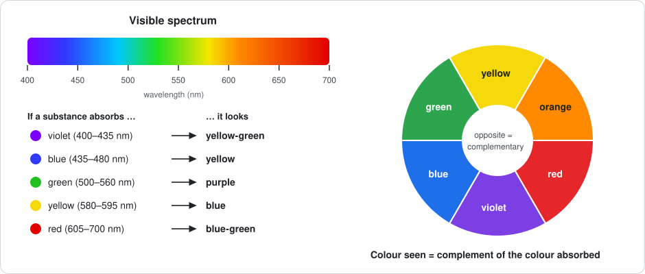

| Colour absorbed | Wavelength (nm) | Colour seen |
|---|---|---|
| 🟪 Violet | 400–435 | 🟨 Yellow-green |
| 🟦 Blue | 435–480 | 🟨 Yellow |
| 🟦 Green-blue | 480–490 | 🟧 Orange |
| 🟩 Blue-green | 490–500 | 🟥 Red |
| 🟩 Green | 500–560 | 🟪 Purple |
| 🟨 Yellow-green | 560–580 | 🟪 Violet |
| 🟨 Yellow | 580–595 | 🟦 Blue |
| 🟧 Orange | 595–605 | 🟦 Green-blue |
| 🟥 Red | 605–700 | 🟩 Blue-green |

**Example.** Methyl orange absorbs blue light (about 460 nm), so it looks **orange-yellow**. Indigo absorbs yellow-orange light, so it looks **blue**.

### 1.2 Dye

**Definition.** A dye is a **coloured organic compound** that can be applied to a fibre or other substrate to give it a lasting colour. It is soluble in the dyeing medium (or can be made soluble), has **affinity** for the fibre, and is fixed to it by ionic bonds, hydrogen bonds, van der Waals forces or covalent bonds.

A good dye must:

1. have an intense colour,
2. be soluble in water (or convertible to a soluble form),
3. have **affinity** for the fibre and be fixed firmly,
4. be fast to light, washing, rubbing and perspiration.

**Examples:** methyl orange, indigo, alizarin, malachite green, Congo red.

### 1.3 Pigment

**Definition.** A pigment is a finely divided, **insoluble** coloured solid (organic or inorganic) that is applied as a **dispersion in a binder** (vehicle). It has **no affinity** for the substrate and stays on the surface as a film.

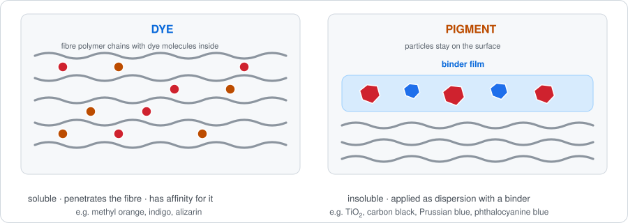

| Property | Dye | Pigment |
|---|---|---|
| Solubility | Soluble in water or the dyeing medium | Insoluble in water and most solvents |
| Particle form | Molecular (dissolved) | Fine solid particles (dispersed) |
| Affinity for substrate | Yes, bonds to the fibre | No, held on the surface by a binder |
| Fixing | Penetrates the fibre | Surface film |
| Uses | Textiles, leather, paper, food | Paints, printing inks, plastics, cosmetics |
| Examples | Methyl orange, indigo, alizarin | TiO2 (white), carbon black, Fe2O3 (red), Prussian blue, phthalocyanine blue |

> [!NOTE]
> The boundary is not absolute. A soluble dye can be precipitated on an inert base (for example alizarin with aluminium) to give an insoluble **lake pigment**.

### 1.4 Chromophore group

**Definition.** A chromophore is an **unsaturated covalent group** in a molecule that is responsible for its colour by absorbing light in the visible region. A compound containing a chromophore is called a **chromogen**.

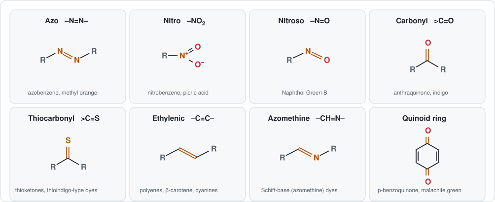

| Chromophore | Structure | Example compounds |
|---|---|---|
| Azo | –N=N– | Azobenzene, methyl orange |
| Nitro | –NO2 | Nitrobenzene (pale yellow), picric acid |
| Nitroso | –N=O | Naphthol Green B |
| Carbonyl | >C=O | Anthraquinone, indigo |
| Thiocarbonyl | >C=S | Thioketones |
| Ethylenic | –C=C– | Polyenes, β-carotene |
| Azomethine | –CH=N– | Schiff-base dyes |
| Quinoid ring | p-benzoquinone type | Quinones, malachite green |

**Example.** Benzene is colourless. Azobenzene (benzene rings joined through –N=N–) is orange-red, because the azo chromophore and the two rings form one conjugated system. But azobenzene is **not a dye**: it has no group that lets it attach to a fibre.

### 1.5 Auxochrome group

**Definition.** An auxochrome (colour-helper) is a group that **by itself does not give colour**, but when attached to a chromogen it **intensifies and deepens the colour** and, being ionisable, supplies the **affinity for the fibre**. It converts a chromogen into a dye.

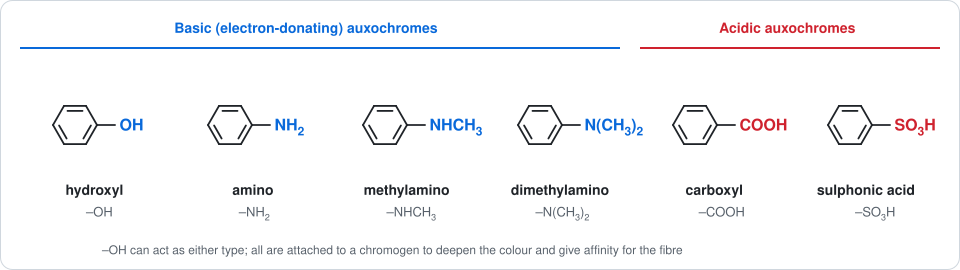

| Type | Groups | Role |
|---|---|---|
| Basic | –NH2, –NHR, –NR2 | Electron-donating lone pair extends conjugation; forms salts with acids |
| Acidic | –COOH, –SO3H | Makes the dye water-soluble; forms salts with bases |
| Either | –OH | Electron-donating; weakly acidic |

**Example.** Azobenzene (chromogen, orange-red) becomes the dye **4-aminoazobenzene (aniline yellow)** when –NH2 is added, and **methyl orange** when –N(CH3)2 and –SO3Na are added.

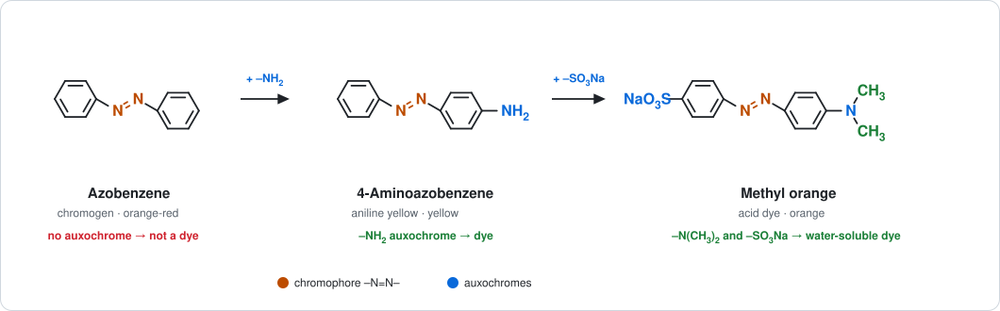

> [!IMPORTANT]
> **Dye = chromophore + auxochrome + conjugated aromatic system.** Chromophore gives colour, auxochrome deepens it and gives fibre affinity.

### 1.6 Dye intermediate

**Definition.** A dye intermediate is a compound **made from a raw material** (benzene, naphthalene, anthracene and so on) by simple chemical operations such as nitration, sulfonation, reduction, oxidation or alkali fusion, which is **not itself a dye** but is used in the next steps to make dyes.

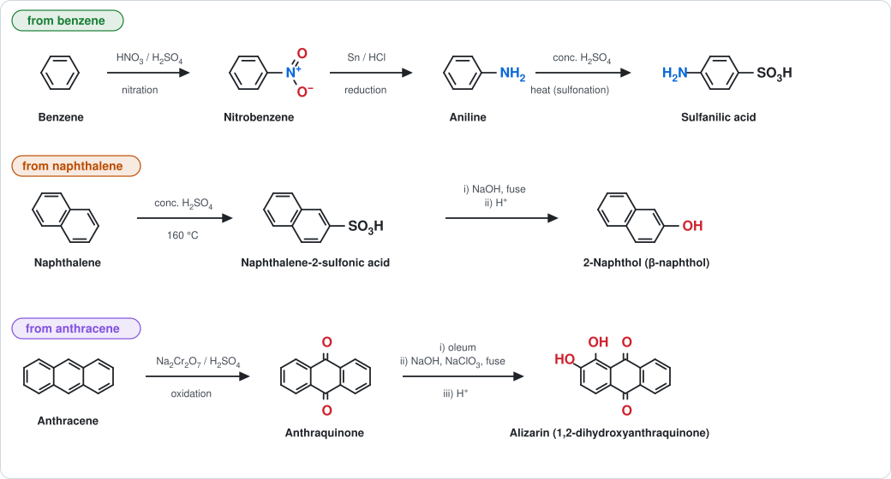

**Benzene series**

$$
\mathrm{C_6H_6 + HNO_3 \xrightarrow{H_2SO_4} C_6H_5NO_2 + H_2O}
$$

$$
\mathrm{C_6H_5NO_2 + 6[H] \xrightarrow{Sn/HCl} C_6H_5NH_2 + 2H_2O}
$$

$$
\mathrm{C_6H_5NH_2 + H_2SO_4 \xrightarrow{\Delta} H_2N{-}C_6H_4{-}SO_3H + H_2O}
$$

**Naphthalene series**

$$
\mathrm{C_{10}H_8 + H_2SO_4 \xrightarrow{160^\circ C} C_{10}H_7SO_3H + H_2O}
$$

$$
\mathrm{C_{10}H_7SO_3Na + 2NaOH \xrightarrow{fuse} C_{10}H_7ONa + Na_2SO_3 + H_2O}
$$

**Anthracene series**

$$
\mathrm{C_{14}H_{10} + 3[O] \xrightarrow{Na_2Cr_2O_7/H_2SO_4} C_{14}H_8O_2 + H_2O}
$$

| Intermediate | Made from | Operations | Used for |
|---|---|---|---|
| Aniline | Benzene | Nitration, reduction | Azo dyes, aniline black |
| Sulfanilic acid | Aniline | Sulfonation | Methyl orange |
| N,N-Dimethylaniline | Aniline | Methylation | Methyl orange, malachite green |
| 2-Naphthol | Naphthalene | Sulfonation, alkali fusion | Para Red, Sudan I, azoic dyes |
| Anthraquinone | Anthracene | Oxidation | Alizarin, vat dyes |
| Phthalic anhydride | Naphthalene or o-xylene | Oxidation | Phthalein, xanthene dyes, phthalocyanines |
| Benzaldehyde | Toluene | Oxidation | Malachite green |

### 1.7 Raw materials used in the manufacture of dyes

Raw materials are the **basic starting chemicals**. They are of two kinds.

**(a) Organic raw materials**, obtained mainly from **coal tar** (and today also from petroleum): benzene, toluene, xylenes, naphthalene, anthracene, phenol, cresols, pyridine.

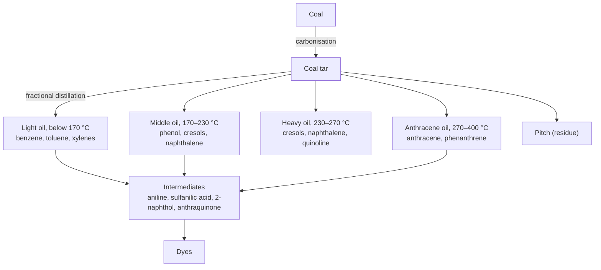

**(b) Inorganic and other chemicals** used in the unit processes:

| Chemical | Role |
|---|---|
| H2SO4, oleum | Sulfonation, nitration medium, dehydrating agent |
| HNO3 | Nitration |
| HCl | Reduction with Sn or Fe, diazotization |
| NaOH, Na2CO3 | Alkali fusion, neutralisation, coupling medium |
| NaNO2 | Diazotization (with HCl) |
| Cl2 | Chlorination |
| Sn, Fe, Zn | Reduction of nitro compounds |
| Na2Cr2O7, NaClO3 | Oxidation |
| Na2S, S | Sulphur dyes |
| NaCl | Salting out the dye |
| Methanol, ethanol, acetic acid | Alkylation, solvents |

> [!TIP]
> **Chain to remember:** raw material → (unit processes) → intermediate → (diazotization, coupling, condensation) → dye.

---

## 2. Part ii: Three dyes

The three dyes below are chosen from three different chemical classes: **azo** (methyl orange), **indigoid** (indigo) and **anthraquinone** (alizarin).

### 2.1 Methyl orange (azo dye)

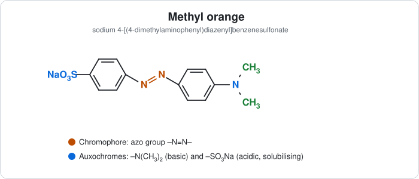

| Item | Detail |
|---|---|
| IUPAC name | Sodium 4-[(4-dimethylaminophenyl)diazenyl]benzenesulfonate |
| Formula | C14H14N3NaO3S |
| Class | Azo dye; **acid dye** |
| Colour | Orange (red in acid, yellow in alkali) |
| Chromophore | Azo group –N=N– |
| Auxochromes | –N(CH3)2 and –SO3Na |
| Uses | Dyeing wool and silk; acid-base indicator (pH 3.1 red to 4.4 yellow) |

**Preparation.** Sulfanilic acid is diazotized, and the diazonium salt is coupled with N,N-dimethylaniline.

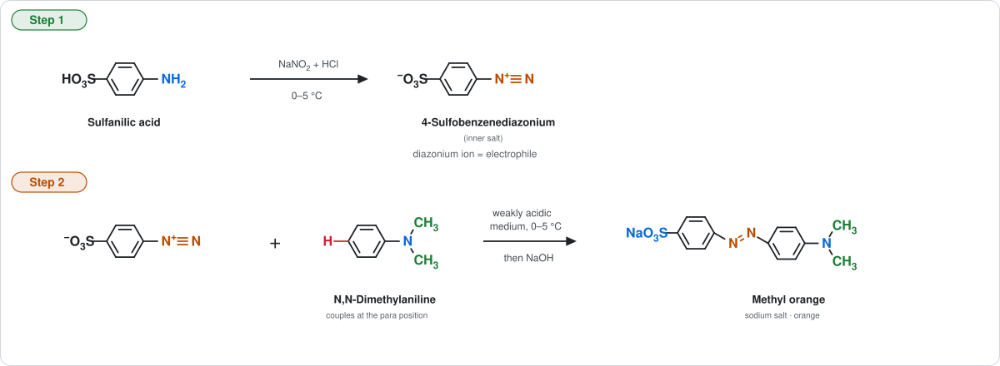

$$
\mathrm{HO_3S{-}C_6H_4{-}NH_2 + NaNO_2 + 2HCl \xrightarrow{0\text{–}5^\circ C} {^-}O_3S{-}C_6H_4{-}N_2^+ + NaCl + 2H_2O}
$$

$$
\mathrm{{^-}O_3S{-}C_6H_4{-}N_2^+ + C_6H_5N(CH_3)_2 \longrightarrow {^-}O_3S{-}C_6H_4{-}N{=}N{-}C_6H_4{-}N(CH_3)_2 + H^+}
$$

Addition of NaOH then gives the orange sodium salt.

### 2.2 Indigo (indigoid vat dye)

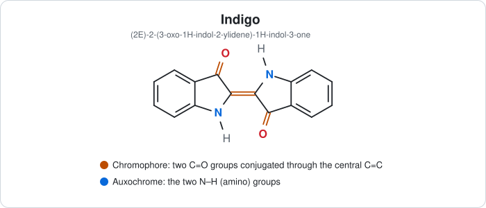

| Item | Detail |
|---|---|
| IUPAC name | (2E)-2-(3-oxo-1H-indol-2-ylidene)-1H-indol-3-one |
| Formula | C16H10N2O2 |
| Class | Indigoid dye; **vat dye** |
| Colour | Deep blue |
| Chromophore | Two C=O groups conjugated through the central C=C |
| Auxochromes | The two N–H groups |
| Source | Natural: *Indigofera* plant; now made synthetically |
| Uses | Dyeing cotton (denim), wool |

**Preparation (Heumann–Pfleger synthesis).** Aniline reacts with chloroacetic acid to give N-phenylglycine, which is fused with alkali (NaNH2/NaOH/KOH) to give indoxyl; air oxidises indoxyl to indigo.

Indigo is insoluble, so it is applied by the **vat process** (reduced to soluble leuco-indigo, absorbed, then re-oxidised):

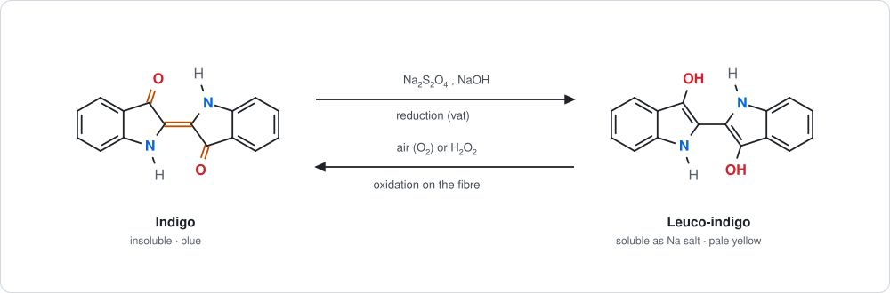

$$
\mathrm{C_{16}H_{10}N_2O_2 + 2[H] \rightleftharpoons C_{16}H_{12}N_2O_2}
$$

### 2.3 Alizarin (anthraquinone mordant dye)

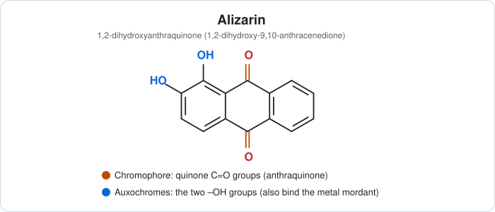

| Item | Detail |
|---|---|
| IUPAC name | 1,2-Dihydroxyanthracene-9,10-dione (1,2-dihydroxyanthraquinone) |
| Formula | C14H8O4 |
| Class | Anthraquinone dye; **mordant dye** |
| Colour | Red with aluminium mordant (violet with iron, brown with chromium) |
| Chromophore | Quinone C=O groups |
| Auxochromes | Two –OH groups |
| Source | Natural: madder root (*Rubia tinctorum*); now synthetic |
| Uses | Dyeing wool and cotton; pigment (lake) |

**Preparation.** Anthracene is oxidised to anthraquinone, which is sulfonated and then fused with NaOH and NaClO3 (see the intermediates figure in Section 1.6).

**Mordanting.** The two –OH groups (and the neighbouring C=O) bind a metal ion such as Al3+ to form an insoluble, coloured chelate (**lake**) fixed on the fibre.

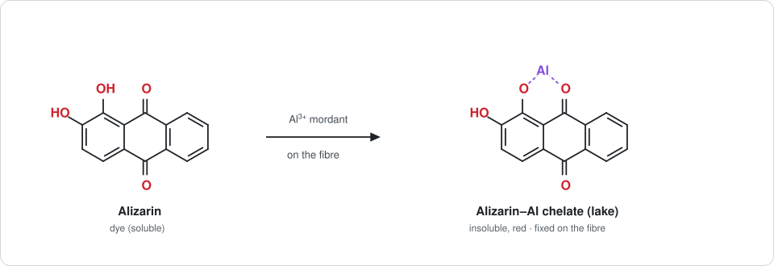

### 2.4 Summary

| Dye | Class (structure) | Class (application) | Colour | Chromophore |
|---|---|---|---|---|
| Methyl orange | Azo | Acid | Orange | –N=N– |
| Indigo | Indigoid | Vat | Blue | C=O and C=C |
| Alizarin | Anthraquinone | Mordant | Red (with Al) | Quinone C=O |

---

## 3. Part iii: Classification of dyes

Dyes are classified in two ways: by **chemical structure** (what chromophore they contain) and by **method of application** (how they are used on the fibre).

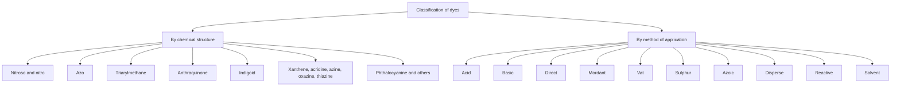

### 3.1 Classification by chemical structure

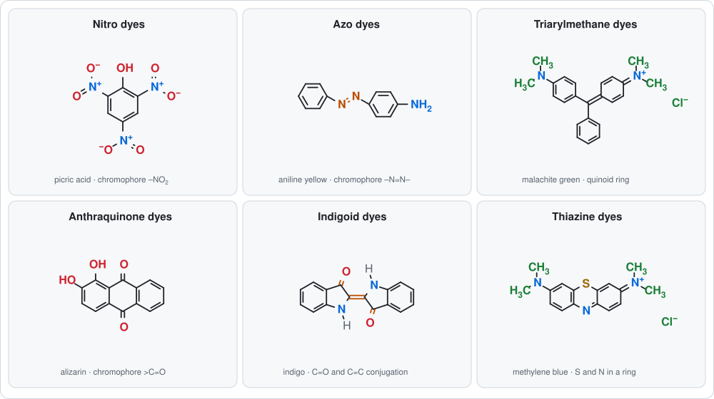

| Class | Chromophore / core | Examples |
|---|---|---|
| Nitroso | –N=O (usually as a metal complex of a nitrosonaphthol) | Naphthol Green B |
| Nitro | –NO2 with –OH or –NH2 | Picric acid, Naphthol Yellow S |
| Azo | –N=N– | Methyl orange, aniline yellow, Congo red, Para Red |
| Diarylmethane | Two aryl rings on one carbon | Auramine O |
| Triarylmethane | Three aryl rings on one carbon, quinoid ring | Malachite green, crystal violet, fuchsin |
| Xanthene | Oxygen-bridged tricyclic ring | Fluorescein, eosin, rhodamine B |
| Acridine | Nitrogen-containing tricyclic ring | Acridine orange, acriflavine |
| Azine | Two N in the central ring | Safranine, mauveine |
| Oxazine | O and N in the central ring | Nile blue |
| Thiazine | S and N in the central ring | Methylene blue |
| Anthraquinone | Anthraquinone core with –OH or –NH2 | Alizarin, indanthrone |
| Indigoid | Two indoxyl units joined by C=C | Indigo, thioindigo |
| Phthalocyanine | Four isoindole units around a metal ion | Copper phthalocyanine (phthalocyanine blue) |
| Sulphur | Complex sulphur-containing rings (structure not fully defined) | Sulphur Black T |

> [!NOTE]
> **Azo dyes** are the largest class, making up more than half of all commercial dyes, because diazotization and coupling are cheap, fast and give a very wide range of colours.

### 3.2 Classification by method of application

| Class | Fibres | Nature of dye | How applied and fixed | Examples |
|---|---|---|---|---|
| **Acid** | Wool, silk, nylon | Anionic (contains –SO3Na or –COOH) | Acidic bath; ionic bond with protonated –NH3+ groups of the fibre | Methyl orange, Orange II, picric acid |
| **Basic (cationic)** | Acrylics, silk, wool; cotton only with a tannin mordant | Cationic (amino groups as salts) | Neutral or weakly acidic bath; salt formation with acidic groups of the fibre | Malachite green, crystal violet, methylene blue |
| **Direct (substantive)** | Cotton, viscose, paper, leather | Anionic, long planar molecules | Neutral bath with NaCl or Na2SO4; hydrogen bonds and van der Waals forces | Congo red |
| **Mordant** | Wool, cotton | Contains –OH or –COOH able to chelate a metal | Fibre treated with a metal salt (Al, Cr, Fe, Sn); insoluble coloured chelate (lake) forms on the fibre | Alizarin, Eriochrome Black T |
| **Vat** | Cotton, linen, rayon | Insoluble in water | Reduced with Na2S2O4 and NaOH to a soluble leuco form, absorbed, then oxidised back by air | Indigo, indanthrone |
| **Sulphur** | Cotton | Insoluble, contains sulphur | Dissolved in Na2S solution (reduced), absorbed, then oxidised in air | Sulphur Black T |
| **Azoic (ice colours)** | Cotton | Formed on the fibre | Fibre soaked in 2-naphthol, then treated with ice-cold diazonium salt; insoluble azo pigment forms inside the fibre | Para Red |
| **Disperse** | Polyester, acetate, nylon | Non-ionic, sparingly soluble | Fine aqueous dispersion at high temperature; dye dissolves in the fibre like a solid solution | Disperse Red 1, Disperse Blue 3 |
| **Reactive** | Cotton, wool, silk | Contains a reactive group (for example chlorotriazine) | Alkaline bath; **covalent bond** with the –OH groups of cellulose | Procion dyes |
| **Solvent** | Plastics, waxes, oils, fuels | Soluble in organic solvents, not in water | Dissolved in the medium | Sudan I |

**Vat dyes** were shown in Section 2.2. Two more application classes are illustrated below.

**Azoic dyeing.** Both components are applied to the fibre in turn, and the dye is made *inside* the fibre by coupling:

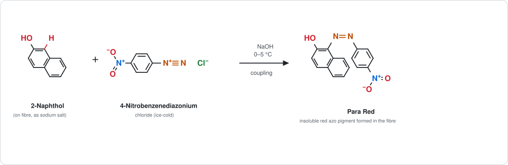

**Mordant dyeing.** The metal mordant links the dye to the fibre (see the alizarin–aluminium figure in Section 2.3).

> [!TIP]
> **Memory aid for application classes:** *A B D M V S A D R S* = Acid, Basic, Direct, Mordant, Vat, Sulphur, Azoic, Disperse, Reactive, Solvent.

---

## 4. Part iv: Non-textile uses of dyes

Besides colouring textiles, dyes are used in many other fields.

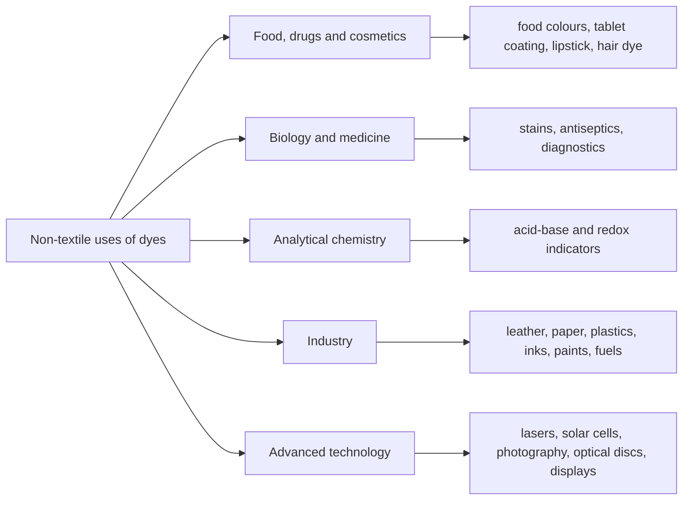

| Field | Use | Example dyes |
|---|---|---|
| **Food, drugs and cosmetics** | Colouring sweets, drinks and tablets; lipsticks and hair dyes | Tartrazine, sunset yellow (permitted azo food dyes); eosin |
| **Biological stains** | Staining cells and tissues for microscopy, such as the Gram stain | Crystal violet, safranine, methylene blue, eosin |
| **Medicine** | Antiseptics, antifungal and antiparasitic agents; diagnostics | Gentian violet, acriflavine, methylene blue |
| **Analytical chemistry** | Indicators for acid-base titration and redox titration; detection of ions | Methyl orange, methyl red, phenolphthalein, methylene blue |
| **Leather, paper, wood** | Colouring leather goods, paper, cardboard and wood | Acid, basic and direct dyes |
| **Plastics, rubber, wax** | Mass colouring of plastics, candles and polishes | Solvent dyes, disperse dyes |
| **Inks and printing** | Ballpoint, felt-tip and inkjet inks; printing | Basic and solvent dyes, azo pigments |
| **Paints and coatings** | Colour of paints, varnishes and lacquers | Pigments and lakes |
| **Petroleum products** | Identification of fuels and oils, and marking of taxed fuel | Sudan dyes (solvent dyes) |
| **Photography** | Sensitising silver halide emulsions to green and red light | Cyanine dyes |
| **Lasers** | Tunable dye lasers as the lasing medium | Rhodamine 6G |
| **Solar cells** | Light-absorbing layer in dye-sensitised solar cells | Ruthenium bipyridyl complexes, organic dyes |
| **Optical data storage and displays** | Recording layer of writable CDs and DVDs; liquid-crystal displays | Cyanine and phthalocyanine dyes |
| **Tracers and signalling** | Tracing water flow in hydrology; coloured smoke and marker dyes | Fluorescein, rhodamine B |

> [!TIP]
> In the exam, give **at least five uses with an example each**: food colouring (tartrazine), biological staining (methylene blue), acid-base indicators (methyl orange), inks and paints, and lasers or solar cells.

---

## 5. Extra: Colour and chemical constitution

### 5.1 Witt's theory (1876)

Otto Witt proposed that a coloured organic compound consists of:

1. a **chromogen**: an aromatic compound containing a **chromophore**, and
2. one or more **auxochromes** that deepen the colour and make it a dye.

### 5.2 Modern explanation

The colour comes from the **energy gap** between the highest occupied and lowest unoccupied molecular orbitals (HOMO–LUMO). The more extensive the **conjugation** (alternating single and double bonds), the smaller the gap and the longer the wavelength absorbed.

$$
\Delta E = \frac{hc}{\lambda_{\max}} \qquad \text{smaller } \Delta E \;\Rightarrow\; \text{longer } \lambda_{\max}
$$

| Compound | Conjugation | Colour |
|---|---|---|
| Benzene | One ring | Colourless |
| Nitrobenzene | Ring + –NO2 | Pale yellow |
| Azobenzene | Two rings + –N=N– | Orange-red (weak) |
| 4-Aminoazobenzene | Plus –NH2 donor | Intense yellow |
| β-Carotene | 11 conjugated C=C | Orange |

### 5.3 Shifts in absorption

| Term | Meaning | Caused by |
|---|---|---|
| Bathochromic shift (red shift) | λmax moves to a longer wavelength | Auxochromes, extended conjugation |
| Hypsochromic shift (blue shift) | λmax moves to a shorter wavelength | Loss of conjugation, protonation of the donor |
| Hyperchromic effect | Absorption intensity increases | Auxochromes |
| Hypochromic effect | Absorption intensity decreases | Breaking planarity |

---

## 6. Extra: How dyeing works

### 6.1 Steps

1. **Preparation of fibre** (scouring, bleaching).
2. **Dye bath** with water, dye and assistants (acid, alkali, salt, reducing agent).
3. **Adsorption** of dye on the fibre surface.
4. **Diffusion** into the fibre.
5. **Fixation** by chemical or physical bonding.
6. **Washing off** unfixed dye, then drying.

### 6.2 Dye–fibre attraction

| Force | Where it acts | Dye classes |
|---|---|---|
| Ionic bond | Anionic dye with –NH3+ of wool/silk; cationic dye with acidic fibre | Acid, basic |
| Hydrogen bond | –OH, –NH2 of dye with –OH of cellulose | Direct |
| Van der Waals forces | Large planar dye molecules lying along the fibre | Direct, disperse |
| Coordinate (chelate) bond | Metal ion binds dye and fibre | Mordant |
| Mechanical entrapment | Insoluble dye trapped inside the fibre | Vat, sulphur, azoic |
| Covalent bond | Reactive group with –OH of cellulose | Reactive |

### 6.3 Fastness

Fastness is the resistance of a dyed fabric to fading or bleeding. The main types are **light fastness**, **wash fastness**, **rub (crock) fastness** and **perspiration fastness**. Covalently bound reactive dyes and insoluble vat dyes generally have the best wash fastness.

---

## 7. Extra: Safety, environment and history

### 7.1 Safety and environment

- Some azo dyes can be **reductively cleaved to carcinogenic aromatic amines** (for example benzidine); such dyes are banned for textiles in many countries.
- **Sudan I** and related dyes are banned as food additives; **malachite green** is banned in food-fish farming in many countries.
- **Picric acid** is explosive when dry.
- Dye-house effluent is intensely coloured and has a high oxygen demand; it needs treatment (coagulation, adsorption, oxidation, biological treatment) before discharge.

### 7.2 History

| Year | Event |
|---|---|
| 1856 | William Perkin makes **mauveine**, the first synthetic dye, while trying to synthesise quinine from aniline |
| 1858 | Peter Griess discovers diazotization |
| 1876 | Witt proposes the chromophore–auxochrome theory |
| 1884 | Congo red, the first direct cotton dye |
| Late 19th century | Synthetic alizarin and indigo replace the natural dyes |

---

## 8. Practice questions

<b>Q1. Why is azobenzene coloured but not a dye?</b>

It contains the azo chromophore conjugated with two benzene rings, so it is coloured (orange-red). It has no auxochrome, so it has no affinity for fibres and cannot be fixed on them. Adding –NH2 (aniline yellow) or –N(CH3)2 and –SO3Na (methyl orange) makes it a dye.

<b>Q2. Differentiate between a dye and a pigment.</b>

A dye is soluble, enters the fibre and has affinity for it. A pigment is insoluble, has no affinity and sits on the surface in a binder. (See the table in Section 1.3.)

<b>Q3. What are dye intermediates? Give the route from benzene to sulfanilic acid.</b>

Intermediates are compounds made from raw materials that are used to make dyes but are not dyes themselves. Benzene → (HNO3/H2SO4) nitrobenzene → (Sn/HCl) aniline → (conc. H2SO4, heat) sulfanilic acid.

<b>Q4. How is a vat dye such as indigo applied?</b>

Insoluble indigo is reduced with sodium dithionite and NaOH to soluble leuco-indigo. The fabric is dipped in this vat, then exposed to air, which oxidises the leuco form back to insoluble blue indigo, trapped in the fibre.

<b>Q5. Why is methyl orange an acid dye and also an indicator?</b>

It carries the –SO3Na group, so it is an anionic dye that bonds to the protonated amino groups of wool and silk in an acidic bath. Its colour depends on pH (red below pH 3.1, yellow above pH 4.4), so it can be used as an acid-base indicator.

<b>Q6. What is the role of a mordant?</b>

A mordant is a metal salt (Al, Cr, Fe, Sn) that binds both the fibre and the dye, forming an insoluble coloured chelate (lake) on the fibre. For example, alizarin with an aluminium mordant gives a red lake.

---

## 9. Quick revision

| Term | One-line answer |
|---|---|
| Colour | Light left after selective absorption in 400–700 nm; complementary colour of the absorbed light |
| Dye | Soluble coloured organic compound with affinity for the fibre |
| Pigment | Insoluble coloured particles held on the surface by a binder |
| Chromophore | Unsaturated group giving colour (–N=N–, –NO2, >C=O, quinoid) |
| Auxochrome | Colour-helper and fibre-binding group (–NH2, –OH, –NR2, –COOH, –SO3H) |
| Intermediate | Compound made from raw materials and converted to dyes |
| Raw materials | Benzene, toluene, naphthalene, anthracene, phenol (coal tar) plus acids, alkalis, NaNO2 |

| Dye | Structural class | Application class | Colour |
|---|---|---|---|
| Methyl orange | Azo | Acid | Orange |
| Indigo | Indigoid | Vat | Blue |
| Alizarin | Anthraquinone | Mordant | Red (Al) |
| Malachite green | Triarylmethane | Basic | Green |
| Congo red | Azo | Direct | Red |
| Para Red | Azo | Azoic | Red |

---

## Notes

- Answers follow the four parts of Question 1 as set. Parts 5 to 9 are extra material for deeper understanding and revision.
- Structures of dyes in the diagrams show the neutral or cationic forms used in textbooks; counter-ions are shown where needed (Na+ in methyl orange, Cl− in malachite green and methylene blue).
- Wavelength ranges for the colour table are the standard textbook values; exact boundaries vary slightly between books.
- Indigo and alizarin are drawn as typical textbook structures; leuco-indigo is shown in its neutral enol form (it dissolves as the sodium salt in alkali).
