# Hydroxy Compounds: Previous-Year Questions Solved (2017–2023)

> **Course:** Chemistry-II (Chem-103) | **Chapter:** Hydroxy Compounds (alcohols, phenols, glycerol)
> **Source:** previous-year questions, 2017 to 2023 (original year and question numbers kept)
> **Format:** exam-style answers, each with a structure diagram and a worked example. Figures are SVG files stored in `../../assets/`.

## Contents

- [How to use these notes](#how-to-use-these-notes)
- [Quick primer (extra)](#quick-primer-extra)
- [2017](#2017)
  - [2017 Q2(a): What is meant by alcohol and phenol?](#2017-q2a-what-is-meant-by-alcohol-and-phenol)
  - [2017 Q2(b): Explain the methods of preparation of 1°, 2° and 3° alcohols](#2017-q2b-explain-the-methods-of-preparation-of-1-2-and-3-alcohols)
  - [2017 Q2(c): Explain (i) Coupling reaction and (ii) Reimer–Tiemann reaction](#2017-q2c-explain-i-coupling-reaction-and-ii-reimertiemann-reaction)
  - [2017 Q2(d): Distinguish among 1°, 2° and 3° alcohols](#2017-q2d-distinguish-among-1-2-and-3-alcohols)
  - [2017 Q3(a): Why is phenol acidic?](#2017-q3a-why-is-phenol-acidic)
  - [2017 Q3(b): How can salicylic acid and picric acid be prepared from phenol?](#2017-q3b-how-can-salicylic-acid-and-picric-acid-be-prepared-from-phenol)
- [2018](#2018)
  - [2018 Q2(a): How can phenol be obtained from coal tar?](#2018-q2a-how-can-phenol-be-obtained-from-coal-tar)
  - [2018 Q2(b): Distinguish between 1°, 2° and 3° alcohols by dehydrogenation method](#2018-q2b-distinguish-between-1-2-and-3-alcohols-by-dehydrogenation-method)
  - [2018 Q2(c): Explain why acetic acid is stronger than propionic acid but weaker than mono-chloroacetic acid](#2018-q2c-explain-why-acetic-acid-is-stronger-than-propionic-acid-but-weaker-than-mono-chloroacetic-acid)
  - [2018 Q2(d): Write short notes on (i) Picric acid (ii) TNG (tri-nitro glycerine)](#2018-q2d-write-short-notes-on-i-picric-acid-ii-tng-tri-nitro-glycerine)
- [2019](#2019)
  - [2019 Q2(a): Why is phenol acidic in nature?](#2019-q2a-why-is-phenol-acidic-in-nature)
  - [2019 Q2(b): Write down with reaction how to differentiate between phenol and ethanol](#2019-q2b-write-down-with-reaction-how-to-differentiate-between-phenol-and-ethanol)
  - [2019 Q3(a): Are all hydroxyl compounds alcohol? Explain it](#2019-q3a-are-all-hydroxyl-compounds-alcohol-explain-it)
- [2020](#2020)
  - [2020 Q2(a): Why phenol is acidic in nature?](#2020-q2a-why-phenol-is-acidic-in-nature)
  - [2020 Q2(b): How can salicylic acid and picric acid be prepared from phenol?](#2020-q2b-how-can-salicylic-acid-and-picric-acid-be-prepared-from-phenol)
  - [2020 Q2(c): Explain the methods of preparation of 1°, 2° and 3° alcohols with reactions](#2020-q2c-explain-the-methods-of-preparation-of-1-2-and-3-alcohols-with-reactions)
  - [2020 Q2(d): What happens when KHSO4 reacts with glycerine with heat?](#2020-q2d-what-happens-when-khso4-reacts-with-glycerine-with-heat)
- [2021](#2021)
  - [2021 Q3(a): What is meant by alcohol and phenol?](#2021-q3a-what-is-meant-by-alcohol-and-phenol)
  - [2021 Q3(b): Distinguish 1°, 2° & 3° alcohol by Lucas reagent](#2021-q3b-distinguish-1-2--3-alcohol-by-lucas-reagent)
  - [2021 Q3(c): Explain about (i) Coupling reaction and (ii) Kolbe's reaction](#2021-q3c-explain-about-i-coupling-reaction-and-ii-kolbes-reaction)
  - [2021 Q3(d): What happens when KHSO4/P2O5 reacts with glycerin with heat?](#2021-q3d-what-happens-when-khso4p2o5-reacts-with-glycerin-with-heat)
- [2022](#2022)
  - [2022 Q4(a): Write the reactions for the production of ethyl alcohol from starch](#2022-q4a-write-the-reactions-for-the-production-of-ethyl-alcohol-from-starch)
  - [2022 Q4(b): Distinguish between phenol and ethyl alcohol](#2022-q4b-distinguish-between-phenol-and-ethyl-alcohol)
  - [2022 Q4(c): What happens when glycerine is treated with HNO3?](#2022-q4c-what-happens-when-glycerine-is-treated-with-hno3)
  - [2022 Q4(d): How is alcohol identified?](#2022-q4d-how-is-alcohol-identified)
- [2023](#2023)
  - [2023 Q2(c): Explain the preparation of 1°, 2° and 3° alcohol from Grignard reagent](#2023-q2c-explain-the-preparation-of-1-2-and-3-alcohol-from-grignard-reagent)
  - [2023 Q2(d): How will you distinguish between 1°, 2° and 3° alcohols?](#2023-q2d-how-will-you-distinguish-between-1-2-and-3-alcohols)
- [Extra sections](#extra-sections)
  - [Extra 1: Reaction map of phenol](#extra-1-reaction-map-of-phenol)
  - [Extra 2: Question analysis, 2017 to 2023](#extra-2-question-analysis-2017-to-2023)
  - [Extra 3: One-page revision sheet](#extra-3-one-page-revision-sheet)
  - [Extra 4: Mnemonics and common mistakes](#extra-4-mnemonics-and-common-mistakes)
  - [Extra 5: Ten-minute self-test](#extra-5-ten-minute-self-test)
- [Figure index](#figure-index)

---

## How to use these notes

- Every answer follows the pattern **Definition / Reaction / Example / Diagram / Key point**.
- Where a question repeats in another year, the full answer is written once and later years link back to it with a short recap, so nothing is missing and nothing is copy-pasted.
- Colour code in all diagrams: 🔴 oxygen (red), 🔵 nitrogen (blue), 🟢 chlorine (green), 🟤 bromine (brown), 🟣 iodine / Mg / Na (purple). Plain skeletal (line-angle) structures are used: every bend or end is a carbon atom.
- In every reaction scheme, **conditions are written on the arrow**.

---

## Quick primer (extra)

| Class | General formula | –OH is attached to | Example |
|---|---|---|---|
| Alcohol | R–OH | sp³ carbon of an alkyl group | CH₃CH₂OH (ethanol) |
| Phenol | Ar–OH | sp² carbon of a benzene ring | C₆H₅OH (phenol) |
| Glycerol | HOCH₂–CH(OH)–CH₂OH | three sp³ carbons (trihydric alcohol) | propane-1,2,3-triol |

**Why alcohols boil high:** the O–H bond is polar, so alcohol molecules hydrogen-bond to each other (ethanol b.p. 351 K against ethane 184 K and dimethyl ether 249 K).
**Why lower alcohols dissolve in water:** they hydrogen-bond with water; solubility falls as the alkyl chain grows.

---

## 2017

### 2017 Q2(a): What is meant by alcohol and phenol?

**Alcohol.** An alcohol is an organic compound in which one or more hydroxyl (–OH) groups are attached to a **saturated (sp³) carbon atom** of an alkyl group. General formula **R–OH**. Examples: CH₃OH, CH₃CH₂OH. (Benzyl alcohol, C₆H₅CH₂OH, is also an alcohol because its OH is on the sp³ CH₂ carbon, not on the ring.)

**Phenol.** A phenol is an organic compound in which a hydroxyl group is attached **directly to a carbon atom of an aromatic (benzene) ring**. General formula **Ar–OH**. The simplest member is C₆H₅OH, called phenol (carbolic acid).

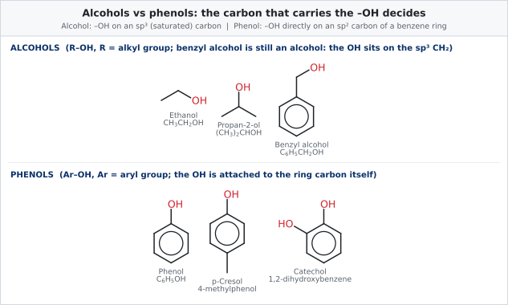

<em>Fig. 1: Alcohols (OH on sp³ carbon) and phenols (OH on the ring carbon).</em>

**Key point.** Because the OH carbon is sp² in phenols, the oxygen lone pair is delocalised into the ring. This makes phenol *acidic* and the ring *very reactive* toward electrophiles; alcohols show neither property to the same degree.

### 2017 Q2(b): Explain the methods of preparation of 1°, 2° and 3° alcohols

**Answer.** The class of the alcohol obtained depends on the starting material. The common laboratory methods are summarised below; each is drawn in the figure that follows.

| Method | 1° alcohol | 2° alcohol | 3° alcohol |
|---|---|---|---|
| Hydrolysis of alkyl halide (aq. KOH) | R–CH₂–X | R₂CH–X | R₃C–X |
| Reduction (H₂/Ni, NaBH₄, LiAlH₄) | aldehyde, acid, ester | ketone | not possible |
| Hydration / hydroboration of alkene | hydroboration–oxidation of a terminal alkene (anti-Markovnikov) | H₂O/H⁺ on R–CH=CH₂ (Markovnikov) | H₂O/H⁺ on R₂C=CH₂ |
| Grignard reagent (RMgX) | + HCHO | + other aldehydes | + ketones, or 2 RMgX + ester |

**(A) Primary (1°) alcohols**

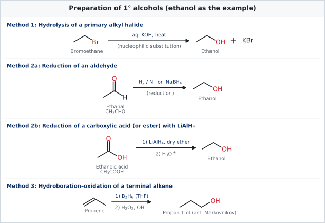

<em>Fig. 2: Preparation of 1° alcohols.</em>

Equations:
1. CH₃CH₂Br + KOH(aq) → CH₃CH₂OH + KBr
2. CH₃CHO + H₂ →(Ni) CH₃CH₂OH; also RCOOH + 4[H] →(LiAlH₄) RCH₂OH + H₂O
3. CH₃CH=CH₂ →(B₂H₆; then H₂O₂/OH⁻) CH₃CH₂CH₂OH (propan-1-ol)
4. Grignard route with methanal: see **Fig. 5 and Fig. 6** below.

**(B) Secondary (2°) alcohols**

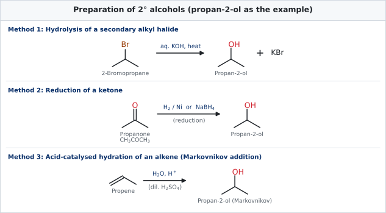

<em>Fig. 3: Preparation of 2° alcohols.</em>

Equations:
1. (CH₃)₂CHBr + KOH(aq) → (CH₃)₂CHOH + KBr
2. CH₃COCH₃ + 2[H] →(NaBH₄ or H₂/Ni) (CH₃)₂CHOH
3. CH₃CH=CH₂ + H₂O →(H⁺) (CH₃)₂CHOH, following **Markovnikov's rule** (OH goes to the carbon with fewer hydrogens)
4. Grignard route with ethanal (see Fig. 5 and Fig. 6).

**(C) Tertiary (3°) alcohols**

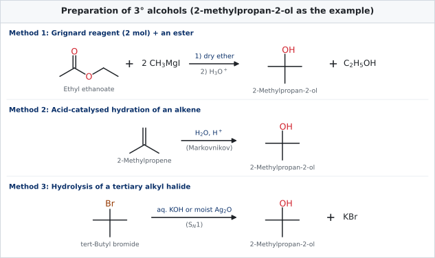

<em>Fig. 4: Preparation of 3° alcohols.</em>

Equations:
1. CH₃COOC₂H₅ + 2 CH₃MgI → (CH₃)₃COMgI →(H₃O⁺) (CH₃)₃COH + C₂H₅OH
2. (CH₃)₂C=CH₂ + H₂O →(H⁺) (CH₃)₃COH
3. (CH₃)₃CBr + OH⁻ → (CH₃)₃COH + Br⁻ (Sₙ 1; keep conditions mild to avoid elimination)
4. Grignard route with a ketone: see the next figures.

**(D) The Grignard method for all three classes (the most examined route)**

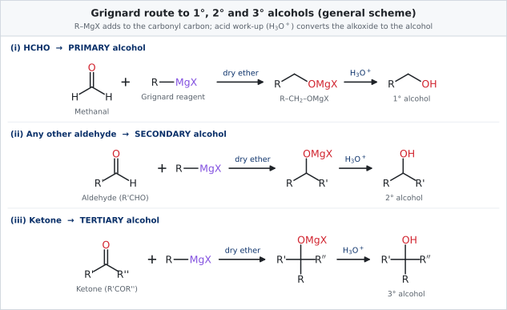

<em>Fig. 5: General Grignard scheme.</em>

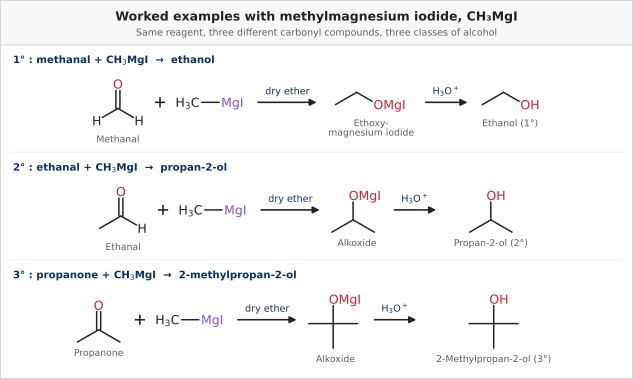

<em>Fig. 6: Worked examples using CH₃MgI.</em>

### 2017 Q2(c): Explain (i) Coupling reaction and (ii) Reimer–Tiemann reaction

**(i) Coupling reaction (azo coupling).** A benzenediazonium salt reacts with an activated aromatic compound such as phenol or aromatic amine to give a coloured **azo compound** containing the –N=N– group. The diazonium ion (ArN₂⁺) acts as a weak electrophile and substitutes the hydrogen at the **para** position of phenol (ortho if para is blocked).

- With phenol (mildly alkaline, pH 9–10, 273–278 K): C₆H₅N₂⁺Cl⁻ + C₆H₅OH → C₆H₅–N=N–C₆H₄–OH (**p-hydroxyazobenzene**, orange-red dye) + HCl
- With aniline (weakly acidic, pH 4–5): gives **p-aminoazobenzene**, a yellow dye.
- The diazonium salt itself is made by **diazotisation**: C₆H₅NH₂ + NaNO₂ + 2HCl → C₆H₅N₂⁺Cl⁻ + NaCl + 2H₂O at 273–278 K.

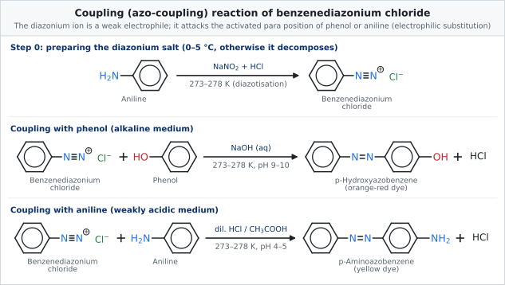

<em>Fig. 7: Coupling reaction.</em>

**Why alkaline for phenol?** In alkali phenol exists as the phenoxide ion, whose ring is far more electron-rich than phenol itself, so the weak diazonium electrophile attacks readily. **Uses:** the azo dyes (methyl orange, Congo red, etc.) are made this way.

**(ii) Reimer–Tiemann reaction.** Phenol, when heated with **chloroform and aqueous sodium hydroxide** at about 340 K and then acidified, gives **salicylaldehyde** (o-hydroxybenzaldehyde) as the main product and a little p-hydroxybenzaldehyde. A –CHO group is introduced on the ring, mainly ortho to –OH.

*Mechanism in brief:* (1) CHCl₃ + OH⁻ → :CCl₃⁻ + H₂O, then :CCl₃⁻ → :CCl₂ + Cl⁻ (dichlorocarbene, the electrophile). (2) The phenoxide ion attacks :CCl₂ through the ortho carbon, giving o-(dichloromethyl)phenoxide. (3) Alkaline hydrolysis converts –CHCl₂ to –CHO; acidification liberates the free phenol group.

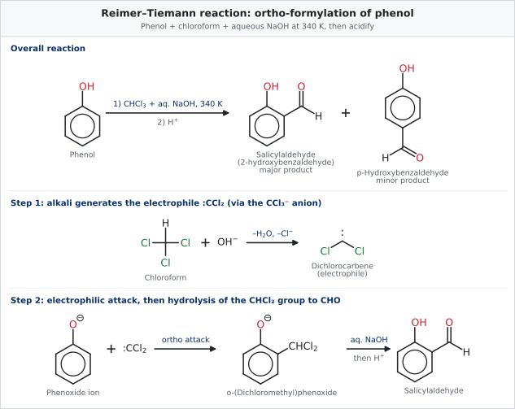

<em>Fig. 8: Reimer–Tiemann reaction.</em>

**Variation:** with CCl₄ and aqueous NaOH, phenol gives **salicylic acid** instead.

### 2017 Q2(d): Distinguish among 1°, 2° and 3° alcohols

**Answer.** Three reliable laboratory tests are used. Each is explained in full under the later years: the **Lucas test** under [2021 Q3(b)](#2021-q3b-distinguish-1-2--3-alcohol-by-lucas-reagent), the **dehydrogenation / oxidation test** under [2018 Q2(b)](#2018-q2b-distinguish-between-1-2-and-3-alcohols-by-dehydrogenation-method), and the Victor Meyer test under [2023 Q2(d)](#2023-q2d-how-will-you-distinguish-between-1-2-and-3-alcohols).

| Test | 1° alcohol | 2° alcohol | 3° alcohol |
|---|---|---|---|
| **Lucas reagent** (conc. HCl + anhyd. ZnCl₂), room temp. | no turbidity (only on heating) | turbid in about 5 min | turbid immediately |
| **Cu, 573 K** (dehydrogenation) | aldehyde | ketone | alkene (dehydration) |
| **Victor Meyer** (P/I₂, AgNO₂, HNO₂, NaOH) | blood-red colour | blue colour | colourless |
| **Acidified K₂Cr₂O₇** | orange → green; aldehyde, then acid | orange → green; ketone | no change (mild conditions) |

### 2017 Q3(a): Why is phenol acidic?

**Answer.** Phenol is acidic because it loses a proton from the O–H bond to form the **phenoxide ion, which is stabilised by resonance**.

1. The oxygen of –OH is attached to an sp² carbon, which is more electronegative than sp³ carbon, so the O–H bond is more polar and the H⁺ leaves more easily.
2. In the phenoxide ion the negative charge is **delocalised over the oxygen and the ortho and para carbons** (five resonance structures, Fig. 9). Delocalisation lowers the energy of the ion, so ionisation is favoured.
3. In an alkoxide such as ethoxide the charge stays on oxygen and the +I effect of the alkyl group makes it even less stable, so alcohols are very weak acids (pKₐ ≈ 16 against ≈ 10 for phenol).

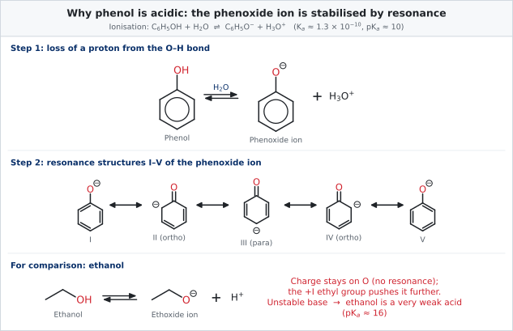

<em>Fig. 9: Resonance stabilisation of the phenoxide ion.</em>

**Evidence.** Phenol turns into sodium phenoxide with NaOH: C₆H₅OH + NaOH → C₆H₅ONa + H₂O. Ethanol does not react with NaOH. Phenol is still a **weak** acid: it does **not** liberate CO₂ from NaHCO₃ (carbonic acid, pKₐ 6.35, is stronger).

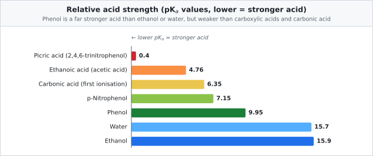

<em>Fig. 10: pKₐ values: electron-withdrawing nitro groups make phenols much stronger acids; electron-releasing groups weaken them.</em>

**Substituent effect (extra).** –NO₂ (electron-withdrawing) increases acidity: p-nitrophenol pKₐ 7.15, 2,4,6-trinitrophenol 0.4. –CH₃ (electron-releasing) decreases it: p-cresol pKₐ 10.3.

### 2017 Q3(b): How can salicylic acid and picric acid be prepared from phenol?

**Answer.** See the full solutions under [2020 Q2(b)](#2020-q2b-how-can-salicylic-acid-and-picric-acid-be-prepared-from-phenol) (same question). Recap:

- **Salicylic acid (Kolbe–Schmidt reaction):** phenol + NaOH → sodium phenoxide; heat with CO₂ at 400 K and 4–7 atm → sodium salicylate; acidify with dil. HCl → salicylic acid.
- **Picric acid:** phenol + conc. H₂SO₄ (373 K) → phenol-2,4-disulphonic acid; + conc. HNO₃ → 2,4,6-trinitrophenol (picric acid).

## 2018

### 2018 Q2(a): How can phenol be obtained from coal tar?

**Answer.** Coal tar, the black viscous by-product of coke ovens, is the oldest commercial source of phenol. The process has two stages.

**Stage 1: fractional distillation of coal tar.** Coal tar is distilled and collected in fractions: light oil (below 443 K), **middle (carbolic) oil (443–503 K)** containing phenol, cresols and naphthalene, heavy oil (503–543 K), anthracene oil (543–633 K) and pitch (residue).

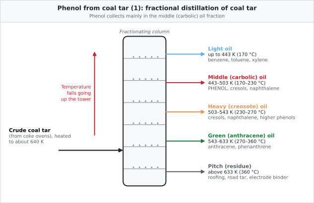

<em>Fig. 11: Fractional distillation of coal tar.</em>

**Stage 2: isolation of phenol from the middle oil.**
1. Cool the middle oil; **naphthalene crystallises** and is filtered off.
2. Shake the filtrate with aqueous **NaOH**: phenol (acidic) dissolves as **sodium phenoxide** in the water layer; neutral hydrocarbons stay in the oil layer. C₆H₅OH + NaOH → C₆H₅ONa + H₂O
3. Separate the aqueous layer and pass **CO₂** (or add dil. H₂SO₄): phenol is liberated because it is a weaker acid than carbonic acid. C₆H₅ONa + CO₂ + H₂O → C₆H₅OH + NaHCO₃
4. Purify by **fractional distillation** (phenol b.p. 455 K); crystals melt at 316 K.

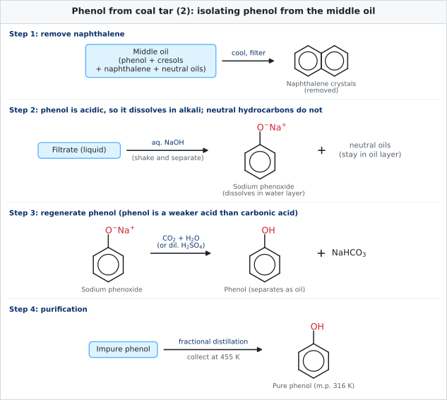

<em>Fig. 12: Isolation of phenol from the middle oil.</em>

### 2018 Q2(b): Distinguish between 1°, 2° and 3° alcohols by dehydrogenation method

**Principle.** When alcohol vapour is passed over **copper heated to 573 K**, hydrogen is removed. What forms depends on the number of hydrogens on the carbinol carbon.

- **1° alcohol** (two α-hydrogens) → **aldehyde** + H₂. CH₃CH₂OH → CH₃CHO + H₂
- **2° alcohol** (one α-hydrogen) → **ketone** + H₂. (CH₃)₂CHOH → CH₃COCH₃ + H₂
- **3° alcohol** (no α-hydrogen) cannot form C=O; it undergoes **dehydration to an alkene**. (CH₃)₃COH → (CH₃)₂C=CH₂ + H₂O

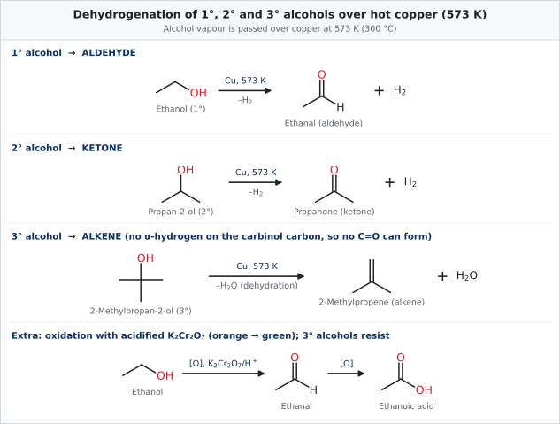

<em>Fig. 13: Dehydrogenation (and oxidation) of 1°, 2° and 3° alcohols.</em>

**Confirming the products.** The aldehyde gives a silver mirror with Tollens' reagent and a red precipitate with Fehling's solution; the ketone does neither (but gives a 2,4-DNP orange precipitate); the alkene decolourises bromine water.

### 2018 Q2(c): Explain why acetic acid is stronger than propionic acid but weaker than mono-chloroacetic acid

**Answer.** The strength of a carboxylic acid depends on the stability of its carboxylate ion, RCOO⁻. Groups that disperse the negative charge stabilise the ion and make the acid stronger; groups that intensify it weaken the acid.

- **Propionic acid (CH₃CH₂COOH):** the ethyl group has a **larger +I (electron-releasing) effect** than methyl. It pushes electrons toward the carboxylate and destabilises it. Hence propionic acid is the *weaker* acid (pKₐ 4.87).
- **Acetic acid (CH₃COOH):** the methyl group has a smaller +I effect (pKₐ 4.76).
- **Chloroacetic acid (ClCH₂COOH):** chlorine is strongly electron-withdrawing (**–I effect**). It pulls electron density away from the carboxylate, spreads and stabilises the negative charge, and so the acid is much stronger (pKₐ 2.87; Kₐ about 80 times that of acetic acid).

**Order of acidity:** ClCH₂COOH > CH₃COOH > CH₃CH₂COOH.

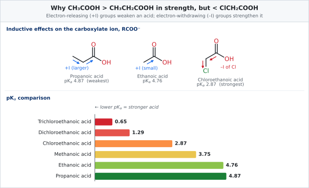

<em>Fig. 14: Inductive effects and pKₐ values of some carboxylic acids.</em>

**Extension:** Cl₂CHCOOH (pKₐ 1.29) and Cl₃CCOOH (0.65) are stronger still: the more Cl atoms, the stronger the –I pull.

### 2018 Q2(d): Write short notes on (i) Picric acid (ii) TNG (tri-nitro glycerine)

#### (i) Picric acid (2,4,6-trinitrophenol)

**Formula:** C₆H₂(NO₂)₃OH. **Preparation:** from phenol by sulphonation then nitration (Fig. 15).

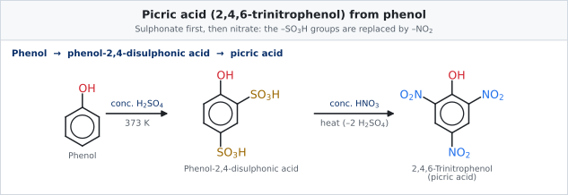

<em>Fig. 15: Preparation of picric acid.</em>

**Properties:** yellow crystalline solid, m.p. 395 K (122 °C), bitter taste (Greek *pikros* = bitter), sparingly soluble in cold water, **strongly acidic** (pKₐ 0.4) because three –NO₂ groups stabilise the picrate ion; it forms coloured crystalline picrates with hydrocarbons and amines (used to identify them) and is **explosive** when dry.
**Uses:** explosive (lyddite, melinite), yellow dye for wool and silk, antiseptic in burns (old use), manufacture of picrates, leather industry.

#### (ii) TNG: trinitroglycerine (glyceryl trinitrate)

**Formula:** C₃H₅(ONO₂)₃. It is the **tri-nitrate ester of glycerol**, made by treating glycerol with a mixture of conc. HNO₃ and conc. H₂SO₄ below 283 K (full reaction under [2022 Q4(c)](#2022-q4c-what-happens-when-glycerine-is-treated-with-hno3)).

**Properties:** pale yellow oily liquid, heavier than water, insoluble in water, sweet burning taste, poisonous; **extremely sensitive to shock** and heat.
**Uses:** **dynamite** (TNG absorbed in kieselguhr, invented by Alfred Nobel), smokeless powder (cordite), and, in tiny doses, as a **vasodilator** (glyceryl trinitrate tablets) for angina pectoris.

## 2019

### 2019 Q2(a): Why is phenol acidic in nature?

Same as [2017 Q3(a)](#2017-q3a-why-is-phenol-acidic). **One-paragraph exam answer:** phenol ionises as C₆H₅OH ⇌ C₆H₅O⁻ + H⁺. The phenoxide ion is stabilised by resonance because its negative charge is delocalised into the benzene ring at the ortho and para positions (Fig. 9), whereas in alkoxides the charge is localised on oxygen. So phenol (pKₐ ≈ 10) is far more acidic than ethanol (≈ 16), reacts with NaOH, but is too weak to react with NaHCO₃.

### 2019 Q2(b): Write down with reaction how to differentiate between phenol and ethanol

**Answer.** Both contain –OH and both liberate H₂ with sodium, so tests that look at the **ring** or the **acidity** must be used.

| Test | Phenol | Ethanol |
|---|---|---|
| **Neutral FeCl₃** | violet colour (complex [Fe(OC₆H₅)₆]³⁻) | no colour change |
| **Bromine water** | white precipitate of 2,4,6-tribromophenol, bromine decolourised | no reaction, orange colour stays |
| **Iodoform test** (I₂ + NaOH, warm) | negative | yellow precipitate of CHI₃ |
| **NaOH** | dissolves (sodium phenoxide) | no reaction |
| **Libermann's nitroso test** (NaNO₂ + conc. H₂SO₄) | green/blue, red on dilution | no colour |

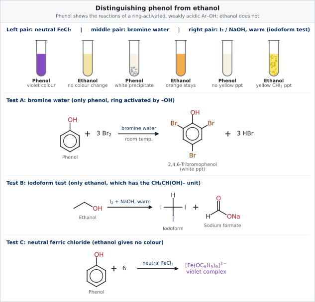

<em>Fig. 16: Distinguishing phenol from ethanol.</em>

Equations:
- 6 C₆H₅OH + FeCl₃ → [Fe(OC₆H₅)₆]³⁻ + 6 H⁺ + 3 Cl⁻ (violet)
- C₆H₅OH + 3 Br₂ → C₆H₂Br₃OH + 3 HBr (white ppt)
- CH₃CH₂OH + 4 I₂ + 6 NaOH → CHI₃ + HCOONa + 5 NaI + 5 H₂O (yellow ppt)

### 2019 Q3(a): Are all hydroxyl compounds alcohol? Explain it

**Answer: No.** A hydroxyl group (–OH) is a functional group that occurs in several families. It makes a compound an **alcohol only when the –OH is bonded to a saturated sp³ carbon** that is not part of C=O or C=C.

| Compound | –OH attached to | Class |
|---|---|---|
| CH₃CH₂OH | sp³ carbon | **alcohol** |
| C₆H₅CH₂OH | sp³ carbon (CH₂ next to ring) | **alcohol** |
| C₆H₅OH | sp² aromatic carbon | **phenol** |
| CH₂=CH–OH | sp² alkene carbon | **enol** (unstable, tautomerises to CH₃CHO) |
| CH₃COOH | carbonyl carbon (C=O) | **carboxylic acid** |
| H–OH, H–O–O–H | hydrogen / oxygen | water, hydrogen peroxide (not organic alcohols) |

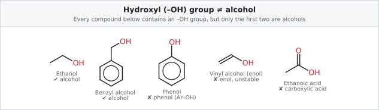

<em>Fig. 17: Compounds containing –OH, only some are alcohols.</em>

**Why the difference matters:** the properties change completely. Phenols are acidic and give a violet colour with FeCl₃; carboxylic acids liberate CO₂ from NaHCO₃; alcohols do neither. Alcohols themselves are subdivided as shown in Fig. 18 (extra).

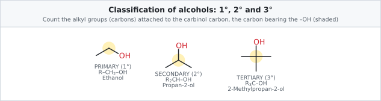

<em>Fig. 18: 1°, 2° and 3° alcohols: the carbinol carbon is bonded to 1, 2 or 3 carbon atoms.</em>

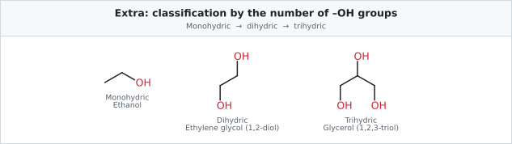

<em>Fig. 19 (extra): Alcohols classified by the number of –OH groups.</em>

## 2020

### 2020 Q2(a): Why phenol is acidic in nature?

Same as [2017 Q3(a)](#2017-q3a-why-is-phenol-acidic): the phenoxide ion is stabilised by delocalisation of its negative charge over oxygen and the ortho/para carbons (Fig. 9), so phenol (pKₐ ≈ 10) ionises far more readily than ethanol (pKₐ ≈ 16).

### 2020 Q2(b): How can salicylic acid and picric acid be prepared from phenol?

#### Salicylic acid: Kolbe–Schmidt reaction

1. Phenol is converted into **sodium phenoxide** with NaOH.
2. Dry sodium phenoxide is heated with **CO₂ at 400 K under 4–7 atm pressure**. The electrophile CO₂ attacks the ortho position, giving **sodium salicylate**.
3. Acidification with dil. HCl (or H₂SO₄) liberates **salicylic acid** (2-hydroxybenzoic acid).

C₆H₅OH + NaOH → C₆H₅ONa + H₂O; C₆H₅ONa + CO₂ → o-HOC₆H₄COONa; o-HOC₆H₄COONa + HCl → o-HOC₆H₄COOH + NaCl

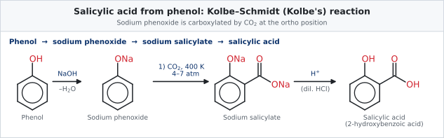

<em>Fig. 20: Preparation of salicylic acid.</em>

**Use:** manufacture of aspirin (acetylsalicylic acid), methyl salicylate (oil of wintergreen), antiseptic and food-preservative uses historically.

#### Picric acid

Direct nitration of phenol with conc. HNO₃ gives low yield because the strong oxidising acid destroys the ring (tarry products). So phenol is **first sulphonated**, which protects the ring and places two –SO₃H groups at positions 2 and 4; **nitration** then replaces these groups and adds a third nitro group at position 6.

C₆H₅OH + 2 H₂SO₄ → C₆H₃(OH)(SO₃H)₂ + 2 H₂O; C₆H₃(OH)(SO₃H)₂ + 3 HNO₃ → C₆H₂(OH)(NO₂)₃ + 2 H₂SO₄ + H₂O

The structure and properties of picric acid are given in [2018 Q2(d)](#2018-q2d-write-short-notes-on-i-picric-acid-ii-tng-tri-nitro-glycerine) and the scheme in Fig. 15.

### 2020 Q2(c): Explain the methods of preparation of 1°, 2° and 3° alcohols with reactions

Identical to [2017 Q2(b)](#2017-q2b-explain-the-methods-of-preparation-of-1-2-and-3-alcohols): see the summary table and Figs. 2 to 6. **Fast revision:**

- **1°:** R–CH₂X + aq. KOH; RCHO or RCOOH reduction; RMgX + HCHO.
- **2°:** R₂CHX + aq. KOH; ketone reduction; RMgX + R'CHO; Markovnikov hydration of R–CH=CH₂.
- **3°:** R₃CX + aq. KOH; RMgX + ketone; 2 RMgX + ester; hydration of R₂C=CH₂.

### 2020 Q2(d): What happens when KHSO4 reacts with glycerine with heat?

**Answer.** Glycerol is **dehydrated** (two molecules of water are removed) to give **acrolein** (propenal, CH₂=CH–CHO), a colourless liquid with a sharp, irritating smell. KHSO₄ (or P₂O₅) acts as the dehydrating agent.

**Course of the reaction:** (1) loss of one H₂O gives the unstable 3-hydroxypropanal (through the enol); (2) loss of a second H₂O gives acrolein.

CH₂(OH)–CH(OH)–CH₂OH →(KHSO₄, Δ) CH₂=CH–CHO + 2 H₂O

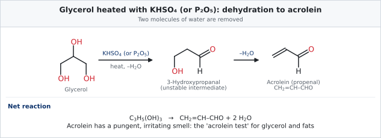

<em>Fig. 21: Dehydration of glycerol to acrolein.</em>

**Use of the reaction:** the pungent smell of acrolein is the **acrolein test**, used to detect glycerol and fats/oils (which contain glycerol).

## 2021

### 2021 Q3(a): What is meant by alcohol and phenol?

Same as [2017 Q2(a)](#2017-q2a-what-is-meant-by-alcohol-and-phenol). **Recap:** alcohol = R–OH, the OH on a saturated sp³ carbon (ethanol); phenol = Ar–OH, the OH directly on a benzene-ring carbon (phenol, C₆H₅OH). See Fig. 1.

### 2021 Q3(b): Distinguish 1°, 2° & 3° alcohol by Lucas reagent

**Lucas reagent:** a solution of **anhydrous ZnCl₂ in concentrated HCl**. It converts an alcohol to the corresponding alkyl chloride; the chloride is insoluble in the reagent, so the clear solution turns **cloudy (turbid)**. The rate depends on how easily the carbocation forms (Sₙ 1 mechanism): 3° > 2° > 1°.

**Procedure:** add about 1 mL of the alcohol to about 5 mL Lucas reagent at room temperature, shake, and note the time taken for turbidity.

| Alcohol | Observation | Reason |
|---|---|---|
| **3°** (t-butanol) | turbidity **immediately** | stable tertiary carbocation |
| **2°** (propan-2-ol) | turbidity in **about 5 min** | less stable secondary carbocation |
| **1°** (ethanol) | **no turbidity** at room temp. (cloudy only on heating) | unstable primary carbocation |

Reactions: (CH₃)₃COH + HCl →(ZnCl₂) (CH₃)₃CCl + H₂O; (CH₃)₂CHOH + HCl →(ZnCl₂) (CH₃)₂CHCl + H₂O; CH₃CH₂OH + HCl → no reaction at room temperature.

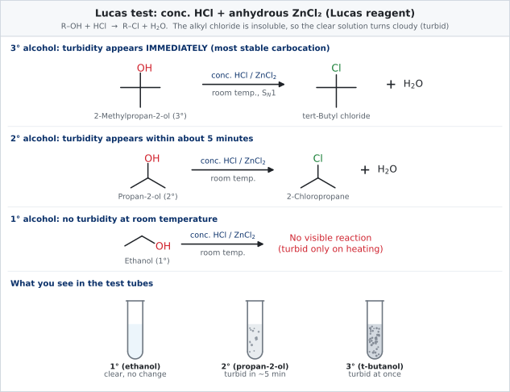

<em>Fig. 22: The Lucas test.</em>

**Limits:** works only for alcohols soluble in the reagent (up to about C₅–C₆); allylic and benzylic 1° alcohols react quickly like 3°.

### 2021 Q3(c): Explain about (i) Coupling reaction and (ii) Kolbe's reaction

**(i) Coupling reaction:** see [2017 Q2(c)(i)](#2017-q2c-explain-i-coupling-reaction-and-ii-reimertiemann-reaction) and Fig. 7: diazonium salt + phenol (alkaline) → p-hydroxyazobenzene, an orange azo dye.

**(ii) Kolbe's reaction (Kolbe–Schmidt reaction):** carboxylation of phenol. Sodium phenoxide, heated with CO₂ at 400 K and 4–7 atm, gives sodium salicylate, which on acidification gives **salicylic acid**. Complete equations and diagram: [2020 Q2(b)](#2020-q2b-how-can-salicylic-acid-and-picric-acid-be-prepared-from-phenol), Fig. 20.

*Mechanism in brief:* the phenoxide ion (a strong ring nucleophile) attacks the electrophilic carbon of CO₂ at the ortho position; a proton shift restores aromaticity. Higher temperature (about 500 K, K salt) gives the para isomer.

*Do not confuse* with Kolbe **electrolysis**: 2 RCOONa + 2 H₂O →(electrolysis) R–R + 2 CO₂ + H₂ + 2 NaOH.

### 2021 Q3(d): What happens when KHSO4/P2O5 reacts with glycerin with heat?

Same as [2020 Q2(d)](#2020-q2d-what-happens-when-khso4-reacts-with-glycerine-with-heat): glycerol is dehydrated (loss of 2 H₂O) to **acrolein**, CH₂=CH–CHO, which has a pungent, tear-producing smell (Fig. 21). P₂O₅ is an even more powerful dehydrating agent than KHSO₄.

C₃H₅(OH)₃ →(KHSO₄ or P₂O₅, Δ) CH₂=CH–CHO + 2 H₂O

## 2022

### 2022 Q4(a): Write the reactions for the production of ethyl alcohol from starch

**Raw materials:** starchy grains or tubers (maize, rice, barley, potato). **Principle:** biological catalysts (**enzymes**) present in malt and in yeast convert starch successively into maltose, glucose and finally ethanol.

1. **Mashing (malting):** starch is cooked, mixed with malt (germinated barley), and kept at about 323 K. The enzyme **diastase** hydrolyses starch to **maltose**.
   2 (C₆H₁₀O₅)ₙ + n H₂O →(diastase) n C₁₂H₂₂O₁₁
2. **Fermentation:** yeast is added at about 303 K. The enzyme **maltase** converts maltose to glucose, and **zymase** converts glucose to ethanol and CO₂.
   C₁₂H₂₂O₁₁ + H₂O →(maltase) 2 C₆H₁₂O₆
   C₆H₁₂O₆ →(zymase) 2 C₂H₅OH + 2 CO₂
3. **Distillation:** the fermented liquid ("wash", about 10–15 % alcohol) is fractionally distilled to give **rectified spirit** (95.6 % ethanol, an azeotrope). Absolute alcohol (99.5 %) is made by refluxing with quicklime (CaO) and distilling, or by azeotropic distillation with benzene.

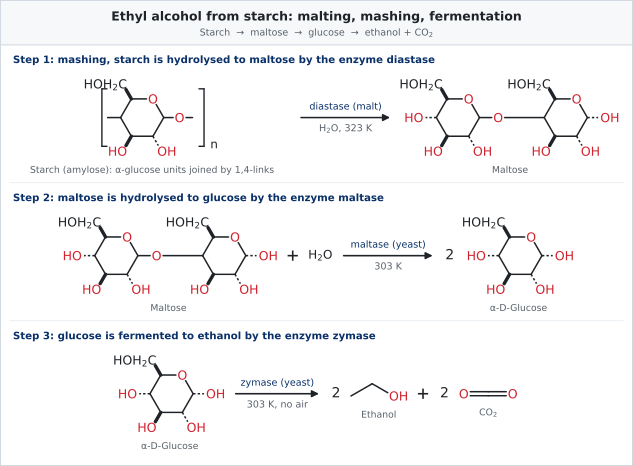

<em>Fig. 23: Production of ethanol from starch.</em>

**Notes.** Air must be excluded (anaerobic) or ethanol would be oxidised to acetic acid. Fermentation stops near 14–15 % ethanol because yeast is killed by the alcohol it makes. The CO₂ evolved shows fermentation is in progress (limewater turns milky).

### 2022 Q4(b): Distinguish between phenol and ethyl alcohol

Same as [2019 Q2(b)](#2019-q2b-write-down-with-reaction-how-to-differentiate-between-phenol-and-ethanol) and Fig. 16. **Two-line answer:** *Neutral FeCl₃* gives a violet colour with phenol but none with ethanol; *bromine water* gives a white precipitate of 2,4,6-tribromophenol with phenol but no reaction with ethanol. In addition, ethanol (not phenol) gives the yellow iodoform precipitate with I₂/NaOH.

### 2022 Q4(c): What happens when glycerine is treated with HNO3?

**Answer.** Glycerol is **esterified** by nitric acid. When treated with a mixture of **conc. HNO₃ and conc. H₂SO₄** kept **below 283 K**, all three –OH groups are converted into nitrate (–ONO₂) groups, giving **glyceryl trinitrate** (trinitroglycerine, TNG) and three molecules of water. The sulphuric acid absorbs the water and keeps the nitric acid concentrated.

C₃H₅(OH)₃ + 3 HNO₃ →(conc. H₂SO₄, < 283 K) C₃H₅(ONO₂)₃ + 3 H₂O

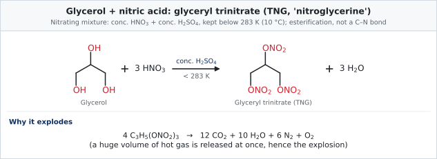

<em>Fig. 24: Nitration of glycerol to TNG.</em>

**Remarks.** TNG is an explosive oil, mixed with kieselguhr to make dynamite and used medicinally as a vasodilator. With less HNO₃ or milder conditions, mono- and dinitrates form (not explosive). Uses and properties are in [2018 Q2(d)](#2018-q2d-write-short-notes-on-i-picric-acid-ii-tng-tri-nitro-glycerine).

### 2022 Q4(d): How is alcohol identified?

**Answer.** An alcohol is identified by showing that (i) an –OH group is present, (ii) the compound is **not** a phenol or a carboxylic acid, and (iii) it then belongs to 1°, 2° or 3° class. Figure 25 gives the systematic route.

| Test | Observation for an alcohol |
|---|---|
| **Sodium metal** | brisk bubbles of H₂; 2 ROH + 2 Na → 2 RONa + H₂ |
| **Esterification** (with CH₃COOH + a few drops conc. H₂SO₄, warm) | pleasant fruity smell of an ester |
| **Acetyl chloride** | steamy fumes of HCl; ROH + CH₃COCl → CH₃COOR + HCl |
| **Ceric ammonium nitrate** | yellow solution turns red |
| **Acidified K₂Cr₂O₇** | orange → green (1° and 2° only) |
| **Neutral FeCl₃** | *no* violet colour (rules out phenol) |
| **NaHCO₃** | *no* CO₂ (rules out carboxylic acid) |
| **Classification** | Lucas test, Victor Meyer test, Cu/573 K (see 2021 Q3(b), 2023 Q2(d), 2018 Q2(b)) |
| **Spectroscopy** | IR: broad O–H stretch 3200–3600 cm⁻¹; ¹H NMR: O–H signal vanishes with D₂O |

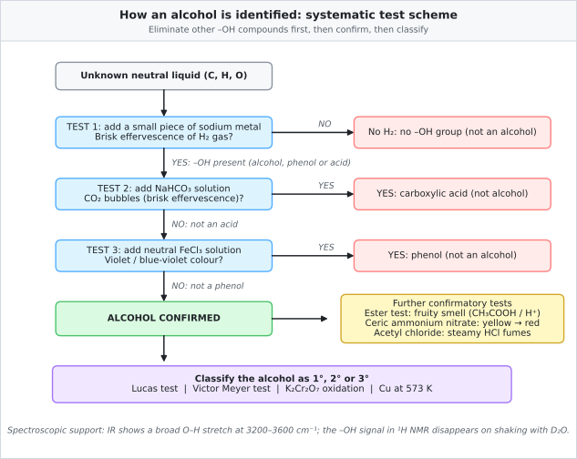

<em>Fig. 25: Systematic scheme for identifying and classifying an alcohol.</em>

## 2023

### 2023 Q2(c): Explain the preparation of 1°, 2° and 3° alcohol from Grignard reagent

**Grignard reagent.** Alkyl magnesium halide R–MgX, prepared by reacting an alkyl halide with magnesium turnings in **dry ether**: R–X + Mg →(dry ether) R–MgX. The carbon-magnesium bond is strongly polar (Rδ⁻–Mgδ⁺X), so R behaves as a **carbanion-like nucleophile**. It attacks the electron-poor carbonyl carbon (Cδ⁺=Oδ⁻), giving a magnesium alkoxide that is hydrolysed by dilute acid to the alcohol. Moisture must be excluded because RMgX is destroyed by water: RMgX + H₂O → RH + Mg(OH)X.

**General steps:** (1) nucleophilic addition of R–MgX to C=O; (2) hydrolysis, R′₂C(R)OMgX + H₂O/H⁺ → R′₂C(R)OH + Mg(OH)X.

<em>Fig. 26 (same as Fig. 5): General Grignard scheme.</em>

| Carbonyl compound | Product class | Example with CH₃MgI |
|---|---|---|
| **Methanal** (HCHO) | **1°** alcohol | HCHO → CH₃CH₂OH (ethanol) |
| **Any other aldehyde** (R′CHO) | **2°** alcohol | CH₃CHO → (CH₃)₂CHOH (propan-2-ol) |
| **Ketone** (R′COR″) | **3°** alcohol | CH₃COCH₃ → (CH₃)₃COH (2-methylpropan-2-ol) |
| Ester (2 mol RMgX) | 3° alcohol (formate ester gives 2°) | CH₃COOC₂H₅ → (CH₃)₃COH |
| Ethylene oxide | 1° alcohol with two more carbons | RMgX + CH₂–CH₂ (epoxide) → R–CH₂CH₂OH |

<em>Fig. 27 (same as Fig. 6): Worked examples with CH₃MgI.</em>

**Equations:**
1. HCHO + CH₃MgI → CH₃CH₂OMgI; CH₃CH₂OMgI + H₂O → CH₃CH₂OH + Mg(OH)I
2. CH₃CHO + CH₃MgI → (CH₃)₂CHOMgI; →(H₂O) (CH₃)₂CHOH + Mg(OH)I
3. CH₃COCH₃ + CH₃MgI → (CH₃)₃COMgI; →(H₂O) (CH₃)₃COH + Mg(OH)I

### 2023 Q2(d): How will you distinguish between 1°, 2° and 3° alcohols?

Same as [2017 Q2(d)](#2017-q2d-distinguish-among-1-2-and-3-alcohols). The Lucas test and dehydrogenation test are given in full above (Fig. 22, Fig. 13). The remaining standard test is the **Victor Meyer test**.

**Victor Meyer test.** The alcohol is converted in three steps: (1) to the alkyl iodide with red P + I₂, (2) to the nitroalkane with AgNO₂, (3) the nitroalkane is treated with nitrous acid (NaNO₂ + H₂SO₄), and then made alkaline with NaOH.

- **1°:** R–CH₂–NO₂ + HNO₂ → R–C(NO₂)=NOH (**nitrolic acid**) →(NaOH) **blood-red** sodium nitrolate.
- **2°:** R₂CH–NO₂ + HNO₂ → R₂C(NO₂)(N=O) (**pseudonitrole**) →(NaOH) **blue** solution.
- **3°:** R₃C–NO₂ has no α-hydrogen, so it does not react with HNO₂: **colourless**.

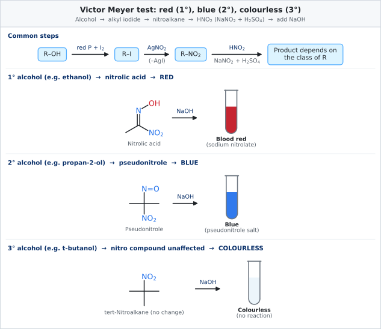

<em>Fig. 28: The Victor Meyer test.</em>

**Summary of distinguishing tests** (Lucas, Cu/573 K and Victor Meyer): see the table in [2017 Q2(d)](#2017-q2d-distinguish-among-1-2-and-3-alcohols).

## Extra sections

### Extra 1: Reaction map of phenol

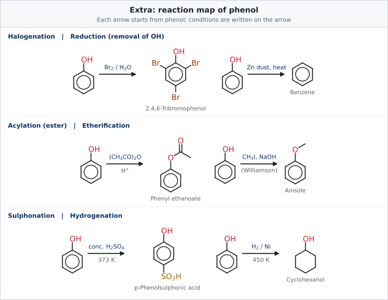

<em>Fig. 29: Reactions of phenol at a glance.</em>

**Key idea:** the –OH group *activates* the ring (ortho/para directing) so phenol undergoes halogenation, nitration, sulphonation and coupling much more easily than benzene, and its oxygen reacts as a weak acid or nucleophile (ester and ether formation).

### Extra 2: Question analysis, 2017 to 2023

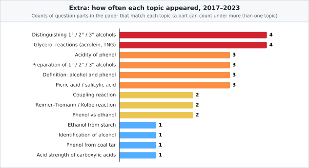

<em>Fig. 30: Frequency of each topic across the seven papers.</em>

| Topic | 2017 | 2018 | 2019 | 2020 | 2021 | 2022 | 2023 |
|---|:-:|:-:|:-:|:-:|:-:|:-:|:-:|
| Definition of alcohol / phenol / hydroxyl | Q2a | | Q3a | | Q3a | | |
| Preparation of 1°, 2°, 3° alcohols | Q2b | | | Q2c | | | Q2c (Grignard) |
| Distinguishing 1°, 2°, 3° alcohols | Q2d | Q2b | | | Q3b | | Q2d |
| Acidity of phenol | Q3a | | Q2a | Q2a | | | |
| Salicylic acid / picric acid | Q3b | Q2d(i) | | Q2b | | | |
| Coupling reaction | Q2c(i) | | | | Q3c(i) | | |
| Reimer–Tiemann / Kolbe | Q2c(ii) | | | | Q3c(ii) | | |
| Glycerol reactions | | Q2d(ii) | | Q2d | Q3d | Q4c | |
| Phenol vs ethanol | | | Q2b | | | Q4b | |
| Phenol from coal tar | | Q2a | | | | | |
| Acid strength | | Q2c | | | | | |
| Ethanol from starch / identification | | | | | | Q4a, Q4d | |

**Reading the table:** *distinguishing alcohols*, *glycerol reactions* and *phenol acidity* are the safest bets; learn the figures in this file by heart.

### Extra 3: One-page revision sheet

| Reagent | With alcohol (R–OH) | With phenol (Ar–OH) |
|---|---|---|
| Na metal | H₂ gas, RONa | H₂ gas, ArONa |
| NaOH | no reaction | soluble, ArONa |
| NaHCO₃ | no reaction | no reaction |
| Neutral FeCl₃ | no colour | violet |
| Br₂ water | no reaction | white ppt (2,4,6-tribromophenol) |
| conc. HNO₃ / H₂SO₄ | nitrate ester (glycerol → TNG) | picric acid (via sulphonation) |
| conc. HCl / ZnCl₂ | R–Cl (3° fast) | no reaction |
| CHCl₃ + NaOH | none | salicylaldehyde |
| CO₂ (Kolbe) | none | salicylic acid |
| ArN₂⁺Cl⁻ | none | azo dye |

### Extra 4: Mnemonics and common mistakes

- **Lucas:** "**T**hree is **T**hirsty (turbid at once), **S**econd is **S**low (5 min), **O**ne is **O**blivious (nothing)".
- **Victor Meyer:** "**R**ed **B**lue **C**lear = **1, 2, 3**".
- **Acid strength:** "Chlorine **pulls** (stronger), alkyl **pushes** (weaker)".
- **Mistake 1:** writing phenol as an alcohol. It is **not**; its OH is on an sp² ring carbon.
- **Mistake 2:** saying phenol reacts with NaHCO₃. It does **not**.
- **Mistake 3:** forgetting the **dry ether** for Grignard reactions, or forgetting the acid work-up step.
- **Mistake 4:** direct nitration of phenol for picric acid. The textbook route is sulphonation first.
- **Mistake 5:** for 3° alcohols over Cu/573 K, writing a ketone. The product is an **alkene**.

### Extra 5: Ten-minute self-test

1. Why does the Lucas test fail for ethanol at room temperature? *(Primary carbocation is unstable.)*
2. Name the reagent that converts glycerol to acrolein. *(KHSO₄ or P₂O₅.)*
3. Give the two enzymes involved after diastase in the fermentation of starch. *(Maltase and zymase.)*
4. Which product forms when phenol reacts with CHCl₃/NaOH? *(Salicylaldehyde.)*
5. Why is picric acid made from the disulphonic acid? *(To avoid oxidation of phenol by conc. HNO₃.)*
6. Which alcohol class gives a blue colour in the Victor Meyer test? *(Secondary.)*
7. At which position does the diazonium ion attack phenol? *(Para.)*
8. Which is the stronger acid, phenol or ethanol? *(Phenol, pKₐ 10 against 16.)*
9. What is dynamite? *(TNG absorbed on kieselguhr.)*
10. Is CH₃COOH an alcohol? *(No: carboxylic acid, OH on a carbonyl carbon.)*

---

## Figure index

1. `chem103-hc-01-alcohol-vs-phenol.svg`
2. `chem103-hc-05-prep-primary-alcohol.svg`
3. `chem103-hc-06-prep-secondary-alcohol.svg`
4. `chem103-hc-07-prep-tertiary-alcohol.svg`
5. `chem103-hc-08-grignard-general.svg`
6. `chem103-hc-09-grignard-examples.svg`
7. `chem103-hc-24-azo-coupling.svg`
8. `chem103-hc-25-reimer-tiemann.svg`
9. `chem103-hc-14-phenol-acidity-resonance.svg`
10. `chem103-hc-15-acid-strength-pka.svg`
11. `chem103-hc-17-coal-tar-distillation.svg`
12. `chem103-hc-18-phenol-from-coal-tar-steps.svg`
13. `chem103-hc-12-dehydrogenation-oxidation.svg`
14. `chem103-hc-16-acid-strength-carboxylic.svg`
15. `chem103-hc-20-picric-acid-from-phenol.svg`
16. `chem103-hc-27-phenol-vs-ethanol.svg`
17. `chem103-hc-02-hydroxyl-not-always-alcohol.svg`
18. `chem103-hc-03-types-of-alcohol.svg`
19. `chem103-hc-04-hydric-classification.svg`
20. `chem103-hc-19-salicylic-acid-kolbe.svg`
21. `chem103-hc-22-glycerol-khso4-acrolein.svg`
22. `chem103-hc-10-lucas-test.svg`
23. `chem103-hc-23-ethanol-from-starch.svg`
24. `chem103-hc-21-glycerol-nitration-tng.svg`
25. `chem103-hc-13-identification-flowchart.svg`
26. `chem103-hc-11-victor-meyer-test.svg`
27. `chem103-hc-29-phenol-reaction-map.svg`
28. `chem103-hc-30-question-frequency.svg`

---

*Prepared for Chem-103 revision. All diagrams are original SVG drawings stored in `../../assets/` and referenced with relative paths so they render on GitHub.*
