# CHEM-103 · Organic Reaction and Mechanism — Previous-Year Questions Solved (2016 – 2023)

*Chemistry-II · model answers in exam style, with mechanisms, diagrams, examples and extra revision material.*

> **Figures** are stored in `../../assets/` (files named `chem103-orm-*.svg`). Each figure is a self-contained SVG with a white background, so it reads well in both GitHub light and dark themes.

---

## Contents

| Section | Topic | Questions covered |
|---|---|---|
| [1. Isomerism](#1-isomerism) | chain, functional, structural, geometrical, optical isomerism; configuration vs conformation | 2016 Q1 (a)–(d) |
| [2. Carbocations and carbanions](#2-carbocations-and-carbanions) | reactive intermediates | 2017 Q1 (a) |
| [3. Electronic effects](#3-electronic-effects) | inductive, electromeric, mesomeric, hyperconjugative effect and their comparisons | 2017 (d), 2018 (a), 2021 (a), 2022 (a), 2023 (a), (d) |
| [4. Nucleophilic substitution SN1 and SN2](#4-nucleophilic-substitution-sn1-and-sn2) | mechanism, order, one-step vs two-step | 2017 (b), 2018 (b), 2021 (b), 2022 (b), 2023 (b) |
| [5. Elimination E1 and E2](#5-elimination-e1-and-e2) | E1 is always two-step; E1 vs E2 | 2017 (c), 2020 Q3 (c), 2021 (d), 2022 (d) |
| [6. Addition reactions](#6-addition-reactions) | electrophilic and nucleophilic addition | 2018 (c), 2021 (c), 2022 (c), 2023 (c) |
| [7. Classification of reagents](#7-classification-of-reagents) | electrophiles and nucleophiles | 2018 (d) |
| [8. Carboxylic acid derivatives](#8-carboxylic-acid-derivatives) | definition, preparation of acid chloride, anhydride, ester; HVZ reaction | 2020 Q3 (a), (b), (d) |
| [9. Extra revision](#9-extra-revision) | frequency table, quick-revision sheet, practice questions, common mistakes | all years |

### Year-wise question map

| Year | Question | Sub-part | Answered in |
|---|---|---|---|
| 2016 | Q1 | (a) chain and functional group isomerism | [Section 1](#1-isomerism) · 1.1 |
| 2016 | Q1 | (b) classification of structural isomerism | [Section 1](#1-isomerism) · 1.2 |
| 2016 | Q1 | (c) geometrical and optical isomerism | [Section 1](#1-isomerism) · 1.3 |
| 2016 | Q1 | (d) configuration vs conformation | [Section 1](#1-isomerism) · 1.4 |
| 2017 | Q1 | (a) carbonium ions and carbanions | [Section 2](#2-carbocations-and-carbanions) |
| 2017 | Q1 | (b) SN1 reaction | [Section 4](#4-nucleophilic-substitution-sn1-and-sn2) |
| 2017 | Q1 | (c) E1 is always two-step | [Section 5](#5-elimination-e1-and-e2) |
| 2017 | Q1 | (d) electromeric vs inductive effect | [Section 3](#3-electronic-effects) · 3.5 |
| 2018 | Q1 | (a) electromeric and mesomeric effect | [Section 3](#3-electronic-effects) |
| 2018 | Q1 | (b) mechanism of SN1 and SN2 | [Section 4](#4-nucleophilic-substitution-sn1-and-sn2) |
| 2018 | Q1 | (c) electrophilic addition | [Section 6](#6-addition-reactions) |
| 2018 | Q1 | (d) classification of electrophilic and nucleophilic reagents | [Section 7](#7-classification-of-reagents) |
| 2020 | Q3 | (a) derivatives of monocarboxylic acid | [Section 8](#8-carboxylic-acid-derivatives) · 8.1 |
| 2020 | Q3 | (b) preparation of acid chloride, anhydride, ester | [Section 8](#8-carboxylic-acid-derivatives) · 8.2 |
| 2020 | Q3 | (c) E1 is always two-step | [Section 5](#5-elimination-e1-and-e2) |
| 2020 | Q3 | (d) RCOOH + Br₂ / red P | [Section 8](#8-carboxylic-acid-derivatives) · 8.3 |
| 2021 | Q1 | (a) electromeric and mesomeric effect | [Section 3](#3-electronic-effects) |
| 2021 | Q1 | (b) SN1 and SN2 mechanism | [Section 4](#4-nucleophilic-substitution-sn1-and-sn2) |
| 2021 | Q1 | (c) electrophilic and nucleophilic addition | [Section 6](#6-addition-reactions) |
| 2021 | Q1 | (d) E1 two-step, E2 one-step | [Section 5](#5-elimination-e1-and-e2) |
| 2022 | Q1 | (a) inductive and electromeric effect | [Section 3](#3-electronic-effects) |
| 2022 | Q1 | (b) SN2 one-step, SN1 two-step | [Section 4](#4-nucleophilic-substitution-sn1-and-sn2) |
| 2022 | Q1 | (c) electrophilic and nucleophilic addition | [Section 6](#6-addition-reactions) |
| 2022 | Q1 | (d) order of E2 and E1 | [Section 5](#5-elimination-e1-and-e2) |
| 2023 | Q1 | (a) mesomeric and hyperconjugative effect | [Section 3](#3-electronic-effects) |
| 2023 | Q1 | (b) SN1 first order, SN2 second order | [Section 4](#4-nucleophilic-substitution-sn1-and-sn2) |
| 2023 | Q1 | (c) electrophilic and nucleophilic addition | [Section 6](#6-addition-reactions) |
| 2023 | Q1 | (d) electromeric vs inductive effect | [Section 3](#3-electronic-effects) · 3.5 |

Questions that were repeated in several years are answered **once, completely**; the *Asked in* line under each heading tells you which years it covers.

---

## 1. Isomerism

*Asked in: 2016 Q1 (a), (b), (c), (d).*

**Definition.** Compounds that have the **same molecular formula but different properties** because of a different arrangement of atoms are called **isomers**; the phenomenon is **isomerism**.

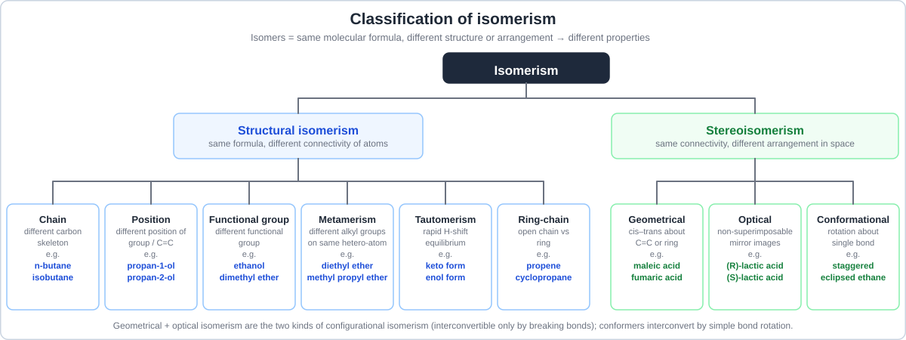

### 1.1 Chain isomerism and functional group isomerism (2016 Q1 a)

**Chain (nuclear / skeletal) isomerism** — isomers have the same molecular and functional group but a **different carbon skeleton** (straight chain vs branched chain).

* C₄H₁₀ : *n*-butane (CH₃CH₂CH₂CH₃) and isobutane, 2-methylpropane ((CH₃)₂CHCH₃).
* C₅H₁₂ : *n*-pentane, 2-methylbutane, 2,2-dimethylpropane (three isomers).

**Functional group isomerism** — isomers have the same molecular formula but **different functional groups**.

| Molecular formula | Isomer I | Isomer II |
|---|---|---|
| C₂H₆O | ethanol, CH₃CH₂OH (alcohol) | dimethyl ether, CH₃OCH₃ (ether) |
| C₃H₆O | propanal, CH₃CH₂CHO (aldehyde) | propanone, CH₃COCH₃ (ketone) |
| C₃H₆O₂ | propanoic acid, CH₃CH₂COOH | methyl ethanoate, CH₃COOCH₃ (ester) |
| C₃H₇NO₂ | 1-nitropropane | propyl nitrite |

### 1.2 Classification of structural isomerism (2016 Q1 b)

Structural (constitutional) isomers differ in the **order in which atoms are linked**. There are six types:

| Type | Difference | Example |
|---|---|---|
| Chain | carbon skeleton | *n*-butane / isobutane |
| Position | position of a substituent, functional group or multiple bond | propan-1-ol / propan-2-ol; but-1-ene / but-2-ene |
| Functional group | the functional group itself | ethanol / dimethyl ether |
| Metamerism | different alkyl groups on either side of a polyvalent atom (O, S, N, C=O) | diethyl ether / methyl propyl ether (C₄H₁₀O) |
| Tautomerism | rapidly interconverting isomers by shift of H (dynamic equilibrium) | keto form ⇌ enol form of propanone |
| Ring–chain | open chain vs ring | propene / cyclopropane (C₃H₆) |

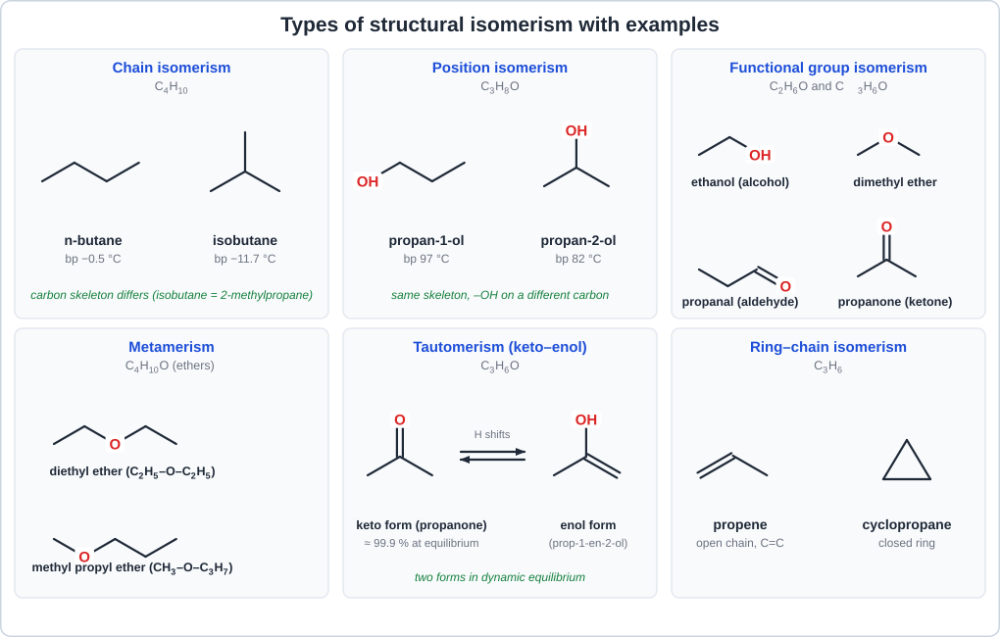

### 1.3 Geometrical isomerism and optical isomerism (2016 Q1 c)

Both are **stereoisomerism** — same connectivity, different arrangement in space.

#### Geometrical (cis–trans) isomerism

* Arises from **restricted rotation** about a C=C bond (or in a ring).
* Needed: each doubly-bonded carbon carries **two different groups** (abC=Cab, abC=Cac).
* **cis** (Z) — like groups on the same side; **trans** (E) — on opposite sides.

| Property | cis-but-2-ene | trans-but-2-ene | maleic acid (cis) | fumaric acid (trans) |
|---|---|---|---|---|
| Dipole moment | ≠ 0 | ≈ 0 | higher | lower |
| Boiling / melting point | b.p. 3.7 °C | b.p. 0.9 °C | m.p. 135 °C | m.p. ≈ 287 °C |
| Stability | less (steric strain) | more stable | forms cyclic anhydride on heating | does not |

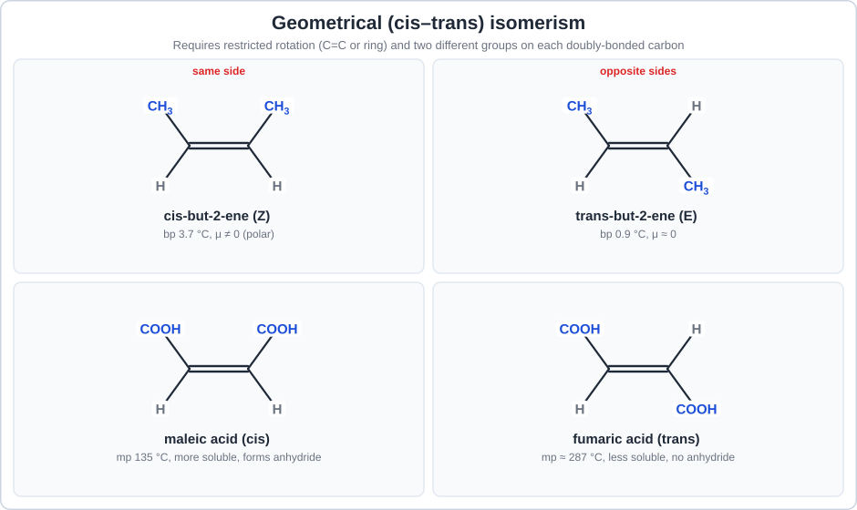

#### Optical isomerism

* Shown by compounds with a **chiral centre** — a carbon bonded to four *different* groups (C*), making the molecule **non-superimposable on its mirror image**.
* Two mirror-image forms are **enantiomers**; one rotates plane-polarised light to the right (**dextrorotatory, +**), the other equally to the left (**laevorotatory, −**). An equimolar mixture is a **racemic mixture** (±) and is optically inactive (external compensation).
* Example: lactic acid, CH₃–C\*H(OH)–COOH, exists as (S)-(+) and (R)-(−). Tartaric acid also has a *meso* form (internal compensation).
* A molecule with *n* different chiral centres has 2ⁿ stereoisomers.

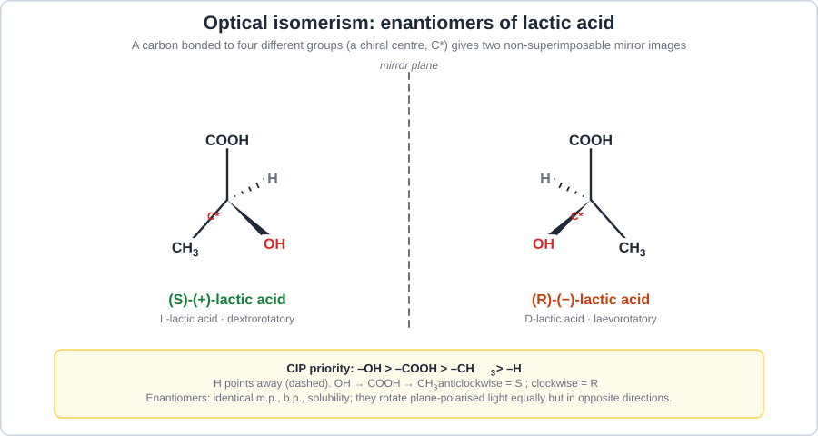

### 1.4 Configuration vs conformation (2016 Q1 d)

| Basis | Configuration | Conformation |
|---|---|---|
| Meaning | fixed spatial arrangement of atoms/groups about a stereocentre or double bond | different spatial arrangements arising from **rotation about single bonds** |
| Interconversion | requires **breaking and making bonds** | by simple rotation, **no bond is broken** |
| Isolation | isomers can be separated (cis/trans, R/S) | usually cannot be isolated at room temperature (barrier ≈ 12 kJ/mol in ethane) |
| Energy barrier | high (> 100 kJ/mol) | low (a few to ~20 kJ/mol) |
| Examples | cis/trans-but-2-ene, (R)/(S)-lactic acid | staggered and eclipsed ethane; anti and gauche butane |

**Ethane.** Rotation about C–C gives infinitely many conformers; the two extremes are **staggered** (lowest energy, dihedral 60°) and **eclipsed** (highest, 12 kJ/mol above staggered, because of torsional strain).

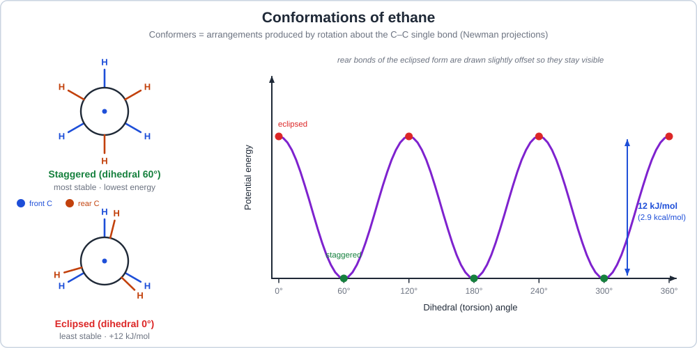

**n-Butane.** Along the C2–C3 bond: anti (0 kJ/mol) < gauche (3.8) < partially eclipsed (16) < fully eclipsed (19).

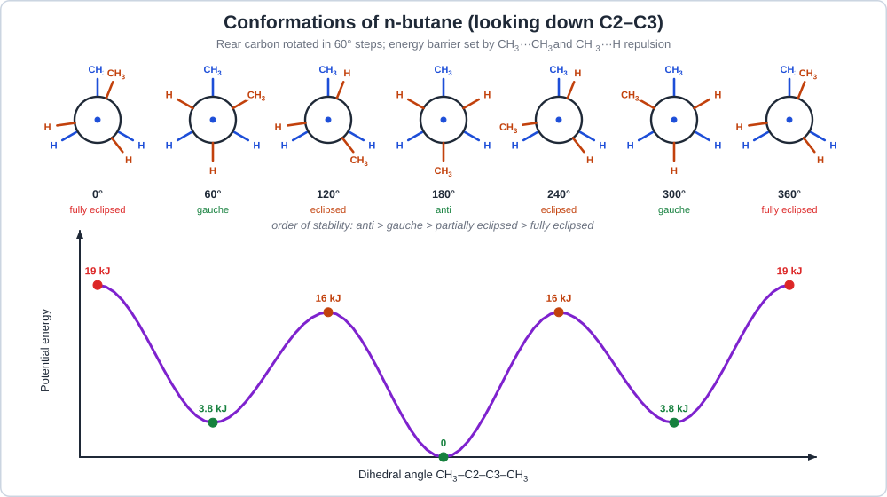

---

## 2. Carbocations and carbanions

*Asked in: 2017 Q1 (a).*

> **Note on the term.** In most textbooks (and in this question) “carbonium ion” means a **carbocation** — a species with a positively charged, trivalent carbon (R₃C⁺). Strict IUPAC/Olah usage calls R₃C⁺ a *carbenium ion* and reserves *carbonium ion* for five-coordinate carbon such as CH₅⁺. The answer below uses the textbook meaning.

**Carbocation (carbonium ion).** A species in which carbon bears a **positive charge** and has only **six valence electrons** (sextet).

* Formed by **heterolytic fission** of C–X with the electrons going to X: R–X → R⁺ + X⁻.
* **sp² hybridised, planar**, 120° bond angles, with an **empty p orbital** perpendicular to the plane.
* **Electron-deficient → electrophile**; attacked by nucleophiles.
* **Stability:** 3° > 2° > 1° > CH₃⁺ — alkyl groups stabilise by +I effect and hyperconjugation (more α C–H bonds). Resonance stabilised ions (allyl, benzyl) are more stable still.
* **Rearrangements** (1,2-H or 1,2-alkyl shift) to form a more stable cation are common.
* Examples: (CH₃)₃C⁺, C₆H₅CH₂⁺.

**Carbanion.** A species in which carbon bears a **negative charge** with a lone pair (eight electrons, three bonds).

* Formed by heterolysis with the electrons staying on carbon, e.g. by removal of H⁺ from a C–H bond: R–H + B⁻ → R⁻ + BH.
* **sp³ hybridised, pyramidal** (lone pair in a hybrid orbital); planar sp² when conjugated (e.g. enolate).
* **Electron-rich → nucleophile and base.**
* **Stability:** CH₃⁻ > 1° > 2° > 3° (alkyl groups push electrons onto an already electron-rich carbon). Stabilised by −I groups (–NO₂, –CN, –C=O) and resonance.
* Examples: CH₃⁻ in Grignard reagent CH₃MgBr, enolate ion, acetylide HC≡C⁻.

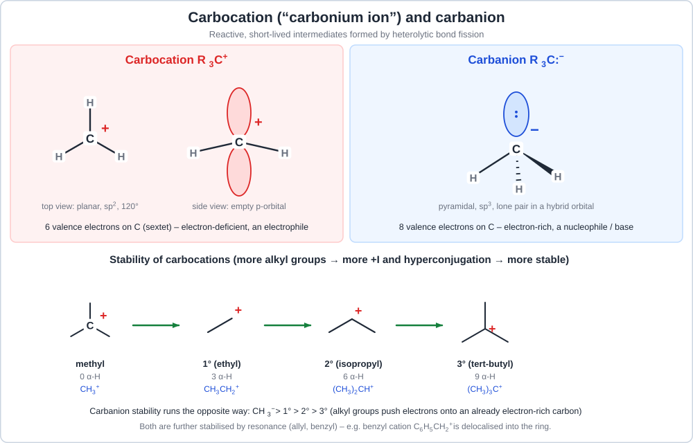

| Feature | Carbocation | Carbanion |
|---|---|---|
| Charge on C | + | − |
| Electrons on C | 6 | 8 |
| Hybridisation / shape | sp², planar | sp³, pyramidal |
| Character | electrophile | nucleophile / base |
| Stability order | 3° > 2° > 1° | 1° > 2° > 3° |
| Typical source | R–X ionisation, ROH + H⁺ | R–H + strong base, R–MgX |

---

## 3. Electronic effects

*Asked in: 2017 (d); 2018 (a); 2021 (a); 2022 (a); 2023 (a), (d).*

Electronic effects explain how electrons are shifted within a molecule and hence its reactivity. They are of two kinds: **permanent** (inductive, mesomeric, hyperconjugation) and **temporary** (electromeric).

### 3.1 Inductive effect (I effect)

The **permanent polarisation of a σ bond** caused by the difference in electronegativity of bonded atoms/groups, transmitted through the chain of σ bonds. Shown by an arrow **→** along the bond.

* **−I effect**: group more electronegative than H pulls electrons — –NO₂ > –CN > –F > –Cl > –Br > –I > –OH > –C₆H₅.
* **+I effect**: group pushes electrons — (CH₃)₃C– > (CH₃)₂CH– > CH₃CH₂– > CH₃–.
* The effect **decreases rapidly with distance** and is negligible after 3 bonds.
* *Consequence:* acid strength Cl₃CCOOH (pKa 0.7) > Cl₂CHCOOH (1.3) > ClCH₂COOH (2.9) > CH₃COOH (4.8); and amines/alkyl cation stability.

### 3.2 Electromeric effect (E effect)

The **temporary, complete transfer of a pair of π electrons** to one of the doubly-bonded atoms **in the presence of an attacking reagent**. It disappears when the reagent is removed.

* **+E effect** — π pair moves *towards* the attacking reagent (alkene + E⁺: the π pair moves to the carbon that bonds to E).
* **−E effect** — π pair moves *away from* the attacking reagent (C=O + Nu⁻: the π pair moves to oxygen, Nu adds to carbon).
* Shown by a **curved arrow** from the middle of the π bond to the atom receiving the pair.

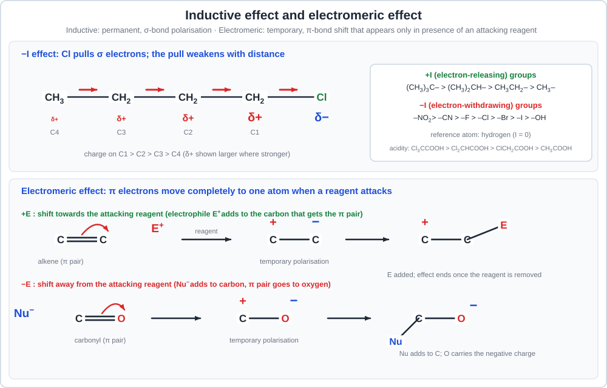

### 3.3 Mesomeric (resonance) effect (M effect)

The **permanent polarity produced in a conjugated system** by delocalisation of π electrons or a lone pair, described by **resonance structures**. The true molecule is a **resonance hybrid** that is more stable than any single structure; the stabilisation is the **resonance energy** (benzene ≈ 150 kJ/mol).

* **+M effect** — group *donates* a lone pair into the π system: –OH, –OR, –NH₂, –NR₂, –X (weak). Increases electron density at **ortho and para** positions (phenol, aniline).
* **−M effect** — group *withdraws* π electrons: –NO₂, –CN, –CHO, –COR, –COOH. Creates δ+ at **ortho and para** positions (benzaldehyde, nitrobenzene).
* Conditions: planar conjugated system with alternating single/double bonds or a lone pair adjacent to a π bond.

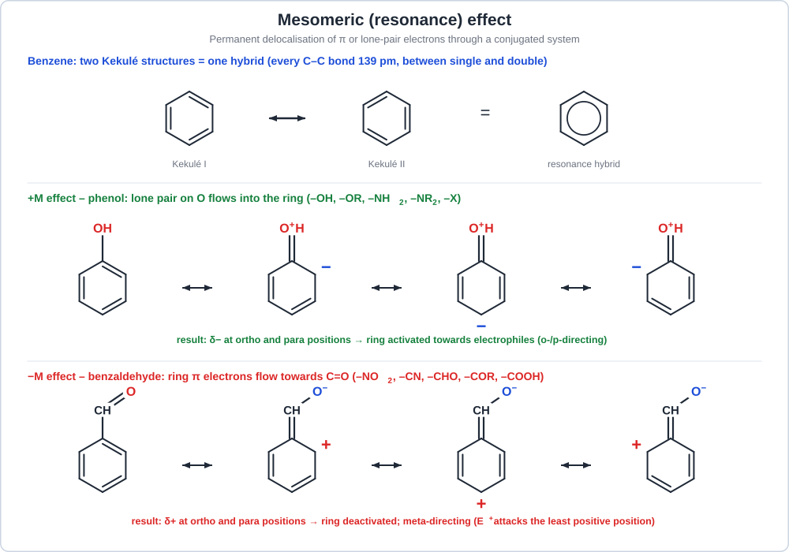

### 3.4 Hyperconjugation (hyperconjugative effect) — 2023 Q1 (a)

The **delocalisation of σ electrons of a C–H bond (α-hydrogen) into an adjacent empty p orbital or π bond**. Also called **“no-bond resonance”** or the Baker–Nathan effect.

* Needed: an sp² carbon (carbocation, alkene, free radical) attached to an sp³ carbon carrying **at least one α-hydrogen**.
* **Consequences:** (i) stability of carbocations and free radicals 3° > 2° > 1° (9, 6, 3 α-H); (ii) stability of alkenes — more alkyl substituents, more stable (Zaitsev’s rule); (iii) shortening of the C–C single bond next to C=C (150 pm in propene); (iv) dipole moment of propene (0.36 D) and o/p-directing effect of CH₃ in toluene.

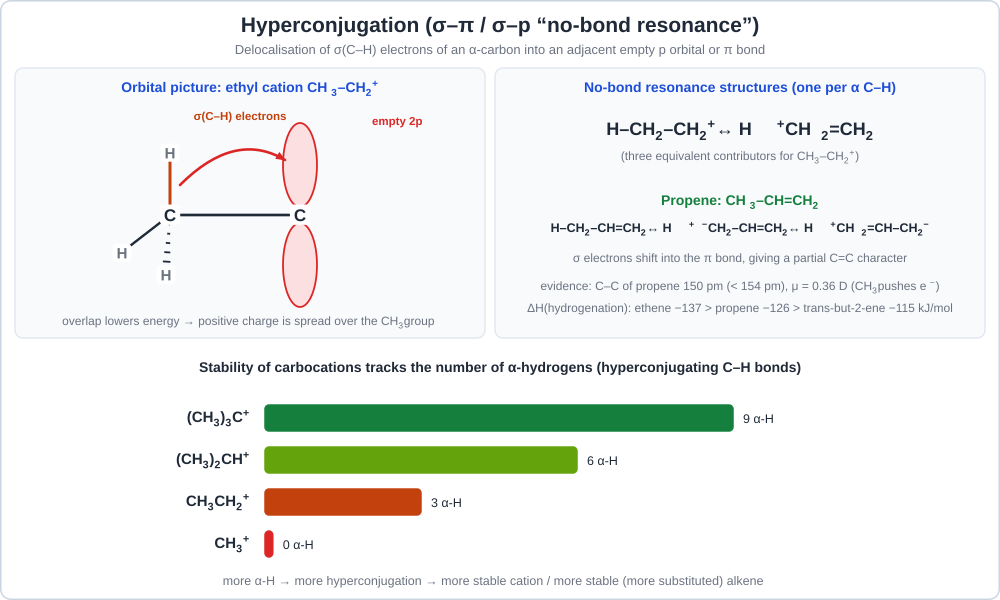

| Mesomeric effect | Hyperconjugation |
|---|---|
| π electrons or lone pairs delocalise | σ(C–H) electrons delocalise |
| needs conjugated π system / lone pair | needs α-H on carbon next to π bond / empty p |
| ordinary resonance structures with real bonds | “no-bond” structures with H⁺ |
| stronger effect | weaker effect |

### 3.5 Comparison tables

**Electromeric effect vs inductive effect** (2017 d, 2023 d)

| Basis | Inductive effect | Electromeric effect |
|---|---|---|
| Nature | **permanent** | **temporary** |
| Bond involved | σ bond | π bond (double/triple) |
| Electron shift | partial (δ+, δ−) | complete transfer of a π pair |
| Requirement | none — present in the molecule at all times | requires an **attacking reagent**; vanishes when it is removed |
| Distance | decreases along the chain, passes via σ bonds | operates only between the two multiply-bonded atoms |
| Representation | straight arrow → on the bond | curved arrow ⌒ from the π bond |
| Effect | alters polarity, acidity, basicity | decides the course of addition reactions |
| Example | CH₃→CH₂→Cl | >C=C< + H⁺, >C=O + CN⁻ |

**Inductive effect vs electromeric effect** is the same pair read from the other side (2022 a): use the table above, adding the *definition* of the inductive effect from 3.1.

**Mesomeric effect vs electromeric effect** (2018 a, 2021 a)

| Basis | Mesomeric effect | Electromeric effect |
|---|---|---|
| Nature | permanent | temporary |
| System | conjugated π–π or π–lone pair | isolated or conjugated double bond |
| Reagent needed | no | yes |
| Description | resonance structures, hybrid | polarisation by approaching reagent |
| Example | phenol, aniline, benzaldehyde | alkene + E⁺, carbonyl + Nu⁻ |

---

## 4. Nucleophilic substitution SN1 and SN2

*Asked in: 2017 (b); 2018 (b); 2021 (b); 2022 (b); 2023 (b).*

**Nucleophilic substitution** replaces the leaving group X in R–X by a nucleophile: R–X + Nu⁻ → R–Nu + X⁻.

### 4.1 SN1 reaction (substitution, nucleophilic, **unimolecular**)

**Example:** hydrolysis of tert-butyl bromide, (CH₃)₃C–Br + OH⁻ → (CH₃)₃C–OH + Br⁻.

**Mechanism (two steps)**

1. **Slow, rate-determining ionisation:** (CH₃)₃C–Br → (CH₃)₃C⁺ + Br⁻ (planar carbocation).
2. **Fast attack of the nucleophile:** (CH₃)₃C⁺ + OH⁻ → (CH₃)₃C–OH.

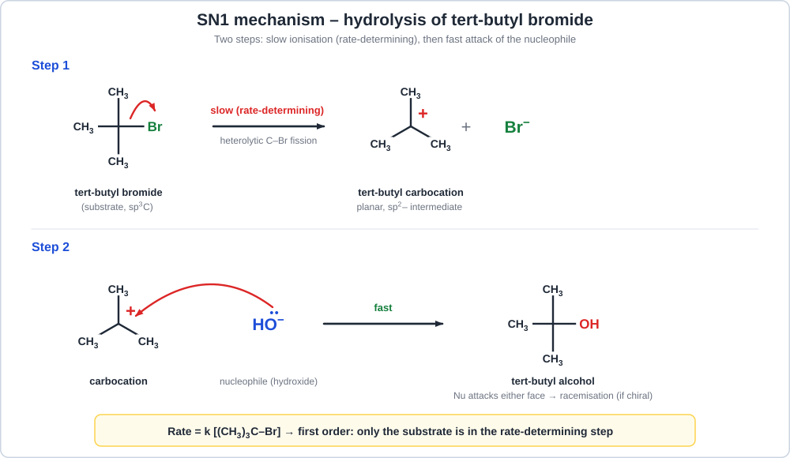

**Characteristics**

* Rate = k[R–X] → **first order** (nucleophile concentration does not matter).
* Reactivity: **3° > 2° > 1° > CH₃–X** (stable carbocation), allyl and benzyl halides also fast.
* Favoured by **polar protic solvents** (water, alcohols) that stabilise the ions, weak nucleophiles, good leaving groups (I⁻ > Br⁻ > Cl⁻).
* **Stereochemistry:** planar carbocation attacked from either face → **racemisation** (partial, often with some inversion from ion pairs).
* Rearrangement of the carbocation is possible; elimination (E1) competes.

### 4.2 SN2 reaction (substitution, nucleophilic, **bimolecular**)

**Example:** CH₃Br + OH⁻ → CH₃OH + Br⁻.

**Mechanism (one concerted step)** — the nucleophile attacks the carbon from the **back side** (180° to the leaving group); bond making and bond breaking occur together through a **five-coordinate transition state** [HO···C···Br]⁻‡, after which the three other groups have turned inside out like an umbrella.

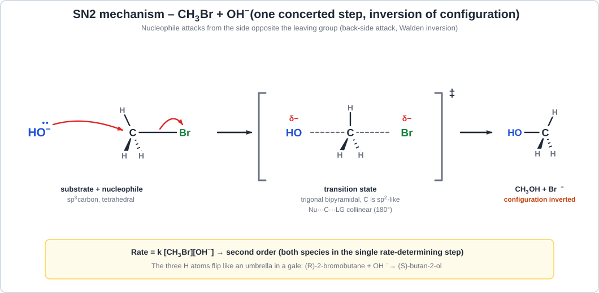

**Characteristics**

* Rate = k[R–X][Nu⁻] → **second order**.
* Reactivity: **CH₃–X > 1° > 2° > 3°** (steric hindrance; 3° halides do not react by SN2).
* Favoured by **polar aprotic solvents** (DMSO, DMF, acetone) and strong nucleophiles.
* **Stereochemistry:** **inversion of configuration (Walden inversion)**; (R)-2-bromobutane gives (S)-butan-2-ol.

### 4.3 Show that SN2 is a one-step reaction but SN1 a two-step reaction (2022 b)

| Evidence | SN1 → **two steps** | SN2 → **one step** |
|---|---|---|
| Kinetics | rate = k[R–X]: only the substrate is in the slow step, so the nucleophile must react in a *later* fast step → at least two steps | rate = k[R–X][Nu⁻]: both are present in the only (rate-determining) step |
| Intermediate | **carbocation** forms (trapped, rearranged products, same ion from SN1/E1) | **none**; only a transition state |
| Energy profile | two humps with a valley (intermediate) | a single hump |
| Stereochemistry | racemisation (planar ion) | complete inversion (back-side attack) |
| Substrate trend | 3° > 2° > 1° | 1° > 2° > 3° |

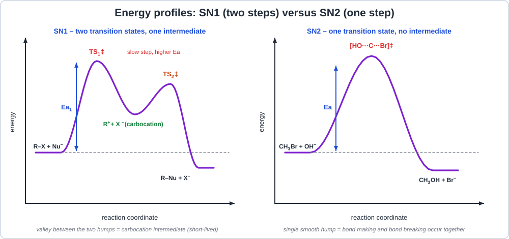

### 4.4 Show that SN1 is first order but SN2 second order (2023 b)

* **SN1.** The slow step is only R–X → R⁺ + X⁻, a unimolecular step, so
  **rate = k[R–X]**. Doubling [R–X] doubles the rate; doubling [Nu⁻] has **no effect** → order 1 (zero order in Nu⁻).
* **SN2.** The single step involves one R–X and one Nu⁻ colliding, so
  **rate = k[R–X][Nu⁻]**. Doubling either doubles the rate; doubling both quadruples it → overall **order 2**.
* *Experimental proof:* plot rate against concentration (below) — a horizontal line for Nu⁻ in SN1 and a straight line in SN2.

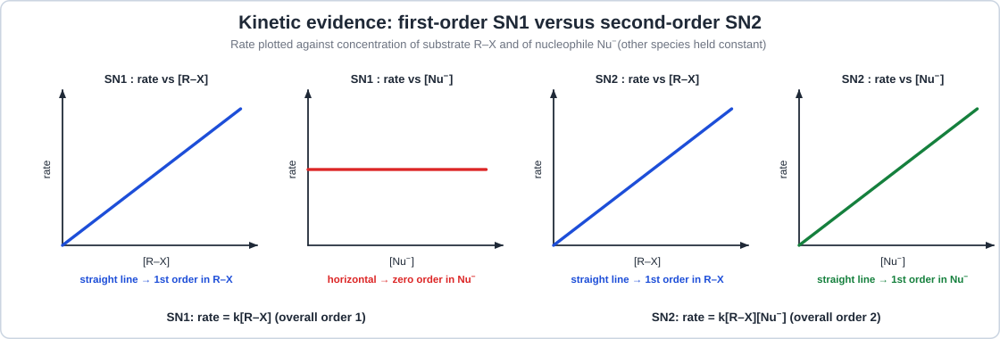

### 4.5 Comparison of SN1 and SN2

| Feature | SN1 | SN2 |
|---|---|---|
| Molecularity / order | unimolecular, 1st | bimolecular, 2nd |
| Steps | 2 (carbocation intermediate) | 1 (transition state) |
| Substrate | 3° > 2° | CH₃ > 1° > 2° |
| Nucleophile | weak is acceptable | strong needed |
| Solvent | polar protic | polar aprotic |
| Stereochemistry | racemisation | inversion |
| Rearrangement | possible | none |

---

## 5. Elimination E1 and E2

*Asked in: 2017 (c); 2020 Q3 (c); 2021 (d); 2022 (d).*

**Elimination** removes H and X from adjacent carbons (**β-elimination**), forming an alkene: H–C–C–X + B⁻ → C=C + BH + X⁻. The more substituted alkene predominates (**Zaitsev rule**).

### 5.1 E1 mechanism

Example: (CH₃)₃C–Br → (CH₃)₂C=CH₂ (2-methylpropene).

1. **Slow:** ionisation to the carbocation (same step as SN1).
2. **Fast:** a base removes a β-hydrogen from the carbocation; the C–H electrons form the π bond.

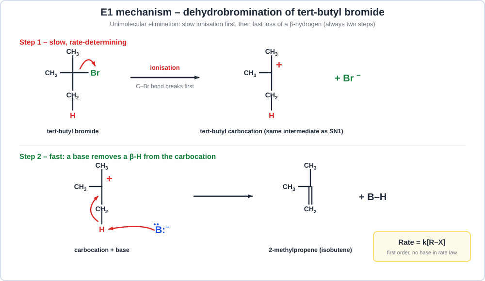

### 5.2 Show that E1 reaction is always a two-step reaction (2017 c, 2020 c)

1. **Kinetic argument.** The rate law is **rate = k[R–X]** — the base does not appear. A single elementary step that both removes X and removes H must involve the base (making it second order). Because the experimental order is 1, the slow step can only be the **unimolecular ionisation of R–X**. The proton removal by the base therefore occurs in a **separate, fast second step**. So the reaction has *at least two steps*; it can never be one step.
2. **Intermediate.** The carbocation can be detected by its behaviour — it gives **rearranged products** (e.g. 1,2-hydride shift) and the *same* product mixture as SN1 (substitution + elimination from one ion).
3. **No kinetic isotope effect.** C–H is not broken in the slow step, so replacing H by D changes the rate very little (kH/kD ≈ 1); for E2, kH/kD ≈ 3–8.
4. **Stereochemistry.** The carbocation is planar, so E1 has no strict stereochemical requirement (unlike E2 which needs anti-periplanar H and X).

### 5.3 E2 mechanism

One concerted step in which the base removes the β-H *while* the leaving group departs; H and X must be **anti-periplanar** (180°). Example: CH₃CH₂Br + C₂H₅O⁻ → CH₂=CH₂ + C₂H₅OH + Br⁻.

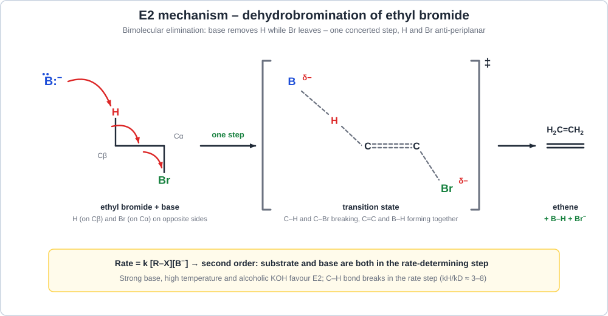

### 5.4 Show that E1 is a two-step reaction but E2 is a one-step reaction (2021 d)

| Feature | E1 | E2 |
|---|---|---|
| Rate law | k[R–X] — **first order** | k[R–X][B⁻] — **second order** |
| Steps | **two** (carbocation intermediate) | **one** (single transition state) |
| Base | weak base is enough | strong base required |
| Substrate | 3° > 2° > 1° | 3° > 2° > 1° (any with β-H) |
| Rearrangement | possible | not possible |
| Stereochemistry | none required | anti-periplanar H and X |
| Isotope effect (kH/kD) | ≈ 1 | 3–8 |
| Competes with | SN1 | SN2 |

### 5.5 Order of E1 and E2 (2022 d)

> **Correction to the question.** As printed, the question says “E2 is first order but E1 second order”. This is reversed: **E1 is first order and E2 is second order**. The answer below proves the correct statement (an examiner expects this; mention the correction in your script).

* **E1:** rate-determining step is R–X → R⁺ + X⁻ only ⇒ rate = k[R–X] ⇒ **first order**.
* **E2:** the single step contains R–X and B⁻ ⇒ rate = k[R–X][B⁻] ⇒ **second order**.

---

## 6. Addition reactions

*Asked in: 2018 (c); 2021 (c); 2022 (c); 2023 (c).*

### 6.1 Electrophilic addition reaction

**Definition.** An addition to a C=C or C≡C bond in which the **first attack is by an electrophile** on the electron-rich π cloud (the π bond acts as the nucleophile). Typical of alkenes and alkynes.

**General mechanism (two steps):** (1) π bond + E⁺ → carbocation (slow); (2) Nu⁻ attacks the carbocation (fast).

**Example 1 — HBr + ethene:** CH₂=CH₂ + HBr → CH₃CH₂Br.

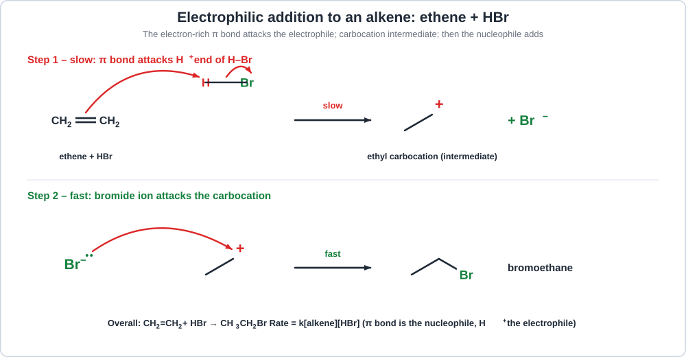

**Example 2 — Br₂ + ethene** goes through a cyclic **bromonium ion** and gives **anti addition**; the reagent Br–Br is polarised by the approaching π cloud (Brδ+–Brδ−). The decolourisation of bromine water is the test for unsaturation.

**Example 3 — Markovnikov’s rule.** In the addition of H–X to an unsymmetrical alkene, **H goes to the carbon bearing more hydrogens** (X to the more substituted carbon) because the more stable carbocation (2° > 1°) forms. CH₃CH=CH₂ + HBr → CH₃CHBrCH₃ (major). In the presence of peroxides HBr adds *anti-Markovnikov* by a free-radical mechanism (Kharasch effect; only for HBr).

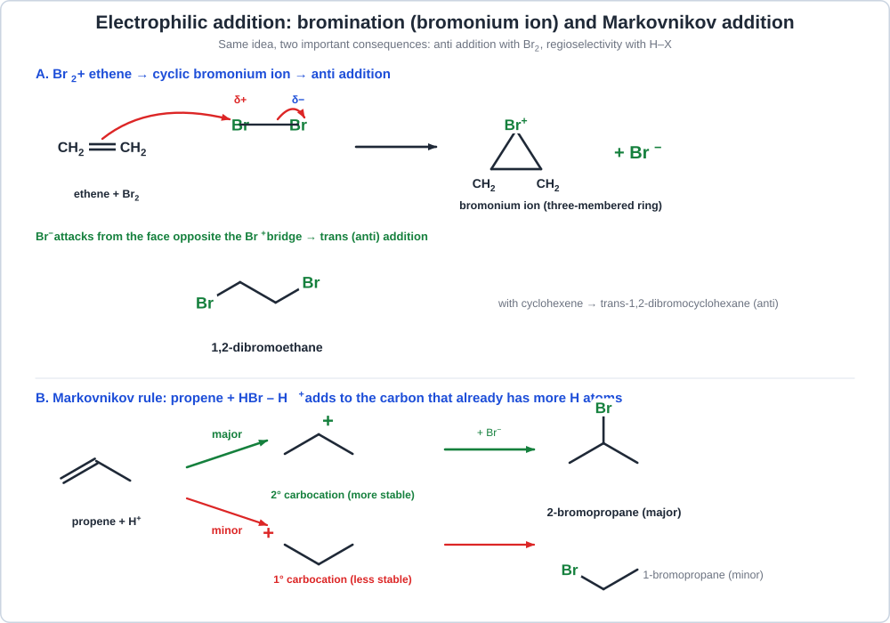

Other examples: hydration (H₂O/H⁺ → alcohol), H₂SO₄ addition, HOCl (halohydrin formation).

### 6.2 Nucleophilic addition reaction

**Definition.** An addition to a polar multiple bond — chiefly the **carbonyl group C=O** — in which the **first attack is by a nucleophile** on the electron-poor carbon (Cδ+=Oδ−). The π pair moves to oxygen (−E effect), giving a tetrahedral alkoxide that is then protonated.

**Mechanism (benzaldehyde + HCN → cyanohydrin):**

1. Slow: CN⁻ attacks the carbonyl carbon; carbon changes from sp² to sp³ and O⁻ results.
2. Fast: the alkoxide takes H⁺ from HCN (or water) → C(OH)(CN).

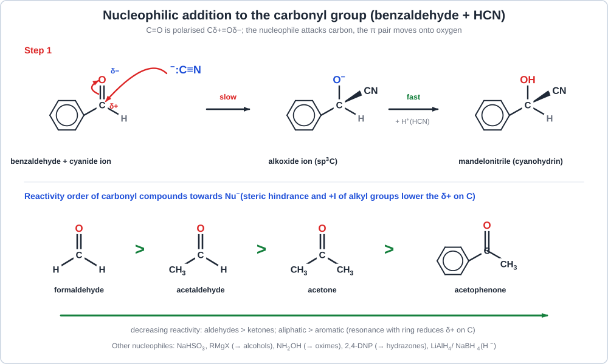

**Reactivity:** HCHO > RCHO > ArCHO > RCOR′ > ArCOR (less steric hindrance and larger δ+ on C make aldehydes more reactive than ketones).

**Other examples:** RMgX (→ 1°/2°/3° alcohol), NaHSO₃ (bisulphite adduct), NH₂OH (oxime), NH₂NH₂ / 2,4-DNP (hydrazone), alcohols/H⁺ (acetal), H⁻ from NaBH₄ / LiAlH₄ (reduction).

### 6.3 Comparison

| Feature | Electrophilic addition | Nucleophilic addition |
|---|---|---|
| Attacking species | electrophile (E⁺) | nucleophile (Nu⁻) |
| Substrate | alkenes, alkynes (electron-rich C=C) | aldehydes, ketones (electron-poor C=O) |
| First step | π bond attacks E⁺ | Nu⁻ attacks Cδ+ |
| Intermediate | carbocation / bromonium | alkoxide (sp³ C) |
| Governing rule | Markovnikov | reactivity: aldehyde > ketone |
| Typical example | CH₂=CH₂ + HBr | PhCHO + HCN |

---

## 7. Classification of reagents

*Asked in: 2018 (d).*

Reagents that attack organic molecules are of three classes: **electrophiles, nucleophiles, free radicals**.

* **Electrophile (E⁺)** — electron-seeking species with an **empty orbital / electron deficiency**; it accepts an electron pair (a Lewis acid).
  1. *Positively charged:* H⁺, NO₂⁺, NO⁺, Br⁺, R⁺, RCO⁺, SO₃H⁺.
  2. *Neutral, electron-deficient:* BF₃, AlCl₃, FeCl₃, ZnCl₂, SO₃, carbenes (:CH₂).
  3. *Neutral, polarised:* carbonyl carbon of C=O, carbon of R–X, H of H–Br.
* **Nucleophile (Nu⁻)** — nucleus-seeking species with a **lone pair or π electrons**; it donates an electron pair (a Lewis base).
  1. *Negatively charged:* OH⁻, RO⁻, CN⁻, X⁻, H⁻, NH₂⁻, R⁻.
  2. *Neutral, with a lone pair:* NH₃, H₂O, ROH, RNH₂, R₃N, R₂S.
  3. *π-electron / ambident:* alkenes, alkynes, benzene; CN⁻ (C or N), NO₂⁻ (N or O), enolates.

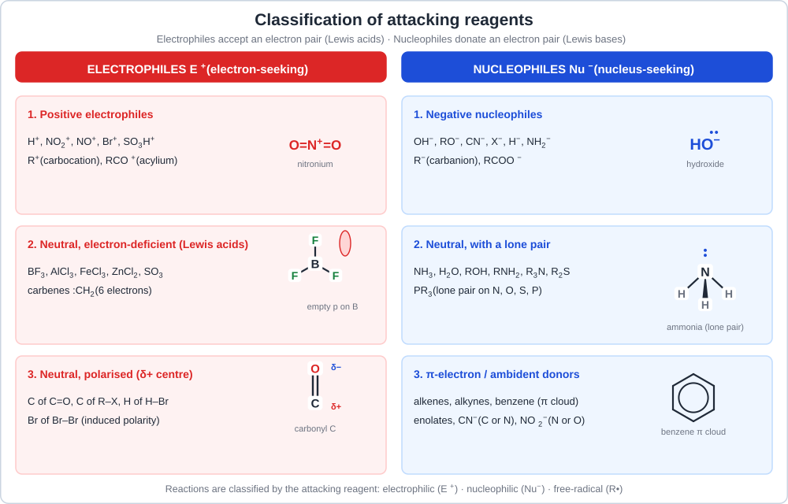

| Basis | Electrophile | Nucleophile |
|---|---|---|
| Meaning | electron-loving | nucleus-loving |
| Electrons | accepts a pair | donates a pair |
| Lewis character | acid | base |
| Attacks | electron-rich centres | electron-poor centres |
| Reactions | electrophilic substitution/addition | SN1, SN2, nucleophilic addition |

Difference between nucleophile and base: a base attacks **H** (thermodynamic, measured by pKa); a nucleophile attacks **C** (kinetic).

---

## 8. Carboxylic acid derivatives

*Asked in: 2020 Q3 (a), (b), (d).*

### 8.1 Derivatives of monocarboxylic acids (2020 Q3 a)

**Definition.** Compounds obtained by **replacing the –OH of the carboxyl group** R–CO–OH with another atom or group Z, giving the general formula **R–CO–Z** (acyl compounds). They are all converted back to the acid by hydrolysis.

| Derivative | Z | General formula | Example |
|---|---|---|---|
| Acid (acyl) chloride | –Cl | RCOCl | acetyl chloride CH₃COCl, benzoyl chloride C₆H₅COCl |
| Acid anhydride | –OCOR | (RCO)₂O | acetic anhydride (CH₃CO)₂O |
| Ester | –OR′ | RCOOR′ | ethyl acetate CH₃COOC₂H₅ |
| Amide | –NH₂ | RCONH₂ | acetamide CH₃CONH₂, benzamide |

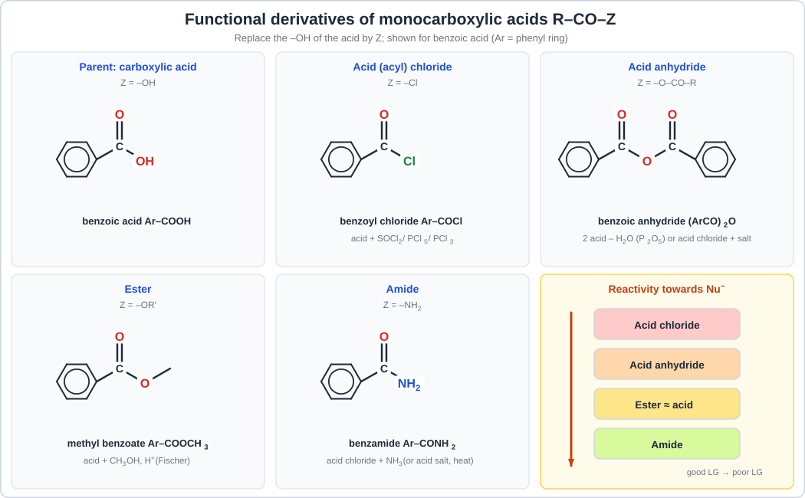

**Reactivity towards nucleophiles:** acid chloride > anhydride > ester ≈ acid > amide (better leaving group → more reactive). All undergo **nucleophilic acyl substitution** by an addition–elimination mechanism.

### 8.2 Preparation of acid chloride, acid anhydride and ester (2020 Q3 b)

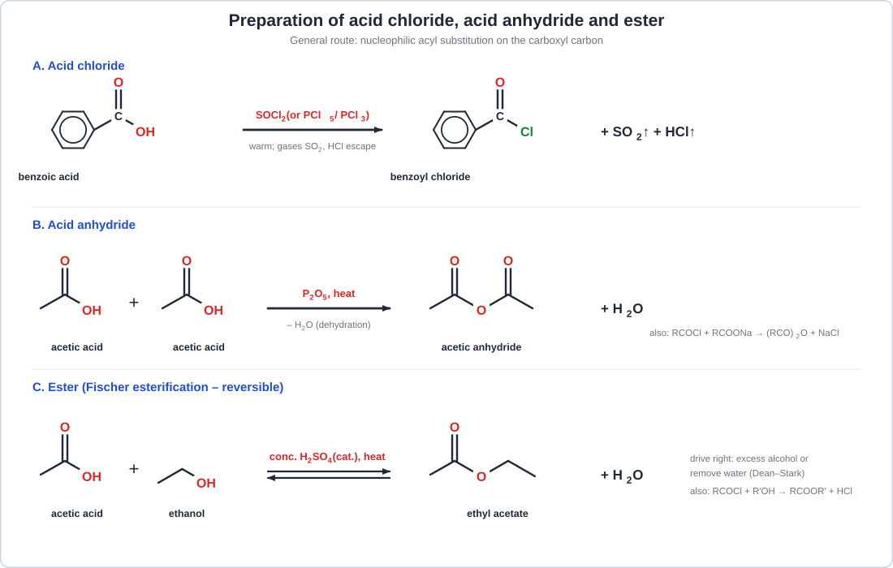

**(i) Acid chloride** — the –OH of the acid is replaced by Cl using thionyl chloride, PCl₅ or PCl₃.

* RCOOH + SOCl₂ → RCOCl + SO₂↑ + HCl↑ *(best method: both by-products are gases, so the product is easy to purify)*
* RCOOH + PCl₅ → RCOCl + POCl₃ + HCl
* 3 RCOOH + PCl₃ → 3 RCOCl + H₃PO₃
* Example: C₆H₅COOH + SOCl₂ → C₆H₅COCl + SO₂ + HCl

**(ii) Acid anhydride**

* By **dehydration** of two molecules of acid with P₂O₅ (or on heating): 2 CH₃COOH → (CH₃CO)₂O + H₂O.
* By **acid chloride + sodium salt of the acid:** CH₃COCl + CH₃COONa → (CH₃CO)₂O + NaCl *(also used for mixed anhydrides)*.
* Cyclic anhydrides: maleic acid or phthalic acid on heating.

**(iii) Ester**

* **Fischer esterification:** RCOOH + R′OH ⇌ RCOOR′ + H₂O, catalysed by conc. H₂SO₄ or dry HCl. It is reversible; excess alcohol or removal of water drives it to the right. Example: CH₃COOH + C₂H₅OH ⇌ CH₃COOC₂H₅ + H₂O.
* From **acid chloride or anhydride + alcohol:** RCOCl + R′OH → RCOOR′ + HCl (fast, irreversible; pyridine added).
* From the **silver salt + alkyl halide:** RCOOAg + R′X → RCOOR′ + AgX; **diazomethane** gives methyl esters: RCOOH + CH₂N₂ → RCOOCH₃ + N₂.

### 8.3 Carboxylic acid + bromine in presence of red phosphorus (2020 Q3 d)

This is the **Hell–Volhard–Zelinsky (HVZ) reaction**: a carboxylic acid having at least one **α-hydrogen** is **brominated at the α-carbon**.

R–CH₂–COOH + Br₂ —(red P)→ R–CHBr–COOH + HBr

Example: CH₃CH₂COOH + Br₂ —(red P, heat)→ CH₃CHBrCOOH (2-bromopropanoic acid) + HBr. With excess Br₂ further α-H atoms are replaced (CH₃COOH → BrCH₂COOH → Br₂CHCOOH → Br₃CCOOH).

**Mechanism:** (1) 2P + 3Br₂ → 2PBr₃; (2) RCH₂COOH + PBr₃ → RCH₂COBr (acyl bromide); (3) acyl bromide enolises, R–CH=C(OH)Br; (4) enol + Br₂ → R–CHBr–COBr; (5) exchange with more acid gives R–CHBr–COOH and regenerates RCH₂COBr.

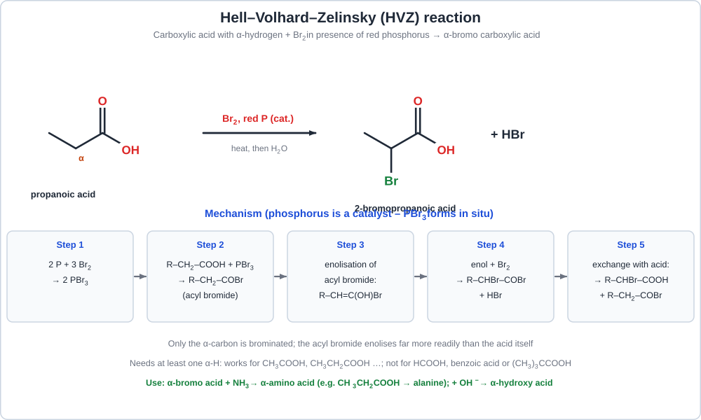

**Importance:** the α-bromo acid is a gateway to **α-hydroxy acids** (with OH⁻) and **α-amino acids** (with NH₃, e.g. alanine from propanoic acid). Acids without α-H (HCOOH, C₆H₅COOH, (CH₃)₃CCOOH) do not react.

---

## 9. Extra revision

### 9.1 How often each topic appeared

| Topic | 2016 | 2017 | 2018 | 2020 | 2021 | 2022 | 2023 |
|---|:-:|:-:|:-:|:-:|:-:|:-:|:-:|
| Isomerism | ✔ | | | | | | |
| Carbocation / carbanion | | ✔ | | | | | |
| Inductive / electromeric | | ✔ | | | | ✔ | ✔ |
| Mesomeric / electromeric | | | ✔ | | ✔ | | ✔ |
| SN1, SN2 | | ✔ | ✔ | | ✔ | ✔ | ✔ |
| E1 / E2 | | ✔ | | ✔ | ✔ | ✔ | |
| Electrophilic / nucleophilic addition | | | ✔ | | ✔ | ✔ | ✔ |
| Reagent classification | | | ✔ | | | | |
| Acid derivatives and HVZ | | | | ✔ | | | |

**Strategy:** the SN1/SN2 + E1/E2 + addition + electronic-effect block appears almost every year; master Sections 3–6 first.

### 9.2 One-page quick revision

| Topic | Remember |
|---|---|
| Carbocation | sp², planar, 6 e⁻, 3° > 2° > 1°, rearranges |
| Carbanion | sp³, pyramidal, 8 e⁻, 1° > 2° > 3° |
| +I | alkyl groups; −I: NO₂ > CN > F > Cl > Br > I > OH |
| Mesomeric | permanent; +M: OH, NH₂; −M: NO₂, CHO |
| Electromeric | temporary; needs reagent; +E toward reagent, −E away |
| Hyperconjugation | σ(C–H) → p / π; number of α-H decides stability |
| SN1 | 2 steps; rate = k[RX]; 3°; racemisation; protic solvent |
| SN2 | 1 step; rate = k[RX][Nu]; CH₃/1°; inversion; aprotic solvent |
| E1 | 2 steps; rate = k[RX]; carbocation; no KIE |
| E2 | 1 step; rate = k[RX][B]; anti-periplanar; KIE 3–8 |
| Electrophilic addition | alkene + E⁺; Markovnikov; Br₂ gives anti addition |
| Nucleophilic addition | C=O + Nu⁻; HCHO > RCHO > RCOR′ |
| Acid derivatives | RCOCl > (RCO)₂O > RCOOR′ ≈ RCOOH > RCONH₂ |
| HVZ | RCH₂COOH + Br₂ / red P → RCHBrCOOH |

**Mnemonics.** *“SN1 – Slow ionisation, No Nu in rate law; SN2 – Same time, Second order.”*

### 9.3 Practice questions (with short answers)

1. **Why does (CH₃)₃CBr react by SN1 but CH₃Br by SN2?**
   3° gives a stable carbocation and is too hindered for back-side attack; CH₃Br gives an unstable carbocation but is unhindered.
2. **Why is Cl₃CCOOH stronger than CH₃COOH?**
   The −I effect of three Cl atoms disperses the negative charge of the carboxylate ion (pKa 0.7 vs 4.8).
3. **Which is more reactive towards HCN, CH₃CHO or CH₃COCH₃?**
   CH₃CHO — one alkyl group (less +I, less steric hindrance) → larger δ+ on carbon.
4. **Predict the product: CH₃CH=CH₂ + HBr (no peroxide).**
   2-bromopropane (Markovnikov, via 2° carbocation).
5. **How many stereoisomers does CH₃CHBr–CHBr–COOH have?**
   Two different chiral centres → 2² = 4.
6. **Why does phenol undergo electrophilic substitution faster than benzene?**
   +M effect of OH raises electron density at ortho/para positions.
7. **A reaction of an alkyl halide has rate = k[RX] and gives both alkene and alcohol. Name the mechanisms.**
   E1 and SN1, competing from the same carbocation.

### 9.4 Common mistakes to avoid

* Writing “carbonium ion” without saying it means carbocation; explain that R₃C⁺ is trivalent.
* Drawing electromeric arrows as straight arrows (they are **curved**, inductive arrows are **straight**).
* Saying SN1 is “fast” — the rate-determining step is *slow*; the second step is fast.
* Giving SN1 an order of 2 or E2 an order of 1 (see the note under Section 5.5).
* Forgetting “inversion” for SN2 and “racemisation” for SN1.
* In HVZ, forgetting that red phosphorus is only a **catalyst** (PBr₃ forms in situ) and that an α-H is required.
* Applying Markovnikov’s rule to HBr in presence of peroxide (anti-Markovnikov there).

---

*Compiled for the `butex-notes` repository · figures in `../../assets/`.*
