# Chem-103 (Chemistry-II) · Chapter 1: Organic Reaction Mechanisms

> **Question solved:** Write the electrophilic and nucleophilic addition reactions. Prove that S<sub>N</sub>1 and E1 are first-order reactions, whereas S<sub>N</sub>2 and E2 are second-order reactions.
>
> **Format:** exam-style answer + extra study material · **Version:** `v261107-1` · All diagrams are SVG files stored in `../../assets/`

## Contents

1. [Question at a glance](#question-at-a-glance)
2. [Part A: Electrophilic addition reactions](#part-a-electrophilic-addition-reactions)
3. [Part B: Nucleophilic addition reactions](#part-b-nucleophilic-addition-reactions)
4. [Part C: Kinetics of SN1, SN2, E1 and E2](#part-c-kinetics-of-sn1-sn2-e1-and-e2)
5. [Part D: Extra study material](#part-d-extra-study-material)
6. [Part E: Quick revision and practice questions](#part-e-quick-revision-and-practice-questions)

---

## Question at a glance

The question has two tasks:

| Task | What the examiner wants | Where it is answered |
|---|---|---|
| 1 | Electrophilic addition (alkenes) and nucleophilic addition (carbonyl compounds) with mechanisms and examples | Parts A and B |
| 2 | Proof, from the mechanism and from experimental data, that S<sub>N</sub>1 and E1 are **first order** and S<sub>N</sub>2 and E2 are **second order** | Part C |

**Colour code used in every diagram**

| Colour | Meaning |
|---|---|
| Red curved arrow | movement of an electron pair (electrophile attack, bond breaking) |
| Blue species / arrow | nucleophile or base and the path of its lone pair |
| Wedge / hashed bond | bond towards / away from the viewer |
| `δ+`, `δ−` | partial charges due to polarity |

> [!TIP]
> Exam strategy: draw the mechanism first (curved arrows!), then state the rate-determining step, then write the rate law. Examiners give most marks for the arrows and the rate-determining step.

---

## Part A: Electrophilic addition reactions

### A.1 Definition

**Q. What is an electrophilic addition reaction?**

**Ans.** An addition reaction in which the first species to attack the unsaturated substrate is an **electrophile** (electron-pair acceptor, E<sup>+</sup>). It is typical of **alkenes and alkynes**, because the π bond is electron-rich, loosely held and exposed above and below the molecular plane.

General reaction:

```text
C=C  +  E–Nu   →   E–C–C–Nu
(π bond is lost; two new σ bonds are formed)
```

General mechanism (always two steps):

1. **Slow:** the π electrons attack E<sup>+</sup> and a **carbocation** (or a cyclic onium ion) forms. This is the rate-determining step.
2. **Fast:** the nucleophile (Nu<sup>−</sup>) combines with the cation.

Rate law (both species are involved in the slow step): rate = *k* [alkene][E–Nu], second order overall.

### A.2 Example 1: addition of HBr to ethene

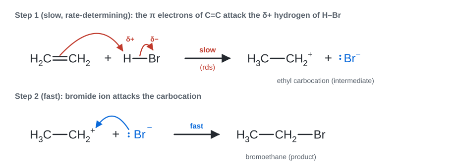

*Fig. 1. Two-step mechanism for CH<sub>2</sub>=CH<sub>2</sub> + HBr → CH<sub>3</sub>CH<sub>2</sub>Br.*

- H–Br is polarised H<sup>δ+</sup>–Br<sup>δ−</sup>. The π electrons attack the hydrogen; the H–Br bond breaks heterolytically and Br<sup>−</sup> leaves.
- The intermediate is the **ethyl carbocation** (primary, sp² carbon, planar).
- Br<sup>−</sup> attacks the empty p orbital of the carbocation to give **bromoethane**.

### A.3 Example 2: Markovnikov's rule (propene + HBr)

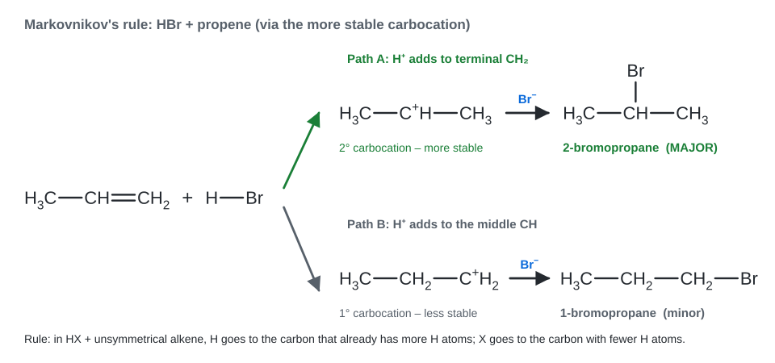

*Fig. 2. Propene can form a 2° or a 1° carbocation; the more stable 2° cation leads to the major product.*

**Markovnikov's rule:** when HX adds to an unsymmetrical alkene, the hydrogen goes to the carbon that already carries **more hydrogens**, and X goes to the carbon with fewer hydrogens.

**Modern statement:** the reaction goes through the **more stable carbocation**. Stability order:

```text
3° > 2° > 1° > methyl
```

Reasons: (i) the +I effect of alkyl groups pushes electron density towards C⁺; (ii) **hyperconjugation** (overlap of neighbouring C–H σ bonds with the empty p orbital): more alkyl groups, more C–H bonds available.

**Peroxide (Kharasch) effect.** In the presence of peroxides, HBr (and only HBr) adds to propene by a **free-radical chain** mechanism and gives the *anti*-Markovnikov product, 1-bromopropane. It is not an electrophilic addition.

### A.4 Example 3: addition of bromine (bromonium ion)

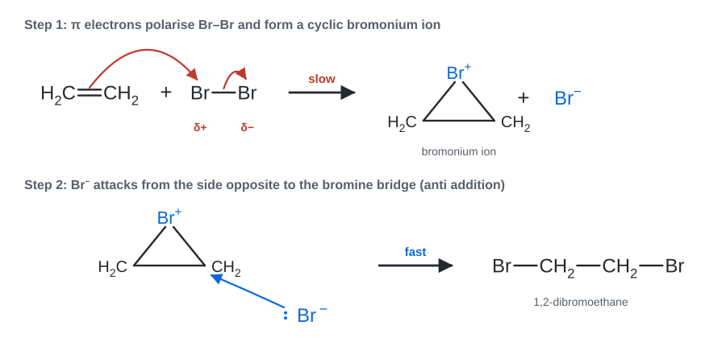

*Fig. 3. Br<sub>2</sub> is polarised by the π bond; a three-membered bromonium ion forms and is opened by Br<sup>−</sup> from the back side.*

- No free carbocation is formed: the cyclic **bromonium ion** prevents rotation and explains **anti addition**. With cyclohexene the product is *trans*-1,2-dibromocyclohexane.
- **Test for unsaturation:** reddish-brown bromine water (or Br<sub>2</sub> in CCl<sub>4</sub>) is decolourised.
- In water the solvent opens the ion and a **bromohydrin** (Br and OH on adjacent carbons) is formed.

### A.5 Example 4: an aromatic substrate (styrene, with a benzene ring)

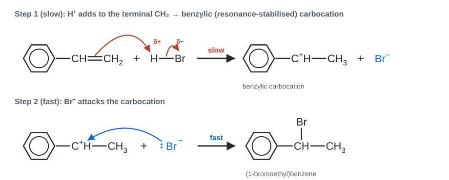

*Fig. 4. The vinyl group reacts; the benzene ring stays intact. H⁺ adds to the terminal carbon to give a benzylic cation.*

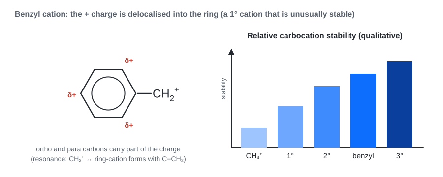

*Fig. 5. The benzylic cation is stabilised by resonance with the ring (charge at ortho and para carbons), so it is much more stable than an ordinary primary cation.*

> [!IMPORTANT]
> **Why does benzene itself not undergo addition?** Addition would destroy the aromatic sextet (resonance stabilisation of about 150 kJ mol⁻¹). Benzene therefore prefers electrophilic **substitution** (for example Br<sub>2</sub>/FeBr<sub>3</sub> gives bromobenzene), which restores aromaticity. A side-chain C=C, as in styrene, reacts by addition.

### A.6 Summary table of electrophilic additions

| Alkene | Reagent | Major product | Note |
|---|---|---|---|
| Ethene | HBr | Bromoethane | via ethyl cation |
| Propene | HBr | 2-Bromopropane | Markovnikov, 2° cation |
| Propene | H<sub>2</sub>O / H<sup>+</sup> | Propan-2-ol | acid-catalysed hydration, Markovnikov |
| Propene | HBr / peroxide | 1-Bromopropane | radical, anti-Markovnikov |
| 2-Methylpropene | HBr | 2-Bromo-2-methylpropane | 3° cation, fastest of these |
| Ethene | Br<sub>2</sub> / CCl<sub>4</sub> | 1,2-Dibromoethane | bromonium ion, anti addition |
| Cyclohexene | Br<sub>2</sub> | *trans*-1,2-Dibromocyclohexane | anti addition |
| Styrene | HBr | (1-Bromoethyl)benzene | benzylic cation |

---

## Part B: Nucleophilic addition reactions

### B.1 Definition

**Q. What is a nucleophilic addition reaction?**

**Ans.** An addition reaction in which a **nucleophile** (electron-pair donor) attacks an electron-poor atom of a multiple bond first. It is typical of **aldehydes and ketones**, because the C=O bond is polarised: carbon is C<sup>δ+</sup> (electrophilic) and oxygen is O<sup>δ−</sup>. The carbon changes from **sp² (trigonal planar) to sp³ (tetrahedral)**.

General reaction:

```text
C=O  +  H–Nu   →   C(OH)(Nu)
```

Two steps: (1) **slow**: Nu<sup>−</sup> attacks C<sup>δ+</sup>, the π electrons move to oxygen and a tetrahedral **alkoxide** forms; (2) **fast**: the alkoxide takes H<sup>+</sup> (from HNu or water).

### B.2 Example 1: HCN addition to ethanal (cyanohydrin formation)

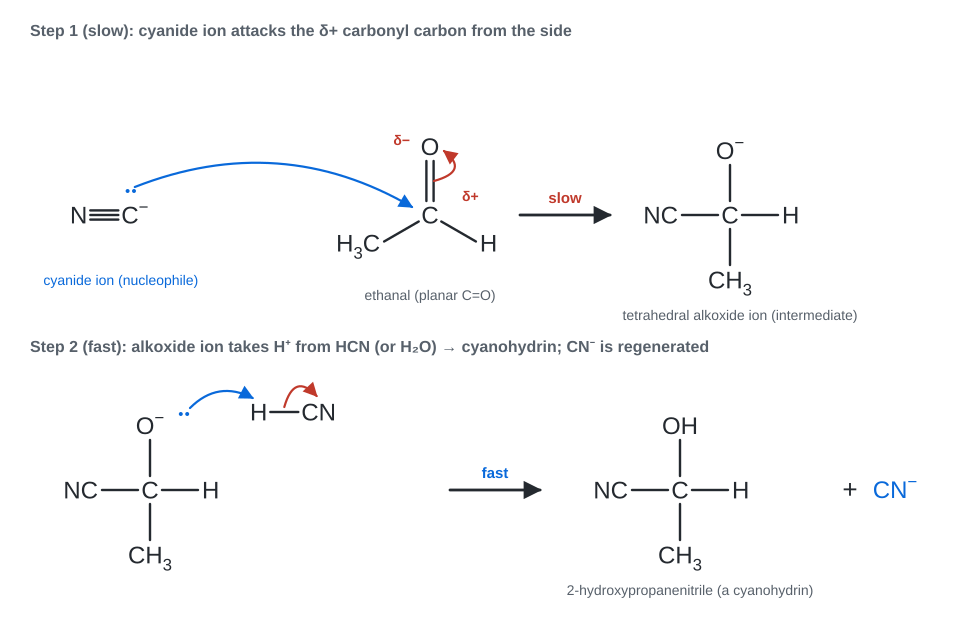

*Fig. 6. Base-catalysed addition of HCN to ethanal.*

- HCN is a weak acid, so a **trace of base** is added to generate the nucleophile: HCN + OH<sup>−</sup> ⇌ CN<sup>−</sup> + H<sub>2</sub>O.
- CN<sup>−</sup> attacks the carbonyl carbon (slow step), giving the alkoxide intermediate; the alkoxide is protonated by HCN, so CN<sup>−</sup> is regenerated (catalytic).
- Product: **2-hydroxypropanenitrile** (a cyanohydrin). Hydrolysis of the –CN group gives 2-hydroxy acids (lactic acid here), so the reaction **adds one carbon**.

### B.3 Example 2: an aromatic aldehyde (benzaldehyde, with a benzene ring)

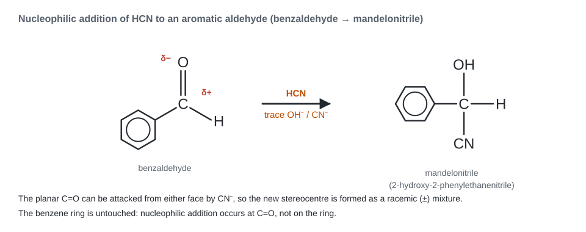

*Fig. 7. Benzaldehyde + HCN → mandelonitrile. The planar C=O is attacked from either face, so the product is racemic.*

### B.4 Reactivity order and reasons

```text
HCHO > CH3CHO > C6H5CHO     (aldehydes)      aldehydes > ketones > diaryl ketones
```

| Factor | Effect |
|---|---|
| Steric | Ketones have two bulky groups; the tetrahedral product is more crowded than for aldehydes |
| Electronic | Alkyl groups (+I) reduce the δ+ charge on carbon in ketones |
| Resonance | In benzaldehyde the ring donates electrons (+R) to C=O, so it is less reactive than aliphatic aldehydes |

### B.5 Other nucleophilic additions (for completeness)

| Reagent | Nucleophile | Product with an aldehyde RCHO |
|---|---|---|
| HCN / trace base | CN<sup>−</sup> | cyanohydrin |
| NaHSO<sub>3</sub> | HSO<sub>3</sub><sup>−</sup> | crystalline bisulfite addition compound (separation of aldehydes and methyl ketones) |
| R'MgX, then H<sub>3</sub>O<sup>+</sup> | R'<sup>δ−</sup> (Grignard) | secondary alcohol (primary alcohol from HCHO) |
| LiAlH<sub>4</sub> or NaBH<sub>4</sub> | H<sup>−</sup> | primary alcohol |
| NH<sub>2</sub>OH, NH<sub>2</sub>NH<sub>2</sub>, 2,4-DNP | N lone pair | addition then loss of water (oxime, hydrazone, 2,4-DNP derivative) |

### B.6 Electrophilic vs nucleophilic addition

| Feature | Electrophilic addition | Nucleophilic addition |
|---|---|---|
| Typical substrate | alkenes, alkynes (C=C, C≡C) | aldehydes, ketones (C=O), nitriles |
| Substrate character | electron-rich π bond (nucleophile) | electron-poor C<sup>δ+</sup> (electrophile) |
| Attacking species first | electrophile (H<sup>+</sup>, Br<sup>δ+</sup>) | nucleophile (CN<sup>−</sup>, H<sup>−</sup>, R<sup>−</sup>) |
| Intermediate | carbocation / onium ion | alkoxide ion |
| Rate-determining step | attack of π bond on E<sup>+</sup> | attack of Nu<sup>−</sup> on C=O |
| Stereochemistry | anti (cyclic ion) or mixture (open cation) | racemic if a new stereocentre forms |
| Examples | HBr + propene; Br<sub>2</sub> + ethene | HCN + ethanal; NaBH<sub>4</sub> + ketone |

---

## Part C: Kinetics of SN1, SN2, E1 and E2

### C.1 Preliminary ideas (state these first in the exam)

| Term | Meaning |
|---|---|
| Rate law | experimentally determined expression: rate = *k*[A]<sup>*m*</sup>[B]<sup>*n*</sup> |
| Order | sum of the exponents (*m* + *n*); found only from experiment |
| Molecularity | number of species colliding in an **elementary** step (1, 2, 3) |
| Rate-determining step (rds) | the slowest step; only species up to and including the rds appear in the rate law |
| Elementary step | for an elementary step, order = molecularity (exponents = stoichiometric coefficients of that step) |

> [!NOTE]
> **S<sub>N</sub>1** = *Substitution, Nucleophilic, **uni**molecular* (the rds involves one species) → first-order kinetics.
> **S<sub>N</sub>2** = *bimolecular* (the single step involves two species) → second-order kinetics. The same logic applies to **E1** (unimolecular) and **E2** (bimolecular).

Rate laws in one line:

$$\text{S}_\text{N}1,\ \text{E}1:\quad \text{Rate}=k\,[\mathrm{RX}] \qquad\qquad \text{S}_\text{N}2,\ \text{E2}:\quad \text{Rate}=k\,[\mathrm{RX}]\,[\mathrm{Nu^-}\ \text{or}\ \mathrm{B^-}]$$

### C.2 S<sub>N</sub>2: second-order kinetics

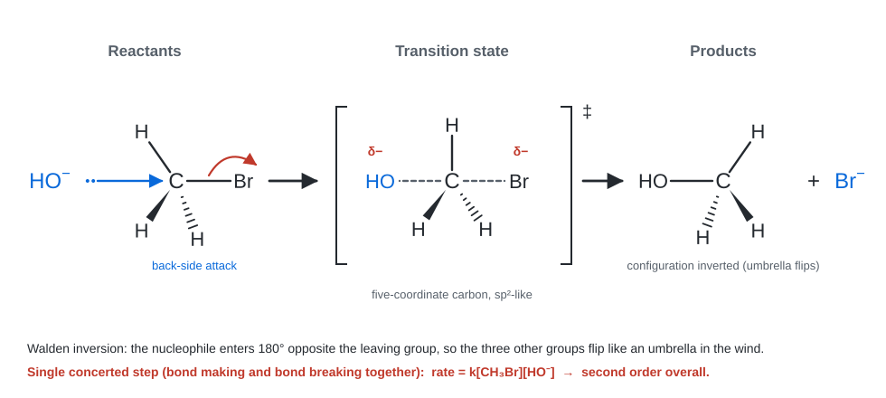

*Fig. 8. HO⁻ + CH<sub>3</sub>Br → CH<sub>3</sub>OH + Br⁻ in one concerted step with inversion of configuration.*

**Proof 1: from the mechanism.** The reaction occurs in a **single elementary step** in which the nucleophile attacks as the leaving group departs. For an elementary step, the rate is proportional to the frequency of collision between the two reacting species, so

$$\text{Rate}=k\,[\mathrm{CH_3Br}]\,[\mathrm{HO^-}]$$

It is first order in the substrate, first order in the nucleophile and **second order overall**.

**Proof 2: from experiment (method of initial rates).** Typical pattern (illustrative values, relative rates):

| Expt | [CH<sub>3</sub>Br] (mol L⁻¹) | [HO⁻] (mol L⁻¹) | Relative initial rate |
|---|---|---|---|
| 1 | 0.10 | 0.10 | 1.0 |
| 2 | 0.20 | 0.10 | 2.0 |
| 3 | 0.10 | 0.20 | 2.0 |
| 4 | 0.20 | 0.20 | 4.0 |

- Expts 1 and 2: [RX] doubled, rate doubled, so 2<sup>*m*</sup> = 2 and *m* = 1.
- Expts 1 and 3: [HO⁻] doubled, rate doubled, so *n* = 1.
- Expt 4 confirms it (×4). Order = 1 + 1 = **2**.

**Proof 3: integrated rate law.** For [A]<sub>0</sub> = [B]<sub>0</sub> the second-order law gives a straight line for 1/[A] against *t*:

$$-\frac{d[\mathrm{A}]}{dt}=k[\mathrm{A}]^2\ \Rightarrow\ \frac{1}{[\mathrm{A}]}=\frac{1}{[\mathrm{A}]_0}+kt,\qquad t_{1/2}=\frac{1}{k[\mathrm{A}]_0}$$

(the half-life **depends** on the starting concentration, which is a signature of second-order kinetics).

**Other features of S<sub>N</sub>2 (supporting evidence)**

- **Inversion of configuration** (Walden inversion): the nucleophile attacks 180° from the leaving group.
- Reactivity: CH<sub>3</sub>X > 1° > 2° ≫ 3° (steric hindrance at the back side; 3° halides do not react by S<sub>N</sub>2).
- Favoured by strong nucleophiles and polar **aprotic** solvents (DMSO, DMF, acetone).
- No rearrangement (no carbocation).

### C.3 S<sub>N</sub>1: first-order kinetics

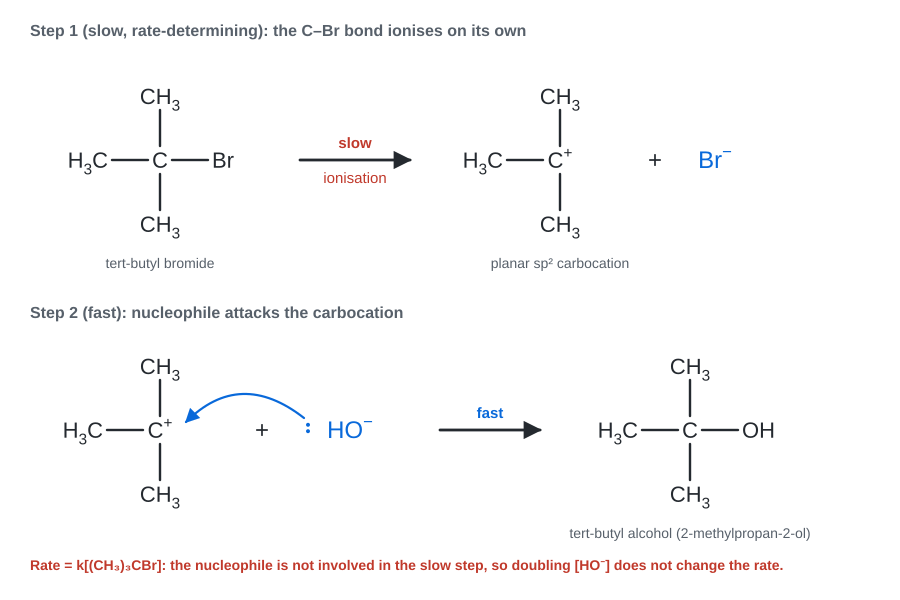

*Fig. 9. (CH<sub>3</sub>)<sub>3</sub>CBr + HO⁻: slow ionisation, then fast capture of the planar carbocation.*

**Proof 1: from the mechanism.**

| Step | Equation | Speed |
|---|---|---|
| 1 | R–X ⇌ R<sup>+</sup> + X<sup>−</sup> (*k*<sub>1</sub>, *k*<sub>−1</sub>) | **slow** (rds) |
| 2 | R<sup>+</sup> + Nu<sup>−</sup> → R–Nu (*k*<sub>2</sub>) | fast |

The overall rate equals the rate of the slow step. Step 1 involves only the substrate, so

$$\text{Rate}=k_1\,[\mathrm{RX}]$$

The nucleophile enters only after the rds and therefore does **not** appear in the rate law: first order overall (unimolecular).

**Proof 2: steady-state treatment (more rigorous).** The carbocation is a reactive intermediate, so its concentration is small and constant:

$$\frac{d[\mathrm{R^+}]}{dt}=k_1[\mathrm{RX}]-k_{-1}[\mathrm{R^+}][\mathrm{X^-}]-k_2[\mathrm{R^+}][\mathrm{Nu^-}]\approx 0$$

$$[\mathrm{R^+}]=\frac{k_1[\mathrm{RX}]}{k_{-1}[\mathrm{X^-}]+k_2[\mathrm{Nu^-}]}$$

$$\text{Rate}=k_2[\mathrm{R^+}][\mathrm{Nu^-}]=\frac{k_1k_2\,[\mathrm{RX}]\,[\mathrm{Nu^-}]}{k_{-1}[\mathrm{X^-}]+k_2[\mathrm{Nu^-}]}$$

Because the carbocation is captured much faster than it returns to RX, $k_2[\mathrm{Nu^-}]\gg k_{-1}[\mathrm{X^-}]$ (for example at the start of the reaction when [X⁻] ≈ 0, or when the nucleophile is the solvent), and the expression reduces to

$$\text{Rate}=k_1[\mathrm{RX}]$$

**Proof 3: from experiment.** Typical pattern for (CH<sub>3</sub>)<sub>3</sub>CBr + HO⁻ (illustrative relative rates):

| Expt | [t-BuBr] (mol L⁻¹) | [HO⁻] (mol L⁻¹) | Relative initial rate |
|---|---|---|---|
| 1 | 0.10 | 0.10 | 1.0 |
| 2 | 0.20 | 0.10 | 2.0 |
| 3 | 0.10 | 0.20 | 1.0 |
| 4 | 0.10 | 0.40 | 1.0 |

Doubling [RX] doubles the rate (*m* = 1); changing [HO⁻] has no effect (*n* = 0). Order = **1**.

**Proof 4: integrated rate law.**

$$-\frac{d[\mathrm{RX}]}{dt}=k_1[\mathrm{RX}]\ \Rightarrow\ \ln[\mathrm{RX}]=\ln[\mathrm{RX}]_0-k_1t,\qquad t_{1/2}=\frac{0.693}{k_1}$$

A plot of ln[RX] against *t* is a straight line of slope −*k*<sub>1</sub>, and the half-life is **independent of the initial concentration** (signature of first order).

**Stereochemistry (supporting evidence):**

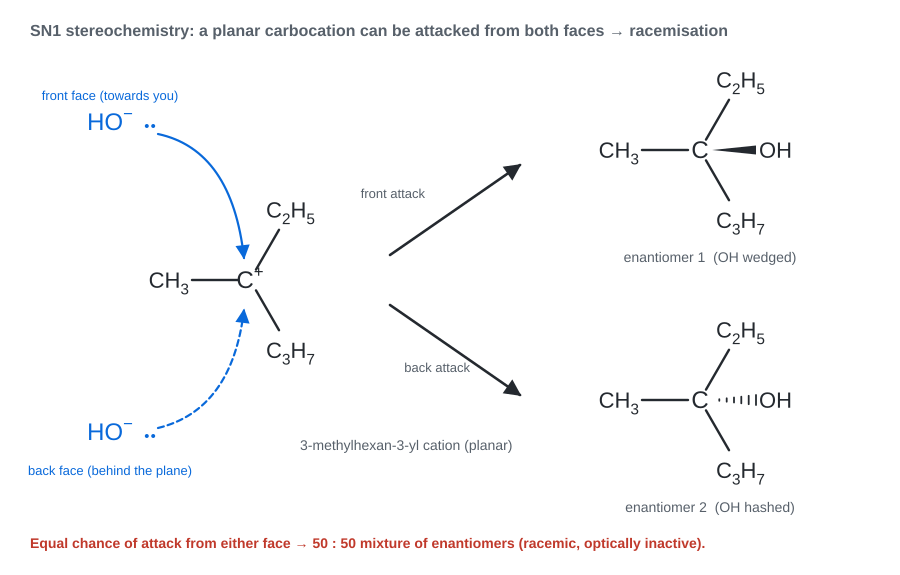

*Fig. 10. The planar carbocation is attacked from the front or back face with nearly equal probability, so an optically active halide gives a (largely) racemic alcohol.*

- Result is **racemisation** (often with a slight excess of inversion because the departing X⁻ still shields one face as an ion pair).
- Reactivity: 3° > 2° ≫ 1° > CH<sub>3</sub>; benzylic and allylic halides are also reactive (see Fig. 5).
- **Rearrangements** (1,2-hydride or methyl shifts) can occur because a carbocation is formed.
- Favoured by polar **protic** solvents (water, alcohols) that stabilise R<sup>+</sup> and X<sup>−</sup>, and by weak nucleophiles.

### C.4 E1: first-order kinetics

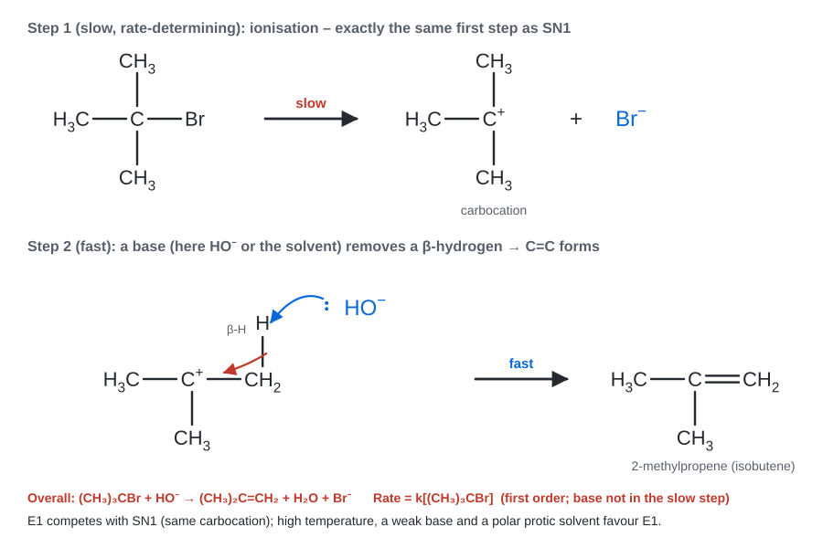

*Fig. 11. Ionisation (identical to S<sub>N</sub>1), then loss of a β-hydrogen to a base.*

**Proof.** E1 begins with exactly the same slow ionisation as S<sub>N</sub>1, giving R<sup>+</sup>. The base then removes a β-hydrogen in a **fast** step to form the alkene.

| Step | Equation | Speed |
|---|---|---|
| 1 | (CH<sub>3</sub>)<sub>3</sub>C–Br → (CH<sub>3</sub>)<sub>3</sub>C<sup>+</sup> + Br<sup>−</sup> | **slow** (rds) |
| 2 | (CH<sub>3</sub>)<sub>3</sub>C<sup>+</sup> + B → (CH<sub>3</sub>)<sub>2</sub>C=CH<sub>2</sub> + BH<sup>+</sup> | fast |

$$\text{Rate}=k_1\,[\mathrm{RX}]\quad\Rightarrow\quad\text{first order (the base is not in the rds)}$$

- The ratio E1 : S<sub>N</sub>1 product is decided **after** the rds (how the carbocation is consumed), so it affects the product distribution, not the rate of disappearance of RX.
- Experimental check: the rate is unchanged when the base concentration is changed, and the rate for E1 and S<sub>N</sub>1 of the same halide in the same solvent is the same.
- **Zaitsev's rule:** the more substituted (more stable) alkene is the major product.
- Typical conditions: weak base, polar protic solvent, **heat**. The carbocation can also rearrange.

### C.5 E2: second-order kinetics

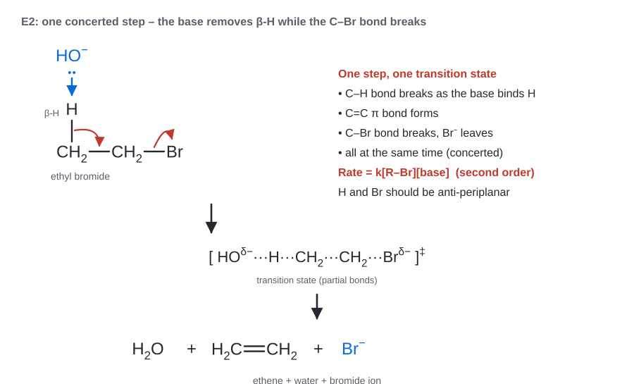

*Fig. 12. One concerted step: the base removes the β-H, the C=C bond forms and the leaving group departs.*

**Proof 1: from the mechanism.** Bond making (B–H, C=C) and bond breaking (C–H, C–X) happen in **one elementary step** involving the substrate and the base:

$$\text{Rate}=k\,[\mathrm{RX}]\,[\mathrm{B^-}]\quad\Rightarrow\quad\text{second order overall}$$

**Proof 2: from experiment.** (Illustrative relative rates, for CH<sub>3</sub>CH<sub>2</sub>Br + EtO⁻ in ethanol.)

| Expt | [RBr] (mol L⁻¹) | [EtO⁻] (mol L⁻¹) | Relative initial rate |
|---|---|---|---|
| 1 | 0.10 | 0.10 | 1.0 |
| 2 | 0.20 | 0.10 | 2.0 |
| 3 | 0.10 | 0.20 | 2.0 |
| 4 | 0.20 | 0.20 | 4.0 |

Each reactant is first order; overall order = **2**.

**Supporting evidence for E2**

- **Kinetic isotope effect:** replacing the β-hydrogen by deuterium slows the reaction (*k*<sub>H</sub>/*k*<sub>D</sub> typically about 3 to 8) because the C–H bond is broken **in the rate-determining step**. For E1 *k*<sub>H</sub>/*k*<sub>D</sub> ≈ 1 (the C–H bond breaks after the rds).
- **Stereochemistry:** the β-H and the leaving group must be **anti-periplanar** (180° apart).
- Favoured by strong bases and high concentration of base; no rearrangement.
- Reactivity of the halide: 3° > 2° > 1° (more substituted alkene, less steric strain).

### C.6 Energy profiles and graphs

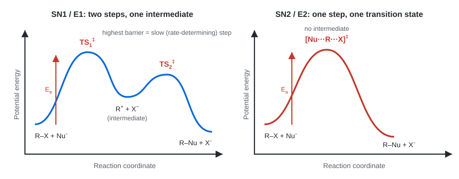

*Fig. 13. S<sub>N</sub>1/E1 have two transition states and a carbocation intermediate (the first barrier is the highest, so step 1 is rate-determining). S<sub>N</sub>2/E2 have one transition state and no intermediate.*

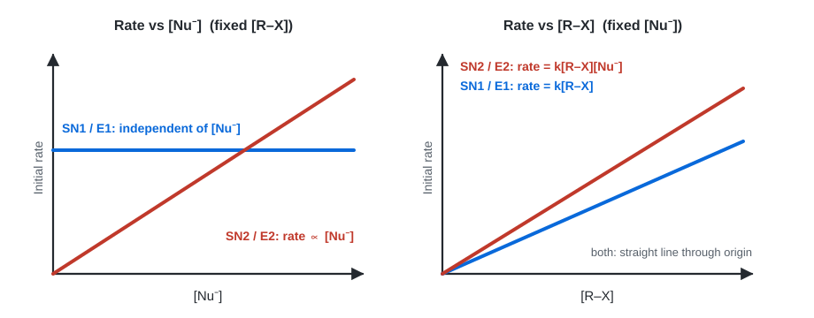

*Fig. 14. Left: the S<sub>N</sub>1/E1 rate is independent of [Nu⁻], while the S<sub>N</sub>2/E2 rate rises linearly. Right: both are linear in [R–X] (first order in substrate).*

### C.7 Final summary: the proof in one table

| | S<sub>N</sub>1 | E1 | S<sub>N</sub>2 | E2 |
|---|---|---|---|---|
| Steps | 2 | 2 | 1 | 1 |
| Rate-determining step | ionisation of R–X | ionisation of R–X | the single step | the single step |
| Species in rds | R–X only | R–X only | R–X + Nu<sup>−</sup> | R–X + base |
| Rate law | *k*[RX] | *k*[RX] | *k*[RX][Nu<sup>−</sup>] | *k*[RX][B<sup>−</sup>] |
| Order | **first** | **first** | **second** | **second** |
| Molecularity | unimolecular | unimolecular | bimolecular | bimolecular |
| Intermediate | carbocation | carbocation | none (TS only) | none (TS only) |
| Stereochemistry | racemisation | Zaitsev alkene | inversion | anti elimination |
| Rearrangement | possible | possible | no | no |

**Hence proved:** S<sub>N</sub>1 and E1 are first-order (the rds involves only the substrate); S<sub>N</sub>2 and E2 are second-order (the rds, the only step, involves substrate and nucleophile/base).

---

## Part D: Extra study material

### D.1 Which mechanism? Decision guide

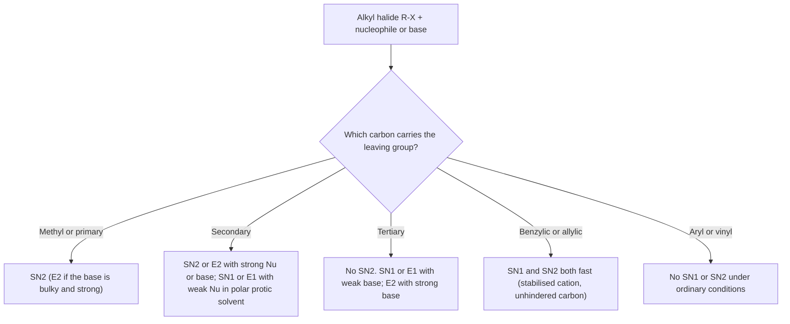

### D.2 Substitution versus elimination

| Factor | Favours substitution | Favours elimination |
|---|---|---|
| Temperature | low | **high** (elimination has higher entropy gain) |
| Reagent | good nucleophile, weak base (I<sup>−</sup>, CN<sup>−</sup>, RS<sup>−</sup>) | strong, bulky base (t-BuOK) |
| Substrate | methyl, primary | tertiary, branched |
| Solvent | polar aprotic (S<sub>N</sub>2) | alcohol / ethanolic KOH (E2) |

Practical memory aid: **aqueous KOH → substitution (alcohol); alcoholic KOH, heat → elimination (alkene).**

### D.3 Zaitsev and Hofmann products (2-bromobutane)

| Base | Major product | Rule |
|---|---|---|
| NaOEt / EtOH (small base) | but-2-ene | Zaitsev (more substituted alkene) |
| t-BuOK / t-BuOH (bulky base) | but-1-ene | Hofmann (less substituted alkene; the bulky base reaches the more accessible H) |

### D.4 Leaving groups and solvents

- **Leaving-group ability** (weak bases are good leaving groups): I<sup>−</sup> > Br<sup>−</sup> > Cl<sup>−</sup> ≫ F<sup>−</sup>. HO<sup>−</sup> is a poor leaving group; in acid it is protonated to H<sub>2</sub>O (good leaving group), and tosylate (TsO<sup>−</sup>) is excellent.
- **Polar protic solvents** (H<sub>2</sub>O, ROH) hydrogen-bond to anions, stabilise ions and favour S<sub>N</sub>1/E1; they also "cage" the nucleophile and slow S<sub>N</sub>2.
- **Polar aprotic solvents** (DMSO, DMF, acetone, CH<sub>3</sub>CN) leave the nucleophile "naked" and favour S<sub>N</sub>2.

### D.5 Benzene-ring examples: benzyl vs aryl halides

| Compound | Reaction with nucleophiles | Reason |
|---|---|---|
| Benzyl chloride, C<sub>6</sub>H<sub>5</sub>CH<sub>2</sub>Cl | S<sub>N</sub>1 and S<sub>N</sub>2 both easy | benzyl cation is resonance stabilised (Fig. 5); the carbon is sp³ and unhindered |
| Chlorobenzene, C<sub>6</sub>H<sub>5</sub>Cl | no S<sub>N</sub>1 / S<sub>N</sub>2 | C–Cl is on an sp² carbon, shorter and stronger (partial double-bond character from resonance), the ring repels a nucleophile, and the phenyl cation is very unstable |

### D.6 Common mistakes to avoid

1. Writing "S<sub>N</sub>1 is first order because it has one step". It has **two** steps; the **slow** step has one reacting species.
2. Mixing up **order** (experimental) and **molecularity** (theoretical). Say "unimolecular / bimolecular" for molecularity and "first / second order" for the rate law.
3. Drawing curved arrows from atoms instead of from **lone pairs or bonds**. The arrow starts at the electrons and ends where they go.
4. Forgetting that the S<sub>N</sub>2 nucleophile attacks from the **back side** (180°), not the front.
5. Calling the product of an S<sub>N</sub>1 reaction "inverted". It is **racemised** (mostly).
6. Forgetting Markovnikov's rule applies to the **carbocation stability**, not just to "more H".

---

## Part E: Quick revision and practice questions

### E.1 One-page revision sheet

| Topic | Remember |
|---|---|
| Electrophilic addition | alkene (nucleophile) attacks E<sup>+</sup>; carbocation intermediate; Markovnikov; Br<sub>2</sub> gives bromonium and anti addition |
| Nucleophilic addition | Nu<sup>−</sup> attacks C<sup>δ+</sup> of C=O; alkoxide intermediate; aldehydes more reactive than ketones |
| S<sub>N</sub>1 | rate = *k*[RX]; 3° > 2°; racemisation; protic solvent; rearrangement |
| S<sub>N</sub>2 | rate = *k*[RX][Nu]; CH<sub>3</sub> > 1° > 2°; inversion; aprotic solvent |
| E1 | rate = *k*[RX]; same carbocation as S<sub>N</sub>1; Zaitsev; heat |
| E2 | rate = *k*[RX][B]; anti-periplanar; strong base; kinetic isotope effect |
| First-order half-life | *t*<sub>½</sub> = 0.693 / *k* (constant) |
| Second-order half-life | *t*<sub>½</sub> = 1 / (*k*[A]<sub>0</sub>) (depends on [A]<sub>0</sub>) |

### E.2 Practice questions with short answers

**Q1.** Predict the major product and mechanism for (CH<sub>3</sub>)<sub>3</sub>CBr with (a) warm ethanol and (b) NaOEt in ethanol.
**Ans.** (a) Weak nucleophile/base, protic solvent: S<sub>N</sub>1 and E1 (tert-butyl ethyl ether and 2-methylpropene). (b) Strong base, tertiary halide: **E2**, 2-methylpropene.

**Q2.** Give the product and mechanism of CH<sub>3</sub>CH<sub>2</sub>CH<sub>2</sub>Br + NaCN in DMSO.
**Ans.** Primary halide, good nucleophile, polar aprotic solvent: **S<sub>N</sub>2**, butanenitrile, CH<sub>3</sub>CH<sub>2</sub>CH<sub>2</sub>CN.

**Q3.** Why does benzyl chloride undergo S<sub>N</sub>1 much faster than ethyl chloride although both are primary?
**Ans.** The benzyl cation is stabilised by resonance with the benzene ring (charge at ortho and para positions, Fig. 5); the ethyl cation has no such stabilisation.

**Q4.** The rate of a reaction is unaffected when the nucleophile concentration is tripled but doubles when the substrate concentration is doubled. Which mechanism(s)?
**Ans.** Rate = *k*[RX]: **S<sub>N</sub>1 or E1** (nucleophile/base not in the rds).

**Q5.** Write the mechanism for HBr + 2-methylpropene.
**Ans.** H<sup>+</sup> adds to CH<sub>2</sub>, forming the 3° (CH<sub>3</sub>)<sub>3</sub>C<sup>+</sup> cation (Markovnikov); Br<sup>−</sup> then gives 2-bromo-2-methylpropane.

**Q6.** A first-order reaction has a half-life of 20 min. Find *k* and the time for 87.5 % completion.
**Ans.** *k* = 0.693 / 20 = 0.0347 min⁻¹. 87.5 % completion = 3 half-lives = **60 min**.

---

<sub>File: `chem-103-organic-reaction-mechanisms-ques-solve-v261107-1.md` · Diagram files: `../../assets/ch1-*.svg` (14 files)</sub>
