# Organometallic Compounds — Solved Previous-Year Questions (2017–2023)

**Course:** Chemistry-II (CHEM-103) · **Topic:** Organometallic compounds, Grignard reagent, TEL, name reactions, acid derivatives, rearrangements
**Years covered:** 2017, 2018, 2019, 2020, 2022, 2023 · **Source:** `07-organometallic-compounds.md` (all questions, original numbering kept)

> **How to use this file.** Every question is answered in exam style (definition → equation → diagram → example). Sections marked **Extra** go beyond the question for deeper understanding and quick revision. All structures are drawn as SVG files in `../../assets/`.

## Contents

- [Question map and exam frequency](#question-map-and-exam-frequency)
- [1. What are organometallic compounds? (2017 Q3c · 2019 Q1a · 2020 Q1a)](#1-what-are-organometallic-compounds-2017-q3c--2019-q1a--2020-q1a)
- [2. Grignard reagent — definition, structure and preparation (2022 Q3a · 2023 Q2a · 2023 Q2b)](#2-grignard-reagent--definition-structure-and-preparation-2022-q3a--2023-q2a--2023-q2b)
- [3. Organometallic compounds obtained from Grignard reagents (2022 Q3b)](#3-organometallic-compounds-obtained-from-grignard-reagents-2022-q3b)
- [4. Preparation of 1°, 2° and 3° alcohols from RMgX (2020 Q1b)](#4-preparation-of-1-2-and-3-alcohols-from-rmgx-2020-q1b)
- [5. Reactivity of organometallic compounds (2020 Q1c)](#5-reactivity-of-organometallic-compounds-2020-q1c)
- [6. Tetraethyllead, TEL (2017 Q3d · 2020 Q1d · 2022 Q3c · 2023 Q4a)](#6-tetraethyllead-tel-2017-q3d--2020-q1d--2022-q3c--2023-q4a)
- [7. Coupling reaction and Gattermann reaction (2018 Q6b)](#7-coupling-reaction-and-gattermann-reaction-2018-q6b)
- [8. Reformatsky reaction (2019 Q1b · 2022 Q3d)](#8-reformatsky-reaction-2019-q1b--2022-q3d)
- [9. Carboxylic acid derivatives and their preparation from acetic acid (2023 Q4b)](#9-carboxylic-acid-derivatives-and-their-preparation-from-acetic-acid-2023-q4b)
- [10. Acetic acid is stronger than propionic acid but weaker than monochloroacetic acid (2023 Q4c)](#10-acetic-acid-is-stronger-than-propionic-acid-but-weaker-than-monochloroacetic-acid-2023-q4c)
- [11. Hofmann degradation and Curtius degradation (2023 Q4d)](#11-hofmann-degradation-and-curtius-degradation-2023-q4d)
- [12. Extra: revision toolkit](#12-extra-revision-toolkit)

---

## Question map and exam frequency

| Year | Question | Part | Topic | Answered in |
| --- | --- | --- | --- | --- |
| 2017 | Q3 | (c) | What are organometallic compounds? | Section 1 |
| 2017 | Q3 | (d) | Short note on TEL | Section 6 |
| 2018 | Q6 | (b) | Coupling reaction and Gattermann reaction | Section 7 |
| 2019 | Q1 | (a) | Define organometallic compounds with example | Section 1 |
| 2019 | Q1 | (b) | Reformatsky reaction | Section 8 |
| 2020 | Q1 | (a) | What are organometallic compounds? | Section 1 |
| 2020 | Q1 | (b) | 1°, 2°, 3° alcohols from RMgX | Section 4 |
| 2020 | Q1 | (c) | Reactivity of organometallic compounds | Section 5 |
| 2020 | Q1 | (d) | Notes on TEL | Section 6 |
| 2022 | Q3 | (a) | What are Grignard reagents? | Section 2 |
| 2022 | Q3 | (b) | Organometallic compounds obtained from GR | Section 3 |
| 2022 | Q3 | (c) | Role of TEL in automobile engines | Section 6 |
| 2022 | Q3 | (d) | Reformatsky reaction | Section 8 |
| 2023 | Q2 | (a) | Grignard reagent with example | Section 2 |
| 2023 | Q2 | (b) | Preparation of Grignard reagent | Section 2 |
| 2023 | Q4 | (a) | Short note on TEL | Section 6 |
| 2023 | Q4 | (b) | Carboxylic acid derivatives; acetyl chloride, amides, acetic anhydride from acetic acid | Section 9 |
| 2023 | Q4 | (c) | Acetic acid stronger than propionic, weaker than monochloroacetic | Section 10 |
| 2023 | Q4 | (d) | Hofmann degradation and Curtius degradation | Section 11 |

**How often each topic appeared**

| Topic | Times asked | Years |
| --- | --- | --- |
| TEL | 4 | 2017, 2020, 2022, 2023 |
| Definition of organometallic compounds | 3 | 2017, 2019, 2020 |
| Grignard reagent (definition, preparation, uses) | 3 | 2020, 2022, 2023 |
| Reformatsky reaction | 2 | 2019, 2022 |
| Coupling / Gattermann | 1 | 2018 |
| Acid derivatives, acid strength, Hofmann, Curtius | 1 each | 2023 |

**Priority order for revision:** TEL → definition → Grignard (preparation + alcohols) → Reformatsky → Hofmann/Curtius → acidity → coupling/Gattermann.

---

## 1. What are organometallic compounds? (2017 Q3c · 2019 Q1a · 2020 Q1a)

### Answer

**Definition.** Organometallic compounds are compounds in which at least one carbon atom of an organic group is bonded **directly to a metal** (or a metalloid such as B, Si, As) atom, i.e. they contain a **metal–carbon (M–C) bond**.

General formula: **R–M**, **RnM** or **R–M–X** (R = alkyl or aryl group, M = metal, X = halogen).

**Examples**

| Compound | Formula | Type |
| --- | --- | --- |
| Methylmagnesium bromide | CH3MgBr | Grignard reagent |
| Phenylmagnesium bromide | C6H5MgBr | Aryl Grignard reagent |
| Ethyllithium | C2H5Li | Organolithium |
| Diethylzinc | Zn(C2H5)2 | Organozinc |
| Tetraethyllead (TEL) | Pb(C2H5)4 | Organolead |
| Ferrocene | Fe(C5H5)2 | π-complex (sandwich) |

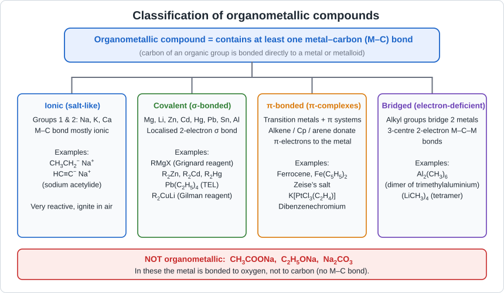

*Fig. 1 — Four classes: ionic, covalent σ-bonded, π-bonded and bridged. Metal–oxygen salts such as CH3COONa or C2H5ONa are **not** organometallic.*

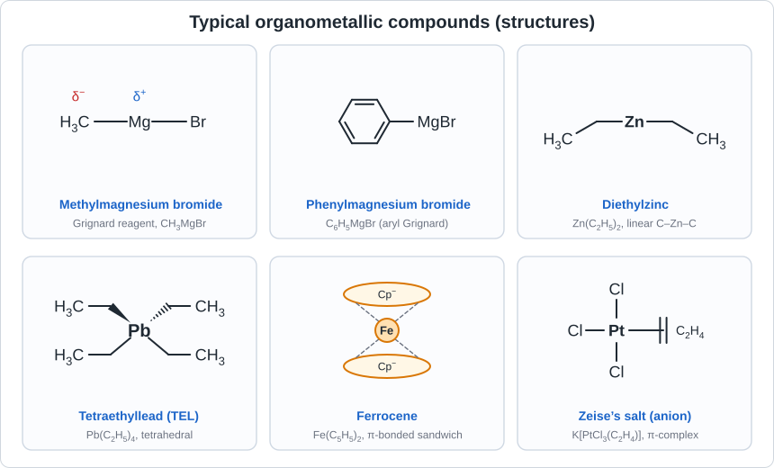

*Fig. 2 — Structures of CH3MgBr, C6H5MgBr, Zn(C2H5)2, Pb(C2H5)4, ferrocene and Zeise's salt.*

### Extra — classification, preparation and uses

| Class | Metals | Nature of M–C bond | Example |
| --- | --- | --- | --- |
| Ionic | Na, K, Ca | mostly ionic, very reactive | C2H5− Na+, sodium acetylide |
| Covalent (σ) | Mg, Li, Zn, Cd, Hg, Pb, Sn, Al | localised 2-electron bond | RMgX, R2Zn, Pb(C2H5)4 |
| π-bonded | transition metals | π electrons of alkene/Cp/arene donated to metal | ferrocene, Zeise's salt |
| Bridged | Al, Li | 3-centre 2-electron bonds | Al2(CH3)6 |

**General methods of preparation**

1. Direct reaction of a metal with an alkyl/aryl halide: R–X + Mg → R–MgX; R–X + 2 Li → R–Li + LiX
2. Transmetallation (from a more reactive organometallic): 2 RMgX + ZnCl2 → R2Zn + 2 MgXCl
3. Metal–alloy method: 4 C2H5Cl + 4 NaPb → Pb(C2H5)4 + 3 Pb + 4 NaCl

**Uses:** synthesis of alcohols, acids and ketones (Grignard); antiknock additive (TEL); Ziegler–Natta catalysts (Al(C2H5)3 + TiCl4) for polyethylene and polypropylene; organotin biocides and PVC stabilisers; ferrocene derivatives as fuel additives and catalysts.

---

## 2. Grignard reagent — definition, structure and preparation (2022 Q3a · 2023 Q2a · 2023 Q2b)

### 2(a) What is a Grignard reagent? (2022 Q3a · 2023 Q2a)

**Ans.** A **Grignard reagent (GR)** is an alkyl- or arylmagnesium halide, **R–Mg–X** (X = Cl, Br, I), prepared by the action of magnesium metal on an alkyl or aryl halide in **dry (anhydrous) ether**. It was discovered by **Victor Grignard** (1900; Nobel Prize in Chemistry, 1912).

**Examples**

- CH3MgI — methylmagnesium iodide
- C2H5MgBr — ethylmagnesium bromide
- C6H5MgBr — phenylmagnesium bromide

**Nature of the C–Mg bond.** Carbon (EN 2.55) is more electronegative than magnesium (EN 1.31), so the bond is polar: **Cδ−–Mgδ+**. The carbon behaves like a **carbanion** and the reagent acts as a strong nucleophile and a strong base.

**Structure in solution.** The Mg atom is solvated by two ether molecules (dative bonds from the oxygen lone pairs), giving a four-coordinate Mg. In ether an equilibrium exists (the **Schlenk equilibrium**): 2 RMgX ⇌ R2Mg + MgX2.

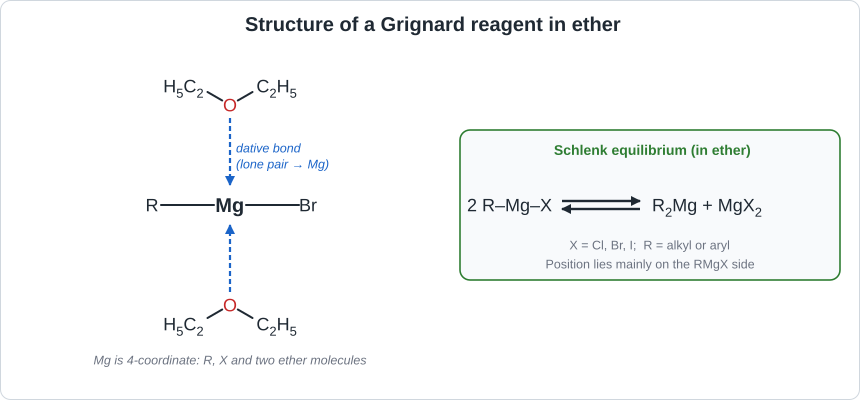

*Fig. 5 — Ether molecules stabilise the Grignard reagent by donating lone pairs to Mg.*

### 2(b) Preparation of a Grignard reagent (2023 Q2b)

**Ans.** Dry magnesium turnings are treated with an alkyl or aryl halide in **absolutely dry diethyl ether** (or THF). A small crystal of **iodine** is added to start the reaction (it cleans the Mg surface). The reaction is exothermic.

**General equation**

R–X + Mg → R–MgX  (dry ether)

**Examples**

- CH3I + Mg → CH3MgI
- C2H5Br + Mg → C2H5MgBr
- C6H5Br + Mg → C6H5MgBr

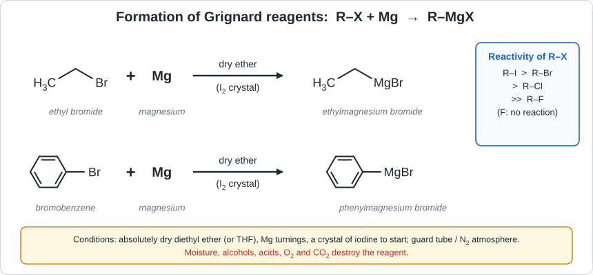

*Fig. 4 — Formation of an alkyl and an aryl Grignard reagent.*

**Apparatus.** Round-bottom flask (Mg + ether + I2), dropping funnel (R–X in ether), reflux condenser, CaCl2 guard tube.

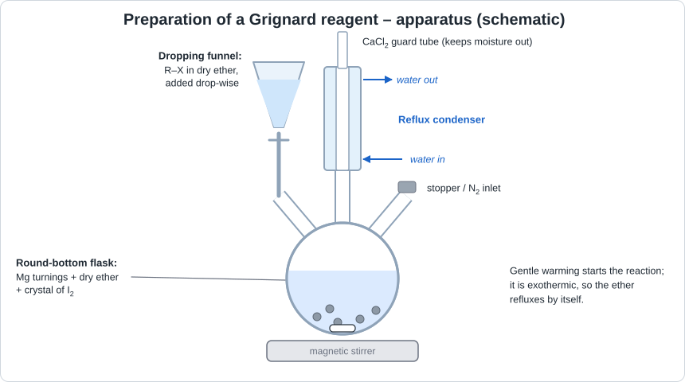

*Fig. 6 — Schematic apparatus. Moisture must be strictly excluded.*

**Why dry ether?**

1. Water destroys the reagent: RMgX + H2O → R–H + Mg(OH)X.
2. Ether is aprotic and its oxygen lone pairs solvate and stabilise RMgX (Fig. 5).
3. Ether is volatile, so it also protects the mixture by refluxing (its vapour keeps air out).

### Extra — precautions, reactivity of R–X and side reactions

- **Reactivity of halides:** R–I > R–Br > R–Cl >> R–F (fluorides do not react).
- **Side reaction (Wurtz-type coupling):** RMgX + R–X → R–R + MgX2. It is reduced by slow addition of R–X.
- **Destroyed by:** water, alcohols, acids, NH3, terminal alkynes, O2, CO2.
- **Active-hydrogen (Zerewitinoff) determination:** CH3MgI + H–Y → CH4 + Mg(Y)I; the volume of methane measures the number of active H atoms.

| Compound with active H | Reaction with CH3MgI |
| --- | --- |
| Water | CH3MgI + H2O → CH4 + Mg(OH)I |
| Ethanol | CH3MgI + C2H5OH → CH4 + Mg(OC2H5)I |
| Ammonia | CH3MgI + NH3 → CH4 + Mg(NH2)I |
| Acetylene | CH3MgI + HC≡CH → CH4 + HC≡CMgI |

---

## 3. Organometallic compounds obtained from Grignard reagents (2022 Q3b)

### Answer

Grignard reagents are converted into other organometallic compounds by reaction with **halides of less electropositive metals/metalloids** (transmetallation). The R group goes to the metal and magnesium ends up as MgXCl.

| Metal halide | Equation | Product |
| --- | --- | --- |
| ZnCl2 | 2 RMgX + ZnCl2 → R2Zn + 2 MgXCl | dialkylzinc |
| CdCl2 | 2 RMgX + CdCl2 → R2Cd + 2 MgXCl | dialkylcadmium |
| HgCl2 | 2 RMgX + HgCl2 → R2Hg + 2 MgXCl | dialkylmercury |
| PbCl2 | 4 RMgCl + 2 PbCl2 → R4Pb + Pb + 4 MgCl2 | tetraalkyllead (TEL if R = C2H5) |
| SnCl4 | 4 RMgX + SnCl4 → R4Sn + 4 MgXCl | tetraalkyltin |
| AlCl3 | 3 RMgX + AlCl3 → R3Al + 3 MgXCl | trialkylaluminium |
| PCl3 | 3 RMgX + PCl3 → R3P + 3 MgXCl | trialkylphosphine |
| SiCl4 | 4 RMgX + SiCl4 → R4Si + 4 MgXCl | tetraalkylsilane |

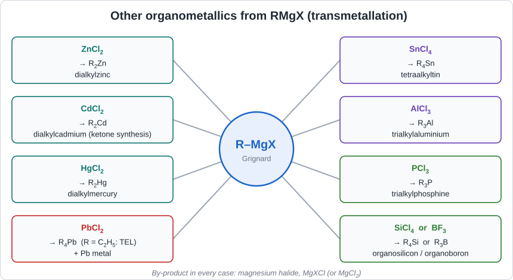

*Fig. 12 — Transmetallation map.*

**Worked examples (write these two in the exam)**

1. Tetraethyllead: 4 C2H5MgCl + 2 PbCl2 → Pb(C2H5)4 + Pb + 4 MgCl2
2. Diethylzinc: 2 C2H5MgBr + ZnCl2 → Zn(C2H5)2 + 2 MgBrCl

**Extra — why these products matter:** R2Cd reacts with acid chlorides to give ketones without attacking the ketone formed: 2 CH3COCl + (CH3)2Cd → 2 CH3COCH3 + CdCl2. A Grignard reagent would go on to a tertiary alcohol.

---

## 4. Preparation of 1°, 2° and 3° alcohols from RMgX (2020 Q1b)

### Answer

Grignard reagents add to the carbonyl group (C=O). The carbon of Rδ− attacks the electrophilic carbonyl carbon, giving a magnesium alkoxide, which is hydrolysed by dilute acid to the alcohol. The class of alcohol depends on the carbonyl compound.

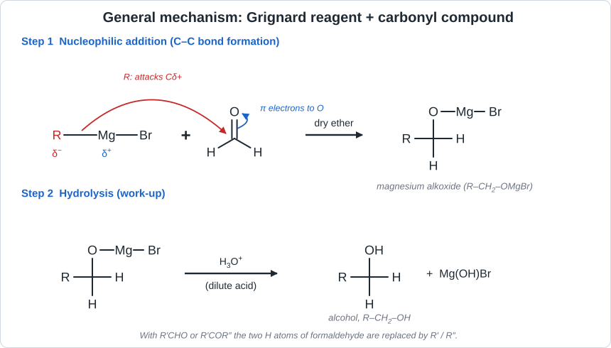

*Fig. 7 — Step 1: nucleophilic addition. Step 2: hydrolysis.*

**General scheme**

R–MgX + >C=O → >C(R)–OMgX → >C(R)–OH + Mg(OH)X

| Alcohol | Carbonyl compound | Product |
| --- | --- | --- |
| **Primary (1°)** | formaldehyde, HCHO; or ethylene oxide | R–CH2OH; R–CH2CH2OH |
| **Secondary (2°)** | any other aldehyde, R′CHO; or formate ester + 2 RMgX | R–CH(OH)–R′; R2CHOH |
| **Tertiary (3°)** | ketone, R′COR″; or ester / acid chloride + 2 RMgX | R–C(OH)R′R″; R2R′C–OH |

### (i) Primary alcohols

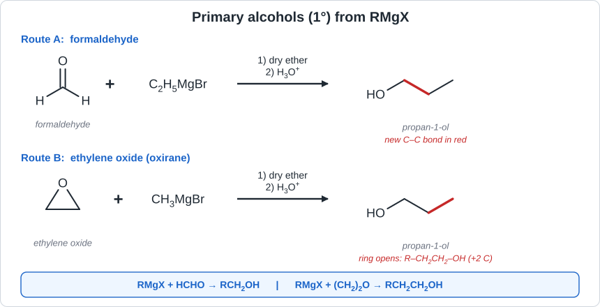

*Fig. 8 — Formaldehyde and ethylene oxide routes (both give propan-1-ol here; the new C–C bond is red).*

- CH3MgBr + HCHO → CH3CH2OMgBr → CH3CH2OH (**ethanol**)
- C2H5MgBr + HCHO → CH3CH2CH2OH (**propan-1-ol**)
- CH3CH2MgBr + (CH2)2O → CH3CH2CH2CH2OH (**butan-1-ol**, two carbons added)

### (ii) Secondary alcohols

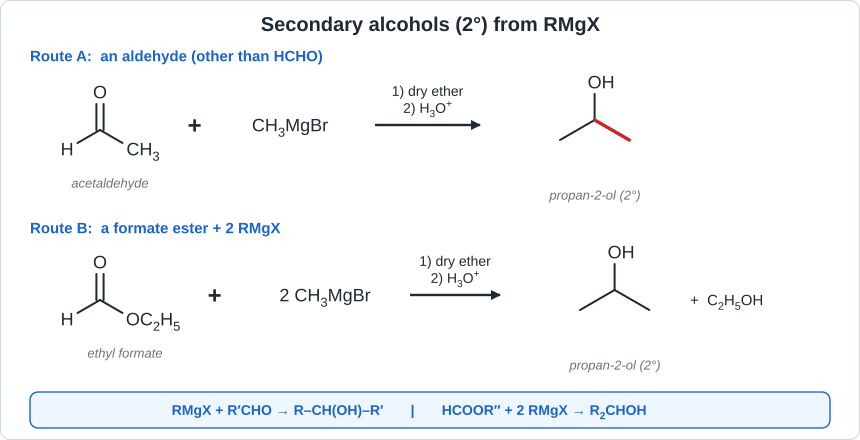

*Fig. 9 — Aldehyde route and formate-ester route.*

- CH3MgI + CH3CHO → (CH3)2CHOMgI → (CH3)2CHOH (**propan-2-ol**)
- C2H5MgBr + CH3CHO → CH3CH(OH)CH2CH3 (**butan-2-ol**)
- CH3MgI + C6H5CHO → C6H5CH(OH)CH3 (**1-phenylethanol**)
- HCOOC2H5 + 2 CH3MgI → (CH3)2CHOH + C2H5OH (after hydrolysis)

### (iii) Tertiary alcohols

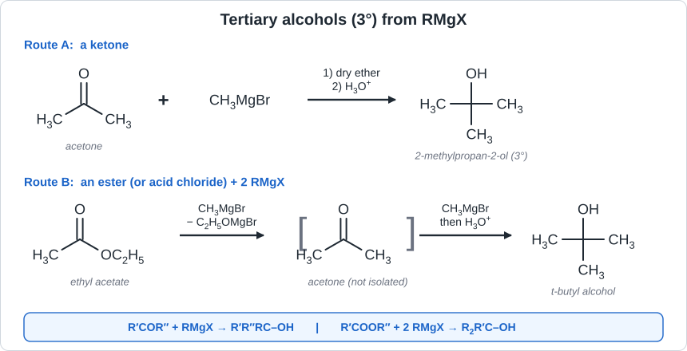

*Fig. 10 — Ketone route and ester route (the ketone formed in situ reacts with a second RMgX).*

- CH3MgI + CH3COCH3 → (CH3)3COMgI → (CH3)3COH (**2-methylpropan-2-ol**)
- CH3COOC2H5 + 2 CH3MgI → (CH3)3COH + C2H5OMgI (after hydrolysis)

### Extra — decision chart and memory aid

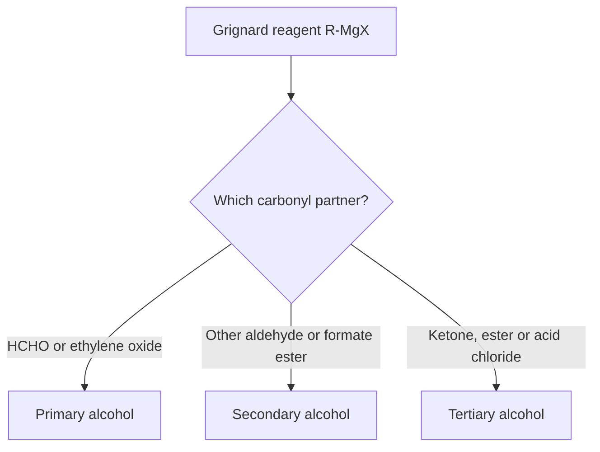

**Memory aid:** *Formaldehyde = First (1°); aldehyde = second (2°); ketone = third (3°).*

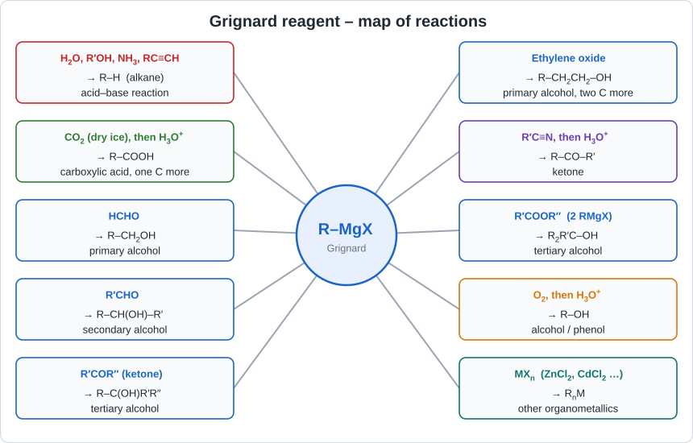

*Fig. 11 — One-page map of what a Grignard reagent can do.*

---

## 5. Reactivity of organometallic compounds (2020 Q1c)

### Answer

The reactivity of an organometallic compound is governed by the **polarity of its C–M bond**, which depends on the electronegativity difference between carbon and the metal.

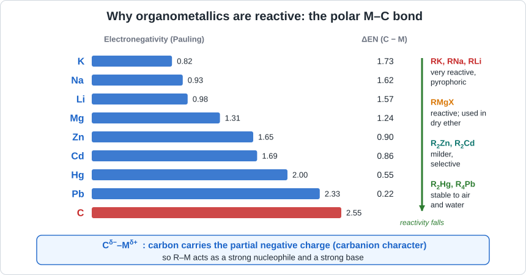

*Fig. 3 — The larger ΔEN (C − M), the more ionic the C–M bond, the more carbanion-like the carbon, and the higher the reactivity.*

**Main points**

1. **More electropositive metal → more ionic bond → more reactive.** Order: R–K > R–Na > R–Li > R–MgX > R2Zn > R2Cd > R2Hg > R4Pb.
2. Carbon carries the partial negative charge, so R–M is a **strong nucleophile** and a **strong base**.
3. Low-valent, highly polar compounds (RNa, RK, RLi) ignite in air and react violently with water; R2Hg and R4Pb are stable to air and water.
4. Reactivity also depends on solvent coordination (ether stabilises RMgX) and steric factors.

| Reagent | C–M character | Behaviour with water / air | Typical use |
| --- | --- | --- | --- |
| RK, RNa | highly ionic | violent, ignite in air | rarely used (very reactive) |
| RLi | very polar | violent; often pyrophoric | strong base, alkylation |
| RMgX | polar covalent | decomposed by water; slowly oxidised by O2 | alcohols, acids, ketones |
| R2Zn | less polar | reacts with water; Et2Zn ignites in air | Reformatsky-type reactions |
| R2Cd | mildly polar | milder than RMgX | ketones from acid chlorides |
| R2Hg | nearly covalent | stable to water and air | transmetallation; very toxic |
| R4Pb | nearly covalent | stable at room temperature | TEL (antiknock) |

**Typical reactions of RMgX (examples of its reactivity)**

| Reaction | Equation |
| --- | --- |
| With water / active H (as a base) | RMgX + H2O → R–H + Mg(OH)X |
| With CO2 (carboxylation) | RMgX + CO2 → RCOOMgX → RCOOH (acid with one more C) |
| With carbonyl compounds | see Section 4 |
| With nitriles | RMgX + R′C≡N → R–C(=NMgX)R′ → R–CO–R′ (ketone) |
| With oxygen | 2 RMgX + O2 → 2 ROMgX → ROH |
| With metal halides | see Section 3 |
| With alkyl halide (coupling) | RMgX + R′X → R–R′ + MgX2 |

**Extra — Gilman reagents.** Lithium dialkylcuprates, R2CuLi (from 2 RLi + CuI), are softer and less basic: they couple with alkyl halides (R2CuLi + R′X → R–R′) and give ketones with acid chlorides.

---

## 6. Tetraethyllead, TEL (2017 Q3d · 2020 Q1d · 2022 Q3c · 2023 Q4a)

### Answer

**What is TEL?** Tetraethyllead, **Pb(C2H5)4**, is an organolead compound: a colourless, oily, volatile liquid, insoluble in water but soluble in petrol. It is covalent and non-polar, with lead in the +4 state; the four Pb–C bonds are tetrahedrally arranged.

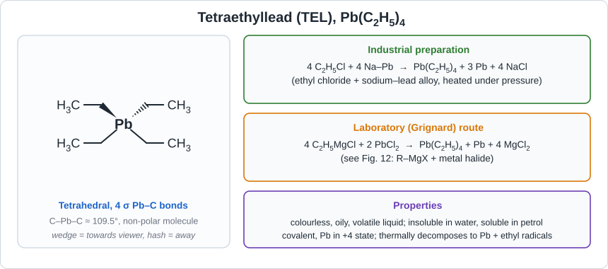

*Fig. 13 — Tetrahedral structure of TEL and its two preparations.*

**Preparation**

- Industrial: 4 C2H5Cl + 4 Na–Pb (alloy) → Pb(C2H5)4 + 3 Pb + 4 NaCl
- Via Grignard reagent: 4 C2H5MgCl + 2 PbCl2 → Pb(C2H5)4 + Pb + 4 MgCl2

**Role in automobile engines (antiknock agent) — 2022 Q3c**

1. **Knocking** is the premature auto-ignition of the fuel–air mixture in a petrol engine through free-radical chain branching. It causes a metallic "ping" and engine damage.
2. TEL is mixed with petrol (about a few mL per litre in leaded petrol). At engine temperature it decomposes: Pb(C2H5)4 → Pb + 4 C2H5•
3. Lead is oxidised to fine particles of **PbO**: 2 Pb + O2 → 2 PbO.
4. These particles **trap the chain-carrying radicals** (•OH, •H, RO•) and break the chain, so combustion is smooth and controlled.
5. The **octane number** of the fuel rises (iso-octane = 100, n-heptane = 0).

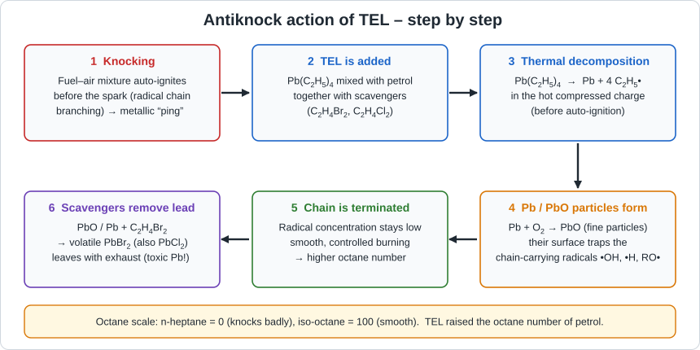

*Fig. 14 — Six-step mechanism of antiknock action.*

**Scavengers.** Left alone, PbO would foul the cylinder and spark plugs. So **1,2-dibromoethane** (C2H4Br2) and **1,2-dichloroethane** (C2H4Cl2) are added: they convert lead into volatile **PbBr2 / PbCl2**, which leaves with the exhaust.

**Disadvantages and present status**

- Lead compounds in exhaust are toxic (neurotoxic, especially to children) and pollute air and soil.
- Lead poisons the catalyst of catalytic converters, so cars with converters need unleaded petrol.
- Leaded petrol has been phased out worldwide (the UN Environment Programme announced its end in 2021). Octane is now raised by iso-octane/alkylate, reformate, ethanol and ethers such as MTBE.

**Extra — one-line summary for a "short note":** *TEL, Pb(C2H5)4, made from ethyl chloride and sodium–lead alloy, was added with ethylene dibromide to petrol to prevent knocking by removing chain-carrying radicals; it was abandoned because of lead toxicity.*

---

## 7. Coupling reaction and Gattermann reaction (2018 Q6b)

In the syllabus "coupling reaction" covers (A) reactions that join two organic groups into a new C–C bond with the help of a metal, and (B) azo coupling of diazonium salts. Both are given below.

### (i) Coupling reactions

**Definition.** A coupling reaction joins two organic fragments to form a new bond (usually C–C) with the help of a metal.

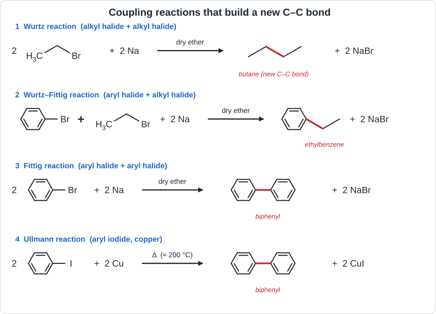

*Fig. 15 — The new C–C bond is drawn in red.*

| Reaction | Reactants | Equation |
| --- | --- | --- |
| **Wurtz** | 2 alkyl halides + Na, dry ether | 2 CH3CH2Br + 2 Na → CH3CH2CH2CH3 + 2 NaBr |
| **Wurtz–Fittig** | aryl halide + alkyl halide + Na | C6H5Br + C2H5Br + 2 Na → C6H5C2H5 + 2 NaBr |
| **Fittig** | 2 aryl halides + Na | 2 C6H5Br + 2 Na → C6H5–C6H5 + 2 NaBr |
| **Ullmann** | 2 aryl iodides + Cu, heat | 2 C6H5I + 2 Cu → C6H5–C6H5 + 2 CuI |

**Mechanism (Wurtz).** R–X + 2 Na → R–Na + NaX (organosodium formed); then R–Na + R–X → R–R + NaX.
**Limitations:** unsymmetrical Wurtz gives a mixture; tertiary halides give alkenes; methane cannot be made.

**Azo coupling.** A diazonium salt couples with an activated aromatic compound (phenol or aromatic amine), usually at the **para** position, to give an **azo compound** (Ar–N=N–Ar′), a coloured dye.

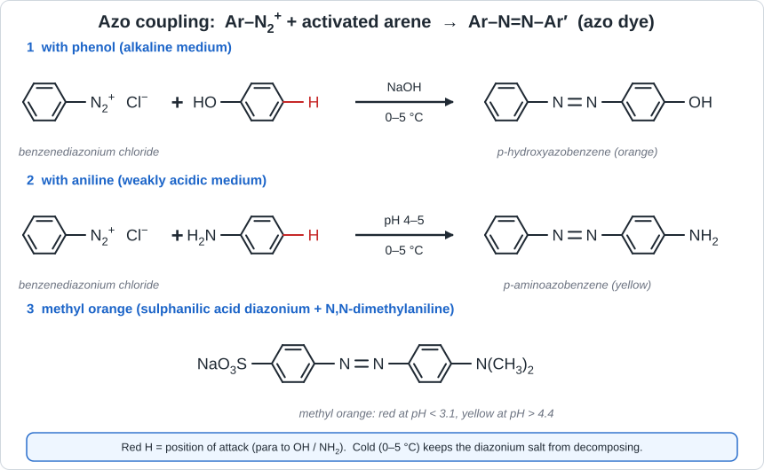

*Fig. 16 — Coupling with phenol (alkaline, pH about 9–10), with aniline (weakly acidic, pH 4–5), and methyl orange.*

- C6H5N2+Cl− + C6H5OH → HO–C6H4–N=N–C6H5 + HCl (p-hydroxyazobenzene, orange)
- C6H5N2+Cl− + C6H5NH2 → H2N–C6H4–N=N–C6H5 + HCl (p-aminoazobenzene, yellow)

### (ii) Gattermann reaction

**Definition.** The replacement of the diazonium group by Cl or Br using **copper powder and the corresponding halogen acid (HCl or HBr)**.

Ar–N2+X− → Ar–X + N2  (Cu powder / HX)

**Steps with equations**

1. Diazotisation: C6H5NH2 + NaNO2 + 2 HCl → C6H5N2+Cl− + NaCl + 2 H2O (0–5 °C)
2. C6H5N2+Cl− → C6H5Cl + N2↑  (Cu / HCl)
3. C6H5N2+Br− → C6H5Br + N2↑  (Cu / HBr)

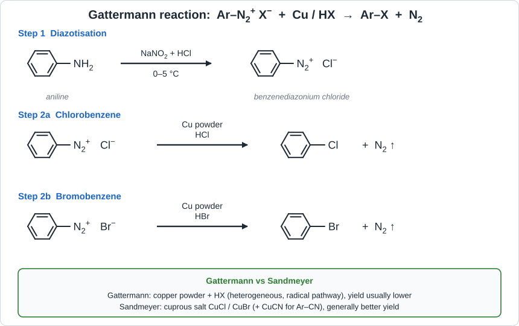

*Fig. 17 — Diazotisation, then Gattermann replacement.*

| Feature | Gattermann | Sandmeyer |
| --- | --- | --- |
| Reagent | Cu powder + HX | cuprous halide, CuCl / CuBr |
| Products | Ar–Cl, Ar–Br | Ar–Cl, Ar–Br (and Ar–CN with CuCN) |
| Yield | usually lower | usually better |

**Extra — Gattermann formylation (aldehyde synthesis).** Do not confuse it with the Gattermann reaction above.

- **Gattermann–Koch:** C6H6 + CO + HCl → C6H5CHO (anhydrous AlCl3 / CuCl)
- **Gattermann:** C6H6 + HCN + HCl → C6H5CH=NH·HCl → (H2O) → C6H5CHO. Zn(CN)2 + HCl also works for phenols; Gattermann–Koch does not work for phenols or phenol ethers.

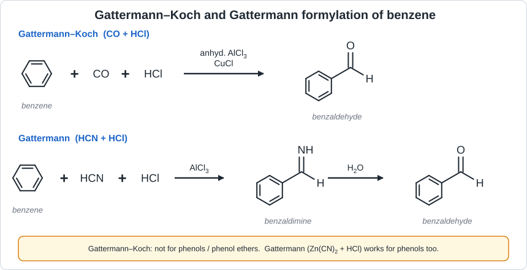

*Fig. 18 — Two routes from benzene to benzaldehyde.*

**Extra — modern coupling.** Palladium-catalysed couplings (Suzuki, Heck, Sonogashira) share the same idea and earned the 2010 Nobel Prize in Chemistry.

---

## 8. Reformatsky reaction (2019 Q1b · 2022 Q3d)

### Answer

**Definition.** The Reformatsky reaction is the condensation of an **α-halo ester** (usually α-bromo ester) with an **aldehyde or ketone** in the presence of **zinc** to give a **β-hydroxy ester**. It is named after Sergey Reformatsky (1887).

**General equation**

BrCH2COOC2H5 + R2C=O → (1) Zn, dry ether; (2) H3O+ → R2C(OH)–CH2COOC2H5

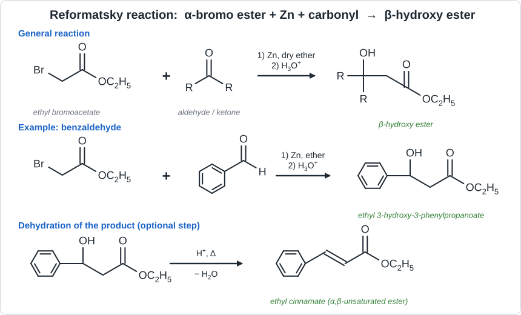

*Fig. 19 — General reaction, benzaldehyde example, and dehydration to ethyl cinnamate.*

**Mechanism**

1. Zinc inserts into the C–Br bond: BrCH2COOEt + Zn → BrZn–CH2COOEt (the **organozinc / Reformatsky reagent**, really a zinc enolate).
2. The carbonyl oxygen of the aldehyde/ketone coordinates to Zn, forming a **six-membered cyclic transition state**.
3. The nucleophilic carbon attacks the carbonyl carbon; a new C–C bond forms and a zinc alkoxide results.
4. Hydrolysis with dilute acid gives the β-hydroxy ester.

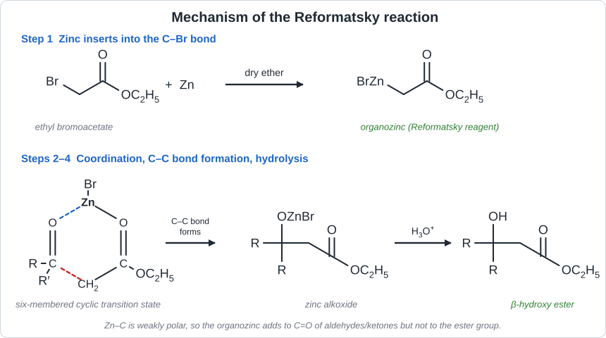

*Fig. 20 — Organozinc formation, six-membered transition state and work-up.*

**Examples**

- Acetone: BrCH2COOC2H5 + (CH3)2CO → (CH3)2C(OH)CH2COOC2H5 (ethyl 3-hydroxy-3-methylbutanoate)
- Benzaldehyde: gives ethyl 3-hydroxy-3-phenylpropanoate (Fig. 19)

### Extra — features and comparison

- **Dehydration:** heating the β-hydroxy ester with acid (or P2O5) removes water to give an **α,β-unsaturated ester**, e.g. ethyl cinnamate.
- **Why zinc and not magnesium?** The organozinc reagent is less reactive than a Grignard reagent, so it adds to the aldehyde/ketone but **does not attack the ester group** of another molecule.
- **Uses:** synthesis of β-hydroxy esters, α,β-unsaturated esters, and carbon chain extension.

| Feature | Reformatsky | Grignard |
| --- | --- | --- |
| Metal | Zn | Mg |
| Organometallic species | zinc enolate (BrZn–CH2COOR) | R–MgX |
| Reactivity | milder, tolerates ester | very reactive, attacks esters |
| Main product with C=O | β-hydroxy ester | alcohol |

---

## 9. Carboxylic acid derivatives and their preparation from acetic acid (2023 Q4b)

### Answer

**Carboxylic acid derivatives** are compounds obtained by replacing the –OH of a carboxylic acid by another group Z. They have the general formula **R–CO–Z** and give back the acid on hydrolysis.

| Derivative | Z | Example |
| --- | --- | --- |
| Acid chloride | –Cl | CH3COCl, acetyl chloride |
| Acid anhydride | –O–CO–R | (CH3CO)2O, acetic anhydride |
| Ester | –OR′ | CH3COOC2H5, ethyl acetate |
| Amide | –NH2, –NHR, –NR2 | CH3CONH2, acetamide |

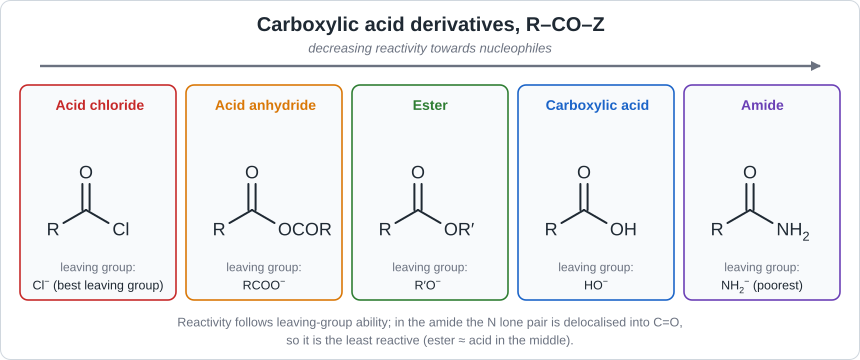

*Fig. 21 — Reactivity towards nucleophiles: acid chloride > anhydride > ester ≈ acid > amide.*

**Preparation from acetic acid**

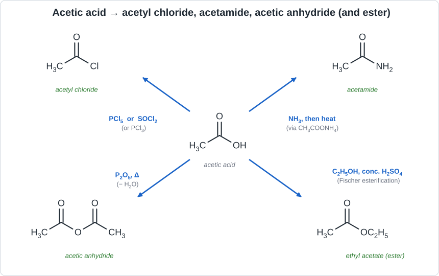

*Fig. 22 — Reagents for converting acetic acid into its derivatives.*

**(a) Acetyl chloride** — acetic acid is heated with PCl5, PCl3 or SOCl2:

- CH3COOH + PCl5 → CH3COCl + POCl3 + HCl
- 3 CH3COOH + PCl3 → 3 CH3COCl + H3PO3
- CH3COOH + SOCl2 → CH3COCl + SO2↑ + HCl↑ (best: by-products are gases)

**(b) Amides (acetamide)** — acetic acid is neutralised with ammonia to ammonium acetate, which is heated and loses water:

- CH3COOH + NH3 → CH3COONH4
- CH3COONH4 → (heat) CH3CONH2 + H2O

Through the acid chloride (cleaner, and gives substituted amides too):

- CH3COCl + 2 NH3 → CH3CONH2 + NH4Cl
- CH3COCl + 2 CH3NH2 → CH3CONHCH3 (N-methylacetamide) + CH3NH3Cl
- CH3COCl + 2 (CH3)2NH → CH3CON(CH3)2 (N,N-dimethylacetamide) + (CH3)2NH2Cl

**(c) Acetic anhydride**

- By dehydration: 2 CH3COOH → (P2O5, heat) (CH3CO)2O + H2O
- Laboratory method (acid chloride + sodium acetate): CH3COCl + CH3COONa → (CH3CO)2O + NaCl

**Extra — ester (Fischer esterification):** CH3COOH + C2H5OH ⇌ CH3COOC2H5 + H2O (conc. H2SO4, heat).

| Target | Reagent | By-products |
| --- | --- | --- |
| Acetyl chloride | SOCl2 (or PCl5, PCl3) | SO2, HCl (or POCl3, H3PO3) |
| Acetamide | NH3, then heat | water |
| Acetic anhydride | P2O5, heat (or CH3COCl + CH3COONa) | H3PO4 (or NaCl) |
| Ethyl acetate | C2H5OH, H2SO4 | water |

---

## 10. Acetic acid is stronger than propionic acid but weaker than monochloroacetic acid (2023 Q4c)

### Answer

Acid strength depends on the **stability of the carboxylate ion** formed on ionisation:

RCOOH + H2O ⇌ RCOO− + H3O+

The more the negative charge on RCOO− is dispersed or stabilised, the stronger the acid (the smaller the pKa).

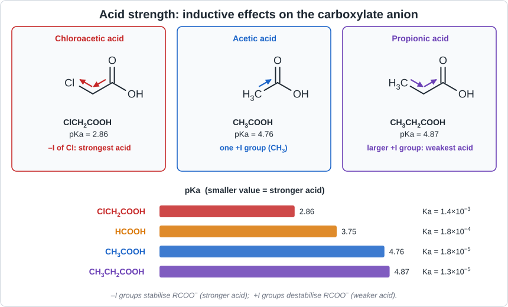

*Fig. 23 — Inductive arrows and pKa chart.*

**1. Acetic acid vs propionic acid (acetic is stronger).** The ethyl group of propionic acid has a **greater +I (electron-releasing) effect** than the methyl group of acetic acid. It pushes more electron density towards the carboxyl group and destabilises the carboxylate ion, so propionic acid ionises less (pKa 4.87 vs 4.76).

**2. Acetic acid vs monochloroacetic acid (chloroacetic is stronger).** Chlorine has a strong **–I (electron-withdrawing) effect**. It pulls electron density away from the carboxylate and spreads out its negative charge, so ClCH2COO− is more stable than CH3COO− (pKa 2.86 vs 4.76).

**Conclusion:** ClCH2COOH (pKa 2.86) > CH3COOH (4.76) > CH3CH2COOH (4.87) in acid strength.

| Acid | Formula | pKa | Ka |
| --- | --- | --- | --- |
| Trichloroacetic | CCl3COOH | 0.65 | very large |
| Dichloroacetic | CHCl2COOH | 1.29 | 5.1 × 10−2 |
| Monochloroacetic | ClCH2COOH | 2.86 | 1.4 × 10−3 |
| Formic | HCOOH | 3.75 | 1.8 × 10−4 |
| Acetic | CH3COOH | 4.76 | 1.8 × 10−5 |
| Propionic | CH3CH2COOH | 4.87 | 1.3 × 10−5 |

### Extra — more Cl and distance effects

- **Number of Cl atoms:** acid strength rises with each Cl: CH3COOH < ClCH2COOH < Cl2CHCOOH < Cl3CCOOH.
- **Distance:** the –I effect falls off quickly along the chain:

| Acid | pKa |
| --- | --- |
| CH3CH2CH(Cl)COOH (2-chlorobutanoic) | 2.86 |
| CH3CH(Cl)CH2COOH (3-chlorobutanoic) | 4.05 |
| ClCH2CH2CH2COOH (4-chlorobutanoic) | 4.52 |
| CH3CH2CH2COOH (butanoic) | 4.82 |

- Formic acid is stronger than acetic acid because it has no +I alkyl group.

---

## 11. Hofmann degradation and Curtius degradation (2023 Q4d)

Both reactions convert a carboxylic acid derivative into a **primary amine with one carbon atom less**, and both go through an **isocyanate (R–N=C=O)** intermediate.

### (i) Hofmann bromamide degradation

**Definition.** A primary amide on treatment with bromine and aqueous NaOH (or NaOBr) gives a primary amine with one carbon atom less than the amide.

RCONH2 + Br2 + 4 NaOH → RNH2 + Na2CO3 + 2 NaBr + 2 H2O

**Examples**

- CH3CONH2 (acetamide) → CH3NH2 (methylamine)
- C6H5CONH2 (benzamide) → C6H5NH2 (aniline)

**Mechanism**

1. Br2 + 2 NaOH → NaOBr + NaBr + H2O
2. RCONH2 + NaOBr → RCONHBr + NaOH (N-bromoamide)
3. RCONHBr + OH− → RCON−Br + H2O (bromoamide anion)
4. The anion rearranges: **R migrates from C to N** as Br− leaves → R–N=C=O (isocyanate)
5. R–N=C=O + H2O → R–NH–COOH (carbamic acid)
6. R–NH–COOH → R–NH2 + CO2; the CO2 is absorbed by NaOH to give Na2CO3

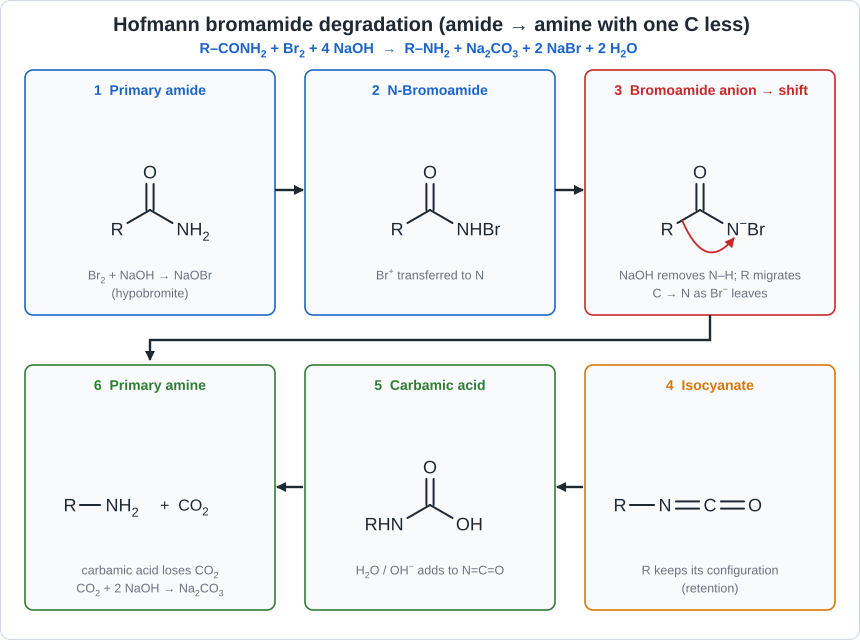

*Fig. 24 — Six steps from amide to amine (R keeps its configuration).*

### (ii) Curtius degradation (rearrangement)

**Definition.** An acyl azide, on heating, loses nitrogen and rearranges to an isocyanate, which is hydrolysed to a primary amine with one carbon atom less.

**Steps**

1. RCOCl + NaN3 → RCON3 + NaCl (acyl azide)
2. RCON3 → (heat) R–N=C=O + N2↑
3. R–N=C=O + H2O → [RNHCOOH] → RNH2 + CO2

**Example:** C6H5COCl → C6H5CON3 → C6H5NCO → C6H5NH2 (aniline)

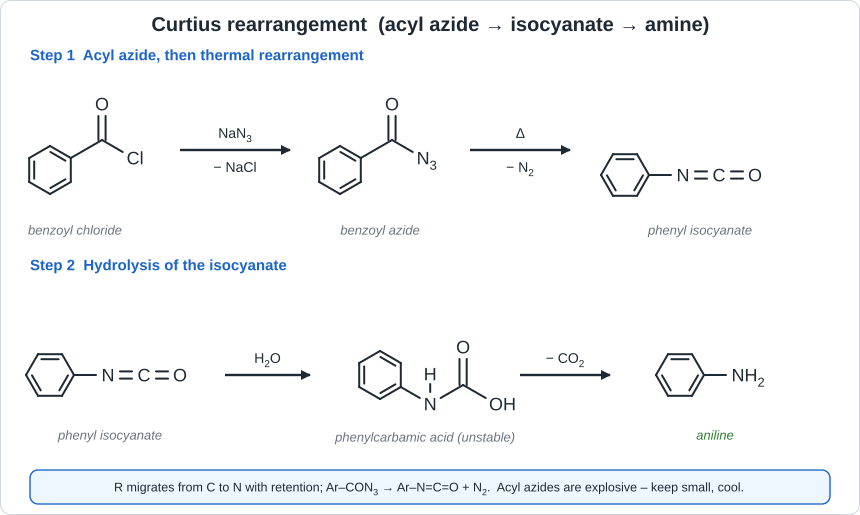

*Fig. 25 — Benzoyl chloride to aniline via the acyl azide and isocyanate.*

### Extra — comparison and cautions

| Feature | Hofmann | Curtius |
| --- | --- | --- |
| Starting material | primary amide | acyl azide (from acid chloride) |
| Reagents | Br2 + NaOH | NaN3, then heat, then H2O |
| Medium | strongly basic, aqueous | neutral, often anhydrous |
| Isocyanate isolable? | no (hydrolysed at once) | yes, if water is excluded |
| Carbon change | −1 C | −1 C |
| Migration | R shifts C → N, retention | R shifts C → N, retention |

- **Do not confuse** Hofmann *bromamide degradation* with Hofmann *elimination* (exhaustive methylation of amines to alkenes).
- In the Curtius route the isocyanate can be trapped: with an alcohol it gives a carbamate (R–NH–COOR′), with an amine a urea. Acyl azides are explosive: handle small amounts, cold.
- Related: the **Lossen** and **Schmidt** reactions also pass through an isocyanate.

---

## 12. Extra: revision toolkit

### 12.1 One-page reaction sheet

| Reaction | Reagents | Product |
| --- | --- | --- |
| Grignard formation | R–X + Mg, dry ether | R–MgX |
| RMgX + water | H2O | R–H |
| RMgX + CO2 | CO2, then H3O+ | R–COOH |
| RMgX + HCHO | then H3O+ | 1° alcohol |
| RMgX + R′CHO | then H3O+ | 2° alcohol |
| RMgX + R′COR″ | then H3O+ | 3° alcohol |
| RMgX + ethylene oxide | then H3O+ | R–CH2CH2OH |
| RMgX + PbCl2 | – | R4Pb (TEL if R = Et) |
| Reformatsky | BrCH2COOEt, Zn, C=O | β-hydroxy ester |
| Wurtz | 2 R–X + 2 Na | R–R |
| Gattermann | ArN2+X− + Cu / HX | Ar–X |
| Hofmann | RCONH2, Br2, NaOH | RNH2 (−1 C) |
| Curtius | RCON3, heat, H2O | RNH2 (−1 C) |

### 12.2 Common mistakes

1. Writing **water or alcohol** as the solvent for a Grignard reaction — it must be dry ether.
2. Calling CH3COONa or C2H5ONa organometallic — there is no M–C bond.
3. Forgetting that **esters need two** equivalents of RMgX and give 3° alcohols (formates give 2°).
4. Mixing up the **Gattermann reaction** (Cu, diazonium) with **Gattermann–Koch** (CO + HCl, benzaldehyde).
5. Saying TEL "removes lead": TEL *contains* lead; the **scavengers** carry lead out as PbBr2.
6. Forgetting the **one-carbon loss** in Hofmann and Curtius.
7. Explaining acid strength with "more carbons = more acidic": it is the **+I effect** that makes propionic weaker.

### 12.3 Textile-engineering connections

- **Azo coupling** is the chemistry behind azo dyes, the largest dye class (roughly 60–70 % of commercial dyes) used for cotton, wool, silk and polyester.
- **Ziegler–Natta catalysts** (organoaluminium + TiCl4) make the polypropylene and polyethylene used for synthetic fibres and non-wovens.
- **Acetic anhydride** is used to make **cellulose acetate** fibre (acetate rayon).
- **Amides**: the –CONH– link is the repeating unit of nylon and of wool and silk proteins.

### 12.4 Self-test (try first, then open the answers)

1. Define organometallic compounds and give two examples.
2. Why must a Grignard reagent be prepared in dry ether?
3. Write the product of CH3MgBr with (a) HCHO, (b) CH3CHO, (c) acetone.
4. Give the role of 1,2-dibromoethane in leaded petrol.
5. State two differences between Reformatsky and Grignard reagents.
6. Convert benzamide into aniline (name the reaction and reagents).
7. Arrange in increasing acidity: CH3CH2COOH, ClCH2COOH, CH3COOH.
8. What is the difference between the Gattermann and Sandmeyer reactions?

Answers

1. Compounds with at least one direct metal–carbon bond, e.g. CH3MgBr and Pb(C2H5)4.
2. Water (or any protic compound) destroys RMgX to give R–H; ether is aprotic and stabilises Mg by coordination.
3. (a) CH3CH2OH; (b) (CH3)2CHOH; (c) (CH3)3COH.
4. It is a scavenger: it converts lead/lead oxide into volatile PbBr2, which leaves with the exhaust.
5. Reformatsky uses Zn and an α-bromo ester, is milder and does not attack the ester group, and gives β-hydroxy esters; Grignard uses Mg, is far more reactive, and gives alcohols.
6. Hofmann bromamide degradation: Br2 + NaOH, heat; C6H5CONH2 → C6H5NH2.
7. CH3CH2COOH < CH3COOH < ClCH2COOH.
8. Gattermann uses copper powder + HX; Sandmeyer uses the cuprous halide (CuX); Sandmeyer generally gives better yields.

### 12.5 Glossary

| Term | Meaning |
| --- | --- |
| Carbanion | species with a negatively charged carbon, R− |
| Nucleophile | electron-pair donor that attacks an electron-poor centre |
| Transmetallation | transfer of an organic group from one metal to another |
| Antiknock agent | additive that raises the octane number of petrol |
| Octane number | percentage of iso-octane in an iso-octane / n-heptane mixture matching the fuel's knock resistance |
| Scavenger | additive that converts lead into a volatile compound |
| Inductive effect | permanent polarisation of σ bonds through a chain (+I donates, −I withdraws) |
| Isocyanate | R–N=C=O, the key intermediate of the Hofmann and Curtius reactions |

### 12.6 Figure index

All figures are SVG files in `../../assets/` and begin with `chem-103-orgmet-`.

| Fig. | File suffix | Shows |
| --- | --- | --- |
| 1 | `fig01-classification` | classes of organometallic compounds |
| 2 | `fig02-examples` | structures of typical examples |
| 3 | `fig03-polarity-reactivity` | electronegativity chart and reactivity |
| 4 | `fig04-grignard-formation` | Grignard formation |
| 5 | `fig05-grignard-solvation-schlenk` | solvation and Schlenk equilibrium |
| 6 | `fig06-apparatus` | apparatus |
| 7 | `fig07-mechanism-general` | Grignard + carbonyl mechanism |
| 8 | `fig08-primary-alcohol` | 1° alcohols |
| 9 | `fig09-secondary-alcohol` | 2° alcohols |
| 10 | `fig10-tertiary-alcohol` | 3° alcohols |
| 11 | `fig11-grignard-hub` | map of Grignard reactions |
| 12 | `fig12-org-from-grignard` | other organometallics from RMgX |
| 13 | `fig13-tel-structure-prep` | TEL structure and preparation |
| 14 | `fig14-tel-antiknock-flow` | antiknock mechanism |
| 15 | `fig15-coupling-wurtz-fittig` | Wurtz, Wurtz–Fittig, Fittig, Ullmann |
| 16 | `fig16-azo-coupling` | azo coupling |
| 17 | `fig17-gattermann` | Gattermann reaction |
| 18 | `fig18-gattermann-formylation` | Gattermann–Koch / Gattermann |
| 19 | `fig19-reformatsky-reaction` | Reformatsky reaction |
| 20 | `fig20-reformatsky-mechanism` | Reformatsky mechanism |
| 21 | `fig21-acid-derivatives` | acid derivatives, reactivity |
| 22 | `fig22-acetic-acid-derivatives` | acetic acid conversions |
| 23 | `fig23-acidity-inductive` | acid strength |
| 24 | `fig24-hofmann-mechanism` | Hofmann mechanism |
| 25 | `fig25-curtius` | Curtius rearrangement |
