# CHEM-103 &middot; Chapter 2: Organometallic Compounds

### Grignard Reagents and Tetraethyl Lead (TEL)

> **Question 1.** What are Grignard reagents and TEL (tetraethyl lead)? Explain the methods of preparation and the uses of Grignard reagents and TEL.

| Course | Chapter | Topic | Format |
|---|---|---|---|
| Chemistry-II (CHEM-103) | 2 - Organometallic compounds | Grignard reagents and TEL | Exam-style answer + extra revision sections |

## Table of contents

- [1. Quick answer (exam summary)](#1-quick-answer-exam-summary)
- [2. Introduction: organometallic compounds](#2-introduction-organometallic-compounds)
- [3. Part A - Grignard reagents](#3-part-a---grignard-reagents)
- [4. Part B - Tetraethyl lead (TEL)](#4-part-b---tetraethyl-lead-tel)
- [5. Extra work: comparison, revision and practice](#5-extra-work-comparison-revision-and-practice)
- [6. One-page revision table](#6-one-page-revision-table)

---

## 1. Quick answer (exam summary)

> **Grignard reagent** - an organomagnesium halide, **R-Mg-X** (R = alkyl or aryl, X = Cl, Br, I), made by reacting an organic halide with magnesium metal in **dry ether**. The C-Mg bond is strongly polar (C&delta;- Mg&delta;+), so R behaves as a carbanion: a powerful nucleophile and base. It is used to make **alcohols (1&deg;, 2&deg;, 3&deg;), carboxylic acids, ketones, aldehydes, alkanes** and other organometallic compounds.
>
> **TEL (tetraethyl lead), Pb(C2H5)4** - a covalent organolead compound, a colourless, oily, toxic liquid. It is prepared by heating **sodium-lead alloy with ethyl chloride** (or from PbCl2 and ethylmagnesium chloride). Its main use was as an **antiknock additive in petrol** (leaded petrol).

---

## 2. Introduction: organometallic compounds

An **organometallic compound** contains **at least one direct carbon-metal bond** (C-M). Compounds such as sodium ethanoate (C-O-Na) or metal alkoxides are *not* organometallic, because the metal is not bonded to carbon.

Classification by the nature of the C-M bond:

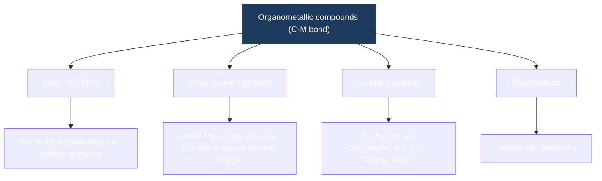

*Grignard reagents* belong to the **polar-covalent** class (the most useful in synthesis); *TEL* belongs to the **covalent** class.

---

## 3. Part A - Grignard reagents

### 3.1 Definition and history

- **Grignard reagents** are organomagnesium halides of general formula **R-Mg-X**.
- Discovered by the French chemist **Victor Grignard in 1900**; he received the **Nobel Prize in Chemistry in 1912** for it.
- They are almost never isolated: they are prepared in ether and used immediately as a solution.

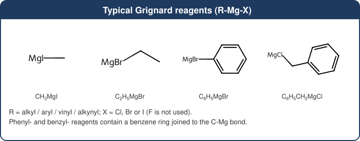

| Formula | Name |
|---|---|
| CH3MgI | methylmagnesium iodide |
| C2H5MgBr | ethylmagnesium bromide |
| C6H5MgBr | phenylmagnesium bromide |
| C6H5CH2MgCl | benzylmagnesium chloride |

### 3.2 Structure and bonding

- **Electronegativity:** C = 2.55, Mg = 1.31, so the **C-Mg bond is highly polar** with the negative end on carbon.
- Carbon therefore acts like a **carbanion (R-)**: it is a strong **nucleophile** (attacks &delta;+ carbons such as C=O) and a strong **base** (removes acidic H).
- In solution, Mg is **tetrahedral**: it is coordinated by **two ether molecules** through the lone pairs on oxygen. This solvation is why **ether is essential**.
- In solution the **Schlenk equilibrium** exists: 2 RMgX &#8652; R2Mg + MgX2.

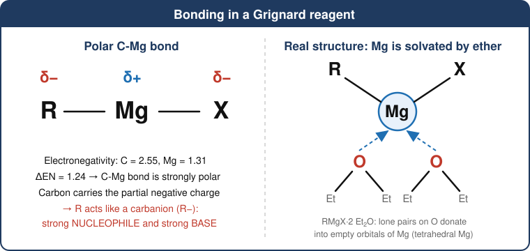

### 3.3 Preparation of Grignard reagents

#### (i) Laboratory method (the standard method)

**General reaction:** an alkyl or aryl halide reacts with magnesium turnings in **anhydrous (dry) diethyl ether** (or THF).

<b>R-X + Mg &rarr; R-Mg-X</b> &nbsp;&nbsp;(dry ether)

**Examples**

1. CH3CH2Br + Mg &rarr; CH3CH2MgBr &nbsp;(ethylmagnesium bromide)
2. C6H5Br + Mg &rarr; C6H5MgBr &nbsp;(phenylmagnesium bromide)
3. CH3I + Mg &rarr; CH3MgI &nbsp;(methylmagnesium iodide)

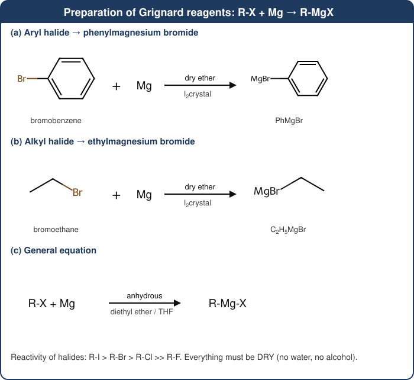

**Conditions and key points**

| Point | Explanation |
|---|---|
| Solvent | **Dry diethyl ether** (b.p. 35 &deg;C) or THF (b.p. 66 &deg;C). Ether is non-acidic, dissolves RMgX and **coordinates Mg**, stabilising the reagent. |
| Absence of water / air | Water, alcohols, O2 and CO2 destroy the reagent. Apparatus is oven-dried and fitted with a **CaCl2 guard tube**. |
| Initiation | Mg is coated with MgO. A **crystal of iodine** (or a little 1,2-dibromoethane, or crushing the Mg) exposes fresh metal. |
| Reactivity of R-X | R-I > R-Br > R-Cl >> R-F. Bromides are most common; **aryl chlorides need THF**. |
| Heat | The reaction is **exothermic**; the halide is added slowly (dropping funnel) with a reflux condenser. |
| Side reaction | **Wurtz-type coupling**: R-X + RMgX &rarr; R-R + MgX2. It is minimised by slow addition of R-X. |

**How it forms (mechanism in brief):** electrons are transferred from the surface of Mg to the C-X bond (single-electron transfer), giving the radical pair R&bull; and &bull;MgX that combine on the metal surface to give R-Mg-X.

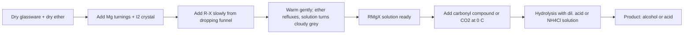

#### (ii) Other methods (for completeness)

- **Acid-base (metal-exchange) method:** a pre-formed Grignard removes the acidic H of a terminal alkyne:
  R'C&equiv;C-H + R-MgBr &rarr; R'C&equiv;C-MgBr + R-H *(see Use 4 below)*.
- **Halogen-magnesium exchange:** an alkyl Grignard exchanges halogen with an aryl or vinyl halide, useful for substrates that react poorly with Mg metal.

### 3.4 Properties in brief

- Not isolated: exists as a solution in ether; fuming and air-sensitive if the solvent is removed.
- Reacts violently with water: **R-MgX + H2O &rarr; R-H + Mg(OH)X**.
- Cannot be made from molecules that already contain acidic H (-OH, -NH2, -COOH, -C&equiv;C-H) or electrophilic groups (C=O, -CN, -NO2), since the reagent would destroy itself.

### 3.5 Uses of Grignard reagents

The key synthetic idea is **C-C bond formation**: the nucleophilic carbon of R-MgX attacks an electrophilic carbon, and a final hydrolysis step gives the neutral product.

#### Mechanism with a carbonyl compound

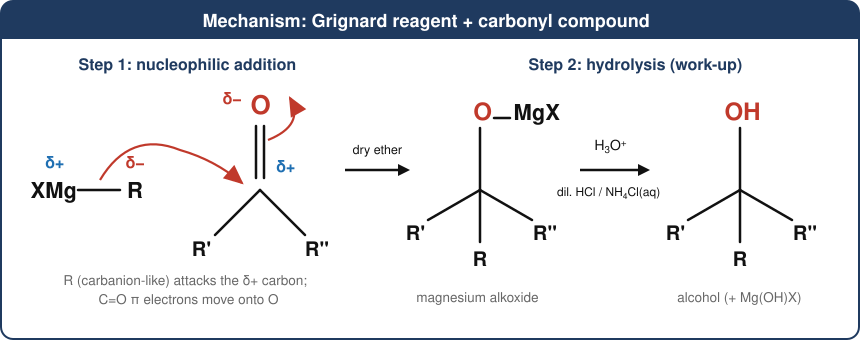

1. **Addition:** R attacks the &delta;+ carbonyl carbon; the C=O &pi; bond breaks and the oxygen becomes an alkoxide bonded to MgX.
2. **Hydrolysis:** dilute acid (or aqueous NH4Cl) protonates the alkoxide to give the alcohol.

#### Overview map

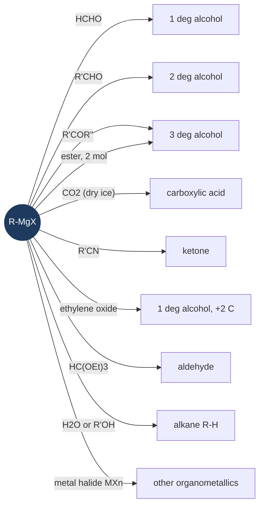

#### Use 1 - Synthesis of alcohols

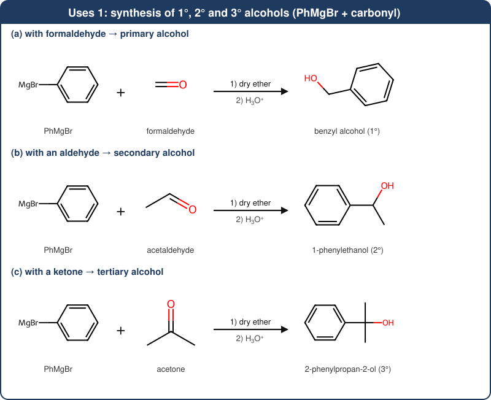

| Carbonyl partner | Class of alcohol | General equation | Example (R = CH3) |
|---|---|---|---|
| HCHO (formaldehyde) | **primary** | HCHO + RMgX &rarr; RCH2OMgX &rarr; **RCH2OH** | CH3CH2OH (ethanol) |
| R'CHO (any other aldehyde) | **secondary** | R'CHO + RMgX &rarr; R'CH(R)OMgX &rarr; **R'CH(R)OH** | CH3CHO &rarr; propan-2-ol |
| R'COR'' (ketone) | **tertiary** | R'COR'' + RMgX &rarr; R'R''C(R)OMgX &rarr; **R'R''C(R)OH** | acetone &rarr; 2-methylpropan-2-ol |
| Ester R'COOR'' (2 mol RMgX) | **tertiary** (two identical R) | R'COOR'' + 2 RMgX &rarr; **R'CR2OH** | ethyl acetate &rarr; 2-methylpropan-2-ol |
| Formate ester HCOOR'' (2 mol RMgX) | **secondary** (two identical R) | HCOOR'' + 2 RMgX &rarr; **R2CHOH** | ethyl formate + 2 CH3MgI &rarr; propan-2-ol |

#### Use 2 - Synthesis of carboxylic acids and of tertiary alcohols from esters

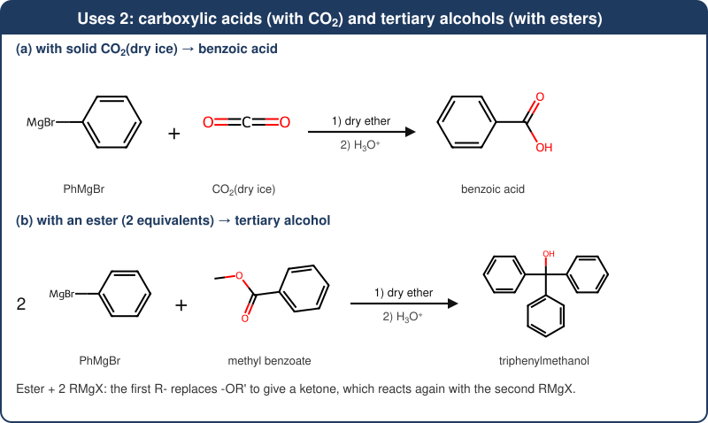

**Carboxylic acid:** R-MgX + O=C=O &rarr; R-COO-MgX &rarr; (H3O+) **R-COOH**. The acid has **one more carbon** than the starting halide.

#### Use 3 - Epoxides and nitriles

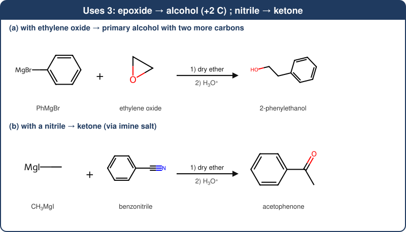

- **Ethylene oxide** gives a **primary alcohol with two extra carbons** (R-CH2CH2OH).
- **Nitrile:** R-MgX + R'-C&equiv;N &rarr; R'(R)C=N-MgX (imine salt) &rarr; (H3O+) **R'-CO-R** (ketone).

#### Use 4 - Alkanes and alkynyl reagents (acidic H compounds)

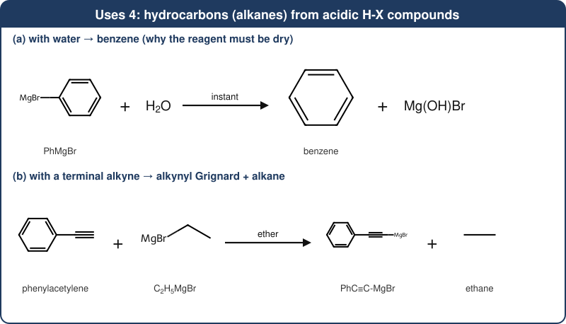

R-MgX + H-Y &rarr; R-H + Mg(Y)X, where H-Y = H2O, R'OH, R'NH2, R'COOH, R'C&equiv;CH. This is a **base** reaction: it makes an alkane, and is also why the reagent must be kept dry.

#### Use 5 - Aldehydes, and other organometallic compounds

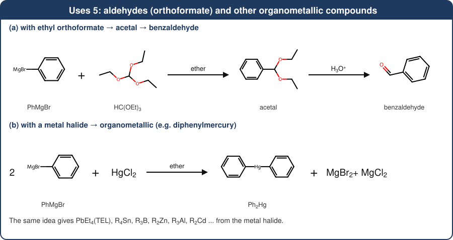

- **Aldehydes:** R-MgX + HC(OEt)3 &rarr; R-CH(OEt)2 &rarr; (H3O+) R-CHO.
- **Ketones from acid chlorides:** R-COCl + R'MgX &rarr; R-CO-R' (low temperature, 1 mol).
- **Other organometallic compounds:** n RMgX + MXn &rarr; RnM + n MgX2 (halides may be mixed). Examples: R2Hg, R4Sn, R3B, R2Zn and **TEL, Pb(C2H5)4** (see Part B).

#### Industrial and laboratory importance

- A standard tool for **building carbon skeletons** in the synthesis of drugs and fine chemicals (for example, a Grignard addition to a ketone is a classic step in the synthesis of the drug **tamoxifen**).
- Preparation of specific alcohols and acids that are hard to make otherwise.
- Preparation of a wide range of organometallic compounds.

---

## 4. Part B - Tetraethyl lead (TEL)

### 4.1 Definition and structure

**Tetraethyl lead (TEL)** is the **organolead compound Pb(C2H5)4**: one Pb(IV) atom bonded covalently to **four ethyl groups** in a **tetrahedral** arrangement.

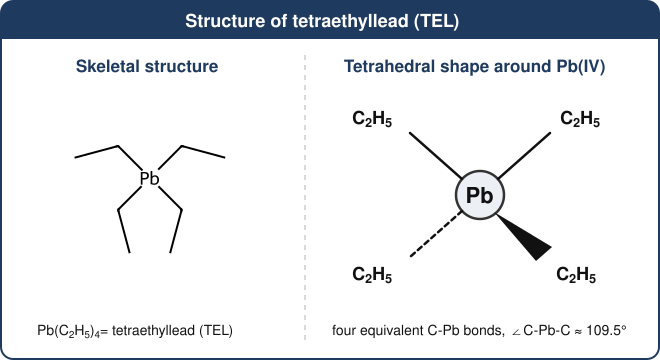

| Property | Value |
|---|---|
| Formula / molar mass | Pb(C2H5)4 / about 323.4 g mol-1 |
| Appearance | colourless, oily, volatile liquid |
| Density | about 1.65 g cm-3 |
| Boiling behaviour | decomposes on heating, near 200 &deg;C |
| Solubility | insoluble in water; soluble in petrol, benzene, ether |
| Bonding | covalent, only slightly polar; the **C-Pb bond is weak** and breaks easily on heating to give ethyl radicals |
| Hazard | **highly toxic** (neurotoxin, absorbed through skin and lungs) |

### 4.2 Preparation of TEL

#### (i) Sodium-lead alloy method (industrial)

An alloy of sodium and lead (about 1:1 atomic ratio, roughly 10 % Na by mass) is heated with **ethyl chloride** in an **autoclave** (under pressure). TEL is separated from the lead sludge by steam distillation, and the unused lead is recycled.

<b>4 Na-Pb + 4 C2H5Cl &rarr; Pb(C2H5)4 + 3 Pb + 4 NaCl</b>

#### (ii) Grignard method

<b>2 PbCl2 + 4 C2H5MgCl &rarr; Pb(C2H5)4 + Pb + 4 MgCl2</b> &nbsp;(dry ether)

(Half of the lead(II) is reduced to lead metal while half is converted to Pb(IV) in TEL.)

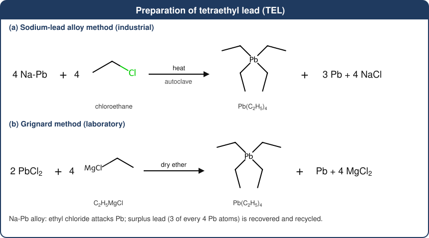

*Other route:* an **electrolytic process** (Nalco process) uses an ethyl Grignard reagent in ether-type solvent with a lead anode.

### 4.3 Uses of TEL

#### Main use: antiknock additive in petrol

- **Knocking** is premature, uncontrolled combustion of the compressed fuel-air mixture in a petrol engine. It lowers efficiency and can damage the engine.
- A fuel's resistance to knocking is its **octane number** (iso-octane = 100, n-heptane = 0).
- Adding a small amount of TEL (well below 1 mL per litre) **raises the octane number**.

**How TEL works:** at engine temperature TEL decomposes to give lead / lead oxide particles and ethyl radicals. The fine PbO particles **mop up the free radicals that carry the pre-ignition chain reaction**, so combustion is smooth rather than explosive.

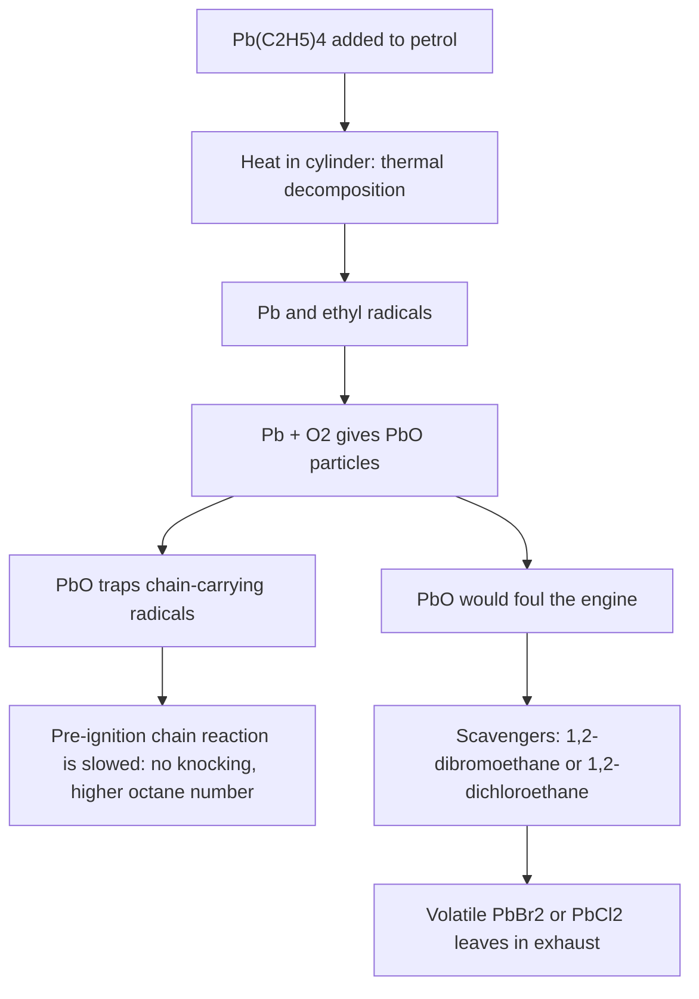

**Lead scavengers:** 1,2-dibromoethane and 1,2-dichloroethane are blended with TEL so that lead oxide becomes **volatile lead halide** and leaves with the exhaust instead of building up in the engine.

#### Other uses

- A source of **alkyl free radicals**: lead alkyls such as TEL were used in the classic Paneth lead-mirror experiments that first demonstrated free radicals.
- Starting material for other organolead compounds (e.g. Et3PbCl).
- Still used in some **aviation gasoline (avgas)** for piston-engine aircraft, where unleaded fuels are being phased in.

#### Why leaded petrol was phased out

- Exhaust releases toxic lead particles, which cause **lead poisoning** (especially harmful to children's brain development).
- Lead **poisons the catalyst** of catalytic converters.
- **Bangladesh banned leaded petrol with effect from 1 July 1999.** Worldwide, UNEP announced in 2021 that leaded petrol had been eliminated from road use.
- Replacements for octane boosting: ethanol, MTBE, and higher-octane hydrocarbon blending components (reformate, alkylate).

---

## 5. Extra work: comparison, revision and practice

### 5.1 Grignard reagent versus TEL

| Feature | Grignard reagent | Tetraethyl lead (TEL) |
|---|---|---|
| Formula | R-Mg-X | Pb(C2H5)4 |
| Metal | magnesium (Group 2) | lead (Group 14) |
| Type of C-M bond | **polar covalent**, carbon negative | **covalent**, weak C-Pb bond |
| Stability | very reactive; used in situ in dry ether | stable liquid, can be stored |
| Made by | R-X + Mg in dry ether | Na-Pb alloy + C2H5Cl, or PbCl2 + C2H5MgCl |
| Main use | synthesis of alcohols, acids, ketones, etc. | antiknock additive in petrol |
| Hazard | flammable ether, water-reactive | highly toxic lead compound |

### 5.2 Conversions: how to get the target

| Target compound | Grignard reagent | Partner | Then |
|---|---|---|---|
| Propan-1-ol | C2H5MgBr | HCHO | H3O+ |
| Butan-2-ol | CH3MgI | CH3CH2CHO (propanal) | H3O+ |
| 2-Methylbutan-2-ol | C2H5MgBr | acetone | H3O+ |
| Propanoic acid | C2H5MgBr | CO2 (dry ice) | H3O+ |
| Acetophenone | CH3MgI | C6H5CN | H3O+ |
| Triphenylmethanol | C6H5MgBr (2 mol) | methyl benzoate | H3O+ |

### 5.3 Likely short questions

**Q: Why must a Grignard reagent be prepared in dry ether?**
Water (and alcohols) protonate the carbanion-like carbon: RMgX + H2O &rarr; RH + Mg(OH)X, destroying the reagent. Ether has no acidic H and its oxygen lone pairs coordinate Mg, stabilising RMgX.

**Q: Why is a crystal of iodine added?**
It cleans the surface of the oxide coating on magnesium so that the reaction can start.

**Q: Why does an ester need two moles of Grignard reagent?**
The first mole converts the ester to a ketone; the ketone is more reactive than the ester and reacts with a second mole to give the tertiary alkoxide.

**Q: Why is TEL added to petrol?**
To raise the octane number and prevent knocking.

**Q: Why are 1,2-dibromoethane / 1,2-dichloroethane added along with TEL?**
They convert lead oxide into volatile lead halides that leave with the exhaust gases.

**Q: Why was leaded petrol banned?**
Lead from exhaust is toxic (especially to children) and poisons catalytic converters.

### 5.4 Common mistakes to avoid

- Writing the reagent with Mg attached to the wrong atom: in **R-Mg-X, Mg is bonded to carbon** (C-Mg-X), not to the ring or to X only.
- Forgetting the **second step (hydrolysis)** - without H3O+ the product is only the magnesium alkoxide.
- Saying HCHO gives a *secondary* alcohol (it gives **primary**); any other aldehyde gives secondary; ketones give tertiary.
- Writing TEL as Pb(C2H5)2 - it is **Pb(C2H5)4** (Pb is Pb(IV) here).
- Forgetting that the Na-Pb method gives **3 Pb per 4 Pb used** as by-product (equation must balance).

### 5.5 Memory hooks

- **"1-2-3 alcohols":** HCHO &rarr; 1&deg;, other RCHO &rarr; 2&deg;, ketone &rarr; 3&deg;, ester (2 mol) &rarr; 3&deg;.
- **"CO2 adds a carbon":** R-MgX &rarr; R-COOH.
- **"Dry! Dry! Dry!"** - ether, glassware, and no protic compounds.
- **TEL:** "4 ethyls on 1 lead = 4 NaPb + 4 EtCl".

---

## 6. One-page revision table

| Topic | Key points |
|---|---|
| Grignard reagent | R-Mg-X, discovered 1900 (Nobel 1912), polar C-Mg bond, carbanion-like R |
| Preparation | R-X + Mg in dry ether (I2 to initiate); reactivity I > Br > Cl |
| Alcohols | HCHO &rarr; 1&deg;; RCHO &rarr; 2&deg;; ketone/ester &rarr; 3&deg;; ethylene oxide &rarr; 1&deg; (+2 C) |
| Acids and ketones | CO2 &rarr; RCOOH; R'CN &rarr; ketone |
| Hydrocarbons | RMgX + H2O &rarr; RH |
| TEL | Pb(C2H5)4, toxic, covalent, tetrahedral |
| TEL preparation | 4 NaPb + 4 EtCl &rarr; PbEt4 + 3 Pb + 4 NaCl; or PbCl2 + EtMgCl |
| TEL use | antiknock additive; halide scavengers; now phased out (Bangladesh: 1 July 1999) |
