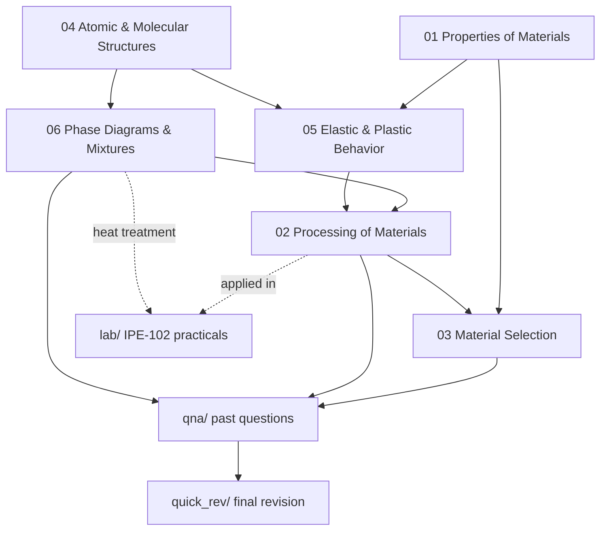
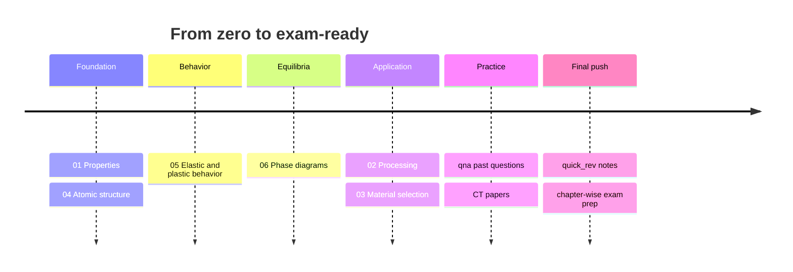

<div align="center">

# ⚙️ IPE-101 — Engineering Materials

**Chapter notes · Previous-question solutions · Quick revision · Lab companion**


</div>

> [!NOTE]
> Everything here is written in GitHub Markdown and renders best on GitHub (math via LaTeX, diagrams via Mermaid, solutions in collapsible blocks). Open the files in the rendered view, not the raw view.

---

## 📑 Table of Contents

- [Quick Navigation](#-quick-navigation)
- [Chapter Notes](#-chapter-notes)
- [Exam Preparation](#-exam-preparation)
- [Lab (IPE-102 Companion)](#-lab-ipe-102-companion)
- [How the Materials Fit Together](#-how-the-materials-fit-together)
- [Suggested Study Roadmap](#-suggested-study-roadmap)
- [Directory Layout](#-directory-layout)
- [File Naming Conventions](#-file-naming-conventions)
- [Local Usage](#-local-usage)

---

## 🧭 Quick Navigation

| I want to… | Go to |
|---|---|
| Learn a chapter from scratch | [Chapter Notes](#-chapter-notes) |
| Revise fast before a CT / final | [`quick_rev/`](./quick_rev/) |
| Practise past exam questions | [`qna/`](./qna/) |
| Prepare for the workshop lab / viva | [`lab/`](./lab/) |
| Revise the whole course in one go | [`quick_rev/ipe-101-em-chapter-wise-exam-prep-v261116-0.md`](./quick_rev/ipe-101-em-chapter-wise-exam-prep-v261116-0.md) |

---

## 📚 Chapter Notes

Six full-length chapter files. Read them in order, since later chapters build on earlier ones (structure → behavior → phase equilibria).

| # | Chapter | File | Size |
|:-:|---|---|:-:|
| 01 | Properties of Materials | [`01-properties-of-materials.md`](./01-properties-of-materials.md) | 21k |
| 02 | Processing of Materials | [`02-processing-of-materials.md`](./02-processing-of-materials.md) | 23k |
| 03 | Material Selection | [`03-material-selection.md`](./03-material-selection.md) | 14k |
| 04 | Atomic & Molecular Structures | [`04-atomic-molecular-structures.md`](./04-atomic-molecular-structures.md) | 22k |
| 05 | Elastic & Plastic Behavior | [`05-elastic-plastic-behavior.md`](./05-elastic-plastic-behavior.md) | 40k |
| 06 | Phase Diagrams & Mixtures | [`06-phase-diagrams-mixtures.md`](./06-phase-diagrams-mixtures.md) | 36k |

<details>
<summary><b>What each chapter file is built from</b></summary>

- Structured sections with YAML frontmatter
- LaTeX equations for formulas and derivations
- Mermaid diagrams for classifications and process flows
- Worked examples
- Collapsible-solution practice problems

</details>

---

## 🎯 Exam Preparation

### 📝 Previous-question solutions — [`qna/`](./qna/)

| File | Purpose |
|---|---|
| [`ipe-101-qna-exam-sol-15-24.md`](./qna/ipe-101-qna-exam-sol-15-24.md) | Solved exam questions, 2015–2024 |
| [`ipe-ct-250715.md`](./qna/ipe-ct-250715.md) | Class Test (2025-07-15) |
| [`ipe-ct-260715.md`](./qna/ipe-ct-260715.md) | Class Test (2026-07-15) |

### ⚡ Quick revision — [`quick_rev/`](./quick_rev/)

| File | Use it for |
|---|---|
| [`ipe-101-em-chapter-wise-exam-prep-v261116-0.md`](./quick_rev/ipe-101-em-chapter-wise-exam-prep-v261116-0.md) | Chapter-wise exam prep (latest) |
| [`ipe-101-materials-revision-notebook-v260727-0.md`](./quick_rev/ipe-101-materials-revision-notebook-v260727-0.md) | Whole-course revision notebook |
| [`ipe-101-heat-treatment-ct2-prep-v260930-2.md`](./quick_rev/ipe-101-heat-treatment-ct2-prep-v260930-2.md) | Heat treatment, CT-2 prep |
| [`ipe-101-heat-treatment-quick-revision-v260929-0.md`](./quick_rev/ipe-101-heat-treatment-quick-revision-v260929-0.md) | Heat treatment quick revision (v260929, rev 0) |
| [`ipe-101-heat-treatment-quick-revision-v260929-1.md`](./quick_rev/ipe-101-heat-treatment-quick-revision-v260929-1.md) | Heat treatment quick revision (v260929, rev 1) |
| [`ipe-101-heat-treatment-quick-revision-v260930-0.md`](./quick_rev/ipe-101-heat-treatment-quick-revision-v260930-0.md) | Heat treatment quick revision (v260930, rev 0) |
| [`ipe-101-heat-treatment-quick-revision-v260930-1.md`](./quick_rev/ipe-101-heat-treatment-quick-revision-v260930-1.md) | Heat treatment quick revision (v260930, rev 1) |
| [`ipe-102-viva-quick-revision-v261009-0.md`](./quick_rev/ipe-102-viva-quick-revision-v261009-0.md) | IPE-102 lab viva |

> [!TIP]
> When several versions of the same topic exist, the highest `vYYMMDD-N` is the newest. See [File Naming Conventions](#-file-naming-conventions). The folder also has its own [`README.md`](./quick_rev/README.md).

---

## 🔧 Lab (IPE-102 Companion)

The `lab/` folder holds the hands-on workshop material for **IPE-102**. It sits here because the practicals apply what the IPE-101 chapters teach (processing, joining, heat treatment, casting).

| Lab | File |
|:-:|---|
| 01 | [Hand Tools](./lab/ipe102-lab-01-hand-tools.md) |
| 02 | [Machine Tools](./lab/ipe102-lab-02-machine-tools.md) |
| 03 | [Sheet Metal](./lab/ipe102-lab-03-sheet-metal.md) |
| 04 | [Metal Joining](./lab/ipe102-lab-04-metal-joining.md) |
| 05 | [Heat Treatment](./lab/ipe102-lab-05-heat-treatment.md) |
| 06 | [Sand Casting](./lab/ipe102-lab-06-sand-casting.md) |
| 07 | [Gear & Thread Cutting](./lab/ipe102-lab-07-gear-thread-cutting.md) |
| — | [Final Practical Report](./lab/ipe-102-practical-report-final.md) |

---

## 🗺️ How the Materials Fit Together



---

## 🛣️ Suggested Study Roadmap



| Stage | What to do |
|---|---|
| 1. Read | Go through chapters 01 → 06, working each example by hand |
| 2. Solve | Open the collapsible practice problems only after attempting them |
| 3. Drill | Work the [`qna/`](./qna/) papers under timed conditions |
| 4. Revise | Use [`quick_rev/`](./quick_rev/), starting with the chapter-wise exam prep file |
| 5. Apply | Connect theory to the [`lab/`](./lab/) practicals and viva |

---

## 🌳 Directory Layout

```text
IPE-101/
├── README.md                              ← you are here
├── 01-properties-of-materials.md
├── 02-processing-of-materials.md
├── 03-material-selection.md
├── 04-atomic-molecular-structures.md
├── 05-elastic-plastic-behavior.md
├── 06-phase-diagrams-mixtures.md
├── lab/
│   ├── ipe102-lab-01-hand-tools.md
│   ├── ipe102-lab-02-machine-tools.md
│   ├── ipe102-lab-03-sheet-metal.md
│   ├── ipe102-lab-04-metal-joining.md
│   ├── ipe102-lab-05-heat-treatment.md
│   ├── ipe102-lab-06-sand-casting.md
│   ├── ipe102-lab-07-gear-thread-cutting.md
│   └── ipe-102-practical-report-final.md
├── qna/
│   ├── ipe-101-qna-exam-sol-15-24.md
│   ├── ipe-ct-250715.md
│   └── ipe-ct-260715.md
└── quick_rev/
    ├── README.md
    ├── ipe-101-em-chapter-wise-exam-prep-v261116-0.md
    ├── ipe-101-heat-treatment-ct2-prep-v260930-2.md
    ├── ipe-101-heat-treatment-quick-revision-v260929-0.md
    ├── ipe-101-heat-treatment-quick-revision-v260929-1.md
    ├── ipe-101-heat-treatment-quick-revision-v260930-0.md
    ├── ipe-101-heat-treatment-quick-revision-v260930-1.md
    ├── ipe-101-materials-revision-notebook-v260727-0.md
    └── ipe-102-viva-quick-revision-v261009-0.md
```

**4 directories · 26 files**

---

## 🏷️ File Naming Conventions

| Kind | Pattern | Example |
|---|---|---|
| Chapter notes | `NN-topic-name.md` | `05-elastic-plastic-behavior.md` |
| Lab sheets | `ipe102-lab-NN-topic.md` | `ipe102-lab-05-heat-treatment.md` |
| Quick revision | `ipe-101-<topic>-quick-revision-vYYMMDD-N.md` | `ipe-101-heat-treatment-quick-revision-v260930-1.md` |
| Class tests | `ipe-ct-YYMMDD.md` | `ipe-ct-260715.md` |

`vYYMMDD` is the date the file was made, and `-N` is a counter for multiple versions on the same day (`-0`, `-1`, …). Higher means newer.

---

## 💻 Local Usage

```bash
# clone and enter the course folder
git clone https://github.com/itachi-re/butex-notes.git
cd butex-notes/IPE-101

# find a topic across every note
grep -rni "tempering" .

# list the newest quick-revision files
ls -1t quick_rev/
```

> [!IMPORTANT]
> Figures and diagrams referenced from these notes are stored in the shared `assets/` directory at the repo root. Keep that relative path intact when moving files.

---

<div align="center">

Compiled by **sigkill0x00** · part of [`butex-notes`](https://github.com/itachi-re/butex-notes)

</div>
