

# ⚙️ Engineering Materials (IPE 101)
### B.Sc. in Textile Engineering · Level-1 Term-II · JTEC 2025 Suggestions
**All 65 questions solved in exam style, with diagrams, worked examples, extra notes and practice problems**

> **How to use this file**
> 1. Start with the [Hot-topic tracker](#-hot-topic-tracker) – it shows which questions repeat.
> 2. Learn the [Formula sheet](#-formula-sheet) and the [Fe–Fe₃C diagram](#q17) – they unlock a third of the paper.
> 3. Write answers the way they are laid out here: **definition → diagram → points/table → example**.
> 4. Try the 🧪 spoiler practice problems *before* opening them.
>
> 📁 Diagrams live in `../../assets/` (SVG, so they stay sharp on GitHub and in dark mode).

---

## 📑 Table of contents

| Part | Topic | Questions |
|---|---|---|
| **A** | [Crystal structure & atomic packing](#part-a--crystal-structure--atomic-packing) | [2](#q2) · [7](#q7) · [8](#q8) · [9](#q9) · [46](#q46) · [47](#q47) · [48](#q48) · [63](#q63) |
| **B** | [Mechanical properties & testing](#part-b--mechanical-properties--testing) | [3](#q3) · [6](#q6) · [15](#q15) · [18](#q18) · [19](#q19) · [20](#q20) · [21](#q21) · [24](#q24) · [31](#q31) · [32](#q32) · [35](#q35) · [36](#q36) · [37](#q37) · [39](#q39) · [60](#q60) · [62](#q62) · [64](#q64) |
| **C** | [Ferrous materials & the Fe–Fe₃C diagram](#part-c--ferrous-materials--iron-carbon-diagram) | [1](#q1) · [10](#q10) · [14](#q14) · [16](#q16) · [17](#q17) · [25](#q25) · [38](#q38) · [50](#q50) · [51](#q51) · [61](#q61) |
| **D** | [Heat treatment](#part-d--heat-treatment) | [4](#q4) · [5](#q5) · [30](#q30) · [41](#q41) · [42](#q42) · [43](#q43) · [52](#q52) · [53](#q53) · [65](#q65) |
| **E** | [Corrosion, protection & lubricants](#part-e--corrosion-protection--lubricants) | [13](#q13) · [22](#q22) · [23](#q23) · [28](#q28) · [33](#q33) · [34](#q34) · [49](#q49) |
| **F** | [Polymers, ceramics, glass & composites](#part-f--polymers-ceramics-glass--composites) | [11](#q11) · [12](#q12) · [26](#q26) · [27](#q27) · [29](#q29) · [40](#q40) · [44](#q44) · [45](#q45) · [54](#q54) · [55](#q55) · [56](#q56) · [57](#q57) · [58](#q58) · [59](#q59) |
| **G** | [Extra: cheat tables, mnemonics, exam tips, mixed practice](#part-g--extra-revision-material) | — |

---

## 🔥 Hot-topic tracker

Questions that appear more than once in the suggestion list are almost certain to be tested. ★ = appears 3+ times.

| Topic | Appears as | Frequency |
|---|---|---|
| Fatigue / creep / endurance / ductility / brittleness definitions | [18](#q18), [21](#q21), [31](#q31), [36](#q36), [60](#q60) | ★★★★★ |
| Atomic packing factor (BCC, FCC) | [2](#q2), [9](#q9), [46](#q46) | ★★★ |
| Quenching & its media | [5](#q5), [43](#q43), [53](#q53) | ★★★ |
| Heat treatment purpose | [4](#q4), [52](#q52) (+ [30](#q30)/[41](#q41) hardening, [42](#q42) annealing) | ★★★ |
| Corrosion (definition, types, prevention) | [13](#q13), [23](#q23), [33](#q33), [49](#q49) | ★★★★ |
| Composites (definition, advantages, types) | [11](#q11), [45](#q45), [58](#q58), [59](#q59), [65](#q65) | ★★★★★ |
| Hardness tests | [15](#q15), [24](#q24), [39](#q39) | ★★★ |
| Glass transition & types of glass | [26](#q26), [56](#q56) | ★★ |
| Effect of impurities on cast iron | [10](#q10), [16](#q16) | ★★ |
| Hardening process | [30](#q30), [41](#q41) | ★★ |
| S–N curve / endurance limit | [19](#q19), [37](#q37) | ★★ |
| Fe–Fe₃C diagram | [14](#q14), [17](#q17) | ★★ |
| Numericals | [3](#q3), [6](#q6), [7](#q7), [48](#q48) (+ APF derivations) | ★★★ |

---

## 🧮 Formula sheet

| Quantity | Formula |
|---|---|
| Engineering stress / strain | $\sigma=\dfrac{F}{A_0}$ , $\varepsilon=\dfrac{\Delta L}{L_0}$ |
| Hooke's law | $\sigma=E\,\varepsilon$ |
| Axial deformation | $\delta=\dfrac{PL}{AE}$ |
| Shear stress / punching force | $\tau=\dfrac{F}{A_s}$ , $F=\tau\,\pi d\,t$ |
| Bending stress | $\sigma_b=\dfrac{My}{I}$ , $\sigma_{max}=\dfrac{M}{Z}$ |
| % elongation / % reduction of area | $\%EL=\dfrac{L_f-L_0}{L_0}\times100$ , $\%RA=\dfrac{A_0-A_f}{A_0}\times100$ |
| Modulus of resilience | $U_r=\dfrac{\sigma_y^{2}}{2E}$ |
| APF | $\mathrm{APF}=\dfrac{n\cdot\frac{4}{3}\pi r^{3}}{a^{3}}$ |
| Theoretical density | $\rho=\dfrac{nA}{V_cN_A}$ , $N_A=6.022\times10^{23}\ \mathrm{mol^{-1}}$ |
| BCC / FCC lattice parameter | $a=\dfrac{4r}{\sqrt3}$ , $a=2\sqrt2\,r$ |
| Brinell hardness | $\mathrm{HB}=\dfrac{2P}{\pi D\left(D-\sqrt{D^{2}-d^{2}}\right)}$ |
| Vickers hardness | $\mathrm{HV}=\dfrac{1.854\,P}{d^{2}}$ |
| Rockwell number | $\mathrm{HR}=N-\dfrac{e}{0.002\ \mathrm{mm}}$ |
| Lever rule | $W_{\alpha}=\dfrac{C_{\beta}-C_0}{C_{\beta}-C_{\alpha}}$ |
| Steady creep rate | $\dot\varepsilon_s=K\sigma^{n}e^{-Q/RT}$ |

---

# PART A — Crystal Structure & Atomic Packing

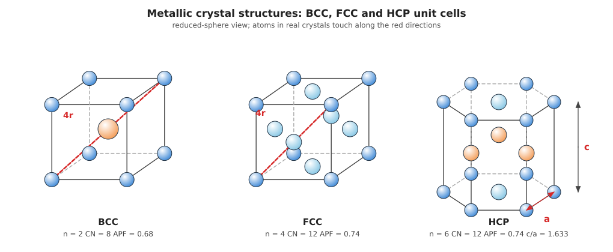

### Q2. What is atomic packing factor? Find the APF for the body-centred cubic (BCC) structure. 
*(Repeated idea: Q9, Q46 ask the same for FCC)*

**Definition.** The **atomic packing factor (APF)** is the fraction of the volume of a unit cell that is actually occupied by atoms (treated as hard spheres):

$$\mathrm{APF}=\frac{\text{volume of atoms in the unit cell}}{\text{volume of the unit cell}}=\frac{n\,\left(\tfrac43\pi r^{3}\right)}{a^{3}}$$

**Given/known for BCC:** atoms per cell $n=2$ (8 corners × ⅛ + 1 centre); atoms touch along the **body diagonal**.

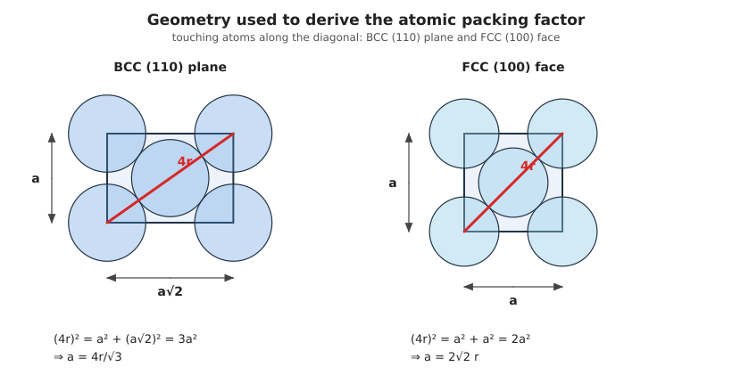

**Step 1 – relation between $a$ and $r$.** Body diagonal $=4r$ and also $=\sqrt{a^{2}+(\sqrt2a)^{2}}=\sqrt3\,a$

$$a=\frac{4r}{\sqrt3}$$

**Step 2 – volumes.**

$$V_{atoms}=2\times\frac43\pi r^{3}=\frac{8\pi r^{3}}{3},\qquad V_{cell}=a^{3}=\frac{64\,r^{3}}{3\sqrt3}$$

**Step 3 – APF.**

$$\mathrm{APF}_{BCC}=\frac{8\pi r^{3}/3}{64r^{3}/(3\sqrt3)}=\frac{\pi\sqrt3}{8}=0.68$$

> ✅ **Answer: APF(BCC) = 0.68** → 68 % of the volume is filled, 32 % is void. Coordination number = 8.

**Examples of BCC metals:** α-Fe (ferrite), Cr, Mo, W, V, Na.

---

### Q9. Define atomic packing factor (APF). Find the APF of the FCC structure.

**Definition:** see [Q2](#q2).

**FCC data:** $n=4$ (8 corners × ⅛ + 6 faces × ½); atoms touch along the **face diagonal**.

$$4r=\sqrt{a^{2}+a^{2}}=\sqrt2\,a\ \Rightarrow\ a=2\sqrt2\,r$$

$$V_{atoms}=4\times\frac43\pi r^{3}=\frac{16\pi r^{3}}{3},\qquad V_{cell}=(2\sqrt2\,r)^{3}=16\sqrt2\,r^{3}$$

$$\mathrm{APF}_{FCC}=\frac{16\pi r^{3}/3}{16\sqrt2\,r^{3}}=\frac{\pi}{3\sqrt2}=0.74$$

> ✅ **Answer: APF(FCC) = 0.74** (CN = 12). This is the **maximum** possible packing of equal spheres (same as HCP).

| Structure | $n$ | CN | $a$ in terms of $r$ | APF | Examples |
|---|:-:|:-:|:-:|:-:|---|
| Simple cubic | 1 | 6 | $2r$ | 0.52 | Po |
| **BCC** | 2 | 8 | $4r/\sqrt3$ | **0.68** | α-Fe, Cr, W |
| **FCC** | 4 | 12 | $2\sqrt2\,r$ | **0.74** | γ-Fe, Cu, Al, Ni |
| **HCP** | 6 | 12 | $a=2r$, $c=1.633a$ | **0.74** | Zn, Mg, Ti, Co |

🧪 <b>Practice 1</b> – APF of simple cubic (try before opening)

$n=1$, atoms touch along the edge so $a=2r$:

$$\mathrm{APF}=\frac{\frac43\pi r^3}{(2r)^3}=\frac{\pi}{6}=0.52$$

---

### Q46. Find the atomic packing factor for FCC structure.

Identical to [Q9](#q9). **Short exam version:**

1. FCC: $n=4$, $a=2\sqrt2\,r$.
2. $\mathrm{APF}=\dfrac{4\cdot\frac43\pi r^3}{(2\sqrt2 r)^3}=\dfrac{\pi}{3\sqrt2}$
3. **APF = 0.74 (74 %)**.

---

### Q7. Find the theoretical density of Cr where the radius of a Cr atom is 0.125 nm.

**Given:** Cr is **BCC** ⇒ $n=2$; $r=0.125$ nm; atomic weight $A=52.0$ g/mol (standard value, not given in the question – state it in the exam); $N_A=6.022\times10^{23}$.

**Step 1 – lattice parameter**

$$a=\frac{4r}{\sqrt3}=\frac{4(0.125)}{1.732}=0.2887\ \text{nm}=2.887\times10^{-8}\ \text{cm}$$

**Step 2 – cell volume**

$$V_c=a^{3}=(2.887\times10^{-8})^{3}=2.406\times10^{-23}\ \text{cm}^{3}$$

**Step 3 – density**

$$\rho=\frac{nA}{V_cN_A}=\frac{2\times52.0}{(2.406\times10^{-23})(6.022\times10^{23})}=\frac{104}{14.49}=7.18\ \text{g/cm}^{3}$$

> ✅ **ρ(Cr) ≈ 7.18 g/cm³** (handbook value 7.19 g/cm³ – excellent agreement).

---

### Q48. Find the density of Cu in g/cc. Atomic radius = 1.28 Å, atomic weight = 63.5 g/mol.

**Given:** Cu is **FCC** ⇒ $n=4$.

$$a=2\sqrt2\,r=2(1.414)(1.28)=3.620\ \text{Å}=3.620\times10^{-8}\ \text{cm}$$

$$V_c=a^3=4.745\times10^{-23}\ \text{cm}^3$$

$$\rho=\frac{4\times63.5}{(4.745\times10^{-23})(6.022\times10^{23})}=\frac{254}{28.58}=8.89\ \text{g/cm}^3$$

> ✅ **ρ(Cu) ≈ 8.89 g/cc** (measured 8.94 g/cc).

🧪 <b>Practice 2</b> – Density of α-Fe (BCC), r = 0.1241 nm, A = 55.85

$a=4r/\sqrt3=0.2866$ nm $=2.866\times10^{-8}$ cm → $V_c=2.354\times10^{-23}$ cm³  
$\rho=\dfrac{2(55.85)}{(2.354\times10^{-23})(6.022\times10^{23})}=7.88\ \text{g/cm}^3$

---

### Q8. Draw the family of {111} planes.

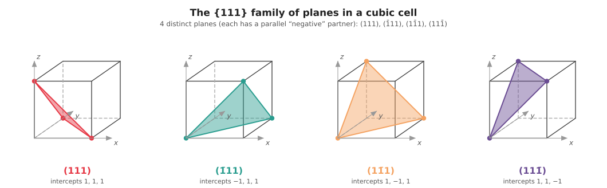

**How the planes are indexed (Miller indices):** take the intercepts on x, y, z (in units of $a$), invert them, clear fractions.

| Plane | Intercepts | Reciprocals | Miller indices |
|---|---|---|---|
| Plane 1 | 1, 1, 1 | 1, 1, 1 | $(111)$ |
| Plane 2 | −1, 1, 1 | −1, 1, 1 | $(\bar{1}11)$ |
| Plane 3 | 1, −1, 1 | 1, −1, 1 | $(1\bar{1}1)$ |
| Plane 4 | 1, 1, −1 | 1, 1, −1 | $(11\bar{1})$ |

* The family $\{111\}$ contains **8 planes** $(\pm1\pm1\pm1)$, but they form **4 pairs of parallel planes**, so only **4 distinct orientations** are drawn.
* In **FCC** metals the $\{111\}$ planes are the **close-packed planes** (stacking ABCABC…) – they are the slip planes, which is why Cu, Al, Au are so ductile.

---

### Q47. Between BCC and FCC, which is more stable and why?

**Answer:** **FCC is the more closely packed and, in the usual sense, the more stable (lower-energy) arrangement**, but stability depends on temperature.

| Reason | BCC | FCC |
|---|:-:|:-:|
| Atomic packing factor | 0.68 | **0.74** |
| Coordination number (nearest neighbours) | 8 | **12** |
| Number of bonds per atom → lower internal energy | fewer | **more** |
| Close-packed planes | none | **{111}** |
| Void space | 32 % | **26 %** |

* FCC atoms have more nearest neighbours, so more bonding energy is released → lower internal energy → **more stable at low temperature** (most metals that are FCC at room temperature: Cu, Al, Ni, Ag, Au).
* **Temperature effect (iron):** α-Fe (BCC) is stable below 912 °C, γ-Fe (FCC) from 912–1394 °C, δ-Fe (BCC) from 1394–1538 °C. BCC reappears at high temperature because its looser structure has higher **vibrational entropy**, which lowers the free energy $G=H-TS$ when $T$ is large.

---

### Q63. Describe the BCC, FCC and HCP crystal structures.

| Feature | **BCC** | **FCC** | **HCP** |
|---|---|---|---|
| Atom positions | 8 corners + 1 body centre | 8 corners + 6 face centres | 12 corners, 2 face centres, 3 inside |
| Atoms / cell | 2 | 4 | 6 |
| Coordination number | 8 | 12 | 12 |
| Relation $a$–$r$ | $a=4r/\sqrt3$ | $a=2\sqrt2 r$ | $a=2r$, $c/a\approx1.633$ |
| APF | 0.68 | 0.74 | 0.74 |
| Stacking | – | ABCABC | ABABAB |
| Slip systems | 48 (12 principal) – no close-packed plane | 12 $\{111\}\langle110\rangle$ | 3 (basal) at room T |
| Behaviour | strong, moderate ductility, **has DBTT** | **very ductile**, no DBTT | less ductile, can twin |
| Examples | α-Fe, Cr, W, Mo, V | γ-Fe, Cu, Al, Ni, Au, Ag, Pb | Zn, Mg, Ti, Cd, Co |

**Why it matters (textile engineer's view):** FCC aluminium and austenitic stainless steel are easily drawn and formed (spinneret plates, machine covers); BCC steels give strength for shafts and frames but become brittle in cold ([Q35](#q35)).

---

# PART B — Mechanical Properties & Testing

### Q32. Classify engineering materials. Why are the mechanical properties of materials important?

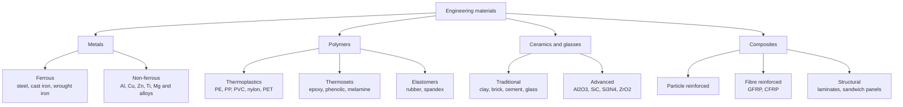

| Class | Bonding | Typical properties | Textile-industry example |
|---|---|---|---|
| Metals | metallic | strong, ductile, conductive, tough | looms, spindles, needles, shafts, dyeing vessels |
| Polymers | covalent + weak secondary | light, low strength, corrosion resistant, insulator | fibres (nylon, PET), bobbins, rollers, coatings |
| Ceramics / glass | ionic / covalent | hard, brittle, heat resistant, insulator | thread guides, glass fibre, kiln linings |
| Composites | mixed | high specific strength/stiffness | rapier loom parts, CFRP rollers, technical textiles |

**Why mechanical properties are important**

1. **Safe design** – stresses in a part must stay below yield strength with a safety factor.
2. **Material selection** – strength, stiffness, toughness, hardness decide whether steel, aluminium or plastic is used.
3. **Predicting service life** – fatigue and creep data tell how long a spindle, shaft or hook will last.
4. **Manufacturing** – ductility/malleability decide whether a metal can be drawn, rolled, forged.
5. **Quality control and standards** – tensile, hardness, impact tests are used for acceptance.
6. **Economy** – avoids over-design (heavy, costly) and under-design (failure, accidents).

---

### Q18. Define ductility, brittleness and resilience.

| Property | Definition | Measure / formula | Example |
|---|---|---|---|
| **Ductility** | Ability of a material to undergo **large plastic deformation under tension** before fracture (can be drawn into wire). | $\%EL=\frac{L_f-L_0}{L_0}\times100$, $\%RA=\frac{A_0-A_f}{A_0}\times100$ | Cu, Al, mild steel, gold |
| **Brittleness** | Tendency to **fracture with little or no plastic deformation**. | Very small $\%EL$ (< 5 %), fracture at the elastic limit | cast iron, glass, ceramics, concrete |
| **Resilience** | Ability to **absorb energy elastically** and release it on unloading; area under the elastic part of the σ–ε curve. | $U_r=\frac{\sigma_y^2}{2E}$ | spring steel, rubber band |

(See the labelled areas in [Q62](#q62).)

---

### Q64. Mention the mechanical properties of materials.

| # | Property | Meaning |
|---|---|---|
| 1 | **Strength** | resistance to deformation/fracture (yield, ultimate tensile, compressive, shear) |
| 2 | **Elasticity** | return to original size after removal of load (E = modulus) |
| 3 | **Plasticity** | permanent deformation without fracture |
| 4 | **Stiffness** | resistance to elastic deformation (high E) |
| 5 | **Ductility** | drawn into wires, see [Q18](#q18) |
| 6 | **Malleability** | hammered/rolled into sheets (compression) |
| 7 | **Brittleness** | fracture without plastic strain |
| 8 | **Toughness** | total energy absorbed up to fracture |
| 9 | **Resilience** | elastic energy stored per unit volume |
| 10 | **Hardness** | resistance to indentation/scratch/wear |
| 11 | **Fatigue strength** | resistance to repeated loading ([Q36](#q36)) |
| 12 | **Creep resistance** | resistance to slow deformation at high T ([Q20](#q20)) |
| 13 | **Impact strength** | energy absorbed by a notched specimen (Charpy/Izod) |

---

### Q62. Draw the stress–strain diagram and label it properly.

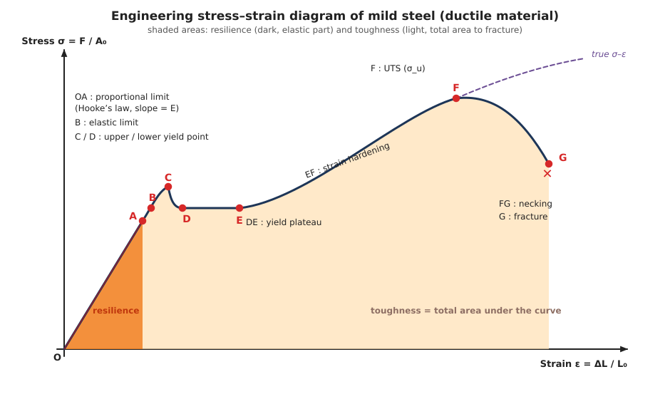

| Point | Name | Meaning |
|---|---|---|
| **OA** | Proportional limit | σ ∝ ε (Hooke's law), slope $E$ (steel ≈ 200 GPa) |
| **B** | Elastic limit | maximum stress without permanent set |
| **C** | Upper yield point | sudden drop begins, dislocations break free |
| **D** | Lower yield point | stable yield stress $\sigma_y$ |
| **DE** | Yield plateau | plastic flow (Lüders bands) at nearly constant stress |
| **EF** | Strain hardening | dislocation tangling → stress rises |
| **F** | Ultimate tensile strength | maximum engineering stress $\sigma_u$ |
| **FG** | Necking | local reduction of area; engineering stress falls |
| **G** | Fracture | cup-and-cone failure |

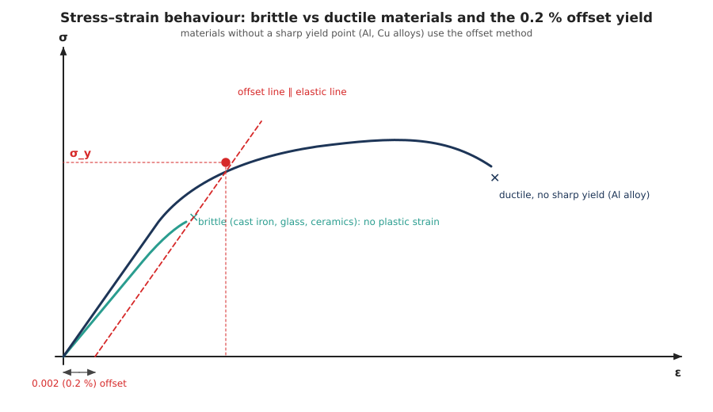

**Remarks:** materials without a sharp yield point (Al, Cu alloys) use the **0.2 % offset yield strength**. **Toughness** = whole area under the curve; **resilience** = area under OA.

---

### Q3. How much force is required to punch a 20 mm diameter hole in a plate 25 mm thick? Shear strength = 350 MN/m².

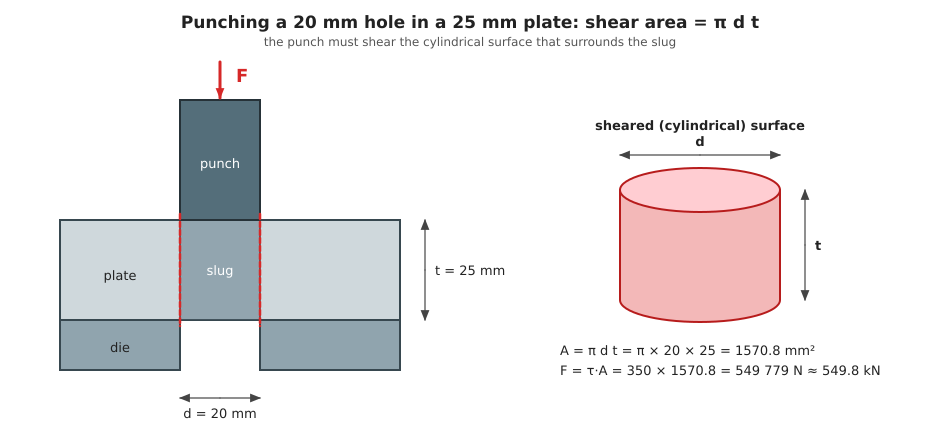

**Given:** $d=20$ mm, $t=25$ mm, $\tau_{ult}=350\ \text{MN/m}^2=350\ \text{N/mm}^2$.

The punch must shear the cylindrical surface around the slug:

$$A_s=\pi d\,t=\pi(20)(25)=1570.8\ \text{mm}^2$$

$$F=\tau\,A_s=350\times1570.8=549\,779\ \text{N}$$

> ✅ **F ≈ 549.8 kN ≈ 550 kN** (about 56 tonnes-force).

🧪 <b>Practice 3</b> – Largest hole that a 400 kN press can punch in 10 mm plate, τ = 300 MPa

$d=\dfrac{F}{\pi t\tau}=\dfrac{400\,000}{\pi(10)(300)}=42.4$ mm

---

### Q6. A hollow cylinder 2 m long, outside diameter 60 mm, inside diameter 40 mm, carries a load of 35 kN. Find the stress and the deformation if E = 250 GPa.

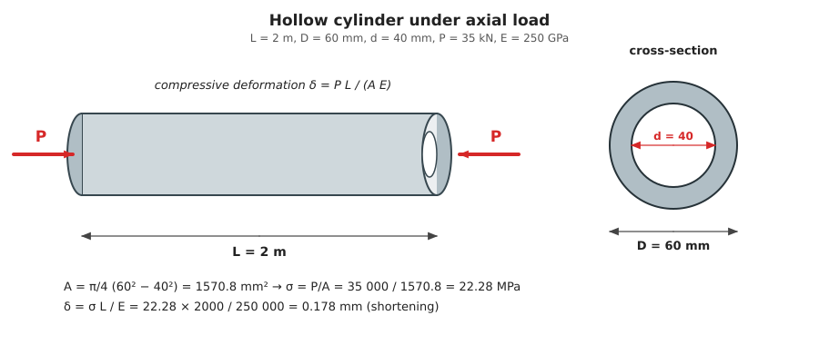

**Given:** $L=2000$ mm, $D=60$ mm, $d=40$ mm, $P=35\,000$ N, $E=250\ \text{GPa}=250\,000\ \text{N/mm}^2$.

**Step 1 – cross-sectional area**

$$A=\frac{\pi}{4}(D^2-d^2)=\frac{\pi}{4}(3600-1600)=1570.8\ \text{mm}^2$$

**Step 2 – stress**

$$\sigma=\frac{P}{A}=\frac{35\,000}{1570.8}=22.28\ \text{N/mm}^2$$

**Step 3 – deformation**

$$\delta=\frac{PL}{AE}=\frac{\sigma L}{E}=\frac{22.28\times2000}{250\,000}=0.178\ \text{mm}$$

> ✅ **σ = 22.28 MPa; δ = 0.178 mm** (shortening if the load is compressive, lengthening if tensile). Strain $\varepsilon=\sigma/E=8.9\times10^{-5}$.

---

### Q21. Describe fatigue, creep, endurance strength and bending stress.

* **Fatigue** – progressive, localised failure of a material under **repeated/fluctuating stress** well below the static tensile strength. Stages: crack initiation → crack propagation (beach marks) → sudden final fracture. *Examples:* shafts, crankshafts, loom crank arms, springs.
* **Creep** – slow, **time-dependent plastic deformation** under constant stress, significant at $T>0.4\,T_m$. *Examples:* turbine blades, boiler tubes, lamp filaments. (Details: [Q20](#q20).)
* **Endurance strength** – the maximum stress amplitude that a material can withstand for a **specified large number of cycles (10⁷–10⁸)** without fracture. For steels it appears as the horizontal part of the S–N curve and is called the **endurance (fatigue) limit** ([Q37](#q37)); for non-ferrous metals it is read at 10⁸ cycles.
* **Bending stress** – normal stress produced in a beam by a bending moment: compressive on one side, tensile on the other, zero at the neutral axis.

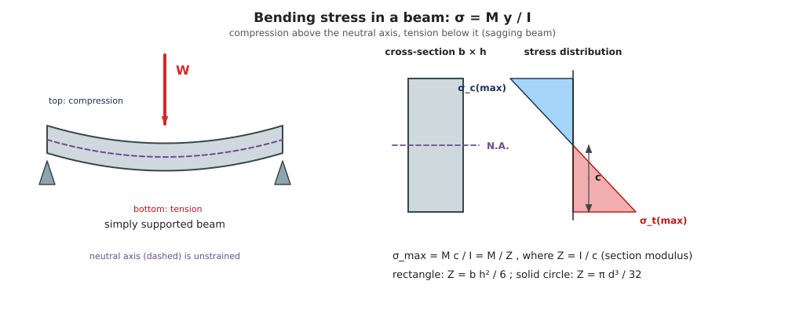

$$\sigma_b=\frac{M\,y}{I},\qquad \sigma_{max}=\frac{M}{Z},\quad Z_{rect}=\frac{bh^2}{6},\quad Z_{circle}=\frac{\pi d^3}{32}$$

🧪 <b>Practice 4</b> – Maximum bending stress in a 40 mm solid round shaft carrying M = 500 N·m

$Z=\pi d^3/32=\pi(0.04)^3/32=6.283\times10^{-6}$ m³  
$\sigma_{max}=M/Z=500/6.283\times10^{-6}=79.6$ MPa

---

### Q31. Define fatigue, creep, ductility and brittleness.

| Term | Definition (exam-ready) |
|---|---|
| **Fatigue** | Failure of a material under repeated cyclic loading at stresses below the yield strength, by crack initiation and growth. |
| **Creep** | Time-dependent, permanent deformation of a material under constant load/stress at elevated temperature. |
| **Ductility** | Ability to deform plastically in tension before fracture (measured by %EL, %RA). |
| **Brittleness** | Property of fracturing with negligible plastic deformation. |

*(Full discussion: [Q21](#q21), [Q18](#q18), [Q20](#q20).)*

---

### Q36. Define fatigue and creep.

* **Fatigue:** progressive structural damage and failure when a component is subjected to **cyclic (alternating, repeated or fluctuating) stresses**, even though the maximum stress is below the yield strength. Fracture surface shows a smooth beach-mark zone and a rough final-fracture zone. Typical life is expressed as the number of cycles $N_f$.
* **Creep:** **slow, continuous, permanent deformation** of a material under a constant stress (below the yield strength) that is **time- and temperature-dependent**; important above about $0.4\,T_m$ (absolute melting temperature).

**Difference in one line:** fatigue is caused by *varying load*; creep is caused by *constant load + high temperature + time*.

---

### Q60. Define fatigue, creep, endurance limit, toughness and hardness.

| Term | Definition |
|---|---|
| Fatigue | see [Q36](#q36) |
| Creep | see [Q36](#q36) |
| **Endurance limit** | The stress level below which a material can withstand an **infinite number of load cycles** without fatigue failure (shown as the flat part of the S–N curve, e.g. ≈ 0.4–0.5 σ_u for steels). |
| **Toughness** | Total energy per unit volume absorbed before fracture = area under the σ–ε curve; $U_t\approx\sigma_{avg}\,\varepsilon_f$. Measured also by Charpy/Izod impact energy. |
| **Hardness** | Resistance of a surface to **localised plastic deformation** (indentation, scratching, abrasion); measured by Brinell, Rockwell, Vickers, Mohs. |

---

### Q37. Draw a typical S–N curve and define the endurance limit from that curve.

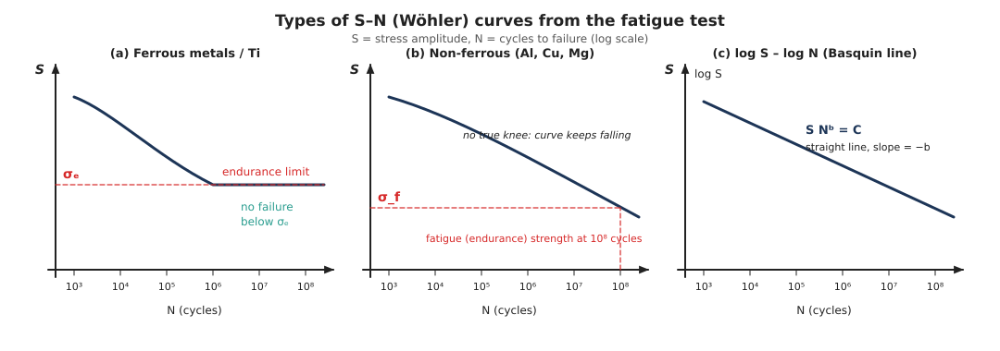

**S–N curve:** plot of stress amplitude $S$ (y-axis) against the number of cycles to failure $N$ (x-axis, log scale), obtained from rotating-beam fatigue tests on many specimens at decreasing stress levels.

**Endurance limit ($\sigma_e$):** from curve (a), the stress at which the curve becomes **horizontal** (beyond ≈ 10⁶–10⁷ cycles). At or below $\sigma_e$ the material has an **infinite fatigue life**. Steels and titanium show it; Al, Cu, Mg do not, so for them the **fatigue strength at 10⁸ cycles** is quoted.

---

### Q19. Draw the different types of S–N curves that can be obtained in a fatigue test.

Three standard presentations (same figure as [Q37](#q37)):

| Type | Shape | Applies to |
|---|---|---|
| (a) **Ferrous-type** | falls, then becomes **horizontal** at the endurance limit | steels, Ti alloys |
| (b) **Non-ferrous type** | falls **continuously**, no true knee; use fatigue strength at $10^{7}$–$10^{8}$ cycles | Al, Cu, Mg alloys |
| (c) **log–log (Basquin)** | straight line: $S\,N^{b}=C$ | high-cycle life prediction |

**Factors that lower fatigue strength:** stress concentrations (notches, keyways), rough surface, corrosion (corrosion fatigue), large size, high mean stress, high temperature. **Improvement:** shot peening, nitriding/carburising, polishing, fillets.

---

### Q20. Define creep. Draw a typical creep curve and explain the stages of creep.

**Definition.** Creep is the **time-dependent permanent deformation** of a material under a constant load (or stress) at a temperature above about $0.4T_m$.

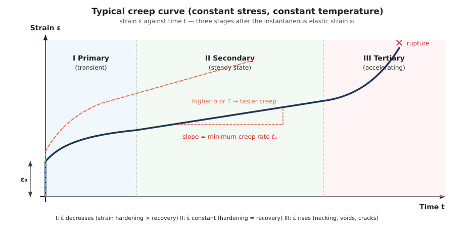

| Stage | Name | Strain rate | What happens |
|---|---|---|---|
| (instant) | elastic strain $\varepsilon_0$ | – | immediate elastic extension on loading |
| **I** | **Primary (transient)** | **decreasing** | strain hardening (dislocation pile-up) is faster than recovery |
| **II** | **Secondary (steady state)** | **constant, minimum** $\dot\varepsilon_s$ | hardening = recovery; longest stage; basis for design life |
| **III** | **Tertiary** | **increasing** | necking, grain-boundary voids/cracks → **rupture** |

$$\dot\varepsilon_s=K\sigma^{n}\exp\!\left(-\frac{Q}{RT}\right)$$

* Higher stress or temperature → steeper curve, shorter life (dashed curve in the figure).
* **Examples:** turbine blades, boiler/steam pipes, tungsten filaments, lead roofs and pipes, polymer (PE, PP) bottles under load.
* **Resisting creep:** high-melting alloys (Ni superalloys), larger grain size or single crystals, solid-solution/dispersion strengthening, lower service temperature.

---

### Q35. What is the ductile-to-brittle transition temperature? What is its significance in the sinking of the Titanic?

**Definition.** The **DBTT** is the temperature (range) below which a material that is normally ductile fractures in a **brittle (cleavage)** manner with very low absorbed energy. It is found from **Charpy/Izod impact tests** at several temperatures; the DBTT is usually taken at the mid-point of the energy–temperature curve (or at 27 J).

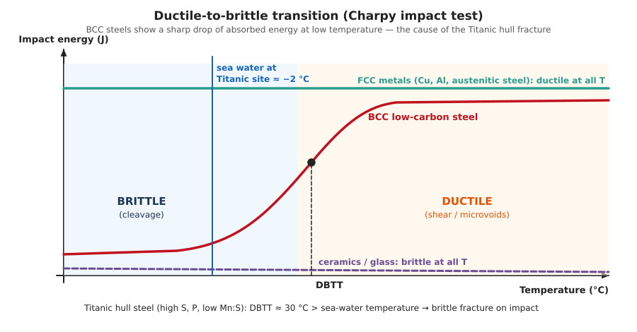

| Behaviour | Materials |
|---|---|
| Shows DBTT | **BCC** metals – low-carbon steels, Cr, Mo; some HCP |
| No DBTT (ductile at all T) | **FCC** metals – Cu, Al, Ni, austenitic stainless steel |
| Brittle at all T | ceramics, glass |

**Titanic (1912).**
* The hull plates and rivets were made of low-grade steel with **high sulphur and phosphorus and a low Mn : S ratio**, which **raises the DBTT**. Tests on recovered plate give a DBTT of roughly **30 °C**.
* On the night of the collision the sea water was ≈ **−2 °C** — **below** the DBTT, so the steel was in the *brittle* range.
* Instead of denting and stretching, the plates fractured (and the iron rivets' slag-rich heads failed), the seams opened along a long stretch and the ship flooded rapidly.
* **Lesson:** select steels with a DBTT well below the lowest service temperature (use Ni, Mn, fine grain, low S/P). Similar brittle failures: Liberty ships (WWII), cold-weather pipeline failures.

---

### Q15. Write three common tests for measuring hardness. Explain any one of them.

**Three tests:** (1) **Brinell** (HB), (2) **Rockwell** (HR), (3) **Vickers** (HV). (Others: Knoop, Shore, Mohs scratch.)

| Test | Indenter | Load | Measurement | Best for |
|---|---|---|---|---|
| Brinell | 10 mm steel/WC ball | 500–3000 kgf | diameter $d$ of dent | soft–medium metals, castings |
| Rockwell | diamond cone (C) or 1/16″ ball (B) | 60/100/150 kgf | **depth** of penetration | quick shop-floor testing of steels |
| Vickers | square diamond pyramid 136° | 1–120 kgf | diagonal $d$ | all metals, thin sheets, case depth |

**Explained: Brinell test** – see full procedure in [Q39](#q39). **Rockwell** in [Q24](#q24).

---

### Q39. What is hardness? Describe the Brinell hardness test measuring procedure.

**Hardness** is the resistance of a material to **localised plastic deformation** by indentation, scratching or abrasion.

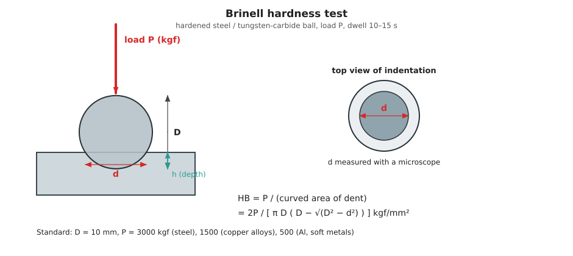

**Procedure**

1. Polish the specimen; place it on the anvil (thickness ≥ 10 × dent depth).
2. Choose ball diameter $D$ (normally 10 mm) and load $P$ (3000 kgf for steel, 1500 for Cu alloys, 500 for Al/soft metals).
3. Press the hardened-steel (or tungsten-carbide) ball into the surface and **hold for 10–15 s** (30 s for soft metals).
4. Remove the load and measure the **diameter $d$** of the impression with a microscope in two perpendicular directions; take the mean.
5. Calculate

$$\mathrm{HB}=\frac{2P}{\pi D\left(D-\sqrt{D^{2}-d^{2}}\right)}\ \ \text{kgf/mm}^2$$

**Numerical example:** $P=3000$ kgf, $D=10$ mm, $d=4.0$ mm

$$\mathrm{HB}=\frac{2(3000)}{\pi(10)\left(10-\sqrt{84}\right)}=\frac{6000}{26.23}\approx229\ \text{HB}$$

**Advantages:** large indent averages grain structure, good for castings; $\sigma_u(\text{MPa})\approx3.45\times \text{HB}$ for steels. **Limitations:** unsuitable for very hard (> 450 HB) or thin parts; leaves a large mark; slow.

---

### Q24. Briefly describe the Rockwell hardness test.

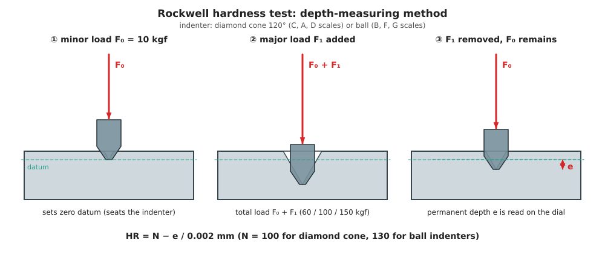

**Principle:** hardness is read from the **increase in depth** of penetration of an indenter under a major load, relative to a minor-load datum – no optical measurement is needed.

**Procedure**
1. Apply the **minor load $F_0$ = 10 kgf** → seats the indenter, sets the zero datum.
2. Apply the **major load $F_1$** (60, 100 or 150 kgf) for a few seconds.
3. **Remove $F_1$** but keep $F_0$; the dial gives the permanent depth increase $e$:

$$\mathrm{HR}=N-\frac{e}{0.002\ \text{mm}}\qquad(N=100\ \text{cone},\ 130\ \text{ball})$$

| Scale | Indenter | Major load | Used for |
|---|---|---|---|
| **HRC** | diamond cone 120° | 150 kgf | hardened steel, tools |
| **HRB** | 1/16″ steel ball | 100 kgf | mild steel, brass, Al |
| **HRA** | diamond cone | 60 kgf | carbides, thin hard steel |

**Advantages:** fast, direct reading, small indent, little skill. **Limitation:** scales cannot be compared directly; needs flat, smooth surface.

---

# PART C — Ferrous Materials & Iron–Carbon Diagram

### Q17. Draw the iron–iron carbide equilibrium diagram labelled with the common names for the structures.

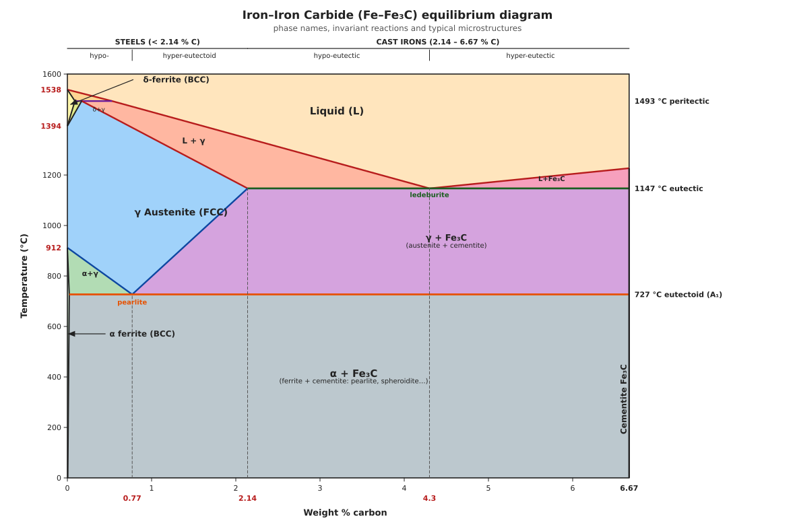

**Phases / constituents (common names)**

| Symbol | Name | Structure | Max. carbon | Notes |
|---|---|---|---|---|
| α | **Ferrite** | BCC | 0.022 % at 727 °C | soft, ductile, magnetic |
| γ | **Austenite** | FCC | 2.14 % at 1147 °C | non-magnetic, stable above 727 °C |
| δ | **δ-ferrite** | BCC | 0.09 % at 1493 °C | high-temperature ferrite |
| Fe₃C | **Cementite** | orthorhombic | 6.67 % | very hard, brittle |
| α + Fe₃C | **Pearlite** | lamellar | 0.77 % (eutectoid) | strong, moderately tough |
| γ + Fe₃C | **Ledeburite** | eutectic | 4.3 % (eutectic) | hard, brittle (white iron) |

**Invariant reactions**

| Reaction | Temperature | Composition | Equation |
|---|---|---|---|
| **Peritectic** | 1493 °C | 0.17 % C | $L+\delta\rightarrow\gamma$ |
| **Eutectic** | 1147 °C | 4.3 % C | $L\rightarrow\gamma+\mathrm{Fe_3C}$ (ledeburite) |
| **Eutectoid** | 727 °C | 0.77 % C | $\gamma\rightarrow\alpha+\mathrm{Fe_3C}$ (pearlite) |

**Critical lines:** $A_1$ = 727 °C (eutectoid line); $A_3$ = GS line (γ→α begins); $A_{cm}$ = SE line (cementite starts to precipitate from austenite).

**Classification by carbon content**

| Class | % C | Room-temperature structure |
|---|---|---|
| Wrought iron | < 0.08 | ferrite (+ slag) |
| Hypo-eutectoid steel | 0.022–0.77 | proeutectoid ferrite + pearlite |
| Eutectoid steel | 0.77 | 100 % pearlite |
| Hyper-eutectoid steel | 0.77–2.14 | pearlite + proeutectoid cementite |
| Hypo-eutectic cast iron | 2.14–4.3 | pearlite + cementite + ledeburite |
| Eutectic cast iron | 4.3 | ledeburite |
| Hyper-eutectic cast iron | 4.3–6.67 | cementite + ledeburite |

**Exam tip:** draw the frame first, mark 0.77, 2.14, 4.3, 6.67 on the x-axis and 727, 912, 1147, 1394, 1493, 1538 on the y-axis, then add the lines in this order: liquidus → solidus → eutectic line → eutectoid line → GS, SE, GP.

---

### Q14. Describe the complete changes of microstructure during the slow cooling of 0.20 % carbon steel.

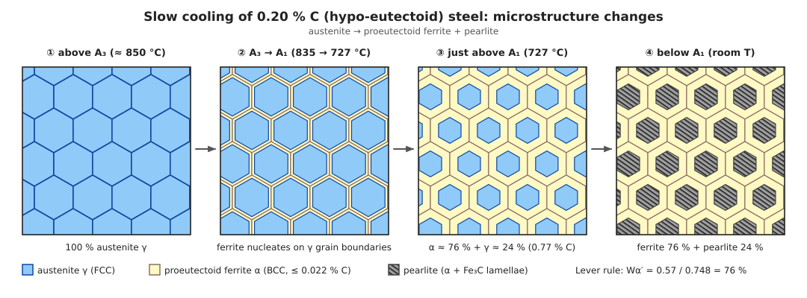

0.20 % C is **hypo-eutectoid** (below 0.77 % C). Follow the vertical line at 0.20 % C on the diagram, from the top:

| Step | Temperature | Change |
|---|---|---|
| 1 | ≈ 1530 °C → 1493 °C | **Liquid** begins to freeze; δ-ferrite forms, the peritectic reaction $L+\delta\rightarrow\gamma$ at 1493 °C consumes δ |
| 2 | ≈ 1490 °C → 1470 °C | **L + γ**: austenite grows until the liquid is used up (complete solidification) |
| 3 | ≈ 1470 °C → 840 °C | **100 % austenite (γ, FCC, 0.20 % C)** – grains grow, cooling is single-phase |
| 4 | ≈ 840 °C ($A_3$) → 727 °C | **Proeutectoid ferrite (α)** nucleates at austenite grain boundaries and grows; ferrite rejects carbon so the remaining austenite becomes richer in C, moving along GS to **0.77 % C** |
| 5 | **727 °C ($A_1$)** | The remaining austenite (0.77 % C) undergoes the **eutectoid reaction** $\gamma\rightarrow\alpha+\mathrm{Fe_3C}$ → **pearlite** |
| 6 | 727 °C → 20 °C | No important change; ferrite loses a little C as cementite (tiny precipitates) |

**Final microstructure:** **proeutectoid ferrite (white) + pearlite (lamellar)**.

**Phase fractions just below 727 °C (lever rule)**

$$W_{\text{proeutectoid }\alpha}=\frac{0.77-0.20}{0.77-0.022}=\frac{0.57}{0.748}=0.762\ (76\,\%)$$

$$W_{\text{pearlite}}=1-0.762=0.238\ (24\,\%)$$

$$W_{\alpha\ (total)}=\frac{6.67-0.20}{6.67-0.022}=0.973,\qquad W_{\mathrm{Fe_3C}}=0.027$$

**Properties:** soft, tough, ductile ($\sigma_u\approx 400$ MPa, 25–30 % elongation); machinable and weldable – typical **mild/low-carbon steel**.

🧪 <b>Practice 5</b> – Same questions for 0.45 % C steel

Proeutectoid ferrite $=\dfrac{0.77-0.45}{0.748}=42.8\,\%$, pearlite $=57.2\,\%$.  
A₃ is ≈ 790 °C. Medium-carbon steel: stronger than 0.20 % C (σ_u ≈ 650 MPa), less ductile.

---

### Q51. Define plain carbon steel and high carbon steel.

**Plain carbon steel:** an iron–carbon alloy containing up to about **1.5 % carbon** (maximum 2.14 %), with small amounts of Mn (0.3–1 %), Si (≤ 0.3 %), S and P (≤ 0.05 %) as residuals, and **no deliberately added alloying element**. Its properties depend almost entirely on carbon content.

| Type | % C | Properties | Uses |
|---|---|---|---|
| Low (mild) | 0.05–0.25 | soft, ductile, weldable | sheets, wires, nails, machine frames |
| Medium | 0.25–0.60 | stronger, heat-treatable | shafts, gears, axles, crankshafts |
| **High carbon** | **0.60–1.5** | **hard, strong, wear-resistant, low ductility** | springs, knives, chisels, files, dies, rails, hacksaw blades |

**High carbon steel:** plain carbon steel with **0.6–1.5 % C**, microstructure of pearlite (+ proeutectoid cementite above 0.77 % C), very hardenable by quenching but brittle and difficult to weld.

---

### Q1. What is cast iron? State the properties of nodular and malleable cast iron.

**Cast iron:** an iron–carbon–silicon alloy containing **2–4.5 % C** (more than 2.14 %) with 0.5–3 % Si, plus Mn, S, P. It melts at 1150–1300 °C (eutectic at 4.3 % C, 1147 °C) so it is easily cast; carbon appears as **graphite** (grey, nodular, malleable) or as **cementite** (white).

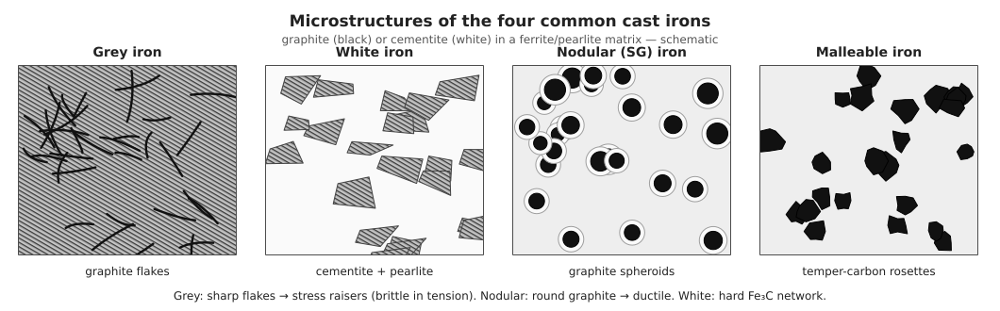

| Type | Carbon form | Properties | Uses |
|---|---|---|---|
| Grey | flakes | good castability, machinability, damping, compressive strength; **brittle in tension** | machine beds, engine blocks, pipes, loom frames |
| White | cementite | very hard, brittle, wear-resistant, unmachinable | mill liners, rolls, malleable-iron precursor |
| **Nodular (SG, ductile)** | **spheroids** | see below | crankshafts, gears, valves |
| **Malleable** | **temper-carbon rosettes** | see below | pipe fittings, brackets, hand tools |

#### Nodular (spheroidal-graphite, ductile) cast iron
*Made by treating molten iron (3.2–4.2 % C, 1.8–2.8 % Si, low S) with 0.03–0.06 % **Mg** (or Ce) and inoculating with ferrosilicon.*

**Properties:**
* Tensile strength **400–800 MPa** (up to > 1000 MPa for austempered ADI)
* **Ductility 2–18 % elongation** – far better than grey iron
* High toughness, fatigue strength, wear resistance
* Good castability and machinability; fair damping
* Spherical graphite does not act as a stress raiser → "steel-like" behaviour.

#### Malleable cast iron
*Made by long **annealing (900–950 °C, 20–60 h)** of white iron (2.2–2.9 % C, 0.9–1.9 % Si): cementite decomposes ($\mathrm{Fe_3C}\rightarrow3\mathrm{Fe}+\mathrm{C}$) to rosette-shaped **temper carbon**.*

**Properties:**
* Tensile strength **300–700 MPa**, elongation **2–18 %**
* Good ductility, shock and impact resistance (can be bent slightly without breaking)
* Excellent machinability; thin sections can be cast
* Types: **blackheart** (ferritic), **whiteheart** (decarburised surface), **pearlitic**.
* Limitation: long heat-treatment cycle → costlier; thickness limited to ≈ 25 mm.

---

### Q10. Discuss the effect of impurities on cast iron.

(*Q16 is the same question – see below.*)

| Element | Typical amount | Effect on cast iron |
|---|---|---|
| **Carbon** | 2–4.5 % | main constituent; as graphite flakes ↓ strength but ↑ machinability and damping; as cementite ↑ hardness (white iron) |
| **Silicon** | 1–3 % | **graphitiser**: promotes grey iron, softens, improves fluidity; too much (> 3 %) embrittles |
| **Sulphur** | < 0.1 % | forms **FeS** (low-melting film at grain boundaries → hot shortness, brittleness); **promotes white iron (carbide stabiliser)**, gas holes. Neutralised by Mn |
| **Manganese** | 0.4–1 % | combines with S as **MnS** (harmless), stabilises pearlite and slightly increases strength/hardness; excess promotes carbides |
| **Phosphorus** | 0.1–1 % | forms hard **steadite** (Fe–Fe₃C–Fe₃P eutectic, mp ≈ 950 °C): ↑ fluidity (good for thin castings), ↑ hardness/wear resistance but ↓ strength, brittle |
| Gases (O, N, H) | traces | blow-holes, pinholes, porosity |

---

### Q16. Briefly discuss the effect of impurities on cast iron.

**Short version of [Q10](#q10):**

1. **Silicon (1–3 %)** – promotes graphite formation → soft, machinable grey iron; improves fluidity.
2. **Sulphur** – makes iron brittle and hot-short; encourages white iron and blow-holes; kept < 0.1 % and neutralised by Mn.
3. **Manganese (0.4–1 %)** – removes S as MnS; increases strength and hardness; stabilises pearlite.
4. **Phosphorus** – forms steadite (low-melting, hard, brittle); gives fluidity for thin castings but lowers strength and toughness; limited to < 0.3 % in strong irons.
5. **Carbon** – decides amount of graphite/cementite and therefore grey or white iron.

---

### Q38. Describe the manufacturing process of cast iron.

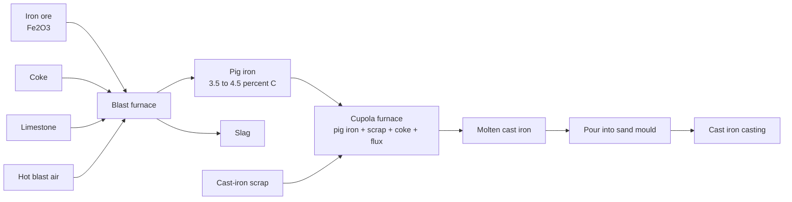

**Stage 1 – Production of pig iron in the blast furnace**

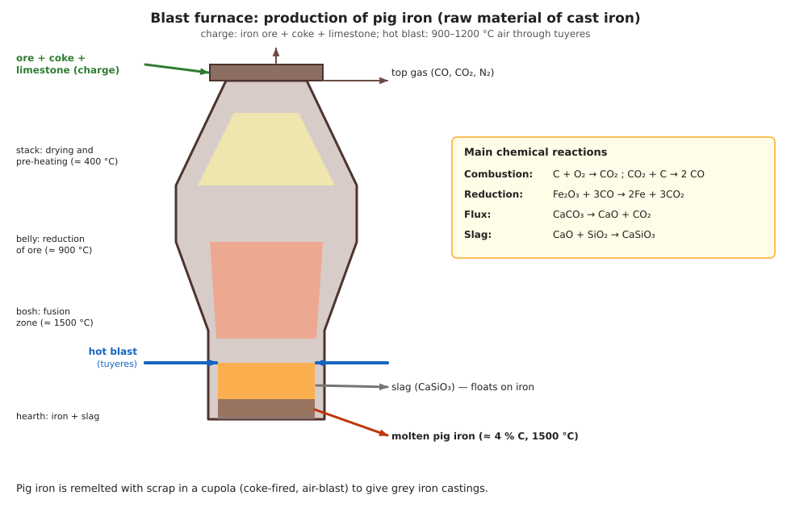

1. **Charge:** iron ore (haematite $\mathrm{Fe_2O_3}$), coke (fuel + reducing agent) and limestone (flux) are fed from the top.
2. **Hot blast** (900–1200 °C) enters through tuyeres: $\mathrm{C+O_2\rightarrow CO_2}$ (exothermic), then $\mathrm{CO_2+C\rightarrow2CO}$.
3. **Reduction:** $\mathrm{Fe_2O_3+3CO\rightarrow2Fe+3CO_2}$.
4. **Flux:** $\mathrm{CaCO_3\rightarrow CaO+CO_2}$; $\mathrm{CaO+SiO_2\rightarrow CaSiO_3}$ (slag, floats on iron).
5. Molten **pig iron** (≈ 4 % C, Si, Mn, S, P) is tapped from the bottom, slag from the upper notch.

**Stage 2 – Remelting in the cupola (foundry)**

1. Pig iron + scrap + coke + limestone are charged in alternate layers into the **cupola** (a small vertical shaft furnace).
2. Air blast burns the coke; iron melts and collects at the well; composition is adjusted (Si, Mn, alloys).
3. Molten iron is tapped into ladles (may be treated with Mg for nodular iron, or inoculated).

**Stage 3 – Casting:** pour into sand moulds (made from patterns), solidify, shake out, fettle (remove runners/risers), clean and, if needed, heat-treat (e.g. annealing for malleable iron). Electric-arc or induction furnaces are used for high-quality irons.

---

### Q50. What is meant by wrought iron? Write its characteristics and uses.

**Wrought iron:** the **purest commercial form of iron** (≥ 99 % Fe, 0.02–0.08 % C) containing **1–3 % fibrous silicate slag** (iron silicate) in its structure; produced by **puddling** pig iron in a reverberatory furnace and then shingling/rolling.

**Characteristics**
* Tough, ductile and **malleable**; high toughness; fibrous fracture
* Can be **forge-welded**; easily worked hot or cold
* Good **corrosion resistance** (slag layers)
* Low carbon → **cannot be hardened** by quenching, low strength (σ_u ≈ 340–380 MPa)
* Cannot be cast (high melting point, ≈ 1500 °C)
* Withstands shock and sudden loads; good fatigue behaviour

**Uses:** chains, anchors, hooks, rivets, nails, bolts, railings and gates, water pipes, crane hooks, ornamental ironwork. Today largely replaced by mild steel.

---

### Q25. State the composition, properties and uses of (i) chromium–nickel steel and (ii) manganese steel.

| | **(i) Chromium–nickel steel** (austenitic stainless, 18-8) | **(ii) Manganese steel** (Hadfield steel) |
|---|---|---|
| **Composition** | 0.08–0.15 % C, **18 % Cr, 8 % Ni**, rest Fe (18/8; also 304) | **11–14 % Mn, 1.0–1.4 % C**, rest Fe |
| **Structure** | austenite (FCC) at room temperature | fully austenitic after water quenching from 1000 °C |
| **Properties** | excellent corrosion and oxidation resistance (Cr₂O₃ film), tough, ductile, non-magnetic, weldable, good at high & low temperature | extremely **tough**, **work-hardens** under impact (surface to 500 HB, core stays tough), non-magnetic, very high wear resistance; difficult to machine |
| **Uses** | dye-house tanks and pipes, kitchenware, cutlery, surgical tools, chemical/food plants, textile machine covers, architecture | rock-crusher jaws, railway crossings and points, excavator teeth, dredger buckets, safes, bullet-proof plate |

> *Note:* "chromium–nickel structural steel" (≈ 3 % Ni, 1 % Cr, 0.3 % C) is also used for gears and shafts because of its toughness and hardenability.

---

### Q61. Define alloy steel. State the purpose of alloying steel.

**Alloy steel:** steel to which one or more alloying elements (Ni, Cr, Mo, V, W, Mn > 1.65 %, Si > 0.6 %, Co, etc.) are **deliberately added** in significant amounts to obtain specific properties. *Low-alloy* < 5 % total; *high-alloy* > 5–10 %.

**Purposes of alloying**
1. Increase **strength and hardness** (solid-solution/precipitation strengthening)
2. Improve **hardenability** (deeper hardening)
3. Improve **toughness**, even at low temperature
4. Improve **corrosion and oxidation resistance** (Cr, Ni)
5. Retain **hot hardness** and creep strength (Mo, W, V, Co)
6. Improve **wear resistance** (carbide formers: Cr, W, V)
7. Grain refinement (V, Ti, Al); better machinability (S, Pb); special magnetic/electrical properties (Si, Ni)

| Element | Main effect | Example steel |
|---|---|---|
| **Ni** | toughness, low-T strength | Ni-steel, 18-8 |
| **Cr** | hardness, corrosion resistance | stainless, tool steel |
| **Mo** | hardenability, creep resistance | Cr–Mo |
| **V** | fine grain, strength | spring steel |
| **W** | red hardness | high-speed steel |
| **Mn** | hardenability, wear | Hadfield steel |
| **Si** | elasticity, magnetic | spring, transformer sheet |
| **Co** | hot hardness | HSS, magnets |

---

# PART D — Heat Treatment

### Q4. What is meant by heat treatment process? What are the purposes of heat treatment?

**Definition.** Heat treatment is a **controlled sequence of heating, soaking (holding) and cooling** of a metal in the **solid state** to obtain the desired microstructure and properties **without changing its shape or composition** (except in case hardening).

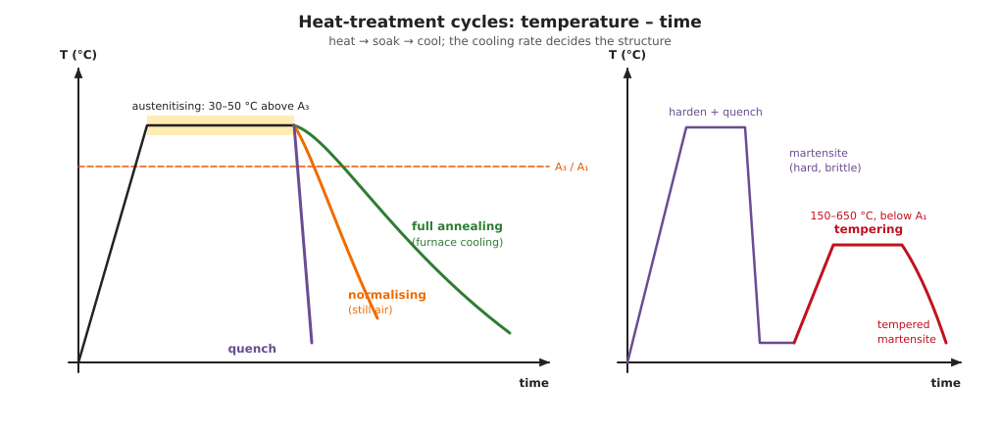

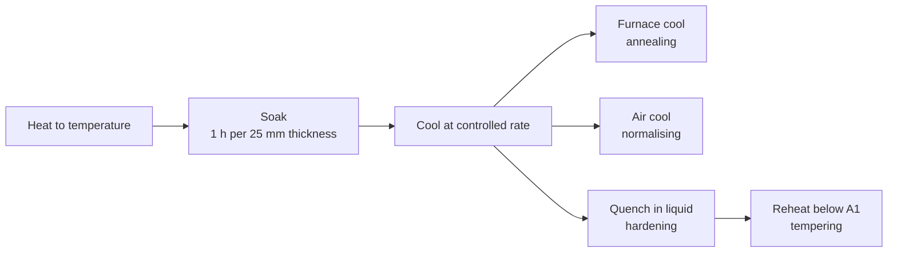

**Purposes**
1. Increase **hardness and strength** (hardening)
2. Increase **ductility and toughness**; remove brittleness (tempering)
3. **Soften** the metal for machining or cold working (annealing)
4. **Refine grain size** and homogenise the structure (normalising)
5. **Relieve internal (residual) stresses** from casting, welding, cold work
6. Improve **machinability** and wear resistance
7. Improve **magnetic/electrical** properties; remove gases
8. Produce a hard surface with a tough core (case hardening, nitriding)

**Principal processes:** annealing · normalising · hardening · tempering · case hardening (carburising, nitriding, cyaniding) · surface hardening (flame, induction).

---

### Q52. Define heat treatment process. What are the purposes of heat treatment?

Same as [Q4](#q4). **Short exam answer:** *Heat treatment is the controlled heating of a solid metal to a definite temperature, holding it there and cooling it at a suitable rate to change its properties. Purposes: ① harden, ② soften, ③ relieve stress, ④ refine grain, ⑤ improve toughness, machinability and wear resistance, ⑥ obtain a hard surface with tough core.*

---

### Q42. What is annealing? Compare full annealing and process annealing.

**Annealing:** heating steel to a suitable temperature, **soaking**, then **very slow cooling (usually in the furnace)** to obtain a soft, ductile, stress-free, coarse-pearlite structure.

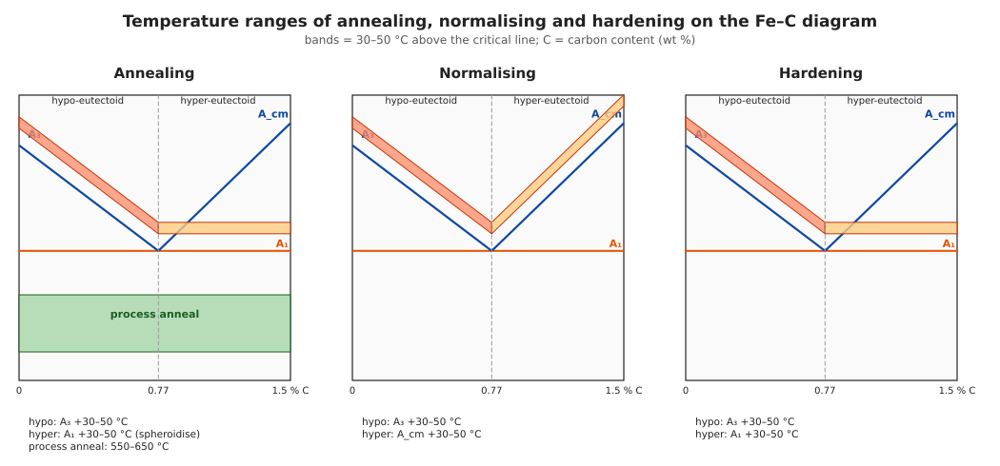

| Feature | **Full annealing** | **Process (sub-critical) annealing** |
|---|---|---|
| Temperature | **30–50 °C above $A_3$** (hypo) or above $A_1$ (hyper) – austenitising | **below $A_1$**: 550–650 °C (recrystallisation range) |
| Structure before | any, coarse, hard | **cold-worked**, distorted grains |
| Phase change | complete transformation to austenite | **none** – only recrystallisation/recovery |
| Cooling | very slow, in furnace | air cool or furnace cool (rate not critical) |
| Result | coarse ferrite + pearlite, maximum softness, uniform | strain-free equiaxed ferrite, ductility restored |
| Used for | castings, forgings, low-/medium-carbon steel | wires, sheets, tubes after cold drawing/rolling, so work can continue |
| Time/cost | long, expensive | short, cheap |

**Other annealing types:** stress-relief anneal (≈ 600 °C), spheroidising (long hold just below $A_1$ → spheroidite for high-carbon steels), diffusion/homogenising (1100 °C, ingots).

**Purposes:** soften, improve machinability and ductility, relieve stress, refine/homogenise grain, prepare for hardening.

---

### Q30. Define hardening. Briefly describe the process of hardening.

**Hardening:** a heat-treatment process in which steel is heated above its **upper critical temperature, soaked**, and **rapidly cooled (quenched)** to obtain **martensite**, increasing hardness and strength.

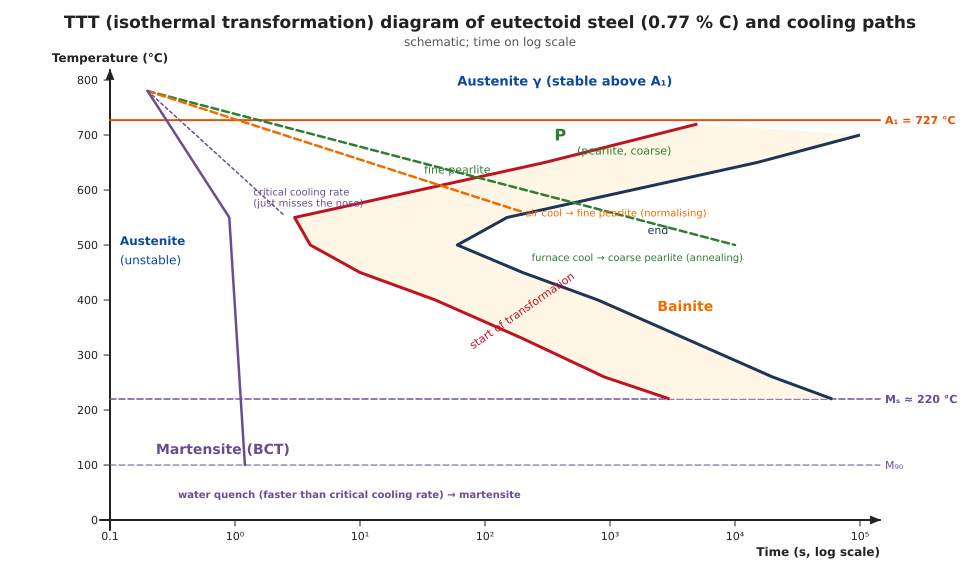

**Process**

1. **Heating:** hypo-eutectoid steel to **$A_3$ + 30–50 °C**; hyper-eutectoid to **$A_1$ + 30–50 °C** (leaving cementite undissolved gives extra hardness and avoids coarse grain).
2. **Soaking:** hold ≈ 1 h per 25 mm thickness so that the section becomes uniformly **austenite**.
3. **Quenching:** cool faster than the **critical cooling rate** (CCR) in water, brine, oil or polymer (see [Q5](#q5)): austenite transforms **diffusionlessly** to **martensite** (BCT, carbon trapped in solution) with a 4 % volume expansion.
4. **Tempering (always follows):** reheating to 150–650 °C to relieve stress and restore toughness.

**Effect of carbon:** hardness of martensite rises with C up to ≈ 0.6 % ($\approx$ 65 HRC); below 0.3 % C steel is not worth hardening.

**Hardenability** (depth to which hardness penetrates) is increased by alloying (Cr, Mo, Mn, Ni). **Defects:** quench cracks, distortion, soft spots, retained austenite, decarburisation.

---

### Q41. Define hardening? Explain the process of hardening.

Same as [Q30](#q30). **Condensed answer in four lines:** *Hardening = heating steel to the austenitising temperature (A₃ + 30–50 °C), soaking, and quenching faster than the critical cooling rate so that austenite changes to hard, brittle martensite. It is followed by tempering to reduce brittleness.*

🧪 <b>Practice 6</b> – Why is a 0.1 % C steel not suitable for through-hardening?

Martensite hardness depends on dissolved carbon; with 0.1 % C the BCT lattice is hardly distorted (≈ 35 HRC max). Such steel is **case-hardened** (carburised) instead.

---

### Q5. What is quenching? Mention the different types of quenching media.

**Quenching:** the **rapid cooling** of austenitised steel (from the hardening temperature) by immersion in a fluid so that cooling exceeds the critical cooling rate, forming martensite.

**Quenching media** (in decreasing severity; H = Grossmann severity, approx.)

| Medium | H-value (approx.) | Remarks / use |
|---|---|---|
| **Brine** (5–10 % NaCl) | 2.0–5.0 | fastest, breaks vapour blanket; risk of cracks; plain-C steels |
| **Caustic soda solution** (3–5 % NaOH) | ≈ 2–5 | very fast, hazardous |
| **Water** | 1.0–1.5 | fast, cheap; distortion/cracking risk |
| **Polymer solutions** (PAG) | 0.3–1.2 | adjustable severity |
| **Oil** (mineral/quenching oil) | 0.25–0.5 | slower; alloy steels; less distortion |
| **Molten salt / hot oil bath** | ≈ 0.2–0.4 | martempering, austempering |
| **Air / gas (nitrogen, argon)** | 0.02 | air-hardening tool steels, normalising, vacuum furnaces |
| Sub-zero (liquid N₂) | – | converts retained austenite |

---

### Q53. What is quenching? Mention the different types of quenching media.

See [Q5](#q5). **Short answer:** Quenching is the rapid cooling of hot steel to obtain martensite. Media: **brine, water, caustic solution, oil, polymer solution, molten salt, air/gas** – listed from most to least severe.

---

### Q43. What is quenching? Briefly explain the mechanism of quenching.

**Quenching** – see [Q5](#q5).

**Mechanism: three stages of cooling in a vaporising liquid**

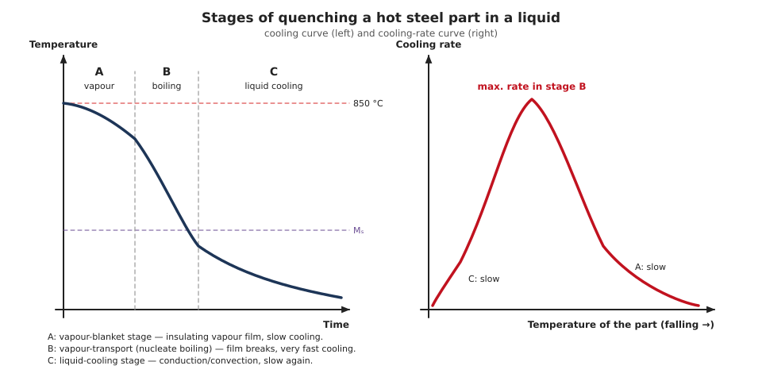

| Stage | Name | What happens | Cooling rate |
|---|---|---|---|
| **A** | **Vapour-blanket** | the red-hot surface instantly vaporises the liquid; a stable **insulating vapour film** surrounds the part; heat leaves only by radiation/conduction through vapour | **slow** |
| **B** | **Vapour-transport (nucleate boiling)** | the film collapses, liquid wets the surface and boils violently; large latent heat is removed | **maximum** (800–500 °C → nose of the TTT curve) |
| **C** | **Liquid cooling** | surface below the boiling point; heat removed by conduction and convection | **slow** (must be slow at 300–200 °C to avoid cracking) |

**Metallurgical mechanism:** to avoid the "nose" of the TTT curve (≈ 550 °C, ≈ 1 s) the part must cool faster than the **critical cooling rate** through stages A→B; austenite is then supercooled and, below $M_s\approx220$ °C (for 0.77 % C), shears into **martensite**. The slower cooling in stage C reduces thermal and transformation stresses.

**Problems:** non-uniform cooling → distortion and **quench cracks** (thermal gradients + 4 % volume expansion of martensite). Remedies: agitate, choose a milder medium, interrupted quenching (martempering), temper immediately.

---

### Q65. What is composite metal? Mention the advantages and disadvantages of heat treatment.

**(a) Composite metal.** A *composite metal* is a **metal-matrix composite (MMC)** – a metal or alloy (Al, Mg, Ti, Cu) matrix reinforced with a second phase such as ceramic particles, whiskers or fibres (SiC, Al₂O₃, B, C) – **or** a **clad (laminated) metal** made by bonding two metals (e.g. copper-clad steel, stainless-clad carbon steel). Result: combination of properties no single metal has: *light, stiff, wear resistant*. Examples: Al–SiC brake discs, WC–Co cutting tools (cermet), Ti–SiC fibre aerospace parts.

**(b) Advantages of heat treatment**
* Increases **hardness, strength, wear resistance**
* Improves **toughness/ductility** (tempering)
* Softens for **machining and forming**
* **Relieves residual stress**, prevents distortion in service
* **Refines grain**, uniform properties
* Gives hard case + tough core; improves magnetic/electrical properties

**Disadvantages**
* Extra **cost, energy and time**; needs furnaces, skilled control
* **Distortion, warping, quench cracks**, residual stress if done badly
* **Surface scale, oxidation and decarburisation** unless protective atmosphere/vacuum is used
* Hardening increases **brittleness**, so tempering is needed
* Not possible for very large/complicated shapes; dimensional changes
* Some metals (pure metals, low-carbon steel) hardly respond

---

# PART E — Corrosion, Protection & Lubricants

### Q13. What are the differences between dry and wet corrosion?

| Basis | **Dry (chemical) corrosion** | **Wet (electrochemical) corrosion** |
|---|---|---|
| Medium | dry gases (O₂, SO₂, Cl₂, H₂S) – **no electrolyte** | **liquid electrolyte** (water, salt solution, moisture) |
| Mechanism | direct chemical attack, adsorption of gas then oxide film | formation of **galvanic cells** with anodic and cathodic areas |
| Temperature | mostly high | ordinary temperatures |
| Electron flow | none (direct electron transfer) | electrons flow through the metal, ions through the liquid |
| Product | formed at the point of attack (film on the surface) | formed **between** anode and cathode (rust away from the pit) |
| Rate | usually slow; depends on film protectiveness (Pilling–Bedworth ratio) | rapid and continuous |
| Nature of attack | uniform | localised (pitting, galvanic, crevice) |
| Examples | scaling of steel in furnaces, tarnishing of Ag in H₂S | rusting of iron in moist air, corrosion of ship hulls, pipes |

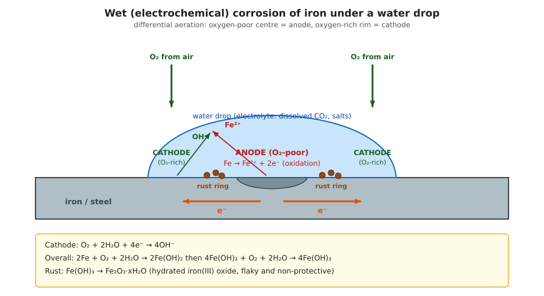

---

### Q33. What are the differences between oxidation and corrosion?

| Basis | **Oxidation** | **Corrosion** |
|---|---|---|
| Meaning | loss of electrons (or combination with oxygen) – a *chemical reaction* | **deterioration of a metal** by chemical/electrochemical reaction with its environment |
| Scope | general term; occurs also in fuels, food, organic substances | applies to metals/alloys (and materials) in service |
| Oxygen | not always required (e.g. Fe → Fe²⁺ + 2e⁻) | oxygen, water, acids, salts, H₂S, SO₂, etc. |
| Reaction pair | only the oxidation half-reaction | **anodic oxidation + cathodic reduction** together |
| Product | oxide layer (may protect – Al₂O₃, Cr₂O₃) | oxides, hydroxides, sulphides, carbonates (rust, verdigris) |
| Effect | may form a **protective film** (passivation) | **gradual destruction**, loss of strength, leaks |
| Examples | burning of Mg, scale on hot steel | rusting of iron, green patina on copper, stress cracking |

Thus **all corrosion involves oxidation of the metal, but not all oxidation is corrosion.**

---

### Q23. Define corrosion. Illustrate the causes of corrosion and corrosion-control techniques.

**Definition.** Corrosion is the **gradual destruction/deterioration of a metal** by chemical or electrochemical reaction with its surrounding environment. Chemically: $\text{metal}\rightarrow\text{metal ion}+ne^-$ (anodic) coupled with a reduction reaction (cathodic).

**Causes of corrosion**

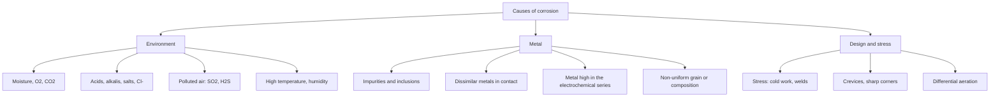

**Mechanism (iron in moist air):** anode $\mathrm{Fe\rightarrow Fe^{2+}+2e^-}$; cathode $\mathrm{O_2+2H_2O+4e^-\rightarrow4OH^-}$; $\mathrm{Fe(OH)_2}$ → rust $\mathrm{Fe_2O_3\cdot xH_2O}$.

**Types of corrosion:** uniform, galvanic, pitting, crevice, intergranular, stress-corrosion (season cracking), erosion, fatigue-corrosion.

**Control techniques**

| Method | How it works | Example |
|---|---|---|
| **Proper design** | avoid crevices, dissimilar metals, water traps | smooth welds, drain holes |
| **Material selection** | use corrosion-resistant metals | stainless steel, Ti, Al |
| **Protective coatings** | barrier between metal and environment | paint, enamel, plastic, galvanizing, tinning, chromium plating, anodising |
| **Cathodic protection** | make the structure the cathode | sacrificial Zn/Mg anodes on ships; impressed-current on pipelines |
| **Anodic protection / passivation** | maintain passive film | stainless steel tanks |
| **Inhibitors** | adsorbed film or reaction with corrosive agent | chromates, nitrites, amines in boilers |
| **Environment control** | remove O₂, moisture, adjust pH | deaerators, silica-gel, dehumidifiers |
| **Alloying** | stable passive film | Cr (≥ 12 %) in steel |

---

### Q49. Define corrosion. How many methods can be applied to prevent corrosion?

**Definition:** see [Q23](#q23).

**Methods of prevention (7 main groups)**

1. **Selection of proper material / alloying** – stainless steel, Cu–Ni, Al alloys.
2. **Proper design** – no crevices, avoid galvanic couples, ensure drainage.
3. **Protective coatings** – *metallic* (galvanizing, tinning, electroplating Ni/Cr, cladding), *inorganic* (anodising, phosphating, enamel, cement), *organic* (paint, varnish, polymer, bitumen, grease).
4. **Cathodic protection** – sacrificial anode (Zn, Mg, Al) or impressed current.
5. **Anodic protection (passivation)**.
6. **Use of corrosion inhibitors**.
7. **Modifying the environment** – deaeration, dehumidification, neutralising acids.

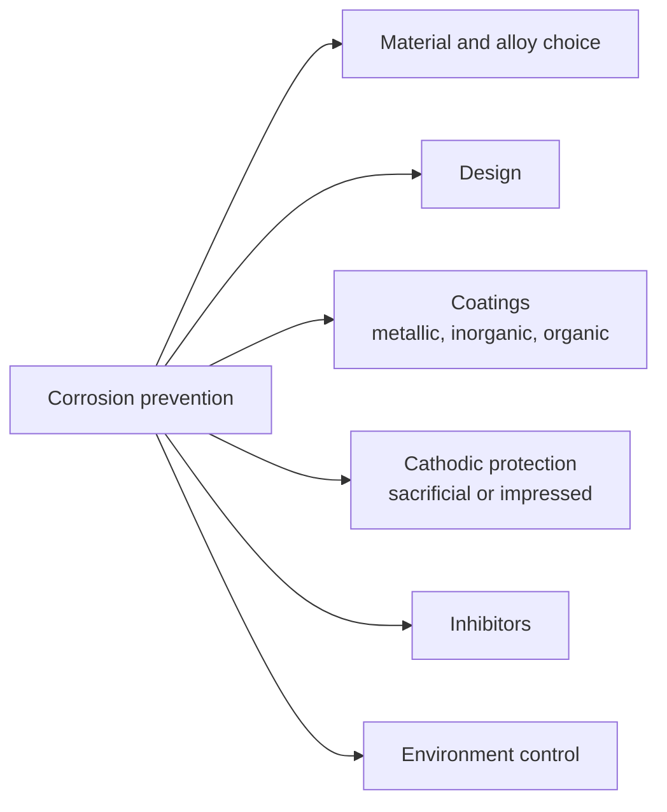

---

### Q22. Differentiate between galvanizing and tinning.

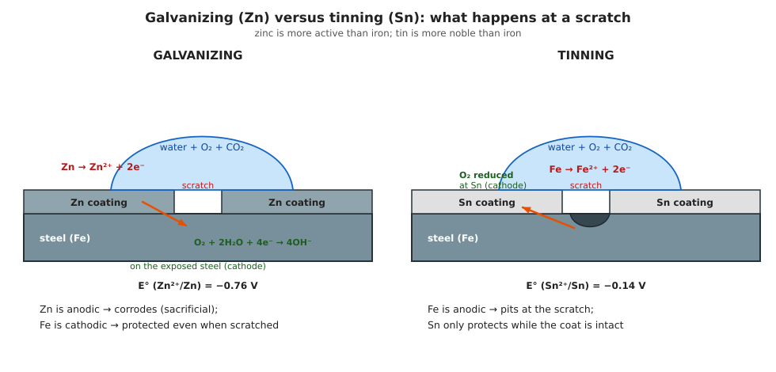

| Basis | **Galvanizing** | **Tinning** |
|---|---|---|
| Coating metal | **Zinc** | **Tin** |
| Method | hot-dip in molten Zn (≈ 450 °C), electro-galvanizing, spraying | hot-dip in molten Sn (≈ 250 °C) or electro-tinning |
| Position in series | Zn ($E^\circ=-0.76$ V) **more active** than Fe ($-0.44$ V) | Sn ($-0.14$ V) **more noble** than Fe |
| Protection type | **barrier + sacrificial (cathodic)**; protects steel even when scratched | **barrier only**; if scratched, Fe becomes the anode and corrodes faster |
| Coating life | 20–50 years outdoors | short once damaged |
| Toxicity | Zn compounds harmful in acidic food | **non-toxic** |
| Uses | roofing sheets, pipes, buckets, wires, fences, bolts, towers | **food cans**, containers, utensils, bearings |

---

### Q34. What is season cracking? Describe the mechanism and protection methods.

**Season cracking** is the **stress-corrosion cracking (SCC) of cold-worked brass (70/30 Cu–Zn)** in the presence of traces of ammonia or ammonium compounds and moisture. It was first noticed in India in the monsoon "season" on brass cartridge cases of the British army – hence the name.

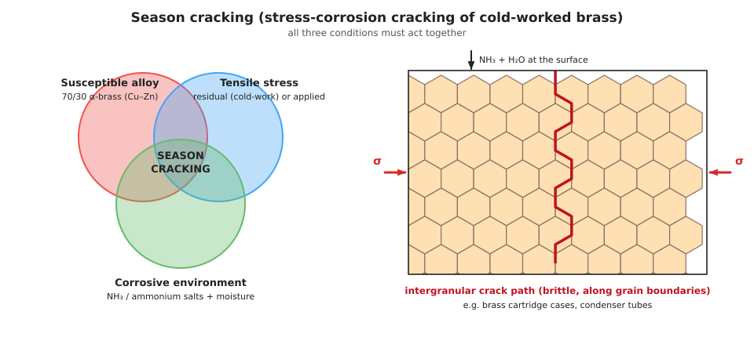

**Mechanism**
1. Deep drawing/cold working leaves **residual tensile stresses** (at the neck and mouth of cases).
2. Moisture + NH₃ (from decaying organic matter, atmosphere) forms a corrosive electrolyte on the surface.
3. Zn-rich **grain boundaries** are anodic and attacked (intergranular corrosion/dezincification).
4. The tensile stress opens the tip of the attacked boundary → **crack advances along grain boundaries** in a **brittle** manner; repeated corrosion–stress steps give failure.
5. Cracks appear suddenly, even after months of storage.

**Protection methods**
* **Stress-relief annealing** at 250–300 °C for about 1 h (most effective)
* Avoid exposure to NH₃, mercury salts and humid polluted air
* Use brass with lower Zn (< 15 %) or add Sn/Si; replace by Cu–Ni alloys
* **Protective coatings** (Sn/Zn plating, lacquer, paint)
* Introduce **compressive surface stress** by shot-peening
* Cathodic protection; control of cold-work (final light anneal)

---

### Q28. Define lubricant. Illustrate the properties of lubricants.

**Lubricant:** a substance (liquid, semi-solid, solid or gas) introduced **between two moving surfaces to reduce friction, wear and heat generation** by forming a separating film.

**Functions:** reduces friction and wear · carries away heat · prevents corrosion · seals · cleans (carries debris) · damps shock/noise.

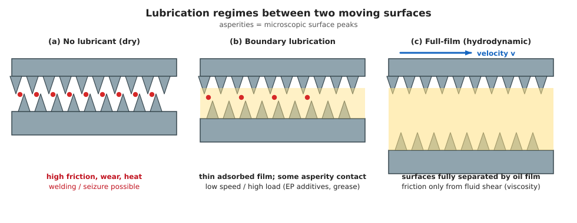

**Types:** liquid (mineral, synthetic and vegetable oils, water emulsions) · semi-solid (**grease**) · solid (graphite, MoS₂, PTFE, talc) · gaseous (air bearings).

**Properties of a good lubricant**

| Property | Meaning / requirement |
|---|---|
| **Viscosity** | resistance to flow; must keep the film under load (SAE grade) |
| **Viscosity index (VI)** | small change of viscosity with temperature (high VI is better) |
| **Oiliness (lubricity)** | ability to adhere and form a boundary film |
| **Flash & fire point** | temperatures at which vapours ignite; should be ≥ 20–40 °C above working temperature |
| **Pour point / cloud point** | lowest temperature at which it flows – must be below the lowest service temperature |
| **Volatility** | low evaporation loss |
| **Oxidation stability** | resists sludge, gum, acid formation |
| **Neutralisation (acid) value** | low acidity, prevents corrosion of the bearing |
| **Demulsibility / emulsification** | separates cleanly from water |
| **Thermal stability** | no decomposition at high temperature |
| **Specific gravity / colour / non-toxicity / cost** | quality and handling considerations |

**Textile applications:** spindle oils, loom (non-staining white) oils, sewing machine oils, greases for bearings; *stain-free* lubricants are essential so fabric is not soiled.

---

# PART F — Polymers, Ceramics, Glass & Composites

### Q54. What is polymerization? Differentiate between thermoplastic and thermosetting polymers.

**Polymerisation:** the chemical process in which many small molecules (**monomers**) join by covalent bonds to form a very large molecule (**polymer**) made of repeating units (**mers**). Degree of polymerisation $DP=\dfrac{M_{polymer}}{M_{mer}}$.

**Types**
* **Addition (chain-growth)** – unsaturated monomers add one after another; no by-product (PE, PVC, PS, PP).
* **Condensation (step-growth)** – bifunctional monomers react with loss of a small molecule such as H₂O (nylon-6,6, polyester PET, Bakelite).

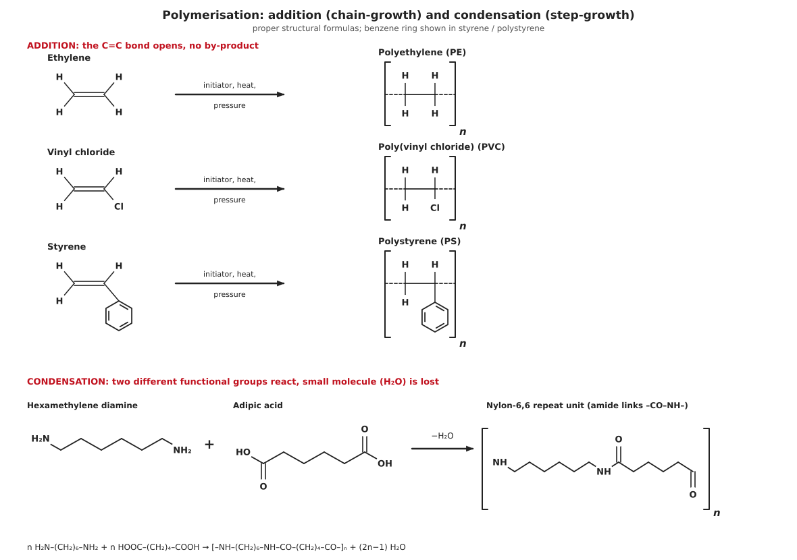

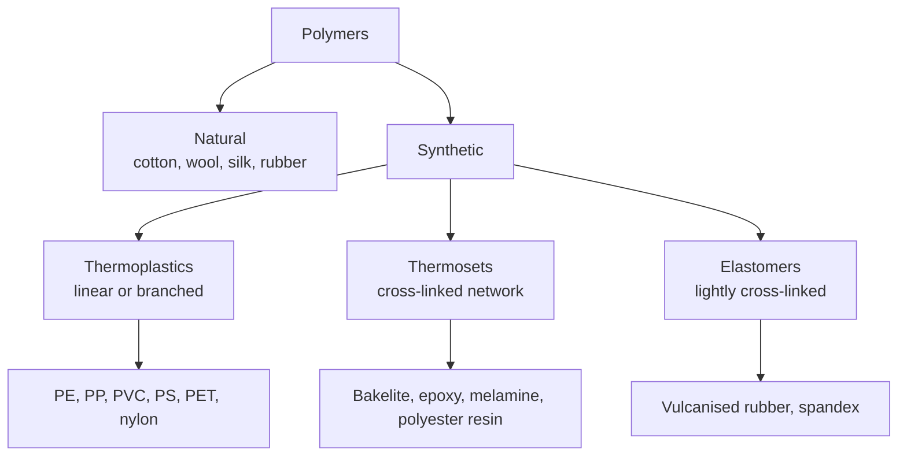

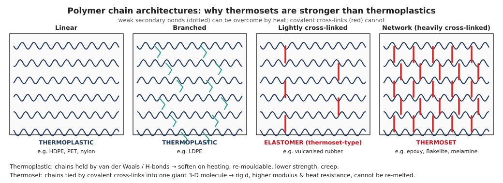

| Basis | **Thermoplastic** | **Thermosetting** |
|---|---|---|
| Structure | linear / branched chains | **cross-linked 3-D network** |
| Bonding between chains | weak **secondary** forces (van der Waals, H-bond) | **primary covalent** cross-links |
| Effect of heat | **softens**, flows; hardens on cooling (reversible) | **sets irreversibly**, chars at high T |
| Remoulding / recycling | possible | **not possible** |
| Strength, modulus | lower | **higher**, rigid |
| Brittleness | tough, flexible | **brittle** |
| Solubility | soluble in solvents | insoluble, swell only |
| Creep / heat resistance | lower | **higher** |
| Processing | injection, extrusion, blow moulding, thermoforming | compression, transfer moulding, casting (cure in mould) |
| Examples | PE, PP, PVC, PS, PET, nylon, PTFE | Bakelite, epoxy, melamine, urea–formaldehyde, polyester resin |

---

### Q12. Why are thermosets stronger than thermoplastics?

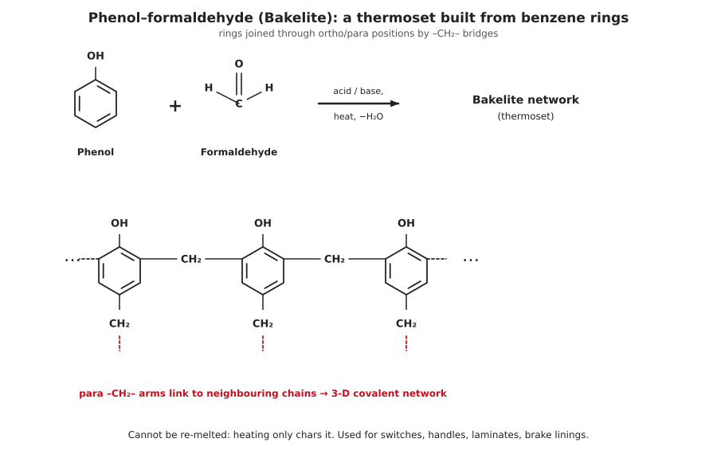

1. In thermosets the chains are linked by **covalent cross-links** (primary bonds, ≈ 300–400 kJ/mol) into **one giant 3-D network**; in thermoplastics the chains are held only by **weak secondary bonds** (≈ 2–40 kJ/mol).
2. Cross-links **prevent chain sliding and uncoiling**, so thermosets show high **modulus, hardness and strength**.
3. The network cannot melt, so strength and shape are retained at higher temperature, with lower creep.
4. Higher cross-link density → higher strength and rigidity (but lower elongation – more brittle).

> Example: a phenol–formaldehyde (Bakelite) resin is rigid and heat-resistant, whereas polyethylene softens at ≈ 100 °C.

---

### Q44. What is a polymer? Describe the injection moulding process of thermoplastic materials.

**Polymer:** a **macromolecule** (molar mass $10^4$–$10^7$) formed by the repeated linking of many small units (**mers**) by covalent bonds, e.g. polyethylene $[\!-\mathrm{CH_2\!-\!CH_2}\!-]_n$. Natural (cellulose, protein, rubber) or synthetic (nylon, PET, PVC).

**Injection moulding** – the most important process for making complex plastic articles in large numbers.

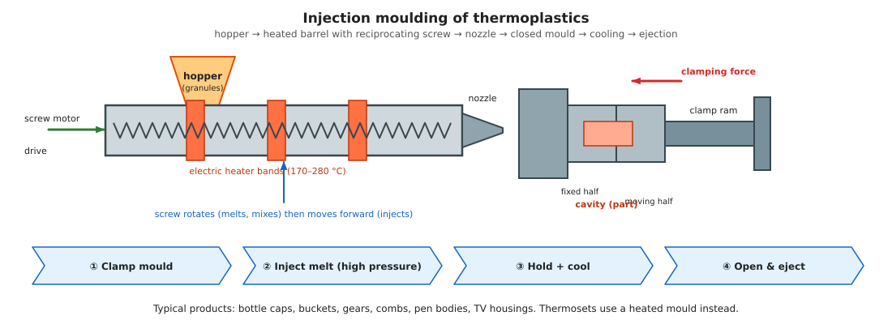

**Steps**
1. **Feeding:** granules enter the barrel from the hopper.
2. **Plasticising:** the rotating screw conveys, shears and, with the heater bands (170–280 °C), **melts** the polymer.
3. **Injection:** the screw moves forward like a plunger and forces the melt through the nozzle into the **closed, cooled mould** (high pressure 70–150 MPa).
4. **Holding & cooling:** pressure is held to compensate shrinkage; the part solidifies (cooling time dominates the cycle).
5. **Ejection:** the clamp opens and ejector pins push the product out; the cycle (10–60 s) repeats.

**Advantages:** fast, high production, complex shapes, little waste (runners can be re-ground), good surface finish. **Limitations:** high tooling cost, only for thermoplastics (thermosets need heated moulds), residual stresses/warpage.

**Products:** bottle caps, combs, buckets, bobbins and spools for yarn, gears, TV/phone housings.

---

### Q55. Describe the process of extrusion moulding.

**Extrusion** is a **continuous process** that forces softened polymer through a shaped die to make products of constant cross-section.

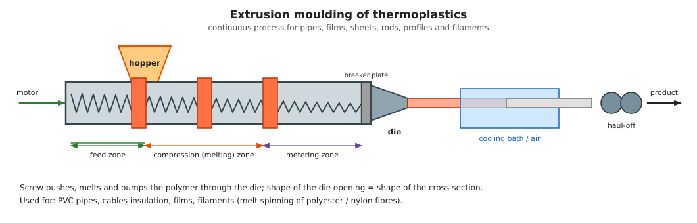

**Steps**
1. Granules fall from the **hopper** into the barrel.
2. A rotating **screw** (feed → compression → metering zones) conveys the material while **heater bands** and shear melt it; the increasing root diameter compresses and homogenises the melt.
3. The melt passes the **breaker plate/screen** (filters impurities, builds pressure) and is forced through the **die**.
4. The extrudate is **cooled** (water bath, air, chill rolls) to fix the shape, then **hauled off** and **cut or coiled**.

**Products:** pipes, tubes, rods, sheets, films (blown/flat), cable insulation, profiles, **monofilaments and melt-spun fibres** (nylon, polyester, polypropylene – very relevant to textiles).

**Advantages:** continuous, economical, uniform; **limitation:** only constant cross-sections.

---

### Q26. Define glass transition. What are the types of glass?

**Glass transition:** the reversible change of an **amorphous material** (glass or polymer) from a hard, rigid, brittle **glassy state** to a soft, viscous or rubbery state on heating, occurring at the **glass-transition temperature $T_g$**. It is *not* a phase change like melting – volume is continuous but the **slope** (thermal-expansion coefficient) and specific heat change; no latent heat and no crystallisation.

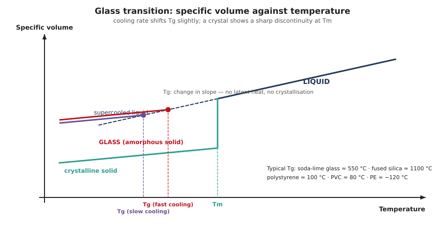

* $T_g$ depends slightly on cooling rate (faster cooling → higher $T_g$); for polymers $T_g\approx\tfrac12$–$\tfrac23\,T_m$.

**Types of glass**

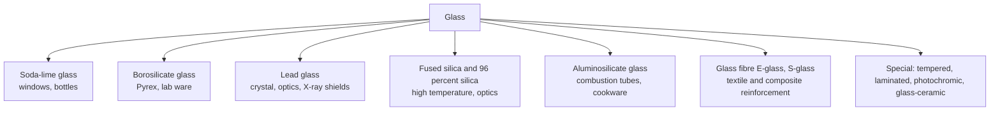

| Type | Approx. composition | Key property | Use |
|---|---|---|---|
| **Soda-lime** | 72 % SiO₂, 14 % Na₂O, 9 % CaO | cheap, easy to form, lowish thermal-shock resistance | sheet, bottles, bulbs |
| **Borosilicate** | 80 % SiO₂, 13 % B₂O₃, 4 % Na₂O | **low expansion (3.3×10⁻⁶/K)**, thermal-shock resistant | lab glassware, ovenware |
| **Lead glass** | 55 % SiO₂, 30 % PbO | high refractive index, brilliance, radiation absorption | cut crystal, optics |
| **Fused silica** | 100 % SiO₂ | highest T, lowest expansion, UV transparent | furnace tubes, optics |
| **Aluminosilicate** | SiO₂–Al₂O₃–CaO | high softening T | halogen lamps, hobs |
| **E-glass fibre** | 54 % SiO₂, 14 % Al₂O₃, 22 % CaO + B₂O₃ | strong, electrical insulator | textile/GFRP reinforcement |

---

### Q56. Define glass transition. What are the types of glass?

Same as [Q26](#q26). **Short answer:** The glass transition temperature $T_g$ is the temperature at which an amorphous solid changes from a hard, glassy state to a soft, rubbery/viscous state (change in slope of the volume–temperature curve, no latent heat). Types: **soda-lime, borosilicate, lead, fused silica, aluminosilicate, glass fibre**, plus tempered, laminated, photochromic glasses and glass-ceramics.

**Typical $T_g$:** polystyrene 100 °C · PVC 80 °C · PET 70–80 °C · nylon-6,6 ≈ 50–60 °C · polyethylene ≈ −120 °C · soda-lime glass ≈ 550 °C · fused silica ≈ 1100 °C.

---

### Q27. What is ceramic material? Classify ceramic materials with examples.

**Ceramic:** an **inorganic, non-metallic solid** composed of metallic and non-metallic elements joined by **ionic/covalent bonds** and normally formed by **shaping and firing (sintering) at high temperature**.

**General properties:** high hardness and compressive strength, **brittle**, very high melting point, excellent heat, wear and corrosion resistance, electrical and thermal insulators, low density (compared with metals).

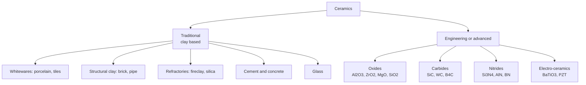

| Class | Examples | Uses |
|---|---|---|
| Whitewares | porcelain, stoneware, tiles | sanitaryware, crockery |
| Structural clay | bricks, drain pipes | construction |
| **Refractories** | fireclay, alumina, magnesia | furnace linings, kilns |
| Abrasives | SiC, Al₂O₃, diamond | grinding wheels, sandpaper |
| Cements | Portland cement | concrete |
| **Glass** | soda-lime, borosilicate | see Q26 |
| **Advanced** | Al₂O₃, Si₃N₄, ZrO₂, SiC | cutting tools, bearings, **yarn guides**, thread guides, engine parts |
| Electro-ceramics | BaTiO₃, PZT | capacitors, piezo sensors |
| Glass-ceramics | Li₂O–Al₂O₃–SiO₂ | cooktops, telescope mirrors |

**Textile relevance:** alumina/zirconia ceramic **thread and yarn guides** (very wear-resistant), ceramic-coated rollers, SiC/Al₂O₃ fibres for technical textiles, ceramic tiles in wet-processing floors.

---

### Q40. Explain the general properties of industrial glass.

| Category | Property |
|---|---|
| **Structure** | amorphous (non-crystalline) network of SiO₄ tetrahedra, no sharp melting point; softens gradually |
| **Optical** | transparent to visible light, refractive index ≈ 1.5; can be coloured by oxides (Co blue, Cr green, Fe brown) |
| **Mechanical** | very hard (Mohs 5.5–6.5), E ≈ 70 GPa, **high compressive strength (≈ 1000 MPa)** but **low tensile strength (30–70 MPa)** due to surface flaws; **brittle** |
| **Thermal** | poor conductor; thermal expansion 0.5–9 × 10⁻⁶/K (borosilicate low) → thermal-shock failure risk; can be tempered |
| **Electrical** | excellent insulator (high resistivity) |
| **Chemical** | highly inert, resistant to water, acids (except HF) and most chemicals |
| **Physical** | density 2.2–2.6 g/cm³; impermeable; can be moulded easily when hot; 100 % **recyclable** |

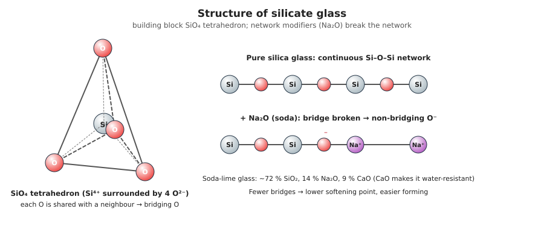

---

### Q57. With necessary sketches, discuss glass-forming methods.

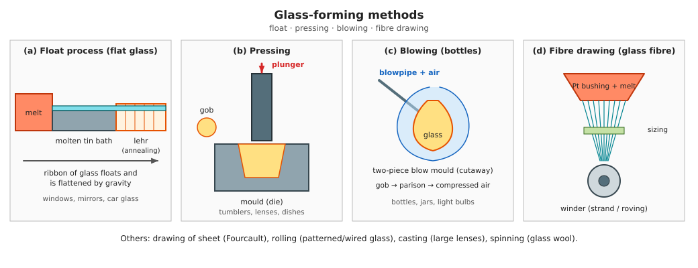

| Method | Principle | Products |
|---|---|---|
| **(a) Float process** | molten glass flows onto a bath of molten **tin**, spreads and becomes perfectly flat, then passes through an annealing **lehr** | window panes, mirrors, car glass |
| **(b) Pressing** | a gob of viscous glass is pressed in a metal mould by a **plunger** | tumblers, dishes, lenses, insulators |
| **(c) Blowing** | gob is first blown into a **parison** (blank mould) and then into the finished shape in a **blow mould** by compressed air (blow-and-blow, press-and-blow) | bottles, jars, bulbs |
| **(d) Fibre drawing** | molten glass runs through **platinum bushing** holes; filaments (5–25 µm) are attenuated by a winder, coated with **sizing** | **glass fibre** for textiles, GFRP, insulation |
| Sheet drawing | continuous drawing up from the melt (Fourcault, Colburn) | older flat glass |
| Rolling | glass squeezed between rolls | patterned/wired glass |
| Casting / centrifugal | pouring/spinning in mould | large lenses, TV funnels |

After forming, glass is **annealed** (to remove thermal stress) and sometimes **tempered** (surface compressive stress).

---

### Q11. What is a composite material? Mention the advantages of composite materials.

**Composite material:** a **multiphase material made by combining two or more chemically different constituents** — a continuous **matrix** (metal, polymer or ceramic) and a **reinforcement** (fibres, particles, flakes) — such that the combination has properties **superior to either constituent alone**.

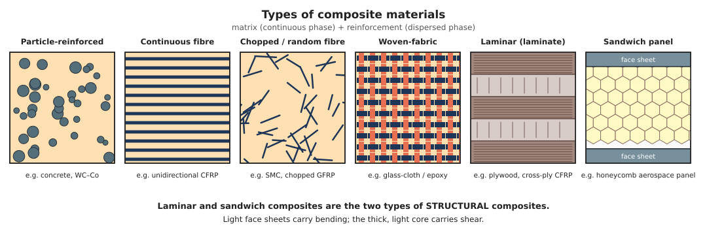

**Advantages**
1. **High specific strength and specific stiffness** (strength/weight) – CFRP is stronger than steel at one-fifth the weight
2. **Light weight** → fuel saving
3. **Corrosion resistance**
4. **Tailored (anisotropic) properties** – fibres placed where loads act
5. Excellent **fatigue** resistance, **low thermal expansion**, good **damping**
6. **Design flexibility** – complex shapes in one piece, part consolidation
7. Good electrical insulation (GFRP) or conductivity (CFRP), radar transparency

**Limitations:** high cost, anisotropy, difficult repair and recycling, brittle failure, moisture absorption, low through-thickness strength.

---

### Q45. Define composite material. Mention the advantages of composite material.

Same as [Q11](#q11). **Condensed answer:** *A composite is a combination of two or more distinct materials – a matrix and a reinforcement – with properties better than the individual components. Advantages: high strength-to-weight ratio, high stiffness, corrosion resistance, fatigue resistance, tailorable properties, design flexibility and low thermal expansion.*

---

### Q58. What is composite? Write some applications of composite materials.

**Composite:** see [Q11](#q11).

| Field | Applications |
|---|---|
| **Aerospace** | fuselage/wing panels (CFRP – Boeing 787, Airbus A350), rotor blades, satellites |
| **Automotive** | body panels, leaf springs, drive shafts, brake discs (Al–SiC) |
| **Marine** | boat hulls, masts (GFRP) |
| **Civil / construction** | reinforced concrete, FRP rebars, bridge decks, cooling towers |
| **Energy** | **wind-turbine blades**, pressure vessels |
| **Sports** | tennis rackets, golf shafts, bicycles, skis, fishing rods |
| **Medical** | prosthetics, dental fillings, bone plates |
| **Textile industry** | **rapier/gripper loom parts**, carbon-fibre rollers, light-weight beams, **technical textiles** (fibre preforms, woven prepregs), protective fabrics |
| **Electrical** | printed-circuit boards (glass/epoxy), insulators |

---

### Q59. Discuss two types of structural composites with figure.

Structural composites have properties that depend on **geometrical design** as well as the constituents. Two types:

**1. Laminar composites (laminates)** – sheets (plies) bonded together with the **fibre direction changed** from layer to layer (0°/90°/±45°) to obtain nearly isotropic in-plane strength.
*Examples:* **plywood**, cross-ply CFRP laminates, bimetallic strips, clad metals, safety glass.

**2. Sandwich panels** – two thin, strong, stiff **face sheets** (Al, GFRP, CFRP) bonded to a thick, **light core** (honeycomb, foam, balsa).
*Principle:* faces carry bending (tension/compression); core resists shear and holds the faces apart – giving very high bending stiffness at very low weight.
*Examples:* aircraft floors/radomes, ship decks, building wall panels, helicopter blades, refrigerator doors.

---

### Q29. With necessary sketches, briefly describe the pultrusion process of composite production.

**Pultrusion** is a **continuous** process for making **constant-cross-section FRP profiles** (rods, I-beams, angles, tubes) in which reinforcing fibres are **pulled** through a resin bath and then a heated die.

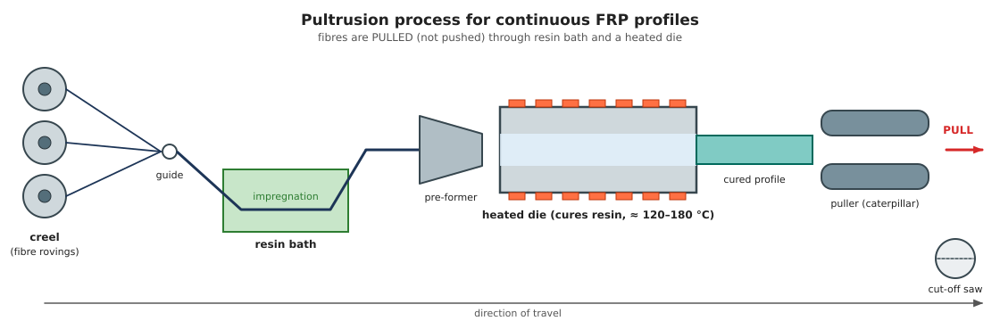

**Steps**
1. **Creel:** spools of fibre rovings/mats (glass, carbon, aramid) are fed under tension.
2. **Resin impregnation:** the fibres pass through a **resin bath** (polyester, vinyl ester, epoxy + catalyst) and are wetted.
3. **Pre-former:** excess resin is squeezed out and the fibres are arranged to the approximate profile shape.
4. **Heated die (120–180 °C):** the shape is finalised and the thermoset resin **cures (cross-links)** as it travels through.
5. **Puller:** caterpillar or reciprocating grippers **pull** the cured profile continuously.
6. **Cut-off saw:** cuts the profile to the required length.

**Advantages:** continuous, high fibre content (50–70 %), excellent axial strength, low labour, little waste. **Limitations:** only constant cross-sections, high die cost. **Uses:** ladders, cable trays, window frames, bridge parts, tool handles.

---

# PART G — Extra Revision Material

## G1. One-page comparison tables

### Steels at a glance

| Steel | % C | Structure (slow-cooled) | Hardenable? | Typical use |
|---|:-:|---|:-:|---|
| Dead mild | 0.05–0.15 | ferrite + little pearlite | no (case-harden) | wire, sheet |
| Mild | 0.15–0.30 | ferrite + pearlite | case only | frames, bolts |
| Medium | 0.30–0.60 | ferrite + pearlite | **yes** | shafts, gears |
| Eutectoid | 0.77 | 100 % pearlite | **yes** | springs, rails |
| High carbon | 0.8–1.5 | pearlite + Fe₃C | **yes** | tools, dies |

### Heat treatments at a glance

| Process | Heat to | Cool | Structure | Purpose |
|---|---|---|---|---|
| Full anneal | A₃ + 30–50 °C | furnace | coarse pearlite + ferrite | softest, ductile |
| Process anneal | 550–650 °C | air | recrystallised ferrite | undo cold work |
| Normalise | A₃/A_cm + 30–50 °C | still air | fine pearlite | refine grain, uniform |
| Harden | A₃ (or A₁) + 30–50 °C | quench | martensite | hard |
| Temper | 150–650 °C | air | tempered martensite | tough |
| Case harden | 900 °C in C-rich medium | quench | hard case/soft core | wear + toughness |

### Tempering temperature guide

| Range | Result | Use |
|---|---|---|
| 150–250 °C | hardness retained (~60 HRC), stress relieved | cutting tools, files |
| 300–400 °C | hard but tougher | springs |
| 450–650 °C | softer, very tough | shafts, gears |

### Hardness tests compared

| Test | Indenter | Result | Unit |
|---|---|---|---|
| Brinell | ball Ø10 mm | dent diameter | HB |
| Rockwell C/B | cone / ball | depth | HRC/HRB |
| Vickers | 136° pyramid | diagonal | HV |
| Mohs | minerals scratch | rank 1–10 | – |

### Classes of material – bonding & behaviour

| Property | Metals | Ceramics | Polymers |
|---|---|---|---|
| Strength | high | high in compression | low–medium |
| Ductility | high | none | medium–high |
| Density | high | medium | low |
| Max. service T | medium–high | **very high** | low |
| Conductivity | high | low | very low |
| Corrosion resistance | poor–good | **excellent** | good |

---

## G2. Mnemonics

* **Phases of Fe–C:** *"Fe-Fe₃C: **A**ll **F**our **C**ome **P**laying"* → **A**ustenite, **F**errite, **C**ementite, **P**earlite.
* **Invariant reactions:** **PEE** – **P**eritectic (1493 °C), **E**utectic (1147 °C), **E**utectoid (727 °C) – temperatures go *down* alphabetically-ish: 1493 → 1147 → 727.
* **Carbon numbers:** *0.022 – 0.77 – 2.14 – 4.3 – 6.67* → "**0-0-7-7**, **2-1-4**, **4-3**, **6-6-7**".
* **Cooling media order (fast → slow):** **B**rine > **W**ater > **O**il > **A**ir → "**B**ig **W**olves **O**ften **A**ttack".
* **Creep stages:** **P**rimary slows, **S**econdary steady, **T**ertiary tears.
* **Stress-strain points:** **P**roportional → **E**lastic → **Y**ield → **U**ltimate → **F**racture → "**P**eople **E**at **Y**ummy **U**don **F**ast".
* **FCC ductile because 12 slip systems; BCC has DBTT; HCP only 3 slip systems.**
* **Zinc protects (anode), tin only covers (cathode).**

---

## G3. Common mistakes & examiner's expectations

| ❌ Common mistake | ✅ Do this |
|---|---|
| APF without stating $n$ and $a$–$r$ relation | always give $n$, the diagonal relation, then substitute |
| Density without units / missing $N_A$ | $g/cm^3$, include $6.022\times10^{23}$ |
| Quenching answer without stages | name stages A, B, C and the media list |
| Fe–Fe₃C diagram without temperatures | mark 727, 912, 1147, 1394, 1493, 1538 °C and 0.022, 0.77, 2.14, 4.3, 6.67 % |
| Corrosion answer with only definition | add **cell diagram + reactions + control methods** |
| Cast iron types without carbon form | state flakes / nodules / rosettes / cementite |
| Thermoset vs thermoplastic: only "heat" | mention **cross-links vs secondary bonds** |
| Missing examples | at least **2 examples** per answer |

### Ideal answer layout (10-mark question)

1. **Definition** (1–2 lines) ➜ 2. **Labelled diagram** ➜ 3. **Points / table** ➜ 4. **Formula or equation** (if any) ➜ 5. **Examples/uses** ➜ 6. **One-line conclusion**.

---

## G4. Mixed practice problems

🧪 <b>P1.</b> Compute the APF of HCP with $c/a=1.633$.

$n=6$, atoms touch along the base edge so $a=2r$. Cell volume (hexagonal prism):

$$V_c=\frac{3\sqrt3}{2}\,a^{2}c=\frac{3\sqrt3}{2}(2r)^{2}(1.633)(2r)=24\sqrt2\,r^{3}$$

$$\mathrm{APF}=\frac{6\cdot\frac43\pi r^{3}}{24\sqrt2\,r^{3}}=\frac{\pi}{3\sqrt2}=0.74$$

🧪 <b>P2.</b> A steel rod 12 mm diameter, 200 mm gauge length, fractures at 56 kN; final length 232 mm, final diameter 8 mm. Find σ_u, %EL, %RA.

$A_0=\pi(12)^2/4=113.1$ mm²; $\sigma_u=56\,000/113.1=495$ MPa  
$\%EL=\dfrac{232-200}{200}\times100=16\,\%$  
$A_f=\pi(8)^2/4=50.27$ mm²; $\%RA=\dfrac{113.1-50.27}{113.1}\times100=55.6\,\%$

🧪 <b>P3.</b> Brinell test with a 10 mm ball, 3000 kgf, d = 3.5 mm. Find HB and estimate σ_u.

$\mathrm{HB}=\dfrac{2(3000)}{\pi(10)(10-\sqrt{100-12.25})}=\dfrac{6000}{31.416(10-9.367)}=\dfrac{6000}{19.89}=302$  
$\sigma_u\approx3.45\times302=1042$ MPa

🧪 <b>P4.</b> A 0.6 % C steel is slowly cooled. Find the fraction of pearlite and proeutectoid ferrite just below 727 °C.

Pearlite $=\dfrac{0.6-0.022}{0.77-0.022}=77.3\,\%$; proeutectoid ferrite $=22.7\,\%$

🧪 <b>P5.</b> Which is the better coating for a steel water tank – zinc or tin? Why?

**Zinc.** Even if scratched, zinc is anodic to iron and corrodes sacrificially, so the steel stays protected. Tin is cathodic to iron; at a scratch the steel corrodes faster.

🧪 <b>P6.</b> Name the stage of quenching and the rate for each: (i) vapour film around hot part, (ii) violent boiling, (iii) liquid convection.

(i) Stage A – slow; (ii) Stage B – fastest; (iii) Stage C – slow.

🧪 <b>P7.</b> Calculate the density of Al (FCC, r = 0.143 nm, A = 26.98).

$a=2\sqrt2(0.143)=0.4045$ nm $=4.045\times10^{-8}$ cm → $V_c=6.62\times10^{-23}$ cm³  
$\rho=\dfrac{4(26.98)}{(6.62\times10^{-23})(6.022\times10^{23})}=2.71\ \text{g/cm}^3$

🧪 <b>P8.</b> A copper tube (E = 110 GPa), D = 50 mm, d = 40 mm, L = 1.5 m carries 60 kN compression. Find σ and δ.

$A=\frac{\pi}{4}(2500-1600)=706.9$ mm²; $\sigma=60\,000/706.9=84.9$ MPa  
$\delta=\dfrac{84.9\times1500}{110\,000}=1.158$ mm

---

## G5. Last-minute checklist

- [ ] Draw Fe–Fe₃C with **all numbers** ([Q17](#q17))
- [ ] Derive **APF BCC & FCC** and the two density problems ([Q2](#q2), [Q9](#q9), [Q7](#q7), [Q48](#q48))
- [ ] Memorise **definitions**: fatigue, creep, endurance limit, toughness, hardness, ductility, brittleness, resilience
- [ ] Draw **S–N**, **creep**, **σ–ε** curves
- [ ] **Heat treatment** family: annealing, normalising, hardening, tempering, quenching stages
- [ ] **Corrosion**: definition, cell, causes, 7 control methods, galvanizing vs tinning, season cracking
- [ ] **Polymers**: polymerisation types, thermoplastic vs thermoset, injection + extrusion sketches
- [ ] **Composites**: definition, advantages, laminar & sandwich, pultrusion
- [ ] **Ceramics & glass**: classification, $T_g$, forming methods
- [ ] Numericals: [Q3](#q3), [Q6](#q6)

---

**📌 File:** `ipe-101-engineering-materials-jtec-2025-suggestions-ques-solve-261116-1.md`  
**Subject:** IPE 101 · Engineering Materials · Level-1 Term-II · B.Sc. Textile Engineering  
*Good luck! 🍀*

