# IPE-101 Engineering Materials: Chapter-wise Exam-Ready Guide

> **Course:** IPE-101 Engineering Materials (EM) · **Format:** exam-style answers + diagrams + worked examples + extra revision sections
> **Built from:** the *IPE-101 EM Chapter-Wise Guide* (index of three source PDFs: Lingkon's notes, Jewel's solved question bank 2015-2024, and the Suggestions set).
> All figures are SVG files kept in [`../../assets/`](../../assets/).

---

## How to use this file

| Symbol | Meaning (from the guide's priority legend) |
|---|---|
| 🔴 **MUST PREPARE** | Repeated across the material and/or a direct exam-style question |
| 🟠 **HIGH PRIORITY** | Clear question or substantial topic, less repetition |
| 🟢 **SUPPORTING** | Short notes and definitions: easy marks after the core topics |

**Study route:** read the *Overall priority order* → solve every 🔴 question on paper once → practise the numericals → finish with *Part B (Extra revision)*.

> [!NOTE]
> Numerical values (temperatures, compositions, strengths) differ slightly between textbooks, for example the eutectoid composition is quoted as 0.76 %, 0.77 % or 0.8 % C. Where this matters, both common values are shown. **Use the numbers given in your own class notes if they differ.**

## Overall priority order

| # | Topic block | Priority | Jump to |
|---|---|---|---|
| 1 | Mechanical properties, stress-strain curve, strength/deformation numericals | 🔴 | [Ch 1A-1B](#1a-engineering-material-classification-and-properties) |
| 2 | Crystal structures, APF, atomic radius, theoretical density | 🔴 | [Ch 1C](#1c-crystal-structure-and-atomic-packing) |
| 3 | Fracture, fatigue, S-N curve, creep curve, ductile-to-brittle transition | 🔴 | [Ch 1B](#1b-stress-strain-and-mechanical-behaviour) |
| 4 | Corrosion, oxidation, dry/wet corrosion, season cracking, prevention | 🔴 | [Ch 1D](#1d-corrosion-and-oxidation) |
| 5 | Cast iron, steels, alloying, iron production, heat treatment | 🔴 | [Ch 3](#chapter-3-iron-and-steel-production-including-heat-treatment) |
| 6 | Polymer types, thermoplastic vs thermoset, moulding processes | 🔴 | [Ch 6](#chapter-6-polymers) |
| 7 | Glass composition, forming, glass transition | 🟠 | [Ch 5](#chapter-5-glasses) |
| 8 | Ceramics: properties, classification, manufacture, defects | 🟠 | [Ch 4](#chapter-4-ceramics) |
| 9 | Composite materials | 🟠 | [Final unit](#final-unit-composite-materials) |
| 10 | Non-ferrous metals and alloys | 🟠 | [Ch 2](#chapter-2-non-ferrous-metals) |
| 11 | Lubricants, smart materials, ASTM/AISI/SAE | 🟢 | [Ch 1E](#1e-lubricants-and-supporting-short-notes) |

## Table of contents

- **Part A: Chapter-wise answers**
  - [Chapter 1: Properties of Metals, Ceramics and Polymers](#chapter-1-properties-of-metals-ceramics-and-polymers)
    - [1A Classification and properties](#1a-engineering-material-classification-and-properties) · [1B Stress, strain, fracture, fatigue, creep, hardness](#1b-stress-strain-and-mechanical-behaviour) · [1C Crystal structure](#1c-crystal-structure-and-atomic-packing) · [1D Corrosion](#1d-corrosion-and-oxidation) · [1E Lubricants, smart materials, standards](#1e-lubricants-and-supporting-short-notes) · [Numerical practice](#chapter-1-numerical-practice)
  - [Chapter 2: Non-Ferrous Metals](#chapter-2-non-ferrous-metals)
  - [Chapter 3: Iron and Steel Production (including Heat Treatment)](#chapter-3-iron-and-steel-production-including-heat-treatment)
  - [Chapter 4: Ceramics](#chapter-4-ceramics)
  - [Chapter 5: Glasses](#chapter-5-glasses)
  - [Chapter 6: Polymers](#chapter-6-polymers)
  - [Final unit: Composite Materials](#final-unit-composite-materials)
- **Part B: Extra revision**
  - [Formula sheet](#b1-formula-sheet) · [One-glance comparison tables](#b2-one-glance-comparison-tables) · [Key numbers to memorise](#b3-key-numbers-to-memorise) · [Mnemonics](#b4-mnemonics-and-memory-hooks) · [Common exam mistakes](#b5-common-exam-mistakes) · [Extra numericals](#b6-extra-practice-numericals-with-answers) · [Viva questions](#b7-viva-questions) · [Final checklist](#b8-final-revision-checklist) · [Figure index](#b9-figure-index)

---

# PART A: CHAPTER-WISE ANSWERS

## Chapter 1: Properties of Metals, Ceramics and Polymers

### 1A. Engineering-material classification and properties

🔴 **MUST PREPARE**

#### Q1.1 Why are the mechanical properties of materials important? Classify engineering materials and explain why their properties must be studied.

**Engineering materials** are the substances (metals, ceramics, polymers, composites) used to make machines, structures, tools and products.

**Why mechanical properties matter**

1. **Safe design:** the part must carry its service load without breaking or deforming permanently (strength, stiffness).
2. **Material selection:** comparing candidates on a common basis, e.g. *specific strength* (strength ÷ density) for aircraft.
3. **Choice of manufacturing process:** ductility and hardness decide whether a metal can be forged, drawn, rolled or machined.
4. **Predicting service life:** fatigue, creep and wear properties tell how long a component will last.
5. **Quality control and standards:** tests such as tensile, hardness and impact verify that a batch meets specification.
6. **Cost and economy:** over-design wastes material; under-design causes failure.

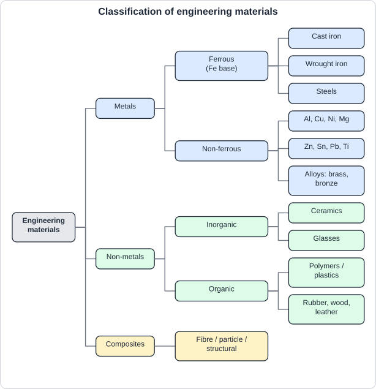

*Fig 1.1: Classification of engineering materials.*

**Classification of material properties**

| Group | What it describes | Examples |
|---|---|---|
| **Mechanical** | response to applied force | strength, hardness, ductility, toughness, fatigue, creep |
| **Physical** | intrinsic physical state | density, melting point, appearance |
| **Thermal** | response to heat | thermal conductivity, expansion, specific heat |
| **Electrical** | response to electric field | conductivity, resistivity, dielectric strength |
| **Magnetic** | response to magnetic field | permeability, coercivity, Curie temperature |
| **Chemical** | reaction with environment | corrosion resistance, oxidation, reactivity |

> [!TIP]
> **Exam tip:** begin with a one-line definition, give the figure above, and end with 3-4 numbered reasons. This pattern covers the 5-6 mark answer.

---

#### Q1.2 Classify engineering materials with a diagram. Distinguish metals from non-metals.

Use **Fig 1.1** (above) for the classification.

**Metalloids:** elements with properties *between* metals and non-metals (semiconducting). Examples: **boron, silicon, germanium, arsenic, antimony, tellurium**. Silicon and germanium are the basis of electronics.

| Property | Metals | Non-metals |
|---|---|---|
| Bonding | metallic (sea of electrons) | covalent / ionic / van der Waals |
| Lustre | shiny | dull (except graphite, iodine) |
| Electrical / thermal conductivity | high | low (insulators), except graphite |
| Ductility / malleability | ductile and malleable | brittle (solids) |
| Density | generally high | generally low |
| Strength | high tensile strength | mostly low tensile, high compressive (ceramics) |
| Melting point | moderate to high | wide range (polymers low, ceramics very high) |
| Sound | sonorous | non-sonorous |
| Examples | Fe, Cu, Al, Zn | ceramics, glass, plastics, rubber, wood |

---

#### Q1.3 Define ferrous and non-ferrous metals; give examples. Explain the classification of metals.

- **Ferrous metals:** iron-based; iron is the principal constituent (carbon content separates the groups). Examples: **cast iron, wrought iron, plain-carbon and alloy steels**.
- **Non-ferrous metals:** contain no (or negligible) iron. Examples: **Al, Cu, Zn, Sn, Pb, Ni, Mg, Ti** and their alloys (brass, bronze, duralumin).

| | Ferrous | Non-ferrous |
|---|---|---|
| Base | Fe | Al, Cu, Ni, Mg, Zn, Ti ... |
| Magnetic | usually (ferromagnetic) | usually not (Ni, Co are exceptions) |
| Strength | high, cheap per strength | lower; high strength-to-weight (Al, Mg, Ti) |
| Corrosion | rusts (except stainless) | generally better resistance |
| Conductivity | lower | Cu, Al excellent |

**Classification summary:** Metals → *ferrous* (cast iron, wrought iron, steels) and *non-ferrous* (light metals Al, Mg, Ti; heavy metals Cu, Pb, Zn, Ni; and their alloys). See the left branch of Fig 1.1.

---

#### Q1.4 Differentiate an alloy, a composite material and a compound.

| Feature | **Alloy** | **Composite** | **Compound** |
|---|---|---|---|
| What it is | metal + other element(s) fused into a *solid solution or intermetallic* | two or more **distinct phases** physically combined | elements **chemically combined** in a fixed ratio |
| Bonding between constituents | metallic (atomic scale mixing) | interface only; phases keep identity | chemical (ionic/covalent) |
| Composition | variable within limits | variable (volume fraction chosen) | fixed (law of definite proportions) |
| Properties | improved version of base metal | combines properties of the phases | new properties unlike the elements |
| Can be separated by physical means? | no | yes (e.g. burn off the resin) | only by chemical reaction |
| Example | brass (Cu + Zn), steel (Fe + C) | glass-fibre-reinforced epoxy, concrete | NaCl, Al₂O₃, Fe₃C |

---

#### Q1.5 Define strength, elasticity, ductility, brittleness, toughness, hardness and resilience.

| Property | Definition | Typical example / measure |
|---|---|---|
| **Strength** | ability to resist external load without failure (yielding or fracture) | yield strength, UTS (MPa) |
| **Elasticity** | ability to regain original shape after the load is removed | spring steel; modulus E |
| **Plasticity** | ability to deform permanently without fracture | forging of hot steel |
| **Stiffness** | resistance to *elastic* deformation | modulus of elasticity E |
| **Ductility** | ability to undergo large plastic deformation in tension (drawn into wire) | Au, Cu, Al; % elongation, % reduction in area |
| **Malleability** | ability to be hammered/rolled into sheets (compression) | Pb, Au, Al foil |
| **Brittleness** | fracture with little or no plastic deformation | cast iron, glass, ceramics |
| **Toughness** | energy absorbed per unit volume up to fracture (area under σ-ε curve) | Charpy / Izod impact energy |
| **Hardness** | resistance to indentation, scratching or local plastic deformation | Brinell, Rockwell, Vickers |
| **Resilience** | energy absorbed per unit volume in the *elastic* range, recoverable | modulus of resilience $`U_r = \sigma_y^2/2E`$ |
| **Machinability** | ease of cutting with acceptable tool life and finish | free-cutting brass, leaded steel |
| **Wear resistance** | resistance to surface material loss by sliding/abrasion | tool steel, hard-faced parts |

**Ductile vs tough vs strong:** a material can be strong but not tough (glass, hardened steel), or ductile but not strong (pure lead).

---

#### Q1.6 Define creep, fatigue and endurance limit.

- **Creep:** slow, *time-dependent* permanent deformation under a **constant stress** (often below yield), important at high temperature (above about $`0.4\,T_m`$ in kelvin). Detail in [Q1.11](#q111-define-creep-draw-the-creep-curve-and-explain-primary-secondary-and-tertiary-creep).
- **Fatigue:** progressive, localised failure of a material under **repeated or fluctuating stress**, at stresses well below the static UTS. Detail in [Q1.10](#q110-define-fatigue-draw-and-explain-the-s-n-curve-and-mark-the-endurance-limit).
- **Endurance limit (fatigue limit):** the **maximum stress amplitude** that a material can withstand for an *infinite* (practically $`10^7`$ or more) number of cycles without failure. Exhibited by steels and titanium; aluminium and copper alloys have none, so a *fatigue strength at $`10^8`$ cycles* is quoted.

---

### 1B. Stress, strain and mechanical behaviour

🔴 **MUST PREPARE**

**Engineering stress and strain**

```math
\sigma = \frac{P}{A_0}, \qquad \varepsilon = \frac{\Delta L}{L_0} = \frac{L - L_0}{L_0}
```

where $`P`$ is the axial load, $`A_0`$ the *original* cross-sectional area and $`L_0`$ the original gauge length. In the elastic region **Hooke's law** gives

```math
\sigma = E\,\varepsilon \quad\Rightarrow\quad E = \frac{\sigma}{\varepsilon}
```

$`E`$ (modulus of elasticity, Young's modulus) is the *slope* of the straight part of the curve: steel ≈ 200-210 GPa, aluminium ≈ 70 GPa, copper ≈ 110-120 GPa.

---

#### Q1.7 Draw the stress-strain curve for mild steel and explain/label every important point.

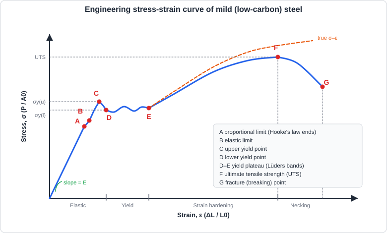

*Fig 1.2: Engineering stress-strain curve of mild (low-carbon) steel. The orange dashed line is the true stress-strain curve.*

| Point | Name | Meaning |
|---|---|---|
| **O → A** | elastic (proportional) region | stress ∝ strain; slope = E; fully recoverable |
| **A** | **proportional limit** | last point where the curve is a straight line (Hooke's law valid) |
| **B** | **elastic limit** | maximum stress after which unloading leaves permanent set; very close to A |
| **C** | **upper yield point** | stress at which yielding starts; sudden drop follows (steel with interstitial C, N pins dislocations) |
| **D** | **lower yield point** | steady stress at which plastic flow continues; used as the **yield strength** σy (more reproducible) |
| **D → E** | yield plateau | strain increases at roughly constant stress by Lüders band propagation |
| **E → F** | strain-hardening region | stress rises with strain because dislocation density increases |
| **F** | **ultimate tensile strength (UTS)** | maximum engineering stress; necking begins after this |
| **F → G** | necking | local reduction of area; *engineering* stress falls because $`A_0`$ is still used |
| **G** | **fracture (breaking) point** | specimen separates (cup-and-cone fracture) |

**Typical values for mild steel:** yield ≈ 250 MPa, UTS ≈ 400-500 MPa, elongation ≈ 20-25 %, E ≈ 200 GPa.

**Ductility measures**

```math
\%EL = \frac{L_f - L_0}{L_0}\times 100,\qquad \%RA = \frac{A_0 - A_f}{A_0}\times 100
```

**Extras worth adding to the answer**

- **Materials without a clear yield point** (aluminium, copper): draw a line parallel to the elastic slope from **0.2 % strain** (offset method); its intersection with the curve is the *0.2 % proof stress*.
- **Toughness** = total area under the curve; **resilience** = area under the elastic part only.
- **True stress** $`\sigma_T = \sigma(1+\varepsilon)`$ keeps rising to fracture because the actual area shrinks.

> [!TIP]
> Always label A-G on the diagram and write the axis names with units. Examiners give most marks for the labelled figure.

---

#### Q1.8 Define fracture. Classify fracture and distinguish ductile fracture from brittle fracture.

**Fracture** is the separation of a solid body into two or more pieces under the action of stress.

**Classification**

- **By amount of plastic deformation:** ductile fracture and brittle fracture.
- **By cause / loading condition** (as listed in the question-bank notes): **fatigue** fracture (cyclic loads), **creep** fracture (high temperature, sustained load) and **stress-corrosion** fracture (stress + corrosive environment).

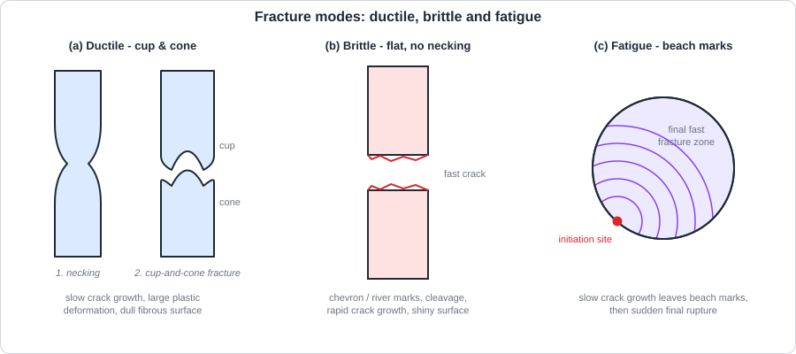

*Fig 1.3: Fracture modes.*

| Feature | **Ductile fracture** | **Brittle fracture** |
|---|---|---|
| Plastic deformation | extensive, with necking | very little or none |
| Warning before failure | yes (visible deformation) | none: sudden |
| Crack propagation | slow, stable; needs increasing stress | very fast (near speed of sound), unstable |
| Energy absorbed | high | low |
| Surface appearance | dull, fibrous; **cup-and-cone** | bright, granular/flat; chevron (river) marks |
| Micro-mechanism | micro-void coalescence (dimples) | cleavage (transgranular) or intergranular |
| Typical materials | mild steel, Al, Cu, Au above DBTT | cast iron, glass, ceramics, steel below DBTT |
| Crack path at 45° | shear lip at the edges | perpendicular to the tensile stress |

**Steps of ductile (cup-and-cone) fracture:** necking → micro-voids form in the neck centre → voids join into an elliptical crack ⟂ to the load → crack grows toward the surface along 45° shear planes (cone and cup).

**Griffith's brittle-fracture criterion** (extra mark): fracture stress $`\sigma_c = \sqrt{2E\gamma_s/\pi a}`$, where $`a`$ is half the length of the largest flaw. Long flaws make brittle materials weak in tension.

---

#### Q1.9 What is DBTT? Explain its importance with an example.

**Ductile-to-brittle transition temperature (DBTT)** is the temperature (or narrow range) below which a normally ductile material fractures in a **brittle** manner and absorbs far less impact energy. It is found from **Charpy/Izod impact tests** at various temperatures.

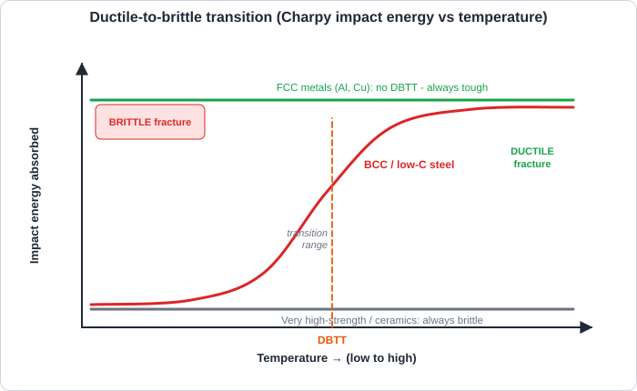

*Fig 1.4: Impact energy vs temperature. BCC metals show a transition; FCC metals do not.*

**Key points**

- Shown by **BCC and some HCP metals** (low-carbon steel, Zn); **FCC metals (Al, Cu, Ni, austenitic stainless steel) do not** show a transition.
- Raised by: higher C, P and S, coarse grains, high strain rate, notches. Lowered by: **Ni, Mn**, fine grains, low impurity (S, P).
- **Importance:** structures in cold service (ships, bridges, pipelines, pressure vessels, Arctic equipment) must be made of steel whose DBTT is *well below* the lowest service temperature.

**Example: RMS Titanic (1912).** The hull steel and rivets had high sulphur/phosphorus content, so their DBTT was above the icy sea-water temperature (≈ −2 °C). On striking the iceberg the plates failed in a brittle manner instead of bending, and the hull split. A similar failure occurred in the WWII **Liberty ships**.

---

#### Q1.10 Define fatigue. Draw and explain the S-N curve and mark the endurance limit.

**Fatigue** is the progressive, localised and permanent structural change that occurs in a material subjected to **repeated or fluctuating stresses**, ending in fracture at stresses **below the tensile (and even yield) strength**. It causes roughly 90 % of mechanical service failures (bridges, aircraft wings, shafts, springs, rail axles).

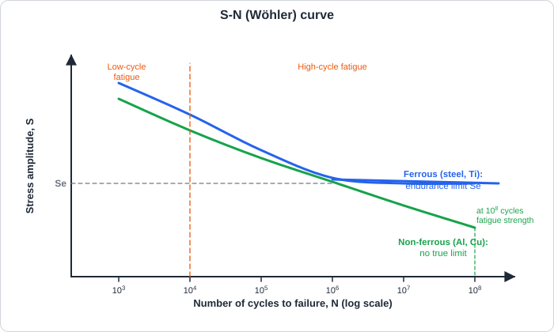

*Fig 1.5: S-N (Wöhler) curve for ferrous and non-ferrous metals.*

**Explanation of the S-N curve**

- Plot of **stress amplitude S** against **number of cycles to failure N** (log scale).
- Higher stress → fewer cycles. Below about $`10^4`$ cycles is **low-cycle fatigue** (plastic strain each cycle); above is **high-cycle fatigue** (elastic strain).
- **Ferrous metals and titanium:** the curve becomes **horizontal** at the **endurance limit $`S_e`$**; for steels roughly $`S_e \approx 0.4\text{-}0.5\,\sigma_{UTS}`$. Below $`S_e`$ the life is infinite.
- **Non-ferrous metals (Al, Cu, Mg):** the curve keeps falling, so **fatigue strength** is quoted at a fixed life, e.g. $`10^8`$ cycles.

**Three stages of fatigue failure:** (1) crack **initiation** at a stress concentrator or surface flaw; (2) slow crack **propagation** leaving **beach marks** and striations; (3) **final rapid fracture** when the remaining section cannot carry the load (see Fig 1.3c).

**How to improve fatigue life:** smooth polished surfaces, generous fillet radii (avoid sharp corners/keyways), **shot peening** (compressive residual stress), surface hardening (carburising, nitriding), avoid corrosive environments, reduce stress amplitude.

---

#### Q1.11 Define creep. Draw the creep curve and explain primary, secondary and tertiary creep.

**Creep** is the slow, continuous, time-dependent plastic deformation of a material under a **constant load (stress)**, significant at **high temperature (> 0.4 $`T_m`$)** but also possible at room temperature in low-melting metals such as lead. Examples: gas-turbine blades, boiler and steam-pipe walls, furnace parts, tungsten lamp filaments.

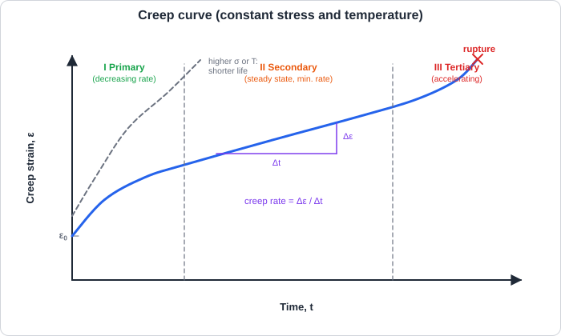

*Fig 1.6: Creep curve at constant stress and temperature.*

| Stage | Creep rate | Reason |
|---|---|---|
| **Instantaneous** $`\varepsilon_0`$ | n/a | elastic (and some plastic) strain on loading |
| **I. Primary (transient)** | decreasing | strain hardening makes further deformation harder |
| **II. Secondary (steady state)** | **constant, minimum**; the longest stage | balance of work hardening and thermal recovery |
| **III. Tertiary** | increasing rapidly | necking, internal voids, micro-cracks reduce the area → **rupture** |

**Design rule:** the steady-state creep rate $`\dot\varepsilon_s = \Delta\varepsilon/\Delta t`$ decides component life. Higher stress or temperature raises the rate and shortens life (grey dashed curve).

**Creep-resistant materials:** high melting point, large grain size (or single crystals), solid-solution and precipitation strengthening: e.g. **nickel-base superalloys** for turbine blades.

---

#### Q1.12 Define hardness and describe the Brinell hardness test, including the measurement of indentation. Name other hardness tests.

**Hardness** is the resistance of a material to **indentation, scratching or localised plastic deformation**.

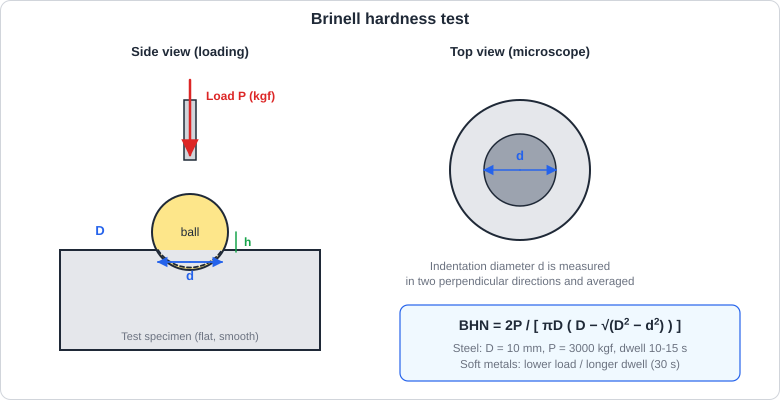

*Fig 1.7: Brinell test: loading and measurement of the impression.*

**Brinell test procedure**

1. Prepare a **flat, smooth** specimen (thickness ≥ 10 × impression depth).
2. Press a **hardened-steel (or tungsten-carbide) ball**, diameter $`D`$ (usually **10 mm**), into the surface with a load $`P`$ (**3000 kgf** for steels, 500 kgf for soft metals).
3. Hold the load for **10-15 s** (30 s for soft metals), then remove it.
4. Measure the **indentation diameter $`d`$** with a low-power microscope in two perpendicular directions and average.
5. Calculate

```math
\mathrm{BHN} = \frac{2P}{\pi D\left(D - \sqrt{D^{2}-d^{2}}\right)}\quad(\text{kgf/mm}^2)
```

**Worked example.** $`P = 3000`$ kgf, $`D = 10`$ mm, $`d = 4`$ mm:

```math
\mathrm{BHN}=\frac{2(3000)}{\pi(10)\left(10-\sqrt{100-16}\right)}=\frac{6000}{31.416\times 0.835}\approx 229\ \text{kgf/mm}^2
```

**Rule of thumb:** for steels $`\sigma_{UTS}\,(\text{MPa}) \approx 3.45 \times \mathrm{BHN}`$ → about 790 MPa for this example.

**Advantages / limits:** simple; averages over coarse structure (good for castings). Not for very hard or thin parts (ball deforms, leaves a large mark).

**Other hardness tests**

| Test | Indenter | Measures | Used for |
|---|---|---|---|
| **Rockwell** (B, C scales) | steel ball (B) / diamond cone 120° (C) | **depth** of penetration (minor 10 kgf + major load) | quick shop-floor test |
| **Vickers** | diamond square pyramid, 136° | diagonal $`d`$; $`HV = 1.854P/d^2`$ | all materials, thin sections |
| **Knoop** | elongated rhombic diamond pyramid | long diagonal (micro-hardness) | thin coatings, brittle materials |
| Shore (scleroscope / durometer) | rebound hammer / spring needle | rebound height / depth | rubbers, polymers |
| Mohs | scratch scale 1-10 | relative scratch hardness | minerals |

---

### 1C. Crystal structure and atomic packing

🔴 **MUST PREPARE**

#### Q1.13 Differentiate crystalline and amorphous solids.

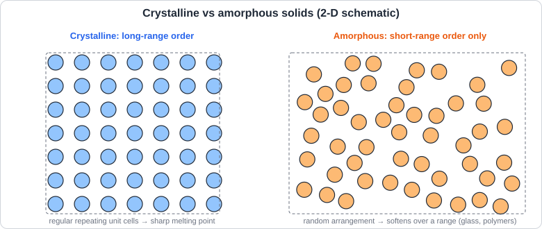

*Fig 1.8: Long-range order (left) vs short-range order only (right).*

| Feature | **Crystalline** | **Amorphous** |
|---|---|---|
| Atomic arrangement | regular, repeating, **long-range order** | random, **short-range order** only |
| Melting | sharp melting point | softens gradually over a range (glass transition) |
| Properties | **anisotropic** (single crystals) | **isotropic** |
| Cleavage | breaks along definite planes | irregular (conchoidal) fracture |
| X-ray diffraction | sharp peaks | broad halo |
| Examples | all metals, NaCl, quartz, diamond | glass, most polymers, rubber, gels |

---

#### Q1.14 Define crystal lattice and unit cell. Draw/describe SC, BCC and FCC structures and calculate the number of atoms per unit cell.

- **Crystal lattice:** a regular three-dimensional array of **lattice points**; every point has identical surroundings.
- **Unit cell:** the smallest repeating block of the lattice which, when stacked in three dimensions, generates the whole crystal. Described by edge lengths $`a, b, c`$ and angles $`\alpha, \beta, \gamma`$.

**Seven crystal systems**

| System | Edges | Angles | Example |
|---|---|---|---|
| Cubic | $`a=b=c`$ | $`\alpha=\beta=\gamma=90^\circ`$ | Cu, Fe, NaCl |
| Tetragonal | $`a=b\neq c`$ | all 90° | white Sn, TiO₂ |
| Orthorhombic | $`a\neq b\neq c`$ | all 90° | α-S, Fe₃C |
| Rhombohedral (trigonal) | $`a=b=c`$ | $`\alpha=\beta=\gamma\neq 90^\circ`$ | Bi, Sb, calcite |
| Hexagonal | $`a=b\neq c`$ | $`\alpha=\beta=90^\circ,\ \gamma=120^\circ`$ | Mg, Zn, Ti, Co |
| Monoclinic | $`a\neq b\neq c`$ | $`\alpha=\gamma=90^\circ\neq\beta`$ | gypsum |
| Triclinic | $`a\neq b\neq c`$ | none = 90° | CuSO₄·5H₂O |

(These seven systems contain 14 Bravais lattices.)

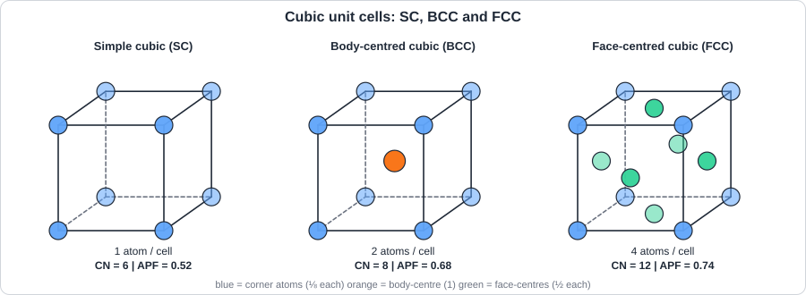

*Fig 1.9: Cubic unit cells.*

**Counting atoms per unit cell**

| Position | Share inside the cell |
|---|---|
| Corner atom | 1/8 (shared by 8 cells) |
| Face-centre atom | 1/2 (shared by 2 cells) |
| Body-centre atom | 1 (belongs wholly to the cell) |

| Structure | Calculation | Atoms / cell | Coordination no. | Examples |
|---|---|---|---|---|
| **SC** | 8 × 1/8 | **1** | 6 | α-Po (rare) |
| **BCC** | 8 × 1/8 + 1 | **2** | 8 | α-Fe, Cr, W, Mo, V, Na |
| **FCC** | 8 × 1/8 + 6 × 1/2 | **4** | 12 | Al, Cu, Ag, Au, Ni, Pb, γ-Fe |
| HCP (extra) | 12 × 1/6 + 2 × 1/2 + 3 | **6** | 12 | Mg, Zn, Ti, Co |

#### Q1.15 Define APF and calculate it for SC, BCC and FCC. Show the steps.

**Atomic packing factor (APF)** = fraction of the unit-cell volume occupied by atoms (hard spheres of radius $`R`$):

```math
\mathrm{APF} = \frac{\text{(atoms per cell)} \times \tfrac{4}{3}\pi R^{3}}{a^{3}}
```

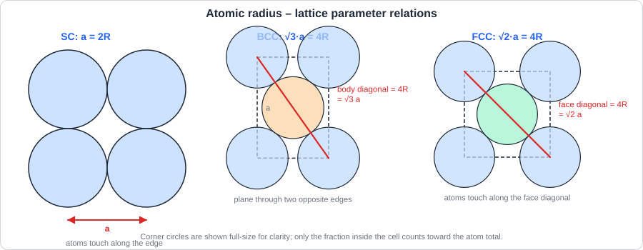

*Fig 1.10: Where atoms touch decides the $`a`$-$`R`$ relation.*

**1. Simple cubic:** atoms touch along the cube edge → $`a = 2R`$, $`n = 1`$

```math
\mathrm{APF}_{SC}=\frac{1\times\frac{4}{3}\pi R^{3}}{(2R)^{3}}=\frac{\pi}{6}=0.52
```

**2. Body-centred cubic:** atoms touch along the body diagonal → $`\sqrt{3}\,a = 4R`$, $`a = 4R/\sqrt{3}`$, $`n = 2`$

```math
\mathrm{APF}_{BCC}=\frac{2\times\frac{4}{3}\pi R^{3}}{\left(4R/\sqrt3\right)^{3}}=\frac{\sqrt3\,\pi}{8}=0.68
```

**3. Face-centred cubic:** atoms touch along the face diagonal → $`\sqrt{2}\,a = 4R`$, $`a = 2\sqrt{2}\,R`$, $`n = 4`$

```math
\mathrm{APF}_{FCC}=\frac{4\times\frac{4}{3}\pi R^{3}}{\left(2\sqrt2\,R\right)^{3}}=\frac{\sqrt2\,\pi}{6}=0.74
```

| Structure | $`a`$ in terms of $`R`$ | Atoms/cell | CN | **APF** | Void space |
|---|---|---|---|---|---|
| SC | $`2R`$ | 1 | 6 | **0.52** | 48 % |
| BCC | $`4R/\sqrt3`$ | 2 | 8 | **0.68** | 32 % |
| FCC | $`2\sqrt2R`$ | 4 | 12 | **0.74** | 26 % |

> [!NOTE]
> 0.74 is the **maximum possible** packing of equal spheres. HCP has the same APF (0.74) when $`c/a = 1.633`$.

---

#### Q1.16 Find the atomic radius or lattice parameter for a given cubic structure.

Use the contact relations of Q1.15:

| Structure | Lattice parameter | Atomic radius |
|---|---|---|
| SC | $`a = 2R`$ | $`R = a/2`$ |
| BCC | $`a = 4R/\sqrt3`$ | $`R = \sqrt3\,a/4`$ |
| FCC | $`a = 2\sqrt2\,R = 4R/\sqrt2`$ | $`R = \sqrt2\,a/4`$ |

**Example 1 (radius → lattice parameter).** Aluminium is FCC with $`R = 0.143`$ nm:

```math
a = 2\sqrt{2}\,(0.143) = 0.404\ \text{nm}
```

**Example 2 (lattice parameter → radius).** α-Iron (BCC) has $`a = 0.2866`$ nm:

```math
R=\frac{\sqrt3\,(0.2866)}{4}=0.124\ \text{nm}
```

---

#### Q1.17 Calculate theoretical density from atomic radius, atomic weight and crystal structure; or calculate the number of atoms per unit cell from lattice parameter and density.

```math
\rho=\frac{n\,A}{V_c\,N_A},\qquad V_c = a^{3},\qquad N_A = 6.022\times10^{23}\ \text{atoms/mol}
```

with $`n`$ = atoms per cell, $`A`$ = atomic weight (g/mol), $`V_c`$ in cm³ (1 nm = $`10^{-7}`$ cm).

**Example A: Copper (FCC), $`R = 0.128`$ nm, $`A = 63.5`$ g/mol**

1. $`a = 2\sqrt2\,R = 2\sqrt2\,(0.128) = 0.3621`$ nm $`= 3.621\times10^{-8}`$ cm
2. $`V_c = a^3 = 4.748\times10^{-23}`$ cm³
3. $`n = 4`$

```math
\rho=\frac{4\times 63.5}{(4.748\times10^{-23})(6.022\times10^{23})}=8.88\ \text{g/cm}^3 \quad(\text{measured } 8.94\text{-}8.96)
```

**Example B: Iron (BCC), $`R = 0.124`$ nm, $`A = 55.85`$ g/mol**

$`a = 4R/\sqrt3 = 0.2864`$ nm → $`V_c = 2.349\times10^{-23}`$ cm³

```math
\rho=\frac{2\times55.85}{(2.349\times10^{-23})(6.022\times10^{23})}=7.90\ \text{g/cm}^3\quad(\text{measured } 7.87)
```

**Example C: Atoms per cell from density.** A metal has $`a = 0.405`$ nm, $`\rho = 2.70`$ g/cm³, $`A = 26.98`$ g/mol. Find $`n`$ and the structure.

```math
n=\frac{\rho\,a^{3}N_A}{A}=\frac{2.70\,(4.05\times10^{-8})^{3}(6.022\times10^{23})}{26.98}=\frac{108.0}{26.98}\approx 4
```

$`n = 4`$ → **FCC** (it is aluminium).

> [!TIP]
> **Exam steps:** (1) write the contact relation to get $`a`$, (2) convert nm → cm, (3) cube it, (4) substitute in $`\rho = nA/(V_cN_A)`$ and **write the unit**. Small differences from the textbook value arise from voids, vacancies and rounding.

---

#### Q1.18 Compare BCC and FCC structures. Which is more stable according to the supplied suggestion, and why?

| Feature | **BCC** | **FCC** |
|---|---|---|
| Atoms per cell | 2 | 4 |
| Coordination number | 8 | 12 |
| APF | 0.68 | **0.74** |
| Close-packed planes | none ({110} is densest) | **yes, {111}** |
| Slip systems | 48 (but no close-packed plane) | 12 ({111}⟨110⟩) |
| Ductility | moderate; **shows DBTT** | **very ductile**, no DBTT |
| Strength | generally stronger, harder | softer, more ductile |
| Examples | α-Fe, Cr, W, Mo, V | Al, Cu, Ni, Au, γ-Fe |

**Which is more stable?** In terms of **packing**, **FCC is the more stable (lower-energy, denser) arrangement**: it has the higher coordination number (12 vs 8) and higher APF (0.74 vs 0.68), so each atom is bonded to more neighbours.

> [!WARNING]
> Stability is also **temperature dependent**. Pure iron is **BCC (α) below 912 °C**, **FCC (γ) from 912-1394 °C** and BCC (δ) again up to 1538 °C. So "FCC is more stable" is the right exam statement based on *packing and coordination*, but FCC is not stable for iron at room temperature.

---

#### Q1.19 Explain Miller indices and draw the family of {110} planes.

**Miller indices (hkl)** are three integers that identify a crystal plane.

**Procedure**

1. Choose axes along the cell edges with the origin at a cell corner **not on the plane**.
2. Write the plane's **intercepts** on x, y, z in units of $`a`$ (use ∞ if parallel to an axis).
3. Take **reciprocals**.
4. **Clear fractions** (multiply by the smallest common factor) to get the smallest integers.
5. Enclose in parentheses **(hkl)**; negative index is written with a bar, e.g. $`(1\bar{1}0)`$.

**Example.** Plane cutting x = 1, y = 1, z = ∞ → reciprocals 1, 1, 0 → **(110)**.

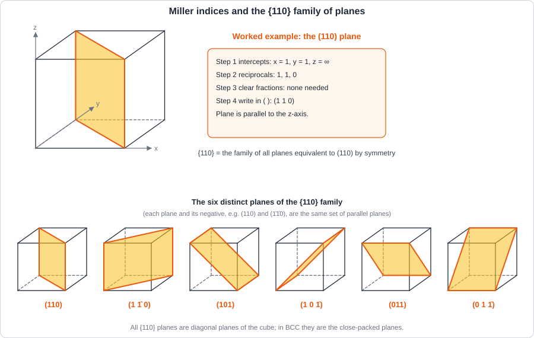

*Fig 1.11: (110) worked example and the six planes of the {110} family.*

**Family {110}:** all planes equivalent by cubic symmetry: **(110), (1 −1 0), (101), (10 −1), (011), (01 −1)**. Each plane and its negative (e.g. (110) and (−1 −1 0)) are parallel and count as one.

**Directions:** $`[uvw]`$ are components of a vector in the lattice; the body diagonal is $`[111]`$, face diagonal $`[110]`$, cube edge $`[100]`$. In cubic crystals $`[hkl] \perp (hkl)`$.

---

### 1D. Corrosion and oxidation

🔴 **MUST PREPARE**

#### Q1.20 Differentiate oxidation and corrosion.

**Oxidation** (in the electrochemical sense) is the **loss of electrons** by an atom ($`\mathrm{M \rightarrow M^{n+} + ne^-}`$); in the high-temperature sense it is the direct reaction of a metal with oxygen to form an oxide. **Corrosion** is the **destructive, unwanted deterioration of a metal by chemical or electrochemical reaction with its environment**.

| Feature | **Oxidation** | **Corrosion** |
|---|---|---|
| Nature | a chemical *reaction type* (loss of electrons / gain of oxygen) | a *process of material degradation* |
| Scope | applies to any substance | applies to metals (and, loosely, other materials) in service |
| Result | oxide or positive ion | metal wasted: rust, pits, cracks |
| Always harmful? | no (anodising, passivation are useful oxidation) | yes, always undesirable |
| Needs electrolyte? | not necessarily | wet corrosion does |
| Relation | **oxidation is the anodic step that causes metallic corrosion** | |

---

#### Q1.21 Differentiate dry corrosion and wet corrosion; explain their mechanisms.

**Dry (chemical) corrosion:** direct attack by gases (O₂, halogens, SO₂, H₂S) at (usually high) temperature, **without an electrolyte**. Mechanism: the metal surface reacts to form an oxide film; the film then thickens by ion diffusion through it.

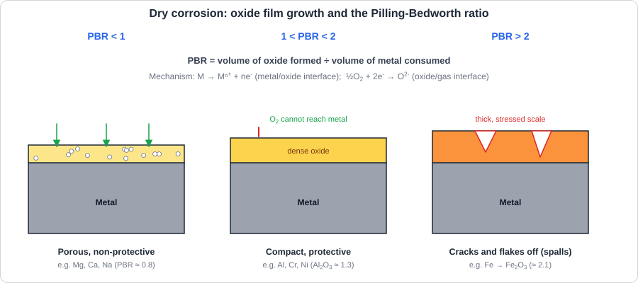

*Fig 1.12: Oxide film behaviour decides protection (Pilling-Bedworth ratio).*

**Wet (electrochemical) corrosion:** occurs in the presence of an **electrolyte** (moisture, salt water); separate anodic and cathodic areas form on the same metal (or on two joined metals) like a tiny galvanic cell.

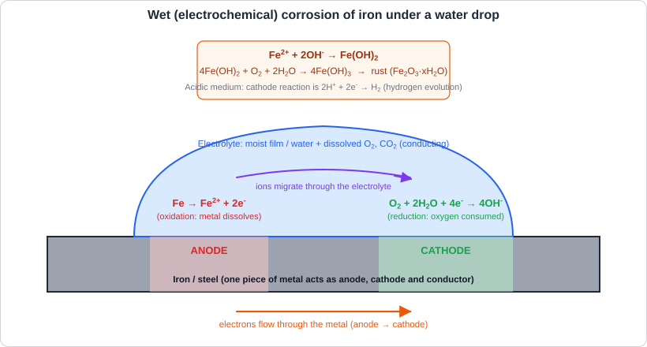

*Fig 1.13: Wet corrosion of iron under a water drop.*

| Feature | **Dry corrosion** | **Wet corrosion** |
|---|---|---|
| Medium | dry gases (O₂, Cl₂, SO₂) | liquid electrolyte (water, salt solution) |
| Type of reaction | direct chemical combination | electrochemical (anode + cathode) |
| Temperature | usually high | ordinary temperatures |
| Rate | slow, **self-limiting** if the oxide film is protective | rapid, continuous |
| Corrosion product | on the metal surface (uniform scale) | at the anode/cathode junction (rust, pits) |
| Electron flow | none through metal | electrons flow anode → cathode |
| Examples | scaling of steel in furnaces, tarnishing of Ag by H₂S | rusting, pitting, galvanic corrosion, crevice corrosion |

**Mechanism summary**

- *Dry:* $`\mathrm{M \rightarrow M^{n+} + ne^-}`$ at metal/oxide, $`\mathrm{\tfrac12 O_2 + 2e^- \rightarrow O^{2-}}`$ at oxide/gas. Protective if the **Pilling-Bedworth ratio** (oxide volume ÷ metal volume consumed) is between 1 and 2 (Al₂O₃, Cr₂O₃). Below 1 the film is porous (Mg); above 2 it cracks and spalls (Fe₂O₃).
- *Wet (neutral/alkaline, oxygen-absorption type):* anode $`\mathrm{Fe \rightarrow Fe^{2+} + 2e^-}`$; cathode $`\mathrm{O_2 + 2H_2O + 4e^- \rightarrow 4OH^-}`$; then $`\mathrm{Fe^{2+} + 2OH^- \rightarrow Fe(OH)_2}`$ → oxidises to **rust** $`\mathrm{Fe_2O_3\cdot xH_2O}`$.
- *Wet (acidic, hydrogen-evolution type):* cathode $`\mathrm{2H^+ + 2e^- \rightarrow H_2}`$.

---

#### Q1.22 What is season cracking? Explain its mechanism and prevention.

**Season cracking** (stress-corrosion cracking of brass) is the **intergranular cracking of cold-worked brass** (e.g. 70/30 cartridge brass) when it is exposed to a **corrosive environment, especially traces of ammonia**, while under **residual tensile stress**. The name came from cracked cartridge cases during the **monsoon season** in India, when moisture and ammonia from decaying organic matter were present.

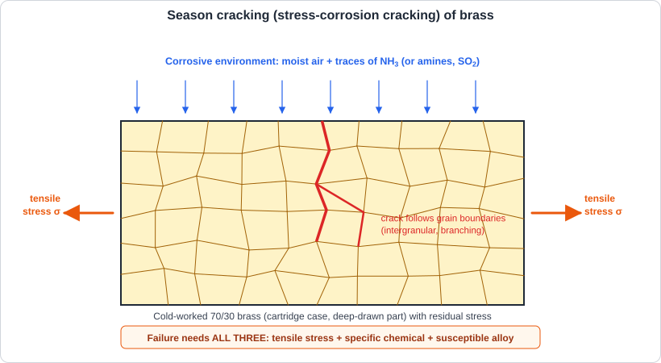

*Fig 1.14: Crack initiation and propagation along grain boundaries.*

**Mechanism**

1. Cold working (deep drawing, bending) leaves **residual tensile stress** in the brass.
2. Moist air containing **NH₃** (or amines, SO₂) attacks the **grain boundaries**, which are anodic (zinc-rich, stressed).
3. Corrosion forms a fine **crack at the surface**; the tip concentrates stress.
4. The crack grows along the grain boundaries (intergranular, branched) until the section fails suddenly.

**Prevention**

- **Stress-relief annealing** at about 250-300 °C after cold working (most effective).
- Avoid ammonia/amine environments; keep the part dry and clean.
- Use **low-zinc brass** (< 15 % Zn) or add Sn, Al, or use cupro-nickel.
- Introduce surface compressive stress (**shot peening**) and protective coatings or paint.
- Design to avoid residual and assembly stresses.

---

#### Q1.23 Describe methods used to prevent/control corrosion.

| Method | Principle | Example |
|---|---|---|
| **Environmental modification** | remove O₂, moisture, adjust pH, lower temperature | boiler-water deaeration, silica gel packs, dehumidifiers |
| **Protective coatings: painting / lacquering / grease** | physical barrier | ships, bridges, structures |
| **Metallic coatings: galvanizing (Zn), tinning (Sn), electroplating (Ni, Cr)** | barrier + (for Zn) sacrificial action | roofing sheets, food cans, chrome-plated parts |
| **Cathodic protection** | make the structure the cathode | see figure below |
| **Alloying** | form a stable passive film | stainless steel (≥ 11 % Cr), Cu-bearing weathering steel |
| **Inhibitors** | adsorb/precipitate on the surface and slow reactions | chromates, phosphates, nitrites in cooling water |
| **High-purity metals** | fewer impurity-driven micro-cells | pure Al resists better than commercial Al |
| **Design against corrosion** | avoid crevices, galvanic couples, stagnant water; allow drainage | rounded joints, insulating washers |

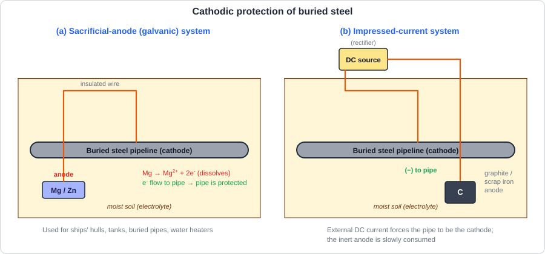

*Fig 1.15: (a) sacrificial anode and (b) impressed current.*

- **Sacrificial anode:** a more active metal (Mg, Zn, Al) is electrically connected to the structure; it corrodes instead.
- **Impressed current:** a DC source makes the structure the cathode; an inert anode (graphite, Fe-Si) is used.

---

#### Q1.24 Differentiate galvanizing and tinning.

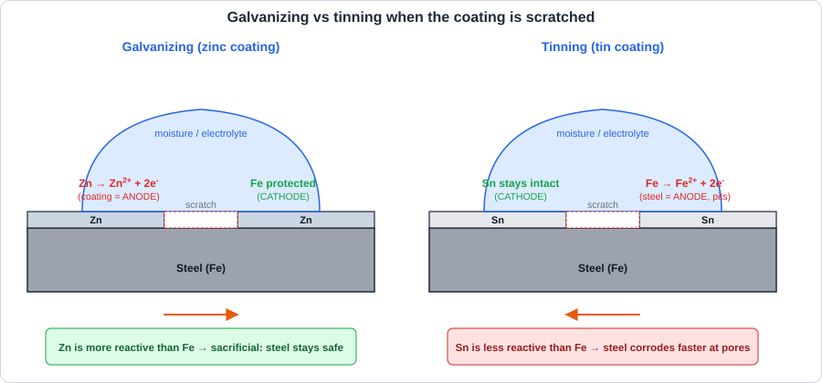

*Fig 1.16: Behaviour of the two coatings when scratched.*

| Feature | **Galvanizing** | **Tinning** |
|---|---|---|
| Coating metal | **zinc** | **tin** |
| Method | hot-dip, electro-galvanising, spraying | hot-dip or electroplating |
| Electrochemical position | Zn is **anodic** to Fe (more reactive) | Sn is **cathodic** to Fe (less reactive) |
| If scratched | Zn corrodes, **steel is still protected** (sacrificial) | exposed steel corrodes **faster** (pitting under the coating) |
| Type of protection | barrier + cathodic | barrier only |
| Toxicity | Zn compounds unsuitable for acidic food | **non-toxic**, used for food packing |
| Typical uses | roofing sheets, pipes, wires, fences, buckets | tin cans, containers, kitchenware |
| Cost | lower | higher |

---

### 1E. Lubricants and supporting short notes

🟠 / 🟢 **HIGH PRIORITY / SUPPORTING**

#### Q1.25 What are the properties of a good lubricant? Explain the industrial necessity/uses of lubricants and classify them.

A **lubricant** is a substance placed between two moving surfaces to **reduce friction and wear**.

**Functions / industrial necessity**

1. Reduces **friction and wear** → longer machine life, lower power loss.
2. **Cools** by carrying away frictional heat.
3. **Seals** (piston rings, gears) and keeps out dust and water.
4. **Cleans** by carrying away debris.
5. **Prevents corrosion** by coating metal surfaces.
6. Dampens **shock and noise**; transmits power in hydraulic systems.

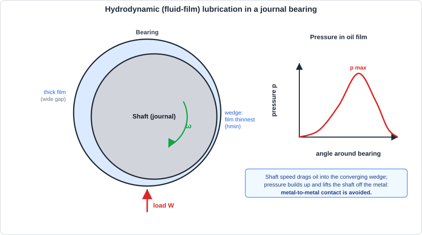

*Fig 1.17: Hydrodynamic (thick-film) lubrication in a journal bearing: the oil film carries the load.*

**Regimes:** *hydrodynamic* (thick film, no metal contact) → *mixed* → *boundary* (thin film, additives needed, e.g. at start-up).

**Properties of a good lubricant**

| Property | Meaning / requirement |
|---|---|
| **Viscosity** | resistance to flow; high enough to hold a film under load, low enough to reduce drag; **high viscosity index** (small change with T) |
| **Flash point** | lowest temperature at which vapours **flash** momentarily when a flame is brought near; should be well above working temperature |
| **Fire point** | temperature at which the oil **burns continuously for ≥ 5 s**; about 5-40 °C above the flash point |
| **Cloud point** | temperature at which wax crystals **first make the oil cloudy** on cooling |
| **Pour point** | lowest temperature at which the oil **still flows**; lower than cloud point; must be below the lowest operating temperature |
| **Oiliness** | ability to adhere (boundary film) |
| **Corrosion stability** | must not attack metals; low acid number |
| **Oxidation / thermal stability** | resists sludge and gum formation |
| **Low volatility** | minimal evaporation loss |

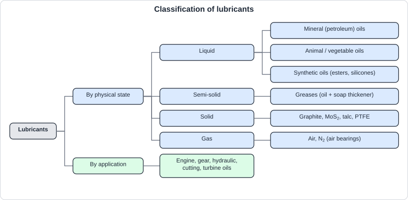

*Fig 1.18: Classification of lubricants.*

---

#### Q1.26 What are smart materials? Explain their uses and limitations.

**Smart (intelligent) materials** have one or more properties that **change in a controlled and reversible way in response to an external stimulus** (temperature, stress, electric/magnetic field, light, pH).

| Type | Stimulus → response | Examples / uses |
|---|---|---|
| **Shape-memory alloys** (Nitinol, Ni-Ti) | heat → returns to remembered shape (martensite ⇄ austenite) | stents, spectacle frames, couplings, actuators |
| **Piezoelectric** (quartz, PZT) | stress ⇄ voltage | sensors, lighters, ultrasound, microphones |
| **Magnetostrictive** (Terfenol-D) | magnetic field → change of length | sonar, precision actuators |
| **Electro-/magneto-rheological fluids** | field → viscosity change | adaptive shock absorbers, dampers |
| **Photochromic / thermochromic / electrochromic** | light, heat, voltage → colour or transparency | self-darkening lenses, smart windows, battery testers |
| **Self-healing polymers/concrete** | damage → repair agent released | coatings, structures |

**Limitations:** high cost; limited fatigue life and hysteresis (SMAs); small strain/force output; narrow operating range; brittleness (PZT ceramics); complex control electronics; limited durability and large-scale availability.

---

#### Q1.27 Write short notes on ASTM, AISI and SAE.

| Body | Full form | Role |
|---|---|---|
| **ASTM** | American Society for Testing and Materials (now *ASTM International*) | publishes voluntary consensus **standards and test methods** for materials, e.g. ASTM A36 structural steel, ASTM E8 tensile test, E10 Brinell test |
| **AISI** | American Iron and Steel Institute | steel industry association; originated the **designation system for steels** (e.g. AISI 1045, 304, 4340) |
| **SAE** | Society of Automotive Engineers (*SAE International*) | standards for automotive/aerospace materials and lubricants (e.g. **SAE 10W-40** engine oil, SAE steel grades) |

**AISI-SAE four-digit steel code:** first two digits = alloy family, last two = carbon in **hundredths of a percent**.

| Code | Steel type | Example |
|---|---|---|
| 10xx | plain carbon | **1020** = 0.20 % C; **1045** = 0.45 % C |
| 13xx | manganese | 1340 |
| 23xx / 25xx | nickel | 2330 |
| 31xx-33xx | Ni-Cr | 3140 |
| 41xx | Cr-Mo | 4140 |
| 43xx / 86xx | Ni-Cr-Mo | 4340, 8620 |
| 5xxx | chromium | 5160 |
| 6xxx | Cr-V | 6150 |
| 92xx | Si-Mn (spring) | 9260 |

(Stainless steels use 3-digit codes: 2xx, **3xx** austenitic, **4xx** ferritic/martensitic.)

---

### Chapter 1: Numerical practice

🔴 **MUST PRACTISE, not just read.**

Core relations: $`\sigma=P/A`$ · $`\varepsilon=\Delta L/L_0`$ · $`E=\sigma/\varepsilon`$ · $`\delta=PL/AE`$ · punching force $`F=\tau\,(\pi d\,t)`$.

#### N1. Stress in a solid rod

A solid steel rod of diameter 20 mm carries an axial tensile load of 50 kN. Find the stress.

```math
A=\frac{\pi}{4}d^{2}=\frac{\pi}{4}(20)^2=314.16\ \text{mm}^2,\qquad \sigma=\frac{P}{A}=\frac{50\,000}{314.16}=159.2\ \text{MPa}
```

#### N2. Stress in a hollow tube

A tube of outside diameter 50 mm and inside diameter 40 mm carries 100 kN in tension.

```math
A=\frac{\pi}{4}\left(50^2-40^2\right)=\frac{\pi}{4}(900)=706.9\ \text{mm}^2,\qquad \sigma=\frac{100\,000}{706.9}=141.5\ \text{MPa}
```

#### N3. Elongation (deformation)

The solid rod of N1 is 2 m long, $`E = 200`$ GPa $`= 200\,000`$ MPa.

```math
\delta=\frac{PL}{AE}=\frac{(50\,000)(2000)}{(314.16)(200\,000)}=1.59\ \text{mm},\qquad \varepsilon=\frac{\delta}{L}=7.96\times10^{-4}
```

(Check: $`\sigma/E = 159.2/200\,000 = 7.96\times10^{-4}`$ ✓)

#### N4. Required outside diameter of a tube

A tube with inside diameter 40 mm must carry a tensile load of 150 kN with allowable stress 80 MPa. Find the outside diameter.

```math
A_{req}=\frac{P}{\sigma_{all}}=\frac{150\,000}{80}=1875\ \text{mm}^2
```

```math
\frac{\pi}{4}\left(D^2-40^2\right)=1875\ \Rightarrow\ D^2-1600=2387.3\ \Rightarrow\ D^2=3987.3\ \Rightarrow\ D=63.2\ \text{mm}
```

Adopt the next standard size, say **64 mm**.

#### N5. Punching force

A hole of 25 mm diameter is punched in a plate 6 mm thick; shear strength of the plate is 300 MPa.

```math
A_{shear}=\pi d\,t=\pi(25)(6)=471.2\ \text{mm}^2,\qquad F=\tau\,A_{shear}=300\times471.2=141.4\ \text{kN}
```

*Extension:* compressive stress on the punch $`=F/(\pi d^2/4) = 141\,372/490.9 = 288`$ MPa, which must be below the punch material's compressive strength.

#### N6. Atoms per cell, APF, density

Worked in [Q1.15](#q115-define-apf-and-calculate-it-for-sc-bcc-and-fcc-show-the-steps) and [Q1.17](#q117-calculate-theoretical-density-from-atomic-radius-atomic-weight-and-crystal-structure-or-calculate-the-number-of-atoms-per-unit-cell-from-lattice-parameter-and-density). More practice in [B6](#b6-extra-practice-numericals-with-answers).

> [!NOTE]
> The guide lists *types* of numericals, not their data. The numbers above are **illustrative** but the methods are exactly those asked. Always write the **formula, substitution, answer and unit**.

---

## Chapter 2: Non-Ferrous Metals

🟠 **HIGH PRIORITY**

#### Q2.1 Explain the outstanding characteristics and applications of aluminium.

**Aluminium (Al):** FCC, density **2.7 g/cm³** (one-third of steel), melting point **660 °C**.

| Characteristic | Consequence / use |
|---|---|
| Low density, good strength-to-weight (after alloying) | aircraft, automobiles, trains |
| Excellent corrosion resistance (self-healing Al₂O₃ film, can be thickened by **anodising**) | building cladding, marine fittings, cans |
| High electrical and thermal conductivity (≈ 60 % of Cu, but lighter) | overhead power lines, heat sinks, cookware |
| Very ductile and malleable | foil, wire, extrusions, deep-drawn parts |
| Non-toxic, non-magnetic, non-sparking | food packaging, electronics shielding, explosive-handling tools |
| Highly reflective | reflectors, insulation foil |
| Easily recyclable (≈ 5 % of the energy of primary production) | beverage cans |
| Moderate E (70 GPa), low strength when pure | strengthened by alloying (Cu, Mg, Zn, Si) and heat treatment, e.g. **duralumin** |

---

#### Q2.2 Describe the manufacture of aluminium from bauxite.

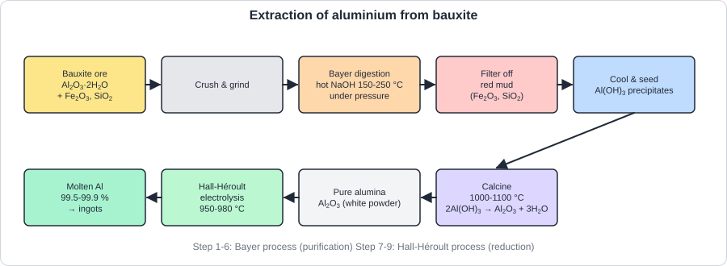

*Fig 2.1: Bayer process (purification) followed by Hall-Héroult process (reduction).*

**Stage 1: Bayer process (ore → pure alumina)**

1. **Bauxite** (Al₂O₃·2H₂O with Fe₂O₃, SiO₂, TiO₂) is crushed and ground.
2. **Digestion:** heated with hot **NaOH** (≈ 150-250 °C, under pressure). Alumina dissolves as sodium aluminate: $`\mathrm{Al_2O_3 + 2NaOH + 3H_2O \rightarrow 2NaAl(OH)_4}`$.
3. **Filtration:** insoluble impurities (**red mud**: Fe₂O₃, SiO₂) are removed.
4. **Precipitation:** on cooling and **seeding**, pure $`\mathrm{Al(OH)_3}`$ crystallises.
5. **Calcination** at about 1000-1100 °C: $`\mathrm{2Al(OH)_3 \rightarrow Al_2O_3 + 3H_2O}`$ → white alumina powder.

**Stage 2: Hall-Héroult electrolysis (alumina → aluminium)**

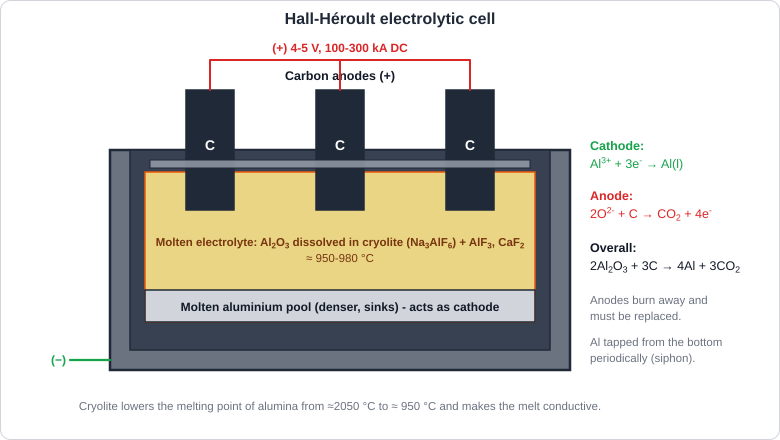

*Fig 2.2: Electrolytic reduction cell.*

- Alumina (mp ≈ 2050 °C) is dissolved in **molten cryolite (Na₃AlF₆)** with AlF₃ and CaF₂ at about **950-980 °C**; cryolite lowers the melting point and makes the bath conductive.
- Steel cell lined with **carbon (cathode)**; **carbon anodes** dip in the melt; 4-5 V, very high current (100-300 kA).
- Cathode: $`\mathrm{Al^{3+} + 3e^- \rightarrow Al(l)}`$ → molten Al (denser) sinks and is **tapped** periodically.
- Anode: $`\mathrm{2O^{2-} + C \rightarrow CO_2 + 4e^-}`$ → anodes burn away and are replaced.
- **Overall:** $`\mathrm{2Al_2O_3 + 3C \rightarrow 4Al + 3CO_2}`$. Purity 99.5-99.9 %; energy ≈ 13-15 kWh per kg.

---

#### Q2.3 Differentiate brass and bronze.

| Feature | **Brass** | **Bronze** |
|---|---|---|
| Composition | **Cu + Zn** (5-45 % Zn) | **Cu + Sn** (typically 5-12 % Sn); also Al, Si, P, Be bronzes |
| Colour | yellow to golden | reddish brown to dull gold |
| Strength / hardness | moderate | **higher**, harder, more wear-resistant |
| Corrosion (marine) | good; **dezincification** and season cracking risk | **better** |
| Machinability / formability | excellent (free-cutting brass), easy to cast and work | good castability, harder to machine |
| Cost | cheaper | dearer |
| Acoustic | bright sound (instruments) | bells, cymbals |
| Examples | cartridge brass 70/30, Muntz metal 60/40 | gun metal (88Cu-10Sn-2Zn), phosphor bronze, aluminium bronze |
| Uses | pipe fittings, valves, hardware, decorative items, ammunition cases, condenser tubes | bearings, bushings, gears, springs, statues, ship propellers, coins |

---

#### Q2.4 Explain applications of nickel and magnesium.

| | **Nickel (Ni)** | **Magnesium (Mg)** |
|---|---|---|
| Structure / density | FCC, 8.9 g/cm³, mp 1455 °C | **HCP**, **1.74 g/cm³** (lightest structural metal), mp 650 °C |
| Key properties | corrosion- and heat-resistant, ductile, **ferromagnetic** | very high specific strength, good damping, easily machined; poor corrosion resistance; powder/chips are flammable |
| Alloys | **Monel** (Ni-Cu), **Inconel** (Ni-Cr-Fe), **Nichrome** (Ni-Cr), **Invar** (Fe-36Ni) | AZ91 (Mg-Al-Zn), Elektron |
| Applications | stainless steel (alloying), electroplating, batteries (Ni-Cd, Ni-MH), coins, heating elements, **jet-engine and turbine superalloys**, chemical plant | aircraft and automobile castings, laptop/camera bodies, wheels, portable tools, **sacrificial anodes**, flash powder, flares, deoxidiser in steel making |

---

#### Q2.5 State the effects of nickel, chromium, silicon and titanium as alloying elements.

| Element | Main effects | Typical use |
|---|---|---|
| **Nickel (Ni)** | raises strength and **toughness**, lowers DBTT, stabilises austenite (FCC), improves corrosion resistance | 3.5 % Ni steels for cold service; 18-8 stainless |
| **Chromium (Cr)** | raises hardness, wear and hardenability; ≥ 11 % forms **passive Cr₂O₃ film** (stainless); carbide former | stainless steels, bearings, tool steels |
| **Silicon (Si)** | deoxidiser; raises elasticity and magnetic permeability; improves oxidation resistance; in cast iron promotes graphite | spring steel (1.5-2 %), transformer steel (3-4 %), grey iron |
| **Titanium (Ti)** | strong carbide/nitride former; **grain refiner**; stabilises stainless steels against Cr-carbide precipitation; high strength-to-weight as a base metal | 321 stainless, Ti alloys for aerospace/biomedical |

(See also the full alloying-element table in [Chapter 3](#q38-explain-the-effects-of-nickel-chromium-manganese-and-other-listed-alloying-elements).)

---

#### Q2.6 Draw/explain the copper-silver and copper-nickel phase diagrams (question-bank topics).

**Copper-nickel: isomorphous system** (complete solubility in liquid *and* solid).

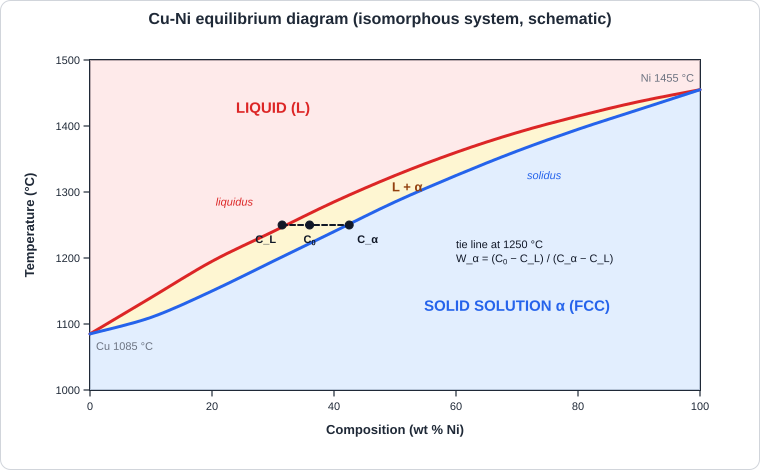

*Fig 2.3: Cu-Ni equilibrium diagram (schematic).*

- Cu (1085 °C) and Ni (1455 °C) obey the **Hume-Rothery rules** (same FCC structure, similar atomic radii ≈ 2.5 % apart, similar electronegativity and valency) → a single α solid solution at all compositions.
- Regions: **Liquid (L)** above the **liquidus**, **α** below the **solidus**, **L + α** between them. Solidification occurs over a *range* of temperature.
- **Lever rule** in the two-phase field with the tie line at temperature $`T`$: $`W_\alpha=\dfrac{C_0-C_L}{C_\alpha-C_L}`$, $`W_L=\dfrac{C_\alpha-C_0}{C_\alpha-C_L}`$.
- Fast cooling gives **coring** (composition gradient inside grains); removed by homogenising anneal.
- Alloys: **Monel** (≈ 67Ni-30Cu), **constantan** (55Cu-45Ni) and cupro-nickels for coins/marine condensers.

**Copper-silver: simple eutectic with limited solid solubility.**

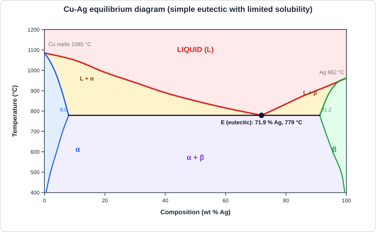

*Fig 2.4: Cu-Ag eutectic diagram.*

| Feature | Value |
|---|---|
| Melting points | Cu 1085 °C, Ag 962 °C |
| **Eutectic point E** | **71.9 wt % Ag at 779 °C** |
| Max solubility of Ag in Cu (α) | 8.0 wt % at 779 °C |
| Max solubility of Cu in Ag (β) | 8.8 wt % Cu (91.2 wt % Ag) at 779 °C |
| Eutectic reaction | $`L \rightleftharpoons \alpha + \beta`$ on cooling, three phases coexist |
| Two-phase fields | L + α, L + β, α + β |
| Uses | silver solder (brazing alloys), electrical contacts, sterling-type alloys |

---

## Chapter 3: Iron and Steel Production (including Heat Treatment)

### 3A. Cast iron, wrought iron and steel

🔴 **MUST PREPARE**

#### Q3.1 What is cast iron? Describe its types with composition/properties and applications.

**Cast iron** is an **iron-carbon-silicon alloy** containing **more than 2.14 % carbon (typically 2.5-4 %)** with 1-3 % Si, and small amounts of Mn, S, P. The high carbon and fluidity give excellent **castability**, but it is brittle and cannot be forged.

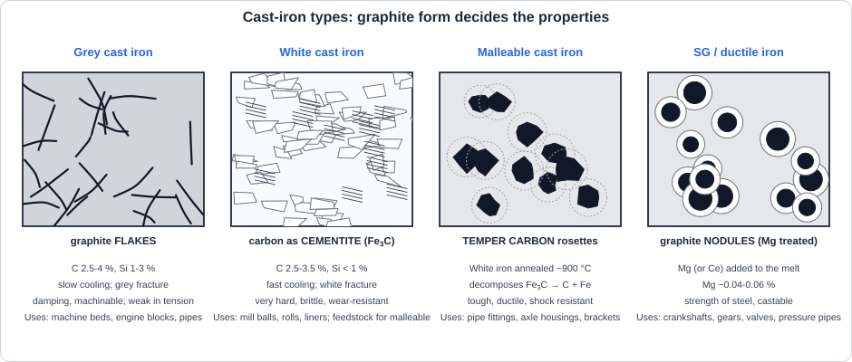

*Fig 3.1: Microstructure sketches. The form of carbon (flake, cementite, temper carbon, nodule) controls properties.*

| Type | Carbon form / how made | Typical composition | Properties | Applications |
|---|---|---|---|---|
| **Grey** | graphite **flakes** in ferrite/pearlite; **slow cooling**, high Si | C 2.5-4 %, Si 1-3 % | good machinability and damping, high compressive strength, low tensile strength and ductility; grey fracture | machine beds, engine blocks, brake drums, pipes, manhole covers |
| **White** | carbon as **cementite (Fe₃C)**; **rapid cooling**, low Si | C 2.5-3.5 %, Si < 1 % | very hard, brittle, wear-resistant, unmachinable; white fracture | mill balls, crusher liners, rolls, parent material for malleable iron |
| **Malleable** | white iron **heat-treated (annealed)** at about 900-950 °C for tens of hours → cementite breaks down into **temper-carbon nodules** | C 2.2-2.9 %, Si 0.6-1.3 % | tough, ductile, shock resistant; blackheart (ferritic), whiteheart, pearlitic grades | pipe fittings, axle housings, brackets, hardware |
| **Ductile / nodular (SG)** | small **Mg (≈ 0.04-0.06 %) or Ce** added to the melt → graphite forms **spheres** | C 3.2-4 %, Si 1.8-2.8 % | strength near steel (400-800 MPa), elongation up to ~18 %, good castability | crankshafts, gears, valves, pressure pipes |
| **Chilled** | casting cooled rapidly against metal **chills** → hard **white-iron skin** over a tough grey core | as grey iron | very hard wear surface, tough core | rolls, railway wheels, crusher jaws, cam shafts |

**Reaction behind malleabilising:** $`\mathrm{Fe_3C \rightarrow 3Fe + C}`$ (temper carbon).

---

#### Q3.2 Discuss the effects of silicon, sulphur, manganese and phosphorus on cast iron.

| Element | Effect on cast iron | Control |
|---|---|---|
| **Silicon (1-3 %)** | **promotes graphitisation** (carbon separates as graphite → grey iron); increases fluidity and reduces shrinkage; softens. Excess (> 3-4 %) makes the iron brittle | adjusted to cooling rate/section size |
| **Sulphur** | forms **FeS**, which **opposes graphite** formation and **promotes white iron (hard, brittle)**; lowers fluidity, causes **hot shortness**, blow-holes and shrinkage | kept < 0.1-0.12 % |
| **Manganese (0.5-1 %)** | neutralises sulphur: $`\mathrm{Mn + FeS \rightarrow MnS + Fe}`$ (MnS floats into slag); mildly promotes combined carbon, raising strength/hardness | enough Mn ≈ 1.7 × %S + 0.3 |
| **Phosphorus** | forms low-melting (≈ 950 °C) **iron phosphide eutectic (steadite)** → **increases fluidity** (thin castings) but increases hardness and brittleness (**cold shortness**) | < 0.1-0.3 % for strong castings; up to ~1 % for art/thin castings |

**In steel** the same impurities matter: S → hot shortness (cracks during hot working, countered by Mn); P → cold shortness (brittle at low temperature, raises DBTT); Si, Mn → deoxidisers/strengtheners.

---

#### Q3.3 Describe the manufacturing process of cast iron (including furnace/process steps).

Cast iron castings are made by **remelting pig iron (from the blast furnace) with scrap in a cupola furnace** and pouring the melt into moulds.

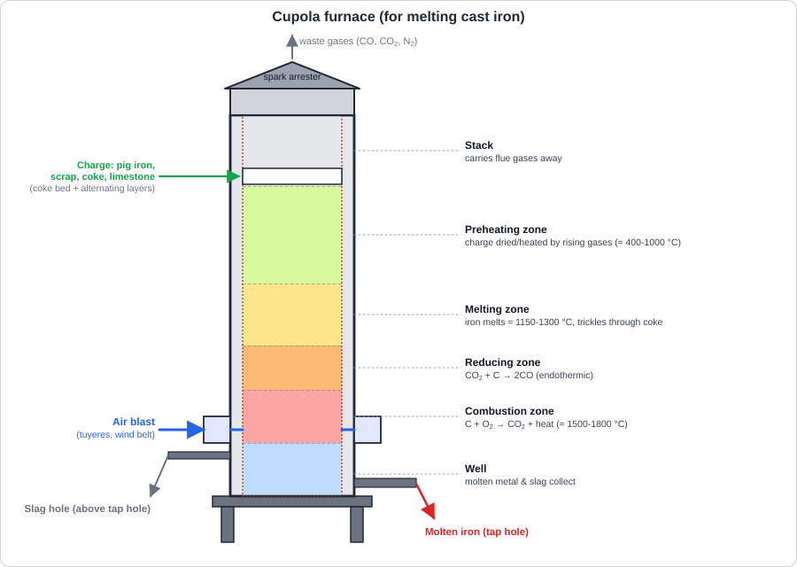

*Fig 3.2: Cupola furnace.*

**Construction:** a vertical cylindrical **steel shell lined with refractory brick**, with a charging door, stack/spark arrester, **wind belt + tuyeres** for the air blast, a **well**, tap hole, slag hole and spout.

**Charge (in layers):** first a bed of **coke**, then alternating layers of **pig iron + scrap + limestone (flux) + coke** (typically ≈ 10 parts metal to 1 part coke; limestone about a quarter to a third of the coke weight).

**Working**

1. The coke bed is lit and the **air blast** is switched on through the tuyeres.
2. **Combustion zone:** $`\mathrm{C + O_2 \rightarrow CO_2}`$ (exothermic, ≈ 1500-1800 °C).
3. **Reducing zone:** $`\mathrm{CO_2 + C \rightarrow 2CO}`$ (endothermic); gives a reducing atmosphere that protects the iron.
4. **Melting zone:** the metal melts (≈ 1150-1300 °C) and trickles through the coke into the **well**, picking up a little C and S.
5. **Preheating zone:** rising hot gases dry and heat the descending charge.
6. **Limestone** $`\mathrm{CaCO_3 \rightarrow CaO + CO_2}`$ fluxes ash and impurities into **slag**, which floats on the metal and leaves through the slag hole (above the tap hole).
7. Molten iron is **tapped** into ladles and poured into moulds (**casting**), then cooled, shaken out and cleaned. Cooling rate and Si content decide grey vs white iron.

**Zones in order (bottom → top):** well → combustion (oxidising) → reducing → melting → preheating → stack. Zone order and temperatures vary slightly between textbooks.

---

#### Q3.4 What is wrought iron? Describe its manufacturing process. Differentiate cast iron and wrought iron.

**Wrought iron** is the **purest commercial iron (≈ 99.5 % Fe, C < 0.08-0.1 %)** containing **1-3 % fibrous silicate slag** distributed as threads in the iron matrix, which gives a *fibrous structure* and toughness.

**Manufacture: puddling process**

1. **Pig iron is melted** in a **reverberatory (puddling) furnace** lined with iron oxide (haematite, $`\mathrm{Fe_2O_3}`$).
2. The oxide **oxidises C, Si, Mn and P** from the bath ($`\mathrm{Fe_2O_3 + 3C \rightarrow 2Fe + 3CO}`$); the carbon monoxide bubbles out ("boil").
3. As carbon drops, the **melting point rises** and the iron becomes **pasty**; the **puddler stirs with a rabble**, and the metal collects into **puddle balls** with slag.
4. Balls are **shingled (squeezed/hammered)** to expel excess slag, then **rolled** into bars and re-rolled for uniform fibre structure.

**Properties:** ductile, malleable, tough, easily forged and **welded**, good corrosion resistance; cannot be hardened by quenching; tensile strength ≈ 300-400 MPa. **Uses:** chains, anchors, rivets, railings, ornamental gates, wire. (Now largely replaced by mild steel.)

| Feature | **Cast iron** | **Wrought iron** |
|---|---|---|
| Carbon | 2.14-4.5 % | < 0.08-0.1 % |
| Structure | crystalline, graphite flakes/cementite | **fibrous** with slag threads |
| Melting range | ≈ 1150-1250 °C (low) | ≈ 1500 °C (high) |
| Mechanical | brittle, weak in tension, strong in compression | tough, ductile, strong in tension |
| Forging / welding | cannot be forged or welded easily | easily forged and welded |
| Casting | excellent | cannot be cast |
| Hardening by heat treatment | possible (white/chilled iron) | **not hardened** (too little C) |
| Corrosion | moderate | good |
| Production | cupola | puddling furnace |
| Uses | machine frames, pipes, engine blocks | chains, rivets, anchors, railings |

---

#### Q3.5 Define plain-carbon steel and classify low-, medium- and high-carbon steels. State their properties/uses.

**Plain-carbon steel** is an alloy of iron and carbon (≤ 2.14 %, usually < 1.5 %) with only residual Mn (≤ 1.65 %), Si (≤ 0.6 %), S, P; no other alloying element is added deliberately.

| Class | Carbon | Structure (slow cooled) | Properties | Uses |
|---|---|---|---|---|
| **Low-carbon (mild)** | 0.05-0.25 % (some books to 0.30) | mostly **ferrite** + little pearlite | soft, very ductile, tough, weldable, machinable; **cannot be hardened by quenching** (can be case-hardened) | wires, nails, rivets, bolts, sheets, car bodies, structural sections, pipes |
| **Medium-carbon** | 0.25-0.60 % | ferrite + pearlite | stronger and harder, moderate ductility; **heat-treatable** | shafts, axles, gears, crankshafts, rails, connecting rods |
| **High-carbon** | 0.60-1.5 % | pearlite (+ cementite) | very hard and strong, brittle, wear-resistant, poor weldability | springs, cutting tools, dies, drills, razors, wire ropes |

Strength and hardness **rise** with carbon; ductility, toughness and weldability **fall**.

---

#### Q3.6 What is mild steel? Give its mechanical properties and applications.

**Mild steel** is low-carbon plain steel (≈ 0.15-0.25 % C), the most widely used engineering steel (cheap, easy to fabricate).

| Property | Typical value |
|---|---|
| Yield strength | ≈ 250 MPa |
| Ultimate tensile strength | ≈ 400-500 MPa |
| Elongation | ≈ 20-25 % |
| Elastic modulus | ≈ 200 GPa |
| Density | 7.85 g/cm³ |
| Hardness | ≈ 120-150 BHN |
| Poisson's ratio | ≈ 0.3 |

**Applications:** structural sections (I-beams, angles), reinforcing bars, rivets/bolts, boiler plate, pipes, sheet-metal automobile bodies, wire, machine parts that need weldability. **Limitation:** corrodes in moist air (must be painted or galvanised).

---

#### Q3.7 What is alloying of steel? State its purposes.

**Alloying** is the deliberate addition of elements (Ni, Cr, Mo, V, W, Mn, Co, Si...) to plain carbon steel to obtain properties it cannot provide alone.

**Purposes**

1. Increase **strength, hardness and toughness**.
2. Improve **hardenability** (deeper hardening on quenching, with less distortion).
3. Improve **corrosion and oxidation resistance** (stainless steel).
4. Retain strength and hardness at **high temperature** (red hardness, creep resistance).
5. Improve **wear resistance** and **fatigue strength**.
6. **Refine grain** and reduce grain growth.
7. Obtain special **magnetic, electrical or thermal** properties (Si steel, Invar).
8. Improve **machinability** (S, Pb) or **weldability**.

---

#### Q3.8 Explain the effects of nickel, chromium, manganese and other listed alloying elements.

| Element | Effect on steel | Example use |
|---|---|---|
| **Nickel (Ni)** | strength and **toughness**; lowers DBTT; austenite stabiliser; corrosion resistance | cold-service steels, 18-8 stainless, gears |
| **Chromium (Cr)** | hardness, wear and hardenability; **≥ 11 % → stainless**; forms hard carbides | stainless steel, ball bearings, tool steel |
| **Molybdenum (Mo)** | raises hardenability and **high-temperature (creep) strength**; reduces temper brittleness | Cr-Mo steels (4140), boiler tubes |
| **Cobalt (Co)** | improves **hot (red) hardness**; magnetic properties | high-speed steel, magnets, cutting tools |
| **Vanadium (V)** | **grain refiner**; strong carbide former; improves strength and fatigue resistance | spring steels, tool steels |
| **Manganese (Mn)** | deoxidiser and desulphuriser; strength and hardenability; **12-14 % Mn = Hadfield steel** (work-hardens, very tough) | railway crossings, crusher jaws |
| **Tungsten (W)** | forms hard stable carbides; **red hardness** | high-speed steel, cutting tools, dies |
| **Silicon (Si)** | deoxidiser; elasticity; high magnetic permeability | spring steel, transformer steel |
| **Titanium (Ti)** | grain refiner; stabilises stainless steel against Cr-carbide precipitation | 321 stainless |
| **Sulphur / lead** | free-machining (chip breaking) | screw-machine steels |

---

#### Q3.9 Write short notes on stainless steel, tool steel and high-speed steel; state their properties and uses.

**Stainless steel:** steel with **≥ 10.5-12 % Cr**; Cr forms a thin, self-healing, transparent **Cr₂O₃ passive film**.

| Type | Composition | Structure | Properties | Uses |
|---|---|---|---|---|
| **Austenitic** (e.g. 304, 316) | 18Cr-8Ni; 316 adds 2 % Mo | FCC | **non-magnetic**, excellent corrosion resistance, ductile, weldable; not hardened by heat treatment | kitchenware, food/chemical plant, surgical tools |
| **Ferritic** (430) | 12-27 % Cr, low C | BCC | magnetic, moderate corrosion resistance, cheap, not hardenable | automobile trim, appliances |
| **Martensitic** (410, 420) | 12-14 % Cr, 0.15-1.2 % C | martensite after quench | **hardenable**, strong, moderate corrosion resistance | cutlery, surgical blades, turbine blades |

*Weld decay:* in 18-8 steel, heating at 425-815 °C precipitates Cr₂₃C₆ at grain boundaries (Cr-depleted zones corrode). Prevent by low-carbon grades (304L) or Ti/Nb stabilisation (321, 347).

**Tool steel:** high-carbon (0.6-1.5 % C) plain or alloy steels (Cr, W, V, Mo) with **high hardness, wear resistance, and ability to retain a cutting edge**, hardened and tempered before use. Uses: dies, punches, chisels, taps, hand tools.

**High-speed steel (HSS):** alloy tool steel that keeps its hardness at **red heat (≈ 600 °C)**, so tools can cut at **2-3 times** the speed of carbon-tool steel. **18-4-1 HSS = 18 % W, 4 % Cr, 1 % V, ≈ 0.7 % C** (Mo-types such as M2 also common). Uses: drills, reamers, milling cutters, lathe tool bits, hacksaw blades.

---

### 3B. Iron production and phase diagrams

🔴 **MUST PREPARE**

#### Q3.10 Describe the blast furnace and write the reactions occurring at different stages.

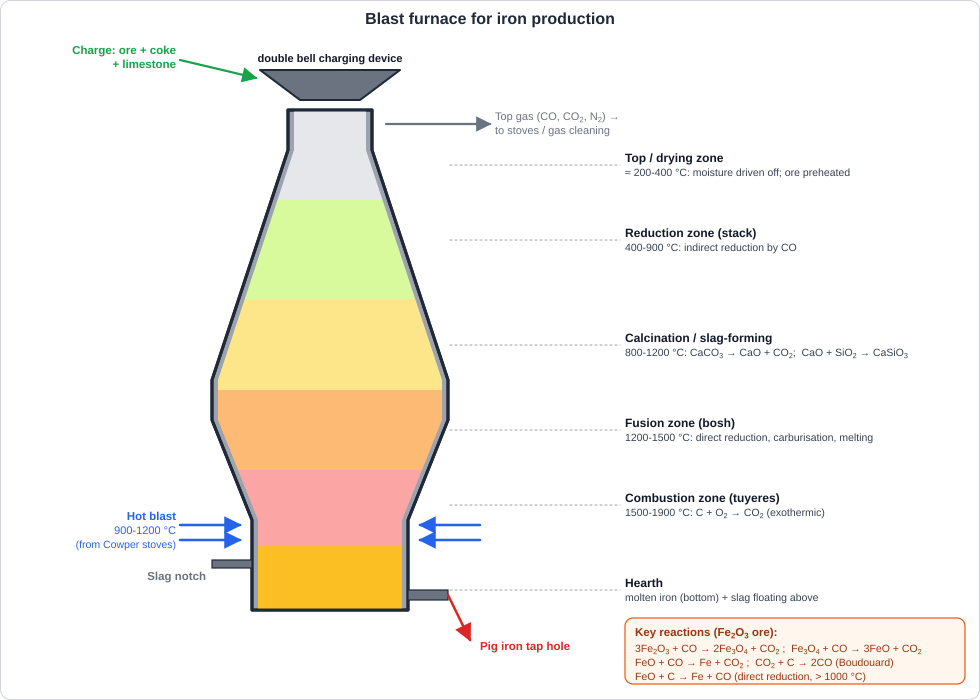

*Fig 3.3: Blast furnace with temperature zones and key reactions.*

**Construction:** tall (about 25-60 m) **steel shell lined with fire-brick**, profile: **throat** (top) → **stack** (widens downward) → **belly** → **bosh** (narrows) → **hearth** (bottom). **Double-bell** charging device at the top (keeps gas in), **tuyeres** near the bottom for the **hot blast (900-1200 °C)** from Cowper stoves, tap hole and slag notch at the hearth.

**Charge (per tonne of pig iron, approximate):** about 1.6-2 t **iron ore** (Fe₂O₃, Fe₃O₄), about 0.8-1 t **coke** (fuel + reducing agent), about 0.3-0.5 t **limestone** (flux), and roughly 4 t of air.

**Reactions by zone**

| Zone (top → bottom) | Temperature | Reactions |
|---|---|---|
| **Drying / preheating (top)** | ≈ 200-400 °C | moisture driven off; ore preheated |
| **Reduction (stack): indirect reduction by CO** | ≈ 400-900 °C | $`3\mathrm{Fe_2O_3 + CO \rightarrow 2Fe_3O_4 + CO_2}`$ ; $`\mathrm{Fe_3O_4 + CO \rightarrow 3FeO + CO_2}`$ ; $`\mathrm{FeO + CO \rightarrow Fe + CO_2}`$ (overall: $`\mathrm{Fe_2O_3 + 3CO \rightarrow 2Fe + 3CO_2}`$) |
| **Calcination / slag formation** | ≈ 800-1200 °C | $`\mathrm{CaCO_3 \rightarrow CaO + CO_2}`$ ; $`\mathrm{CaO + SiO_2 \rightarrow CaSiO_3}`$ (slag) |
| **Fusion (bosh): direct reduction, carburisation** | ≈ 1200-1500 °C | $`\mathrm{FeO + C \rightarrow Fe + CO}`$ ; $`\mathrm{SiO_2 + 2C \rightarrow Si + 2CO}`$ ; spongy iron absorbs C and melts |
| **Combustion (tuyere level)** | ≈ 1500-1900 °C | $`\mathrm{C + O_2 \rightarrow CO_2}`$ (exothermic) ; $`\mathrm{CO_2 + C \rightarrow 2CO}`$ (Boudouard) |
| **Hearth** | ≈ 1500 °C | molten **pig iron** (bottom, tapped) and lighter **slag** floating above (tapped separately) |

**Products:** **pig iron** (≈ 3.5-4.5 % C, 0.5-3 % Si, Mn, S, P), **slag** (CaSiO₃-rich: used for cement/road base) and **top gas** (CO, CO₂, N₂; burnt in stoves).

> [!TIP]
> If the question says "write the reactions", present the table above and **balance every equation**. Mention that CO is the main reducing agent and limestone removes silica as slag.

---

#### Q3.11 Draw the Fe-Fe₃C equilibrium diagram and label its important features.

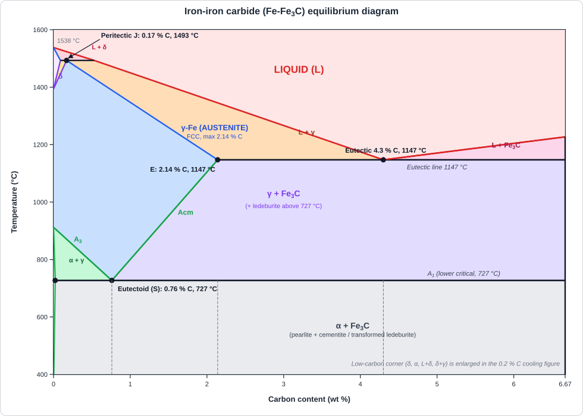

*Fig 3.4: Iron-iron carbide equilibrium diagram.*

**Phases**

| Phase | Structure | Solubility of C | Properties |
|---|---|---|---|
| **α-ferrite** | BCC | max **0.022 %** at 727 °C | soft, ductile, ferromagnetic below 768 °C |
| **γ-austenite** | FCC | max **2.14 %** at 1147 °C | non-magnetic, ductile; stable only above 727 °C in plain carbon steel |
| **δ-ferrite** | BCC | max 0.09 % at 1493 °C | high-temperature phase |
| **Cementite Fe₃C** | orthorhombic compound | **6.67 % C** | very hard, brittle |
| **Liquid** | - | - | above liquidus |

**Invariant reactions**

| Reaction | Temperature | Composition | Equation |
|---|---|---|---|
| **Peritectic** | **1493 °C** | 0.17 % C | $`L(0.53) + \delta(0.09) \rightleftharpoons \gamma(0.17)`$ |
| **Eutectic** | **1147 °C** | **4.3 % C** | $`L \rightleftharpoons \gamma(2.14) + \mathrm{Fe_3C}`$ → **ledeburite** |
| **Eutectoid** | **727 °C** | **0.76 % C** | $`\gamma(0.76) \rightleftharpoons \alpha(0.022) + \mathrm{Fe_3C}`$ → **pearlite** |

**Critical lines:** **A₁** (727 °C, eutectoid line), **A₃** (γ/γ+α boundary, 912 °C for pure iron falling to 727 °C at 0.76 % C), **A_cm** (γ/γ+Fe₃C boundary).

**Microconstituents:** **pearlite** (lamellar α + Fe₃C, ≈ 89 % ferrite and 11 % cementite), **ledeburite** (γ + Fe₃C above 727 °C; *transformed ledeburite* below), **proeutectoid ferrite / cementite** (formed before the eutectoid reaction).

**Slow-cooled microstructure vs composition**

| % C | Name | Microstructure at room temperature |
|---|---|---|
| < 0.022 | commercial pure iron | ferrite |
| 0.022-0.76 | **hypo-eutectoid steel** | proeutectoid ferrite + pearlite |
| 0.76 | **eutectoid steel** | 100 % pearlite |
| 0.76-2.14 | **hyper-eutectoid steel** | pearlite + proeutectoid cementite (grain-boundary network) |
| 2.14-4.3 | **hypo-eutectic cast iron** | pearlite + cementite + transformed ledeburite |
| 4.3 | eutectic cast iron | transformed ledeburite |
| 4.3-6.67 | **hyper-eutectic cast iron** | primary cementite + transformed ledeburite |

> [!NOTE]
> Some textbooks use **0.8 % C, 723 °C, 2.0 % C, 1130 °C**. Both sets are accepted; state the values you are using.

---

#### Q3.12 Describe the microstructural changes during slow cooling of 0.2 % carbon steel.

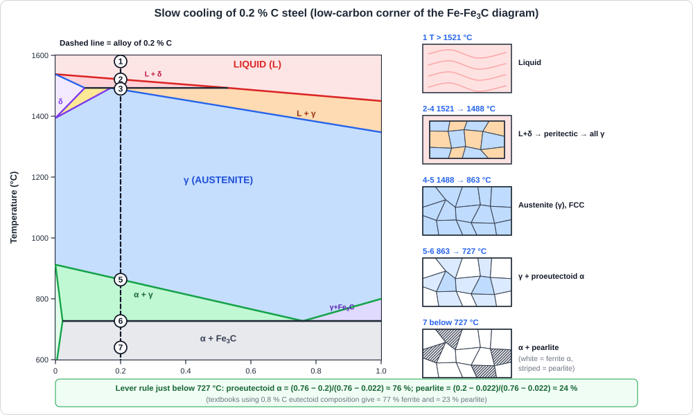

*Fig 3.5: Path of the 0.2 % C alloy on the low-carbon corner of the Fe-Fe₃C diagram, with microstructures.*

| Step | Temperature | Event | Phases present |
|---|---|---|---|
| **1** | above ≈ 1521 °C | molten alloy | liquid |
| **2** | ≈ 1521 °C | liquidus: first δ-ferrite crystals form | L + δ |
| **3** | 1493 °C | peritectic reaction $`L + \delta \rightarrow \gamma`$; the alloy has 0.2 % C (> 0.17 %), so δ is used up and **some liquid remains**, which then solidifies directly to γ | L + γ |
| **4** | ≈ 1488 °C | solidus reached | **all austenite (γ)**; single-phase FCC grains with 0.2 % C |
| **5** | ≈ 863 °C (A₃) | austenite starts rejecting **proeutectoid ferrite** at grain boundaries; remaining γ becomes enriched in carbon | α + γ |
| **6** | **727 °C (A₁)** | remaining austenite has 0.76 % C and transforms by the eutectoid reaction to **pearlite** | α + γ → α + pearlite |
| **7** | below 727 °C | no further change on slow cooling | **ferrite (≈ 76 %) + pearlite (≈ 24 %)** |

**Lever rule just below 727 °C**

```math
W_{\text{proeutectoid }\alpha}=\frac{0.76-0.20}{0.76-0.022}=0.76\ (76\,\%),\qquad W_{\text{pearlite}}=\frac{0.20-0.022}{0.76-0.022}=0.24\ (24\,\%)
```

(Using 0.8 % as the eutectoid composition and 0.02 % for ferrite gives about 77 % / 23 %.) The steel is soft and ductile with moderate strength, typical of mild steel.

---

#### Q3.13 Draw/explain the cooling curve for pure iron.

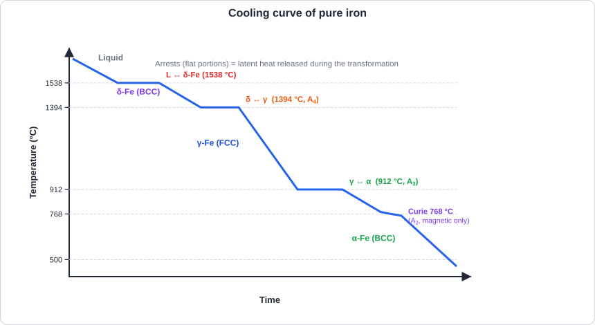

*Fig 3.6: Time-temperature curve of pure iron.*

A **cooling curve** records temperature against time as molten metal cools. **Flat portions (arrests)** appear where a phase change releases **latent heat**, balancing the heat loss.

| Temperature | Change | Structure |
|---|---|---|
| **1538 °C** | liquid → δ-iron (solidification) | BCC |
| **1394 °C (A₄)** | δ-iron → γ-iron | BCC → **FCC** |
| **912 °C (A₃)** | γ-iron → α-iron | FCC → **BCC** |
| **768 °C (A₂)** | **Curie point**: α-iron becomes ferromagnetic (no structural change, only a small kink) | BCC |

**Phase-rule explanation:** for a pure metal at constant pressure, $`F = C - P + 1`$. During a transformation two phases coexist ($`P=2`$), so $`F = 1-2+1 = 0`$ (invariant: temperature must stay constant → **arrest**). Within one phase, $`F = 1`$ and temperature falls continuously.

**Allotropy:** iron exists in different crystal forms (δ, γ, α) at different temperatures. The volume change at γ → α is the basis of heat treatment.

---

### 3C. Heat treatment

🔴 **MUST PREPARE**

#### Q3.14 What is heat treatment? State its purposes.

**Heat treatment** is the **controlled heating and cooling of a metal in the solid state** to obtain desired properties **without changing its chemical composition** (apart from surface treatments).

**Purposes**

1. **Soften** the metal (improve machinability, ductility).
2. **Harden** it (cutting tools, wear parts).
3. **Relieve internal stresses** from casting, forging, welding, cold work.
4. **Refine grain size** and homogenise structure.
5. Improve **toughness, strength** and **fatigue life**.
6. **Restore ductility** after cold working (recrystallisation).
7. Produce a **hard surface with a tough core** (case hardening).
8. Improve electrical/magnetic properties and dimensional stability.

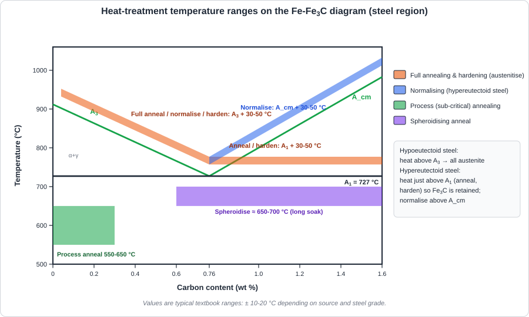

*Fig 3.7: Typical temperature ranges on the steel part of the Fe-Fe₃C diagram.*

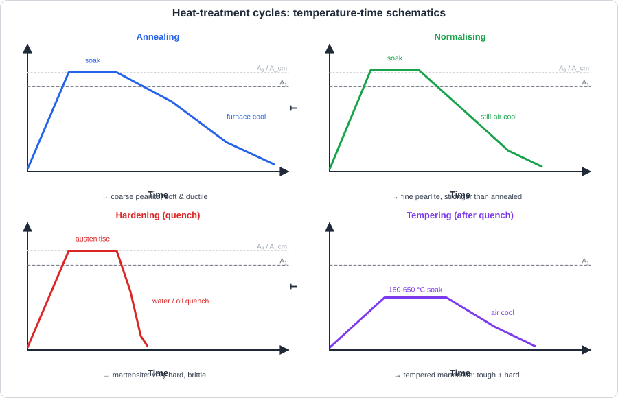

*Fig 3.8: Time-temperature cycles of annealing, normalising, hardening and tempering.*

---

#### Q3.15 Define annealing. Explain its purposes and different types.

**Annealing:** heating steel to a suitable temperature, **soaking** it, and then **cooling slowly (usually in the furnace)** to obtain a soft, stress-free, coarse-pearlite structure.

**Purposes:** soften steel; improve machinability and ductility; relieve internal stresses; refine/homogenise the structure; remove gases; prepare the steel for hardening or cold working.

| Type | Temperature | Purpose / result |
|---|---|---|
| **Full annealing** | hypo-eutectoid: **A₃ + 30-50 °C**; hyper: A₁ + 30-50 °C; furnace cool | full softening; coarse pearlite + ferrite |
| **Process annealing** (sub-critical) | **below A₁**, ≈ 550-650 °C | restores ductility of **cold-worked low-carbon steel** (recovery/recrystallisation) between drawing stages |
| **Spheroidising** | just below A₁ (≈ 650-700 °C) for a long time, or cycled about A₁ | cementite becomes **spheroids** in ferrite; best machinability of **high-carbon steel** |
| **Diffusion (homogenising)** | 1100-1200 °C for long periods | removes **segregation** in ingots/castings |
| **Recrystallisation annealing** | above recrystallisation temperature, below A₁ | removes strain-hardening of cold-worked metals (new strain-free grains) |
| **Isothermal annealing** | austenitise → quickly cool to ≈ 600-700 °C → hold until transformation is complete → cool in air | shorter cycle, uniform structure |

---

#### Q3.16 Differentiate full annealing and process annealing.

| Feature | **Full annealing** | **Process annealing** |
|---|---|---|
| Temperature | **above critical temperature** (A₃ + 30-50 °C) | **below the lower critical temperature** (≈ 550-650 °C) |
| Phase change | complete **transformation to austenite** and back | **no phase change**, only recrystallisation |
| Cooling | slow, in the furnace | air cooling is acceptable |
| Applied to | castings, forgings, all carbon steels | cold-worked low-carbon sheet and wire |
| Result | soft coarse **pearlite + ferrite**; grain refinement | **recrystallised, ductile** grains; stress relief |
| Time and cost | long and expensive | short and cheap |

---

#### Q3.17 What is normalizing? State its applications.

**Normalizing:** heating steel to **30-50 °C above A₃ (hypo-eutectoid) or above A_cm (hyper-eutectoid)**, holding briefly, and **cooling in still air**.

- **Result:** **fine-grained pearlite** (finer than annealing because cooling is faster) → **higher strength and hardness** than annealed steel, with good toughness.

**Applications:** refine coarse grains after forging, casting or rolling; remove internal stresses; improve machinability of low-carbon steel; break up the carbide network in hyper-eutectoid steel; prepare steel for hardening; obtain uniform properties and a standard reference structure.

| | **Annealing** | **Normalizing** |
|---|---|---|
| Cooling | slow (furnace) | air |
| Structure | coarse pearlite | fine pearlite |
| Hardness / strength | lower | higher |
| Cost | higher (long furnace time) | lower |

---

#### Q3.18 What is quenching? List quenching media and explain the mechanism/stages.

**Quenching:** **rapid cooling of austenitised steel** from the hardening temperature in a medium (liquid or gas) so that austenite transforms to hard **martensite** instead of pearlite.

**Quenching media (fastest → slowest, in general):** **brine** > **water** > polymer solutions > **oil** > molten salt/lead (for martempering) > **air / gas**.

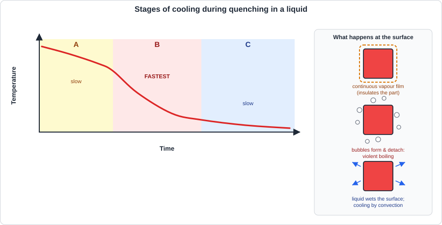

*Fig 3.9: Three stages of cooling in a liquid quench.*

| Stage | What happens | Cooling rate |
|---|---|---|
| **A: vapour-blanket** | the red-hot surface vaporises the liquid; a continuous vapour film insulates the part | **slow** |
| **B: vapour-transport (boiling)** | the film collapses; liquid wets the surface and boils violently, carrying away large heat | **fastest** |
| **C: liquid cooling** | surface is below the boiling point; heat leaves by conduction and convection | **slow** |

**Effects:** martensite formation, large **thermal and transformation stresses** → **distortion and quench cracks**. Water gives hardness but cracks risk; oil gives less distortion; brine is the severest. Agitation breaks the vapour blanket and speeds cooling.

---

#### Q3.19 Explain hardening and surface-hardening methods (including the methods named in the notes).

**Hardening (through-hardening):** heat steel to the austenitising temperature (**A₃ + 30-50 °C** for hypo-eutectoid; **A₁ + 30-50 °C** for hyper-eutectoid), soak, and **quench faster than the critical cooling rate** → **martensite** (a diffusionless, supersaturated body-centred tetragonal structure): **very hard but brittle**, with high residual stress. Hardness depends on **carbon content** (so low-C steel does not harden appreciably).

**Tempering (always follows hardening):** reheating the hardened steel to **150-650 °C**, holding, and cooling → **tempered martensite**: reduces brittleness and internal stress, and increases toughness, at some loss of hardness (low temper 150-250 °C for tools; 350-450 °C for springs; 500-650 °C for toughness).

**Surface (case) hardening:** hard, wear-resistant **case** with a soft, tough **core**; for gears, cams, shafts, bearings.

| Method | Steel used | Process | Case |
|---|---|---|---|
| **Carburising** | low-carbon (0.1-0.25 % C) | heat at ≈ 900-950 °C in carbon-rich medium (pack, gas, liquid) so C diffuses in; then **quench + temper** | hard high-C case, ≈ 0.5-2 mm |
| **Nitriding** | alloy steels containing Al, Cr, Mo, V | heat at ≈ 500-560 °C in **ammonia (NH₃)**; hard nitrides form; **no quench**, so little distortion | very hard, thin (≈ 0.1-0.6 mm) |
| **Cyaniding** | low/medium-carbon steel | immerse in molten **NaCN/KCN bath** at ≈ 800-870 °C (absorbs C and N); quench | thin (≈ 0.25-0.75 mm), hard |
| **Carbonitriding** | low-carbon steel | gas mixture of carburising gas + NH₃ at ≈ 800-870 °C | similar to cyaniding, safer |
| **Flame hardening** | medium-carbon steel | local oxy-acetylene heating then water spray | surface layer only |
| **Induction hardening** | medium-carbon steel | high-frequency induction heating then quench | precise, quick |

---

## Chapter 4: Ceramics

🟠 **HIGH PRIORITY**

#### Q4.1 State the important characteristics/properties of ceramic materials.

**Ceramics** are **inorganic, non-metallic compounds** of metallic and non-metallic elements (oxides, carbides, nitrides, silicates) held by **ionic and/or covalent bonds**, usually shaped from powder or clay and **hardened by firing at high temperature**.

| Property | Description |
|---|---|
| **Hardness** | very high (alumina ≈ 9 on Mohs scale) → abrasives, cutting tools |
| **Brittleness** | fracture with no plastic deformation (no dislocation motion in strong directional bonds); weak in tension, strong in compression (≈ 10:1) |
| **High melting point / refractoriness** | stable at very high temperature (Al₂O₃ ≈ 2070 °C, MgO ≈ 2800 °C) |
| **Density** | generally lower than steels and superalloys (≈ 2-6 g/cm³), though not lower than Al |
| **Thermal / electrical insulation** | low conductivity (except SiC, graphite); high dielectric strength |
| **Chemical inertness** | resists corrosion, oxidation and most acids |
| **Low thermal expansion** | but poor **thermal-shock resistance** |
| **Wear resistance and stiffness** | high elastic modulus (alumina ≈ 380 GPa) |

---

#### Q4.2 Classify ceramic materials with examples.

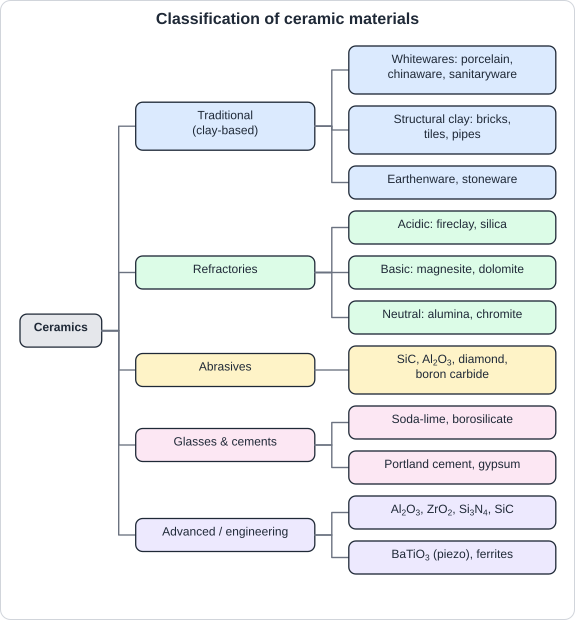

*Fig 4.1: Classification of ceramics.*

- **Glassy materials:** silicate glasses (see Chapter 5).
- **Clay products:** whitewares (porcelain, tableware, sanitaryware) and structural clay products (bricks, tiles, pipes).
- **Refractories:** withstand high temperature without melting or reacting: **fireclay, silica, magnesite, alumina, chromite**; used for furnace and kiln linings, crucibles.
- **Abrasives:** very hard grains for grinding and cutting: **SiC, Al₂O₃, diamond, boron carbide, garnet**.
- **Cements** and **advanced ceramics** (Al₂O₃, ZrO₂, Si₃N₄, SiC, BaTiO₃).

---

#### Q4.3 List useful ceramic products and state their characteristics/applications.

| Product | Key characteristic | Applications |
|---|---|---|
| Porcelain / china | vitrified, white, impervious | tableware, insulators, sanitaryware |
| Bricks and tiles | cheap, durable, compressive strength | construction |
| **Refractory bricks** (fireclay, silica, magnesite) | high melting point, thermal stability | blast furnace, kiln, cupola lining |
| **Abrasives** (SiC, Al₂O₃) | extreme hardness | grinding wheels, sandpaper, cutting |
| **Cutting tools** (Al₂O₃, Si₃N₄, WC-Co cermet) | hardness at high temperature | high-speed machining |
| **Electrical insulators** | high dielectric strength | spark plugs, high-voltage insulators |
| **Piezoelectric / capacitor ceramics** (BaTiO₃, PZT) | dielectric / electromechanical | sensors, capacitors, transducers |
| **Bioceramics** (alumina, zirconia, hydroxyapatite) | biocompatible, wear resistant | hip joints, dental implants |
| **Cement and concrete** | hydraulic setting | civil works |
| **Space-shuttle tiles** (silica) | very low conductivity | heat shield |

---

#### Q4.4 Explain/draw the drying and firing stages of ceramic manufacturing.

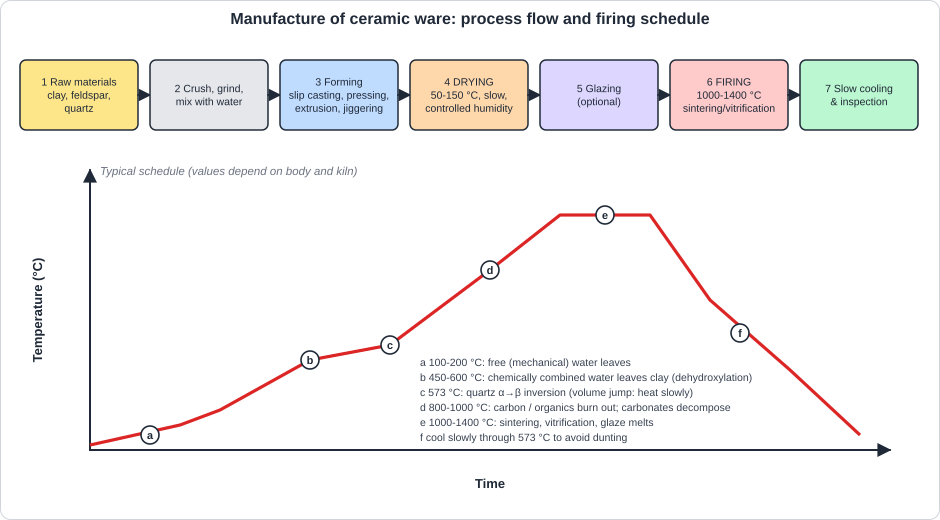

*Fig 4.2: Process flow and firing schedule (letters a-f in the figure).*

**Drying** (before firing)

- Removes **free (mechanical) water** from the shaped "green" body at **50-150 °C** slowly under controlled humidity.
- The body **shrinks** as water between clay particles leaves; if drying is fast or uneven, **warping and cracks** form.
- Dried body (leather-hard → bone-dry) is stronger and can be handled/glazed.

**Firing** (sintering/vitrification)

| Range | What happens |
|---|---|
| ≈ 100-200 °C | last free water escapes |
| ≈ 450-600 °C | **chemically combined water** leaves clay (dehydroxylation): kaolinite → metakaolin |
| **573 °C** | **quartz α → β inversion** (volume change; heat/cool slowly here) |
| ≈ 800-1000 °C | **organic matter and carbon burn out**, carbonates decompose |
| ≈ 1000-1400 °C | **sintering / vitrification:** glassy phase forms from feldspar, fills pores, bonds particles; body shrinks and becomes dense, strong; glaze melts |
| cooling | slow cooling (especially through 573 °C and cristobalite inversion ≈ 220-270 °C) to avoid **dunting** |

---

#### Q4.5 Explain fired and surface defects in ceramics with necessary figures.

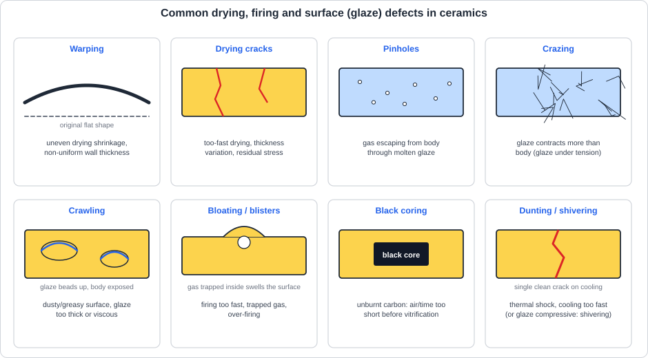

*Fig 4.3: Common defects (schematic).*

| Defect | Type | Cause | Remedy |
|---|---|---|---|
| **Warping** | drying/firing | non-uniform shrinkage, uneven thickness, poor support | uniform wall thickness, even drying, setters |
| **Drying cracks** | drying | too-rapid water loss, thick-thin sections | slow controlled drying |
| **Black coring** | fired | trapped carbon/organics not burnt out before pores closed | longer oxidising soak at 800-1000 °C |
| **Bloating / blisters** | fired | gas from decomposition trapped in vitrified body; over-firing | slower heating, proper peak temperature |
| **Dunting (fire cracks)** | fired | thermal shock, fast cooling through quartz/cristobalite inversion | slow cooling |
| **Pinholes** | surface (glaze) | gas escaping through molten glaze | proper bisque firing, adequate glaze maturing |
| **Crazing** | surface (glaze) | glaze contracts **more** than the body → tension → network of fine cracks | match thermal expansion; lower glaze expansion |
| **Shivering / peeling** | surface (glaze) | glaze contracts **less** than body → compression flakes edges | raise glaze expansion |
| **Crawling** | surface (glaze) | glaze too thick, dusty or greasy surface, high surface tension | clean bisque, correct glaze viscosity |
| **Over/under-firing** | fired | wrong peak temperature or time | controlled kiln schedule |

---

## Chapter 5: Glasses

🟠 **HIGH PRIORITY**

#### Q5.1 What is glass? State the types and explain its composition and structure.

**Glass** is an **inorganic, amorphous (non-crystalline), usually transparent solid** obtained by cooling a molten mixture (mainly **silica, SiO₂**) fast enough to prevent crystallisation: effectively a **supercooled liquid** that has become rigid.

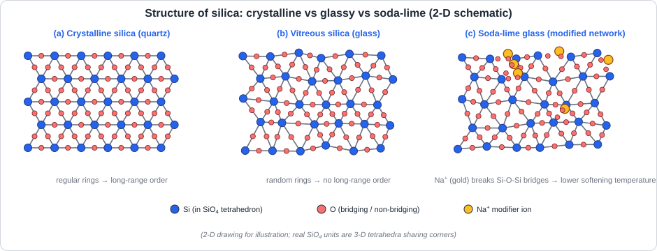

*Fig 5.1: Crystalline silica vs vitreous silica vs soda-lime glass (2-D schematic).*

**Composition: roles of oxides**

| Role | Oxides | Function |
|---|---|---|
| **Network formers** | SiO₂ (main), B₂O₃, P₂O₅ | build the random 3-D network of SiO₄ tetrahedra |
| **Modifiers / fluxes** | Na₂O, K₂O | break Si-O-Si links (non-bridging O), **lower melting temperature and viscosity** |
| **Stabilisers / intermediates** | CaO, MgO, Al₂O₃, PbO | restore durability (resist water attack), adjust properties |
| Colourants / decolourisers | Fe, Co, Cr, Mn, Se oxides, etc. | colour or remove colour |

**Structure:** each Si is bonded to four O atoms (**SiO₄ tetrahedron**); tetrahedra share corners in a **random network** with no long-range order; Na⁺ and Ca²⁺ ions sit in the holes and create non-bridging oxygens (Fig 5.1c).

| Type | Approx. composition | Properties | Uses |
|---|---|---|---|
| **Soda-lime (silicate)** | ≈ 72 % SiO₂, 14 % Na₂O, 10 % CaO | cheap, easily formed; moderate thermal-shock resistance | windows, bottles, jars, bulbs (≈ 90 % of all glass) |
| **Borosilicate** | ≈ 80 % SiO₂, 13 % B₂O₃, 4 % Na₂O | **low expansion** (≈ 3.3 × 10⁻⁶ /K), chemical and thermal-shock resistant | Pyrex lab ware, cookware, pipes |
| **Lead glass** | 18-35 % PbO | high refractive index, brilliant, easy to cut, absorbs X-rays | crystal ware, optical lenses, radiation shields |
| **Fused silica / quartz** | ≈ 100 % SiO₂ | highest working temperature, tiny expansion, UV transparent | crucibles, optics, lamp envelopes |
| **96 % silica (Vycor)** | 96 % SiO₂ | like fused silica but easier to make | furnace tubes |
| Property-based: **tempered, laminated, glass fibre** | - | tempered: compressive skin → 4-5× stronger; laminated: plastic interlayer holds fragments; fibre: reinforcement/insulation | car windows, safety glass, composites |

---

#### Q5.2 Explain the general, thermal and mechanical properties of industrial glass.

| Group | Properties |
|---|---|
| **General** | amorphous, hard, brittle, transparent, chemically durable (resists most acids except HF), non-porous, density 2.2-2.6 g/cm³ (silicate glasses), recyclable |
| **Thermal** | **no sharp melting point** (softens over a range); low conductivity (≈ 1 W/m·K); expansion: soda-lime ≈ 9 × 10⁻⁶ /K, borosilicate ≈ 3.3 × 10⁻⁶, fused silica ≈ 0.5 × 10⁻⁶ → poor thermal-shock resistance in soda-lime; glass-transition ≈ 500-600 °C (soda-lime) |
| **Mechanical** | **very strong in compression (> 1000 MPa)**, weak in tension (30-70 MPa in practice, theoretical several GPa) because of surface (Griffith) flaws; E ≈ 70 GPa; brittle; **strengthened** by thermal tempering, chemical (ion-exchange) tempering or fire polishing |
| **Optical** | transmits ≈ 90 % of visible light; refractive index ≈ 1.5 (lead glass 1.6-1.7); can be coloured |
| **Electrical** | good insulator at room temperature (conductivity rises with temperature through Na⁺ migration) |

**Viscosity reference points** (soda-lime type): working point ≈ 10³ Pa·s (≈ 1000 °C), softening ≈ 4 × 10⁶ Pa·s (≈ 700 °C), **annealing ≈ 10¹² Pa·s** (≈ 500 °C), strain point ≈ 3 × 10¹³ Pa·s (≈ 470 °C).

---

#### Q5.3 Discuss glass-forming methods with necessary sketches.

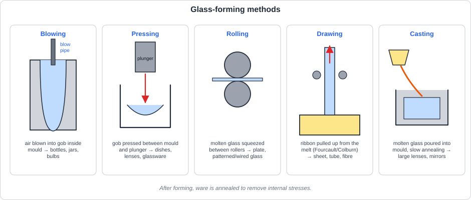

*Fig 5.2: Five forming methods.*

| Method | Description | Products |
|---|---|---|
| **Blowing** | air blown into a gob of molten glass inside a mould (press-and-blow or blow-and-blow); by hand or machine | bottles, jars, bulbs, hollow ware |
| **Pressing** | a gob is pressed between a plunger and mould | dishes, lenses, ovenware, insulators |
| **Rolling** | molten glass passes between water-cooled rollers (patterns can be imprinted) | plate, patterned and wired glass |
| **Drawing** | ribbon pulled vertically from the melt (Fourcault, Colburn, Pittsburgh); tubes by Danner/Vello; fibres from bushings | window sheet (older), tubes, rods, fibre |
| **Casting** | poured into a mould and slowly annealed | large mirrors, lenses, telescope blanks, statues |

After forming, **annealing** removes stresses (reheating to the annealing point and cooling slowly).

---

#### Q5.4 Explain sheet/float-glass manufacturing with a labelled diagram/flow sequence.

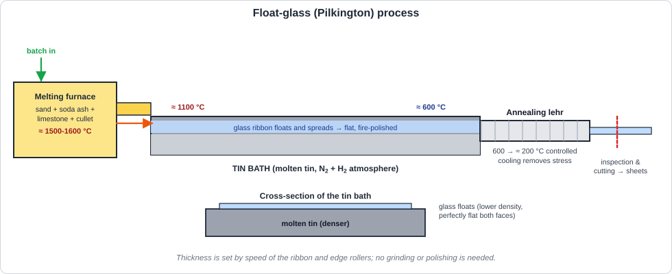

*Fig 5.3: Float-glass (Pilkington) process.*

**Sequence**

1. **Batch** (sand ≈ 72 %, soda ash, limestone, dolomite, plus recycled **cullet**) is melted in a **furnace at ≈ 1500-1600 °C**.
2. The molten glass flows over a lip onto a bath of **molten tin** (density greater than glass, does not mix); **N₂ + H₂ atmosphere** prevents tin oxidation.
3. The glass **floats and spreads**, forming a ribbon with **perfectly flat, parallel, fire-polished surfaces**; temperature falls from ≈ 1100 °C to ≈ 600 °C. Thickness is controlled by ribbon speed and edge rollers.
4. The hardened ribbon is lifted onto rollers and enters the **annealing lehr** where it cools in a controlled way from ≈ 600 °C to ≈ 200 °C to remove stress.
5. **Inspection, cutting** to size, stacking; optional coating (low-E), tempering or laminating.

Advantages: no grinding or polishing needed, continuous, high quality.

---

#### Q5.5 What is glass-transition temperature? Draw/explain the specific-volume-versus-temperature behaviour of crystalline and non-crystalline materials.

The **glass-transition temperature $`T_g`$** is the temperature (a narrow range) at which a **supercooled liquid becomes a rigid glass** on cooling (or a glass becomes rubbery/viscous on heating). Below $`T_g`$ atomic motion is essentially frozen (viscosity ≈ 10¹² Pa·s).

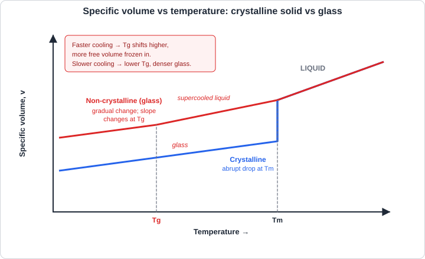

*Fig 5.4: Cooling behaviour of crystalline and non-crystalline materials.*

| | **Crystalline** | **Non-crystalline (glass)** |
|---|---|---|
| Change at transition | **abrupt discontinuous drop** in specific volume at the melting temperature $`T_m`$ | **gradual decrease**; slope changes at $`T_g`$ with **no sudden volume drop** |
| Transition temperature | single sharp $`T_m`$ | $`T_g`$ depends on **cooling rate** |
| Below transition | ordered solid | frozen-in disordered structure with extra free volume |

**Cooling rate effect:** faster cooling → higher $`T_g`$ and larger specific volume; slower cooling → lower $`T_g`$ and denser glass. Note that $`T_g`$ for glass is typically about 0.6-0.7 $`T_m`$ (kelvin).

---

## Chapter 6: Polymers

🔴 **MUST PREPARE**

#### Q6.1 Define polymer, monomer, polymerization and co-polymer.

- **Polymer:** a very large molecule (macromolecule, molar mass often $`10^4`$-$`10^6`$ g/mol) built by repeating a small unit many times.
- **Monomer:** the small molecule that forms the repeating unit (e.g. ethene, $`\mathrm{CH_2{=}CH_2}`$).
- **Polymerization:** the chemical process that joins many monomers into a polymer. Degree of polymerisation $`n = M_{polymer}/M_{repeat\ unit}`$.
- **Co-polymer:** a polymer made from **two or more different monomers** (random, alternating, block or graft), e.g. **ABS**, SBR rubber, styrene-acrylonitrile.

**Example:** polyethylene of molar mass 28 000 g/mol; repeat unit $`\mathrm{C_2H_4} = 28`$ → $`n = 28\,000/28 = 1000`$.

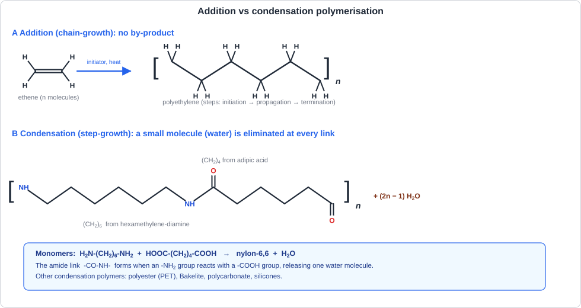

*Fig 6.1: Addition polymerisation (ethene → polyethylene) and condensation polymerisation (nylon-6,6).*

| | **Addition (chain-growth)** | **Condensation (step-growth)** |
|---|---|---|
| Monomers | contain a double bond (C=C) | two different **functional groups** (-OH, -COOH, -NH₂) |
| By-product | none | small molecule (H₂O, HCl) lost at each link |
| Steps | initiation → propagation → termination | stepwise; any two molecules can join |
| Molar mass growth | very rapid, high mass at once | slow, mass increases gradually |
| Examples | PE, PP, PVC, PS, PTFE | nylon, polyester (PET), Bakelite, polycarbonate |

---

#### Q6.2 Differentiate thermoplastic and thermosetting polymers. Why are thermosetting plastics generally stronger/more heat-resistant in the supplied comparison?

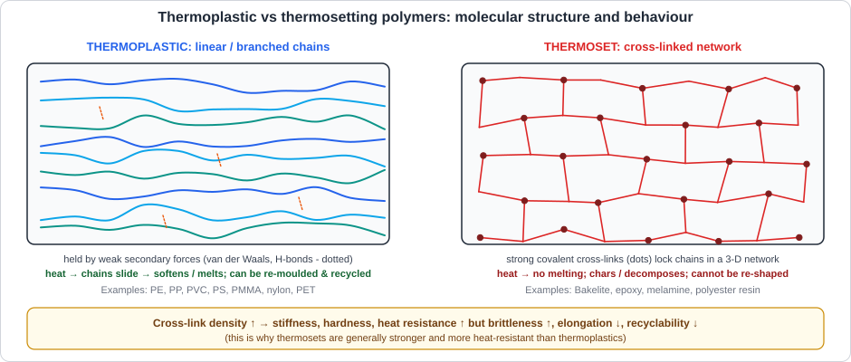

*Fig 6.2: Chain arrangement and behaviour on heating.*

| Feature | **Thermoplastic** | **Thermosetting** |
|---|---|---|
| Molecular structure | **linear or branched** chains | **3-D cross-linked network** |
| Bonds between chains | weak secondary forces (van der Waals, H-bonds) | **strong covalent cross-links** |
| Effect of heat | softens, melts and flows; **reversible** | **sets permanently** (cures); chars/decomposes on further heating |
| Re-moulding / recycling | yes | **no** |
| Strength, rigidity | lower | **higher** |
| Heat resistance | lower (softens ≈ 60-250 °C) | **higher**, retains shape |
| Elongation / toughness | higher, often flexible | brittle, low elongation |
| Solubility | soluble in some solvents | insoluble, swell only |
| Processing | injection, extrusion, blow moulding, thermoforming | compression, transfer moulding (cure in the mould) |
| Examples | PE, PP, PVC, PS, nylon, PMMA, PET | Bakelite, epoxy, melamine, urea-formaldehyde, polyester resin |

**Why thermosets are stronger and more heat-resistant:** covalent cross-links join the chains into **one giant network**. Chains **cannot slide** past each other, so the material is rigid and **cannot melt**. Heat must break strong covalent bonds (decomposition), whereas in thermoplastics it only has to overcome weak secondary bonds.

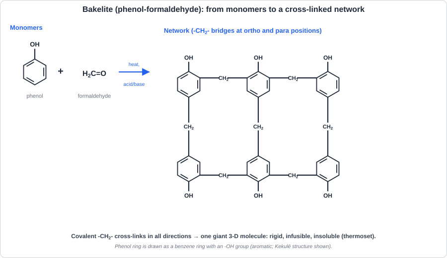

*Fig 6.3: Bakelite (phenol-formaldehyde): phenol rings joined by -CH₂- bridges.*

---

#### Q6.3 What is plastic? State properties and industrial applications; give thermoplastic compounds and their uses.

**Plastics** are synthetic (or semi-synthetic) **organic polymers**, mixed with additives (plasticisers, fillers, stabilisers, pigments, flame retardants), that can be **moulded into shape** by heat and/or pressure.

**Properties:** low density (0.9-1.5 g/cm³); corrosion and chemical resistant; electrical and thermal insulators; easily and cheaply moulded into complex shapes; colourable, good strength-to-weight. **Limits:** low stiffness and strength, **creep**, low service temperature, UV degradation, flammability, non-biodegradability.

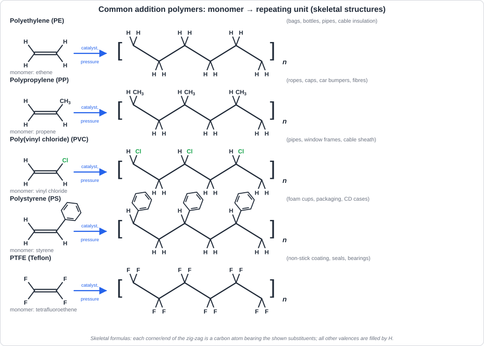

*Fig 6.4: Monomer → repeating unit of the common thermoplastics (skeletal formulas; brackets show a chain segment, repeat unit repeated n times).*

| Thermoplastic | Monomer | Properties | Uses |
|---|---|---|---|
| **Polyethylene (LDPE/HDPE)** | ethene | tough, flexible, chemical resistant, low cost | bags, films, bottles, pipes, cable insulation |
| **Polypropylene (PP)** | propene | stiffer, higher melting (≈ 165 °C), fatigue (living-hinge) resistance | ropes, crates, bumpers, caps, fibres |
| **PVC** | vinyl chloride | rigid or plasticised, flame retardant, weatherable | pipes, window frames, cables, flooring |
| **Polystyrene (PS)** | styrene (benzene ring) | clear, rigid, brittle; foamable | cups, packaging, insulation foam, CD cases |
| **PTFE (Teflon)** | tetrafluoroethene | lowest friction, inert, to 260 °C | non-stick coatings, seals, bearings |
| **PMMA (acrylic)** | methyl methacrylate | transparent, weatherable | windows, lenses, signs |
| **Nylon (PA 6,6)** | condensation | strong, wear-resistant | gears, bearings, fibres, ropes |

**Common thermosets:** phenolics (switches, handles), urea-/melamine-formaldehyde (adhesives, crockery), epoxy (adhesives, composites), unsaturated polyester (FRP boats), silicones.

---

#### Q6.4 Describe injection moulding of thermoplastic material step by step.

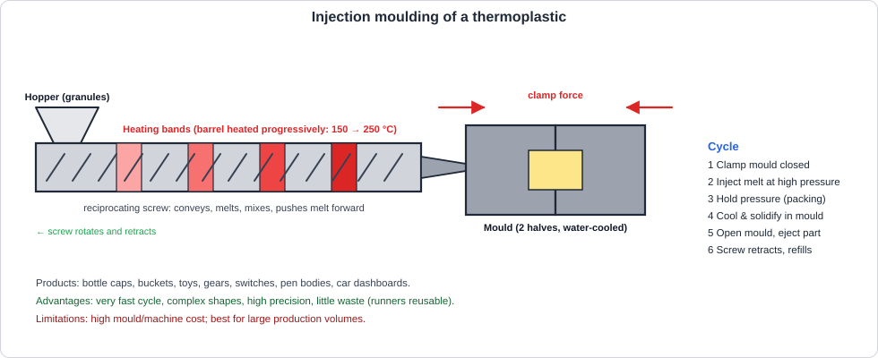

*Fig 6.5: Injection-moulding machine.*

**Main parts:** hopper, heated barrel with **reciprocating screw**, nozzle, two-part water-cooled **mould** and clamping unit.

**Steps**

1. **Granules** from the hopper are carried forward by the rotating screw along the **heated barrel**; friction and heater bands **melt** them (≈ 150-250 °C).
2. The screw retracts, **accumulating a shot** of melt in front of it.
3. The mould is **clamped shut** under high force.
4. The screw acts as a ram and **injects** the melt through the nozzle into the cavity at high pressure.
5. **Packing/holding pressure** compensates for shrinkage as the polymer cools.
6. The part **cools and solidifies** in the water-cooled mould.
7. The mould opens and **ejector pins** push the part out; runners/sprues are trimmed and reused. The cycle repeats (seconds to a minute).

**Products:** bottle caps, buckets, toys, gears, switches, car interior parts. **Advantages:** fast, precise, complex shapes, low labour; **limits:** costly moulds.

---

#### Q6.5 Describe extrusion moulding and explain how a continuous product is formed.

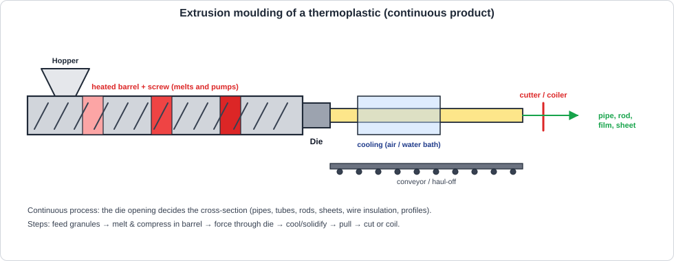

*Fig 6.6: Extruder.*

1. Granules/powder drop from the **hopper** into the **heated barrel**.
2. A rotating **screw** conveys, compresses and **melts** the plastic, building pressure.
3. The molten plastic is **forced continuously through a die** whose opening gives the cross-section (pipe, rod, sheet, film, profile).
4. The hot extrudate is **cooled** (air or water bath), **pulled** by a haul-off/conveyor and **cut** to length or **coiled**.

Because feed and die are continuous, the **product length is unlimited**. Examples: PVC pipes, window profiles, cable insulation, sheet, blown film (a tubular die plus air inflation).

---

#### Q6.6 Describe compression moulding; prepare blow moulding/rotational moulding/thermoforming if required.

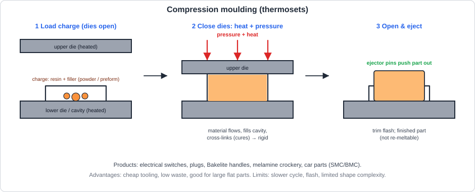

*Fig 6.7: Compression moulding of a thermoset.*

**Compression moulding (mainly thermosets)**

1. A measured **charge** (powder, granules or pre-form of resin + filler) is placed in the **heated lower die**.
2. The **upper die closes**, applying **pressure and heat** (≈ 130-200 °C).
3. The material **softens, flows to fill the cavity** and then **cross-links (cures)**.
4. After curing, the die opens and the **rigid part is ejected** while hot; **flash** is trimmed.

Products: electric plugs/switches, Bakelite handles, melamine plates, car parts (SMC/BMC). Advantages: low tooling cost, little waste; limits: slower cycle, flash, simple shapes.

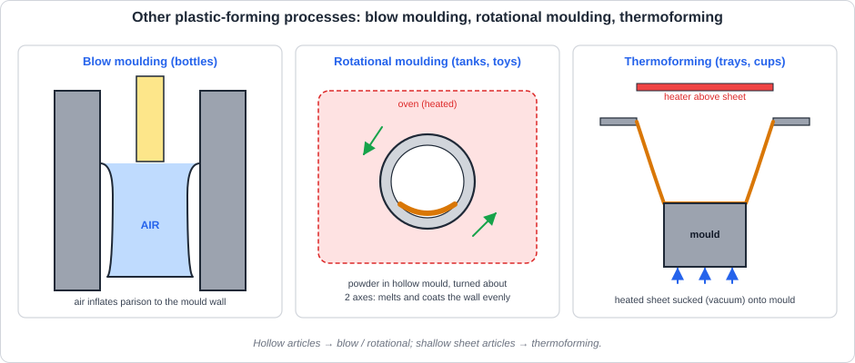

*Fig 6.8: Blow moulding, rotational moulding and thermoforming.*

| Process | Principle | Products |
|---|---|---|
| **Blow moulding** | an extruded hot tube (**parison**) is clamped in a mould and **inflated with compressed air** against the walls | bottles, containers, drums |
| **Rotational moulding** | powder in a hollow mould is **rotated about two axes in an oven**, melting and coating the wall; cooled, then demoulded | tanks, kayaks, toys, traffic cones |
| **Thermoforming** | a heated thermoplastic **sheet** is drawn onto a mould by **vacuum or pressure** | trays, cups, packaging, refrigerator liners |

---

## Final unit: Composite Materials

🟠 **HIGH PRIORITY**

> [!NOTE]
> In the Suggestions PDF this section follows Chapter 6 but has no clearly printed chapter number; the lecture notes place it in Module 07 with ceramics, glass and polymers. It is kept here as a separate final unit.

#### Q7.1 What is a composite material? State its advantages and applications.

A **composite material** consists of **two or more chemically different phases**, separated by a distinct interface, combined so that the result has **properties better than either constituent alone** (e.g. strong and light). Examples: **fibreglass (GFRP)**, carbon-fibre-reinforced plastic (CFRP), concrete, plywood.

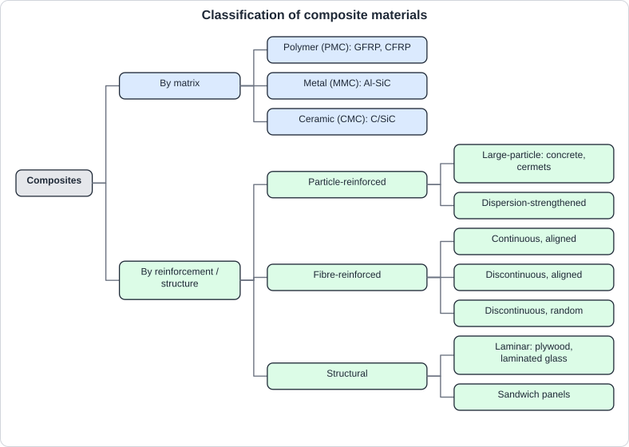

*Fig 7.1: Classification of composite materials.*

**Advantages**

- **High specific strength and specific stiffness** (strength or modulus ÷ density): ideal for aircraft and sports goods.
- **Low specific gravity**, light weight.
- Properties can be **tailored** (fibre direction, fraction, layup).
- **Corrosion and oxidation resistance** (polymer matrix).
- Good **fatigue, creep and toughness** performance.
- Large, **complex shapes** in one piece; parts consolidation.

**Disadvantages:** expensive, **anisotropic**, difficult to repair and recycle, damage hard to detect, matrix limits service temperature, low through-thickness strength.

| Field | Applications |
|---|---|
| **Aerospace** | wings, fuselage panels, rotor blades (Boeing 787 is ≈ 50 % composite by weight), satellites |
| **Architecture / construction** | concrete, FRP rebar and bridge decks, GRC facades, cladding |
| **Energy** | **wind-turbine blades** (GFRP/CFRP), pressure vessels |
| **Marine** | boat hulls, masts, tanks |
| **Automotive and rail** | body panels, springs, drive shafts, brake discs |
| **Sports and medical** | rackets, bicycles, skis; prostheses, bone plates |

---

#### Q7.2 Explain laminar composites with examples/uses.

**Laminar composites** consist of **thin layers (plies/laminae) bonded together** so that each layer's strong direction is oriented differently, giving good properties in more than one direction.

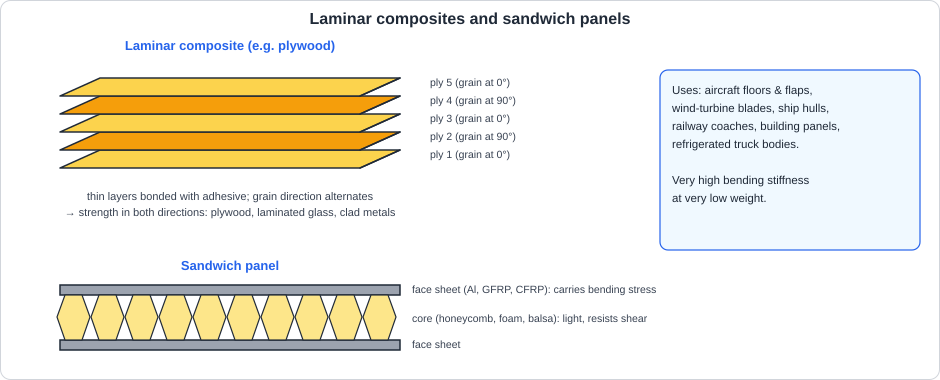

*Fig 7.2: Laminar composite and sandwich panel.*

**Examples/uses:** **plywood** (veneers with grain alternating at 90°), **laminated glass** (glass + PVB sheet: windscreens), **bimetallic strips**, **clad metals** (Alclad), Formica/decorative laminates, **CFRP cross-ply laminates** for aircraft skins.

---

#### Q7.3 Explain sandwich panels and their construction.

A **sandwich panel** has **two thin, stiff, strong face sheets** (aluminium, GFRP, CFRP, plywood) **bonded to a thick, lightweight core** (honeycomb, foam, balsa wood, corrugation) with adhesive.

- **Face sheets** carry the **bending (tensile/compressive) stresses**.
- **Core** keeps the faces apart (large second moment of area), resists **shear** and supports the faces against buckling.
- Result: **very high bending stiffness at very low weight**, like an I-beam spread over an area.

**Uses:** aircraft floors, flaps and radomes, wind-turbine blades, ship decks, railway coach panels, refrigerated trucks, building wall/roof panels.

---

#### Q7.4 Differentiate the matrix phase and dispersed/reinforcement phase; state their purposes.

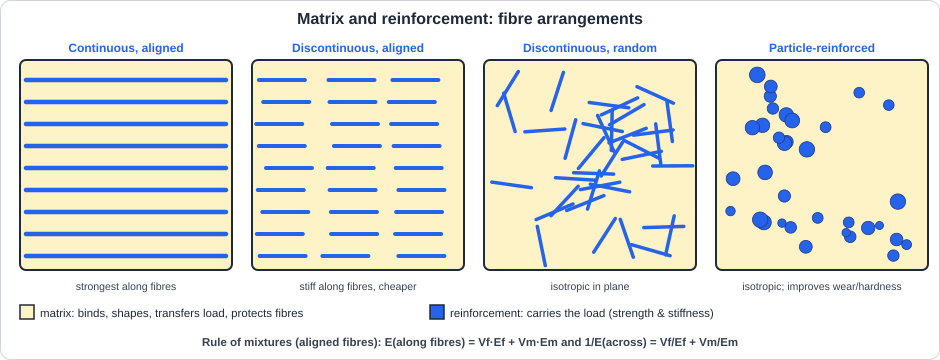

*Fig 7.3: Matrix and reinforcement.*

| | **Matrix phase** | **Dispersed (reinforcement) phase** |
|---|---|---|
| Role | **continuous** phase that surrounds the reinforcement | **discontinuous** (or continuous fibres) embedded in the matrix |
| Purpose | binds fibres, **transfers load** to them, gives shape, protects from environment/abrasion, separates fibres to stop crack spread | carries **most of the load**; provides **strength and stiffness** |
| Typical materials | polymers (epoxy, polyester), metals (Al, Mg, Ti), ceramics | glass, carbon, aramid (Kevlar) fibres; SiC, Al₂O₃ particles |
| Properties | ductile/tough, lower strength | strong, stiff, often brittle |

**Rule of mixtures** (aligned continuous fibres, volume fractions $`V_f + V_m = 1`$):

```math
E_{\parallel}=V_fE_f+V_mE_m \quad(\text{along fibres, upper bound}),\qquad \frac{1}{E_{\perp}}=\frac{V_f}{E_f}+\frac{V_m}{E_m}\quad(\text{across fibres, lower bound})
```

**Example:** glass/epoxy with $`V_f = 0.6`$, $`E_f = 72`$ GPa, $`E_m = 3`$ GPa:
$`E_\parallel = 0.6(72)+0.4(3)=44.4`$ GPa; $`1/E_\perp = 0.6/72 + 0.4/3 = 0.1417`$ → $`E_\perp = 7.1`$ GPa. The composite is **six times stiffer along the fibres than across them** (anisotropy).

---

#### Q7.5 Describe composite-manufacturing processes (hand lay-up, filament winding, compression moulding, resin-transfer moulding and pultrusion where applicable).

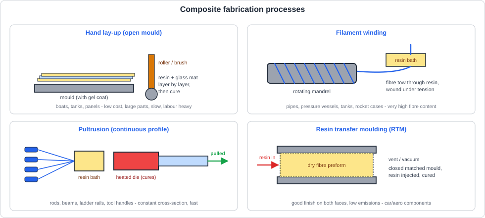

*Fig 7.4: Fabrication processes.*

| Process | Method | Advantages | Limitations | Typical products |
|---|---|---|---|---|
| **Hand lay-up** | gel coat on open mould; layers of fibre mat/cloth wetted with resin by brush/roller; cure at room temperature | simple, low tooling cost, large/complex parts | slow, labour-intensive, one good surface, variable quality, styrene emission | boat hulls, tanks, panels |
| **Filament winding** | continuous fibre tow pulled through a **resin bath** and wound under tension on a rotating mandrel; cured; mandrel removed | high fibre content and strength, automated, accurate fibre direction | only convex/axisymmetric shapes, mandrel cost | pipes, pressure vessels, rocket motor cases, storage tanks |
| **Pultrusion** | fibres pulled through resin bath then a **heated die** that shapes and cures; continuous cut-to-length | continuous, fast, constant profile, high fibre volume | constant cross-section only; die cost | rods, I-beams, ladder rails, tool handles |
| **Compression moulding** | SMC/BMC or pre-form placed in heated matched metal dies, pressed and cured | fast cycle, good finish both sides, repeatability | expensive dies and press | automotive panels, housings |
| **Resin transfer moulding (RTM)** | **dry fibre pre-form** placed in a closed mould; resin injected under pressure, cured | good finish on both faces, low emissions, near-net shape | tooling cost; resin flow control | car and aircraft components |

---

#### Q7.6 Discuss advantages/disadvantages of composite fabrication processes if asked.

Use the **Advantages** and **Limitations** columns of the table in Q7.5. Short summary for a 3-mark answer: *open-mould processes (hand lay-up) are cheap but slow and variable; filament winding and pultrusion are automated and give the highest fibre content but only fixed shapes; closed-mould processes (compression, RTM) give accurate, finished parts at high tooling cost.*

---

# PART B: EXTRA REVISION

### B1. Formula sheet

| Topic | Formula |
|---|---|
| Normal stress / strain | $`\sigma=P/A_0`$ , $`\varepsilon=\Delta L/L_0`$ |
| Hooke's law | $`\sigma=E\varepsilon`$ |
| Axial deformation | $`\delta=\dfrac{PL}{AE}`$ |
| Shear (punching) force | $`F=\tau\,\pi d\,t`$ |
| True stress | $`\sigma_T=\sigma(1+\varepsilon)`$ |
| Ductility | $`\%EL=\dfrac{L_f-L_0}{L_0}\times100`$ , $`\%RA=\dfrac{A_0-A_f}{A_0}\times100`$ |
| Modulus of resilience | $`U_r=\dfrac{\sigma_y^2}{2E}`$ |
| Brinell hardness | $`\mathrm{BHN}=\dfrac{2P}{\pi D\left(D-\sqrt{D^2-d^2}\right)}`$ |
| Vickers hardness | $`HV=1.854\,P/d^2`$ |
| Griffith fracture stress | $`\sigma_c=\sqrt{2E\gamma_s/\pi a}`$ |
| Lattice parameter | SC: $`a=2R`$ · BCC: $`a=4R/\sqrt3`$ · FCC: $`a=2\sqrt2R`$ |
| APF | SC $`\pi/6=0.52`$ · BCC $`\sqrt3\pi/8=0.68`$ · FCC $`\sqrt2\pi/6=0.74`$ |
| Theoretical density | $`\rho=\dfrac{nA}{a^3N_A}`$ |
| Lever rule | $`W_1=\dfrac{C_2-C_0}{C_2-C_1}`$ |
| Pearlite fraction (hypo-eutectoid) | $`W_p=\dfrac{C_0-0.022}{0.76-0.022}`$ |
| Degree of polymerisation | $`n=M_{polymer}/M_{repeat}`$ |
| Rule of mixtures | $`E_\parallel=V_fE_f+V_mE_m`$ ; $`1/E_\perp=V_f/E_f+V_m/E_m`$ |
| Pilling-Bedworth ratio | $`\mathrm{PBR}=V_{oxide}/V_{metal}`$ (1-2 protective) |
| Phase rule (constant P) | $`F=C-P+1`$ |

---

### B2. One-glance comparison tables

**Steel microstructure and properties vs carbon content**

| % C | Name | Structure | Hardness / strength | Ductility | Hardenable? |
|---|---|---|---|---|---|
| 0.05-0.25 | low-carbon (mild) | ferrite + little pearlite | low | high | no (case-harden) |
| 0.25-0.6 | medium-carbon | ferrite + pearlite | medium | medium | yes |
| 0.6-1.5 | high-carbon | pearlite (+ Fe₃C) | high | low | yes |
| 2.14+ | cast iron | + graphite or cementite | varies | very low | white/chilled iron |

**Heat treatments at a glance**

| Treatment | Heat to | Cool | Structure | Result |
|---|---|---|---|---|
| Full anneal | A₃ + 30-50 °C | furnace | coarse pearlite | softest |
| Process anneal | 550-650 °C | air | recrystallised ferrite | ductility restored |
| Spheroidise | ≈ 650-700 °C long soak | slow | spheroidal Fe₃C | best machinability (high C) |
| Normalise | A₃ (or A_cm) + 30-50 °C | still air | fine pearlite | stronger, refined |
| Harden | A₃ (or A₁) + 30-50 °C | water / oil | **martensite** | hard, brittle |
| Temper | 150-650 °C | air | tempered martensite | tough + hard |

**Material families**

| Property | Metals | Ceramics | Polymers | Composites |
|---|---|---|---|---|
| Bonding | metallic | ionic / covalent | covalent + secondary | mixed |
| Strength | high | high in compression | low-moderate | very high (specific) |
| Ductility | high | nil | moderate-high | low-moderate |
| Density | high | medium | low | low-medium |
| Max service temp | high | **very high** | low | polymer-limited |
| Conductivity | high | low | very low | low-medium |
| Corrosion | poor-fair | **excellent** | excellent | good |

**Hardness tests**

| Test | Indenter | Measured | Typical use |
|---|---|---|---|
| Brinell | ⌀10 mm ball | impression diameter | castings, soft/medium metals |
| Rockwell | ball / diamond cone | depth | hardened steel, fast checks |
| Vickers | 136° diamond pyramid | diagonals | all metals, thin sections |
| Knoop | rhombic diamond | long diagonal | micro-hardness, brittle |

---

### B3. Key numbers to memorise

| Item | Value |
|---|---|
| Atoms per cell: SC / BCC / FCC | 1 / 2 / 4 |
| Coordination number: SC / BCC / FCC | 6 / 8 / 12 |
| APF: SC / BCC / FCC | 0.52 / 0.68 / 0.74 |
| Iron allotropes | α (BCC) < 912 °C · γ (FCC) 912-1394 °C · δ (BCC) 1394-1538 °C |
| Curie point of iron | 768 °C |
| Eutectoid | 0.76 % C (0.8), 727 °C (723) |
| Eutectic | 4.3 % C, 1147 °C |
| Peritectic | 0.17 % C, 1493 °C |
| Max C solubility: α / γ | 0.022 % / 2.14 % |
| Cementite | 6.67 % C |
| Steel / cast iron boundary | 2.14 % C |
| Stainless steel | ≥ 10.5-12 % Cr |
| HSS 18-4-1 | 18 W, 4 Cr, 1 V |
| Mild-steel yield / UTS / E | ≈ 250 / 400-500 MPa / 200 GPa |
| Al density / mp | 2.7 g/cm³ / 660 °C |
| Mg density | 1.74 g/cm³ |
| Cu-Ag eutectic | 71.9 % Ag, 779 °C |
| Hall-Héroult bath | ≈ 950-980 °C in cryolite |
| Quartz inversion | 573 °C |
| Glass annealing viscosity | ≈ 10¹² Pa·s |

---

### B4. Mnemonics and memory hooks

- **Seven crystal systems:** *"**C**ats **T**ake **O**nly **R**ats, **H**ens, **M**ice, **T**oads"* → Cubic, Tetragonal, Orthorhombic, Rhombohedral, Hexagonal, Monoclinic, Triclinic.
- **APF:** *"52, 68, 74"* = SC, BCC, FCC (APF rises with atoms: 1-2-4).
- **Iron transitions:** *15-13-9* → 1538, 1394, 912 °C (L→δ, δ→γ, γ→α).
- **Cast irons:** *"**G**ood **W**omen **M**ake **D**elicious **C**hocolate"* → Grey, White, Malleable, Ductile, Chilled.
- **Flash before Fire; Pour below Cloud** (on cooling, oil turns cloudy first, then stops pouring).
- **Quench stages:** **V-B-L** = Vapour blanket (slow) → Boiling (fast) → Liquid convection (slow).
- **Anneal vs normalise:** *Anneal = furnace (slow, soft); Normalise = in the open air (finer, harder).*
- **Galvanizing:** *Zinc is the Zacrifice* (sacrificial); **Tin is a Thin shield**: breaks and the steel rots.
- **Thermoset:** *"set" like concrete: once set, it never melts again.*
- **Matrix = Mother** (holds and protects); **Reinforcement = Rod/fibre** (takes the load).

---

### B5. Common exam mistakes

> [!WARNING]
> Check these before submitting.

1. **No units or axis labels** on the stress-strain, S-N or creep curves.
2. Forgetting to **label points A-G** on the mild-steel curve or mixing up the *upper* and *lower* yield points.
3. Using **atom counts** wrongly: FCC is **4** (not 14); BCC is **2**.
4. Writing APF **without the contact relation** ($`a=4R/\sqrt3`$ etc.): marks are lost for missing steps.
5. Mixing nm and cm in density problems: **1 nm = 10⁻⁷ cm**.
6. Calling **austenite** stable at room temperature in plain carbon steel.
7. Confusing **annealing and normalising** (cooling rate) or **full and process annealing** (above vs below A₁).
8. Saying "zinc coating protects only as a barrier": it protects **sacrificially** too.
9. Mixing up **thermoplastic = linear/branched, softens** with **thermoset = cross-linked, does not soften**.
10. In Fe-Fe₃C, mixing the **eutectic (4.3 %, 1147 °C)** with the **eutectoid (0.76 %, 727 °C)**.
11. Forgetting to write **balanced equations** in the blast-furnace answer.
12. Not stating *which* textbook values are used (0.76 vs 0.8 % C).

---

### B6. Extra practice numericals (with answers)

**E1: Density of nickel (FCC).** $`R=0.1246`$ nm, $`A=58.69`$ g/mol.
$`a=2\sqrt2R=0.3524`$ nm → $`V_c=4.377\times10^{-23}`$ cm³ → $`\rho=\dfrac{4(58.69)}{(4.377\times10^{-23})(6.022\times10^{23})}=`$ **8.91 g/cm³**.

**E2: Density of chromium (BCC).** $`R=0.125`$ nm, $`A=52.0`$ g/mol.
$`a=4R/\sqrt3=0.2887`$ nm → $`V_c=2.406\times10^{-23}`$ cm³ → $`\rho=\dfrac{2(52.0)}{(2.406\times10^{-23})(6.022\times10^{23})}=`$ **7.18 g/cm³**.

**E3: Wire in tension.** Steel wire, $`d=2`$ mm, $`L=1.5`$ m, $`P=1.5`$ kN, $`E=200`$ GPa.
$`A=\pi(2)^2/4=3.142`$ mm² → $`\sigma=1500/3.142=`$ **477.5 MPa**; $`\delta=\sigma L/E=477.5(1500)/200\,000=`$ **3.58 mm**.

**E4: Brinell number.** $`P=3000`$ kgf, $`D=10`$ mm, $`d=3.5`$ mm.
$`\sqrt{100-12.25}=9.368`$; $`D-\sqrt{\cdot}=0.632`$; $`\mathrm{BHN}=6000/(\pi\times10\times0.632)=`$ **≈ 302**.

**E5: Phase fractions of 0.4 % C steel** (just below 727 °C).
Pearlite $`=\dfrac{0.40-0.022}{0.76-0.022}=`$ **51 %**, proeutectoid ferrite **49 %**.

**E6: Degree of polymerisation.** PVC (repeat unit $`\mathrm{C_2H_3Cl}`$, 62.5 g/mol) of molar mass 125 000 g/mol → $`n=`$ **2000**.

**E7: Carbon-fibre/epoxy.** $`V_f=0.5`$, $`E_f=230`$ GPa, $`E_m=3.5`$ GPa.
$`E_\parallel=0.5(230)+0.5(3.5)=`$ **116.75 GPa**; $`1/E_\perp=0.5/230+0.5/3.5=0.1450`$ → $`E_\perp=`$ **6.90 GPa**.

**E8: Punching.** Hole 30 mm in 8 mm plate, $`\tau=250`$ MPa → $`F=250\times\pi(30)(8)=`$ **188.5 kN**.

**E9: Creep rate.** Strain rises from 0.0020 to 0.0035 over 500 h in the steady stage → rate $`=\dfrac{0.0015}{500}=`$ **3.0 × 10⁻⁶ per hour**.

---

### B7. Viva questions

<details>
<summary><b>1. Why is FCC more ductile than BCC?</b></summary>

FCC has **close-packed {111} planes** and 12 well-defined slip systems that operate at all temperatures; BCC has no close-packed plane and its slip is strongly temperature dependent (hence the DBTT).
</details>

<details>
<summary><b>2. What is allotropy? Give an example.</b></summary>

Existence of a solid element in more than one crystal structure. **Iron:** BCC (α) → FCC (γ) at 912 °C → BCC (δ) at 1394 °C.
</details>

<details>
<summary><b>3. Why does steel with 0.1 % C not harden by quenching?</b></summary>

Too little carbon to form a hard, supersaturated martensite; hardness of martensite depends mainly on carbon content.
</details>

<details>
<summary><b>4. Why is pig iron brittle?</b></summary>

High carbon (≈ 4 %) and impurities (Si, S, P) form cementite or graphite flakes that give easy crack paths.
</details>

<details>
<summary><b>5. What is hot shortness and cold shortness?</b></summary>

**Hot shortness:** sulphur (FeS films) makes steel crack during hot working. **Cold shortness:** phosphorus makes steel brittle at low temperature.
</details>

<details>
<summary><b>6. Why is tin plating unsuitable if the coating is scratched?</b></summary>

Tin is cathodic to iron, so the exposed iron becomes the anode and corrodes rapidly, a small anode area on a large cathode.
</details>

<details>
<summary><b>7. Why is ceramic strong in compression but weak in tension?</b></summary>

Compression closes the surface flaws; tension opens them and a flaw grows unstably (Griffith) since the ionic/covalent bonds cannot yield by slip.
</details>

<details>
<summary><b>8. Why is float glass flat?</b></summary>

Liquid tin has a perfectly level surface and the glass floats on it, so gravity and surface tension give flat parallel faces.
</details>

<details>
<summary><b>9. Difference between Tg and Tm?</b></summary>

$`T_m`$: sharp melting of a **crystalline** solid. $`T_g`$: softening range of an **amorphous** material, cooling-rate dependent.
</details>

<details>
<summary><b>10. Why are sandwich panels so stiff and light?</b></summary>

Stiff face sheets are placed far from the neutral axis by a light core, so the second moment of area is large for very little extra weight.
</details>

---

### B8. Final revision checklist

**Do these first**

- [ ] Mechanical-property definitions and material classification → [Q1.1-Q1.6](#1a-engineering-material-classification-and-properties)
- [ ] Mild-steel stress-strain curve with all labels → [Q1.7](#q17-draw-the-stress-strain-curve-for-mild-steel-and-explainlabel-every-important-point)
- [ ] Stress, strain, modulus, elongation and hollow-cylinder numericals → [N1-N5](#chapter-1-numerical-practice)
- [ ] SC/BCC/FCC diagrams, atom count, APF, radius relation and density numericals → [Q1.14-Q1.17](#1c-crystal-structure-and-atomic-packing)
- [ ] Crystalline vs amorphous; BCC vs FCC → [Q1.13](#q113-differentiate-crystalline-and-amorphous-solids), [Q1.18](#q118-compare-bcc-and-fcc-structures-which-is-more-stable-according-to-the-supplied-suggestion-and-why)
- [ ] Fracture, DBTT, fatigue/S-N curve, creep curve → [Q1.8-Q1.11](#1b-stress-strain-and-mechanical-behaviour)
- [ ] Brinell hardness test and other hardness tests → [Q1.12](#q112-define-hardness-and-describe-the-brinell-hardness-test-including-the-measurement-of-indentation-name-other-hardness-tests)
- [ ] Oxidation/corrosion, dry/wet corrosion, season cracking, prevention → [1D](#1d-corrosion-and-oxidation)
- [ ] Cast-iron types, impurities and production; steel classification and alloying → [3A](#3a-cast-iron-wrought-iron-and-steel)
- [ ] Fe-Fe₃C diagram, 0.2 % C cooling, blast-furnace reactions → [3B](#3b-iron-production-and-phase-diagrams)
- [ ] Heat treatment, annealing comparison, normalising and quenching mechanism → [3C](#3c-heat-treatment)
- [ ] Polymer comparisons and injection/extrusion/compression moulding → [Ch 6](#chapter-6-polymers)
- [ ] Glass transition and glass-forming methods → [Ch 5](#chapter-5-glasses)
- [ ] Ceramic classification, drying/firing and defects → [Ch 4](#chapter-4-ceramics)
- [ ] Composite types, properties, applications and fabrication → [Final unit](#final-unit-composite-materials)

**Then cover**

- [ ] Non-ferrous metals: aluminium, brass/bronze, nickel and magnesium → [Ch 2](#chapter-2-non-ferrous-metals)
- [ ] Lubricants: properties, classification and industrial necessity → [Q1.25](#q125-what-are-the-properties-of-a-good-lubricant-explain-the-industrial-necessityuses-of-lubricants-and-classify-them)
- [ ] Smart materials; ASTM/AISI/SAE; Miller-index notation and {110} planes → [Q1.26](#q126-what-are-smart-materials-explain-their-uses-and-limitations), [Q1.27](#q127-write-short-notes-on-astm-aisi-and-sae), [Q1.19](#q119-explain-miller-indices-and-draw-the-family-of-110-planes)

---

### B9. Figure index

All figures are SVG files in [`../../assets/`](../../assets/).

| Figure | Description | File | Section |
|---|---|---|---|
| Fig 1.1 | Classification of engineering materials | `ipe-101-material-classification.svg` | Q1.1 |
| Fig 1.2 | Stress-strain curve of mild steel | `ipe-101-stress-strain-mild-steel.svg` | Q1.7 |
| Fig 1.3 | Ductile, brittle and fatigue fracture surfaces | `ipe-101-fracture-types.svg` | Q1.8 |
| Fig 1.4 | DBTT curve | `ipe-101-dbtt-curve.svg` | Q1.9 |
| Fig 1.5 | S-N curve | `ipe-101-s-n-curve.svg` | Q1.10 |
| Fig 1.6 | Creep curve | `ipe-101-creep-curve.svg` | Q1.11 |
| Fig 1.7 | Brinell hardness test | `ipe-101-brinell-test.svg` | Q1.12 |
| Fig 1.8 | Crystalline vs amorphous | `ipe-101-crystalline-vs-amorphous.svg` | Q1.13 |
| Fig 1.9 | SC, BCC and FCC unit cells | `ipe-101-unit-cells-sc-bcc-fcc.svg` | Q1.14 |
| Fig 1.10 | Atomic radius and lattice parameter relations | `ipe-101-apf-geometry.svg` | Q1.15 |
| Fig 1.11 | Miller indices and {110} family | `ipe-101-miller-110-planes.svg` | Q1.19 |
| Fig 1.12 | Dry corrosion and Pilling-Bedworth ratio | `ipe-101-dry-corrosion-pbr.svg` | Q1.21 |
| Fig 1.13 | Wet corrosion cell | `ipe-101-wet-corrosion-cell.svg` | Q1.21 |
| Fig 1.14 | Season cracking | `ipe-101-season-cracking.svg` | Q1.22 |
| Fig 1.15 | Cathodic protection | `ipe-101-cathodic-protection.svg` | Q1.23 |
| Fig 1.16 | Galvanizing vs tinning | `ipe-101-galvanizing-vs-tinning.svg` | Q1.24 |
| Fig 1.17 | Hydrodynamic lubrication | `ipe-101-hydrodynamic-lubrication.svg` | Q1.25 |
| Fig 1.18 | Classification of lubricants | `ipe-101-lubricant-classification.svg` | Q1.25 |
| Fig 2.1 | Aluminium process flow | `ipe-101-aluminium-process-flow.svg` | Q2.2 |
| Fig 2.2 | Hall-Héroult cell | `ipe-101-hall-heroult-cell.svg` | Q2.2 |
| Fig 2.3 | Cu-Ni phase diagram | `ipe-101-cu-ni-phase-diagram.svg` | Q2.6 |
| Fig 2.4 | Cu-Ag phase diagram | `ipe-101-cu-ag-phase-diagram.svg` | Q2.6 |
| Fig 3.1 | Cast iron types | `ipe-101-cast-iron-types.svg` | Q3.1 |
| Fig 3.2 | Cupola furnace | `ipe-101-cupola-furnace.svg` | Q3.3 |
| Fig 3.3 | Blast furnace | `ipe-101-blast-furnace.svg` | Q3.10 |
| Fig 3.4 | Fe-Fe3C diagram | `ipe-101-fe-fe3c-diagram.svg` | Q3.11 |
| Fig 3.5 | Slow cooling of 0.2% C steel | `ipe-101-cooling-02c-steel.svg` | Q3.12 |
| Fig 3.6 | Cooling curve of pure iron | `ipe-101-pure-iron-cooling-curve.svg` | Q3.13 |
| Fig 3.7 | Heat-treatment temperature ranges | `ipe-101-heat-treatment-ranges.svg` | Q3.14 |
| Fig 3.8 | Heat-treatment cycles | `ipe-101-heat-treatment-cycles.svg` | Q3.14 |
| Fig 3.9 | Quenching stages | `ipe-101-quenching-stages.svg` | Q3.18 |
| Fig 4.1 | Ceramic classification | `ipe-101-ceramic-classification.svg` | Q4.2 |
| Fig 4.2 | Ceramic manufacture and firing schedule | `ipe-101-ceramic-manufacturing.svg` | Q4.4 |
| Fig 4.3 | Ceramic defects | `ipe-101-ceramic-defects.svg` | Q4.5 |
| Fig 5.1 | Glass network structure | `ipe-101-glass-network.svg` | Q5.1 |
| Fig 5.2 | Glass-forming methods | `ipe-101-glass-forming.svg` | Q5.3 |
| Fig 5.3 | Float-glass process | `ipe-101-float-glass.svg` | Q5.4 |
| Fig 5.4 | Specific volume vs temperature | `ipe-101-glass-transition.svg` | Q5.5 |
| Fig 6.1 | Addition vs condensation polymerisation | `ipe-101-addition-vs-condensation.svg` | Q6.1 |
| Fig 6.2 | Thermoplastic vs thermoset | `ipe-101-thermoplastic-vs-thermoset.svg` | Q6.2 |
| Fig 6.3 | Bakelite network | `ipe-101-bakelite-network.svg` | Q6.2 |
| Fig 6.4 | Common addition polymers | `ipe-101-polymer-structures.svg` | Q6.3 |
| Fig 6.5 | Injection moulding | `ipe-101-injection-moulding.svg` | Q6.4 |
| Fig 6.6 | Extrusion moulding | `ipe-101-extrusion-moulding.svg` | Q6.5 |
| Fig 6.7 | Compression moulding | `ipe-101-compression-moulding.svg` | Q6.6 |
| Fig 6.8 | Blow, rotational and thermoforming | `ipe-101-blow-rotational-thermoforming.svg` | Q6.6 |
| Fig 7.1 | Classification of composites | `ipe-101-composite-classification.svg` | Q7.1 |
| Fig 7.2 | Laminar composites and sandwich panels | `ipe-101-laminar-sandwich.svg` | Q7.2 |
| Fig 7.3 | Fibre arrangements | `ipe-101-fibre-arrangements.svg` | Q7.4 |
| Fig 7.4 | Composite fabrication processes | `ipe-101-composite-fabrication.svg` | Q7.5 |

---

> [!IMPORTANT]
> **Source-handling note.** The guide is an *index* of three handwritten-scan PDFs; it does not certify every technical statement. This document expands each indexed question with standard textbook content. Numerical data in worked examples are illustrative, and typical values (temperatures, compositions) can differ by textbook, so **confirm against your class notes** where they disagree.
