# MATH-103 — Suggestion Question Set: Complete Exam-Style Answers

**Topics:** Laplace Transform · Ordinary Differential Equations · Vector Analysis · (Complex Number — see note)
**Source:** *Math Suggestion by Mustafizur Rahman sir*
**Compiled by:** sigkill0x00 · **Date:** 2026-10-24

---

## Table of Contents

- [Part A — Laplace Transform](#part-a--laplace-transform)
- [Part B — Ordinary Differential Equations](#part-b--ordinary-differential-equations)
- [Part C — Vector Analysis](#part-c--vector-analysis)
- [Part D — Complex Number (note only)](#part-d--complex-number-note-only)

> **Reading notes (handwritten source):** a few expressions in the scanned sheet are hard to read. Where I interpreted one, it is marked **(read as …)** and the reading is the standard textbook form (verified by checking exactness / consistency).

---

# Part A — Laplace Transform

---

## LT-1. Definition of Laplace Transform

**Definition.** Let $F(t)$ be a function defined for all $t \ge 0$. The **Laplace transform** of $F(t)$ is

$$
\mathcal{L}\{F(t)\} = f(s) = \int_0^\infty e^{-st}\,F(t)\,dt
$$

where $s$ is a real (or complex) parameter, and $e^{-st}$ is the **kernel**.

**Existence conditions (sufficient):**

1. $F(t)$ is **piecewise continuous** on every finite interval $[0, T]$.
2. $F(t)$ is of **exponential order** $\alpha$: $|F(t)| \le Me^{\alpha t}$ for $t > T$. Then $f(s)$ exists for $s > \alpha$.

**Inverse transform:** if $\mathcal{L}\{F(t)\} = f(s)$ then $F(t) = \mathcal{L}^{-1}\{f(s)\}$.

| Term | Meaning |
| --- | --- |
| **Laplace transform** $\mathcal{L}$ | $F(t) \to f(s)$ (time domain to $s$-domain) |
| **Inverse Laplace transform** $\mathcal{L}^{-1}$ | $f(s) \to F(t)$ |
| **Linearity** | $\mathcal{L}\{aF + bG\} = a\,f + b\,g$ |

> **Quick revision:** $\mathcal{L}\{F\}=\int_0^\infty e^{-st}F(t)\,dt$; needs piecewise continuity + exponential order; $\mathcal{L}$ is linear.

---

## LT-2. Find the Laplace transform of

### (i) $F(t) = 1$

$$
\mathcal{L}\{1\} = \int_0^\infty e^{-st}\,dt = \left[\frac{e^{-st}}{-s}\right]_0^\infty = \frac{1}{s},\quad s>0
$$

### (ii) $F(t) = e^{-at}$

$$
\mathcal{L}\{e^{-at}\} = \int_0^\infty e^{-(s+a)t}\,dt = \frac{1}{s+a},\quad s>-a
$$

### (iii) $F(t) = e^{at}$

$$
\mathcal{L}\{e^{at}\} = \int_0^\infty e^{-(s-a)t}\,dt = \frac{1}{s-a},\quad s>a
$$

### (iv) $F(t) = \cos at$

Use $\mathcal{L}\{e^{iat}\} = \dfrac{1}{s-ia} = \dfrac{s+ia}{s^2+a^2}$. Since $e^{iat} = \cos at + i\sin at$, equating real and imaginary parts:

$$
\mathcal{L}\{\cos at\} = \frac{s}{s^2+a^2},\qquad \mathcal{L}\{\sin at\} = \frac{a}{s^2+a^2},\quad s>0
$$

### (v) $F(t) = t^n$

$$
\mathcal{L}\{t^n\} = \int_0^\infty e^{-st}t^n\,dt
$$

Put $st = u$, so $t = u/s$, $dt = du/s$:

$$
= \frac{1}{s^{n+1}}\int_0^\infty e^{-u}u^n\,du = \frac{\Gamma(n+1)}{s^{n+1}}
$$

$$
\boxed{\mathcal{L}\{t^n\} = \frac{\Gamma(n+1)}{s^{n+1}}\ (n>-1),\qquad = \frac{n!}{s^{n+1}}\ \text{if } n \text{ is a non-negative integer}}
$$

### (vi) $F(t) = t^{-1/2}$

Here $n = -\tfrac12$, so

$$
\mathcal{L}\{t^{-1/2}\} = \frac{\Gamma(1/2)}{s^{1/2}} = \sqrt{\frac{\pi}{s}},\quad s>0 \quad(\Gamma(\tfrac12)=\sqrt\pi)
$$

### (vii) $F(t) = \cosh at$

$$
\mathcal{L}\{\cosh at\} = \tfrac12\left[\frac{1}{s-a}+\frac{1}{s+a}\right] = \frac{s}{s^2-a^2},\quad s>|a|
$$

### (viii) $F(t) = \sinh at$

$$
\mathcal{L}\{\sinh at\} = \tfrac12\left[\frac{1}{s-a}-\frac{1}{s+a}\right] = \frac{a}{s^2-a^2},\quad s>|a|
$$

### (ix) $F(t) = 4e^{5t} + 6t^3 - 3\cos 4t + 4\sin 5t$

By linearity:

$$
f(s) = \frac{4}{s-5} + 6\cdot\frac{3!}{s^4} - 3\cdot\frac{s}{s^2+16} + 4\cdot\frac{5}{s^2+25}
$$

$$
\boxed{f(s) = \frac{4}{s-5} + \frac{36}{s^4} - \frac{3s}{s^2+16} + \frac{20}{s^2+25}}
$$

### (x) $F(t) = e^{at}\sin bt$

Since $\mathcal{L}\{\sin bt\} = \dfrac{b}{s^2+b^2}$, the first shifting theorem ($s \to s-a$) gives

$$
\boxed{\mathcal{L}\{e^{at}\sin bt\} = \frac{b}{(s-a)^2+b^2}}
$$

### (xi) $F(t) = e^{-3t}\cos 2t$

$\mathcal{L}\{\cos 2t\} = \dfrac{s}{s^2+4}$. Replace $s \to s+3$:

$$
\boxed{\frac{s+3}{(s+3)^2+4} = \frac{s+3}{s^2+6s+13}}
$$

### (xii) $\mathcal{L}\{e^{4t}\cosh 5t\}$

$\mathcal{L}\{\cosh 5t\} = \dfrac{s}{s^2-25}$. Replace $s \to s-4$:

$$
\boxed{\frac{s-4}{(s-4)^2-25} = \frac{s-4}{s^2-8s-9}},\quad s>9
$$

### (xiii) $\mathcal{L}\{e^{at}t^n\}$

$\mathcal{L}\{t^n\} = \dfrac{n!}{s^{n+1}}$. Replace $s \to s-a$:

$$
\boxed{\mathcal{L}\{e^{at}t^n\} = \frac{n!}{(s-a)^{n+1}}},\quad s>a
$$

### (xiv) $\mathcal{L}\{e^{-3t}(3\cos 6t - 5\sin 6t)\}$

First,

$$
\mathcal{L}\{3\cos 6t - 5\sin 6t\} = \frac{3s}{s^2+36} - \frac{30}{s^2+36} = \frac{3s-30}{s^2+36}
$$

Replace $s \to s+3$:

$$
\frac{3(s+3)-30}{(s+3)^2+36} = \boxed{\frac{3s-21}{s^2+6s+45}}
$$

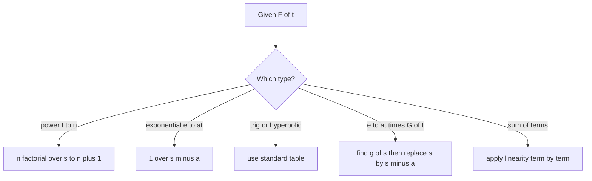

### Table of standard transforms (used above)

| $F(t)$ | $f(s)=\mathcal{L}\{F(t)\}$ | Condition |
| --- | --- | --- |
| $1$ | $\dfrac1s$ | $s>0$ |
| $e^{at}$ | $\dfrac{1}{s-a}$ | $s>a$ |
| $t^n$ | $\dfrac{n!}{s^{n+1}}$ | $s>0$ |
| $t^{-1/2}$ | $\sqrt{\pi/s}$ | $s>0$ |
| $\sin at$ | $\dfrac{a}{s^2+a^2}$ | $s>0$ |
| $\cos at$ | $\dfrac{s}{s^2+a^2}$ | $s>0$ |
| $\sinh at$ | $\dfrac{a}{s^2-a^2}$ | $s>\lvert a\rvert$ |
| $\cosh at$ | $\dfrac{s}{s^2-a^2}$ | $s>\lvert a\rvert$ |
| $e^{at}\sin bt$ | $\dfrac{b}{(s-a)^2+b^2}$ | $s>a$ |
| $e^{at}\cos bt$ | $\dfrac{s-a}{(s-a)^2+b^2}$ | $s>a$ |

> **Quick revision:** Linearity + table + **shift rule** ($e^{at}$ multiplier ⇒ $s\to s-a$). Always state the region of $s$.

---

## LT-3. Change of scale property

**Statement.** If $\mathcal{L}\{F(t)\} = f(s)$, then for $a>0$

$$
\mathcal{L}\{F(at)\} = \frac{1}{a}\,f\!\left(\frac{s}{a}\right)
$$

**Proof.**

$$
\mathcal{L}\{F(at)\} = \int_0^\infty e^{-st}F(at)\,dt
$$

Put $u = at$, so $t = u/a$ and $dt = du/a$ (limits unchanged since $a>0$):

$$
= \frac1a\int_0^\infty e^{-(s/a)u}F(u)\,du = \frac1a\,f\!\left(\frac sa\right)\qquad\blacksquare
$$

**Example.** $\mathcal{L}\{\sin t\} = \dfrac{1}{s^2+1}$ ⇒ $\mathcal{L}\{\sin 3t\} = \dfrac13\cdot\dfrac{1}{(s/3)^2+1} = \dfrac{3}{s^2+9}$ ✓.

> **Quick revision:** Scaling time by $a$ ⇒ replace $s\to s/a$ and multiply by $1/a$. Proof: substitute $u=at$.

---

## LT-4. First translation (shifting) property

**Statement.** If $\mathcal{L}\{F(t)\}=f(s)$ then

$$
\mathcal{L}\{e^{at}F(t)\} = f(s-a)
$$

**Proof.**

$$
\mathcal{L}\{e^{at}F(t)\} = \int_0^\infty e^{-st}e^{at}F(t)\,dt = \int_0^\infty e^{-(s-a)t}F(t)\,dt = f(s-a)\qquad\blacksquare
$$

**Example.** $\mathcal{L}\{e^{2t}\sin 3t\} = \dfrac{3}{(s-2)^2+9}$.

> **Quick revision:** $e^{at}$ in time ⇒ shift $s \to s-a$ in the transform.

---

## LT-5. Multiplication by $t^n$

**Statement.** If $\mathcal{L}\{F(t)\}=f(s)$ then

$$
\mathcal{L}\{t^nF(t)\} = (-1)^n\frac{d^n}{ds^n}f(s),\qquad n=1,2,3,\dots
$$

**Proof (by induction).** We have $f(s)=\int_0^\infty e^{-st}F(t)\,dt$. Differentiating under the integral sign:

$$
\frac{df}{ds} = \int_0^\infty \frac{\partial}{\partial s}\!\left(e^{-st}\right)F(t)\,dt = -\int_0^\infty e^{-st}\,tF(t)\,dt
$$

so $\mathcal{L}\{tF(t)\} = -\dfrac{df}{ds}$, i.e. true for $n=1$.

Assume true for $n=m$: $\mathcal{L}\{t^mF(t)\} = (-1)^m\dfrac{d^m f}{ds^m} = \displaystyle\int_0^\infty e^{-st}t^mF(t)\,dt$. Differentiating both sides w.r.t. $s$:

$$
(-1)^m\frac{d^{m+1}f}{ds^{m+1}} = -\int_0^\infty e^{-st}\,t^{m+1}F(t)\,dt
$$

$$
\Rightarrow \mathcal{L}\{t^{m+1}F(t)\} = (-1)^{m+1}\frac{d^{m+1}f}{ds^{m+1}}\qquad\blacksquare
$$

> **Quick revision:** Multiply by $t^n$ ⇔ take $(-1)^n\,d^n/ds^n$ of $f(s)$.

---

## LT-6. Find the Laplace transform

### (i) $\mathcal{L}\{t^3e^{4t}\}$

$\mathcal{L}\{t^3\} = \dfrac{3!}{s^4}$. Replace $s\to s-4$:

$$
\boxed{\mathcal{L}\{t^3e^{4t}\} = \frac{6}{(s-4)^4}},\quad s>4
$$

### (ii) $\mathcal{L}\{t\sin at\}$

Using LT-5 with $n=1$, $F=\sin at$, $f(s)=\dfrac{a}{s^2+a^2}$:

$$
\mathcal{L}\{t\sin at\} = -\frac{d}{ds}\left[\frac{a}{s^2+a^2}\right] = -\frac{-a\cdot 2s}{(s^2+a^2)^2} = \boxed{\frac{2as}{(s^2+a^2)^2}}
$$

> **Quick revision:** (i) shift rule on $t^n$; (ii) $-\,\dfrac{d}{ds}$ of $\mathcal{L}\{\sin at\}$.

---

## LT-7. Second translation (shifting) property

**Statement.** If $\mathcal{L}\{F(t)\}=f(s)$ and

$$
G(t)=\begin{cases}F(t-a), & t>a\\[2pt] 0, & t<a\end{cases}
$$

then

$$
\mathcal{L}\{G(t)\} = e^{-as}f(s)
$$

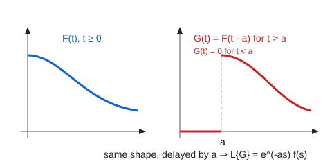

**Proof.**

$$
\mathcal{L}\{G(t)\} = \int_0^a e^{-st}\cdot 0\,dt + \int_a^\infty e^{-st}F(t-a)\,dt = \int_a^\infty e^{-st}F(t-a)\,dt
$$

Put $u=t-a$ ⇒ $t=u+a$, $dt=du$; when $t=a$, $u=0$; when $t\to\infty$, $u\to\infty$:

$$
= \int_0^\infty e^{-s(u+a)}F(u)\,du = e^{-as}\int_0^\infty e^{-su}F(u)\,du = e^{-as}f(s)\qquad\blacksquare
$$

### Comparison: first vs second shifting

| Feature | First shifting | Second shifting |
| --- | --- | --- |
| Operation in $t$ | multiply by $e^{at}$ | delay by $a$ (start at $t=a$) |
| Effect in $s$ | $f(s) \to f(s-a)$ | $f(s) \to e^{-as}f(s)$ |
| Formula | $\mathcal{L}\{e^{at}F(t)\}=f(s-a)$ | $\mathcal{L}\{F(t-a)H(t-a)\}=e^{-as}f(s)$ |
| Shift happens in | $s$-axis | $t$-axis |

> **Quick revision:** Delay by $a$ in time ⇒ multiply by $e^{-as}$. Proof: substitute $u=t-a$.

---

## LT-8. Transform of the second derivative

**Statement.** If $\mathcal{L}\{F(t)\}=f(s)$ then $\mathcal{L}\{F''(t)\} = s^2f(s) - sF(0) - F'(0)$.

**Step 1 — first derivative.** Integrate by parts:

$$
\mathcal{L}\{F'(t)\} = \int_0^\infty e^{-st}F'(t)\,dt = \Big[e^{-st}F(t)\Big]_0^\infty + s\int_0^\infty e^{-st}F(t)\,dt = -F(0) + s\,f(s)
$$

(using $e^{-st}F(t)\to0$ as $t\to\infty$ for large $s$).

$$
\mathcal{L}\{F'(t)\} = s f(s) - F(0)\qquad(\ast)
$$

**Step 2 — apply $(\ast)$ to $G=F'$:**

$$
\mathcal{L}\{F''\} = \mathcal{L}\{G'\} = s\,\mathcal{L}\{G\} - G(0) = s\big[sf(s)-F(0)\big] - F'(0)
$$

$$
\boxed{\mathcal{L}\{F''(t)\} = s^2f(s) - sF(0) - F'(0)}\qquad\blacksquare
$$

> **Quick revision:** Integration by parts twice; each derivative multiplies by $s$ and subtracts an initial value.

---

## LT-9. Transform of the third derivative

**Statement.** $\mathcal{L}\{F'''(t)\} = s^3f(s) - s^2F(0) - sF'(0) - F''(0)$.

**Proof.** Take $G=F''$ and use $(\ast)$: $\mathcal{L}\{G'\}=s\mathcal{L}\{G\}-G(0)$. From LT-8:

$$
\mathcal{L}\{F'''\} = s\Big[s^2f(s)-sF(0)-F'(0)\Big] - F''(0)
$$

$$
\boxed{\mathcal{L}\{F'''(t)\} = s^3f(s) - s^2F(0) - sF'(0) - F''(0)}\qquad\blacksquare
$$

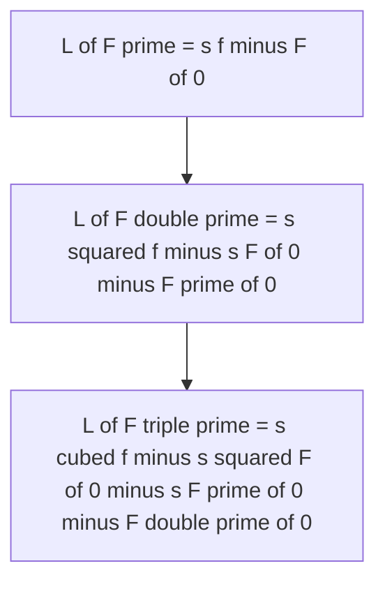

**General pattern:**

$$
\mathcal{L}\{F^{(n)}\} = s^nf(s) - s^{n-1}F(0) - s^{n-2}F'(0) - \cdots - F^{(n-1)}(0)
$$

> **Quick revision:** Powers of $s$ go **down** as the order of the initial condition goes **up**.

---

## LT-10. Theorem 1 — Transform of an integral

**Statement.** If $\mathcal{L}\{F(t)\}=f(s)$ then $\displaystyle\mathcal{L}\left\{\int_0^tF(u)\,du\right\} = \frac{f(s)}{s}$.

**Proof.** Let $G(t)=\displaystyle\int_0^tF(u)\,du$. Then $G'(t)=F(t)$ and $G(0)=0$. Using $\mathcal{L}\{G'\}=s\,\mathcal{L}\{G\}-G(0)$:

$$
f(s) = s\,\mathcal{L}\{G\} - 0 \;\Rightarrow\; \mathcal{L}\{G\} = \frac{f(s)}{s}\qquad\blacksquare
$$

> **Quick revision:** Integration in $t$ ⇔ division by $s$ (differentiation ⇔ multiplication by $s$).

---

## LT-11. Theorem 2 — $\mathcal{L}\left\{\displaystyle\int_0^t\frac{\sin u}{u}\,du\right\}=\frac1s\tan^{-1}\frac1s$

**Step 1 — find $\mathcal{L}\{\sin t/t\}$.** Let $G(t)=\dfrac{\sin t}{t}$ and $g(s)=\mathcal{L}\{G\}$. Then $tG(t)=\sin t$, so by LT-5 ($n=1$):

$$
-g'(s) = \mathcal{L}\{\sin t\} = \frac{1}{s^2+1}\;\Rightarrow\; g(s) = -\tan^{-1}s + C
$$

As $s\to\infty$, $g(s)\to0$, hence $C=\dfrac\pi2$:

$$
g(s) = \frac\pi2-\tan^{-1}s = \cot^{-1}s = \tan^{-1}\frac1s\quad(s>0)
$$

**Step 2 — apply Theorem 1 (LT-10):**

$$
\mathcal{L}\left\{\int_0^t\frac{\sin u}{u}\,du\right\} = \frac{g(s)}{s} = \boxed{\frac1s\tan^{-1}\frac1s}\qquad\blacksquare
$$

> **Quick revision:** $\mathcal{L}\{\sin t/t\}=\tan^{-1}(1/s)$; then divide by $s$ for the integral.

---

## LT-12. Show that (inverse Laplace transforms)

### (i) $\mathcal{L}^{-1}\left\{\dfrac{1}{s^{n+1}}\right\} = \dfrac{t^n}{n!}$

From $\mathcal{L}\{t^n\}=\dfrac{n!}{s^{n+1}}$, divide by $n!$ and take the inverse: $\mathcal{L}^{-1}\left\{\dfrac{1}{s^{n+1}}\right\}=\dfrac{t^n}{n!}$ ∎

### (ii) $\mathcal{L}^{-1}\left\{\dfrac{1}{s^{3/2}}\right\} = 2\sqrt{\dfrac t\pi}$

$$
\mathcal{L}\{t^{1/2}\} = \frac{\Gamma(3/2)}{s^{3/2}} = \frac{\tfrac12\sqrt\pi}{s^{3/2}}\;\Rightarrow\;\mathcal{L}^{-1}\left\{\frac1{s^{3/2}}\right\} = \frac{2}{\sqrt\pi}t^{1/2} = 2\sqrt{\frac t\pi}\ ∎
$$

### (iii) $\mathcal{L}^{-1}\left\{\dfrac{3s-8}{s^2+4}-\dfrac{4s-24}{s^2-16}\right\} = 3\cos2t-4\sin2t-4\cosh4t+6\sinh4t$

Split each fraction:

$$
\frac{3s-8}{s^2+4} = 3\frac{s}{s^2+2^2} - 4\cdot\frac{2}{s^2+2^2}\;\Rightarrow\;3\cos2t-4\sin2t
$$

$$
\frac{4s-24}{s^2-16} = 4\frac{s}{s^2-4^2}-6\cdot\frac{4}{s^2-4^2}\;\Rightarrow\;4\cosh4t-6\sinh4t
$$

Subtracting the second from the first:

$$
3\cos2t-4\sin2t-4\cosh4t+6\sinh4t\ ∎
$$

### (iv) $\mathcal{L}^{-1}\left\{\dfrac{s+2}{s^2-4s+13}\right\}$

Complete the square: $s^2-4s+13=(s-2)^2+9$, and $s+2=(s-2)+4$:

$$
\frac{s+2}{(s-2)^2+3^2} = \frac{s-2}{(s-2)^2+3^2}+\frac43\cdot\frac{3}{(s-2)^2+3^2}
$$

$$
\boxed{F(t) = e^{2t}\left(\cos3t+\tfrac43\sin3t\right)}
$$

### (v) $\mathcal{L}^{-1}\left\{\dfrac{s+3}{s^2+6s+13}\right\}$

$s^2+6s+13=(s+3)^2+4$:

$$
\frac{s+3}{(s+3)^2+2^2}\;\Rightarrow\;\boxed{F(t)=e^{-3t}\cos2t}
$$

### (vi) $\mathcal{L}^{-1}\left\{\dfrac{3s+2}{2s^2-4s+3}\right\}$

$$
\frac{3s+2}{2s^2-4s+3} = \frac12\cdot\frac{3s+2}{s^2-2s+\tfrac32} = \frac12\cdot\frac{3(s-1)+5}{(s-1)^2+\tfrac12}
$$

Using $a=\dfrac1{\sqrt2}$ in $\mathcal{L}^{-1}\left\{\dfrac{s-1}{(s-1)^2+a^2}\right\}=e^t\cos at$ and $\mathcal{L}^{-1}\left\{\dfrac{1}{(s-1)^2+a^2}\right\}=\dfrac1a e^t\sin at=\sqrt2\,e^t\sin at$:

$$
F(t) = \frac12\left[3e^t\cos\frac t{\sqrt2}+5\sqrt2\,e^t\sin\frac t{\sqrt2}\right]
$$

$$
\boxed{F(t) = e^t\left(\frac32\cos\frac{t}{\sqrt2}+\frac{5}{\sqrt2}\sin\frac{t}{\sqrt2}\right)}
$$

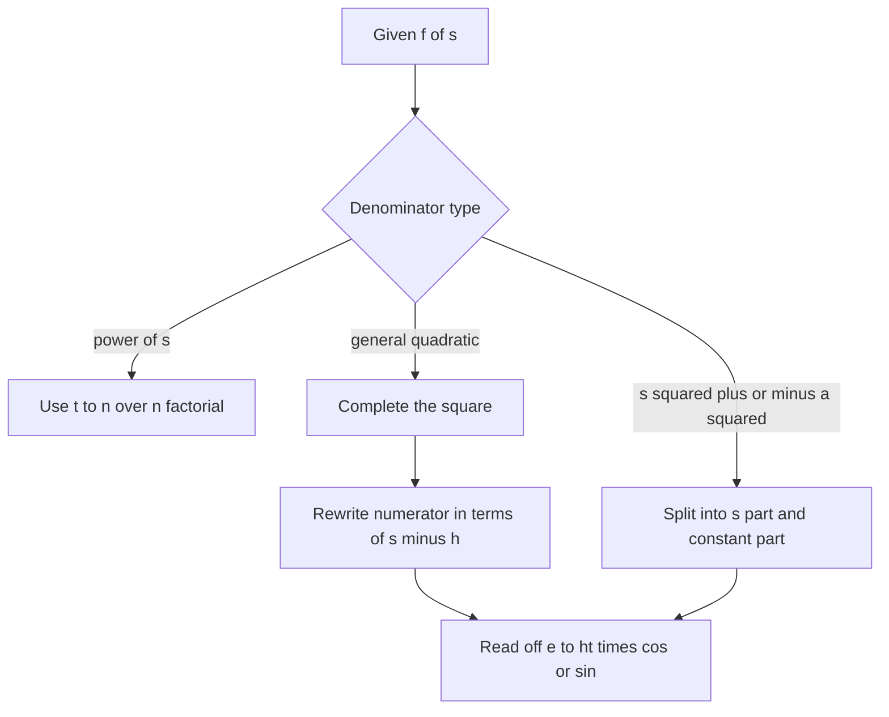

> **Quick revision:** Complete the square → shift → split numerator → read off $e^{ht}\cos/\sin/\cosh/\sinh$.

---

## LT-13. Solve using Laplace transform

$$
y''+2y'+5y = e^{-t}\sin t,\qquad y(0)=0,\ y'(0)=1
$$

**Step 1 — transform.** Let $Y=\mathcal{L}\{y\}$. Then

$$
\big[s^2Y - s\cdot0 - 1\big] + 2\big[sY-0\big] + 5Y = \frac{1}{(s+1)^2+1}
$$

$$
(s^2+2s+5)Y = 1+\frac{1}{s^2+2s+2}
$$

**Step 2 — solve for $Y$.**

$$
Y = \frac{1}{s^2+2s+5}+\frac{1}{(s^2+2s+2)(s^2+2s+5)}
$$

Put $u=s^2+2s$: $\dfrac{1}{(u+2)(u+5)}=\dfrac13\left[\dfrac1{u+2}-\dfrac1{u+5}\right]$. Therefore

$$
Y = \frac{1}{(s+1)^2+4}+\frac13\left[\frac{1}{(s+1)^2+1}-\frac{1}{(s+1)^2+4}\right] = \frac{2/3}{(s+1)^2+4}+\frac{1/3}{(s+1)^2+1}
$$

**Step 3 — invert** (first shifting, $s\to s+1$):

$$
y(t) = \frac23\cdot\frac12e^{-t}\sin2t+\frac13e^{-t}\sin t
$$

$$
\boxed{y(t)=\frac{e^{-t}}{3}\big(\sin t+\sin2t\big)}
$$

**Check:** $y(0)=0$ ✓; $y'(0)=\tfrac13(1+2)=1$ ✓.

> **Quick revision:** transform → insert $y(0),y'(0)$ → solve algebraically → partial fractions → invert.
> *(The Bengali margin note on the sheet says Q11/Q12 of this part are to be practised together with the CTEC notes.)*

---

# Part B — Ordinary Differential Equations

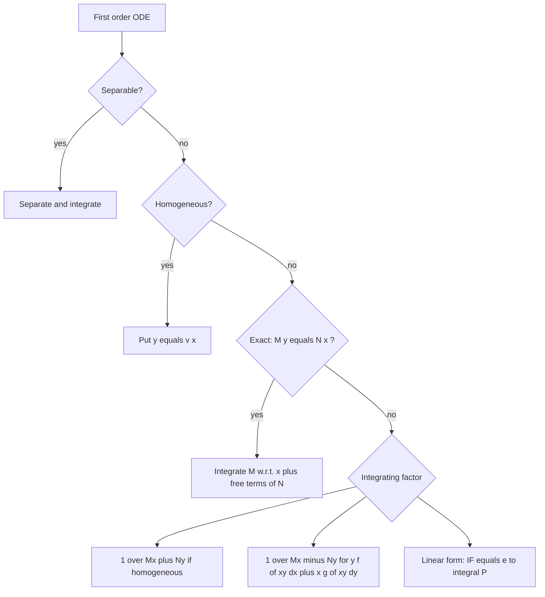

## ODE-1. Solve

### (i) $\dfrac{dy}{dx}=e^{x-y}+x^2e^{-y}$ *(read as $e^{x-y}$)*

$$
\frac{dy}{dx} = e^{-y}(e^x+x^2)\;\Rightarrow\;e^y\,dy=(e^x+x^2)\,dx
$$

$$
\boxed{e^y = e^x+\frac{x^3}{3}+C}
$$

### (ii) $\sin^{-1}\!\left(\dfrac{dy}{dx}\right)=x+y$

$\dfrac{dy}{dx}=\sin(x+y)$. Put $v=x+y$ ⇒ $\dfrac{dv}{dx}=1+\sin v$:

$$
\int\frac{dv}{1+\sin v} = \int\frac{1-\sin v}{\cos^2v}\,dv = \int(\sec^2v-\sec v\tan v)\,dv = \tan v-\sec v
$$

$$
\boxed{\tan(x+y)-\sec(x+y)=x+C}
$$

### (iii) $\dfrac{dy}{dx}=\dfrac yx+\tan\dfrac yx$ (homogeneous)

Put $y=vx$ ⇒ $v+x\dfrac{dv}{dx}=v+\tan v$:

$$
\cot v\,dv=\frac{dx}{x}\;\Rightarrow\;\ln\sin v=\ln x+\ln c
$$

$$
\boxed{\sin\frac yx = cx}
$$

### (iv) $(1+y^2)\,dx=(\tan^{-1}y-x)\,dy$ (linear in $x$)

$$
\frac{dx}{dy}+\frac{x}{1+y^2}=\frac{\tan^{-1}y}{1+y^2}
$$

IF $=e^{\int dy/(1+y^2)}=e^{\tan^{-1}y}$. Put $t=\tan^{-1}y$:

$$
x e^{t}=\int te^t\,dt=e^t(t-1)+C
$$

$$
\boxed{x=\tan^{-1}y-1+Ce^{-\tan^{-1}y}}
$$

### (v) $(1+x^2)\dfrac{dy}{dx}+y=\tan^{-1}x$

$$
\frac{dy}{dx}+\frac{y}{1+x^2}=\frac{\tan^{-1}x}{1+x^2},\qquad \text{IF}=e^{\tan^{-1}x}
$$

$$
ye^{\tan^{-1}x}=\int te^t\,dt\ (t=\tan^{-1}x)=e^t(t-1)+C
$$

$$
\boxed{y=\tan^{-1}x-1+Ce^{-\tan^{-1}x}}
$$

### (vi) $(3x+2y-5)\,dx+(2x+3y-5)\,dy=0$

$M=3x+2y-5$, $N=2x+3y-5$: $\dfrac{\partial M}{\partial y}=2=\dfrac{\partial N}{\partial x}$ ⇒ **exact**.

$$
\int M\,dx\ (y\ \text{const})=\frac{3x^2}2+2xy-5x;\qquad \text{terms of }N\text{ free of }x:\ \frac{3y^2}2-5y
$$

$$
\boxed{3x^2+4xy+3y^2-10x-10y=C}
$$

### (vii) $(x^2y-2xy^2)\,dx-(x^3-3x^2y)\,dy=0$

$M=x^2y-2xy^2$, $N=-x^3+3x^2y$ — both homogeneous of degree 3, not exact. 

$Mx+Ny=x^3y-2x^2y^2-x^3y+3x^2y^2=x^2y^2\ne0$, so IF $=\dfrac1{x^2y^2}$:

$$
\left(\frac1y-\frac2x\right)dx+\left(-\frac{x}{y^2}+\frac3y\right)dy=0
$$

Check: $\partial_y(\tfrac1y-\tfrac2x)=-\tfrac1{y^2}=\partial_x(-\tfrac x{y^2}+\tfrac3y)$ ✓ exact.

$$
\int M\,dx=\frac xy-2\ln x;\quad\text{free terms of }N:\ \frac3y\to3\ln y
$$

$$
\boxed{\frac xy-2\ln x+3\ln y=C}
$$

### (viii) $(1+xy)y\,dx+(1-xy)x\,dy=0$

Form $yf(xy)\,dx+xg(xy)\,dy$ ⇒ IF $=\dfrac1{Mx-Ny}$. Here $M=y+xy^2$, $N=x-x^2y$:

$$
Mx-Ny=xy+x^2y^2-xy+x^2y^2=2x^2y^2
$$

Multiplying by $\dfrac{1}{x^2y^2}$ (constant factor ½ dropped):

$$
\left(\frac1{x^2y}+\frac1x\right)dx+\left(\frac1{xy^2}-\frac1y\right)dy=0
$$

Exact ($\partial_y=\partial_x=-\tfrac1{x^2y^2}$ ✓). Integrating:

$$
-\frac1{xy}+\ln x-\ln y=C\;\Rightarrow\;\boxed{\ln\frac xy=\frac1{xy}+C}
$$

### (ix) $3x(xy-2)\,dx+(x^3+2y)\,dy=0$ *(read as $x^3+2y$)*

$M=3x^2y-6x$, $N=x^3+2y$: $M_y=3x^2=N_x$ ⇒ exact.

$$
\int M\,dx=x^3y-3x^2;\quad\text{free terms of }N:\ y^2
$$

$$
\boxed{x^3y-3x^2+y^2=C}
$$

### (x) $(1+e^{x/y})\,dx+e^{x/y}\left(1-\dfrac xy\right)dy=0$

Put $x=vy$ ⇒ $dx=v\,dy+y\,dv$:

$$
(1+e^v)(v\,dy+y\,dv)+e^v(1-v)\,dy=0
$$

$$
(v+e^v)\,dy+y(1+e^v)\,dv=0\;\Rightarrow\;\frac{dy}y+\frac{1+e^v}{v+e^v}\,dv=0
$$

$$
\ln y+\ln(v+e^v)=\ln C\;\Rightarrow\;y(v+e^v)=C
$$

$$
\boxed{x+ye^{x/y}=C}
$$

### (xi) $\dfrac{d^2y}{dx^2}+6\dfrac{dy}{dx}+5y=2e^x+10e^{5x}$

**Auxiliary equation:** $m^2+6m+5=0\Rightarrow m=-1,-5$.

$$
y_c=c_1e^{-x}+c_2e^{-5x}
$$

**Particular integral** ($f(D)=D^2+6D+5$):

$$
\frac{2e^x}{1+6+5}=\frac{e^x}{6},\qquad\frac{10e^{5x}}{25+30+5}=\frac{e^{5x}}6
$$

$$
\boxed{y=c_1e^{-x}+c_2e^{-5x}+\frac{e^x+e^{5x}}6}
$$

### Summary table of methods used

| Part | Type | Key step |
| --- | --- | --- |
| (i) | Separable | $e^y\,dy=(e^x+x^2)dx$ |
| (ii) | Substitution | $v=x+y$ |
| (iii) | Homogeneous | $y=vx$ |
| (iv), (v) | Linear (first order) | IF $=e^{\tan^{-1}(\cdot)}$ |
| (vi), (ix) | Exact | $M_y=N_x$ |
| (vii) | Homogeneous, non-exact | IF $=1/(Mx+Ny)$ |
| (viii) | $yf(xy)dx+xg(xy)dy$ | IF $=1/(Mx-Ny)$ |
| (x) | Homogeneous | $x=vy$ |
| (xi) | 2nd order linear, const. coeff. | CF + PI |

> **Quick revision:** Identify the type first (flowchart above), then apply its single key step; always add $+C$ (or $c_1,c_2$).

---

## ODE-2. Find $y_p=\dfrac{1}{D^3+3D^2+3D+1}e^{-x}$

Note $D^3+3D^2+3D+1=(D+1)^3$. Putting $D=-1$ makes the denominator $0$ (**failing case**), so use

$$
\frac1{(D+1)^3}e^{-x}=e^{-x}\frac1{(D-1+1)^3}\cdot1=e^{-x}\frac1{D^3}\cdot1=e^{-x}\frac{x^3}{3!}
$$

$$
\boxed{y_p=\frac{x^3e^{-x}}{6}}
$$

> **Quick revision:** If $f(a)=0$ with multiplicity $r$: $\dfrac1{f(D)}e^{ax}=\dfrac{x^r}{r!\,\phi(a)}e^{ax}$ where $f(D)=(D-a)^r\phi(D)$.

---

## ODE-3. Solve $(D^2+2D+2)y=10\sin4x$

**Complementary function:** $m^2+2m+2=0\Rightarrow m=-1\pm i$

$$
y_c=e^{-x}(c_1\cos x+c_2\sin x)
$$

**Particular integral:** 

$$
y_p=\frac{10\sin4x}{D^2+2D+2}=\frac{10\sin4x}{-16+2D+2}=\frac{10\sin4x}{2D-14}\qquad(D^2\to-4^2)
$$

$$
=10\cdot\frac{(2D+14)\sin4x}{4D^2-196}=10\cdot\frac{8\cos4x+14\sin4x}{-64-196}=-\frac{80\cos4x+140\sin4x}{260}
$$

$$
y_p=-\frac{4\cos4x+7\sin4x}{13}
$$

**General solution:**

$$
\boxed{y=e^{-x}(c_1\cos x+c_2\sin x)-\frac{4\cos4x+7\sin4x}{13}}
$$

*(Verification: $y_p''+2y_p'+2y_p=\frac{1}{13}[130\sin4x]=10\sin4x$ ✓)*

> **Quick revision:** For $\sin ax$: replace $D^2\to-a^2$, rationalise $(2D-14)\to(2D+14)/(4D^2-196)$.

---

## ODE-4. When the R.H.S. is $Ve^{ax}$, $V\sin ax$ or $V\cos ax$ (and $(D^2+D+2)y=e^{ax}V$)

**Case 1 — R.H.S. $=e^{ax}V$** ($V$ a function of $x$): 

$$
\boxed{\frac1{f(D)}\big[e^{ax}V\big]=e^{ax}\,\frac1{f(D+a)}\,V}
$$

*Proof sketch:* $D(e^{ax}V)=e^{ax}(D+a)V$, so $f(D)(e^{ax}V)=e^{ax}f(D+a)V$. ∎

**Case 2 — R.H.S. $=V\sin ax$ or $V\cos ax$:** write $\sin ax=\operatorname{Im}e^{iax}$, $\cos ax=\operatorname{Re}e^{iax}$:

$$
\frac1{f(D)}\big[V\sin ax\big]=\operatorname{Im}\left\{e^{iax}\frac1{f(D+ia)}V\right\},\quad
\frac1{f(D)}\big[V\cos ax\big]=\operatorname{Re}\left\{e^{iax}\frac1{f(D+ia)}V\right\}
$$

**Applied to $(D^2+D+2)y=e^{ax}V$:**

$$
y_p=e^{ax}\frac1{(D+a)^2+(D+a)+2}V=e^{ax}\frac1{D^2+(2a+1)D+(a^2+a+2)}V
$$

Then expand $\dfrac1{\cdots}$ in powers of $D$ (binomial series) if $V$ is a polynomial, or put $D^2\to-b^2$ if $V$ is $\sin bx$ / $\cos bx$.

**Worked illustration** ($a=1$, $V=x$): 

$$
y_p=e^{x}\frac1{D^2+3D+4}\,x=\frac{e^x}4\left(1+\frac{3D+D^2}4\right)^{-1}x=\frac{e^x}4\left(x-\frac34\right)=e^x\left(\frac x4-\frac3{16}\right)
$$

Check: $y_p''+y_p'+2y_p=xe^x$ ✓.

### Methods for finding $y_p$ by type of R.H.S. $X$

| R.H.S. $X$ | Rule for $\dfrac1{f(D)}X$ | Failing case |
| --- | --- | --- |
| $e^{ax}$ | $\dfrac{e^{ax}}{f(a)}$ | $f(a)=0$: $x\,\dfrac{e^{ax}}{f'(a)}$ |
| $\sin ax$ / $\cos ax$ | put $D^2\to-a^2$ | $f(-a^2)=0$: $x\,\dfrac{\sin ax}{f'(D)}$ with $D^2\to-a^2$ |
| $x^n$ | expand $[f(D)]^{-1}$ in powers of $D$ | $f(0)=0$: factor out $D^r$ |
| $e^{ax}V$ | $e^{ax}\dfrac1{f(D+a)}V$ | — |
| $V\sin ax$ / $V\cos ax$ | $\operatorname{Im}/\operatorname{Re}\Big\{e^{iax}\dfrac1{f(D+ia)}V\Big\}$ | — |

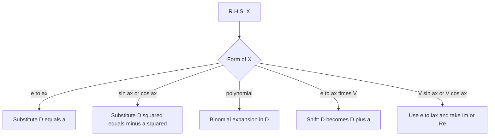

> **Quick revision:** $\dfrac1{f(D)}(e^{ax}V)=e^{ax}\dfrac1{f(D+a)}V$. For $(D^2+D+2)$: $f(D+a)=D^2+(2a+1)D+a^2+a+2$.
> *(The Bengali margin note asks for the "prefix/formula" list to be memorised — the table above is that list.)*

---

# Part C — Vector Analysis

## VEC-1. Prove $\vec a\times(\vec b\times\vec c)=(\vec a\cdot\vec c)\vec b-(\vec a\cdot\vec b)\vec c$

Let $\vec a=(a_1,a_2,a_3)$ etc. Take the $\hat i$-component of the left side:

$$
\big[\vec a\times(\vec b\times\vec c)\big]_x=a_2(\vec b\times\vec c)_z-a_3(\vec b\times\vec c)_y
$$

$$
=a_2(b_1c_2-b_2c_1)-a_3(b_3c_1-b_1c_3)=b_1(a_2c_2+a_3c_3)-c_1(a_2b_2+a_3b_3)
$$

Add and subtract $a_1b_1c_1$:

$$
=b_1(a_1c_1+a_2c_2+a_3c_3)-c_1(a_1b_1+a_2b_2+a_3b_3)=b_1(\vec a\cdot\vec c)-c_1(\vec a\cdot\vec b)
$$

Similarly for the $\hat j$ and $\hat k$ components. Hence

$$
\vec a\times(\vec b\times\vec c)=(\vec a\cdot\vec c)\,\vec b-(\vec a\cdot\vec b)\,\vec c\qquad\blacksquare
$$

> **Quick revision (BAC–CAB rule):** $\vec a\times(\vec b\times\vec c)=\vec b(\vec a\cdot\vec c)-\vec c(\vec a\cdot\vec b)$; result lies in the plane of $\vec b,\vec c$.

---

## VEC-2. Find $n$ for which $r^n\vec r$ is solenoidal

**Solenoidal** means $\nabla\cdot\vec F=0$. With $\vec r=x\hat i+y\hat j+z\hat k$, $r=|\vec r|$:

$$
\nabla\cdot(r^n\vec r)=r^n(\nabla\cdot\vec r)+\vec r\cdot\nabla(r^n)=3r^n+\vec r\cdot\big(nr^{n-2}\vec r\big)=3r^n+nr^n=(n+3)r^n
$$

Setting $(n+3)r^n=0$ for all $r\neq0$:

$$
\boxed{n=-3}
$$

> **Quick revision:** $\nabla\cdot(r^n\vec r)=(n+3)r^n$ ⇒ solenoidal iff $n=-3$ (the inverse-square field).

---

## VEC-3. Prove $\hat i\times(\vec a\times\hat i)+\hat j\times(\vec a\times\hat j)+\hat k\times(\vec a\times\hat k)=2\vec a$

Use the triple product $\vec p\times(\vec q\times\vec r)=\vec q(\vec p\cdot\vec r)-\vec r(\vec p\cdot\vec q)$ with $\vec p=\hat i,\ \vec q=\vec a,\ \vec r=\hat i$:

$$
\hat i\times(\vec a\times\hat i)=\vec a(\hat i\cdot\hat i)-\hat i(\hat i\cdot\vec a)=\vec a-a_1\hat i
$$

Similarly $\hat j\times(\vec a\times\hat j)=\vec a-a_2\hat j$ and $\hat k\times(\vec a\times\hat k)=\vec a-a_3\hat k$. Adding:

$$
3\vec a-(a_1\hat i+a_2\hat j+a_3\hat k)=3\vec a-\vec a=2\vec a\qquad\blacksquare
$$

> **Quick revision:** Each term $=\vec a-(\text{one component})$; three terms ⇒ $3\vec a-\vec a=2\vec a$.

---

## VEC-4. Prove $\nabla\cdot(\nabla\times\vec A)=0$

Let $\vec A=A_1\hat i+A_2\hat j+A_3\hat k$ with continuous second partial derivatives.

$$
\nabla\times\vec A=\left(\frac{\partial A_3}{\partial y}-\frac{\partial A_2}{\partial z}\right)\hat i+\left(\frac{\partial A_1}{\partial z}-\frac{\partial A_3}{\partial x}\right)\hat j+\left(\frac{\partial A_2}{\partial x}-\frac{\partial A_1}{\partial y}\right)\hat k
$$

$$
\nabla\cdot(\nabla\times\vec A)=\frac{\partial^2A_3}{\partial x\partial y}-\frac{\partial^2A_2}{\partial x\partial z}+\frac{\partial^2A_1}{\partial y\partial z}-\frac{\partial^2A_3}{\partial y\partial x}+\frac{\partial^2A_2}{\partial z\partial x}-\frac{\partial^2A_1}{\partial z\partial y}
$$

Mixed partials are equal (continuity), so all six terms cancel in pairs:

$$
\nabla\cdot(\nabla\times\vec A)=0\qquad\blacksquare
$$

> **Quick revision:** div(curl) $=0$ because mixed partials commute; curl A is always solenoidal.

---

## VEC-5. Geometrical interpretation of the dot product; coplanar vectors

### (a) Geometrical interpretation

The **dot (scalar) product** is $\vec a\cdot\vec b=|\vec a||\vec b|\cos\theta$, $0\le\theta\le\pi$.

- $|\vec b|\cos\theta$ is the **(scalar) projection of $\vec b$ on $\vec a$**, so $\vec a\cdot\vec b=|\vec a|\times(\text{projection of }\vec b\text{ on }\vec a)$.
- $\theta<90^\circ\Rightarrow\vec a\cdot\vec b>0$; $\theta=90^\circ\Rightarrow0$ (**perpendicular**); $\theta>90^\circ\Rightarrow<0$.
- $\vec a\cdot\vec a=|\vec a|^2$.

### (b) Find $\lambda$ so that $2\hat i-\hat j+\hat k,\ \hat i+2\hat j-3\hat k,\ 4\hat i-\hat j+\lambda\hat k$ are coplanar *(third vector read as $4\hat i-\hat j+\lambda\hat k$)*

Three vectors are coplanar iff their scalar triple product is zero:

$$
\begin{vmatrix}2&-1&1\\1&2&-3\\4&-1&\lambda\end{vmatrix}=0
$$

$$
2(2\lambda-3)+1\cdot(\lambda+12)+1\cdot(-1-8)=4\lambda-6+\lambda+12-9=5\lambda-3
$$

$$
5\lambda-3=0\;\Rightarrow\;\boxed{\lambda=\frac35}
$$

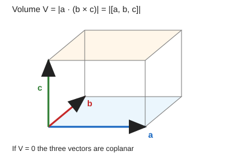

> **Quick revision:** $\vec a\cdot\vec b=|\vec a|(\text{proj. of }\vec b\text{ on }\vec a)$; coplanar ⇔ $[\vec a,\vec b,\vec c]=0$ ⇒ $\lambda=3/5$.

---

## VEC-6. Show that $\nabla r^n=nr^{n-2}\vec r$

With $r^2=x^2+y^2+z^2$: $2r\dfrac{\partial r}{\partial x}=2x\Rightarrow\dfrac{\partial r}{\partial x}=\dfrac xr$, similarly for $y,z$. Hence $\nabla r=\dfrac{\vec r}r$.

$$
\nabla r^n=\hat i\frac{\partial r^n}{\partial x}+\hat j\frac{\partial r^n}{\partial y}+\hat k\frac{\partial r^n}{\partial z}
=nr^{n-1}\left(\frac xr\hat i+\frac yr\hat j+\frac zr\hat k\right)=nr^{n-2}(x\hat i+y\hat j+z\hat k)
$$

$$
\nabla r^n=nr^{n-2}\vec r\qquad\blacksquare
$$

> **Quick revision:** $\nabla r=\vec r/r$ (unit radial vector); chain rule gives $nr^{n-2}\vec r$.

---

## VEC-7. Line integral $I=\oint(x\,dy-y\,dx)$ *(sheet text is partly garbled: "from (0,0) to (2,2) over the region bounded by the square (0,0),(1,0),(1,1),(0,1)")*

Both natural readings are solved.

### (a) Closed path around the square $(0,0)\to(1,0)\to(1,1)\to(0,1)\to(0,0)$

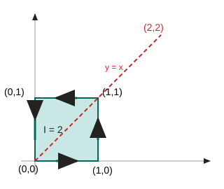

**Green's theorem:** $P=-y,\ Q=x$ ⇒ $\dfrac{\partial Q}{\partial x}-\dfrac{\partial P}{\partial y}=1+1=2$:

$$
I=\iint_R2\,dx\,dy=2\times\text{Area}=2\times1=\boxed{2}
$$

**Direct check (four sides):**

| Side | Path | $x\,dy-y\,dx$ | Value |
| --- | --- | --- | --- |
| $(0,0)\to(1,0)$ | $y=0,\ dy=0$ | $0$ | $0$ |
| $(1,0)\to(1,1)$ | $x=1,\ dx=0$ | $dy$ | $1$ |
| $(1,1)\to(0,1)$ | $y=1,\ dy=0$ | $-dx$ | $1$ |
| $(0,1)\to(0,0)$ | $x=0,\ dx=0$ | $0$ | $0$ |
| **Total** | | | **2** ✓ |

### (b) Open path along $y=x$ from $(0,0)$ to $(2,2)$

$dy=dx$ ⇒ $x\,dy-y\,dx=x\,dx-x\,dx=0$:

$$
I=\boxed{0}
$$

> **Quick revision:** $\oint(x\,dy-y\,dx)=2\times$ enclosed area; for the unit square $I=2$. Along $y=x$ the integrand vanishes ⇒ $0$.

---

## VEC-8. Evaluate $\displaystyle\iint_S\vec F\cdot\hat n\,dS$, $\vec F=4xz\hat i-y^2\hat j+yz\hat k$, $S$ = surface of the cube $0\le x,y,z\le1$ *(read as $4xz\hat i$)*

**Gauss divergence theorem:** $\displaystyle\iint_S\vec F\cdot\hat n\,dS=\iiint_V\nabla\cdot\vec F\,dV$.

$$
\nabla\cdot\vec F=\frac{\partial(4xz)}{\partial x}+\frac{\partial(-y^2)}{\partial y}+\frac{\partial(yz)}{\partial z}=4z-2y+y=4z-y
$$

$$
\iiint_V(4z-y)\,dx\,dy\,dz=\int_0^1\!\!\int_0^1\!\!\int_0^1(4z-y)\,dx\,dy\,dz=4\cdot\frac12-\frac12=\boxed{\frac32}
$$

**Direct verification (six faces):**

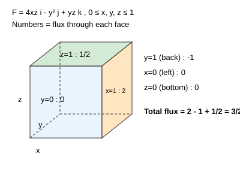

| Face | $\hat n$ | $\vec F\cdot\hat n$ | Flux |
| --- | --- | --- | --- |
| $x=1$ | $+\hat i$ | $4z$ | $\int\!\!\int4z\,dy\,dz=2$ |
| $x=0$ | $-\hat i$ | $-4xz=0$ | $0$ |
| $y=1$ | $+\hat j$ | $-y^2=-1$ | $-1$ |
| $y=0$ | $-\hat j$ | $y^2=0$ | $0$ |
| $z=1$ | $+\hat k$ | $yz=y$ | $\tfrac12$ |
| $z=0$ | $-\hat k$ | $-yz=0$ | $0$ |
| **Total** | | | $2-1+\tfrac12=\tfrac32$ ✓ |

> **Quick revision:** Closed surface + vector field ⇒ use divergence theorem; $\nabla\cdot\vec F=4z-y$, answer $3/2$.

---

## VEC-9. Scalar (dot) product geometrically; projection of $2\hat i-3\hat j+6\hat k$ on $\hat i+2\hat j+2\hat k$

### (a) Geometrical meaning

$$
\vec a\cdot\vec b=|\vec a||\vec b|\cos\theta
$$

= (length of $\vec a$) × (length of the projection of $\vec b$ on $\vec a$). It is a **scalar**, commutative, and distributive over addition. $\vec a\perp\vec b\iff\vec a\cdot\vec b=0$. Work done by a force: $W=\vec F\cdot\vec d$.

### (b) Projection

Let $\vec a=2\hat i-3\hat j+6\hat k$, $\vec b=\hat i+2\hat j+2\hat k$.

$$
\vec a\cdot\vec b=2(1)+(-3)(2)+6(2)=2-6+12=8,\qquad|\vec b|=\sqrt{1+4+4}=3
$$

$$
\text{Projection of }\vec a\text{ on }\vec b=\frac{\vec a\cdot\vec b}{|\vec b|}=\boxed{\frac83}
$$

> **Quick revision:** projection of $\vec a$ on $\vec b$ $=\dfrac{\vec a\cdot\vec b}{|\vec b|}=\dfrac83$.

---

## VEC-10. Prove $[\vec a+\vec b,\ \vec b+\vec c,\ \vec c+\vec a]=2[\vec a,\vec b,\vec c]$

$$
[\vec a+\vec b,\vec b+\vec c,\vec c+\vec a]=(\vec a+\vec b)\cdot\big[(\vec b+\vec c)\times(\vec c+\vec a)\big]
$$

Expand the cross product (note $\vec c\times\vec c=\vec 0$):

$$
(\vec b+\vec c)\times(\vec c+\vec a)=\vec b\times\vec c+\vec b\times\vec a+\vec c\times\vec a
$$

Dot with $(\vec a+\vec b)$; any triple product with a repeated vector vanishes:

$$
\vec a\cdot(\vec b\times\vec c)+\underbrace{\vec a\cdot(\vec b\times\vec a)}_{0}+\underbrace{\vec a\cdot(\vec c\times\vec a)}_{0}+\underbrace{\vec b\cdot(\vec b\times\vec c)}_{0}+\underbrace{\vec b\cdot(\vec b\times\vec a)}_{0}+\vec b\cdot(\vec c\times\vec a)
$$

$$
=[\vec a,\vec b,\vec c]+[\vec b,\vec c,\vec a]=2[\vec a,\vec b,\vec c]\qquad\blacksquare
$$

(cyclic permutation does not change the triple product).

> **Quick revision:** repeated vector ⇒ triple product $=0$; cyclic order keeps value ⇒ factor 2.

---

## VEC-11. Geometrical interpretation of the cross product

$$
\vec a\times\vec b=|\vec a||\vec b|\sin\theta\;\hat n
$$

where $\hat n$ is the unit vector **perpendicular to both** $\vec a,\vec b$, direction by the **right-hand rule**.

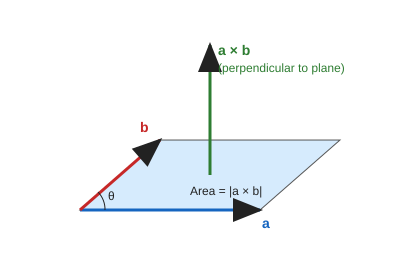

- **Magnitude** $|\vec a\times\vec b|$ = **area of the parallelogram** with adjacent sides $\vec a,\vec b$.
- Area of the triangle $=\tfrac12|\vec a\times\vec b|$.
- $\vec a\parallel\vec b\iff\vec a\times\vec b=\vec0$.
- Not commutative: $\vec a\times\vec b=-\vec b\times\vec a$.

### Dot product vs cross product

| Feature | Dot product $\vec a\cdot\vec b$ | Cross product $\vec a\times\vec b$ |
| --- | --- | --- |
| Result | scalar | vector |
| Formula | $\lvert a\rvert\lvert b\rvert\cos\theta$ | $\lvert a\rvert\lvert b\rvert\sin\theta\,\hat n$ |
| Geometric meaning | length × projection | area of parallelogram |
| Commutative? | yes | no (anti-commutative) |
| Zero when | $\vec a\perp\vec b$ | $\vec a\parallel\vec b$ |
| Application | work done | torque, area |

> **Quick revision:** $|\vec a\times\vec b|$ = parallelogram area; direction ⟂ plane by right-hand rule.

---

## VEC-12. Show that $\vec F=(2xz^3+6y)\hat i+(6x-2yz)\hat j+(3x^2z^2-y^2)\hat k$ is conservative *(third component read as $3x^2z^2-y^2$)*

$\vec F$ is conservative iff $\nabla\times\vec F=\vec0$. With $P=2xz^3+6y,\ Q=6x-2yz,\ R=3x^2z^2-y^2$:

$$
\nabla\times\vec F=\begin{vmatrix}\hat i&\hat j&\hat k\\\partial_x&\partial_y&\partial_z\\P&Q&R\end{vmatrix}
$$

| Component | Computation | Value |
| --- | --- | --- |
| $\hat i$ | $\partial_yR-\partial_zQ=-2y-(-2y)$ | $0$ |
| $\hat j$ | $\partial_zP-\partial_xR=6xz^2-6xz^2$ | $0$ |
| $\hat k$ | $\partial_xQ-\partial_yP=6-6$ | $0$ |

$\nabla\times\vec F=\vec0$ ⇒ $\vec F$ is **irrotational ⇒ conservative** ∎

**Scalar potential** (optional check): $\phi=x^2z^3+6xy-y^2z$ gives $\phi_x=P,\ \phi_y=Q,\ \phi_z=R$ ✓.

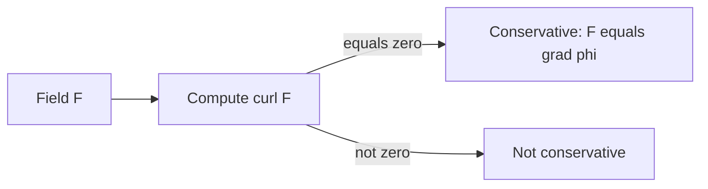

> **Quick revision:** $\nabla\times\vec F=\vec0$ ⇔ conservative ⇔ $\vec F=\nabla\phi$ ⇔ work independent of path.

---

## VEC-13. Verify Green's theorem for $\oint_C(xy+y^2)\,dx+x^2\,dy$, $C$ bounded by $y=x$ and $y=x^2$

**Green's theorem:** $\displaystyle\oint_C P\,dx+Q\,dy=\iint_R\left(\frac{\partial Q}{\partial x}-\frac{\partial P}{\partial y}\right)dx\,dy$, with $P=xy+y^2$, $Q=x^2$.

The curves meet where $x=x^2$: $(0,0)$ and $(1,1)$.

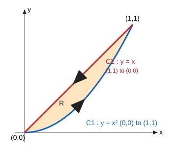

### Right-hand side (double integral)

$$
\frac{\partial Q}{\partial x}-\frac{\partial P}{\partial y}=2x-(x+2y)=x-2y
$$

$$
\iint_R(x-2y)\,dA=\int_0^1\!\!\int_{x^2}^{x}(x-2y)\,dy\,dx=\int_0^1\Big[xy-y^2\Big]_{x^2}^{x}dx=\int_0^1\big(-x^3+x^4\big)dx=-\frac14+\frac15=-\frac1{20}
$$

### Left-hand side (line integral, counter-clockwise)

**Along $C_1$: $y=x^2$, $x:0\to1$** ($dy=2x\,dx$):

$$
\int_0^1\big[(x\cdot x^2+x^4)+x^2\cdot2x\big]dx=\int_0^1(3x^3+x^4)\,dx=\frac34+\frac15=\frac{19}{20}
$$

**Along $C_2$: $y=x$, $x:1\to0$** ($dy=dx$):

$$
\int_1^0\big[(x^2+x^2)+x^2\big]dx=\int_1^03x^2\,dx=-1
$$

$$
\oint_C=\frac{19}{20}-1=-\frac1{20}
$$

LHS $=$ RHS $=-\dfrac1{20}$ ⇒ **Green's theorem verified** ∎

> **Quick revision:** both sides $=-1/20$. Line integral: $19/20$ (parabola) $+(-1)$ (line); double integral: $\int_0^1(x^4-x^3)dx$.

---

## VEC-14. Line integral $I=\oint(y^2\,dx-x^2\,dy)$ about the triangle with vertices $(1,0),(0,1),(-1,0)$

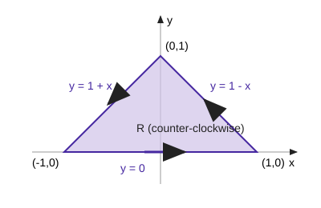

**By Green's theorem** ($P=y^2,\ Q=-x^2$):

$$
\frac{\partial Q}{\partial x}-\frac{\partial P}{\partial y}=-2x-2y
$$

Region: $0\le y\le1,\ y-1\le x\le1-y$.

$$
I=\iint_R(-2x-2y)\,dA=-2\int_0^1\!\!\int_{y-1}^{1-y}(x+y)\,dx\,dy
=-2\int_0^1\Big[\tfrac{x^2}{2}+xy\Big]_{y-1}^{1-y}dy=-2\int_0^12y(1-y)\,dy=-4\left(\tfrac12-\tfrac13\right)
$$

$$
\boxed{I=-\frac23}
$$

**Direct check (counter-clockwise, three sides):**

| Side | Path | Integrand | Value |
| --- | --- | --- | --- |
| $(1,0)\to(0,1)$ | $y=1-x,\ dy=-dx$ | $\big[(1-x)^2+x^2\big]dx,\ x:1\to0$ | $-\tfrac23$ |
| $(0,1)\to(-1,0)$ | $y=1+x,\ dy=dx$ | $(1+2x)\,dx,\ x:0\to-1$ | $0$ |
| $(-1,0)\to(1,0)$ | $y=0$ | $0$ | $0$ |
| **Total** | | | $-\tfrac23$ ✓ |

> **Quick revision:** $\oint=\iint(Q_x-P_y)\,dA=-2\iint(x+y)\,dA=-2/3$.

---

## VEC-15. Prove $\nabla\times(\nabla\times\vec A)=\nabla(\nabla\cdot\vec A)-\nabla^2\vec A$

Work with the $\hat i$-component. Let $\vec B=\nabla\times\vec A$ with $B_y=\partial_zA_1-\partial_xA_3,\ B_z=\partial_xA_2-\partial_yA_1$.

$$
\big[\nabla\times\vec B\big]_x=\partial_yB_z-\partial_zB_y=\frac{\partial^2A_2}{\partial y\partial x}-\frac{\partial^2A_1}{\partial y^2}-\frac{\partial^2A_1}{\partial z^2}+\frac{\partial^2A_3}{\partial z\partial x}
$$

Add and subtract $\dfrac{\partial^2A_1}{\partial x^2}$:

$$
=\frac{\partial}{\partial x}\left(\frac{\partial A_1}{\partial x}+\frac{\partial A_2}{\partial y}+\frac{\partial A_3}{\partial z}\right)-\left(\frac{\partial^2}{\partial x^2}+\frac{\partial^2}{\partial y^2}+\frac{\partial^2}{\partial z^2}\right)A_1=\frac{\partial}{\partial x}(\nabla\cdot\vec A)-\nabla^2A_1
$$

The $\hat j,\hat k$ components follow the same way, therefore

$$
\nabla\times(\nabla\times\vec A)=\nabla(\nabla\cdot\vec A)-\nabla^2\vec A\qquad\blacksquare
$$

(Memory aid: it is the BAC–CAB rule $\vec a\times(\vec b\times\vec c)=\vec b(\vec a\cdot\vec c)-\vec c(\vec a\cdot\vec b)$ with $\nabla$ acting on $\vec A$.)

> **Quick revision:** curl curl $=$ grad div $-$ Laplacian; prove by components, adding/subtracting $\partial^2A_1/\partial x^2$.

---

## VEC-16. State and prove Green's theorem

**Statement.** Let $C$ be a **piecewise-smooth, simple, closed, positively oriented** (counter-clockwise) curve bounding a region $R$ in the $xy$-plane. If $P(x,y),Q(x,y)$ and their first partial derivatives are continuous on $R\cup C$, then

$$
\oint_C(P\,dx+Q\,dy)=\iint_R\left(\frac{\partial Q}{\partial x}-\frac{\partial P}{\partial y}\right)dx\,dy
$$

**Proof (for a region that is simple in both directions).**

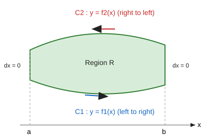

**Part 1 — show $\displaystyle\oint_CP\,dx=-\iint_R\frac{\partial P}{\partial y}\,dx\,dy$.**

Describe $R$ as $a\le x\le b,\ f_1(x)\le y\le f_2(x)$ (type I).

$$
\iint_R\frac{\partial P}{\partial y}\,dx\,dy=\int_a^b\Big[P(x,y)\Big]_{y=f_1(x)}^{y=f_2(x)}dx=\int_a^bP(x,f_2(x))\,dx-\int_a^bP(x,f_1(x))\,dx
$$

Now the line integral: on $C_1$ ($y=f_1$, left to right) $\int_{C_1}P\,dx=\int_a^bP(x,f_1)\,dx$; on $C_2$ ($y=f_2$, traversed right to left) $\int_{C_2}P\,dx=-\int_a^bP(x,f_2)\,dx$; on the vertical sides $dx=0$. So

$$
\oint_CP\,dx=\int_a^bP(x,f_1)\,dx-\int_a^bP(x,f_2)\,dx=-\iint_R\frac{\partial P}{\partial y}\,dx\,dy\quad(1)
$$

**Part 2 — show $\displaystyle\oint_CQ\,dy=\iint_R\frac{\partial Q}{\partial x}\,dx\,dy$.**

Describe $R$ as $c\le y\le d,\ g_1(y)\le x\le g_2(y)$ (type II).

$$
\iint_R\frac{\partial Q}{\partial x}\,dx\,dy=\int_c^d\big[Q(g_2(y),y)-Q(g_1(y),y)\big]\,dy
$$

Counter-clockwise: the right curve $x=g_2$ is traversed upward, the left curve $x=g_1$ downward, horizontal sides have $dy=0$:

$$
\oint_CQ\,dy=\int_c^dQ(g_2,y)\,dy-\int_c^dQ(g_1,y)\,dy=\iint_R\frac{\partial Q}{\partial x}\,dx\,dy\quad(2)
$$

**Adding (1) and (2):**

$$
\oint_C(P\,dx+Q\,dy)=\iint_R\left(\frac{\partial Q}{\partial x}-\frac{\partial P}{\partial y}\right)dx\,dy\qquad\blacksquare
$$

**Extension.** A general region is cut into finitely many sub-regions of this type; the line integrals along the cuts cancel (traversed twice in opposite directions), so the theorem holds for the whole region.

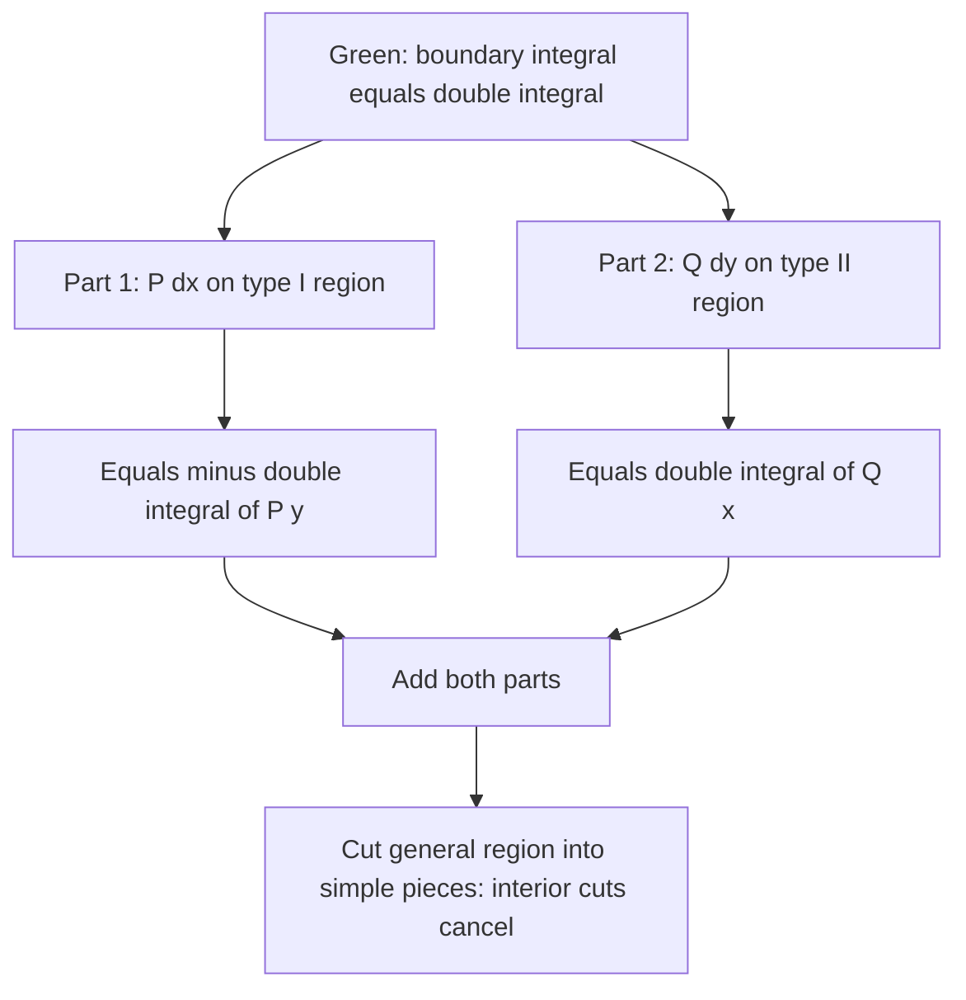

**Important special case:** $Q=x,\ P=-y$ ⇒ Area $=\dfrac12\oint(x\,dy-y\,dx)$.

> **Quick revision:** $\oint P\,dx+Q\,dy=\iint(Q_x-P_y)\,dA$. Proof = type I for $P$, type II for $Q$, add; cuts cancel for general regions.

---

## VEC-17. Define: (i) Del (ii) Gradient (iii) Curl (iv) Divergence (v) Line integral

**(i) Del (nabla) operator** — a vector differential operator:

$$
\nabla=\hat i\frac{\partial}{\partial x}+\hat j\frac{\partial}{\partial y}+\hat k\frac{\partial}{\partial z}
$$

**(ii) Gradient** — of a scalar field $\phi(x,y,z)$:

$$
\operatorname{grad}\phi=\nabla\phi=\frac{\partial\phi}{\partial x}\hat i+\frac{\partial\phi}{\partial y}\hat j+\frac{\partial\phi}{\partial z}\hat k
$$

It is a **vector** pointing in the direction of the greatest rate of increase of $\phi$, with magnitude equal to that rate, and is normal to the level surface $\phi=\text{const}$.

**(iii) Curl** — of a vector field $\vec F=F_1\hat i+F_2\hat j+F_3\hat k$:

$$
\operatorname{curl}\vec F=\nabla\times\vec F=\begin{vmatrix}\hat i&\hat j&\hat k\\\partial_x&\partial_y&\partial_z\\F_1&F_2&F_3\end{vmatrix}
$$

It is a **vector** measuring the local rotation (circulation per unit area) of the field; $\nabla\times\vec F=\vec0$ means **irrotational**.

**(iv) Divergence** — of $\vec F$:

$$
\operatorname{div}\vec F=\nabla\cdot\vec F=\frac{\partial F_1}{\partial x}+\frac{\partial F_2}{\partial y}+\frac{\partial F_3}{\partial z}
$$

It is a **scalar** measuring the net outflow (source strength) per unit volume; $\nabla\cdot\vec F=0$ means **solenoidal**.

**(v) Line integral** — of $\vec F$ along a curve $C$ with position vector $\vec r(t)$, $t\in[t_1,t_2]$:

$$
\int_C\vec F\cdot d\vec r=\int_C(F_1\,dx+F_2\,dy+F_3\,dz)=\int_{t_1}^{t_2}\vec F\cdot\frac{d\vec r}{dt}\,dt
$$

For a closed curve it is written $\oint_C\vec F\cdot d\vec r$ (**circulation**). Physical meaning: work done by a force $\vec F$ along $C$.

### Comparison of the vector operators

| Operator | Acts on | Notation | Result | Meaning |
| --- | --- | --- | --- | --- |
| Gradient | scalar $\phi$ | $\nabla\phi$ | vector | direction of steepest increase |
| Divergence | vector $\vec F$ | $\nabla\cdot\vec F$ | scalar | source / outflow density |
| Curl | vector $\vec F$ | $\nabla\times\vec F$ | vector | rotation / circulation density |
| Laplacian | scalar $\phi$ | $\nabla^2\phi=\nabla\cdot\nabla\phi$ | scalar | divergence of the gradient |

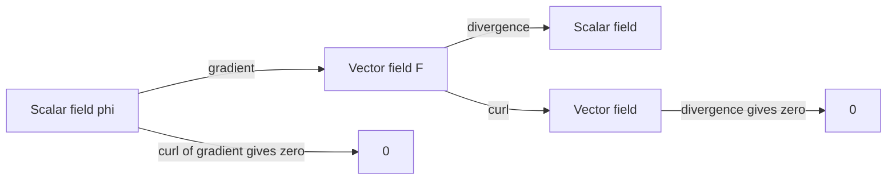

**Key identities:** $\nabla\times(\nabla\phi)=\vec0$ and $\nabla\cdot(\nabla\times\vec F)=0$.

> **Quick revision:** grad: scalar→vector; div: vector→scalar; curl: vector→vector; line integral $=\int\vec F\cdot d\vec r$ (work).

---

# Part D — Complex Number (note only)

The sheet has a heading **"Complex number"**, but below it contains only handwritten Bengali notes (referring to *Jakaria's notes*, an ODE-chapter exercise number to be solved from them, and *CTEC* notes — signed "Jakaria, PTEC-19"). **No complex-number question is actually written**, so there is nothing to answer here. Practise the exercises from those referenced notes directly.

---

*End of answer set — Compiled by sigkill0x00.*
