# Mathematics-II: Selected Questions with Model Answers

**Vector Analysis · Complex Variables · Laplace Transform · Ordinary Differential Equations**

> Exam-style worked answers to every question in *Selected Questions* (compiled by Nayem).
> Notation: bold capitals/lowercase = vectors, $\mathbf{i},\mathbf{j},\mathbf{k}$ = unit vectors along $x,y,z$, $[\mathbf{a},\mathbf{b},\mathbf{c}]=\mathbf{a}\cdot(\mathbf{b}\times\mathbf{c})$.

---

## Examiner's Notes (read first)

Four questions marked ⚠ in the source (unclear photo) are **not correct as printed**. They are answered below in the form that is mathematically true, and the discrepancy is shown explicitly.

| Question | Problem in printed version | What is answered |
| --- | --- | --- |
| A5-Q8 | $(B\times C)\times(A\times D)+(C\times A)\times(B\times D)+(A\times B)\times(C\times D)=\mathbf 0$ is false (counter-example given) | Correct result: the sum equals $-2[A,B,C]\,D$ |
| B3-Q28 | With integrand $e^{itz}/(z^2+1)$ the integral is $-2\pi\sinh t$, not $2\pi i\sin t$ | Standard textbook form $e^{tz}/(z^2+1)$, which gives $2\pi i\sin t$; printed form also evaluated |
| C-Solve Q2 | A third-order ODE needs three initial conditions; only $Y(0),Y'(0)$ are given | Solved with $Y''(0)=c$ kept general, then the case $Y''(0)=0$ |
| D-Exact Q4 | $(e^x\sin y+e^{-y})dx+(e^x\cos y-xe^{-x})dy$ is not exact | Intended form $N=e^x\cos y-xe^{-y}$ is exact and solved |

---

## Table of Contents

- [Part A: Vector Analysis](#part-a-vector-analysis)
  - [A1. Scalar (Dot) Product of Two Vectors](#a1-scalar-dot-product-of-two-vectors)
  - [A2. Scalar Triple Product](#a2-scalar-triple-product)
  - [A3. Scalar Product of Four Vectors](#a3-scalar-product-of-four-vectors)
  - [A4. Vector (Cross) Product of Two Vectors](#a4-vector-cross-product-of-two-vectors)
  - [A5. Vector Triple Product](#a5-vector-triple-product)
  - [A6. Gradient, Divergence and Curl](#a6-gradient-divergence-and-curl)
  - [A7. Green's Theorem](#a7-greens-theorem)
  - [A8. Gauss Divergence Theorem](#a8-gauss-divergence-theorem)
  - [A9. Vector Integrals](#a9-vector-integrals)
- [Part B: Complex Variables](#part-b-complex-variables)
  - [B1. Complex Numbers](#b1-complex-numbers)
  - [B2. Complex Differentiation and Cauchy-Riemann Equations](#b2-complex-differentiation-and-cauchy-riemann-equations)
  - [B3. Complex Integration and Cauchy's Theorem](#b3-complex-integration-and-cauchys-theorem)
- [Part C: Laplace Transform](#part-c-laplace-transform)
- [Part D: Ordinary Differential Equations](#part-d-ordinary-differential-equations)

---

# Part A: Vector Analysis

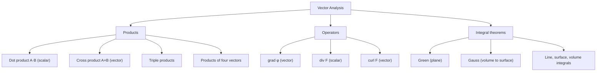

---

## A1. Scalar (Dot) Product of Two Vectors

### A1-Q1. Define the scalar (dot) product geometrically and algebraically

**Geometric definition.** If $\theta\,(0\le\theta\le\pi)$ is the angle between $\mathbf{A}$ and $\mathbf{B}$,

$$\mathbf{A}\cdot\mathbf{B}=\lvert\mathbf{A}\rvert\,\lvert\mathbf{B}\rvert\cos\theta .$$

**Algebraic definition.** If $\mathbf{A}=a_1\mathbf i+a_2\mathbf j+a_3\mathbf k$ and $\mathbf{B}=b_1\mathbf i+b_2\mathbf j+b_3\mathbf k$,

$$\mathbf{A}\cdot\mathbf{B}=a_1b_1+a_2b_2+a_3b_3 .$$

**Equivalence (law of cosines).** In the triangle with sides $\mathbf A,\mathbf B,\mathbf A-\mathbf B$:

$$\lvert\mathbf A-\mathbf B\rvert^2=\lvert\mathbf A\rvert^2+\lvert\mathbf B\rvert^2-2\lvert\mathbf A\rvert\lvert\mathbf B\rvert\cos\theta .$$

Expanding the left side algebraically gives $\lvert\mathbf A\rvert^2+\lvert\mathbf B\rvert^2-2(a_1b_1+a_2b_2+a_3b_3)$. Comparing the two,

$$\lvert\mathbf A\rvert\lvert\mathbf B\rvert\cos\theta=a_1b_1+a_2b_2+a_3b_3 .$$

**Key facts:** $\mathbf i\cdot\mathbf i=\mathbf j\cdot\mathbf j=\mathbf k\cdot\mathbf k=1$; $\mathbf i\cdot\mathbf j=\mathbf j\cdot\mathbf k=\mathbf k\cdot\mathbf i=0$; $\mathbf A\cdot\mathbf A=\lvert\mathbf A\rvert^2$.

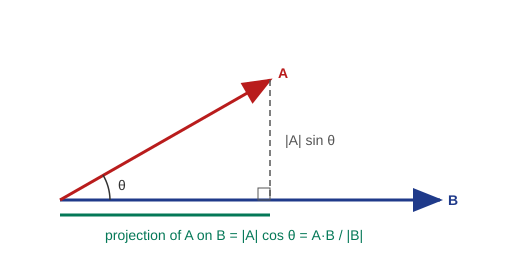

### A1-Q2. Is the dot product commutative? Justify

**Yes.**

1. Geometric: $\mathbf A\cdot\mathbf B=\lvert\mathbf A\rvert\lvert\mathbf B\rvert\cos\theta$, and the angle between $\mathbf B$ and $\mathbf A$ is the same $\theta$, so $\mathbf B\cdot\mathbf A=\lvert\mathbf B\rvert\lvert\mathbf A\rvert\cos\theta=\mathbf A\cdot\mathbf B$.
2. Algebraic: $a_1b_1+a_2b_2+a_3b_3=b_1a_1+b_2a_2+b_3a_3$ because multiplication of real numbers commutes.

| Property | Dot product | Cross product |
| --- | --- | --- |
| Result | Scalar | Vector |
| Commutative | $\mathbf A\cdot\mathbf B=\mathbf B\cdot\mathbf A$ (yes) | $\mathbf A\times\mathbf B=-\mathbf B\times\mathbf A$ (anti-commutative) |
| Distributive over $+$ | Yes | Yes |
| Zero when | $\mathbf A\perp\mathbf B$ | $\mathbf A\parallel\mathbf B$ |
| Associative | Not defined for three vectors | No |

### A1-Q4. Formula for the projection of $\mathbf A$ on $\mathbf B$

The **scalar projection** of $\mathbf A$ on $\mathbf B$ is the signed length of the component of $\mathbf A$ along $\mathbf B$:

$$\operatorname{proj}_{\mathbf B}\mathbf A=\lvert\mathbf A\rvert\cos\theta=\frac{\mathbf A\cdot\mathbf B}{\lvert\mathbf B\rvert}.$$

The **vector projection** is

$$\frac{\mathbf A\cdot\mathbf B}{\lvert\mathbf B\rvert^2}\,\mathbf B=(\mathbf A\cdot\hat{\mathbf b})\,\hat{\mathbf b}.$$

### A1-Q5. Projection of $\mathbf A=\mathbf i-2\mathbf j+\mathbf k$ on $\mathbf B=4\mathbf i-4\mathbf j+7\mathbf k$

1. $\mathbf A\cdot\mathbf B=(1)(4)+(-2)(-4)+(1)(7)=4+8+7=19$.
2. $\lvert\mathbf B\rvert=\sqrt{16+16+49}=\sqrt{81}=9$.
3. Projection $=\dfrac{19}{9}$.

$$\boxed{\operatorname{proj}_{\mathbf B}\mathbf A=\tfrac{19}{9}}$$

### A1-Q7. Prove $\mathbf a=(\mathbf a\cdot\mathbf i)\mathbf i+(\mathbf a\cdot\mathbf j)\mathbf j+(\mathbf a\cdot\mathbf k)\mathbf k$

Let $\mathbf a=a_1\mathbf i+a_2\mathbf j+a_3\mathbf k$. Using the orthonormality of $\mathbf i,\mathbf j,\mathbf k$:

$$\mathbf a\cdot\mathbf i=a_1(1)+a_2(0)+a_3(0)=a_1,\quad \mathbf a\cdot\mathbf j=a_2,\quad \mathbf a\cdot\mathbf k=a_3 .$$

Substituting, $(\mathbf a\cdot\mathbf i)\mathbf i+(\mathbf a\cdot\mathbf j)\mathbf j+(\mathbf a\cdot\mathbf k)\mathbf k=a_1\mathbf i+a_2\mathbf j+a_3\mathbf k=\mathbf a$. $\blacksquare$

### A1-Q9. If $\lvert\mathbf a+\mathbf b\rvert=\lvert\mathbf a-\mathbf b\rvert$, show $\mathbf a\perp\mathbf b$

Square both sides:

$$\lvert\mathbf a\rvert^2+2\,\mathbf a\cdot\mathbf b+\lvert\mathbf b\rvert^2=\lvert\mathbf a\rvert^2-2\,\mathbf a\cdot\mathbf b+\lvert\mathbf b\rvert^2
\;\Rightarrow\; 4\,\mathbf a\cdot\mathbf b=0\;\Rightarrow\;\mathbf a\cdot\mathbf b=0 .$$

For non-zero $\mathbf a,\mathbf b$ this means $\cos\theta=0$, so $\theta=90^\circ$. $\blacksquare$

(Geometrically: the diagonals of a parallelogram are equal only for a rectangle.)

### A1-Q10. Angle between $\mathbf i+2\mathbf j+3\mathbf k$ and $3\mathbf i-4\mathbf j+2\mathbf k$

1. Dot product: $(1)(3)+(2)(-4)+(3)(2)=3-8+6=1$.
2. Magnitudes: $\sqrt{1+4+9}=\sqrt{14}$ and $\sqrt{9+16+4}=\sqrt{29}$.
3. $\cos\theta=\dfrac{1}{\sqrt{14}\sqrt{29}}=\dfrac{1}{\sqrt{406}}$.

$$\boxed{\theta=\cos^{-1}\!\left(\tfrac{1}{\sqrt{406}}\right)\approx 87.16^\circ}$$

> **Quick revision (A1).** $\mathbf A\cdot\mathbf B=\lvert A\rvert\lvert B\rvert\cos\theta=\sum a_ib_i$; commutative; zero iff perpendicular; projection $=\mathbf A\cdot\mathbf B/\lvert\mathbf B\rvert$; $\mathbf a=\sum(\mathbf a\cdot\mathbf e_i)\mathbf e_i$.

---

## A2. Scalar Triple Product

### A2-Q2. Geometrical interpretation (volume of a parallelepiped) and derivation

**Definition.** $[\mathbf a,\mathbf b,\mathbf c]=\mathbf a\cdot(\mathbf b\times\mathbf c)$.

**Derivation.** Take the parallelepiped with coterminous edges $\mathbf a,\mathbf b,\mathbf c$.

1. The base is the parallelogram on $\mathbf b,\mathbf c$, with area $\lvert\mathbf b\times\mathbf c\rvert$.
2. The unit normal to the base is $\hat{\mathbf n}=\dfrac{\mathbf b\times\mathbf c}{\lvert\mathbf b\times\mathbf c\rvert}$.
3. The height is the length of the projection of $\mathbf a$ on $\hat{\mathbf n}$:
   $h=\lvert\mathbf a\cdot\hat{\mathbf n}\rvert=\dfrac{\lvert\mathbf a\cdot(\mathbf b\times\mathbf c)\rvert}{\lvert\mathbf b\times\mathbf c\rvert}$.
4. Volume $=$ base area $\times$ height:

$$V=\lvert\mathbf b\times\mathbf c\rvert\cdot\frac{\lvert\mathbf a\cdot(\mathbf b\times\mathbf c)\rvert}{\lvert\mathbf b\times\mathbf c\rvert}=\lvert\mathbf a\cdot(\mathbf b\times\mathbf c)\rvert .$$

$$\boxed{V=\lvert[\mathbf a,\mathbf b,\mathbf c]\rvert}$$

The sign is positive when $\mathbf a,\mathbf b,\mathbf c$ form a right-handed system. Cyclic permutation does not change the value: $[\mathbf a,\mathbf b,\mathbf c]=[\mathbf b,\mathbf c,\mathbf a]=[\mathbf c,\mathbf a,\mathbf b]$, and swapping two vectors changes the sign.

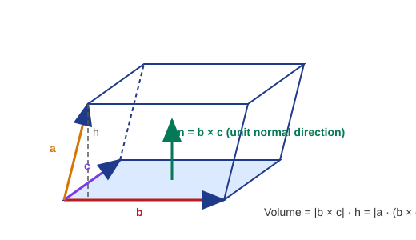

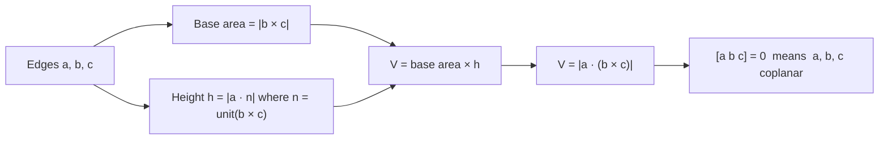

### A2-Q4. Show $\mathbf a\cdot(\mathbf b\times\mathbf c)$ is the determinant of the components

By the determinant form of the cross product,

$$\mathbf b\times\mathbf c=\begin{vmatrix}\mathbf i&\mathbf j&\mathbf k\\ b_1&b_2&b_3\\ c_1&c_2&c_3\end{vmatrix}
=(b_2c_3-b_3c_2)\mathbf i-(b_1c_3-b_3c_1)\mathbf j+(b_1c_2-b_2c_1)\mathbf k .$$

Taking the dot product with $\mathbf a=a_1\mathbf i+a_2\mathbf j+a_3\mathbf k$:

$$\mathbf a\cdot(\mathbf b\times\mathbf c)=a_1(b_2c_3-b_3c_2)-a_2(b_1c_3-b_3c_1)+a_3(b_1c_2-b_2c_1).$$

This is exactly the expansion, along the first row, of

$$[\mathbf a,\mathbf b,\mathbf c]=\begin{vmatrix}a_1&a_2&a_3\\ b_1&b_2&b_3\\ c_1&c_2&c_3\end{vmatrix}. \qquad\blacksquare$$

### A2-Q6. Prove $[\mathbf a+\mathbf b,\;\mathbf b+\mathbf c,\;\mathbf c+\mathbf a]=2[\mathbf a,\mathbf b,\mathbf c]$

First expand the cross product (using $\mathbf c\times\mathbf c=\mathbf 0$):

$$(\mathbf b+\mathbf c)\times(\mathbf c+\mathbf a)=\mathbf b\times\mathbf c+\mathbf b\times\mathbf a+\mathbf c\times\mathbf c+\mathbf c\times\mathbf a=\mathbf b\times\mathbf c+\mathbf b\times\mathbf a+\mathbf c\times\mathbf a .$$

Now dot with $(\mathbf a+\mathbf b)$. A triple product with a repeated vector is zero, so

| Term | Value |
| --- | --- |
| $\mathbf a\cdot(\mathbf b\times\mathbf c)$ | $[\mathbf a,\mathbf b,\mathbf c]$ |
| $\mathbf a\cdot(\mathbf b\times\mathbf a)$ | $0$ |
| $\mathbf a\cdot(\mathbf c\times\mathbf a)$ | $0$ |
| $\mathbf b\cdot(\mathbf b\times\mathbf c)$ | $0$ |
| $\mathbf b\cdot(\mathbf b\times\mathbf a)$ | $0$ |
| $\mathbf b\cdot(\mathbf c\times\mathbf a)$ | $[\mathbf b,\mathbf c,\mathbf a]=[\mathbf a,\mathbf b,\mathbf c]$ |

Sum $=2[\mathbf a,\mathbf b,\mathbf c]$. $\blacksquare$

### A2-Q7. Show $(\mathbf A\cdot\mathbf B\times\mathbf C)(\mathbf a\cdot\mathbf b\times\mathbf c)=\det$ of dot products

Let $M$ be the $3\times3$ matrix whose rows are the components of $\mathbf A,\mathbf B,\mathbf C$, and $N$ the matrix whose rows are the components of $\mathbf a,\mathbf b,\mathbf c$. By A2-Q4,

$$[\mathbf A,\mathbf B,\mathbf C]=\det M,\qquad [\mathbf a,\mathbf b,\mathbf c]=\det N=\det N^{T}.$$

Using $\det(M)\det(N^T)=\det(MN^T)$, the $(i,j)$ entry of $MN^T$ is (row $i$ of $M$)$\,\cdot\,$(row $j$ of $N$). Hence

$$[\mathbf A,\mathbf B,\mathbf C]\,[\mathbf a,\mathbf b,\mathbf c]=
\begin{vmatrix}
\mathbf A\cdot\mathbf a&\mathbf A\cdot\mathbf b&\mathbf A\cdot\mathbf c\\
\mathbf B\cdot\mathbf a&\mathbf B\cdot\mathbf b&\mathbf B\cdot\mathbf c\\
\mathbf C\cdot\mathbf a&\mathbf C\cdot\mathbf b&\mathbf C\cdot\mathbf c
\end{vmatrix}. \qquad\blacksquare$$

### A2-Q9. Find $\lambda$ if $\mathbf i-\mathbf j+\mathbf k,\;2\mathbf i+\mathbf j-\mathbf k,\;\lambda\mathbf i-\mathbf j+\lambda\mathbf k$ are coplanar

Three vectors are coplanar $\iff$ their scalar triple product is zero.

$$\begin{vmatrix}1&-1&1\\2&1&-1\\\lambda&-1&\lambda\end{vmatrix}
=1\,(\lambda-1)-(-1)(2\lambda+\lambda)+1\,(-2-\lambda)$$

$$=\lambda-1+3\lambda-2-\lambda=3\lambda-3 .$$

Setting $3\lambda-3=0$:

$$\boxed{\lambda=1}$$

### A2-Q11. Volume of the parallelepiped with edges $\mathbf A=2\mathbf i-3\mathbf j+4\mathbf k,\;\mathbf B=\mathbf i+2\mathbf j-\mathbf k,\;\mathbf C=3\mathbf i-\mathbf j+2\mathbf k$

$$[\mathbf A,\mathbf B,\mathbf C]=\begin{vmatrix}2&-3&4\\1&2&-1\\3&-1&2\end{vmatrix}
=2(4-1)-(-3)(2+3)+4(-1-6)=6+15-28=-7 .$$

$$\boxed{V=\lvert-7\rvert=7\ \text{cubic units}}$$

(The negative sign only shows that $\mathbf A,\mathbf B,\mathbf C$ form a left-handed triple.)

> **Quick revision (A2).** $V=\lvert[\mathbf a,\mathbf b,\mathbf c]\rvert=\lvert\det\rvert$; coplanar $\iff[\,]=0$; cyclic order keeps sign; $[\mathbf a+\mathbf b,\mathbf b+\mathbf c,\mathbf c+\mathbf a]=2[\mathbf a,\mathbf b,\mathbf c]$.

---

## A3. Scalar Product of Four Vectors

### A3-Q1. Define the scalar product of four vectors

The scalar product of four vectors $\mathbf A,\mathbf B,\mathbf C,\mathbf D$ is the dot product of two cross products:

$$(\mathbf A\times\mathbf B)\cdot(\mathbf C\times\mathbf D)=(\mathbf A\cdot\mathbf C)(\mathbf B\cdot\mathbf D)-(\mathbf A\cdot\mathbf D)(\mathbf B\cdot\mathbf C)=\begin{vmatrix}\mathbf A\cdot\mathbf C&\mathbf A\cdot\mathbf D\\ \mathbf B\cdot\mathbf C&\mathbf B\cdot\mathbf D\end{vmatrix}.$$

**Proof.** By the cyclic property of the scalar triple product, $\mathbf X\cdot(\mathbf C\times\mathbf D)=\mathbf A\cdot(\mathbf B\times(\mathbf C\times\mathbf D))$ with $\mathbf X=\mathbf A\times\mathbf B$, i.e.

$$(\mathbf A\times\mathbf B)\cdot(\mathbf C\times\mathbf D)=\mathbf A\cdot[\mathbf B\times(\mathbf C\times\mathbf D)] .$$

By the vector triple product $\mathbf B\times(\mathbf C\times\mathbf D)=(\mathbf B\cdot\mathbf D)\mathbf C-(\mathbf B\cdot\mathbf C)\mathbf D$ (proved in A5-Q3), so

$$(\mathbf A\times\mathbf B)\cdot(\mathbf C\times\mathbf D)=(\mathbf B\cdot\mathbf D)(\mathbf A\cdot\mathbf C)-(\mathbf B\cdot\mathbf C)(\mathbf A\cdot\mathbf D). \qquad\blacksquare$$

*(Special case $\mathbf C=\mathbf A,\ \mathbf D=\mathbf B$ gives Lagrange's identity $\lvert\mathbf A\times\mathbf B\rvert^2=\lvert\mathbf A\rvert^2\lvert\mathbf B\rvert^2-(\mathbf A\cdot\mathbf B)^2$.)*

### A3-Q2. ⚠ Prove $(\mathbf B\times\mathbf C)\cdot(\mathbf A\times\mathbf D)+(\mathbf C\times\mathbf A)\cdot(\mathbf B\times\mathbf D)+(\mathbf A\times\mathbf B)\cdot(\mathbf C\times\mathbf D)=0$

Apply the formula of A3-Q1 to each term.

$$\begin{aligned}
(\mathbf B\times\mathbf C)\cdot(\mathbf A\times\mathbf D)&=(\mathbf B\cdot\mathbf A)(\mathbf C\cdot\mathbf D)-(\mathbf B\cdot\mathbf D)(\mathbf C\cdot\mathbf A),\\
(\mathbf C\times\mathbf A)\cdot(\mathbf B\times\mathbf D)&=(\mathbf C\cdot\mathbf B)(\mathbf A\cdot\mathbf D)-(\mathbf C\cdot\mathbf D)(\mathbf A\cdot\mathbf B),\\
(\mathbf A\times\mathbf B)\cdot(\mathbf C\times\mathbf D)&=(\mathbf A\cdot\mathbf C)(\mathbf B\cdot\mathbf D)-(\mathbf A\cdot\mathbf D)(\mathbf B\cdot\mathbf C).
\end{aligned}$$

Add the three right-hand sides. Using commutativity of the dot product, the six products cancel in pairs:

| Product | Appears with $+$ in | Appears with $-$ in |
| --- | --- | --- |
| $(\mathbf A\cdot\mathbf B)(\mathbf C\cdot\mathbf D)$ | line 1 | line 2 |
| $(\mathbf B\cdot\mathbf D)(\mathbf A\cdot\mathbf C)$ | line 3 | line 1 |
| $(\mathbf A\cdot\mathbf D)(\mathbf B\cdot\mathbf C)$ | line 2 | line 3 |

Hence the sum is $0$. $\blacksquare$

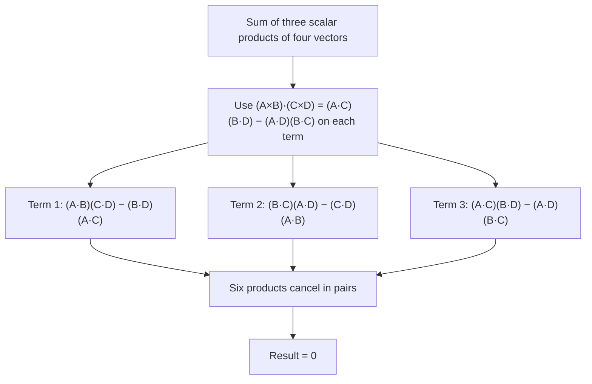

> **Quick revision (A3).** $(\mathbf A\times\mathbf B)\cdot(\mathbf C\times\mathbf D)=(\mathbf A\cdot\mathbf C)(\mathbf B\cdot\mathbf D)-(\mathbf A\cdot\mathbf D)(\mathbf B\cdot\mathbf C)$; the cyclic sum of such terms vanishes.

---
## A4. Vector (Cross) Product of Two Vectors

### A4-Q1. Define the cross product and write it in determinant form

**Definition.** For vectors $\mathbf a,\mathbf b$ at angle $\theta\,(0\le\theta\le\pi)$,

$$\mathbf a\times\mathbf b=\lvert\mathbf a\rvert\lvert\mathbf b\rvert\sin\theta\;\hat{\mathbf n},$$

where $\hat{\mathbf n}$ is the unit vector perpendicular to both $\mathbf a$ and $\mathbf b$, chosen so that $\mathbf a,\mathbf b,\hat{\mathbf n}$ form a **right-handed** system (right-hand screw rule).

**Determinant form.** With $\mathbf a=a_1\mathbf i+a_2\mathbf j+a_3\mathbf k$, $\mathbf b=b_1\mathbf i+b_2\mathbf j+b_3\mathbf k$,

$$\mathbf a\times\mathbf b=\begin{vmatrix}\mathbf i&\mathbf j&\mathbf k\\a_1&a_2&a_3\\b_1&b_2&b_3\end{vmatrix}
=(a_2b_3-a_3b_2)\mathbf i+(a_3b_1-a_1b_3)\mathbf j+(a_1b_2-a_2b_1)\mathbf k .$$

Basic results: $\mathbf i\times\mathbf j=\mathbf k,\ \mathbf j\times\mathbf k=\mathbf i,\ \mathbf k\times\mathbf i=\mathbf j$; $\mathbf a\times\mathbf b=-\mathbf b\times\mathbf a$; $\mathbf a\times\mathbf a=\mathbf 0$.

### A4-Q2. Geometrical interpretation: area of a parallelogram is $\lvert\mathbf A\times\mathbf B\rvert$

Let the parallelogram have adjacent sides $\mathbf A$ and $\mathbf B$ with angle $\theta$ between them.

1. Take $\mathbf A$ as the base: base length $=\lvert\mathbf A\rvert$.
2. The perpendicular height is $h=\lvert\mathbf B\rvert\sin\theta$.
3. Area $=$ base $\times$ height $=\lvert\mathbf A\rvert\lvert\mathbf B\rvert\sin\theta=\lvert\mathbf A\times\mathbf B\rvert$. $\blacksquare$

The area of the triangle on the same two sides is $\tfrac12\lvert\mathbf A\times\mathbf B\rvert$.

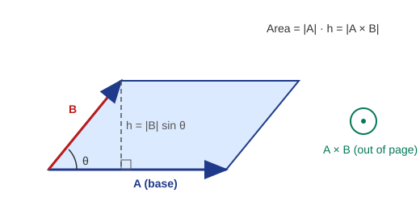

### A4-Q3. $\mathbf A=3\mathbf i-\mathbf j+2\mathbf k,\ \mathbf B=2\mathbf i+\mathbf j-\mathbf k,\ \mathbf C=\mathbf i-2\mathbf j+2\mathbf k$. Find (i) $(\mathbf A\times\mathbf B)\times\mathbf C$ (ii) $\mathbf A\times(\mathbf B\times\mathbf C)$

**Step 1: $\mathbf A\times\mathbf B$.**

$$\mathbf A\times\mathbf B=\begin{vmatrix}\mathbf i&\mathbf j&\mathbf k\\3&-1&2\\2&1&-1\end{vmatrix}
=\mathbf i(1-2)-\mathbf j(-3-4)+\mathbf k(3+2)=-\mathbf i+7\mathbf j+5\mathbf k .$$

**(i)**

$$(\mathbf A\times\mathbf B)\times\mathbf C=\begin{vmatrix}\mathbf i&\mathbf j&\mathbf k\\-1&7&5\\1&-2&2\end{vmatrix}
=\mathbf i(14+10)-\mathbf j(-2-5)+\mathbf k(2-7)=24\mathbf i+7\mathbf j-5\mathbf k .$$

**Step 2: $\mathbf B\times\mathbf C$.**

$$\mathbf B\times\mathbf C=\begin{vmatrix}\mathbf i&\mathbf j&\mathbf k\\2&1&-1\\1&-2&2\end{vmatrix}
=\mathbf i(2-2)-\mathbf j(4+1)+\mathbf k(-4-1)=-5\mathbf j-5\mathbf k .$$

**(ii)**

$$\mathbf A\times(\mathbf B\times\mathbf C)=\begin{vmatrix}\mathbf i&\mathbf j&\mathbf k\\3&-1&2\\0&-5&-5\end{vmatrix}
=\mathbf i(5+10)-\mathbf j(-15-0)+\mathbf k(-15-0)=15\mathbf i+15\mathbf j-15\mathbf k .$$

**Check with the triple-product formula** ($\mathbf A\cdot\mathbf C=9,\ \mathbf A\cdot\mathbf B=3,\ \mathbf B\cdot\mathbf C=-2$):

- (ii) $\mathbf B(\mathbf A\cdot\mathbf C)-\mathbf C(\mathbf A\cdot\mathbf B)=9\mathbf B-3\mathbf C=(15,15,-15)$ ✓
- (i) $\mathbf B(\mathbf A\cdot\mathbf C)-\mathbf A(\mathbf B\cdot\mathbf C)=9\mathbf B+2\mathbf A=(24,7,-5)$ ✓

$$\boxed{\text{(i) }24\mathbf i+7\mathbf j-5\mathbf k\qquad\text{(ii) }15\mathbf i+15\mathbf j-15\mathbf k}$$

Since (i) $\ne$ (ii), the cross product is **not associative**.

### A4-Q7. Find a vector perpendicular to $\mathbf u=\mathbf i+2\mathbf j+3\mathbf k$ and $\mathbf v=3\mathbf i-4\mathbf j+2\mathbf k$ (vector product of $\mathbf u,\mathbf v$)

$$\mathbf u\times\mathbf v=\begin{vmatrix}\mathbf i&\mathbf j&\mathbf k\\1&2&3\\3&-4&2\end{vmatrix}
=\mathbf i(4+12)-\mathbf j(2-9)+\mathbf k(-4-6)=16\mathbf i+7\mathbf j-10\mathbf k .$$

**Verification:** $(16,7,-10)\cdot(1,2,3)=16+14-30=0$ and $(16,7,-10)\cdot(3,-4,2)=48-28-20=0$ ✓.

$$\boxed{\mathbf u\times\mathbf v=16\mathbf i+7\mathbf j-10\mathbf k}$$

### A4-Q8. Prove $\lvert\mathbf a\times\mathbf b\rvert^2+\lvert\mathbf a\cdot\mathbf b\rvert^2=\lvert\mathbf a\rvert^2\lvert\mathbf b\rvert^2$

With $\theta$ the angle between $\mathbf a$ and $\mathbf b$:

$$\lvert\mathbf a\times\mathbf b\rvert^2+\lvert\mathbf a\cdot\mathbf b\rvert^2=\lvert\mathbf a\rvert^2\lvert\mathbf b\rvert^2\sin^2\theta+\lvert\mathbf a\rvert^2\lvert\mathbf b\rvert^2\cos^2\theta=\lvert\mathbf a\rvert^2\lvert\mathbf b\rvert^2(\sin^2\theta+\cos^2\theta)=\lvert\mathbf a\rvert^2\lvert\mathbf b\rvert^2 .\ \blacksquare$$

### A4-Q9. Unit vector perpendicular to $\mathbf i+2\mathbf j+3\mathbf k$ and $5\mathbf i-\mathbf j+2\mathbf k$

$$\begin{vmatrix}\mathbf i&\mathbf j&\mathbf k\\1&2&3\\5&-1&2\end{vmatrix}=\mathbf i(4+3)-\mathbf j(2-15)+\mathbf k(-1-10)=7\mathbf i+13\mathbf j-11\mathbf k .$$

Magnitude: $\sqrt{49+169+121}=\sqrt{339}$.

$$\boxed{\hat{\mathbf n}=\pm\frac{7\mathbf i+13\mathbf j-11\mathbf k}{\sqrt{339}}}$$

> **Quick revision (A4).** $\lvert\mathbf a\times\mathbf b\rvert=$ parallelogram area; $\mathbf a\times\mathbf b\perp\mathbf a,\mathbf b$; anti-commutative; not associative; $\lvert\mathbf a\times\mathbf b\rvert^2+(\mathbf a\cdot\mathbf b)^2=\lvert\mathbf a\rvert^2\lvert\mathbf b\rvert^2$.

---

## A5. Vector Triple Product

### A5-Q1. Define the vector triple product

For three vectors $\mathbf a,\mathbf b,\mathbf c$ the **vector triple product** is $\mathbf a\times(\mathbf b\times\mathbf c)$. It is a vector that lies **in the plane of $\mathbf b$ and $\mathbf c$** (it is perpendicular to $\mathbf b\times\mathbf c$), and

$$\mathbf a\times(\mathbf b\times\mathbf c)=(\mathbf a\cdot\mathbf c)\mathbf b-(\mathbf a\cdot\mathbf b)\mathbf c\qquad(\text{"BAC-CAB" rule}).$$

In general $\mathbf a\times(\mathbf b\times\mathbf c)\neq(\mathbf a\times\mathbf b)\times\mathbf c$.

### A5-Q3. Prove $\mathbf a\times(\mathbf b\times\mathbf c)=(\mathbf a\cdot\mathbf c)\mathbf b-(\mathbf a\cdot\mathbf b)\mathbf c$

Write $\mathbf b\times\mathbf c=(b_2c_3-b_3c_2,\ b_3c_1-b_1c_3,\ b_1c_2-b_2c_1)$. The $\mathbf i$-component of $\mathbf a\times(\mathbf b\times\mathbf c)$ is

$$a_2(b_1c_2-b_2c_1)-a_3(b_3c_1-b_1c_3)=b_1(a_2c_2+a_3c_3)-c_1(a_2b_2+a_3b_3).$$

Add and subtract $a_1b_1c_1$:

$$=b_1(a_1c_1+a_2c_2+a_3c_3)-c_1(a_1b_1+a_2b_2+a_3b_3)=b_1(\mathbf a\cdot\mathbf c)-c_1(\mathbf a\cdot\mathbf b).$$

This is the $\mathbf i$-component of $(\mathbf a\cdot\mathbf c)\mathbf b-(\mathbf a\cdot\mathbf b)\mathbf c$. The $\mathbf j$- and $\mathbf k$-components follow by cyclic permutation of the indices $1\to2\to3\to1$. $\blacksquare$

### A5-Q4. Define the vector product of four vectors

The vector product of four vectors is $(\mathbf A\times\mathbf B)\times(\mathbf C\times\mathbf D)$. It can be expanded in two ways:

$$(\mathbf A\times\mathbf B)\times(\mathbf C\times\mathbf D)=[\mathbf A,\mathbf B,\mathbf D]\,\mathbf C-[\mathbf A,\mathbf B,\mathbf C]\,\mathbf D=[\mathbf A,\mathbf C,\mathbf D]\,\mathbf B-[\mathbf B,\mathbf C,\mathbf D]\,\mathbf A .$$

**Derivation.** Put $\mathbf X=\mathbf A\times\mathbf B$. Then $\mathbf X\times(\mathbf C\times\mathbf D)=(\mathbf X\cdot\mathbf D)\mathbf C-(\mathbf X\cdot\mathbf C)\mathbf D$, which is the first form. Put $\mathbf Y=\mathbf C\times\mathbf D$. Then $(\mathbf A\times\mathbf B)\times\mathbf Y=-\mathbf Y\times(\mathbf A\times\mathbf B)=-[(\mathbf Y\cdot\mathbf B)\mathbf A-(\mathbf Y\cdot\mathbf A)\mathbf B]=(\mathbf A\cdot\mathbf Y)\mathbf B-(\mathbf B\cdot\mathbf Y)\mathbf A$, the second form. $\blacksquare$

### A5-Q7. For any vector $\mathbf a$, prove $\mathbf i\times(\mathbf a\times\mathbf i)+\mathbf j\times(\mathbf a\times\mathbf j)+\mathbf k\times(\mathbf a\times\mathbf k)=2\mathbf a$

By the BAC-CAB rule, $\mathbf i\times(\mathbf a\times\mathbf i)=\mathbf a(\mathbf i\cdot\mathbf i)-\mathbf i(\mathbf i\cdot\mathbf a)=\mathbf a-a_1\mathbf i$. Similarly for $\mathbf j,\mathbf k$. Summing:

$$3\mathbf a-(a_1\mathbf i+a_2\mathbf j+a_3\mathbf k)=3\mathbf a-\mathbf a=2\mathbf a .\ \blacksquare$$

### A5-Q8. ⚠ The four-vector identity (corrected)

**Printed claim:** $(\mathbf B\times\mathbf C)\times(\mathbf A\times\mathbf D)+(\mathbf C\times\mathbf A)\times(\mathbf B\times\mathbf D)+(\mathbf A\times\mathbf B)\times(\mathbf C\times\mathbf D)=\mathbf 0$.

**This is not true in general.** Counter-example: $\mathbf A=\mathbf i,\ \mathbf B=\mathbf j,\ \mathbf C=\mathbf k,\ \mathbf D=\mathbf i$.

| Term | Value |
| --- | --- |
| $(\mathbf B\times\mathbf C)\times(\mathbf A\times\mathbf D)=\mathbf i\times\mathbf 0$ | $\mathbf 0$ |
| $(\mathbf C\times\mathbf A)\times(\mathbf B\times\mathbf D)=\mathbf j\times(-\mathbf k)$ | $-\mathbf i$ |
| $(\mathbf A\times\mathbf B)\times(\mathbf C\times\mathbf D)=\mathbf k\times\mathbf j$ | $-\mathbf i$ |
| **Sum** | $-2\mathbf i\ne\mathbf 0$ |

**Correct result.** Use $(\mathbf P\times\mathbf Q)\times(\mathbf R\times\mathbf S)=[\mathbf P,\mathbf Q,\mathbf S]\mathbf R-[\mathbf P,\mathbf Q,\mathbf R]\mathbf S$ (A5-Q4):

$$\begin{aligned}
(\mathbf B\times\mathbf C)\times(\mathbf A\times\mathbf D)&=[\mathbf B,\mathbf C,\mathbf D]\mathbf A-[\mathbf A,\mathbf B,\mathbf C]\mathbf D,\\
(\mathbf C\times\mathbf A)\times(\mathbf B\times\mathbf D)&=-[\mathbf A,\mathbf C,\mathbf D]\mathbf B-[\mathbf A,\mathbf B,\mathbf C]\mathbf D,\\
(\mathbf A\times\mathbf B)\times(\mathbf C\times\mathbf D)&=[\mathbf A,\mathbf B,\mathbf D]\mathbf C-[\mathbf A,\mathbf B,\mathbf C]\mathbf D .
\end{aligned}$$

Adding:

$$\text{Sum}=\big([\mathbf B,\mathbf C,\mathbf D]\mathbf A-[\mathbf A,\mathbf C,\mathbf D]\mathbf B+[\mathbf A,\mathbf B,\mathbf D]\mathbf C\big)-3[\mathbf A,\mathbf B,\mathbf C]\mathbf D .$$

Any four vectors in 3-space are linearly dependent, and expressing $\mathbf D$ in the basis $\mathbf A,\mathbf B,\mathbf C$ (Cramer's rule) gives

$$[\mathbf A,\mathbf B,\mathbf C]\,\mathbf D=[\mathbf B,\mathbf C,\mathbf D]\mathbf A-[\mathbf A,\mathbf C,\mathbf D]\mathbf B+[\mathbf A,\mathbf B,\mathbf D]\mathbf C .$$

Therefore the bracket equals $[\mathbf A,\mathbf B,\mathbf C]\mathbf D$ and

$$\boxed{(\mathbf B\times\mathbf C)\times(\mathbf A\times\mathbf D)+(\mathbf C\times\mathbf A)\times(\mathbf B\times\mathbf D)+(\mathbf A\times\mathbf B)\times(\mathbf C\times\mathbf D)=-2\,[\mathbf A,\mathbf B,\mathbf C]\,\mathbf D}$$

This is $\mathbf 0$ only if $\mathbf A,\mathbf B,\mathbf C$ are coplanar or $\mathbf D=\mathbf 0$. (Check with the counter-example: $-2[\mathbf i,\mathbf j,\mathbf k]\mathbf i=-2\mathbf i$ ✓.) The version that does equal zero is the scalar identity of A3-Q2 and the Jacobi identity $\mathbf A\times(\mathbf B\times\mathbf C)+\mathbf B\times(\mathbf C\times\mathbf A)+\mathbf C\times(\mathbf A\times\mathbf B)=\mathbf 0$.

> **Quick revision (A5).** $\mathbf a\times(\mathbf b\times\mathbf c)=(\mathbf a\cdot\mathbf c)\mathbf b-(\mathbf a\cdot\mathbf b)\mathbf c$ (BAC-CAB); $(\mathbf A\times\mathbf B)\times(\mathbf C\times\mathbf D)=[ABD]\mathbf C-[ABC]\mathbf D$; $\sum\mathbf i\times(\mathbf a\times\mathbf i)=2\mathbf a$.

---

## A6. Gradient, Divergence and Curl

### A6-Q1. Define the del operator $\nabla$

$$\nabla=\mathbf i\frac{\partial}{\partial x}+\mathbf j\frac{\partial}{\partial y}+\mathbf k\frac{\partial}{\partial z}.$$

It is a **vector differential operator**: it has no meaning alone but acts on scalar or vector fields to produce

| Operation | Notation | Input | Output |
| --- | --- | --- | --- |
| Gradient | $\nabla\phi$ | scalar field | vector field |
| Divergence | $\nabla\cdot\mathbf F$ | vector field | scalar field |
| Curl | $\nabla\times\mathbf F$ | vector field | vector field |

### A6-Q2. Define the gradient of a scalar function $\phi(x,y,z)$

$$\operatorname{grad}\phi=\nabla\phi=\frac{\partial\phi}{\partial x}\mathbf i+\frac{\partial\phi}{\partial y}\mathbf j+\frac{\partial\phi}{\partial z}\mathbf k .$$

Properties: $\nabla\phi$ points in the direction of the **greatest rate of increase** of $\phi$; its magnitude is that maximum rate; it is **normal to the level surfaces** $\phi=\text{const}$; the directional derivative along a unit vector $\hat{\mathbf u}$ is $\nabla\phi\cdot\hat{\mathbf u}$; and $d\phi=\nabla\phi\cdot d\mathbf r$.

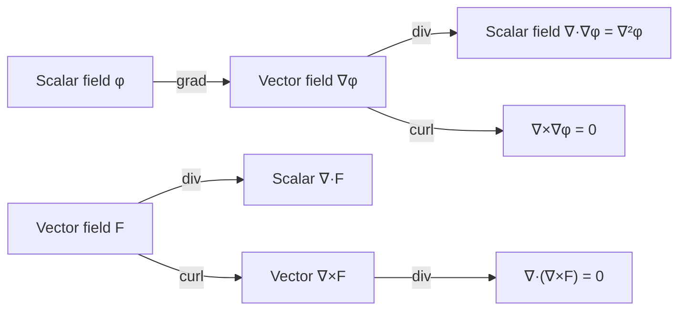

### A6-Q6. Theorem 2: Show $\nabla\times(\phi\mathbf A)=(\nabla\phi)\times\mathbf A+\phi(\nabla\times\mathbf A)$

Write $\nabla\times\mathbf V=\sum\mathbf i\times\dfrac{\partial\mathbf V}{\partial x}$ (sum over $x,y,z$ with the matching unit vector). With $\mathbf V=\phi\mathbf A$ and the product rule,

$$\nabla\times(\phi\mathbf A)=\sum\mathbf i\times\left(\frac{\partial\phi}{\partial x}\mathbf A+\phi\frac{\partial\mathbf A}{\partial x}\right)
=\Big(\sum\mathbf i\frac{\partial\phi}{\partial x}\Big)\times\mathbf A+\phi\sum\mathbf i\times\frac{\partial\mathbf A}{\partial x}.$$

The first bracket is $\nabla\phi$ and the second sum is $\nabla\times\mathbf A$. Hence

$$\nabla\times(\phi\mathbf A)=(\nabla\phi)\times\mathbf A+\phi(\nabla\times\mathbf A).\ \blacksquare$$

**Component check ($\mathbf i$-part):** $\dfrac{\partial(\phi A_3)}{\partial y}-\dfrac{\partial(\phi A_2)}{\partial z}=\Big(\phi_yA_3-\phi_zA_2\Big)+\phi\Big(\dfrac{\partial A_3}{\partial y}-\dfrac{\partial A_2}{\partial z}\Big)$ ✓.

### A6-Q7. Theorem 3: Prove $\nabla\times\nabla\phi=\mathbf 0$ (curl grad $\phi=0$)

Assume $\phi$ has continuous second partial derivatives, so mixed partials are equal.

$$\nabla\times\nabla\phi=\begin{vmatrix}\mathbf i&\mathbf j&\mathbf k\\\partial_x&\partial_y&\partial_z\\\phi_x&\phi_y&\phi_z\end{vmatrix}
=(\phi_{zy}-\phi_{yz})\mathbf i+(\phi_{xz}-\phi_{zx})\mathbf j+(\phi_{yx}-\phi_{xy})\mathbf k=\mathbf 0 .\ \blacksquare$$

Consequence: a gradient field (conservative field) is **irrotational**.

### A6-Q9. Theorem 5: Prove $\nabla\cdot(\mathbf A\times\mathbf B)=\mathbf B\cdot(\nabla\times\mathbf A)-\mathbf A\cdot(\nabla\times\mathbf B)$

Use $\nabla\cdot\mathbf V=\sum\mathbf i\cdot\dfrac{\partial\mathbf V}{\partial x}$ and the product rule:

$$\nabla\cdot(\mathbf A\times\mathbf B)=\sum\mathbf i\cdot\Big(\frac{\partial\mathbf A}{\partial x}\times\mathbf B\Big)+\sum\mathbf i\cdot\Big(\mathbf A\times\frac{\partial\mathbf B}{\partial x}\Big).$$

Use the cyclic property of the scalar triple product on each term:

- $\mathbf i\cdot\big(\tfrac{\partial\mathbf A}{\partial x}\times\mathbf B\big)=\mathbf B\cdot\big(\mathbf i\times\tfrac{\partial\mathbf A}{\partial x}\big)$, and summing gives $\mathbf B\cdot(\nabla\times\mathbf A)$.
- $\mathbf i\cdot\big(\mathbf A\times\tfrac{\partial\mathbf B}{\partial x}\big)=-\,\mathbf i\cdot\big(\tfrac{\partial\mathbf B}{\partial x}\times\mathbf A\big)=-\,\mathbf A\cdot\big(\mathbf i\times\tfrac{\partial\mathbf B}{\partial x}\big)$, and summing gives $-\mathbf A\cdot(\nabla\times\mathbf B)$.

Therefore $\nabla\cdot(\mathbf A\times\mathbf B)=\mathbf B\cdot(\nabla\times\mathbf A)-\mathbf A\cdot(\nabla\times\mathbf B)$. $\blacksquare$

> **Quick revision (A6).** $\nabla=\mathbf i\partial_x+\mathbf j\partial_y+\mathbf k\partial_z$; $\nabla\times(\phi\mathbf A)=\nabla\phi\times\mathbf A+\phi\nabla\times\mathbf A$; $\nabla\times\nabla\phi=\mathbf 0$; $\nabla\cdot(\mathbf A\times\mathbf B)=\mathbf B\cdot\nabla\times\mathbf A-\mathbf A\cdot\nabla\times\mathbf B$.

---
## A7. Green's Theorem

### A7-Q3. Verify Green's theorem for $\oint_C\{(xy+y^2)\,dx+x^2\,dy\}$, $C$ bounded by $y=x$ and $y=x^2$

**Green's theorem.** For a positively oriented (anticlockwise) simple closed curve $C$ enclosing region $R$,

$$\oint_C(P\,dx+Q\,dy)=\iint_R\Big(\frac{\partial Q}{\partial x}-\frac{\partial P}{\partial y}\Big)dx\,dy .$$

Here $P=xy+y^2$ and $Q=x^2$. The curves meet where $x=x^2$, i.e. at $(0,0)$ and $(1,1)$. For $0\le x\le1$ we have $x^2\le y\le x$.

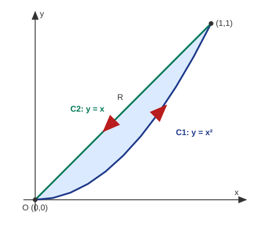

**Part 1: line integral (anticlockwise: out along $y=x^2$, back along $y=x$).**

*Along $C_1:\ y=x^2$, $x:0\to1$* ($dy=2x\,dx$):

$$\int_{C_1}=\int_0^1\big[(x\cdot x^2+x^4)+x^2\cdot2x\big]dx=\int_0^1(3x^3+x^4)\,dx=\frac34+\frac15=\frac{19}{20}.$$

*Along $C_2:\ y=x$, $x:1\to0$* ($dy=dx$):

$$\int_{C_2}=\int_1^0\big[(x^2+x^2)+x^2\big]dx=\int_1^0 3x^2\,dx=-1 .$$

$$\oint_C=\frac{19}{20}-1=-\frac1{20}.$$

**Part 2: double integral.** $\dfrac{\partial Q}{\partial x}-\dfrac{\partial P}{\partial y}=2x-(x+2y)=x-2y$.

$$\iint_R(x-2y)\,dy\,dx=\int_0^1\Big[xy-y^2\Big]_{y=x^2}^{y=x}dx=\int_0^1\big[(x^2-x^2)-(x^3-x^4)\big]dx=-\Big(\frac14-\frac15\Big)=-\frac1{20}.$$

Both sides equal $-\dfrac1{20}$, so **Green's theorem is verified**. $\blacksquare$

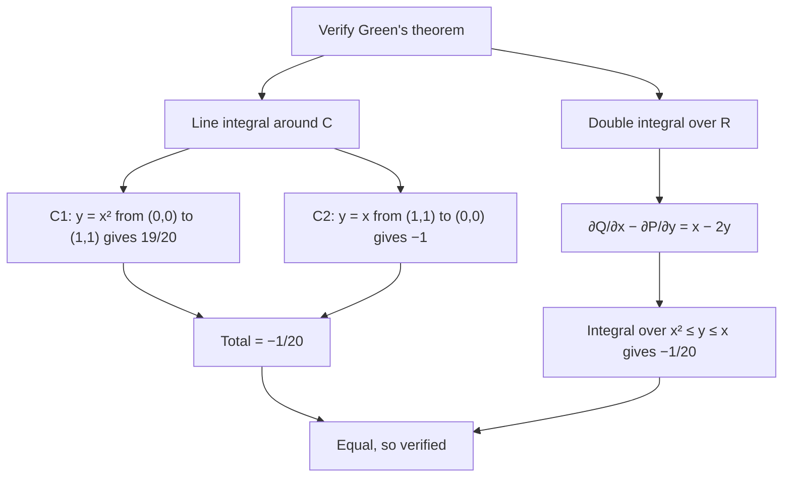

> **Quick revision (A7).** Green: $\oint(P\,dx+Q\,dy)=\iint(Q_x-P_y)\,dA$. Both sides $=-\tfrac1{20}$ for the region between $y=x$ and $y=x^2$.

---

## A8. Gauss Divergence Theorem

### A8-Q1. State and prove Gauss' divergence theorem

**Statement.** Let $V$ be a volume bounded by a closed piecewise-smooth surface $S$ with outward unit normal $\mathbf n$, and let $\mathbf F$ have continuous first partial derivatives. Then

$$\iiint_V\nabla\cdot\mathbf F\,dV=\iint_S\mathbf F\cdot\mathbf n\,dS .$$

**Proof** (for a region that is simple in all three directions). Write $\mathbf F=F_1\mathbf i+F_2\mathbf j+F_3\mathbf k$ and $\mathbf n\,dS$ with direction cosines. It suffices to prove the three separate results

$$\iiint_V\frac{\partial F_1}{\partial x}dV=\iint_SF_1\,\mathbf i\cdot\mathbf n\,dS,\quad
\iiint_V\frac{\partial F_2}{\partial y}dV=\iint_SF_2\,\mathbf j\cdot\mathbf n\,dS,\quad
\iiint_V\frac{\partial F_3}{\partial z}dV=\iint_SF_3\,\mathbf k\cdot\mathbf n\,dS,$$

and add them. We prove the third.

Let the region be bounded below by $S_1:\ z=f_1(x,y)$, above by $S_2:\ z=f_2(x,y)$, and laterally by a cylindrical surface $S_3$ (possibly empty), with projection $R$ on the $xy$-plane.

1. **Left side.**
$$\iiint_V\frac{\partial F_3}{\partial z}dV=\iint_R\Big[\int_{f_1}^{f_2}\frac{\partial F_3}{\partial z}dz\Big]dx\,dy=\iint_R\big[F_3(x,y,f_2)-F_3(x,y,f_1)\big]dx\,dy .$$

2. **Right side, upper surface $S_2$.** Here $\mathbf k\cdot\mathbf n>0$ and $\mathbf k\cdot\mathbf n\,dS=dx\,dy$, so $\iint_{S_2}F_3\,\mathbf k\cdot\mathbf n\,dS=\iint_RF_3(x,y,f_2)\,dx\,dy$.

3. **Lower surface $S_1$.** Here $\mathbf k\cdot\mathbf n<0$ and $\mathbf k\cdot\mathbf n\,dS=-dx\,dy$, so $\iint_{S_1}F_3\,\mathbf k\cdot\mathbf n\,dS=-\iint_RF_3(x,y,f_1)\,dx\,dy$.

4. **Lateral surface $S_3$.** $\mathbf n$ is horizontal, so $\mathbf k\cdot\mathbf n=0$ and the contribution is $0$.

Adding steps 2, 3, 4 equals step 1. Repeating for $F_1$ (projecting on the $yz$-plane) and $F_2$ (projecting on the $zx$-plane) and adding gives the theorem. $\blacksquare$

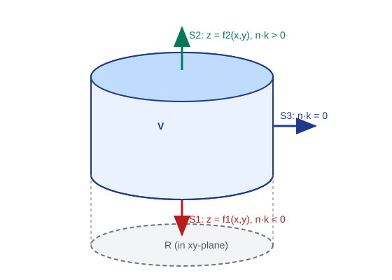

| Theorem | Relates | Dimension drop |
| --- | --- | --- |
| Green (plane) | $\oint_C$ and $\iint_R$ | line $\leftrightarrow$ area |
| Stokes | $\oint_C$ and $\iint_S(\nabla\times\mathbf F)\cdot\mathbf n\,dS$ | line $\leftrightarrow$ surface |
| Gauss | $\iint_S$ and $\iiint_V\nabla\cdot\mathbf F\,dV$ | surface $\leftrightarrow$ volume |

### A8-Q3. Evaluate $\iint_S\mathbf F\cdot\mathbf n\,dS$ for $\mathbf F=ax\mathbf i+by\mathbf j+cz\mathbf k$, $S:\ x^2+y^2+z^2=1$

**Method 1 (divergence theorem).**

$$\nabla\cdot\mathbf F=a+b+c,\qquad \iint_S\mathbf F\cdot\mathbf n\,dS=\iiint_V(a+b+c)\,dV=(a+b+c)\cdot\frac{4}{3}\pi(1)^3 .$$

**Method 2 (direct check).** On the unit sphere $\mathbf n=x\mathbf i+y\mathbf j+z\mathbf k$, so $\mathbf F\cdot\mathbf n=ax^2+by^2+cz^2$. By symmetry $\iint_Sx^2dS=\iint_Sy^2dS=\iint_Sz^2dS=\tfrac13\iint_S(x^2+y^2+z^2)\,dS=\tfrac13(4\pi)$. Hence the integral is $\tfrac{4\pi}{3}(a+b+c)$, the same.

$$\boxed{\iint_S\mathbf F\cdot\mathbf n\,dS=\frac{4\pi}{3}(a+b+c)}$$

> **Quick revision (A8).** $\iint_S\mathbf F\cdot\mathbf n\,dS=\iiint_V\nabla\cdot\mathbf F\,dV$; proof by splitting into $F_1,F_2,F_3$ and integrating $\partial F_3/\partial z$ between lower and upper surfaces.

---

## A9. Vector Integrals

### A9-Q1. Volume integral of a vector function

Let $\mathbf F(x,y,z)=F_1\mathbf i+F_2\mathbf j+F_3\mathbf k$ be defined in a volume $V$. Divide $V$ into small cells $\Delta V_k$, form $\sum\mathbf F(P_k)\Delta V_k$ and take the limit as $\max\Delta V_k\to0$:

$$\iiint_V\mathbf F\,dV=\mathbf i\iiint_VF_1\,dx\,dy\,dz+\mathbf j\iiint_VF_2\,dx\,dy\,dz+\mathbf k\iiint_VF_3\,dx\,dy\,dz .$$

The result is a **vector** whose components are ordinary triple integrals.

### A9-Q2. Line integral of a continuous vector function along $C$ from $A$ to $B$

Divide the curve $C$ into $n$ small arcs with displacement vectors $\Delta\mathbf R_k$ and pick a point $\mathbf R_k$ on each. Then

$$\int_C\mathbf F(\mathbf R)\cdot d\mathbf R=\lim_{n\to\infty}\sum_{k=1}^n\mathbf F(\mathbf R_k)\cdot\Delta\mathbf R_k .$$

In Cartesian form, with $d\mathbf R=dx\,\mathbf i+dy\,\mathbf j+dz\,\mathbf k$,

$$\int_C\mathbf F\cdot d\mathbf R=\int_C(F_1\,dx+F_2\,dy+F_3\,dz).$$

If $C$ is parametrised by $\mathbf R(t)$, $t_1\le t\le t_2$, then

$$\int_C\mathbf F\cdot d\mathbf R=\int_{t_1}^{t_2}\mathbf F(\mathbf R(t))\cdot\frac{d\mathbf R}{dt}\,dt .$$

**Properties.** Reversing the direction changes the sign; the integral is additive over sub-arcs; if $\mathbf F=\nabla\phi$ it equals $\phi(B)-\phi(A)$ and is independent of the path.

> **Quick revision (A9).** Volume integral of $\mathbf F$ = vector of three triple integrals. Line integral $=\int F_1dx+F_2dy+F_3dz=\int\mathbf F\cdot\mathbf R'(t)\,dt$.

---

# Part B: Complex Variables

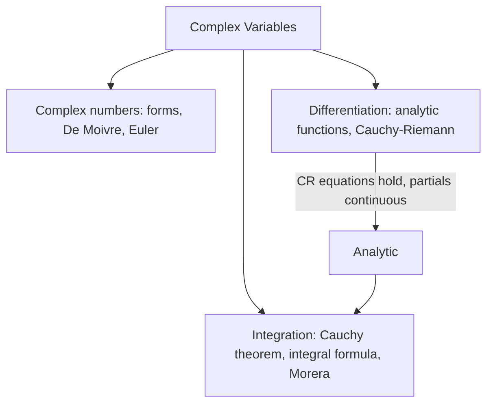

---

## B1. Complex Numbers

### B1-Q2. Prove $\lvert z_1+z_2\rvert\le\lvert z_1\rvert+\lvert z_2\rvert$; hence $\lvert z_1-z_2\rvert\le\lvert z_1\rvert+\lvert z_2\rvert$

Use $\lvert z\rvert^2=z\bar z$.

$$\lvert z_1+z_2\rvert^2=(z_1+z_2)(\bar z_1+\bar z_2)=\lvert z_1\rvert^2+\lvert z_2\rvert^2+z_1\bar z_2+\bar z_1z_2 .$$

The last two terms are conjugates, so their sum is $2\operatorname{Re}(z_1\bar z_2)\le2\lvert z_1\bar z_2\rvert=2\lvert z_1\rvert\lvert z_2\rvert$. Therefore

$$\lvert z_1+z_2\rvert^2\le\lvert z_1\rvert^2+2\lvert z_1\rvert\lvert z_2\rvert+\lvert z_2\rvert^2=(\lvert z_1\rvert+\lvert z_2\rvert)^2 ,$$

and taking square roots gives the triangle inequality. $\blacksquare$

**Hence:** replace $z_2$ by $-z_2$ and use $\lvert-z_2\rvert=\lvert z_2\rvert$:

$$\lvert z_1-z_2\rvert=\lvert z_1+(-z_2)\rvert\le\lvert z_1\rvert+\lvert z_2\rvert. \ \blacksquare$$

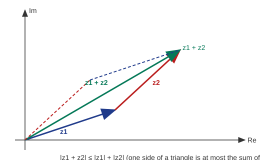

### B1-Q3. Prove $\lvert z_1-z_2\rvert\ge\lvert z_1\rvert-\lvert z_2\rvert$

Write $z_1=(z_1-z_2)+z_2$ and apply the triangle inequality:

$$\lvert z_1\rvert\le\lvert z_1-z_2\rvert+\lvert z_2\rvert\ \Rightarrow\ \lvert z_1-z_2\rvert\ge\lvert z_1\rvert-\lvert z_2\rvert .\ \blacksquare$$

(Interchanging $z_1,z_2$ gives the stronger form $\lvert z_1-z_2\rvert\ge\big\lvert\lvert z_1\rvert-\lvert z_2\rvert\big\rvert$.)

### B1-Q4. Modulus of the quotient of two conjugate complex numbers is 1

Let $z=x+iy\ne0$, so $\bar z=x-iy$. Then

$$\Big\lvert\frac{z}{\bar z}\Big\rvert=\frac{\lvert z\rvert}{\lvert\bar z\rvert}=\frac{\sqrt{x^2+y^2}}{\sqrt{x^2+(-y)^2}}=1 .\ \blacksquare$$

### B1-Q5. Show $\lvert z\rvert=\lvert\bar z\rvert$ and $\operatorname{Arg}(z)=-\operatorname{Arg}(\bar z)$

Let $z=r(\cos\theta+i\sin\theta)$ with $r=\lvert z\rvert$, $\theta=\operatorname{Arg}z$. Then

$$\bar z=r(\cos\theta-i\sin\theta)=r\big(\cos(-\theta)+i\sin(-\theta)\big).$$

So $\lvert\bar z\rvert=r=\lvert z\rvert$ and $\operatorname{Arg}\bar z=-\theta$, i.e. $\operatorname{Arg}z=-\operatorname{Arg}\bar z$ (for $z$ not on the negative real axis; on it both arguments equal $\pi$ in the principal range, and the relation holds modulo $2\pi$). $\blacksquare$

### B1-Q6. State and prove De Moivre's theorem

**Statement.** For every integer $n$,

$$(\cos\theta+i\sin\theta)^n=\cos n\theta+i\sin n\theta .$$

**Proof.**

1. *$n\ge1$ by induction.* $n=1$ is trivial. Assume true for $n=m$. Then, using B1-Q7(a),
$$(\cos\theta+i\sin\theta)^{m+1}=(\cos m\theta+i\sin m\theta)(\cos\theta+i\sin\theta)=\cos(m+1)\theta+i\sin(m+1)\theta .$$
2. *$n=0$:* both sides equal $1$.
3. *$n=-m<0$:*
$$(\cos\theta+i\sin\theta)^{-m}=\frac{1}{\cos m\theta+i\sin m\theta}=\cos m\theta-i\sin m\theta=\cos(-m\theta)+i\sin(-m\theta).\ \blacksquare$$

### B1-Q7. Product and quotient in polar form

Let $z_1=r_1(\cos\theta_1+i\sin\theta_1)$, $z_2=r_2(\cos\theta_2+i\sin\theta_2)$.

**(a) Product.**

$$z_1z_2=r_1r_2\big[(\cos\theta_1\cos\theta_2-\sin\theta_1\sin\theta_2)+i(\sin\theta_1\cos\theta_2+\cos\theta_1\sin\theta_2)\big]=r_1r_2\{\cos(\theta_1+\theta_2)+i\sin(\theta_1+\theta_2)\}.$$

**(b) Quotient.** Multiply numerator and denominator by the conjugate of $z_2$:

$$\frac{z_1}{z_2}=\frac{r_1(\cos\theta_1+i\sin\theta_1)(\cos\theta_2-i\sin\theta_2)}{r_2(\cos^2\theta_2+\sin^2\theta_2)}=\frac{r_1}{r_2}\{\cos(\theta_1-\theta_2)+i\sin(\theta_1-\theta_2)\}.\ \blacksquare$$

| Operation | Modulus | Argument |
| --- | --- | --- |
| $z_1z_2$ | multiply: $r_1r_2$ | add: $\theta_1+\theta_2$ |
| $z_1/z_2$ | divide: $r_1/r_2$ | subtract: $\theta_1-\theta_2$ |
| $z^n$ | $r^n$ | $n\theta$ |

### B1-Q8. Derive Euler's formula $e^{i\theta}=\cos\theta+i\sin\theta$

The series (absolutely convergent for all complex arguments)

$$e^x=\sum_{n=0}^\infty\frac{x^n}{n!},\quad \cos\theta=\sum_{k=0}^\infty\frac{(-1)^k\theta^{2k}}{(2k)!},\quad \sin\theta=\sum_{k=0}^\infty\frac{(-1)^k\theta^{2k+1}}{(2k+1)!}.$$

Put $x=i\theta$ and use $i^0=1,\ i^1=i,\ i^2=-1,\ i^3=-i$ (period 4):

$$e^{i\theta}=1+i\theta-\frac{\theta^2}{2!}-i\frac{\theta^3}{3!}+\frac{\theta^4}{4!}+i\frac{\theta^5}{5!}-\cdots$$

Group real and imaginary parts (allowed by absolute convergence):

$$e^{i\theta}=\Big(1-\frac{\theta^2}{2!}+\frac{\theta^4}{4!}-\cdots\Big)+i\Big(\theta-\frac{\theta^3}{3!}+\frac{\theta^5}{5!}-\cdots\Big)=\cos\theta+i\sin\theta .\ \blacksquare$$

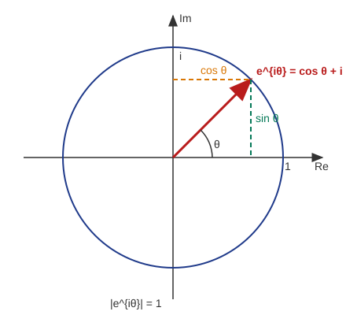

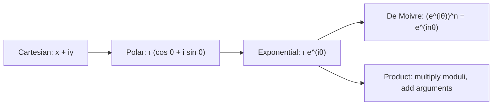

### B1-Q9. Prove the identities

*(The source text lost the superscripts; the identities are for $\sin^3\theta$ and $\cos^4\theta$.)*

Let $z=e^{i\theta}$, so $\sin\theta=\dfrac{z-z^{-1}}{2i}$, $\cos\theta=\dfrac{z+z^{-1}}{2}$, $z^n-z^{-n}=2i\sin n\theta$, $z^n+z^{-n}=2\cos n\theta$.

**(a) $\sin^3\theta=\tfrac34\sin\theta-\tfrac14\sin3\theta$.**

$$\sin^3\theta=\frac{(z-z^{-1})^3}{(2i)^3}=\frac{z^3-3z+3z^{-1}-z^{-3}}{-8i}=-\frac{1}{8i}\Big[(z^3-z^{-3})-3(z-z^{-1})\Big]$$

$$=-\frac1{8i}\big[2i\sin3\theta-6i\sin\theta\big]=-\frac14\sin3\theta+\frac34\sin\theta .\ \blacksquare$$

**(b) $\cos^4\theta=\tfrac18\cos4\theta+\tfrac12\cos2\theta+\tfrac38$.**

$$\cos^4\theta=\frac{(z+z^{-1})^4}{16}=\frac{z^4+4z^2+6+4z^{-2}+z^{-4}}{16}=\frac{2\cos4\theta+8\cos2\theta+6}{16}=\frac18\cos4\theta+\frac12\cos2\theta+\frac38 .\ \blacksquare$$

> **Quick revision (B1).** Triangle inequality via $\lvert z\rvert^2=z\bar z$; $\lvert z\rvert=\lvert\bar z\rvert$, $\arg\bar z=-\arg z$; multiplication adds arguments; De Moivre $(\cos\theta+i\sin\theta)^n=\cos n\theta+i\sin n\theta$; Euler $e^{i\theta}=\cos\theta+i\sin\theta$; power reduction uses $z=e^{i\theta}$.

---

## B2. Complex Differentiation and Cauchy-Riemann Equations

### B2-Q13. State and prove the necessary conditions for $f(z)=u+iv$ to be analytic (Cauchy-Riemann equations)

**Theorem.** If $f(z)=u(x,y)+iv(x,y)$ is differentiable at $z_0=x_0+iy_0$, then $u_x,u_y,v_x,v_y$ exist at $(x_0,y_0)$ and

$$\boxed{u_x=v_y,\qquad u_y=-v_x}$$

**Proof.** By hypothesis the limit $f'(z_0)=\lim_{\Delta z\to0}\dfrac{f(z_0+\Delta z)-f(z_0)}{\Delta z}$ exists and is the same along every path.

*Path 1: $\Delta z=\Delta x$ (real).*

$$f'(z_0)=\lim_{\Delta x\to0}\Big[\frac{u(x_0+\Delta x,y_0)-u(x_0,y_0)}{\Delta x}+i\frac{v(x_0+\Delta x,y_0)-v(x_0,y_0)}{\Delta x}\Big]=u_x+iv_x .$$

*Path 2: $\Delta z=i\Delta y$ (imaginary).*

$$f'(z_0)=\lim_{\Delta y\to0}\frac{[u(x_0,y_0+\Delta y)-u(x_0,y_0)]+i[v(x_0,y_0+\Delta y)-v(x_0,y_0)]}{i\Delta y}=\frac{u_y+iv_y}{i}=v_y-iu_y .$$

Equating the two values: $u_x+iv_x=v_y-iu_y$. Real parts give $u_x=v_y$; imaginary parts give $v_x=-u_y$. $\blacksquare$

**Sufficiency (statement).** If $u,v$ have continuous first partial derivatives in a neighbourhood of $z_0$ and satisfy the CR equations there, then $f$ is differentiable at $z_0$. $f$ is **analytic** in a domain when it is differentiable at every point of an open set in it.

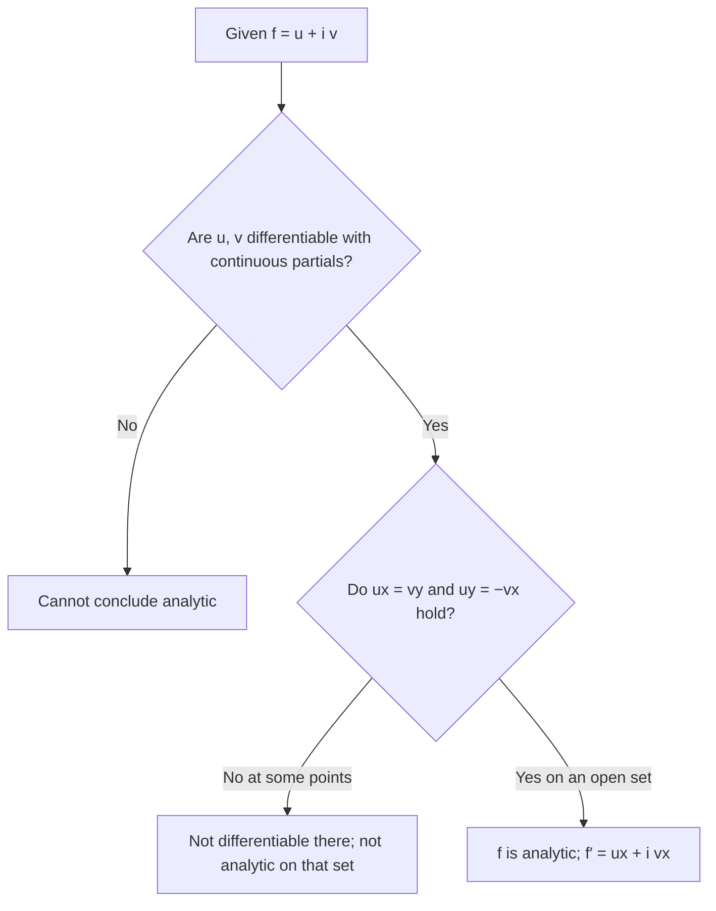

### B2-Q14. State and prove the Cauchy-Riemann equations in polar form

**Statement.** For $z=re^{i\theta}$ and $f=u(r,\theta)+iv(r,\theta)$ differentiable at $z_0\ne0$:

$$\boxed{u_r=\frac1r\,v_\theta,\qquad v_r=-\frac1r\,u_\theta}$$

**Proof.** Take the limit of the difference quotient along two paths.

*Radial path:* $\Delta z=e^{i\theta}\Delta r$, with $\theta$ fixed.

$$f'(z_0)=\lim_{\Delta r\to0}\frac{\Delta u+i\Delta v}{e^{i\theta}\Delta r}=e^{-i\theta}(u_r+iv_r).$$

*Angular path:* $\Delta z\approx ire^{i\theta}\Delta\theta$, with $r$ fixed.

$$f'(z_0)=\lim_{\Delta\theta\to0}\frac{\Delta u+i\Delta v}{ire^{i\theta}\Delta\theta}=\frac{u_\theta+iv_\theta}{ire^{i\theta}}=\frac{e^{-i\theta}}{r}(v_\theta-iu_\theta).$$

Equating: $u_r+iv_r=\dfrac1r(v_\theta-iu_\theta)$. Real parts: $u_r=v_\theta/r$. Imaginary parts: $v_r=-u_\theta/r$. $\blacksquare$

Also $f'(z)=e^{-i\theta}(u_r+iv_r)$.

| Form | Equations |
| --- | --- |
| Cartesian | $u_x=v_y,\ \ u_y=-v_x$ |
| Polar | $u_r=\dfrac{v_\theta}{r},\ \ v_r=-\dfrac{u_\theta}{r}$ |

### B2-Q15. Prove that every differentiable function is continuous

Suppose $f$ is differentiable at $z_0$. For $z\ne z_0$,

$$f(z)-f(z_0)=\frac{f(z)-f(z_0)}{z-z_0}\,(z-z_0).$$

Taking $z\to z_0$: $\lim[f(z)-f(z_0)]=f'(z_0)\cdot0=0$. Hence $\lim_{z\to z_0}f(z)=f(z_0)$, i.e. $f$ is continuous at $z_0$. $\blacksquare$

(The converse is false: $f(z)=\bar z$ is continuous everywhere and differentiable nowhere.)

### B2-Q17. Show $f(z)=xy+iy$ is everywhere continuous but not analytic

Here $u=xy$, $v=y$.

**Continuity.** $u$ and $v$ are polynomials in $x,y$, hence continuous everywhere, so $f$ is continuous everywhere.

**Not analytic.** $u_x=y,\ u_y=x,\ v_x=0,\ v_y=1$. The CR equations require $y=1$ (from $u_x=v_y$) and $x=0$ (from $u_y=-v_x$). They hold only at the single point $(0,1)$, and in no open neighbourhood. Hence $f$ is analytic at **no** point. $\blacksquare$

### B2-Q18. Prove $u=2x(1-y)$ is harmonic; find $v$ so that $f=u+iv$ is analytic; express $f(z)$

$u=2x-2xy$.

**Harmonic:** $u_x=2-2y,\ u_{xx}=0$; $u_y=-2x,\ u_{yy}=0$. So $u_{xx}+u_{yy}=0$. $\blacksquare$

**Find $v$** using CR:

1. $v_y=u_x=2-2y\ \Rightarrow\ v=2y-y^2+g(x)$.
2. $v_x=-u_y=2x\ \Rightarrow\ g'(x)=2x\ \Rightarrow\ g=x^2+c$.

$$v=x^2-y^2+2y+c .$$

**Express in $z$.**

$$f=(2x-2xy)+i(x^2-y^2+2y)+ic .$$

Since $iz^2=i(x^2-y^2)-2xy$ and $2z=2x+2iy$, we get $2z+iz^2=(2x-2xy)+i(x^2-y^2+2y)$. Hence

$$\boxed{f(z)=iz^2+2z+ic}$$

### B2-Q19. $f(z)=\dfrac{(x^3-3xy^2)+i(y^3-3x^2y)}{x^2+y^2}\ (z\ne0),\ f(0)=0$: continuous, CR holds at $0$, not differentiable at $0$

In polar form, $x=r\cos\theta$, $y=r\sin\theta$:

$$u=r\cos3\theta,\qquad v=r(\sin^3\theta-3\cos^2\theta\sin\theta)=-r\sin3\theta,\qquad\text{so } f=re^{-3i\theta}\ (z\ne0).$$

**(i) Continuity at $0$.** $\lvert f(z)\rvert=r\to0=f(0)$. $\blacksquare$

**(ii) CR equations at $0$** (from the definition of partial derivatives, using $u(h,0)=h$, $u(0,k)=0$, $v(h,0)=0$, $v(0,k)=k$):

$$u_x(0,0)=\lim_{h\to0}\frac{h-0}{h}=1,\quad v_y(0,0)=\lim_{k\to0}\frac{k-0}{k}=1,\quad u_y(0,0)=\lim_{k\to0}\frac{0}{k}=0,\quad v_x(0,0)=\lim_{h\to0}\frac0h=0 .$$

So $u_x=v_y=1$ and $u_y=-v_x=0$: CR holds. $\blacksquare$

**(iii) Not differentiable at $0$.**

$$\frac{f(z)-f(0)}{z-0}=\frac{re^{-3i\theta}}{re^{i\theta}}=e^{-4i\theta}.$$

Along the real axis ($\theta=0$) it equals $1$; along $y=x$ ($\theta=\pi/4$) it equals $e^{-i\pi}=-1$. The limit depends on the path, so $f'(0)$ does not exist. $\blacksquare$

**Moral:** CR equations are *necessary* but not *sufficient* without continuity of the partial derivatives.

### B2-Q21. Show $f(z)=x^2+iy^3$ is nowhere analytic, but CR holds at the origin

$u=x^2,\ v=y^3$: $u_x=2x,\ u_y=0,\ v_x=0,\ v_y=3y^2$.

- CR requires $2x=3y^2$ and $0=0$. So CR holds exactly on the parabola $2x=3y^2$, which contains $(0,0)$ (since $0=0$). $\blacksquare$
- The parabola contains **no open disc**, so there is no neighbourhood of any point where $f$ is differentiable. Hence $f$ is **analytic nowhere**.
- Since the partials are continuous, $f$ is differentiable *at* each point of the parabola (including $z=0$), but analyticity needs differentiability in a neighbourhood.

| Concept | Meaning | $f=x^2+iy^3$ |
| --- | --- | --- |
| Differentiable at $z_0$ | $f'(z_0)$ exists | only on $2x=3y^2$ |
| Analytic at $z_0$ | differentiable in a whole disc about $z_0$ | nowhere |

> **Quick revision (B2).** CR: $u_x=v_y,\ u_y=-v_x$ (polar: $u_r=v_\theta/r,\ v_r=-u_\theta/r$); differentiable $\Rightarrow$ continuous; harmonic $u$ gives $v$ by integrating CR; analytic needs CR on an **open set** with continuous partials.

---

## B3. Complex Integration and Cauchy's Theorem

### B3-Q22. Define the complex line integral and the winding number $n(\gamma,z)$

**Complex line integral.** For a piecewise-smooth path $\gamma:[a,b]\to\mathbb C$ and $f$ continuous on $\gamma$,

$$\int_\gamma f(z)\,dz=\int_a^bf(\gamma(t))\,\gamma'(t)\,dt=\int_\gamma(u\,dx-v\,dy)+i\int_\gamma(v\,dx+u\,dy).$$

**Winding number.** For a closed path $\gamma$ and a point $z\notin\gamma$,

$$n(\gamma,z)=\frac1{2\pi i}\oint_\gamma\frac{dw}{w-z}.$$

It is an integer counting how many times $\gamma$ winds anticlockwise around $z$.

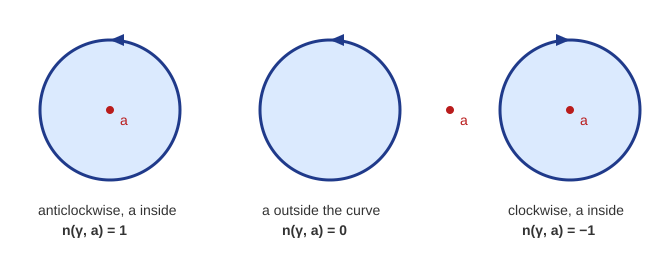

### B3-Q23. Properties of winding numbers

1. $n(\gamma,z)$ is an **integer**.
2. It is **constant** on each connected component of $\mathbb C\setminus\gamma$.
3. It is **zero** on the unbounded component (for $z$ far outside).
4. $n(-\gamma,z)=-n(\gamma,z)$ (reversing direction reverses the sign).
5. For a positively oriented circle $\lvert w-a\rvert=r$: $n=1$ if $\lvert z-a\rvert<r$, and $n=0$ if $\lvert z-a\rvert>r$.
6. If $\gamma=\gamma_1+\gamma_2$ (closed paths joined), $n(\gamma,z)=n(\gamma_1,z)+n(\gamma_2,z)$.
7. It is invariant under homotopy that does not cross $z$.

### B3-Q24. State and prove Cauchy's theorem

**Statement.** If $f$ is analytic in a simply connected domain $D$ and $\gamma$ is a closed piecewise-smooth curve in $D$, then

$$\oint_\gamma f(z)\,dz=0 .$$

**Proof** (assuming $f'$ continuous, via Green's theorem). With $f=u+iv$,

$$\oint_\gamma f\,dz=\oint_\gamma(u\,dx-v\,dy)+i\oint_\gamma(v\,dx+u\,dy).$$

Apply Green's theorem to each real integral over the region $R$ enclosed by $\gamma$:

$$\oint_\gamma f\,dz=\iint_R(-v_x-u_y)\,dx\,dy+i\iint_R(u_x-v_y)\,dx\,dy .$$

By the Cauchy-Riemann equations $u_x=v_y$ and $u_y=-v_x$, both integrands vanish. Hence $\oint_\gamma f\,dz=0$. $\blacksquare$

*(Goursat's proof removes the assumption that $f'$ is continuous by subdividing into triangles; the conclusion is the same.)*

### B3-Q25. State and prove Cauchy's integral formula for the derivative

**Statement.** Let $f$ be analytic inside and on a simple closed contour $C$ (anticlockwise) and $a$ be inside $C$. Then $f$ has derivatives of all orders and

$$f^{(n)}(a)=\frac{n!}{2\pi i}\oint_C\frac{f(z)}{(z-a)^{n+1}}\,dz,\qquad n=0,1,2,\dots$$

**Proof.**

*Step 0 (Cauchy's integral formula, $n=0$).* Deform $C$ to a small circle $\lvert z-a\rvert=\varepsilon$ (Cauchy's theorem for the region between). On it, $z-a=\varepsilon e^{i\theta}$, so $\oint\dfrac{dz}{z-a}=2\pi i$ and

$$\oint_C\frac{f(z)}{z-a}\,dz=f(a)\oint\frac{dz}{z-a}+\oint\frac{f(z)-f(a)}{z-a}\,dz=2\pi if(a)+0,$$

because $\big\lvert\oint\frac{f(z)-f(a)}{z-a}dz\big\rvert\le2\pi\max_{\lvert z-a\rvert=\varepsilon}\lvert f(z)-f(a)\rvert\to0$ as $\varepsilon\to0$. Hence $f(a)=\dfrac1{2\pi i}\oint_C\dfrac{f(z)}{z-a}\,dz$.

*Step 1 ($n=1$).* For small $h$ (with $a+h$ inside $C$),

$$\frac{f(a+h)-f(a)}{h}=\frac1{2\pi i}\oint_C\frac{f(z)}{(z-a-h)(z-a)}\,dz .$$

Subtract $\dfrac1{2\pi i}\oint_C\dfrac{f(z)}{(z-a)^2}dz$:

$$\frac{f(a+h)-f(a)}{h}-\frac1{2\pi i}\oint_C\frac{f(z)}{(z-a)^2}dz=\frac{h}{2\pi i}\oint_C\frac{f(z)}{(z-a-h)(z-a)^2}\,dz .$$

Let $d=$ the distance from $a$ to $C$, $\lvert h\rvert<d/2$, $\lvert f\rvert\le M$ on $C$, and $L$ the length of $C$. Then $\lvert z-a\rvert\ge d$ and $\lvert z-a-h\rvert\ge d/2$, so the right side has modulus at most

$$\frac{\lvert h\rvert}{2\pi}\cdot\frac{M\,L}{(d/2)\,d^2}\to0\quad(h\to0).$$

Hence $f'(a)=\dfrac1{2\pi i}\oint_C\dfrac{f(z)}{(z-a)^2}dz$.

*Step 2 (general $n$).* Repeat the same argument on the formula for $f^{(n-1)}$ (induction), which produces the factor $n$ each time, giving $f^{(n)}(a)=\dfrac{n!}{2\pi i}\oint_C\dfrac{f(z)}{(z-a)^{n+1}}dz$. $\blacksquare$

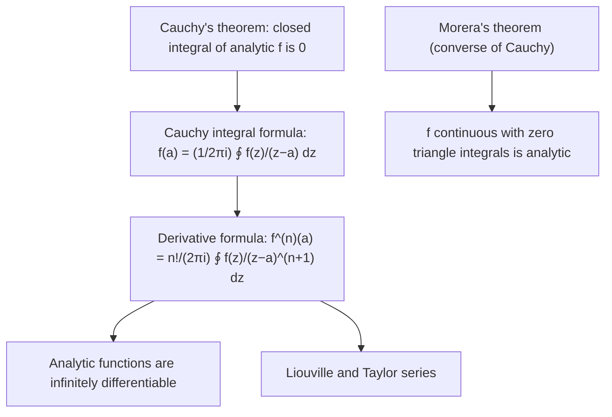

### B3-Q27. Evaluate $\oint_C\dfrac{dz}{z(z-4)^2}$, $C:\ \lvert z\rvert=1$ anticlockwise

The singularities are $z=0$ (inside $C$) and $z=4$ (outside, since $\lvert4\rvert>1$). Write

$$\oint_C\frac{1/(z-4)^2}{z-0}\,dz,\qquad g(z)=\frac1{(z-4)^2}\ \text{analytic inside and on }C .$$

By Cauchy's integral formula, $\oint_C\dfrac{g(z)}{z}dz=2\pi i\,g(0)=2\pi i\cdot\dfrac1{16}$.

$$\boxed{\oint_C\frac{dz}{z(z-4)^2}=\frac{\pi i}{8}}$$

### B3-Q28. ⚠ Show $\oint_C\dfrac{e^{tz}}{z^2+1}\,dz=2\pi i\sin t$, $C:\ \lvert z\rvert=3$, $t>0$

**Note.** The source prints the integrand as $e^{itz}/(z^2+1)$, which does **not** give $2\pi i\sin t$ (see "printed form" below). The standard textbook result is for $e^{tz}$.

The poles are $z=\pm i$, both inside $\lvert z\rvert=3$. Use partial fractions:

$$\frac1{z^2+1}=\frac1{2i}\Big[\frac1{z-i}-\frac1{z+i}\Big].$$

By Cauchy's integral formula,

$$\oint_C\frac{e^{tz}}{z^2+1}dz=\frac1{2i}\Big[2\pi i\,e^{it}-2\pi i\,e^{-it}\Big]=\pi\big(e^{it}-e^{-it}\big)=\pi\cdot2i\sin t .$$

$$\boxed{\oint_C\frac{e^{tz}}{z^2+1}dz=2\pi i\sin t}\ \blacksquare$$

**Printed form $e^{itz}$.** Same method: values at $z=i$ and $z=-i$ are $e^{it\cdot i}=e^{-t}$ and $e^{it\cdot(-i)}=e^{t}$, so

$$\oint_C\frac{e^{itz}}{z^2+1}dz=\frac1{2i}\big[2\pi i\,e^{-t}-2\pi i\,e^{t}\big]=\pi(e^{-t}-e^{t})=-2\pi\sinh t .$$

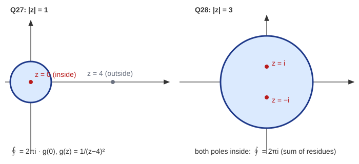

### B3-Q29. State and prove Morera's theorem

**Statement.** If $f$ is continuous in a domain $D$ and $\oint_{\partial\Delta}f\,dz=0$ for every triangle $\Delta$ lying in $D$ (with its interior), then $f$ is analytic in $D$.

**Proof.** Analyticity is local, so fix a disc $B\subset D$ with centre $z_0$. Define

$$F(z)=\int_{[z_0,z]}f(w)\,dw\qquad(z\in B),$$

the integral along the straight segment.

1. For $z$ and $z+h$ in $B$, the triangle with vertices $z_0,z,z+h$ lies in $B$, so by hypothesis
$$F(z+h)-F(z)=\int_{[z,z+h]}f(w)\,dw .$$
2. Since $\displaystyle\int_{[z,z+h]}dw=h$,
$$\frac{F(z+h)-F(z)}{h}-f(z)=\frac1h\int_{[z,z+h]}\big(f(w)-f(z)\big)dw,$$
whose modulus is at most $\displaystyle\max_{\lvert w-z\rvert\le\lvert h\rvert}\lvert f(w)-f(z)\rvert\to0$ as $h\to0$, by continuity of $f$.
3. So $F'(z)=f(z)$; $F$ is analytic in $B$. By Cauchy's formula for derivatives, an analytic function has analytic derivatives of every order, so $f=F'$ is analytic in $B$. As $B$ was arbitrary, $f$ is analytic in $D$. $\blacksquare$

| Cauchy's theorem | Morera's theorem |
| --- | --- |
| Analytic $\Rightarrow$ closed integrals vanish | Continuous with vanishing triangle integrals $\Rightarrow$ analytic |
| Needs analyticity | Needs only continuity plus integral condition |
| Forward direction | Converse |

> **Quick revision (B3).** $n(\gamma,z)=\frac1{2\pi i}\oint\frac{dw}{w-z}\in\mathbb Z$; Cauchy: $\oint f=0$; CIF: $f^{(n)}(a)=\frac{n!}{2\pi i}\oint\frac{f}{(z-a)^{n+1}}$; $\oint\frac{dz}{z(z-4)^2}=\frac{\pi i}8$; $\oint\frac{e^{tz}}{z^2+1}dz=2\pi i\sin t$; Morera is the converse of Cauchy.

---
# Part C: Laplace Transform

**Definition.** For $F(t)$ defined for $t\ge0$,

$$\mathcal L\{F(t)\}=f(s)=\int_0^\infty e^{-st}F(t)\,dt,$$

provided the integral converges (e.g. $F$ piecewise continuous and of exponential order).

## C1. Laplace Transform of Basic Functions

**(a) $F(t)=1$.**

$$\mathcal L\{1\}=\int_0^\infty e^{-st}dt=\Big[-\frac{e^{-st}}{s}\Big]_0^\infty=\frac1s\qquad(s>0).$$

**(d) $F(t)=\cos at$ and (e) $F(t)=\sin at$.** Use $e^{iat}=\cos at+i\sin at$ and $\mathcal L\{e^{kt}\}=\dfrac1{s-k}$ (valid for complex $k$ with $s>\operatorname{Re}k$):

$$\mathcal L\{e^{iat}\}=\frac1{s-ia}=\frac{s+ia}{s^2+a^2}=\frac{s}{s^2+a^2}+i\frac{a}{s^2+a^2}.$$

Equating real and imaginary parts (since $a,s$ real):

$$\boxed{\mathcal L\{\cos at\}=\frac{s}{s^2+a^2},\qquad\mathcal L\{\sin at\}=\frac{a}{s^2+a^2}}\qquad(s>0).$$

## C2. Prove (ii) $\mathcal L\{\sinh at\}=\dfrac{a}{s^2-a^2}$

$$\sinh at=\frac{e^{at}-e^{-at}}2\ \Rightarrow\ \mathcal L\{\sinh at\}=\frac12\Big[\frac1{s-a}-\frac1{s+a}\Big]=\frac12\cdot\frac{2a}{s^2-a^2}=\frac{a}{s^2-a^2}\qquad(s>\lvert a\rvert).\ \blacksquare$$

## C3. Properties

### Property 1 (change of scale). If $\mathcal L\{F(t)\}=f(s)$, show $\mathcal L\{F(at)\}=\dfrac1af\!\left(\dfrac sa\right)$, $a>0$

$$\mathcal L\{F(at)\}=\int_0^\infty e^{-st}F(at)\,dt .$$

Put $u=at$, $dt=du/a$:

$$=\frac1a\int_0^\infty e^{-(s/a)u}F(u)\,du=\frac1af\Big(\frac sa\Big).\ \blacksquare$$

### Property 2 (first shifting theorem). If $\mathcal L\{F(t)\}=f(s)$, show $\mathcal L\{e^{at}F(t)\}=f(s-a)$

$$\mathcal L\{e^{at}F(t)\}=\int_0^\infty e^{-st}e^{at}F(t)\,dt=\int_0^\infty e^{-(s-a)t}F(t)\,dt=f(s-a).\ \blacksquare$$

## C4. Evaluate

### Q1. $\mathcal L\{e^{-t}\cos2t\}$

$\mathcal L\{\cos2t\}=\dfrac{s}{s^2+4}$. Shift $s\to s+1$:

$$\boxed{\mathcal L\{e^{-t}\cos2t\}=\frac{s+1}{(s+1)^2+4}=\frac{s+1}{s^2+2s+5}}$$

### Q3. $\mathcal L\{5t^2-6t^3+3\cos4t-4\sin5t\}$

Use linearity with $\mathcal L\{t^n\}=\dfrac{n!}{s^{n+1}}$:

| Term | Transform |
| --- | --- |
| $5t^2$ | $5\cdot\dfrac{2}{s^3}=\dfrac{10}{s^3}$ |
| $-6t^3$ | $-6\cdot\dfrac{6}{s^4}=-\dfrac{36}{s^4}$ |
| $3\cos4t$ | $\dfrac{3s}{s^2+16}$ |
| $-4\sin5t$ | $-\dfrac{20}{s^2+25}$ |

$$\boxed{\frac{10}{s^3}-\frac{36}{s^4}+\frac{3s}{s^2+16}-\frac{20}{s^2+25}}$$

### (i) $\mathcal L\{t^2\cos at\}$

Use $\mathcal L\{t^nF(t)\}=(-1)^n\dfrac{d^n}{ds^n}f(s)$ with $f(s)=\dfrac{s}{s^2+a^2}$.

$$f'(s)=\frac{(s^2+a^2)-2s^2}{(s^2+a^2)^2}=\frac{a^2-s^2}{(s^2+a^2)^2},$$

$$f''(s)=\frac{-2s(s^2+a^2)^2-(a^2-s^2)\cdot2(s^2+a^2)\cdot2s}{(s^2+a^2)^4}=\frac{-2s(s^2+a^2)-4s(a^2-s^2)}{(s^2+a^2)^3}=\frac{2s^3-6a^2s}{(s^2+a^2)^3}.$$

$$\boxed{\mathcal L\{t^2\cos at\}=f''(s)=\frac{2s(s^2-3a^2)}{(s^2+a^2)^3}}$$

### (ii) $\mathcal L\{t^3e^{-t}\}$

$\mathcal L\{t^3\}=\dfrac6{s^4}$; shift $s\to s+1$:

$$\boxed{\mathcal L\{t^3e^{-t}\}=\frac{6}{(s+1)^4}}$$

## C5. Theorems on Derivatives

*Assumptions:* $F,F',F''$ continuous and of exponential order, $F'''$ piecewise continuous.

### Q1. Show $\mathcal L\{F''(t)\}=s^2f(s)-sF(0)-F'(0)$

First, by integration by parts, for any suitable $G$:

$$\mathcal L\{G'(t)\}=\int_0^\infty e^{-st}G'(t)\,dt=\Big[e^{-st}G(t)\Big]_0^\infty+s\int_0^\infty e^{-st}G(t)\,dt=s\,\mathcal L\{G\}-G(0).$$

Apply with $G=F'$, then again with $G=F$:

$$\mathcal L\{F''\}=s\mathcal L\{F'\}-F'(0)=s[sf(s)-F(0)]-F'(0)=s^2f(s)-sF(0)-F'(0).\ \blacksquare$$

### Q2. Show $\mathcal L\{F'''(t)\}=s^3f(s)-s^2F(0)-sF'(0)-F''(0)$

Apply the same rule with $G=F''$:

$$\mathcal L\{F'''\}=s\mathcal L\{F''\}-F''(0)=s\big[s^2f(s)-sF(0)-F'(0)\big]-F''(0)=s^3f(s)-s^2F(0)-sF'(0)-F''(0).\ \blacksquare$$

| Derivative | Transform |
| --- | --- |
| $F'$ | $sf-F(0)$ |
| $F''$ | $s^2f-sF(0)-F'(0)$ |
| $F'''$ | $s^3f-s^2F(0)-sF'(0)-F''(0)$ |

## C6. Inverse Laplace Transform

### Q2. $\mathcal L^{-1}\!\left\{\dfrac{7s+12}{s^2+9}\right\}$ and $\mathcal L^{-1}\!\left\{\dfrac{8}{s^2-6s+25}\right\}$

**First.** Split: $\dfrac{7s+12}{s^2+9}=7\dfrac{s}{s^2+3^2}+4\cdot\dfrac{3}{s^2+3^2}$.

$$\boxed{\mathcal L^{-1}\Big\{\frac{7s+12}{s^2+9}\Big\}=7\cos3t+4\sin3t}$$

**Second.** Complete the square: $s^2-6s+25=(s-3)^2+4^2$, and $\dfrac8{(s-3)^2+4^2}=2\cdot\dfrac4{(s-3)^2+4^2}$. By the first shifting theorem:

$$\boxed{\mathcal L^{-1}\Big\{\frac8{s^2-6s+25}\Big\}=2e^{3t}\sin4t}$$

### Q3. $\mathcal L^{-1}\!\left\{\dfrac{s^2+2s+3}{(s^2+2s+2)(s^2+2s+5)}\right\}$

Put $w=s^2+2s$. Then

$$\frac{w+3}{(w+2)(w+5)}=\frac{A}{w+2}+\frac B{w+5},\quad A=\frac{-2+3}{-2+5}=\frac13,\quad B=\frac{-5+3}{-5+2}=\frac23 .$$

So the expression is

$$\frac13\cdot\frac1{(s+1)^2+1}+\frac23\cdot\frac1{(s+1)^2+4}.$$

Using $\mathcal L^{-1}\{\frac1{(s+1)^2+1}\}=e^{-t}\sin t$ and $\mathcal L^{-1}\{\frac1{(s+1)^2+4}\}=\frac12e^{-t}\sin2t$:

$$\boxed{\mathcal L^{-1}\{\cdots\}=\frac13e^{-t}\sin t+\frac13e^{-t}\sin2t=\frac13e^{-t}(\sin t+\sin2t)}$$

## C7. Solve Using the Laplace Transform

### Q1. $Y''+9Y=\cos2t,\quad Y(0)=1,\ Y(\pi/2)=-1$

Let $Y'(0)=c$ (unknown). Transform:

$$s^2y-s-c+9y=\frac{s}{s^2+4}\ \Rightarrow\ y=\frac{s+c}{s^2+9}+\frac{s}{(s^2+4)(s^2+9)}.$$

Partial fractions: $\dfrac{s}{(s^2+4)(s^2+9)}=\dfrac s5\Big[\dfrac1{s^2+4}-\dfrac1{s^2+9}\Big]$. Inverting:

$$Y(t)=\cos3t+\frac c3\sin3t+\frac15(\cos2t-\cos3t)=\frac45\cos3t+\frac c3\sin3t+\frac15\cos2t .$$

Apply $Y(\pi/2)=-1$: $\cos\frac{3\pi}2=0$, $\sin\frac{3\pi}2=-1$, $\cos\pi=-1$:

$$-\frac c3-\frac15=-1\ \Rightarrow\ c=\frac{12}5 .$$

$$\boxed{Y(t)=\frac45\cos3t+\frac45\sin3t+\frac15\cos2t}$$

Check: $Y(0)=\frac45+\frac15=1$ ✓; $Y''+9Y$ for the particular part $\frac15\cos2t$ gives $\frac{-4+9}5\cos2t=\cos2t$ ✓.

### Q2. ⚠ $Y'''+2Y''+5Y'=e^{-t}\sin t,\quad Y(0)=0,\ Y'(0)=1$

**Note.** A third-order ODE needs **three** initial conditions; $Y''(0)$ is missing in the source ("check initial conditions"). Keep $Y''(0)=c$ general.

Transform ($\mathcal L\{e^{-t}\sin t\}=\dfrac1{s^2+2s+2}$):

$$\big(s^3y-s-c\big)+2\big(s^2y-1\big)+5sy=\frac1{s^2+2s+2}$$

$$y\,s(s^2+2s+5)=s+(c+2)+\frac1{s^2+2s+2}.$$

Put $k=c+2$:

$$y=\underbrace{\frac{s+k}{s(s^2+2s+5)}}_{T_1}+\underbrace{\frac1{s(s^2+2s+2)(s^2+2s+5)}}_{T_2}.$$

**$T_1$.** $\dfrac{s+k}{s(s^2+2s+5)}=\dfrac{k/5}{s}+\dfrac{-\frac k5(s+1)+1-\frac k5}{(s+1)^2+4}$, so

$$\mathcal L^{-1}\{T_1\}=\frac k5-\frac k5e^{-t}\cos2t+\frac12\Big(1-\frac k5\Big)e^{-t}\sin2t .$$

**$T_2$.** With $w=s^2+2s$: $\dfrac1{(w+2)(w+5)}=\dfrac13\Big[\dfrac1{w+2}-\dfrac1{w+5}\Big]$, and

$$\frac1{s(s^2+2s+2)}=\frac12\cdot\frac1s-\frac12\cdot\frac{(s+1)+1}{(s+1)^2+1},\qquad\frac1{s(s^2+2s+5)}=\frac15\cdot\frac1s-\frac15\cdot\frac{(s+1)+1}{(s+1)^2+4}.$$

$$\mathcal L^{-1}\{T_2\}=\frac1{10}-\frac16e^{-t}(\cos t+\sin t)+\frac1{15}e^{-t}\cos2t+\frac1{30}e^{-t}\sin2t .$$

Adding and writing $k=c+2$:

$$\boxed{Y(t)=\frac{2c+5}{10}+e^{-t}\Big[-\frac{3c+5}{15}\cos2t+\frac{10-3c}{30}\sin2t-\frac16(\cos t+\sin t)\Big]}$$

**Check:** $Y(0)=\frac{2c+5}{10}-\frac{3c+5}{15}-\frac16=0$ ✓ and $Y'(0)=1$ ✓.

**Case $Y''(0)=0$** (the usual choice that gives clean numbers):

$$\boxed{Y(t)=\frac12+e^{-t}\Big[-\frac13\cos2t+\frac13\sin2t-\frac16\cos t-\frac16\sin t\Big]}$$

### Q3. $Y''-3Y'+2Y=4e^{2t},\quad Y(0)=-3,\ Y'(0)=5$

Transform:

$$\big(s^2y+3s-5\big)-3\big(sy+3\big)+2y=\frac4{s-2}\ \Rightarrow\ (s^2-3s+2)\,y=\frac4{s-2}-3s+14 .$$

Since $s^2-3s+2=(s-1)(s-2)$:

$$y=\frac4{(s-1)(s-2)^2}+\frac{14-3s}{(s-1)(s-2)}.$$

Partial fractions:

$$\frac4{(s-1)(s-2)^2}=\frac4{s-1}-\frac4{s-2}+\frac4{(s-2)^2},\qquad\frac{14-3s}{(s-1)(s-2)}=-\frac{11}{s-1}+\frac8{s-2}.$$

$$y=-\frac7{s-1}+\frac4{s-2}+\frac4{(s-2)^2}.$$

$$\boxed{Y(t)=-7e^{t}+4e^{2t}+4te^{2t}}$$

Check: $Y(0)=-7+4=-3$ ✓; $Y'(0)=-7+8+4=5$ ✓.

## C8. Table of Transforms Used

| $F(t)$ | $f(s)$ | Condition |
| --- | --- | --- |
| $1$ | $\dfrac1s$ | $s>0$ |
| $t^n$ | $\dfrac{n!}{s^{n+1}}$ | $s>0$ |
| $e^{at}$ | $\dfrac1{s-a}$ | $s>a$ |
| $\sin at$ | $\dfrac a{s^2+a^2}$ | $s>0$ |
| $\cos at$ | $\dfrac s{s^2+a^2}$ | $s>0$ |
| $\sinh at$ | $\dfrac a{s^2-a^2}$ | $s>\lvert a\rvert$ |
| $e^{at}F(t)$ | $f(s-a)$ | shifting |
| $t^nF(t)$ | $(-1)^nf^{(n)}(s)$ | multiplication by $t^n$ |
| $F(at)$ | $\frac1af(s/a)$ | scaling |

> **Quick revision (C).** Transform the ODE using $\mathcal L\{F''\}=s^2f-sF(0)-F'(0)$, solve for $y(s)$, split into partial fractions, complete squares, invert using shifting. For Q3: $Y=-7e^t+4e^{2t}+4te^{2t}$.

---

# Part D: Ordinary Differential Equations

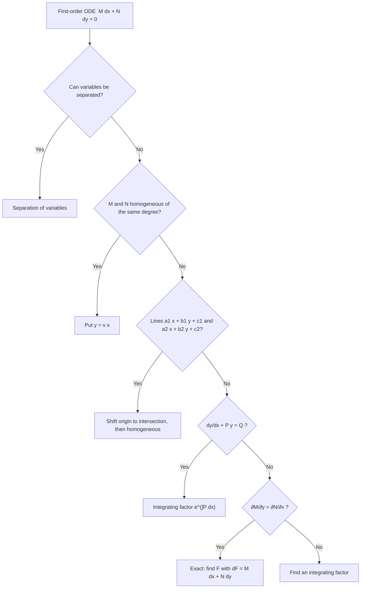

| Type | Recognise by | Method |
| --- | --- | --- |
| Separable | $f(x)dx=g(y)dy$ | Integrate both sides |
| Homogeneous | $dy/dx=\varphi(y/x)$ | $y=vx$ |
| Reducible to homogeneous | linear numerator and denominator | Shift to intersection point |
| Linear | $y'+Py=Q$ | IF $=e^{\int P\,dx}$ |
| Constant-coefficient (homogeneous) | $(D^2+aD+b)y=0$ | Auxiliary equation |
| Exact | $M_y=N_x$ | $F=\int M\,dx+\varphi(y)$ |

## D1. Separation of Variables

### Q1. $(e^x+1)y\,dy=(y+1)e^x\,dx$

Separate: $\dfrac{y}{y+1}dy=\dfrac{e^x}{e^x+1}dx$. Integrate with $\dfrac y{y+1}=1-\dfrac1{y+1}$:

$$y-\ln\lvert y+1\rvert=\ln(e^x+1)+C\ \Rightarrow\ \boxed{(y+1)(e^x+1)=Ke^{y}}\ (K=e^{-C}).$$

### Q2. $y\sqrt{x^2-1}\,dx+x\sqrt{y^2-1}\,dy=0$

Divide by $xy$: $\dfrac{\sqrt{x^2-1}}x\,dx+\dfrac{\sqrt{y^2-1}}y\,dy=0$.

Use $\displaystyle\int\frac{\sqrt{x^2-1}}x\,dx=\sqrt{x^2-1}-\sec^{-1}x$ (check: derivative $=\frac x{\sqrt{x^2-1}}-\frac1{x\sqrt{x^2-1}}=\frac{\sqrt{x^2-1}}x$ ✓). Therefore

$$\boxed{\sqrt{x^2-1}-\sec^{-1}x+\sqrt{y^2-1}-\sec^{-1}y=C}$$

### Q3. $y(1+xy)\,dx+x(1-xy)\,dy=0$

Not directly separable. Put $v=xy$, so $y=v/x$ and $dy=\dfrac{x\,dv-v\,dx}{x^2}$:

$$\frac vx(1+v)\,dx+x(1-v)\frac{x\,dv-v\,dx}{x^2}=0
\ \Rightarrow\ \frac{[v(1+v)-v(1-v)]\,dx+x(1-v)\,dv}{x}=0
\ \Rightarrow\ 2v^2\,dx+x(1-v)\,dv=0 .$$

Separate: $\dfrac{2\,dx}x+\dfrac{1-v}{v^2}\,dv=0$. Integrate:

$$2\ln\lvert x\rvert-\frac1v-\ln\lvert v\rvert=C\ \Rightarrow\ \ln\Big\lvert\frac xy\Big\rvert-\frac1{xy}=C .$$

$$\boxed{\frac xy=Ce^{1/(xy)}}$$

*Check:* differentiating $\ln x-\ln y-\frac1{xy}=C$ and multiplying by $x^2y^2$ gives $y(1+xy)\,dx+x(1-xy)\,dy=0$ ✓.

### Q5. $\dfrac{dy}{dx}=\dfrac yx+\tan\dfrac yx$

See D2-Q1 below: the substitution $y=vx$ makes the variables separable.

$$\boxed{\sin\frac yx=Cx}$$

## D2. Homogeneous Differential Equations

Put $y=vx$, $\dfrac{dy}{dx}=v+x\dfrac{dv}{dx}$, then separate $v$ and $x$.

### Q1. $\dfrac{dy}{dx}=\dfrac yx+\tan\dfrac yx$

$$v+x\frac{dv}{dx}=v+\tan v\ \Rightarrow\ \cot v\,dv=\frac{dx}x\ \Rightarrow\ \ln\lvert\sin v\rvert=\ln\lvert x\rvert+\ln C .$$

$$\boxed{\sin\frac yx=Cx}$$

### Q2. $(x^2+y^2)\,dy=xy\,dx$

$$\frac{dy}{dx}=\frac{xy}{x^2+y^2}=\frac v{1+v^2}\ \Rightarrow\ x\frac{dv}{dx}=\frac v{1+v^2}-v=-\frac{v^3}{1+v^2}.$$

$$\frac{1+v^2}{v^3}\,dv=-\frac{dx}x\ \Rightarrow\ \int\Big(v^{-3}+v^{-1}\Big)dv=-\ln\lvert x\rvert+c\ \Rightarrow\ -\frac1{2v^2}+\ln\lvert v\rvert=-\ln\lvert x\rvert+c .$$

So $\ln\lvert vx\rvert=\dfrac1{2v^2}+c$, i.e. $\ln\lvert y\rvert=\dfrac{x^2}{2y^2}+c$:

$$\boxed{y=C\,e^{x^2/(2y^2)}}$$

### Q4. $(x^2+y^2)\,dx-2xy\,dy=0$

$$\frac{dy}{dx}=\frac{x^2+y^2}{2xy}=\frac{1+v^2}{2v}\ \Rightarrow\ x\frac{dv}{dx}=\frac{1+v^2}{2v}-v=\frac{1-v^2}{2v}.$$

$$\frac{2v}{1-v^2}\,dv=\frac{dx}x\ \Rightarrow\ -\ln\lvert1-v^2\rvert=\ln\lvert x\rvert+c\ \Rightarrow\ x(1-v^2)=C .$$

$$\boxed{x^2-y^2=Cx}$$

## D3. Equations Reducible to Homogeneous Form

For $\dfrac{dy}{dx}=\dfrac{a_1x+b_1y+c_1}{a_2x+b_2y+c_2}$ with $a_1b_2-a_2b_1\ne0$: solve the two lines $a_1x+b_1y+c_1=0,\ a_2x+b_2y+c_2=0$ for the intersection $(h,k)$, put $x=X+h,\ y=Y+k$, and the equation becomes homogeneous in $X,Y$.

### Q1. $(4x-y+7)\,dx-(2x+y-1)\,dy=0$

1. Determinant $4(1)-(-1)(2)=6\ne0$. Solve $4x-y+7=0,\ 2x+y-1=0$: adding gives $6x+6=0$, so $x=-1$, $y=3$.
2. Put $x=X-1,\ y=Y+3$: $\dfrac{dY}{dX}=\dfrac{4X-Y}{2X+Y}=\dfrac{4-v}{2+v}$ with $Y=vX$.
3. $X\dfrac{dv}{dX}=\dfrac{4-v}{2+v}-v=\dfrac{4-3v-v^2}{2+v}=-\dfrac{(v+4)(v-1)}{v+2}$.
4. Separate and use partial fractions $\dfrac{v+2}{(v+4)(v-1)}=\dfrac{2/5}{v+4}+\dfrac{3/5}{v-1}$:
$$\frac25\ln\lvert v+4\rvert+\frac35\ln\lvert v-1\rvert=-\ln\lvert X\rvert+c\ \Rightarrow\ (v+4)^2(v-1)^3X^5=C .$$
5. Since $(v+4)^2(v-1)^3X^5=(Y+4X)^2(Y-X)^3$, and $Y+4X=4x+y+1$, $Y-X=y-x-4$:

$$\boxed{(4x+y+1)^2\,(y-x-4)^3=C}$$

*Check:* differentiating gives $-5(4x-y+7)\,dx+5(2x+y-1)\,dy=0$ ✓.

### Q2. $(x+y-3)\,dx=(3x-y-1)\,dy$

1. Determinant $(1)(-1)-(1)(3)=-4\ne0$. Solve $x+y=3,\ 3x-y=1$: $x=1,\ y=2$.
2. Put $x=X+1,\ y=Y+2$: $\dfrac{dY}{dX}=\dfrac{X+Y}{3X-Y}=\dfrac{1+v}{3-v}$.
3. $X\dfrac{dv}{dX}=\dfrac{1+v}{3-v}-v=\dfrac{(v-1)^2}{3-v}$.
4. $\dfrac{3-v}{(v-1)^2}\,dv=\dfrac{dX}X$, with $\dfrac{3-v}{(v-1)^2}=\dfrac2{(v-1)^2}-\dfrac1{v-1}$:
$$-\frac2{v-1}-\ln\lvert v-1\rvert=\ln\lvert X\rvert+c .$$
5. $X(v-1)=Y-X$ and $\dfrac1{v-1}=\dfrac X{Y-X}$, so $\ln\lvert Y-X\rvert+\dfrac{2X}{Y-X}=C$. With $Y-X=y-x-1$, $X=x-1$:

$$\boxed{\ln\lvert y-x-1\rvert+\frac{2(x-1)}{y-x-1}=C}$$

## D4. Linear Differential Equations

Standard form $\dfrac{dy}{dx}+Py=Q$; integrating factor $\mu=e^{\int P\,dx}$; solution $y\mu=\int Q\mu\,dx+C$.

### Q2. $\dfrac{dy}{dx}+xy=x$

$P=x$, $\mu=e^{x^2/2}$. $\dfrac d{dx}\big(ye^{x^2/2}\big)=xe^{x^2/2}\Rightarrow ye^{x^2/2}=e^{x^2/2}+C$.

$$\boxed{y=1+Ce^{-x^2/2}}$$

### Q3. $(1+x^2)\dfrac{dy}{dx}+2xy=4x^2$

The left side is $\dfrac d{dx}\big[(1+x^2)y\big]$ (integrating factor $e^{\int\frac{2x}{1+x^2}dx}=1+x^2$). So $(1+x^2)y=\dfrac{4x^3}3+C$:

$$\boxed{y=\frac{4x^3+3C}{3(1+x^2)}}$$

### Q4. $\cos^2x\,\dfrac{dy}{dx}+y=\tan x$

Divide by $\cos^2x$: $\dfrac{dy}{dx}+\sec^2x\,y=\tan x\sec^2x$. $\mu=e^{\tan x}$. With $t=\tan x$:

$$ye^{\tan x}=\int\tan x\sec^2x\,e^{\tan x}dx=\int te^t\,dt=(t-1)e^t+C .$$

$$\boxed{y=\tan x-1+Ce^{-\tan x}}$$

### Q5. $(1+y^2)\,dx=(\tan^{-1}y-x)\,dy$

Treat $x$ as the dependent variable: $\dfrac{dx}{dy}+\dfrac1{1+y^2}x=\dfrac{\tan^{-1}y}{1+y^2}$. $\mu=e^{\tan^{-1}y}$. With $t=\tan^{-1}y$:

$$xe^{t}=\int te^t\,dt=(t-1)e^t+C .$$

$$\boxed{x=\tan^{-1}y-1+Ce^{-\tan^{-1}y}}$$

## D5. Homogeneous Equations with Constant Coefficients

Substitute $y=e^{mx}$ to get the auxiliary equation.

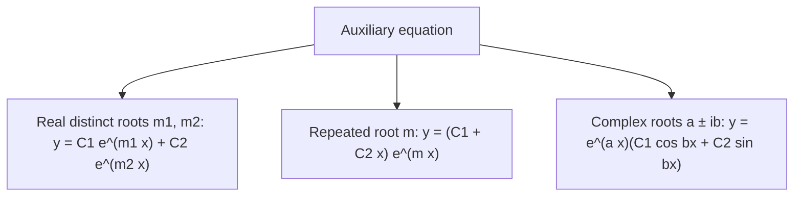

| Q | Equation | Auxiliary equation | Roots | General solution |
| --- | --- | --- | --- | --- |
| 1 | $(D^2-3D+2)y=0$ | $m^2-3m+2=0$ | $1,\ 2$ | $y=C_1e^{x}+C_2e^{2x}$ |
| 4 | $(D+3)^2y=0$ | $(m+3)^2=0$ | $-3,\ -3$ | $y=(C_1+C_2x)e^{-3x}$ |
| 6 | $(D^2-4D+13)y=0$ | $m^2-4m+13=0$ | $2\pm3i$ | $y=e^{2x}(C_1\cos3x+C_2\sin3x)$ |

Working for Q6: $m=\dfrac{4\pm\sqrt{16-52}}2=\dfrac{4\pm6i}2=2\pm3i$.

## D6. Exact Differential Equations

**Definition.** $M(x,y)\,dx+N(x,y)\,dy=0$ is **exact** if there is a function $F(x,y)$ with $dF=M\,dx+N\,dy$, i.e. $F_x=M,\ F_y=N$. The necessary and sufficient condition (on a simply connected region with continuous partials) is

$$\frac{\partial M}{\partial y}=\frac{\partial N}{\partial x}.$$

**Method:** $F=\int M\,dx+\varphi(y)$; determine $\varphi$ from $F_y=N$; solution $F(x,y)=C$.

### Q1. $(2x+3y-6)\,dy=(6x-2y-7)\,dx$

Write $(6x-2y-7)\,dx-(2x+3y-6)\,dy=0$: $M=6x-2y-7$, $N=-(2x+3y-6)$.
$M_y=-2$, $N_x=-2$ ✓ exact.

$F=\int M\,dx=3x^2-2xy-7x+\varphi(y)$; $F_y=-2x+\varphi'=-2x-3y+6\Rightarrow\varphi'=-3y+6$, $\varphi=-\frac32y^2+6y$.

$$\boxed{3x^2-2xy-7x-\tfrac32y^2+6y=C\ \ (\text{or } 6x^2-4xy-14x-3y^2+12y=C')}$$

### Q2. $(2y-x-1)\,dy+(2x-y+1)\,dx=0$

$M=2x-y+1$, $N=2y-x-1$; $M_y=-1=N_x$ ✓.

$F=x^2-xy+x+\varphi(y)$; $F_y=-x+\varphi'=2y-x-1\Rightarrow\varphi=y^2-y$.

$$\boxed{x^2-xy+y^2+x-y=C}$$

### Q3. $(x^3+3xy^2)\,dx+(y^3+3x^2y)\,dy=0$

$M_y=6xy=N_x$ ✓.

$F=\dfrac{x^4}4+\dfrac32x^2y^2+\varphi(y)$; $F_y=3x^2y+\varphi'=y^3+3x^2y\Rightarrow\varphi=\dfrac{y^4}4$.

$$\boxed{x^4+6x^2y^2+y^4=C}$$

### Q4. ⚠ $(e^x\sin y+e^{-y})\,dx+(e^x\cos y-xe^{-x})\,dy=0$

**Test as printed.** $M=e^x\sin y+e^{-y}$ gives $M_y=e^x\cos y-e^{-y}$. $N=e^x\cos y-xe^{-x}$ gives $N_x=e^x\cos y-e^{-x}+xe^{-x}$. These are **not equal**, so the printed equation is **not exact** (the "$e^{-x}$" is a mis-transcription).

**Intended equation:** $(e^x\sin y+e^{-y})\,dx+(e^x\cos y-xe^{-y})\,dy=0$.

$M_y=e^x\cos y-e^{-y}$ and $N_x=e^x\cos y-e^{-y}$ ✓ exact.

$F=\int M\,dx=e^x\sin y+xe^{-y}+\varphi(y)$; $F_y=e^x\cos y-xe^{-y}+\varphi'=N\Rightarrow\varphi'=0$.

$$\boxed{e^x\sin y+xe^{-y}=C}$$

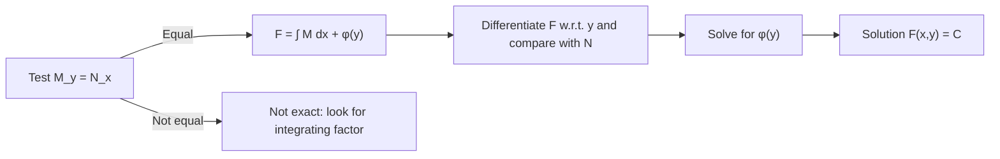

> **Quick revision (D).** Separable: integrate. Homogeneous: $y=vx$. Reducible: shift to intersection. Linear: $\mu=e^{\int P}$. Constant coefficients: auxiliary equation. Exact: $M_y=N_x$, $F=\int M\,dx+\varphi(y)$.

---

*End of answer set.*
