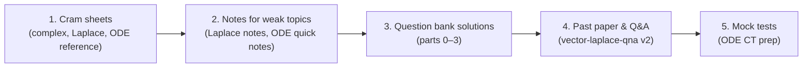

# ⚡ MATH-103 — Quick Revision & Exam Prep

**Course:** MS-103 / MATH-103 — Mathematics-II · B.Sc. Textile Engineering (Fabric Engineering), BUTEX
**Units covered:** Complex Variables · Vector Calculus · Laplace Transform · Ordinary Differential Equations

> Revision-grade material for the final exam and class tests: cram sheets, complete notes, solved question banks and exam-style solutions. For the full topic-by-topic theory, see the unit folders one level up: [`01_ode`](../01_ode) · [`02_vector`](../02_vector) · [`03_complex_variables`](../03_complex_variables) · [`04_laplace_transform`](../04_laplace_transform) · [`qna`](../qna) · [`calculus-extras`](../calculus-extras).

---

## 🧭 Where Should I Start?

| I need to… | Open this |
|:---|:---|
| Cram the night before (no derivations) | [`ms-103-laplace-transform-quick-rev`](ms-103-laplace-transform-quick-rev.md) · [`ms-103-complex-variables`](ms-103-complex-variables.md) · [`ms-103-ode-calculus-reference`](ms-103-ode-calculus-reference.md) |
| Answer **every question of the class question bank** (Minarul Sir) | [`ms-103-solution-qb-*-261030-0`](#-solved-question-bank-minarul-sir) |
| Practise the **MS-103 2023 paper** and vector/Laplace problems | [`ms-103-vector-laplace-qna-v260930-2`](ms-103-vector-laplace-qna-v260930-2.md) |
| Prepare for an **ODE class test** with mock papers | [`ms-103-ode-ct260730-prep`](ms-103-ode-ct260730-prep.md) |
| Learn Laplace transforms from scratch | [`ms-103-laplace-transform-note-1`](ms-103-laplace-transform-note-1.md) |
| Look up a formula or "which method?" fast | [`ms-103-ode-calculus-reference`](ms-103-ode-calculus-reference.md) · [`ms-103-ode-quick-notes`](ms-103-ode-quick-notes.md) (formula sheet, §8–10) |

---

## 📂 File Index

### 🔵 Complex Variables

| File | Type | What's inside |
|:---|:---:|:---|
| [`ms-103-complex-variables.md`](ms-103-complex-variables.md) | Cram sheet | Essential definitions, formula block (polar form, De Moivre, Euler, Cauchy–Riemann, Cauchy–Goursat, integral formula, residues), 5 key theorems, **12 exam problem types**, high-yield reminders. Plain-text math. |

Full worked solutions for this unit are in the [question bank, part 0](ms-103-solution-qb-complex-variables-261030-0.md).

### 🟢 Vector Calculus

Vector problems live mainly in the combined Vector + Laplace files below, plus the question-bank solutions ([part 1](ms-103-solution-qb-vectors-261030-0.md)).

| File | Type | Vector content |
|:---|:---:|:---|
| [`ms-103-vector-laplace-qna-v260930-1.md`](ms-103-vector-laplace-qna-v260930-1.md) | Model answers | Q1–Q20: conservative/solenoidal fields, coplanarity, triple products, line integrals, Green's, Gauss's divergence theorem, curl identities. Contents table gives each final answer. |
| [`ms-103-vector-laplace-qna-v260930-2.md`](ms-103-vector-laplace-qna-v260930-2.md) | Model answers + past paper | Part I: 21 practice questions. Part II: **MS-103, 2023 exam** Section A (Vector Calculus). SVG figures for the geometry questions. |
| [`ms-103-vector-laplace-qna-v260930-3.md`](ms-103-vector-laplace-qna-v260930-3.md) | Homework solutions | Q1–Q6: directional derivative along a normal, orthogonal surfaces, parallelepiped volume, coplanarity, triple-product identity, parallelogram area. |
| [`ms-103-laplace-vector-16-24.md`](ms-103-laplace-vector-16-24.md) | Notes (Part II) | Part II: dot/cross product geometry, vector identities (BAC–CAB, Jacobi, Gram), curl-of-curl, conservative fields, Green's theorem, line integrals, Gauss's divergence theorem applied to a cube. |

### 🟣 Laplace Transform

| File | Type | What's inside |
|:---|:---:|:---|
| [`ms-103-laplace-transform-quick-rev.md`](ms-103-laplace-transform-quick-rev.md) | Cram sheet | One-line definitions, essential transform table, properties, inverse-transform patterns, **ODE and PDE solving checklists**, answer skeletons for common question types. |
| [`ms-103-laplace-transform-note-1.md`](ms-103-laplace-transform-note-1.md) | Complete notes | 30 sections, from the definition through basic transforms, linearity, both shifting properties, multiplication/division by *t*, logarithmic results, inverse transforms, convolution, master formula sheets, *"how to recognise which formula to use"*, and exam strategy. |
| [`ms-103-laplace-transform-note-2.md`](ms-103-laplace-transform-note-2.md) | Lecture-note reconstruction | Reconstructed from handwritten lecture notes, with 65 worked examples across transforms, properties, inverse, convolution, ODEs and PDEs. Two errors in the source are corrected and flagged (§3.9, §7.2). |
| [`ms-103-laplace-transform-note-3.md`](ms-103-laplace-transform-note-3.md) | Lecture-note reconstruction | A second reconstruction of handwritten notes (pp. 51–84): elementary functions, properties, formula sheet, inverse transforms, differential equations, PDEs, periodic-function recap. Written in plain Unicode math inside code blocks; uncertain items are marked. |
| [`ms-103-laplace-qna.md`](ms-103-laplace-qna.md) | Solved question bank | 23 questions: direct transforms (Q1–9), properties and proofs (Q10–15), solving differential equations (Q16–20), inverse transforms (Q21–23). |
| [`ms-103-laplace-vector-16-24.md`](ms-103-laplace-vector-16-24.md) | Notes (Part I) | Part I: first-principles derivations, cosh/sinh, damped sine/cosine, scale and shifting properties, *t<sup>n</sup>* multiplication, first-order ODE by Laplace, inverse-transform examples. |

The Laplace parts of the combined Q&A files ([v1](ms-103-vector-laplace-qna-v260930-1.md): Q21–28 · [v2](ms-103-vector-laplace-qna-v260930-2.md): convolution and **MS-103 2023 Section B** · [v3](ms-103-vector-laplace-qna-v260930-3.md): Q7–19, including IVPs with ramp, exponential, sinusoidal and resonant forcing) are also useful practice.

### 🟠 Ordinary Differential Equations

| File | Type | What's inside |
|:---|:---:|:---|
| [`ms-103-ode-calculus-reference.md`](ms-103-ode-calculus-reference.md) | Reference sheet | Derivative and integral tables, DE cheat sheet, **"Which method do I use?"** decision guide, worked examples. |
| [`ms-103-ode-quick-notes.md`](ms-103-ode-quick-notes.md) | Revision notes | 10 sections: classification, first-order methods, higher-order linear ODEs, undetermined coefficients, inverse operator method, variation of parameters, formula sheet, quick-revision tables, exam cheatsheet. |
| [`ms-103-ode-complete-v260712-0.md`](ms-103-ode-complete-v260712-0.md) | Revision handbook | Chapter 1: exponential growth, decay and Newton's law of cooling. Chapter 2: higher-order linear ODEs with constant coefficients. Each chapter: theory → solved examples → practice questions → full solutions → exam-prep sheet. |
| [`ms-103-ode-ct260730-prep.md`](ms-103-ode-ct260730-prep.md) | Class-test notebook | 35 solved problems, **3 full mock tests** (10 marks, 30 minutes, GTEC style), 25 mixed practice questions with answer key, 25-row pattern-recognition table, formula sheet, 30-minute pre-exam revision, 8 challenge problems, exam strategy. |

Exam-style solutions to the ODE questions in the class question bank are in [question bank, part 3](ms-103-solution-qb-ode-261030-0.md).

### 🔴 Solved Question Bank (Minarul Sir)

Every question in the class question bank, answered in exam style (statement → working → boxed/bold answer). Split by chapter so GitHub can render every equation.

| Part | File | Chapter | Topics |
|:---:|:---|:---|:---|
| 0 | [`ms-103-solution-qb-complex-variables-261030-0.md`](ms-103-solution-qb-complex-variables-261030-0.md) | Complex Variable | Definitions, triangle inequality, Euler and De Moivre, Cauchy formulas, harmonic conjugates, residues and improper integrals |
| 1 | [`ms-103-solution-qb-vectors-261030-0.md`](ms-103-solution-qb-vectors-261030-0.md) | Vector Calculus | Triple-product geometry (with figure), solenoidal/irrotational fields, vector identities, line and surface integrals, Green/Stokes/Gauss |
| 2 | [`ms-103-solution-qb-laplace-261030-0.md`](ms-103-solution-qb-laplace-261030-0.md) | Laplace Transform | Convolution theorem, textile applications (yarn tension, dryer, vibration), fundamental proofs, inverse transforms, shifting properties, ODEs |
| 3 | [`ms-103-solution-qb-ode-261030-0.md`](ms-103-solution-qb-ode-261030-0.md) | Ordinary Differential Equations | Order/degree, separable and homogeneous, decay and cooling, linear, exact, higher-order, undetermined coefficients |

All four share the same navigation bar, so you can jump between parts from the top or bottom of any file.

---

## 🗺️ Suggested Study Paths



| Time left | Plan |
|:---|:---|
| **1 evening** | Read the three cram sheets, then skim the "exam problem types" / "which method" lists. |
| **2–3 days** | Cram sheets → the question-bank solutions chapter by chapter (cover the answer, solve, compare). |
| **1 week** | Add the notes files for any weak unit, the MS-103 2023 paper in Q&A v2, and the ODE mock tests under timed conditions. |

---

## 🏷️ File Naming

Files follow `ms-103-<topic>-<type>[-vYYMMDD-N].md`.

- `vYYMMDD` is the date the file was made (for example `v260930` is 30 Sep 2026); `-N` is the revision number.
- The question-bank files are named `ms-103-solution-qb-<chapter>-261030-0.md` (`complex-variables`, `vectors`, `laplace`, `ode`); each chapter is its own file, so all start at revision `0`.
- Files with no version suffix are single-version reference sheets.
- A trailing date such as `ct260730` marks a class test (here, 30 Jul 2026).

---

## ⚙️ Rendering Notes

- Most files use GitHub-flavoured LaTeX: inline math as `` $`...`$ `` or `$...$`, display math in ```` ```math ```` fences or `$$...$$`.
- [`ms-103-complex-variables`](ms-103-complex-variables.md) and [`ms-103-laplace-transform-note-3`](ms-103-laplace-transform-note-3.md) deliberately use plain Unicode math (∫, √, ∮, superscripts) and need no renderer.
- GitHub appears to stop rendering equations partway down very math-heavy pages. If you see "Unable to render expression", check the **Code** tab for the raw LaTeX. The question bank was split into four parts for this reason.
- Figures are SVG files in the repository-level `assets/` folder, linked as `../../assets/<name>.svg` from this directory.

---

## 🔗 Related

- [`../README`](../) — MATH-103 unit folders (ODE, Vector, Complex Variables, Laplace, Calculus Extras)
- [`../qna`](../qna) — topic-wise questions and answers
- [Repository README](../../README.md) · [CHANGELOG](../../CHANGELOG.md)

*Maintained by [itachi-re](https://github.com/itachi-re) · BUTEX Fabric Engineering.*
