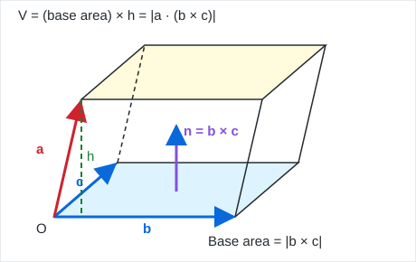

# Math-II Question Bank: Exam-Style Solutions (Part 1 of 3)

Solutions to the Question Bank (Minarul Sir's class notes), split by chapter so GitHub can render every equation.

[Complex Variable](ms-103-solution-question-bank-261030-0.md) · **Vector Calculus** · [Laplace Transform](ms-103-solution-question-bank-261030-2.md) · [Ordinary Differential Equations](ms-103-solution-question-bank-261030-3.md)

> **Notes on the source questions**
> - Ch2 T4 Q8 has no field or curve given in the PDF, so the method and a model example are shown.

---

# Chapter 2: Vector Calculus

## Topic 1: Geometrical Interpretation of Triple Product

### Q1. Explain the geometrical interpretation of $`\bar a\cdot(\bar b\times\bar c)`$.



Let $`\bar a, \bar b, \bar c`$ be three non-coplanar vectors drawn from a common point $`O`$. They are the edges of a **parallelepiped**.

- The base is the parallelogram formed by $`\bar b`$ and $`\bar c`$. Its area is $`|\bar b\times\bar c|`$, and $`\bar b\times\bar c`$ is normal to the base. Let $`\hat n = \dfrac{\bar b\times\bar c}{|\bar b\times\bar c|}`$.
- The height of the parallelepiped is the length of the projection of $`\bar a`$ on $`\hat n`$: $`h = |\bar a\cdot\hat n|`$.

```math
V = (\text{area of base})\times h = |\bar b\times\bar c|\cdot\frac{|\bar a\cdot(\bar b\times\bar c)|}{|\bar b\times\bar c|} = |\bar a\cdot(\bar b\times\bar c)|
```

So **$`\bar a\cdot(\bar b\times\bar c)`$ is the volume of the parallelepiped** with edges $`\bar a, \bar b, \bar c`$ (positive if $`\bar a,\bar b,\bar c`$ form a right-handed system, negative otherwise).

**Consequences:**
- $`[\bar a\ \bar b\ \bar c] = [\bar b\ \bar c\ \bar a] = [\bar c\ \bar a\ \bar b]`$ (cyclic permutation keeps the same volume).
- $`\bar a,\bar b,\bar c`$ are **coplanar** iff $`\bar a\cdot(\bar b\times\bar c) = 0`$ (volume is zero).
- The volume of the tetrahedron with these edges is $`\tfrac16|[\bar a\ \bar b\ \bar c]|`$.

---

## Topic 2: Solenoidal, Coplanar and Irrotational Vectors

### Q1. (Homework) $`\bar a = 2\hat i - \hat j + \hat k`$, $`\bar b = \hat i + 2\hat j - 3\hat k`$, $`\bar c = 3\hat i + a\hat j + 5\hat k`$. Find $`a`$ if coplanar.

Coplanar $`\iff [\bar a\ \bar b\ \bar c] = 0`$:

```math
\begin{vmatrix}2 & -1 & 1\\ 1 & 2 & -3\\ 3 & a & 5\end{vmatrix} = 2(10 + 3a) + 1(5 + 9) + 1(a - 6) = 28 + 7a = 0
```

**Answer:**

```math
a = -4
```

### Q2. (Homework) Show $`\bar V = (x+3y)\hat i + (y-3z)\hat j + (x-2z)\hat k`$ is solenoidal.

A vector field is solenoidal if $`\nabla\cdot\bar V = 0`$.

```math
\nabla\cdot\bar V = \frac{\partial}{\partial x}(x + 3y) + \frac{\partial}{\partial y}(y - 3z) + \frac{\partial}{\partial z}(x - 2z) = 1 + 1 - 2 = 0
```

Hence $`\bar V`$ is solenoidal. $`\blacksquare`$

### Q3. $`\bar F = (x^2 - y^2 + x)\hat i - (2xy + y)\hat j`$. Is it irrotational? Find the scalar potential.

```math
\nabla\times\bar F = \begin{vmatrix}\hat i & \hat j & \hat k\\ \partial_x & \partial_y & \partial_z\\ x^2 - y^2 + x & -(2xy+y) & 0\end{vmatrix} = \hat k\left[\frac{\partial}{\partial x}(-2xy - y) - \frac{\partial}{\partial y}(x^2 - y^2 + x)\right]
```

```math
= \hat k[-2y + 2y] = \bar 0
```

So $`\bar F`$ is **irrotational**, and $`\bar F = \nabla\phi`$ for some scalar potential $`\phi`$:

```math
\phi_x = x^2 - y^2 + x \Rightarrow \phi = \frac{x^3}{3} - xy^2 + \frac{x^2}{2} + g(y)
```

```math
\phi_y = -2xy + g'(y) = -(2xy + y) \Rightarrow g' = -y \Rightarrow g = -\frac{y^2}{2}
```

**Answer:**

```math
\phi = \frac{x^3}{3} + \frac{x^2}{2} - xy^2 - \frac{y^2}{2} + c
```

### Q4. $`\bar F = (2xz^3 + 6y)\hat i + (6x - 2yz)\hat j + (3x^2z^2 - y^2)\hat k`$. Show $`\bar F`$ is conservative.

$`\bar F`$ is conservative iff $`\nabla\times\bar F = \bar 0`$.

```math
\hat i\text{: } \frac{\partial F_3}{\partial y} - \frac{\partial F_2}{\partial z} = -2y - (-2y) = 0
```

```math
\hat j\text{: } \frac{\partial F_1}{\partial z} - \frac{\partial F_3}{\partial x} = 6xz^2 - 6xz^2 = 0
```

```math
\hat k\text{: } \frac{\partial F_2}{\partial x} - \frac{\partial F_1}{\partial y} = 6 - 6 = 0
```

$`\nabla\times\bar F = \bar 0`$ everywhere in $`\mathbb{R}^3`$ (simply connected), so $`\bar F`$ is conservative. $`\blacksquare`$

(Its potential is $`\phi = x^2z^3 + 6xy - y^2z`$.)

---

## Topic 3: Vector Identities

### Q1. Prove $`\bar a\times(\bar b\times\bar c) = \bar b(\bar a\cdot\bar c) - \bar c(\bar a\cdot\bar b)`$.

Let $`\bar a = (a_1,a_2,a_3)`$ etc. $`\bar b\times\bar c = (b_2c_3 - b_3c_2,\ b_3c_1 - b_1c_3,\ b_1c_2 - b_2c_1)`$.

The $`\hat i`$-component of the LHS:

```math
a_2(b_1c_2 - b_2c_1) - a_3(b_3c_1 - b_1c_3) = b_1(a_2c_2 + a_3c_3) - c_1(a_2b_2 + a_3b_3)
```

Adding and subtracting $`a_1b_1c_1`$:

```math
= b_1(a_1c_1 + a_2c_2 + a_3c_3) - c_1(a_1b_1 + a_2b_2 + a_3b_3) = b_1(\bar a\cdot\bar c) - c_1(\bar a\cdot\bar b)
```

This is the $`\hat i`$-component of RHS. The $`\hat j`$ and $`\hat k`$ components follow by cyclic permutation of indices. Hence the identity holds. $`\blacksquare`$

### Q2. Prove $`[\bar A + \bar B,\ \bar B + \bar C,\ \bar C + \bar A] = 2[\bar A\ \bar B\ \bar C]`$.

```math
(\bar B + \bar C)\times(\bar C + \bar A) = \bar B\times\bar C + \bar B\times\bar A + \bar C\times\bar C + \bar C\times\bar A = \bar B\times\bar C + \bar B\times\bar A + \bar C\times\bar A
```

Dot with $`\bar A + \bar B`$:

```math
\bar A\cdot(\bar B\times\bar C) + \underbrace{\bar A\cdot(\bar B\times\bar A)}_{0} + \underbrace{\bar A\cdot(\bar C\times\bar A)}_{0} + \underbrace{\bar B\cdot(\bar B\times\bar C)}_{0} + \underbrace{\bar B\cdot(\bar B\times\bar A)}_{0} + \bar B\cdot(\bar C\times\bar A)
```

(a triple product with a repeated vector is zero.)

```math
= [\bar A\ \bar B\ \bar C] + [\bar B\ \bar C\ \bar A] = 2[\bar A\ \bar B\ \bar C]. \qquad \blacksquare
```

### Q3. Prove $`\hat i\times(\bar a\times\hat i) + \hat j\times(\bar a\times\hat j) + \hat k\times(\bar a\times\hat k) = 2\bar a`$.

By BAC–CAB: $`\hat i\times(\bar a\times\hat i) = \bar a(\hat i\cdot\hat i) - \hat i(\hat i\cdot\bar a) = \bar a - a_1\hat i`$. Similarly for $`\hat j,\hat k`$.

```math
\text{LHS} = 3\bar a - (a_1\hat i + a_2\hat j + a_3\hat k) = 3\bar a - \bar a = 2\bar a. \qquad \blacksquare
```

---

## Topic 4: Line Integral, Surface Integral & Scalar Potential

### Q1. Define line integral, work done, circulation, surface integral, volume integral.

- **Line integral:** for a vector field $`\bar F`$ and curve $`C`$, $`\displaystyle\int_C\bar F\cdot d\bar r = \int_C(F_1dx + F_2dy + F_3dz)`$.
- **Work done:** the work done by a force $`\bar F`$ moving a particle along $`C`$ is $`W = \displaystyle\int_C\bar F\cdot d\bar r`$.
- **Circulation:** the line integral around a closed curve, $`\displaystyle\oint_C\bar F\cdot d\bar r`$.
- **Surface integral (flux):** $`\displaystyle\iint_S\bar F\cdot\hat n\,dS`$, where $`\hat n`$ is the unit normal to the surface $`S`$.
- **Volume integral:** $`\displaystyle\iiint_V\phi\,dV`$ (scalar) or $`\displaystyle\iiint_V\bar F\,dV`$ (vector) over a region $`V`$.

### Q2. Directional derivative of $`\mathrm{div}\bar u`$ at $`(1,2,2)`$ along the outward normal of $`x^2+y^2+z^2 = 9`$, $`\bar u = x^4\hat i + y^4\hat j + z^4\hat k`$.

```math
\mathrm{div}\bar u = 4(x^3 + y^3 + z^3)
```

```math
\nabla(\mathrm{div}\bar u) = 12(x^2\hat i + y^2\hat j + z^2\hat k) \;\Rightarrow\; \text{at }(1,2,2):\ 12\hat i + 48\hat j + 48\hat k
```

The point lies on the sphere ($`1 + 4 + 4 = 9`$). Outward normal: $`\nabla(x^2+y^2+z^2) = 2(x,y,z) = (2,4,4)`$, unit vector $`\hat n = \dfrac{\hat i + 2\hat j + 2\hat k}{3}`$.

**Answer:**

```math
\text{D.D.} = \frac{12 + 96 + 96}{3} = \frac{204}{3} = 68
```

### Q3. (Homework) Find $`\lambda,\mu`$ so that $`\lambda x^2 - \mu yz = (\lambda+2)x`$ and $`4x^2y + z^3 = 4`$ intersect orthogonally at $`(1,-1,2)`$.

The point lies on the second surface: $`4(1)(-1) + 8 = 4`$ ✓. It must lie on the first:

```math
\lambda(1) - \mu(-1)(2) = \lambda + 2 \Rightarrow \lambda + 2\mu = \lambda + 2 \Rightarrow \mu = 1.
```

Normals: $`\phi_1 = \lambda x^2 - \mu yz - (\lambda+2)x`$, $`\ \nabla\phi_1 = (2\lambda x - \lambda - 2,\ -\mu z,\ -\mu y)`$; at the point $`= (\lambda - 2,\ -2\mu,\ \mu) = (\lambda-2,\ -2,\ 1)`$.

$`\phi_2 = 4x^2y + z^3 - 4`$, $`\ \nabla\phi_2 = (8xy,\ 4x^2,\ 3z^2)`$; at the point $`= (-8,\ 4,\ 12)`$.

Orthogonal surfaces: $`\nabla\phi_1\cdot\nabla\phi_2 = 0`$:

```math
-8(\lambda - 2) - 8 + 12 = 0 \Rightarrow 20 - 8\lambda = 0
```

**Answer:**

```math
\lambda = \tfrac52,\qquad \mu = 1
```

### Q4. (Homework) For $`r = (x^2+y^2+z^2)^{1/2}`$, prove $`\nabla r^n = nr^{n-2}\vec r`$.

$`r^2 = x^2 + y^2 + z^2 \Rightarrow 2r\dfrac{\partial r}{\partial x} = 2x \Rightarrow \dfrac{\partial r}{\partial x} = \dfrac xr`$, and similarly for $`y, z`$.

```math
\nabla r^n = \hat i\,nr^{n-1}\frac{\partial r}{\partial x} + \hat j\,nr^{n-1}\frac{\partial r}{\partial y} + \hat k\,nr^{n-1}\frac{\partial r}{\partial z} = nr^{n-1}\cdot\frac{x\hat i + y\hat j + z\hat k}{r} = nr^{n-2}\vec r. \qquad \blacksquare
```

### Q5. (Homework) Scalar potential of $`\bar A = y^2\hat i + 2xy\hat j - z^2\hat k`$.

$`\nabla\times\bar A`$: $`\hat i`$: $`0 - 0 = 0`$; $`\hat j`$: $`0 - 0 = 0`$; $`\hat k`$: $`2y - 2y = 0`$. So $`\bar A = \nabla f`$.

```math
f_x = y^2 \Rightarrow f = xy^2 + g(y,z)
```

```math
f_y = 2xy + g_y = 2xy \Rightarrow g_y = 0 \Rightarrow g = g(z)
```

```math
f_z = g'(z) = -z^2 \Rightarrow g = -\frac{z^3}{3}
```

**Answer:**

```math
f = xy^2 - \frac{z^3}{3} + c
```

### Q6. Evaluate $`\oint_C(x\,dy - y\,dx)`$ around the square $`(0,0),(1,0),(1,1),(0,1)`$ counter-clockwise.

*By Green's theorem* ($`\phi = -y`$, $`\psi = x`$):

```math
\oint_C(x\,dy - y\,dx) = \iint_R\left(\frac{\partial x}{\partial x} - \frac{\partial(-y)}{\partial y}\right)dx\,dy = \iint_R 2\,dx\,dy = 2\times1 = 2
```

*Direct check:*

| Side | Path | Value |
|---|---|---|
| bottom | $`y = 0,\ dy = 0`$ | $`0`$ |
| right | $`x = 1,\ dx = 0`$: $`\int_0^1dy`$ | $`1`$ |
| top | $`y = 1,\ dy = 0`$: $`-\int_1^0dx`$ | $`1`$ |
| left | $`x = 0,\ dx = 0`$ | $`0`$ |

**Answer:**

```math
\oint_C(x\,dy - y\,dx) = 2
```

### Q7. $`\bar F = (\sin y)\hat i + x(1+\cos y)\hat j`$; evaluate the line integral over $`x^2 + y^2 = a^2`$, $`z = 0`$.

$`\bar F\cdot d\bar r = \sin y\,dx + x(1 + \cos y)\,dy`$. By Green's theorem (circle traversed counter-clockwise):

```math
\oint_C = \iint_R\left[\frac{\partial}{\partial x}\big(x(1+\cos y)\big) - \frac{\partial}{\partial y}(\sin y)\right]dx\,dy = \iint_R[(1 + \cos y) - \cos y]\,dx\,dy = \iint_R dx\,dy
```

**Answer:**

```math
\oint_C\bar F\cdot d\bar r = \pi a^2
```

### Q8. (Homework) Compute $`\int_C\bar F\cdot d\bar r`$.

*The field $`\bar F`$ and curve $`C`$ are not given in the question bank; the standard method is shown with a model example.*

**Method.**
1. Parametrise $`C`$: $`x = x(t),\ y = y(t),\ z = z(t)`$, $`t_1\le t\le t_2`$.
2. Substitute: $`\bar F\cdot d\bar r = \bar F\cdot\dfrac{d\bar r}{dt}dt`$.
3. Integrate over $`t`$.
4. If $`\bar F = \nabla\phi`$ (conservative), shortcut: $`\displaystyle\int_C\bar F\cdot d\bar r = \phi(B) - \phi(A)`$.

**Example.** $`\bar F = x^2\hat i + xy\hat j`$ along $`y = x`$ from $`(0,0)`$ to $`(1,1)`$. Here $`y = x`$, $`dy = dx`$:

```math
\int_C(x^2dx + xy\,dy) = \int_0^1(x^2 + x^2)\,dx = \frac23.
```

### Q9. Evaluate $`\iint_S\bar F\cdot\hat n\,dS`$, $`\bar F = 4xz\hat i - y^2\hat j + yz\hat k`$, $`S`$ the closed surface of the unit cube.

By the divergence theorem:

```math
\nabla\cdot\bar F = 4z - 2y + y = 4z - y
```

```math
\iint_S\bar F\cdot\hat n\,dS = \int_0^1\!\!\int_0^1\!\!\int_0^1(4z - y)\,dx\,dy\,dz = 4\cdot\frac12 - \frac12 = \frac32
```

**Answer:**

```math
\iint_S\bar F\cdot\hat n\,dS = \frac32
```

### Q10. (Homework) Evaluate $`\iint_S\bar F\cdot\hat n\,dS`$, $`\bar F = yz\hat i + zx\hat j + xy\hat k`$, $`S`$ the part of $`x^2+y^2+z^2 = a^2`$ in the first octant.

On the sphere, $`\hat n = \dfrac{x\hat i + y\hat j + z\hat k}{a}`$.

```math
\bar F\cdot\hat n = \frac{xyz + xyz + xyz}{a} = \frac{3xyz}{a}
```

Use spherical coordinates: $`x = a\sin\varphi\cos\theta,\ y = a\sin\varphi\sin\theta,\ z = a\cos\varphi`$, $`dS = a^2\sin\varphi\,d\varphi\,d\theta`$, with $`0\le\varphi\le\frac\pi2`$, $`0\le\theta\le\frac\pi2`$.

```math
xyz = a^3\sin^2\varphi\cos\varphi\sin\theta\cos\theta
```

```math
\iint_S\bar F\cdot\hat n\,dS = \frac3a\cdot a^3\cdot a^2\int_0^{\pi/2}\sin^3\varphi\cos\varphi\,d\varphi\int_0^{\pi/2}\sin\theta\cos\theta\,d\theta = 3a^4\cdot\frac14\cdot\frac12
```

**Answer:**

```math
\iint_S\bar F\cdot\hat n\,dS = \frac{3a^4}{8}
```

*(Check: $`\nabla\cdot\bar F = 0`$, so the flux through the three coordinate quarter-discs is $`-\tfrac{3a^4}{8}`$, giving zero for the closed octant.)*

---

## Topic 5: Vector Differential Proofs

### Q1. Prove $`\mathrm{div}(\mathrm{curl}\bar A) = 0`$.

Let $`\bar A = A_1\hat i + A_2\hat j + A_3\hat k`$ with continuous second partial derivatives.

```math
\mathrm{curl}\bar A = \left(\frac{\partial A_3}{\partial y} - \frac{\partial A_2}{\partial z}\right)\hat i + \left(\frac{\partial A_1}{\partial z} - \frac{\partial A_3}{\partial x}\right)\hat j + \left(\frac{\partial A_2}{\partial x} - \frac{\partial A_1}{\partial y}\right)\hat k
```

```math
\nabla\cdot(\nabla\times\bar A) = \frac{\partial^2A_3}{\partial x\partial y} - \frac{\partial^2A_2}{\partial x\partial z} + \frac{\partial^2A_1}{\partial y\partial z} - \frac{\partial^2A_3}{\partial y\partial x} + \frac{\partial^2A_2}{\partial z\partial x} - \frac{\partial^2A_1}{\partial z\partial y}
```

Mixed partials are equal, so every pair cancels:

```math
\nabla\cdot(\nabla\times\bar A) = 0. \qquad \blacksquare
```

### Q2. Prove $`\mathrm{curl}(\mathrm{grad}\phi) = 0`$.

```math
\nabla\phi = \phi_x\hat i + \phi_y\hat j + \phi_z\hat k
```

```math
\nabla\times(\nabla\phi) = \begin{vmatrix}\hat i & \hat j & \hat k\\ \partial_x & \partial_y & \partial_z\\ \phi_x & \phi_y & \phi_z\end{vmatrix} = (\phi_{zy} - \phi_{yz})\hat i + (\phi_{xz} - \phi_{zx})\hat j + (\phi_{yx} - \phi_{xy})\hat k
```

Since $`\phi`$ has continuous second derivatives, $`\phi_{zy} = \phi_{yz}`$ etc. Hence $`\nabla\times(\nabla\phi) = \bar 0`$. $`\blacksquare`$

---

## Topic 6: Green's, Stokes' and Gauss' Theorems

### Q1. State and prove Green's theorem in a plane.

**Statement:** Let $`R`$ be a closed region in the $`xy`$-plane bounded by a simple closed curve $`C`$ (positively oriented), and let $`\phi(x,y)`$, $`\psi(x,y)`$ be continuous with continuous first partial derivatives in $`R`$. Then

```math
\oint_C(\phi\,dx + \psi\,dy) = \iint_R\left(\frac{\partial\psi}{\partial x} - \frac{\partial\phi}{\partial y}\right)dx\,dy.
```

**Proof** (for a region that is simple in both directions).

*Part 1: $`\oint_C\phi\,dx = -\iint_R\dfrac{\partial\phi}{\partial y}dx\,dy`$.* Let $`R`$ be $`a\le x\le b`$, $`y_1(x)\le y\le y_2(x)`$, where $`C_1: y = y_1(x)`$ is the lower curve and $`C_2: y = y_2(x)`$ the upper curve.

```math
\iint_R\frac{\partial\phi}{\partial y}dx\,dy = \int_a^b\big[\phi(x, y_2) - \phi(x, y_1)\big]dx = \int_a^b\phi(x,y_2)\,dx - \int_a^b\phi(x,y_1)\,dx
```

With counter-clockwise orientation, $`C_1`$ is traversed from $`a`$ to $`b`$ and $`C_2`$ from $`b`$ to $`a`$ (the vertical sides contribute nothing to $`\int\phi\,dx`$):

```math
\oint_C\phi\,dx = \int_a^b\phi(x,y_1)\,dx - \int_a^b\phi(x,y_2)\,dx = -\iint_R\frac{\partial\phi}{\partial y}dx\,dy.
```

*Part 2: $`\oint_C\psi\,dy = \iint_R\dfrac{\partial\psi}{\partial x}dx\,dy`$.* Describe $`R`$ as $`c\le y\le d`$, $`x_1(y)\le x\le x_2(y)`$:

```math
\iint_R\frac{\partial\psi}{\partial x}dx\,dy = \int_c^d\big[\psi(x_2,y) - \psi(x_1,y)\big]dy = \oint_C\psi\,dy
```

(the right curve $`x_2`$ is traversed upward, the left curve $`x_1`$ downward).

Adding Part 1 and Part 2 gives Green's theorem. For a general region, divide it into sub-regions of this type; the line integrals along interior cuts cancel. $`\blacksquare`$

### Q2. Use Green's theorem to evaluate $`\oint_C[(\sin y)\hat i + x(1+\cos y)\hat j]\cdot d\bar r`$, $`C: x^2 + y^2 = a^2`$.

Here $`\phi = \sin y`$, $`\psi = x(1 + \cos y)`$.

```math
\frac{\partial\psi}{\partial x} - \frac{\partial\phi}{\partial y} = (1 + \cos y) - \cos y = 1
```

```math
\oint_C = \iint_R 1\,dx\,dy = \text{Area of the circle}
```

**Answer:**

```math
\oint_C\bar F\cdot d\bar r = \pi a^2
```

### Q3. State Gauss' divergence theorem and Stokes' theorem.

**Gauss' divergence theorem:** If $`V`$ is a volume bounded by a closed surface $`S`$ and $`\bar F`$ is a vector field with continuous first partial derivatives in $`V`$, then

```math
\iint_S\bar F\cdot\hat n\,dS = \iiint_V\nabla\cdot\bar F\,dV,
```

where $`\hat n`$ is the outward unit normal to $`S`$. (Flux through a closed surface = integral of the divergence over the enclosed volume.)

**Stokes' theorem:** If $`S`$ is an open surface bounded by a simple closed curve $`C`$ and $`\bar F`$ has continuous first partial derivatives on $`S`$, then

```math
\oint_C\bar F\cdot d\bar r = \iint_S(\nabla\times\bar F)\cdot\hat n\,dS,
```

where $`C`$ is traversed in the positive direction relative to $`\hat n`$ (right-hand rule). (Circulation around $`C`$ = flux of the curl through $`S`$.)

---

[Complex Variable](ms-103-solution-question-bank-261030-0.md) · **Vector Calculus** · [Laplace Transform](ms-103-solution-question-bank-261030-2.md) · [Ordinary Differential Equations](ms-103-solution-question-bank-261030-3.md)
