# MDM-101 · Computer Programming (C) — Solved Question Bank (2017 – 2019)

> **Style:** exam-style answers — definition → explanation → example/code → output → figure.
> **Numbering:** questions are numbered **Q1 – Q32** in the order of the question paper file.
> Figures are SVG files stored in `../../assets/`.
> All programs are standard C (C99). Compile with `gcc file.c -o file -lm` and run `./file`.

| Q# | Paper | Q# | Paper | Q# | Paper | Q# | Paper |
|----|-------|----|-------|----|-------|----|-------|
| [1](#q1) | 2019 Q1 | [9](#q9) | 2018 Q1 | [17](#q17) | 2018-B Q1 | [25](#q25) | 2017 Q1 |
| [2](#q2) | 2019 Q2 | [10](#q10) | 2018 Q2 | [18](#q18) | 2018-B Q2 | [26](#q26) | 2017 Q2 |
| [3](#q3) | 2019 Q3 | [11](#q11) | 2018 Q3 | [19](#q19) | 2018-B Q3 | [27](#q27) | 2017 Q3 |
| [4](#q4) | 2019 Q4 | [12](#q12) | 2018 Q4 | [20](#q20) | 2018-B Q4 | [28](#q28) | 2017 Q4 |
| [5](#q5) | 2019 Q5 | [13](#q13) | 2018 Q5 | [21](#q21) | 2018-B Q5 | [29](#q29) | 2017 Q5 |
| [6](#q6) | 2019 Q6 | [14](#q14) | 2018 Q6 | [22](#q22) | 2018-B Q6 | [30](#q30) | 2017 Q6 |
| [7](#q7) | 2019 Q7 | [15](#q15) | 2018 Q7 | [23](#q23) | 2018-B Q7 | [31](#q31) | 2017 Q7 |
| [8](#q8) | 2019 Q8 | [16](#q16) | 2018 Q8 | [24](#q24) | 2018-B Q8 | [32](#q32) | 2017 Q8 |

*2018-B = the second 2018 paper.*

> ⚠️ **Exam tip on "output" questions:** when code has undefined behaviour (uninitialised variable, array out of bounds, `i++ + ++i`), write the *typical* output **and** state that the behaviour is undefined. Examiners give marks for both.

---

# PART A — 2019

<a id="q1"></a>
## Q1 · 2019 — Q1

### (a) Define computer programming. Differences between flow chart and algorithm; why do we need them?

**Computer programming** is the process of designing, writing, testing, debugging and maintaining a sequence of instructions (a *program*) in a programming language so that a computer can solve a particular problem.

**Algorithm** — a finite, ordered set of well-defined steps to solve a problem.
**Flow chart** — a graphical (diagram) representation of an algorithm using standard symbols joined by arrows.

| Basis | Algorithm | Flow chart |
|---|---|---|
| Form | Written steps in plain English / pseudo-code | Diagram made of symbols and arrows |
| Symbols | None | Standard symbols (oval, parallelogram, rectangle, diamond) |
| Readability | Good for small problems | Easy to *see* decisions and loops |
| Drawing effort | Quick to write | Slower to draw and modify |
| Purpose | Describes *what steps* to perform | Shows *flow of control* visually |

**Why do we need them?**
1. They let us plan the logic **before** writing code, so errors are caught early.
2. They are **independent of any language** — the same algorithm can be coded in C, Java, Python.
3. They make **debugging and maintenance** easier.
4. They act as **documentation** and help team members communicate.
5. A flow chart shows branching and looping clearly (`if`, `while`, `for`).

**Standard flow chart symbols**

| Symbol | Shape | Use |
|---|---|---|
| Terminator | Oval | Start / End |
| Input / Output | Parallelogram | `scanf` / `printf` |
| Process | Rectangle | Calculation, assignment |
| Decision | Diamond | Condition (Yes / No) |
| Flow line | Arrow | Direction of flow |

### (b) Flow chart: is a positive integer prime or not?

**Algorithm**
1. Start. 2. Read `n`. 3. If `n ≤ 1`, print *NOT PRIME* and stop.
4. Set `i = 2`. 5. While `i ≤ n/2`: if `n % i == 0` print *NOT PRIME* and stop; else `i = i + 1`.
6. Print *PRIME*. 7. Stop.

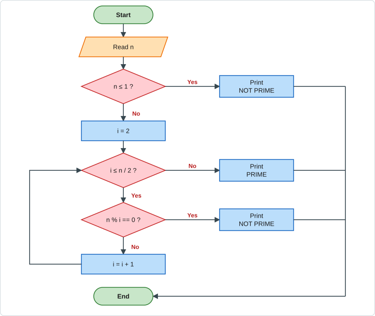

**Dry run**

| n | i values tried | `n % i` | Result |
|---|---|---|---|
| 7 | 2, 3 | 1, 1 | loop ends → **PRIME** |
| 9 | 2, 3 | 1, **0** | divisible at `i=3` → **NOT PRIME** |
| 1 | – | – | `n ≤ 1` → **NOT PRIME** |

### (c) How do we declare a variable? Rules for naming a variable

A **variable** is a named memory location that stores a value which can change during execution. It must be declared before use.

**Syntax:** `data_type variable_name;` — optionally with initialisation.

```c
int age;                 // declaration
float price = 99.5f;     // declaration + initialisation
char grade = 'A';
int a, b, c;             // several variables of the same type
```

**Rules for naming a variable**
1. Only letters (`a–z`, `A–Z`), digits (`0–9`) and underscore (`_`) are allowed.
2. The first character must be a **letter or underscore** — never a digit.
3. **No spaces** or special symbols (`@ # $ - . ,`).
4. **Keywords** (`int`, `float`, `if`, `while` …) cannot be used as names.
5. Names are **case-sensitive** (`Sum` ≠ `sum`).
6. Name length: at least the first 31 characters are significant (C99).
7. Choose meaningful names (`total_marks`, not `x1`).

| Valid | Invalid | Reason |
|---|---|---|
| `total_marks` | `2nd_mark` | starts with a digit |
| `_count` | `my var` | contains a space |
| `x1` | `float` | keyword |
| `Sum` | `a-b` | `-` not allowed |

---

<a id="q2"></a>
## Q2 · 2019 — Q2

### (a) Limitations of the `switch` statement, with examples

1. **Only integer-type expressions** (`int`, `char`, `enum`) can be tested — `float`, `double` and strings are **not** allowed.
2. `case` labels must be **constants** — variables are not allowed.
3. **No relational / logical conditions** — only equality with a constant.
4. **No range** testing (`case 1..10` is not standard C).
5. **Duplicate** `case` values are an error.
6. Without `break`, execution **falls through** to the next case.

```c
float f = 2.5;
switch (f) { case 2.5: break; }      // ❌ error: switch quantity is not an integer

int marks = 85, limit = 50;
switch (marks) {
    case limit:      break;          // ❌ case label must be a constant
    case marks >= 80: break;         // ❌ relational expression not allowed
    case 80 ... 89:  break;          // ❌ range is only a GCC extension
}

char *s = "abc";
switch (s) { case "abc": break; }    // ❌ strings cannot be used
```
For these situations, use an **`if – else if`** ladder.

### (b) Output of the program

```c
main() {
    int i = '0', a;
    if (a == i)
        printf("%d", a);
}
```

**Explanation**
- `i = '0'` stores the **ASCII value of the character `'0'`, which is 48**.
- `a` is a local variable that is **never initialised**, so it holds a **garbage value**.
- `a == i` is true only if the garbage value happens to be 48.

**Output:** normally **nothing is printed** (the condition is false). If `a` happened to contain 48 it would print `48`. The result is **undefined / unpredictable**.

### (c) C program: marks → grade point

| Marks | Grade point |
|---|---|
| ≥ 90 | 4.0 |
| 80 – <90 | 3.5 |
| 70 – <80 | 3.0 |
| 60 – <70 | 2.5 |
| 50 – <60 | 2.0 |
| < 50 | 0 |

```c
#include <stdio.h>

int main(void) {
    float mark, gp;

    printf("Enter marks (0-100): ");
    scanf("%f", &mark);

    if (mark < 0 || mark > 100) {
        printf("Invalid marks!\n");
        return 1;
    }

    if      (mark >= 90) gp = 4.0;
    else if (mark >= 80) gp = 3.5;
    else if (mark >= 70) gp = 3.0;
    else if (mark >= 60) gp = 2.5;
    else if (mark >= 50) gp = 2.0;
    else                 gp = 0.0;

    printf("Grade point = %.1f\n", gp);
    return 0;
}
```
**Sample run:** `Enter marks (0-100): 84` → `Grade point = 3.5`

---

<a id="q3"></a>
## Q3 · 2019 — Q3

### (a) How do `continue` and `break` work in a loop?

- **`break`** — immediately **terminates the loop** (or `switch`); control moves to the first statement after the loop.
- **`continue`** — **skips the rest of the current iteration** and jumps to the next iteration (to the update expression in `for`, to the condition in `while`).

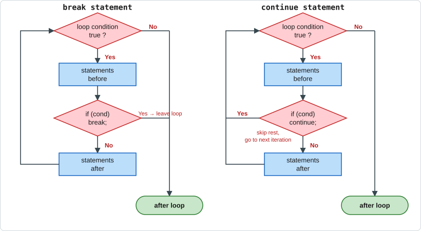

```c
#include <stdio.h>
int main(void) {
    int i;
    printf("break   : ");
    for (i = 1; i <= 10; i++) { if (i == 5) break;    printf("%d ", i); }
    printf("\ncontinue: ");
    for (i = 1; i <= 5;  i++) { if (i == 3) continue; printf("%d ", i); }
    return 0;
}
```
**Output**
```text
break   : 1 2 3 4
continue: 1 2 4 5
```

| | `break` | `continue` |
|---|---|---|
| Effect | Leaves the loop | Skips to next iteration |
| Used in | loops and `switch` | loops only |
| Remaining iterations | Never executed | Still executed |

### (b) Output of the code portions

**(i)**
```c
for (i = 1; i <= 10; i++) {
    printf("%d", i);
    continue;
    i++;
}
```
`continue` jumps straight to `i++` of the `for` header, so the **`i++` inside the body is unreachable** and never runs. Each value 1…10 is printed once.

**Output:** `12345678910`

**(ii)**
```c
int a = 0;
while (a) { ... }
```
`a = 0` is **false**, so the loop condition fails at once and the body (the `switch`, `continue`, `a++`) **never executes**.

**Output:** *nothing is printed.*
*(Note: had `a` been 2, `continue` would skip `a++` and the loop would run forever.)*

### (c) Fibonacci series up to a given number

```c
#include <stdio.h>

int main(void) {
    int n, a = 0, b = 1, next;

    printf("Enter a number: ");
    scanf("%d", &n);

    printf("Fibonacci series up to %d: ", n);
    while (a <= n) {
        printf("%d ", a);
        next = a + b;
        a = b;
        b = next;
    }
    printf("\n");
    return 0;
}
```
**Trace for n = 20**

| a | b | printed |
|---|---|---|
| 0 | 1 | 0 |
| 1 | 1 | 1 |
| 1 | 2 | 1 |
| 2 | 3 | 2 |
| 3 | 5 | 3 |
| 5 | 8 | 5 |
| 8 | 13 | 8 |
| 13 | 21 | 13 |
| 21 | 34 | loop stops (21 > 20) |

**Output:** `Fibonacci series up to 20: 0 1 1 2 3 5 8 13`

---

<a id="q4"></a>
## Q4 · 2019 — Q4

### (a) `while` vs `do-while`; what happens with the given code?

| Basis | `while` | `do-while` |
|---|---|---|
| Type | **Entry-controlled** — condition tested first | **Exit-controlled** — condition tested after the body |
| Minimum executions | **0** | **1** |
| Semicolon | none after `)` | required after `while(...)` |

```c
int i = 10;
while (i < 5)      printf("while\n");        // prints nothing
do { printf("do-while\n"); } while (i < 5);  // prints once
```

**Given code**
```c
for (i = 0; i < 5; i++);
printf("%d", i);
```
The **semicolon after `)` is an empty (null) statement**, so the `for` loop runs 5 times doing nothing. When it ends, `i = 5`, and `printf` runs once (it is *not* part of the loop).

**Output:** `5`

### (b) How does `goto` work?

`goto label;` transfers control **unconditionally** to the statement marked by `label:` in the same function.

```c
#include <stdio.h>
int main(void) {
    int i = 1;
loop:                       // label
    printf("%d ", i);
    i++;
    if (i <= 5) goto loop;  // jump back
    return 0;
}
```
**Output:** `1 2 3 4 5`

*Drawback:* overusing `goto` creates "spaghetti code" that is hard to read; prefer loops. It is acceptable for breaking out of deeply nested loops.

### (c) Sum of the digits of an integer

```c
#include <stdio.h>

int main(void) {
    int n, sum = 0;
    printf("Enter an integer: ");
    scanf("%d", &n);
    if (n < 0) n = -n;

    while (n > 0) {
        sum += n % 10;   // last digit
        n   /= 10;       // remove last digit
    }
    printf("Sum of digits = %d\n", sum);
    return 0;
}
```
**Trace for n = 1234**

| n | n % 10 | sum |
|---|---|---|
| 1234 | 4 | 4 |
| 123 | 3 | 7 |
| 12 | 2 | 9 |
| 1 | 1 | 10 |
| 0 | loop ends | **10** |

---

<a id="q5"></a>
## Q5 · 2019 — Q5

### (a) Why do we need arrays? What if fewer / more values are assigned?

An **array** is a collection of elements of the **same type** stored in **contiguous memory** and accessed by an index.

**Need:** (1) store many values under one name instead of `a1, a2, … a100`; (2) process them with loops; (3) easy sorting/searching; (4) efficient memory access by index.

```c
int marks[5];                 // instead of m1, m2, m3, m4, m5
```

**i. Fewer values than the size**
```c
int a[5] = {1, 2};            // a = {1, 2, 0, 0, 0}
```
The **remaining elements are automatically set to 0**.

**ii. More values than the size**
```c
int a[3] = {1, 2, 3, 4, 5};   // compile warning/error: excess elements in array initializer
```
This is an error/warning at compile time (extra values are ignored). If a program *stores at run-time* beyond the last index (`a[5] = 9;` for size 5), C does **no bounds checking** → **undefined behaviour** (it may overwrite neighbouring memory or crash).

### (b) Output of the program

```c
main() {
    int array[5] = {1,2,3,4,5}, i;
    for (i = 4; i >= 2; i--)
        printf("%d\n", array[i+1]);
}
```
| i | accessed | value |
|---|---|---|
| 4 | `array[5]` | **out of bounds → garbage** |
| 3 | `array[4]` | 5 |
| 2 | `array[3]` | 4 |

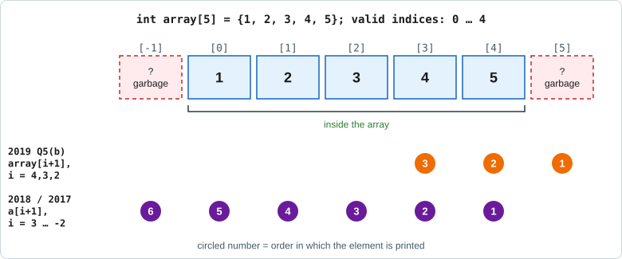

**Output (typical)**
```text
<garbage value>
5
4
```
The first line is undefined because index 5 does not exist (valid indices are 0–4).

### (c) Read a 2 × 4 array and replace negative numbers by zero

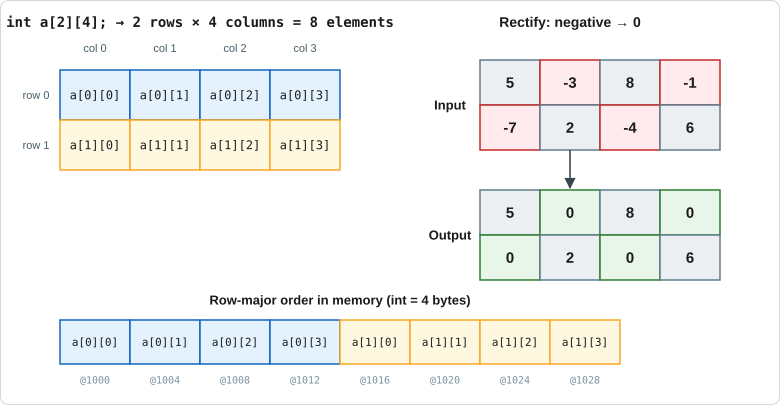

```c
#include <stdio.h>

int main(void) {
    int a[2][4], i, j;

    printf("Enter 8 elements:\n");
    for (i = 0; i < 2; i++)
        for (j = 0; j < 4; j++) {
            scanf("%d", &a[i][j]);
            if (a[i][j] < 0)          // rectify
                a[i][j] = 0;
        }

    printf("Rectified array:\n");
    for (i = 0; i < 2; i++) {
        for (j = 0; j < 4; j++)
            printf("%d ", a[i][j]);
        printf("\n");
    }
    return 0;
}
```
**Sample:** input `5 -3 8 -1 -7 2 -4 6` → output
```text
5 0 8 0
0 2 0 6
```

---

<a id="q6"></a>
## Q6 · 2019 — Q6

### (a) `strcmp()` and `strcat()`  *(header: `<string.h>`)*

**`strcmp(s1, s2)`** — compares two strings character by character (by ASCII value).
Returns **0** if equal, **< 0** if `s1 < s2`, **> 0** if `s1 > s2`.

**`strcat(s1, s2)`** — **appends** `s2` to the end of `s1` (`s1` must be large enough) and returns `s1`.

```c
#include <stdio.h>
#include <string.h>
int main(void) {
    char a[20] = "Hello", b[] = " BUTEX";
    printf("%d\n", strcmp("abc", "abc"));   // 0
    printf("%d\n", strcmp("apple", "bat")); // negative ('a' < 'b')
    strcat(a, b);
    printf("%s\n", a);                      // Hello BUTEX
    return 0;
}
```
**Output:** `0`, a negative number (e.g. `-1`), `Hello BUTEX`

### (b) Output of the program

```c
main() {
    char *string = "BUTEX-45";
    printf("%c\n", string);
    printf("%c\n", *string);
    printf("%c\n", *string + 10);
    printf("%c\n", *(string + 10));
}
```
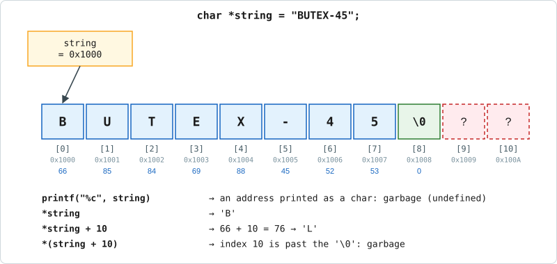

| Statement | Explanation | Result |
|---|---|---|
| `printf("%c", string)` | `string` is an **address**, but `%c` expects a character → prints one byte of the address | garbage (undefined) |
| `*string` | first character | `B` |
| `*string + 10` | `'B'` (66) + 10 = 76 → ASCII 76 | `L` |
| `*(string + 10)` | index 10 is **after** `'\0'` (the string has indices 0–8) | garbage (undefined) |

**Output (typical):** `<garbage>` `B` `L` `<garbage>` (one per line).

### (c) Print the words of a string vertically

Each word is displayed on its own line (spaces are replaced by new-lines).

```c
#include <stdio.h>
#include <string.h>

int main(void) {
    char s[100];
    int i;

    printf("Enter a string: ");
    fgets(s, sizeof s, stdin);
    s[strcspn(s, "\n")] = '\0';        // remove trailing newline

    for (i = 0; s[i] != '\0'; i++)
        if (s[i] == ' ')
            s[i] = '\n';               // modify the string

    printf("%s\n", s);
    return 0;
}
```
**Sample:** `I love BUTEX` →
```text
I
love
BUTEX
```

---

<a id="q7"></a>
## Q7 · 2019 — Q7

### (a) Actual and formal parameters; call by value and call by reference

- **Actual parameters (arguments)** — the values/variables written in the function **call**: `swap(a, b);`
- **Formal parameters** — the variables declared in the function **definition** that receive the values: `void swap(int x, int y)`.

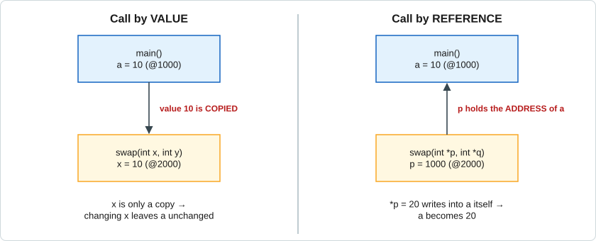

**Call by value** — a **copy** of the argument is passed; changes inside the function do **not** affect the original.
```c
#include <stdio.h>
void swap(int x, int y) { int t = x; x = y; y = t; }
int main(void) {
    int a = 10, b = 20;
    swap(a, b);
    printf("a=%d b=%d\n", a, b);
}
```
**Output:** `a=10 b=20` (unchanged)

**Call by reference** — the **address** is passed using pointers; the function changes the original variables.
```c
#include <stdio.h>
void swap(int *p, int *q) { int t = *p; *p = *q; *q = t; }
int main(void) {
    int a = 10, b = 20;
    swap(&a, &b);
    printf("a=%d b=%d\n", a, b);
}
```
**Output:** `a=20 b=10` (swapped)

### (b) Storage class — how many kinds? Explain with example

A **storage class** tells the compiler **where** a variable is stored, its **default value**, **scope** and **lifetime**. C has **four** storage classes: `auto`, `register`, `static`, `extern`.

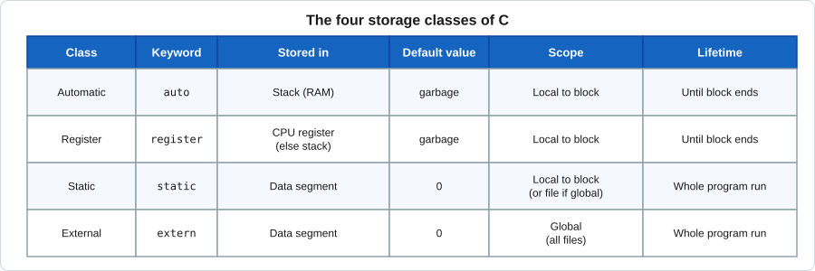

```c
#include <stdio.h>
int g = 100;                       // global → external linkage (extern from other files)

void counter(void) {
    static int s = 0;              // static: keeps value between calls
    auto   int a = 0;              // auto (default for locals): created every call
    s++; a++;
    printf("static=%d auto=%d\n", s, a);
}

int main(void) {
    register int r;                // request to keep in a CPU register
    extern int g;                  // refers to the global g
    for (r = 0; r < 3; r++) counter();
    printf("g=%d\n", g);
    return 0;
}
```
**Output**
```text
static=1 auto=1
static=2 auto=1
static=3 auto=1
g=100
```

### (c) Function that takes 5 integers and prints their average

```c
#include <stdio.h>

void average(int a, int b, int c, int d, int e) {
    float avg = (a + b + c + d + e) / 5.0;
    printf("Average = %.2f\n", avg);
}

int main(void) {
    int n1, n2, n3, n4, n5;
    printf("Enter 5 integers: ");
    scanf("%d %d %d %d %d", &n1, &n2, &n3, &n4, &n5);
    average(n1, n2, n3, n4, n5);
    return 0;
}
```
**Sample:** `10 20 30 40 50` → `Average = 30.00`  *(use `5.0`, not `5`, to avoid integer division)*

---

<a id="q8"></a>
## Q8 · 2019 — Q8

### (a) Advantages and disadvantages of functions

**Advantages**
1. **Reusability** — write once, call many times.
2. **Modularity** — a big problem is split into small, manageable parts.
3. **Easier debugging and testing** — each function can be tested separately.
4. **Shorter code** — avoids repeating the same statements.
5. **Teamwork** — different programmers can write different functions.
6. Readability and maintenance improve.

**Disadvantages**
1. **Function-call overhead** (pushing arguments, jumping, returning) makes execution slightly slower.
2. Extra **memory** for stack frames; deep recursion can cause stack overflow.
3. Needs **careful design** of parameters and return types.
4. Passing large data by value is costly.

### (b) Output of the program

```c
int module() {
    static int i = 45;
    return i++;
}
main() {
    int a = module(), b = module();
    printf("%d %d", a, b);
}
```
- `static int i = 45;` is initialised **only once** and keeps its value between calls.
- 1st call: returns `45`, then `i` becomes 46 → `a = 45`.
- 2nd call: returns `46`, then `i` becomes 47 → `b = 46`.

**Output:** `45 46`

### (c) Function to compute nCr = n! / (r! (n−r)!)

```c
#include <stdio.h>

long factorial(int n) {              // returns n!
    long f = 1;
    for (int i = 2; i <= n; i++)
        f *= i;
    return f;
}

long nCr(int n, int r) {             // uses factorial()
    return factorial(n) / (factorial(r) * factorial(n - r));
}

int main(void) {
    int n, r;
    printf("Enter n and r: ");
    scanf("%d %d", &n, &r);
    if (r > n || n < 0 || r < 0) { printf("Invalid input\n"); return 1; }
    printf("%dC%d = %ld\n", n, r, nCr(n, r));
    return 0;
}
```
**Sample:** `5 2` → `5C2 = 10`  (5! = 120, 2! = 2, 3! = 6 → 120/12 = 10)

---

# PART B — 2018 (first paper)

<a id="q9"></a>
## Q9 · 2018 — Q1

### (a) What is an algorithm? Importance in programming

An **algorithm** is a finite sequence of clear, unambiguous steps that solves a problem and always terminates with a result.

**Importance**
1. Gives a **clear plan** before coding, saving time.
2. **Language-independent**.
3. Reduces logical errors and helps in **debugging**.
4. Helps compare solutions by **efficiency** (time and memory).
5. Serves as **documentation**.

*Characteristics:* input, output, definiteness, finiteness, effectiveness.

### (b) Flow chart: maximum of 10 integers

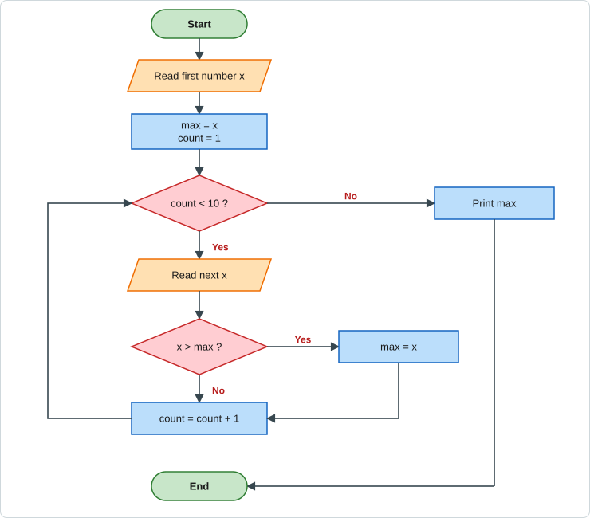

**Idea:** take the first number as `max`; read the other nine one by one and replace `max` whenever a larger number appears.

### (c) Statement and operator; arithmetic operators in C

- **Statement** — a complete instruction ending with `;` (e.g. `x = a + b;`).
- **Operator** — a symbol that performs an operation on operands (e.g. `+`, `>`, `&&`).

| Operator | Meaning | Example (a = 17, b = 5) | Result |
|---|---|---|---|
| `+` | addition | `a + b` | 22 |
| `-` | subtraction | `a - b` | 12 |
| `*` | multiplication | `a * b` | 85 |
| `/` | division (integer if both int) | `a / b` | 3 |
| `%` | remainder (modulus) | `a % b` | 2 |
| `++` / `--` | increment / decrement | `a++` | 17 then a = 18 |

### (d) Define variable; rules of declaring variables

A **variable** is a named storage location whose value may change during execution. Declare with `type name;`.
**Rules:** start with a letter/underscore; only letters, digits, `_`; no spaces/special characters; not a keyword; case-sensitive; unique within its scope. *(Examples and table: see [Q1(c)](#q1).)*

---

<a id="q10"></a>
## Q10 · 2018 — Q2

### (a) C program to check whether an integer is prime

```c
#include <stdio.h>

int main(void) {
    int n, i, isPrime = 1;
    printf("Enter an integer: ");
    scanf("%d", &n);

    if (n <= 1) isPrime = 0;
    for (i = 2; i <= n / 2 && isPrime; i++)
        if (n % i == 0)
            isPrime = 0;

    printf("%d is %s\n", n, isPrime ? "a prime number" : "not a prime number");
    return 0;
}
```
**Sample:** `29` → `29 is a prime number`; `21` → `21 is not a prime number`.
*(Flow chart: see [Q1(b)](#q1).)*

### (b) `continue` and `break`
`break` exits the loop immediately; `continue` skips the rest of the current iteration and starts the next one. *(Definition, figure, example and table: see [Q3(a)](#q3).)*

### (c) Output of the program

```c
int i;
for (i = 5; i < 20; i += 3) {
    if (i % 2 == 0)
        continue;
    printf("%d", i);
}
printf("%d", i);
```
| i | i % 2 == 0 ? | action |
|---|---|---|
| 5 | no | print **5** |
| 8 | yes | `continue` (skip print) |
| 11 | no | print **11** |
| 14 | yes | `continue` |
| 17 | no | print **17** |
| 20 | – | `20 < 20` false → loop ends |

After the loop, `i = 20`, so the last `printf` prints **20**.

**Output:** `5111720`

---

<a id="q11"></a>
## Q11 · 2018 — Q3

### (a) Why do we need arrays?
To store a **collection of same-type values under one name** and process them with loops, instead of declaring many separate variables; arrays also make sorting and searching easy. *(Details: [Q5(a)](#q5).)*

### (b) Program: take 10 integers and show the average

```c
#include <stdio.h>

int main(void) {
    int a[10], i, sum = 0;
    printf("Enter 10 integers: ");
    for (i = 0; i < 10; i++) {
        scanf("%d", &a[i]);
        sum += a[i];
    }
    printf("Average = %.2f\n", sum / 10.0);
    return 0;
}
```
**Sample:** `1 2 3 4 5 6 7 8 9 10` → `Average = 5.50`
*(Flow chart: [Q17(b)](#q17).)*

### (c) Output of the program

```c
int a[5] = {1,2,3,4,5};
for (i = 3; i >= -2; i--)
    printf("%d", a[i+1]);
```
| i | `a[i+1]` | value |
|---|---|---|
| 3 | `a[4]` | 5 |
| 2 | `a[3]` | 4 |
| 1 | `a[2]` | 3 |
| 0 | `a[1]` | 2 |
| −1 | `a[0]` | 1 |
| −2 | `a[-1]` | **out of bounds → garbage** |


**Output:** `54321` followed by one garbage value (undefined behaviour).

---

<a id="q12"></a>
## Q12 · 2018 — Q4

### (a) Difference between `=` and `==`; example

| `=` | `==` |
|---|---|
| **Assignment** operator — stores the right value into the left variable | **Relational (equality)** operator — compares two values |
| Result: the assigned value | Result: `1` (true) or `0` (false) |

```c
int a = 5;          // assigns 5 to a
if (a == 5)         // compares: true
    printf("equal");
if (a = 0)          // ❌ common bug: assigns 0, condition becomes false
    printf("never printed");
```

### (b) `int a = 32790;` with a 2-byte integer — will it work?

**No.** A 2-byte (16-bit) **signed** integer can hold only **−32768 to 32767**. `32790` exceeds `32767`, so **overflow** occurs: the bit pattern `1000 0000 0001 0110` is read with the sign bit = 1, giving

32790 − 65536 = **−32746**.

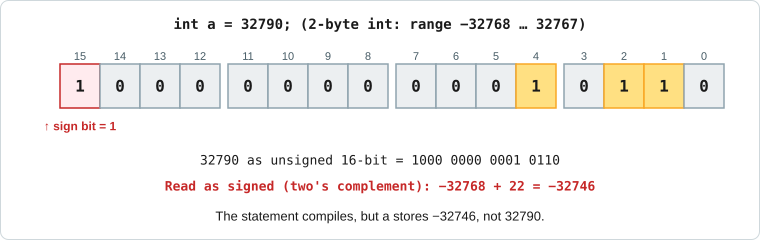

*Fix:* use `unsigned int` (0–65535) or `long int`.

### (c) Program: number is negative or positive

```c
#include <stdio.h>

int main(void) {
    int n;
    printf("Enter a number: ");
    scanf("%d", &n);

    if (n > 0)       printf("%d is positive\n", n);
    else if (n < 0)  printf("%d is negative\n", n);
    else             printf("The number is zero\n");
    return 0;
}
```

### (d) What will be printed?

```c
int a = 2, c, d;
c = a++ + a++;
printf("%d", c);

a = 2;
d = ++a + a++;
printf("%d", d);
```
- `c = a++ + a++;` → classic (Turbo C / textbook) evaluation: each `a++` uses the **old value 2** (post-increment), so `c = 2 + 2 = 4`; `a` becomes 4 afterwards.
- `d = ++a + a++;` → classic evaluation: `a++` gives 2 (a → 3), then `++a` makes `a = 4` and the sum of the operands is **6**, hence `d = 6`.

**Output (textbook answer):** `46`

⚠️ Modifying a variable more than once between sequence points is **undefined behaviour**. The textbook answer is `4` and `6`, but a modern compiler such as GCC may print different numbers (e.g. `5` and `7`). In the exam write the textbook answer **and** mention that the behaviour is undefined.

---

<a id="q13"></a>
## Q13 · 2018 — Q5

### (a) Function: mark → grade point

```c
#include <stdio.h>

float gradePoint(float mark) {
    if (mark >= 90) return 4.0;
    if (mark >= 80) return 3.5;
    if (mark >= 70) return 3.0;
    if (mark >= 60) return 2.5;
    if (mark >= 50) return 2.0;
    return 0.0;
}

int main(void) {
    float m;
    printf("Enter mark: ");
    scanf("%f", &m);
    printf("Grade point = %.1f\n", gradePoint(m));
    return 0;
}
```
**Sample:** `73` → `Grade point = 3.0`

### (b) Advantages of using FILE; `fscanf()` and `fprintf()`

**Advantages of files**
1. Data is **permanent** (kept after the program ends, unlike variables in RAM).
2. Can store **large amounts** of data.
3. Data can be **shared** between programs / transferred between computers.
4. Input can be given without typing every time; output can be saved and reused.

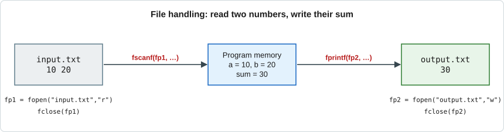

| Function | Syntax | Purpose |
|---|---|---|
| `fscanf` | `fscanf(fp, "format", &var…);` | Reads **formatted** data from a file (like `scanf`) |
| `fprintf` | `fprintf(fp, "format", values…);` | Writes **formatted** data to a file (like `printf`) |

```c
FILE *fp = fopen("data.txt", "w");
fprintf(fp, "%d %s\n", 101, "Rahim");      // write
fclose(fp);

fp = fopen("data.txt", "r");
int id; char name[20];
fscanf(fp, "%d %s", &id, name);            // read → id=101, name="Rahim"
fclose(fp);
```

### (c) Read two strings from `input.txt`, join them, write to `output.txt`

```c
#include <stdio.h>
#include <string.h>

int main(void) {
    FILE *fin, *fout;
    char s1[50], s2[50], result[100];

    fin = fopen("input.txt", "r");
    if (fin == NULL) { printf("Cannot open input.txt\n"); return 1; }

    fscanf(fin, "%49s %49s", s1, s2);      // two strings
    fclose(fin);

    strcpy(result, s1);
    strcat(result, s2);                    // join

    fout = fopen("output.txt", "w");
    fprintf(fout, "%s\n", result);
    fclose(fout);

    printf("Done. Joined string = %s\n", result);
    return 0;
}
```
**Example:** `input.txt` = `BUTEX University` → `output.txt` = `BUTEXUniversity`

---

<a id="q14"></a>
## Q14 · 2018 — Q6

### (a) What do `ch`, `*ch`, `&ch` hold?

```c
char *ch, letter = 'A';
ch = &letter;
```
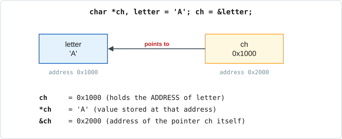

| Expression | Holds |
|---|---|
| `ch` | the **address of `letter`** (e.g. 0x1000) — `ch` is a pointer variable |
| `*ch` | the **value stored at that address**, i.e. `'A'` (dereference) |
| `&ch` | the **address of the pointer variable `ch` itself** (e.g. 0x2000) |

### (b) Print the string using a pointer

```c
#include <stdio.h>

int main(void) {
    char word[] = "BUTEX";
    char *p = word;                 // points to word[0]

    while (*p != '\0') {
        printf("%c", *p);
        p++;                        // move to next character
    }
    printf("\n");
    return 0;
}
```
**Output:** `BUTEX`

### (c) Structure vs union

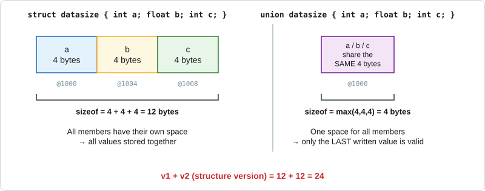

| Basis | `struct` | `union` |
|---|---|---|
| Keyword | `struct` | `union` |
| Memory | Separate space for **every** member | **One shared** space (size of the largest member) |
| Size | Sum of member sizes (plus padding) | Size of the largest member |
| Access | All members usable at the same time | Only the **last written** member is valid |
| Use | Records (student, employee) | Save memory when only one member is needed at a time |

```c
struct S { int a; float b; char c; };   // sizeof ≈ 12 (4+4+1+3 padding)
union  U { int a; float b; char c; };   // sizeof = 4
```

### (d) Slope of the line through p1(x1, y1) and p2(x2, y2) using a user-defined type

```c
#include <stdio.h>

struct Point { float x, y; };          // user-defined data type

int main(void) {
    struct Point p1, p2;
    float m;

    printf("Enter x1 y1: "); scanf("%f %f", &p1.x, &p1.y);
    printf("Enter x2 y2: "); scanf("%f %f", &p2.x, &p2.y);

    if (p2.x == p1.x)
        printf("Slope is undefined (vertical line)\n");
    else {
        m = (p2.y - p1.y) / (p2.x - p1.x);
        printf("Slope m = %.2f\n", m);
    }
    return 0;
}
```
**Sample:** `(1,2)` and `(3,8)` → `m = (8−2)/(3−1) = 3.00`

---

<a id="q15"></a>
## Q15 · 2018 — Q7

### (a) Differences between call by value and call by reference

| Basis | Call by value | Call by reference |
|---|---|---|
| What is passed | **Copy** of the value | **Address** of the variable |
| Formal parameter | Ordinary variable | **Pointer** |
| Effect on original | **No change** | **Original changes** |
| Memory | Extra memory for copies | No copy of data |
| Call | `f(a)` | `f(&a)` |
| Safer? | Yes (original protected) | Less safe (can modify) |

*(Figure and swap programs: see [Q7(a)](#q7).)*

### (b) `strrev()`, `strcmp()`, `strcat()`

| Function | Purpose | Example |
|---|---|---|
| `strrev(s)` | **Reverses** the string in place | `"abc"` → `"cba"` |
| `strcmp(s1,s2)` | Compares; `0` if equal, `<0` / `>0` otherwise | `strcmp("a","a")` → `0` |
| `strcat(s1,s2)` | Appends `s2` after `s1` | `"Hi"`,`" there"` → `"Hi there"` |

> `strrev()` is **non-standard** (Turbo C / MinGW). With GCC on Linux, write your own reverse loop.

### (c) Palindrome check (library functions allowed)

```c
#include <stdio.h>
#include <string.h>

int main(void) {
    char s[100], rev[100];
    int i, n;

    printf("Enter a string: ");
    scanf("%99s", s);
    n = strlen(s);

    for (i = 0; i < n; i++)          // build reversed copy
        rev[i] = s[n - 1 - i];
    rev[n] = '\0';

    if (strcmp(s, rev) == 0)
        printf("\"%s\" is a palindrome\n", s);
    else
        printf("\"%s\" is not a palindrome\n", s);
    return 0;
}
```
**Sample:** `madam` → palindrome; `butex` → not a palindrome.

### (d) Count alphanumeric characters in a string

```c
#include <stdio.h>
#include <ctype.h>

int main(void) {
    char s[100];
    int i, count = 0;

    printf("Enter a string: ");
    fgets(s, sizeof s, stdin);

    for (i = 0; s[i] != '\0'; i++)
        if (isalnum((unsigned char)s[i]))     // letter or digit
            count++;

    printf("Alphanumeric characters = %d\n", count);
    return 0;
}
```
**For `<html></html>`:** the characters `< > < / >` are ignored; `h t m l` + `h t m l` = **8** ✔.

---

<a id="q16"></a>
## Q16 · 2018 — Q8

### (a) Difference between `'a'` and `"a"`

| | `'a'` | `"a"` |
|---|---|---|
| Name | **Character constant** | **String constant** (literal) |
| Quotes | single | double |
| Stored as | ASCII code **97** | `'a'` followed by `'\0'` |
| Size | 1 byte (type `int` in C) | **2 bytes** |
| Assign to | `char c = 'a';` | `char s[] = "a";` or `char *p = "a";` |

```c
char c = 'a';       // OK
char s[] = "a";     // sizeof(s) == 2  →  ['a']['\0']
```

### (b) Read 2 numbers from a file, add them, write the result to another file

```c
#include <stdio.h>

int main(void) {
    FILE *fp1, *fp2;
    int a, b;

    fp1 = fopen("input.txt", "r");
    if (fp1 == NULL) { printf("Cannot open input.txt\n"); return 1; }
    fscanf(fp1, "%d %d", &a, &b);
    fclose(fp1);

    fp2 = fopen("output.txt", "w");
    fprintf(fp2, "Sum = %d\n", a + b);
    fclose(fp2);
    return 0;
}
```
**Example:** `input.txt` = `10 20` → `output.txt` = `Sum = 30`  *(see figure in [Q13(b)](#q13))*

### (c) What is a header file? Two examples

A **header file** (`.h`) contains **declarations** of functions, macros and data types. It is included with `#include` so that the program can use library functions.

| Header | Functions |
|---|---|
| `<stdio.h>` | `printf()`, `scanf()`, `fopen()`, `fprintf()` — input/output |
| `<math.h>` | `sqrt()`, `pow()`, `sin()` — mathematical functions |
| `<string.h>` | `strlen()`, `strcpy()`, `strcmp()`, `strcat()` |
| `<ctype.h>` | `isalpha()`, `isdigit()`, `toupper()` |

`#include <file.h>` searches the system directories; `#include "file.h"` searches the current folder first (user-defined headers).

---

# PART C — 2018 (second paper)

<a id="q17"></a>
## Q17 · 2018-B — Q1

### (a) What is computer programming? Importance of algorithm
*Computer programming* and the *importance of an algorithm* are answered in [Q1(a)](#q1) and [Q9(a)](#q9). In short: programming is writing instructions for a computer; an algorithm gives a clear, language-independent plan that reduces errors and speeds up development.

### (b) What is a flow chart? Flow chart for the average of 10 integers

A **flow chart** is a **pictorial representation of an algorithm** using standard symbols (oval, parallelogram, rectangle, diamond) connected by arrows.

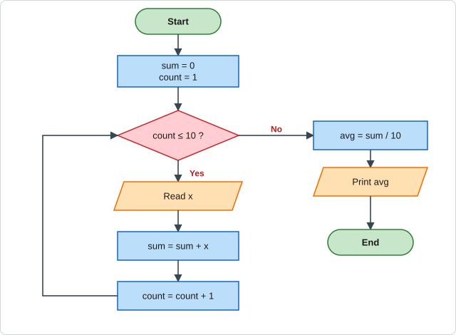

### (c) Difference between `=` and `==`
See [Q12(a)](#q12): `=` assigns a value; `==` compares two values and gives 1 or 0.

### (d) `int a = 32790;` with 2-byte int
See [Q12(b)](#q12): it **does not work correctly** — 32790 > 32767, overflow gives **−32746**.

---

<a id="q18"></a>
## Q18 · 2018-B — Q2

### (a) Differences between `for` and `do-while`

| Basis | `for` | `do-while` |
|---|---|---|
| Control | **Entry-controlled** | **Exit-controlled** |
| Syntax | `for(init; cond; update)` | `do { … } while(cond);` |
| Minimum runs | 0 | **1** |
| Best used when | number of iterations is **known** | body must run **at least once** (menus, input validation) |
| Init/update | inside the header | written separately |

```c
for (i = 1; i <= 3; i++) printf("%d ", i);       // 1 2 3
i = 1; do { printf("%d ", i); i++; } while (i <= 3); // 1 2 3
```

### (b) Program: number negative or positive
See [Q12(c)](#q12).

### (c) Output of the programs

**(i)**
```c
int x = 0;
for (i = 0; i < 10; i++) {
    x = x + i + 10;
    printf("%d", x);
}
```
| i | x = x + i + 10 | printed |
|---|---|---|
| 0 | 0+0+10 | 10 |
| 1 | 10+1+10 | 21 |
| 2 | 21+2+10 | 33 |
| 3 | 33+3+10 | 46 |
| 4 | 46+4+10 | 60 |
| 5 | 60+5+10 | 75 |
| 6 | 75+6+10 | 91 |
| 7 | 91+7+10 | 108 |
| 8 | 108+8+10 | 126 |
| 9 | 126+9+10 | 145 |

**Output:** `10213346607591108126145`

**(ii)** `for(i=0;i<5;i++) printf("%d", i);` → **`01234`**

**(iii)** the same loop with braces `{ printf("%d", i); }` → **`01234`**
Braces are optional when the loop body is a **single statement**, so (ii) and (iii) are identical.

---

<a id="q19"></a>
## Q19 · 2018-B — Q3

### (a) Data types in C

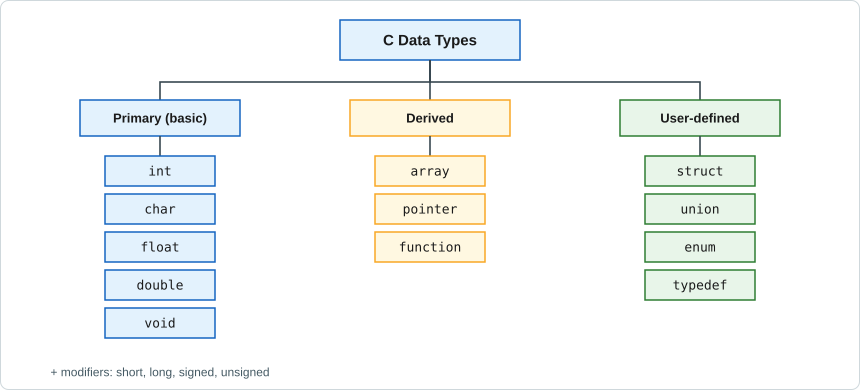

| Type | Typical size | Format | Description / example |
|---|---|---|---|
| `char` | 1 byte | `%c` | single character `'A'` |
| `int` | 4 bytes (2 in old compilers) | `%d` | whole numbers `25` |
| `float` | 4 bytes | `%f` | single-precision real `3.14f` (≈6 digits) |
| `double` | 8 bytes | `%lf` | double-precision real (≈15 digits) |
| `void` | – | – | "no value"; used for functions returning nothing |

- **Modifiers:** `short`, `long`, `signed`, `unsigned` change size/range (e.g. `unsigned int`, `long int`).
- **Derived types:** **array** (same-type collection), **pointer** (stores an address), **function**.
- **User-defined types:** **structure** (`struct`), **union**, **enumeration** (`enum`), **`typedef`** (new name for an existing type).

### (b) `continue` and `break`
See [Q3(a)](#q3).

### (c) What will be printed?
Same code as [Q12(d)](#q12): **`46`** (textbook answer: `c = 2 + 2 = 4`, `d = 6`). Mention that the behaviour is undefined because `a` is modified twice without a sequence point.

---

<a id="q20"></a>
## Q20 · 2018-B — Q4

### (a) Return data type of a function; program to add two integers

The **return type** is the data type written before the function name; it specifies the type of value the function sends back with `return` (`void` if nothing is returned).

```c
#include <stdio.h>

int add(int x, int y) {          // return type = int
    return x + y;
}

int main(void) {
    int a, b;
    printf("Enter two integers: ");
    scanf("%d %d", &a, &b);
    printf("Sum = %d\n", add(a, b));
    return 0;
}
```
**Sample:** `12 8` → `Sum = 20`

### (b) Output of the recursive program

```c
int func(int n) {
    if (n <= 0) return 5;
    else        return n + func(n - 1);
}
int main() { int x; x = func(4); printf("%d", x); return 0; }
```
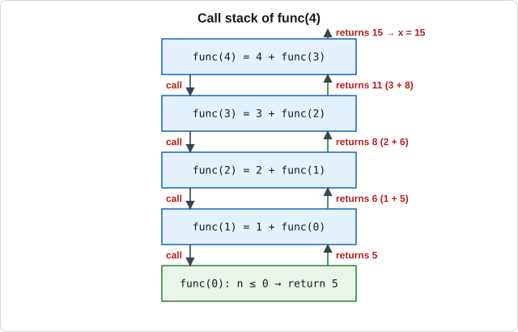

| Call | Computation | Returns |
|---|---|---|
| `func(0)` | base case | 5 |
| `func(1)` | 1 + 5 | 6 |
| `func(2)` | 2 + 6 | 8 |
| `func(3)` | 3 + 8 | 11 |
| `func(4)` | 4 + 11 | **15** |

**Output:** `15`

### (c) Short notes: `sqrt()`, `pow()` *(the paper lists `sqrt()` twice)*

Both are declared in `<math.h>` (link with `-lm` on Linux).

| Function | Prototype | Purpose | Example |
|---|---|---|---|
| `sqrt()` | `double sqrt(double x)` | square root of `x` (x ≥ 0) | `sqrt(25)` → `5.0` |
| `pow()` | `double pow(double x, double y)` | `x` raised to the power `y` | `pow(2,3)` → `8.0` |

```c
#include <stdio.h>
#include <math.h>
int main(void) {
    printf("%.1f %.1f\n", sqrt(25), pow(2, 3));   // 5.0 8.0
}
```

---

<a id="q21"></a>
## Q21 · 2018-B — Q5

### (a) Define pointer. In `int *p`, what are `*p` and `p`?

A **pointer** is a variable that **stores the memory address** of another variable.
In `int *p;` → `p` is the **pointer variable** (holds an address); `*p` is the **integer value stored at the address held by `p`** (dereferencing).
*(Figure: [Q14(a)](#q14).)*

### (b) Output of the program

```c
int func1(int c)   { c++; }
int func2(int *p)  { *p++; }
int main() {
    int a = 3, b = 3;
    func1(a);
    func2(&b);
    printf("%d %d", a, b);
}
```
- `func1(a)` — **call by value**: only the local copy `c` is incremented; `a` stays **3**.
- `func2(&b)` — `*p++` is parsed as `*(p++)`: the **pointer** `p` is incremented (it now points to the next int), the **value** of `b` is **not** changed; `b` stays **3**.
  (To increment the value we would write `(*p)++`.)

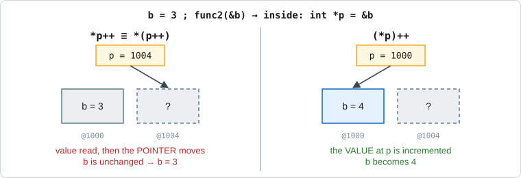

**Output:** `3 3`

### (c) Define recursion function; why do we use `return`?

A **recursive function** is a function that **calls itself** (directly or indirectly) to solve smaller instances of a problem. It needs a **base case** to stop (e.g. `if (n == 0) return 1;`).

The **`return` statement** ends the function and **sends a value back to the caller**; in recursion it passes each result up the chain of calls.

```c
int fact(int n) { return (n <= 1) ? 1 : n * fact(n - 1); }   // fact(4) = 24
```

### (d) Output

```c
int *p, *q, a = 4;
p = &a;
q = p;
printf("%d", *q);
```
`p` holds the address of `a`; `q = p` makes `q` hold the **same address**; `*q` reads the value at that address, i.e. `a`.

**Output:** `4`

---

<a id="q22"></a>
## Q22 · 2018-B — Q6

### (a) Short notes: `strrev()`, `strcmp()`, `strcpy()`  *(`<string.h>`)*

| Function | Purpose | Example |
|---|---|---|
| `strrev(s)` | reverses `s` in place (non-standard) | `"BUTEX"` → `"XETUB"` |
| `strcmp(s1,s2)` | compares two strings → `0` equal, `<0`, `>0` | `strcmp("cat","cat")` = 0 |
| `strcpy(dest, src)` | copies `src` (with `'\0'`) into `dest` | `strcpy(d,"Hi")` → `d = "Hi"` |

### (b) Define string; output of the program

A **string** is a **sequence of characters terminated by the null character `'\0'`**, stored in a `char` array.

```c
char str1[30] = "#love_Bangladesh_cricket";
len = strlen(str1);
printf("%d", len);
```
`strlen` counts characters **before** `'\0'`:

`#`(1) + `love`(4) + `_`(1) + `Bangladesh`(10) + `_`(1) + `cricket`(7) = **24**

**Output:** `24`

### (c) Print each word of the input on a new line

```c
#include <stdio.h>
#include <string.h>

int main(void) {
    char s[100];
    char *word;

    printf("Enter a string: ");
    fgets(s, sizeof s, stdin);
    s[strcspn(s, "\n")] = '\0';

    word = strtok(s, " ");            // split at spaces
    while (word != NULL) {
        printf("%s\n", word);
        word = strtok(NULL, " ");
    }
    return 0;
}
```
**Sample input:** `Quality is not an act, but habit`
```text
Quality
is
not
an
act,
but
habit
```
*(The sample output in the question shows a full stop after "habit"; the input has none. If the full stop is required, add `putchar('.');` after the last word.)*

---

<a id="q23"></a>
## Q23 · 2018-B — Q7

### (a) Difference between `'a'` and `"a"`
See [Q16(a)](#q16): `'a'` is a 1-byte character constant (ASCII 97); `"a"` is a 2-byte string (`'a'` + `'\0'`).

### (b) Read 2 numbers from a file, add, write to another file
See the complete program in [Q16(b)](#q16).

### (c) 2-D array: `int a[2][4];`

A **two-dimensional array** is an array of arrays — a table with **rows and columns**; element access needs two indices `a[row][col]`.

For `int a[2][4];`
- **Dimensions:** **2 rows × 4 columns**
- **Number of variables (elements):** 2 × 4 = **8** (`a[0][0] … a[1][3]`)
- **Memory:** 8 × 4 = 32 bytes (if `int` = 4 bytes), stored row by row.


---

<a id="q24"></a>
## Q24 · 2018-B — Q8

### (a) What is a structure? Structure vs union
A **structure** groups variables of **different types** under one name (`struct student { int id; char name[20]; float cgpa; };`).
Differences and figure: **see [Q14(c)](#q14).**

### (b) Storage for `v1` and `v2`

```c
struct datasize { int a; float b; int c; } v1, v2;
m = sizeof(v1) + sizeof(v2);
```


| Member | Type | Bytes |
|---|---|---|
| `a` | int | 4 |
| `b` | float | 4 |
| `c` | int | 4 |
| **`sizeof(v1)`** | | **12** |

`v2` is the same type → 12 bytes. All members are 4-byte aligned, so there is **no padding**.

`m = 12 + 12 =` **24**  → **Output: `24`**

### (c) Describe `fopen()`, `fclose()`, `fprintf()`, `fscanf()`

| Function | Syntax | Description |
|---|---|---|
| `fopen` | `FILE *fp = fopen("name", "mode");` | Opens a file; returns a `FILE` pointer or `NULL` on failure. Modes: `"r"` read, `"w"` write (erases), `"a"` append, `"r+"`, `"w+"`. |
| `fclose` | `fclose(fp);` | Closes the file and flushes buffered data. |
| `fprintf` | `fprintf(fp, "%d", x);` | Writes formatted output to the file. |
| `fscanf` | `fscanf(fp, "%d", &x);` | Reads formatted input from the file; returns the number of items read (or `EOF`). |

```c
FILE *fp = fopen("a.txt", "w");
if (fp == NULL) return 1;
fprintf(fp, "%d", 25);
fclose(fp);
```

---

# PART D — 2017

<a id="q25"></a>
## Q25 · 2017 — Q1

### (a) Source program vs object program

| Basis | Source program | Object program |
|---|---|---|
| Written in | High-level language (C) | Machine language (binary) |
| Written by | Programmer | Compiler / assembler |
| Readable? | Yes, by humans | No |
| Extension | `.c` | `.o` / `.obj` |
| Executable directly? | No | Not yet — must be **linked** to make an executable |

**Example:** `hello.c` (source) → compile → `hello.o` (object) → link → `hello` / `hello.exe`.

### (b) What is a statement? Types of statements

A **statement** is a complete instruction to the computer, normally ending with `;`.

| Type | Example |
|---|---|
| Declaration | `int a, b;` |
| Expression | `a = b + 5;`   `x++;` |
| Compound (block) | `{ a = 1; b = 2; }` |
| Selection | `if`, `if-else`, `switch` |
| Iteration | `for`, `while`, `do-while` |
| Jump | `break;` `continue;` `goto L;` `return 0;` |
| Null | `;` (does nothing) |
| Labeled | `L: x = 0;` |

### (c) What is a flow chart? Flow chart: odd or even

A flow chart is the **graphical representation of the steps of an algorithm** (see [Q1(a)](#q1)).

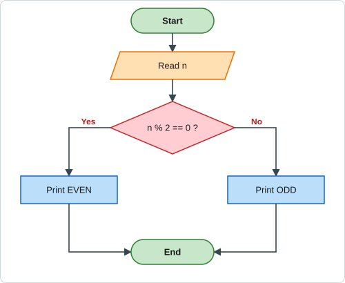

### (d) Categories of errors in C

| Error | When found | Cause / example |
|---|---|---|
| **Syntax error** | Compile time | Rule of the language broken: missing `;`, wrong keyword `itn x;` |
| **Semantic error** | Compile time | Meaningless statement: `a + b = c;` |
| **Linker error** | Link time | Missing function/library: `undefined reference to 'sqrt'` |
| **Runtime error** | While running | Division by zero, invalid memory access (segmentation fault) |
| **Logical error** | Output is wrong | Program runs but logic is wrong: `avg = a + b / 2;` |

*(Warnings are not errors — the program still compiles but may behave unexpectedly.)*

---

<a id="q26"></a>
## Q26 · 2017 — Q2

### (a) Symbolic constant; defining π

A **symbolic constant** is a name that represents a fixed value. It is defined with the preprocessor directive `#define`, which replaces the name by the value **before compilation**. It has **no semicolon** and uses no memory.

```c
#include <stdio.h>
#define PI 3.14159265

int main(void) {
    float r = 5;
    printf("Area = %.2f\n", PI * r * r);     // Area = 78.54
    return 0;
}
```
*Alternative:* `const double PI = 3.14159265;`

### (b) How is a C program compiled and executed?

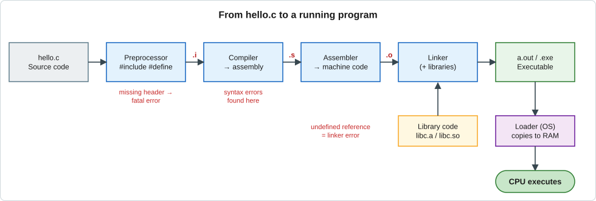

1. **Edit** — write source code `hello.c`.
2. **Preprocessing** — processes `#include`, `#define`, removes comments → `.i`.
3. **Compilation** — checks syntax, translates to **assembly** (`.s`).
4. **Assembly** — assembler converts it to **machine code / object file** (`.o`).
5. **Linking** — linker joins object files with **library code** (`printf` …) → executable.
6. **Loading & execution** — the OS loads the executable into RAM and the CPU runs it.

```bash
gcc hello.c -o hello     # steps 2–5
./hello                  # step 6
```

### (c) Ranges of data types

| Type | Size | Range |
|---|---|---|
| `char` / `signed char` | 1 byte | −128 to 127 |
| **`unsigned char`** | 1 byte | **0 to 255** |
| `short int` | 2 bytes | −32768 to 32767 |
| `unsigned short` | 2 bytes | 0 to 65535 |
| **`int` (signed)** | 2 bytes (old) | **−32768 to 32767** |
| `int` (signed) | 4 bytes (modern) | −2,147,483,648 to 2,147,483,647 |
| `unsigned int` | 4 bytes | 0 to 4,294,967,295 |
| `long int` | 4 or 8 bytes | at least −2³¹ to 2³¹−1 |
| `float` | 4 bytes | ≈ ±3.4 × 10⁻³⁸ to ±3.4 × 10³⁸ (6 digits) |
| `double` | 8 bytes | ≈ ±1.7 × 10⁻³⁰⁸ to ±1.7 × 10³⁰⁸ (15 digits) |

**Answer:** signed integer (2 bytes): **−2¹⁵ to 2¹⁵ − 1 = −32768 to 32767**; unsigned character: **0 to 2⁸ − 1 = 255**.

### (d) What is a variable? Examples
A **variable** is a named memory location that holds a value that can change while the program runs.
```c
int age = 20;  float cgpa = 3.75;  char grade = 'A';
age = 21;                 // value changed → that is why it is "variable"
```
*(Naming rules: [Q1(c)](#q1).)*

---

<a id="q27"></a>
## Q27 · 2017 — Q3

### (a) `for` vs `while` vs `do-while`

| Basis | `for` | `while` | `do-while` |
|---|---|---|---|
| Check | at the **top** | at the **top** | at the **bottom** |
| Init / condition / update | all in one line | init before, update inside | init before, update inside |
| Min. executions | 0 | 0 | **1** |
| Use when | count is known | count is unknown | must run at least once |
| Semicolon after `while(…)` | – | no | **yes** |

### (b) Will the loop terminate?

```c
int i;
for (i = 0; i < 3000; i++);
```
**Yes, it terminates.** `i` increases by 1 each time; when `i` reaches **3000** the condition `i < 3000` becomes false and the loop stops after 3000 (empty) iterations. The `;` after `)` makes the body empty. (A loop like `for(;;)` or `while(1)` without `break` would be infinite.)

### (c) Difference between `&` and `&&`

| `&` | `&&` |
|---|---|
| **Bitwise AND** — works on each bit | **Logical AND** — works on truth values |
| Both operands are always evaluated | **Short-circuit**: if the left side is false, the right side is skipped |
| Result is a number | Result is `1` or `0` |

```c
int a = 6, b = 3;               // 0110 and 0011
printf("%d %d", a & b, a && b); // 2 1
```

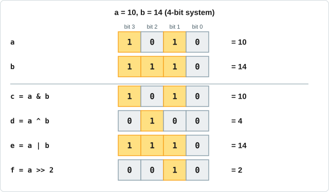

### (d) Rules for nesting loops
1. The **inner loop must be completely inside** the outer loop (no overlapping).
2. Each loop needs its **own control variable** (`i` for outer, `j` for inner).
3. For each iteration of the outer loop, the inner loop runs **completely**.
4. Different types may be nested (`for` inside `while`).
5. Control can jump **out** of nested loops (`break`, `goto`), but **never into** a loop.

```c
for (i = 1; i <= 3; i++) {          // outer
    for (j = 1; j <= i; j++)        // inner
        printf("* ");
    printf("\n");
}
```
```text
*
* *
* * *
```

---

<a id="q28"></a>
## Q28 · 2017 — Q4

### (a) How does `goto` work?
See [Q4(b)](#q4): `goto label;` jumps unconditionally to `label:` in the same function (example prints `1 2 3 4 5`).

### (b) Output

```c
for (i = 0; i < 10; i++) {
    printf("%d", i);
    if (i == 5) break;
}
```
`i` is printed first, and **then** the test `i == 5` triggers `break`, so 5 is also printed.

**Output:** `012345`

### (c) Short notes: `sqrt()`, `pow()`, `getch()`

| Function | Header | Purpose / example |
|---|---|---|
| `sqrt(x)` | `<math.h>` | square root; `sqrt(49)` → `7.0` |
| `pow(x,y)` | `<math.h>` | x to the power y; `pow(3,2)` → `9.0` |
| `getch()` | `<conio.h>` (non-standard, Turbo C/Windows) | reads **one character from the keyboard without echo and without pressing Enter**; commonly used to **hold the output screen** until a key is pressed. |

### (d) Why `return 0;` at the end of `main`?
`main` returns an `int` to the **operating system** as the **exit status**: `0` means **successful termination**; a non-zero value indicates an error. It also marks the end of the program.

---

<a id="q29"></a>
## Q29 · 2017 — Q5

### (a) Storage classes; `register`, `static`, `extern`

There are **four**: `auto`, `register`, `static`, `extern` (table: [Q7(b)](#q7)).

- **`register`** — asks the compiler to keep the variable in a **CPU register** for speed (used for loop counters). Local scope, garbage default, you cannot take its address (`&`).
  `register int i;`
- **`static`** — a local variable that is **initialised once and keeps its value between function calls**; default value 0; lifetime = whole program.
  `static int count = 0;`
- **`extern`** — declares a **global variable defined elsewhere** (another file or later in the file); it does not create new storage.
  `extern int total;`

### (b) User-defined function; add two numbers using a function

A **user-defined function** is a function written by the programmer to perform a specific task (as opposed to library functions like `printf`).

```c
#include <stdio.h>

int sum(int a, int b) { return a + b; }

int main(void) {
    int x, y;
    printf("Enter two numbers: ");
    scanf("%d %d", &x, &y);
    printf("Summation = %d\n", sum(x, y));
    return 0;
}
```
**Sample:** `7 5` → `Summation = 12`

### (c) Why arrays? Output of the program

Need for arrays: see [Q5(a)](#q5).
```c
int a[5] = {1,2,3,4,5}, i;
for (i = 3; i >= -2; i--) printf("%d", a[i+1]);
```
Same as [Q11(c)](#q11): prints `a[4], a[3], a[2], a[1], a[0]`, then `a[-1]` (out of bounds).
**Output:** `54321` + one garbage value (undefined behaviour).

### (d) Output of the program

```c
void fun()  { static int c = 0; printf("%d\n", c); c++; }
void fun2() { int z = 0; }
main: fun(); fun(); fun(); fun2(); fun2();
```
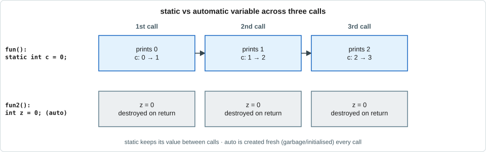

`static int c` is created once and keeps its value, so successive calls print 0, 1, 2. `fun2()` prints nothing; its `z` is recreated on each call.

**Output**
```text
0
1
2
```

---

<a id="q30"></a>
## Q30 · 2017 — Q6

### (a) Relationship between the function's return type and the returned value
The value in the `return` statement should be of the **same type as the return type** declared in the function header. If it differs, the value is **automatically converted** to the declared type.
```c
int f(void) { return 3.7; }    // returns 3 (fractional part lost)
```

### (b) Is an array element changed in a function visible in the caller?
**Yes.** An array name passed to a function is passed as the **address of its first element** (like call by reference), so the function works on the **original array**. A change to an element inside the function is therefore **seen by the calling function**.
```c
void change(int x[]) { x[0] = 99; }
int main(void) { int a[3] = {1,2,3}; change(a); printf("%d", a[0]); }   // 99
```

### (c) Maximum characters in a string declared as an array of 50 characters
One position is reserved for the **null terminator `'\0'`**, so the maximum is **49 characters**.

### (d) What does the program do? Output?

```c
char str1[] = "BUTEx";
char f[10];
int i = 0;
for (strlen(str1) - 1; i >= 0; i--) {
    if (i > 0) i++;
}
for (i = 0; i < strlen(str1); i++)
    printf("%c", f[i]);
```
**Analysis**
1. In the first `for`, the initialisation part is the expression `strlen(str1) - 1`, which is just evaluated and **thrown away**; `i` stays 0. The condition `i >= 0` is true, `if (i > 0)` is false, then `i--` makes `i = -1` and the loop ends. **Nothing is copied into `f`.**
2. The second loop prints `f[0] … f[4]`, but `f` was **never initialised** → garbage characters.

**Output:** 5 unpredictable (garbage) characters — undefined behaviour.

**What the programmer probably intended** — reverse `str1` into `f`:
```c
for (i = strlen(str1) - 1, j = 0; i >= 0; i--, j++) f[j] = str1[i];
f[j] = '\0';          // prints  xETUB
```

---

<a id="q31"></a>
## Q31 · 2017 — Q7

### (a) Structure and union
See [Q24(a)](#q24) and the table + figure in [Q14(c)](#q14).

### (b) Storage required for `v1` and `v2`
Same program as [Q24(b)](#q24): `sizeof(v1) = sizeof(v2) = 4 + 4 + 4 = 12` → **`m = 24`**.

### (c) Bitwise operations, `a = 10`, `b = 14` (4-bit system)


| Expression | Working (4-bit) | Binary | Decimal |
|---|---|---|---|
| `a` | | `1010` | 10 |
| `b` | | `1110` | 14 |
| `c = a & b` | `1010 & 1110` | `1010` | **10** |
| `d = a ^ b` | `1010 ^ 1110` | `0100` | **4** |
| `e = a \| b` | `1010 \| 1110` | `1110` | **14** |
| `f = a >> 2` | shift right two places | `0010` | **2** |

**Answer:** `c = 10, d = 4, e = 14, f = 2`

---

<a id="q32"></a>
## Q32 · 2017 — Q8

### (a) Explain `fopen()`, `fclose()`, `fprintf()`
See the table in [Q24(c)](#q24). Summary: `fopen` opens a file (modes `r`, `w`, `a`) and returns a `FILE*`; `fprintf` writes formatted data to it; `fclose` closes it and flushes the buffer.

### (b) Take two inputs from a text file and write their sum to another file
Complete program: [Q16(b)](#q16). The input/output flow:


### (c) Pointer variable; `p` and `*p` in `int *p;`
A **pointer variable** stores the **address** of another variable.
- `p` — the pointer; it holds an **address** (of an `int`).
- `*p` — the **value stored at that address** (dereference operator).

### (d) Output

```c
int *p, a = 2;
p = &a;
printf("%d", *p);
```
`p` holds the address of `a`; `*p` is the value at that address, i.e. 2.

**Output:** `2`

---

# APPENDIX

## A. Repeated questions across the papers (high-priority revision)

| Topic | Where it appears |
|---|---|
| `break` / `continue` | Q3(a), Q10(b), Q19(b) |
| Prime number program / flow chart | Q1(b), Q10(a) |
| Grade point from marks | Q2(c), Q13(a) |
| Positive / negative number | Q12(c), Q18(b) |
| `=` vs `==` | Q12(a), Q17(c) |
| `int a = 32790` overflow | Q12(b), Q17(d) |
| `c = a++ + a++; d = ++a + a++;` | Q12(d), Q19(c) |
| `a[i+1]` loop out of bounds | Q5(b), Q11(c), Q29(c) |
| `'a'` vs `"a"` | Q16(a), Q23(a) |
| Two numbers from file → sum to file | Q16(b), Q23(b), Q32(b) |
| Structure vs union | Q14(c), Q24(a), Q31(a) |
| Struct size `v1 + v2 = 24` | Q24(b), Q31(b) |
| Call by value vs reference | Q7(a), Q15(a) |
| String functions `strrev/strcmp/strcat/strcpy` | Q6(a), Q15(b), Q22(a) |
| `sqrt()` / `pow()` | Q20(c), Q28(c) |
| Storage classes | Q7(b), Q29(a) |
| `static` variable output | Q8(b), Q29(d) |
| `goto` | Q4(b), Q28(a) |
| Pointers (`p`, `*p`, `&p`) | Q14(a), Q21(a,d), Q32(c,d) |

## B. Quick reference

**Format specifiers:** `%d` int · `%f` float · `%lf` double · `%c` char · `%s` string · `%p` pointer · `%x` hex.

**ASCII values:** `'0'` = 48 · `'A'` = 65 · `'a'` = 97 · `'\0'` = 0.

**Operator precedence (high → low):** `() [] ->` · `! ++ -- * & (unary)` · `* / %` · `+ -` · `<< >>` · `< <= > >=` · `== !=` · `&` · `^` · `|` · `&&` · `||` · `?:` · `= += -=` · `,`

**Things that give *undefined behaviour* (write "garbage / undefined" in exams):**
1. Using an uninitialised local variable (Q2b, Q30d).
2. Accessing an array outside `0 … size-1` (Q5b, Q11c).
3. Modifying a variable twice in one expression (`a++ + a++`, Q12d).
4. Printing with the wrong format specifier (`%c` with a pointer, Q6b).

---
*File: `mdm-101-c-programming-qna-v261018-0.md` · Course: MDM-101 · BUTEX*
