# PHY-103 Electricity: Previous-Year Questions Solved, 2016 to 2023

<strong>Exam-revision notes for BUTEX Fabric Engineering, Physics-II (PHY-103)</strong>

| Item | Detail |
|---|---|
| Course | PHY-103, Physics-II, Fabric Engineering, BUTEX |
| Topic | Electricity (Part A of the question bank) |
| Years covered | 2016, 2017, 2018, 2019, 2020, 2021, 2022, 2023 (every question in the supplied scope list) |
| Repo location | `PHY-103/quick_rev/`, images in `../../assets/` |
| Version | v261103-0 |
| Constants used | $\varepsilon_0 = 8.854\times10^{-12}\,\mathrm{F/m}$, $k = 1/(4\pi\varepsilon_0) \approx 9\times10^{9}\,\mathrm{N\,m^2/C^2}$, $e = 1.602\times10^{-19}\,\mathrm{C}$, $m_e = 9.109\times10^{-31}\,\mathrm{kg}$, $g = 9.8\,\mathrm{m/s^2}$ |

> [!NOTE]
> The file name keeps the label 2015-2023, but the supplied question list contains papers from 2016 to 2023 only. Repeated questions are solved in full at their first appearance; later appearances quote the question and link back.

## Table of Contents

- [Year by Topic Appearance Matrix](#year-by-topic-appearance-matrix)
- [Formula and Units Sheet](#formula-and-units-sheet)
- [Year 2016 Questions](#year-2016-questions)
  - [2016 Q1(a) Ohm's law and resonance](#2016-q1a-ohms-law-and-resonance)
  - [2016 Q1(b) Wheatstone bridge principle using Kirchhoff's laws](#2016-q1b-wheatstone-bridge-principle-using-kirchhoffs-laws)
  - [2016 Q1(c) Potential of a dipole on its axis](#2016-q1c-potential-of-a-dipole-on-its-axis)
  - [2016 Q4(b) The L-R circuit: growth and decay of current](#2016-q4b-the-l-r-circuit-growth-and-decay-of-current)
- [Year 2017 Questions](#year-2017-questions)
  - [2017 Q1(a) Coulomb's law](#2017-q1a-coulombs-law)
  - [2017 Q1(b) Capacitance of a parallel plate capacitor](#2017-q1b-capacitance-of-a-parallel-plate-capacitor)
  - [2017 Q1(c) Capacitor with a sulphur slab](#2017-q1c-capacitor-with-a-sulphur-slab)
  - [2017 Q2(a) Specific resistance; Ohm's law](#2017-q2a-specific-resistance-ohms-law)
  - [2017 Q2(b) Kirchhoff's laws of electricity](#2017-q2b-kirchhoffs-laws-of-electricity)
  - [2017 Q2(c) Wheatstone bridge numerical: balancing resistor](#2017-q2c-wheatstone-bridge-numerical-balancing-resistor)
  - [2017 Q4(b) Time constant and charging of an RC circuit](#2017-q4b-time-constant-and-charging-of-an-rc-circuit)
- [Year 2018 Questions](#year-2018-questions)
  - [2018 Q1(a) Definitions: Gauss's law, Ohm's law, capacitor](#2018-q1a-definitions-gausss-law-ohms-law-capacitor)
  - [2018 Q1(b) Wheatstone bridge principle (repeat)](#2018-q1b-wheatstone-bridge-principle-repeat)
  - [2018 Q1(c) Capacitors in series](#2018-q1c-capacitors-in-series)
  - [2018 Q4(a) Time constant and RC charging (repeat)](#2018-q4a-time-constant-and-rc-charging-repeat)
  - [2018 Q4(b) Resonance and resonant frequency of an RLC circuit](#2018-q4b-resonance-and-resonant-frequency-of-an-rlc-circuit)
  - [2018 Q4(c) RLC numerical](#2018-q4c-rlc-numerical)
  - [2018 Q5(d) Kirchhoff's law of radiation](#2018-q5d-kirchhoffs-law-of-radiation)
- [Year 2019 Questions](#year-2019-questions)
  - [2019 Q1(a) Electric field and electric field intensity](#2019-q1a-electric-field-and-electric-field-intensity)
  - [2019 Q1(b) Coulomb's law and the unit of charge](#2019-q1b-coulombs-law-and-the-unit-of-charge)
  - [2019 Q3(a) Capacitor and capacitance (repeat)](#2019-q3a-capacitor-and-capacitance-repeat)
  - [2019 Q3(b) Ohm's law (repeat)](#2019-q3b-ohms-law-repeat)
- [Year 2020 Questions](#year-2020-questions)
  - [2020 Q1(a) Gauss's law: statement and proof](#2020-q1a-gausss-law-statement-and-proof)
  - [2020 Q1(b) Coulomb's law from Gauss's law](#2020-q1b-coulombs-law-from-gausss-law)
  - [2020 Q1(c) Field that balances the weight of an electron](#2020-q1c-field-that-balances-the-weight-of-an-electron)
  - [2020 Q2(a) Lenz's law and conservation of energy](#2020-q2a-lenzs-law-and-conservation-of-energy)
  - [2020 Q2(b) Exponential rise of current in an LR circuit (repeat)](#2020-q2b-exponential-rise-of-current-in-an-lr-circuit-repeat)
  - [2020 Q2(c) LR numerical: time constant](#2020-q2c-lr-numerical-time-constant)
  - [2020 Q3(b) The L-R circuit (repeat)](#2020-q3b-the-l-r-circuit-repeat)
- [Year 2021 Questions](#year-2021-questions)
  - [2021 Q1(a) Capacitor and capacitance (repeat)](#2021-q1a-capacitor-and-capacitance-repeat)
  - [2021 Q1(b) Capacitance of a parallel plate capacitor (repeat)](#2021-q1b-capacitance-of-a-parallel-plate-capacitor-repeat)
  - [2021 Q1(c) Parallel plate numerical](#2021-q1c-parallel-plate-numerical)
  - [2021 Q3(a) Gauss's law (repeat)](#2021-q3a-gausss-law-repeat)
  - [2021 Q3(b) Wheatstone bridge: balanced condition (repeat)](#2021-q3b-wheatstone-bridge-balanced-condition-repeat)
  - [2021 Q3(c) Field on the perpendicular bisector](#2021-q3c-field-on-the-perpendicular-bisector)
  - [2021 Q4(b) LR growth and decay curves (repeat)](#2021-q4b-lr-growth-and-decay-curves-repeat)
  - [2021 Q4(c) LR numerical: time to half current](#2021-q4c-lr-numerical-time-to-half-current)
  - [2021 Q8(a) Energy stored in a capacitor](#2021-q8a-energy-stored-in-a-capacitor)
- [Year 2022 Questions](#year-2022-questions)
  - [2022 Q1(a) Electric field and intensity (repeat)](#2022-q1a-electric-field-and-intensity-repeat)
  - [2022 Q1(b) Coulomb's law (repeat)](#2022-q1b-coulombs-law-repeat)
  - [2022 Q1(c) Parallel plate capacitor expression (repeat)](#2022-q1c-parallel-plate-capacitor-expression-repeat)
  - [2022 Q2 Resistivity, Kirchhoff's second law, Wheatstone numerical](#2022-q2-resistivity-kirchhoffs-second-law-wheatstone-numerical)
  - [2022 Q3 Cross-reference to Q2](#2022-q3-cross-reference-to-q2)
- [Year 2023 Questions](#year-2023-questions)
  - [2023 Q1(a) Gauss's law, Ohm's law, capacitor (repeat)](#2023-q1a-gausss-law-ohms-law-capacitor-repeat)
  - [2023 Q1(b) Wheatstone bridge principle (repeat)](#2023-q1b-wheatstone-bridge-principle-repeat)
  - [2023 Q1(c) Capacitors in series (repeat)](#2023-q1c-capacitors-in-series-repeat)
  - [2023 Q4(a) Time constant and RC charging (repeat)](#2023-q4a-time-constant-and-rc-charging-repeat)
  - [2023 Q4(b) Resonance and resonant frequency (repeat)](#2023-q4b-resonance-and-resonant-frequency-repeat)
  - [2023 Q4(c) RLC numerical (year-specific copy)](#2023-q4c-rlc-numerical-year-specific-copy)
- [Concept Map of the Chapter](#concept-map-of-the-chapter)
- [One-Page Cheat Sheet](#one-page-cheat-sheet)
- [Glossary](#glossary)
- [Practice Problems with Answers](#practice-problems-with-answers)

## Year by Topic Appearance Matrix

Each cell lists the question numbers in which the topic was asked (Q2/Q3 in 2022 are identical copies). The last column counts question appearances.

| Topic | 2016 | 2017 | 2018 | 2019 | 2020 | 2021 | 2022 | 2023 | Times asked |
|---|---|---|---|---|---|---|---|---|---|
| Ohm's law | Q1(a) | Q2(a) | Q1(a) | Q3(b) | - | - | Q2(a), Q3(a) | Q1(a) | 7 |
| Wheatstone bridge principle | Q1(b) | - | Q1(b) | - | - | Q3(b) | - | Q1(b) | 4 |
| Wheatstone numerical (8, 16, 12, 48) | - | Q2(c) | - | - | - | - | Q2(c), Q3(c) | - | 3 |
| Gauss's law | - | - | Q1(a) | - | Q1(a), Q1(b) | Q3(a) | - | Q1(a) | 5 |
| Capacitor and capacitance (definition) | - | - | Q1(a) | Q3(a) | - | Q1(a) | - | Q1(a) | 4 |
| Capacitance of parallel plates (expression) | - | Q1(b) | - | - | - | Q1(b) | Q1(c) | - | 3 |
| LR circuit growth and decay | Q4(b) | - | - | - | Q2(b), Q3(b) | Q4(b) | - | - | 4 |
| Coulomb's law | - | Q1(a) | - | Q1(b) | - | - | Q1(b) | - | 3 |
| RC circuit and time constant | - | Q4(b) | Q4(a) | - | - | - | - | Q4(a) | 3 |
| RLC resonance (theory) | Q1(a) | - | Q4(b) | - | - | - | - | Q4(b) | 3 |
| Specific resistance | - | Q2(a) | - | - | - | - | Q2(a), Q3(a) | - | 3 |
| Kirchhoff's laws of electricity | - | Q2(b) | - | - | - | - | Q2(b), Q3(b) | - | 3 |
| Electric field and intensity | - | - | - | Q1(a) | - | - | Q1(a) | - | 2 |
| Dipole potential and field | Q1(c) | - | - | - | - | Q3(c) | - | - | 2 |
| Series capacitors | - | - | Q1(c) | - | - | - | - | Q1(c) | 2 |
| Capacitor numericals | - | Q1(c) | - | - | - | Q1(c) | - | - | 2 |
| LR numericals | - | - | - | - | Q2(c) | Q4(c) | - | - | 2 |
| RLC numerical (L = 50 uH) | - | - | Q4(c) | - | - | - | - | Q4(c) | 2 |
| Energy stored in a capacitor | - | - | - | - | - | Q8(a) | - | - | 1 |
| Electron weight against electric force | - | - | - | - | Q1(c) | - | - | - | 1 |
| Kirchhoff's law of radiation (thermal) | - | - | Q5(d) | - | - | - | - | - | 1 |
| Lenz's law (magnetism) | - | - | - | - | Q2(a) | - | - | - | 1 |

> [!TIP]
> Priority order for revision: Ohm's law and resistivity, Gauss's law with Coulomb's law, the Wheatstone bridge (theory and the numerical), the capacitor group (definition, parallel plate, series, energy), then the three transient circuits (RC, LR, RLC). Every one of these has appeared at least three times.

## Formula and Units Sheet

| Quantity | Symbol | SI unit | Dimensions | Key relation |
|---|---|---|---|---|
| Electric charge | $q$ | coulomb, C ($=\mathrm{A\,s}$) | $\mathrm{I\,T}$ | $q = ne$ |
| Electric field | $E$ | N/C ($=\mathrm{V/m}$) | $\mathrm{M\,L\,T^{-3}\,I^{-1}}$ | $E = F/q_0$ |
| Electric flux | $\Phi_E$ | N m$^2$/C | $\mathrm{M\,L^{3}\,T^{-3}\,I^{-1}}$ | $\Phi_E = q_{\mathrm{enc}}/\varepsilon_0$ |
| Potential | $V$ | volt, V ($=\mathrm{J/C}$) | $\mathrm{M\,L^{2}\,T^{-3}\,I^{-1}}$ | $V = kq/r$ |
| Permittivity | $\varepsilon_0$ | F/m | $\mathrm{M^{-1}\,L^{-3}\,T^{4}\,I^{2}}$ | $k = 1/(4\pi\varepsilon_0)$ |
| Capacitance | $C$ | farad, F ($=\mathrm{C/V}$) | $\mathrm{M^{-1}\,L^{-2}\,T^{4}\,I^{2}}$ | $C = Q/V$ |
| Resistance | $R$ | ohm, $\Omega$ ($=\mathrm{V/A}$) | $\mathrm{M\,L^{2}\,T^{-3}\,I^{-2}}$ | $R = V/I$ |
| Resistivity | $\rho$ | $\Omega\,\mathrm{m}$ | $\mathrm{M\,L^{3}\,T^{-3}\,I^{-2}}$ | $R = \rho L/A$ |
| Inductance | $L$ | henry, H ($=\mathrm{V\,s/A}$) | $\mathrm{M\,L^{2}\,T^{-2}\,I^{-2}}$ | $\mathcal{E} = -L\,dI/dt$ |
| Dipole moment | $p$ | C m | $\mathrm{L\,T\,I}$ | $p = 2aq$ |
| Energy | $U$ | joule, J | $\mathrm{M\,L^{2}\,T^{-2}}$ | $U = \tfrac{1}{2}CV^{2}$ |
| Time constant | $\tau$ | second, s | $\mathrm{T}$ | $\tau = RC$ or $L/R$ |
| Resonant frequency | $f_0$ | hertz, Hz | $\mathrm{T^{-1}}$ | $f_0 = 1/(2\pi\sqrt{LC})$ |

## Year 2016 Questions

### 2016 Q1(a) Ohm's law and resonance

> State Ohm's law and resonance.
>
> Asked in: Ohm's law: 2016 Q1(a), 2017 Q2(a), 2018 Q1(a), 2019 Q3(b), 2022 Q2(a) and Q3(a), 2023 Q1(a). Resonance: 2016 Q1(a), 2018 Q4(b), 2023 Q4(b).

#### Ans. to the question no. 1(a) of 2016

**Ohm's law.** The current $I$ through a conductor is directly proportional to the potential difference $V$ across its ends, provided temperature and other physical conditions remain constant.

**Resonance.** In a series RLC circuit driven by an alternating source, resonance is the condition in which the inductive reactance equals the capacitive reactance, $X_L = X_C$. The impedance is then minimum ($Z = R$), the current is maximum and in phase with the applied voltage, and the frequency is $f_0 = 1/(2\pi\sqrt{LC})$. The derivation is in [2018 Q4(b)](#2018-q4b-resonance-and-resonant-frequency-of-an-rlc-circuit).

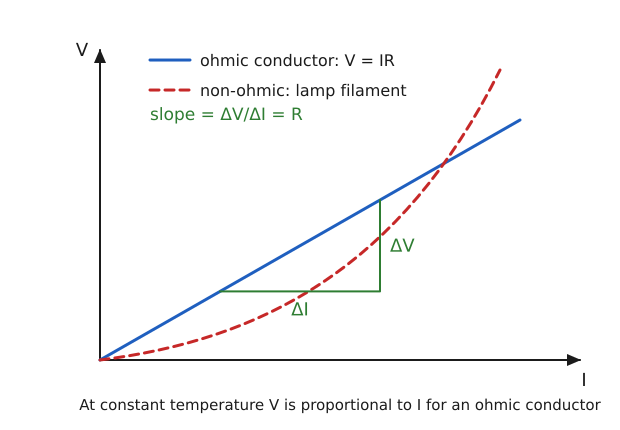

Symbols: $V$ potential difference (V), $I$ current (A), $R$ resistance ($\Omega$).

**Step 1.** For a metallic conductor at constant temperature the measured $V$-$I$ graph is a straight line through the origin:

$$
V \propto I
$$

**Step 2.** Write the constant of proportionality as the resistance $R$ (the slope of the graph):

$$
V = IR \qquad\Rightarrow\qquad R = \frac{V}{I}
$$

**Step 3.** The unit is $1\,\Omega = 1\,\mathrm{V/A}$. The reciprocal $G = 1/R$ is the conductance (siemens).

> [!IMPORTANT]
> Ohm's law: $V = IR$ with $R$ constant at constant temperature. Resonance: $X_L = X_C$, $Z = R$, $f_0 = 1/(2\pi\sqrt{LC})$.

**Worked example (household heater and fuse).** A heater element of resistance $R = 44\,\Omega$ is connected to a $220\,\mathrm{V}$ supply.

$$
I = \frac{V}{R} = \frac{220\,\mathrm{V}}{44\,\Omega} = 5\,\mathrm{A}, \qquad P = VI = 220 \times 5 = 1100\,\mathrm{W}
$$

The wiring must carry $5\,\mathrm{A}$ continuously, so a fuse rated somewhat above this (for example $10\,\mathrm{A}$) protects the circuit: a fault that lowers $R$ raises $I$ and melts the fuse. A tungsten lamp filament, by contrast, is non-ohmic because its resistance rises as it heats.

<b>Extra: Ohm's law from electron drift, and ohmic against non-ohmic</b>

Between collisions an electron of charge $e$ and mass $m$ accelerates in the field $E$ and loses its drift velocity at each collision (mean time between collisions $\tau_c$). The drift speed is

$$
v_d = \frac{eE\tau_c}{m}
$$

With $n$ free electrons per unit volume the current density is $J = nev_d = \dfrac{ne^{2}\tau_c}{m}E = \sigma E$. For a wire of length $L$ and area $A$, put $E = V/L$ and $I = JA$:

$$
V = \left(\frac{mL}{ne^{2}\tau_c A}\right) I = RI, \qquad \rho = \frac{m}{ne^{2}\tau_c}
$$

So $R$ is constant as long as $n$ and $\tau_c$ do not change, that is, at constant temperature. Devices whose $V$-$I$ graph is not a straight line (diode, filament lamp, thermistor) are non-ohmic.

> [!TIP]
> Always add "at constant temperature" when stating Ohm's law; without it the statement loses marks. Do not write resonance as "maximum amplitude" only: state $X_L = X_C$ and the frequency.

### 2016 Q1(b) Wheatstone bridge principle using Kirchhoff's laws

> Deduce the Wheatstone bridge principle using Kirchhoff's law.
>
> Asked in: 2016 Q1(b), 2018 Q1(b), 2021 Q3(b) (balanced bridge, show $P/Q = R/S$), 2023 Q1(b).

#### Ans. to the question no. 1(b) of 2016

**Statement.** A Wheatstone bridge has four resistances $P$, $Q$, $R$, $S$ in the arms of a quadrilateral $ABCD$, a cell between $A$ and $C$ and a galvanometer $G$ between $B$ and $D$. When the galvanometer shows no deflection (balance), the ratio of the resistances in one branch equals the ratio in the other:

$$
\frac{P}{Q} = \frac{R}{S}
$$

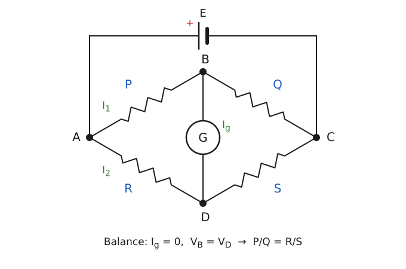

Let $I_1$ flow in $P$, $I_g$ in $G$ (from $B$ to $D$), $I_2$ in $R$, and $G$ have resistance $G$. Kirchhoff's current law (KCL) at $B$ and $D$ gives the currents in $Q$ and $S$.

**Step 1 (KCL at B and D).**

$$
I_Q = I_1 - I_g, \qquad I_S = I_2 + I_g
$$

**Step 2 (KVL in loop ABDA).**

$$
I_1 P + I_g G - I_2 R = 0
$$

**Step 3 (KVL in loop BCDB).**

$$
(I_1 - I_g)Q - (I_2 + I_g)S - I_g G = 0
$$

**Step 4 (balance condition $I_g = 0$).** Steps 2 and 3 reduce to

$$
I_1 P = I_2 R, \qquad I_1 Q = I_2 S
$$

**Step 5 (divide).**

$$
\frac{P}{Q} = \frac{R}{S}
$$

> [!IMPORTANT]
> At balance $I_g = 0$, so $V_B = V_D$ and $P/Q = R/S$. The result does not depend on the cell emf or on the galvanometer resistance.

**Worked example (strain-gauge bridge).** Four $120\,\Omega$ gauges form a bridge with a $5\,\mathrm{V}$ supply. One gauge stretches and its resistance rises by $\Delta R = 0.24\,\Omega$ (gauge factor 2, strain $10^{-3}$). The bridge unbalances and the output is

$$
V_{\mathrm{out}} = 5\left(\frac{120.24}{240.24} - \frac{1}{2}\right) \approx 2.50\,\mathrm{mV}
$$

A tiny resistance change is turned into a measurable voltage, which is why load cells and pressure sensors use bridges.

<b>Extra: potential-divider proof and the meter bridge</b>

With the galvanometer removed, each branch is a potential divider across the cell $E$:

$$
V_A - V_B = \frac{EP}{P+Q}, \qquad V_A - V_D = \frac{ER}{R+S}
$$

Setting $V_B = V_D$ gives $P/(P+Q) = R/(R+S)$, so $PS = QR$, the same result.

In a meter bridge (a 100 cm uniform wire) the unknown $X$ and a known $S$ are in the two gaps, and the balance length $l$ is measured from the $X$ end:

$$
X = S\,\frac{l}{100 - l}
$$

For $S = 15\,\Omega$ and $l = 40\,\mathrm{cm}$: $X = 15 \times 40/60 = 10\,\Omega$.

> [!TIP]
> Keep the arm order fixed ($P$ and $Q$ adjacent in one branch, $R$ and $S$ in the other). Set $I_g = 0$ only after writing the general loop equations, and show both KCL and KVL, because the question asks for Kirchhoff's law.

### 2016 Q1(c) Potential of a dipole on its axis

> Calculate the potential due to a dipole on its axis, dipole moment $2.5\times10^{-10}\,\mathrm{C\,m}$, at $1\,\mathrm{m}$ from it.
>
> Asked in: 2016 Q1(c).

#### Ans. to the question no. 1(c) of 2016

**Assumptions.** The point lies on the axis, on the side of the positive charge, at distance $r = 1\,\mathrm{m}$ from the centre of the dipole, and $r \gg a$ (half-length $a$ is not given, so the short-dipole formula is used).

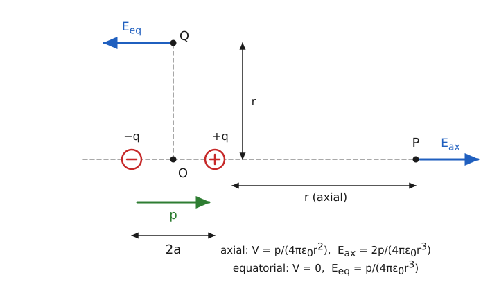

**Derivation.** Charges $-q$ and $+q$ are at $-a$ and $+a$; the axial point is at distance $r$ from the centre.

**Step 1.**

$$
V = \frac{kq}{r-a} - \frac{kq}{r+a}
$$

**Step 2.** Combine, with $p = 2aq$:

$$
V = \frac{kq\,(2a)}{r^{2} - a^{2}} = \frac{kp}{r^{2} - a^{2}}
$$

**Step 3.** For $r \gg a$:

$$
V \approx \frac{p}{4\pi\varepsilon_0 r^{2}}
$$

**Numerical.**

Given: $p = 2.5\times10^{-10}\,\mathrm{C\,m}$, $r = 1\,\mathrm{m}$, $k = 9\times10^{9}\,\mathrm{N\,m^2/C^2}$.

Formula: $V = kp/r^{2}$.

Substitution:

$$
V = \frac{9\times10^{9} \times 2.5\times10^{-10}}{1^{2}} = 2.25\,\mathrm{V}
$$

> [!IMPORTANT]
> $V = \dfrac{p}{4\pi\varepsilon_0 r^{2}} = 2.25\,\mathrm{V}$ (using the exact $k = 8.99\times10^{9}$ gives $2.247\,\mathrm{V}$, the same to three figures).

**Worked example (a water molecule).** Water has $p = 6.17\times10^{-30}\,\mathrm{C\,m}$. On its axis at $r = 1.0\,\mathrm{nm}$:

$$
V = \frac{9\times10^{9} \times 6.17\times10^{-30}}{(10^{-9})^{2}} \approx 0.056\,\mathrm{V}
$$

This tiny potential is what neighbouring molecules feel, and it is why polar molecules orient each other in water.

<b>Extra: field and potential of a dipole at any angle</b>

At distance $r$ and angle $\theta$ from the dipole axis (point dipole, $r \gg a$):

$$
V = \frac{kp\cos\theta}{r^{2}}, \qquad E = \frac{kp}{r^{3}}\sqrt{1 + 3\cos^{2}\theta}
$$

- Axial ($\theta = 0$): $V = kp/r^{2}$ and $E_{\mathrm{ax}} = 2kp/r^{3}$, along $\mathbf{p}$. Here $E_{\mathrm{ax}} = 2\times9\times10^{9}\times2.5\times10^{-10} = 4.5\,\mathrm{V/m}$.
- Equatorial ($\theta = 90^\circ$): $V = 0$ and $E_{\mathrm{eq}} = kp/r^{3} = 2.25\,\mathrm{V/m}$, opposite to $\mathbf{p}$ (derived in [2021 Q3(c)](#2021-q3c-field-on-the-perpendicular-bisector)).
- The potential falls as $1/r^{2}$ and the field as $1/r^{3}$, faster than for a single charge.

> [!TIP]
> State that $r \gg a$; the question gives no $a$. Do not use $p/(4\pi\varepsilon_0 r^{3})$ for potential (that is the field), and give the unit (volt).

### 2016 Q4(b) The L-R circuit: growth and decay of current

> Describe the L-R circuit and plot growth and decay of current with time.
>
> Asked in: 2016 Q4(b), 2020 Q3(b); related: 2020 Q2(b), 2021 Q4(b).

#### Ans. to the question no. 4(b) of 2016

**Description.** An inductor $L$ (negligible resistance) is joined in series with a resistor $R$, a cell of emf $E$ and a switch. When the switch is closed the current rises from zero; the changing flux in $L$ induces a back emf $-L\,dI/dt$ that opposes the rise, so the current grows gradually and not instantly. When the cell is removed (switch moved to the short-circuit position) the current decays gradually for the same reason. Both processes are governed by the time constant $\tau = L/R$.

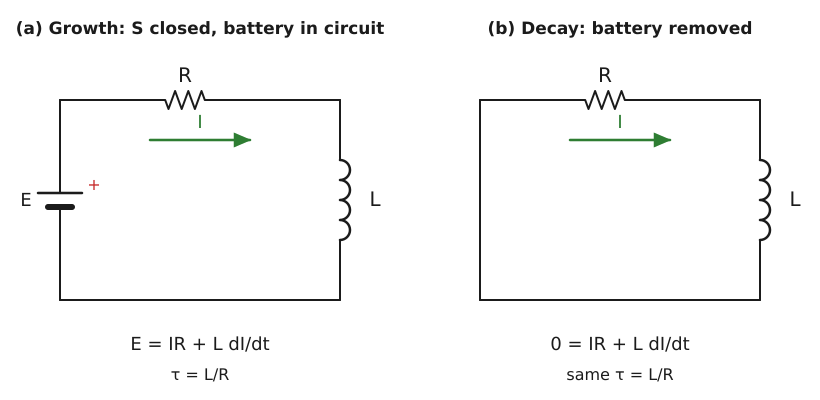

**Growth.**

**Step 1 (KVL).**

$$
E - IR - L\frac{dI}{dt} = 0
$$

**Step 2 (separate variables, final current $I_0 = E/R$).**

$$
\frac{dI}{I_0 - I} = \frac{R}{L}\,dt
$$

**Step 3 (integrate from $I = 0$ at $t = 0$).**

$$
-\ln\!\left(\frac{I_0 - I}{I_0}\right) = \frac{Rt}{L}
$$

**Step 4.**

$$
I = I_0\left(1 - e^{-Rt/L}\right)
$$

**Decay.** With the cell removed the circuit equation is $IR + L\,dI/dt = 0$, so $dI/I = -(R/L)\,dt$ and, with $I = I_0$ at $t = 0$:

$$
I = I_0\,e^{-Rt/L}
$$

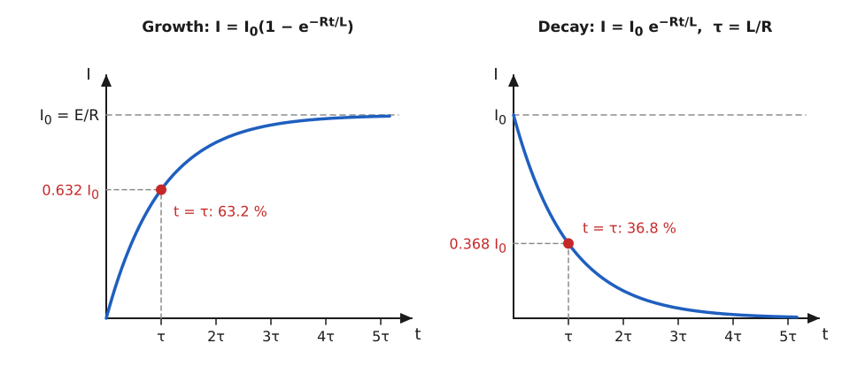

At $t = \tau = L/R$: growth gives $I = 0.632\,I_0$; decay gives $I = 0.368\,I_0$. The growth curve reaches about $99\%$ of $I_0$ after $5\tau$. Check of units: $\mathrm{H}/\Omega = \mathrm{s}$.

> [!IMPORTANT]
> Growth: $I = I_0(1 - e^{-Rt/L})$. Decay: $I = I_0e^{-Rt/L}$. Time constant $\tau = L/R$, with $I_0 = E/R$.

**Worked example (relay coil).** A solenoid coil has $L = 0.5\,\mathrm{H}$ and $R = 25\,\Omega$ and is switched onto $50\,\mathrm{V}$.

$$
\tau = \frac{0.5}{25} = 0.02\,\mathrm{s}, \qquad I_0 = \frac{50}{25} = 2\,\mathrm{A}, \qquad I(\tau) = 2(1 - e^{-1}) = 1.26\,\mathrm{A}
$$

The coil needs about $5\tau = 0.1\,\mathrm{s}$ to reach $99\%$ of its final current, which sets the switching delay of the relay.

<b>Extra: initial slope, energy stored and the 63.2 percent rule</b>

- Initial slope of the growth curve: $\left.\dfrac{dI}{dt}\right|_{0} = \dfrac{E}{L} = \dfrac{50}{0.5} = 100\,\mathrm{A/s}$. The tangent at $t = 0$ meets the level $I_0$ at $t = \tau$.
- Voltage across the inductor during growth: $V_L = L\,dI/dt = E\,e^{-t/\tau}$, falling from $E$ to zero while $V_R = IR$ rises.
- Energy stored in the field in the final state:

$$
U = \tfrac{1}{2}LI_0^{2} = \tfrac{1}{2}(0.5)(2)^{2} = 1\,\mathrm{J}
$$

- The factor $0.632 = 1 - e^{-1}$ is why $\tau$ is the standard measure of how fast the circuit responds.

> [!TIP]
> Draw both curves with $\tau$ marked and the $63.2\%$ and $36.8\%$ levels. Do not mix the formulas: $(1 - e^{-t/\tau})$ is for growth only.

## Year 2017 Questions

### 2017 Q1(a) Coulomb's law

> State and explain Coulomb's law.
>
> Asked in: 2017 Q1(a), 2019 Q1(b), 2022 Q1(b).

#### Ans. to the question no. 1(a) of 2017

**Statement.** The force between two stationary point charges is directly proportional to the product of the charges, inversely proportional to the square of the distance between them, and acts along the line joining them.

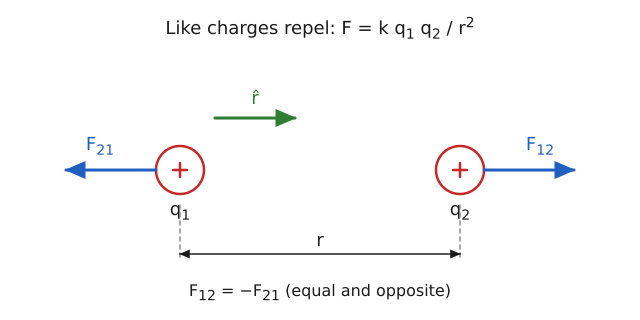

Symbols: $q_1, q_2$ charges (C), $r$ separation (m), $k$ Coulomb constant.

**Step 1 (experiment, torsion balance).** $F \propto q_1 q_2$ and $F \propto 1/r^{2}$.

**Step 2 (combine).**

$$
F = k\,\frac{q_1 q_2}{r^{2}}, \qquad k = \frac{1}{4\pi\varepsilon_0} \approx 9\times10^{9}\,\mathrm{N\,m^2/C^2}
$$

**Step 3 (vector form, force on $q_2$ due to $q_1$).**

$$
\vec{F}_{12} = k\,\frac{q_1 q_2}{r^{2}}\,\hat{r}, \qquad \vec{F}_{21} = -\vec{F}_{12}
$$

Like charges repel (positive product), unlike charges attract. In a medium of dielectric constant $K$ the force is reduced to $F/K$.

> [!IMPORTANT]
> $F = \dfrac{1}{4\pi\varepsilon_0}\dfrac{q_1 q_2}{r^{2}}$, along the line of the charges, with $\varepsilon_0 = 8.854\times10^{-12}\,\mathrm{C^2/N\,m^2}$.

**Worked example (hydrogen atom).** The electron and proton are about $5.29\times10^{-11}\,\mathrm{m}$ apart:

$$
F = \frac{8.99\times10^{9}\,(1.602\times10^{-19})^{2}}{(5.29\times10^{-11})^{2}} \approx 8.2\times10^{-8}\,\mathrm{N}
$$

Tiny in everyday terms, but acting on a particle of mass $10^{-30}\,\mathrm{kg}$ it holds the atom together.

<b>Extra: electric against gravitational force, and superposition</b>

For an electron and a proton the ratio of electric to gravitational force is independent of separation:

$$
\frac{F_e}{F_g} = \frac{k e^{2}}{G m_e m_p} \approx 2.3\times10^{39}
$$

so gravity is negligible in atoms. With several charges the net force on one is the vector sum of the Coulomb forces from each of the others (superposition).

> [!TIP]
> Use $|q|$ in magnitudes and decide direction from the signs. Write $r$ in metres and mention the medium (vacuum or air).

### 2017 Q1(b) Capacitance of a parallel plate capacitor

> Find an expression for the capacitance of a capacitor.
>
> Asked in: 2017 Q1(b), 2021 Q1(b) (parallel plate), 2022 Q1(c).

#### Ans. to the question no. 1(b) of 2017

**Definition.** Capacitance is the charge needed per unit potential difference between the conductors: $C = Q/V$. For the standard case, a parallel plate capacitor, take plates of area $A$ separated by $d$ (with $d$ small compared with the plate size, so the field is uniform) carrying $+Q$ and $-Q$.

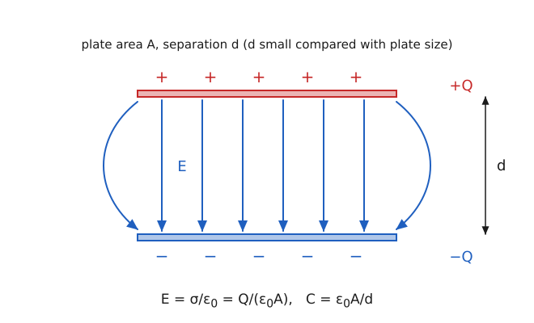

**Step 1 (surface charge density).**

$$
\sigma = \frac{Q}{A}
$$

**Step 2 (field between plates, Gauss's law on a pillbox at one plate).**

$$
E = \frac{\sigma}{\varepsilon_0} = \frac{Q}{\varepsilon_0 A}
$$

**Step 3 (potential difference).**

$$
V = Ed = \frac{Qd}{\varepsilon_0 A}
$$

**Step 4.**

$$
C = \frac{Q}{V} = \frac{\varepsilon_0 A}{d}
$$

With a dielectric of constant $K$ filling the gap, $C = K\varepsilon_0 A/d$.

> [!IMPORTANT]
> $C = \dfrac{\varepsilon_0 A}{d}$ (air), $C = \dfrac{K\varepsilon_0 A}{d}$ (dielectric). $C$ depends only on geometry and dielectric, not on $Q$ or $V$.

**Worked example (touch sensor pad).** A capacitive pad has $A = 1\,\mathrm{cm^2} = 10^{-4}\,\mathrm{m^2}$ and gap $d = 0.5\,\mathrm{mm}$:

$$
C = \frac{8.854\times10^{-12} \times 10^{-4}}{5\times10^{-4}} \approx 1.77\,\mathrm{pF}
$$

A fingertip changes the effective gap or dielectric, shifting $C$ by a fraction of a picofarad that the controller detects.

<b>Extra: spherical and cylindrical capacitors</b>

Spherical (radii $a < b$): $E = kQ/r^{2}$ between the shells, so $V = kQ\left(\dfrac{1}{a} - \dfrac{1}{b}\right)$ and

$$
C = \frac{4\pi\varepsilon_0\,ab}{b - a}
$$

An isolated sphere ($b\to\infty$) has $C = 4\pi\varepsilon_0 R$. For the Earth, $R = 6.37\times10^{6}\,\mathrm{m}$ gives $C \approx 7.1\times10^{-4}\,\mathrm{F}$ (about $710\,\mu\mathrm{F}$).

Cylindrical (length $L$, radii $a < b$): $E = \lambda/(2\pi\varepsilon_0 r)$ with $\lambda = Q/L$, so $V = \dfrac{\lambda}{2\pi\varepsilon_0}\ln\dfrac{b}{a}$ and

$$
C = \frac{2\pi\varepsilon_0 L}{\ln(b/a)}
$$

> [!TIP]
> State the assumption $d \ll \sqrt{A}$ and show where $E = \sigma/\varepsilon_0$ comes from. Convert area units to $\mathrm{m^2}$ before substituting.

### 2017 Q1(c) Capacitor with a sulphur slab

> A parallel plate capacitor has two square metal plates of $50\,\mathrm{cm}$ side, separated by $1\,\mathrm{cm}$. A sulphur slab $6\,\mathrm{mm}$ thick is placed on the lower plate. Calculate the capacitance. Dielectric constant of sulphur $= 4$.
>
> Asked in: 2017 Q1(c).

#### Ans. to the question no. 1(c) of 2017

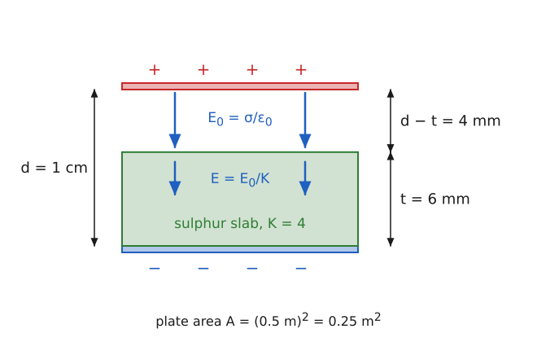

**Derivation.** With charge density $\sigma$ on the plates, the field is $E_0 = \sigma/\varepsilon_0$ in air and $E = \sigma/(K\varepsilon_0)$ in the slab.

$$
V = E_0 (d - t) + E\,t = \frac{\sigma}{\varepsilon_0}\left(d - t + \frac{t}{K}\right)
\qquad\Rightarrow\qquad
C = \frac{Q}{V} = \frac{\varepsilon_0 A}{d - t + t/K}
$$

Given: $A = (0.50)^{2} = 0.25\,\mathrm{m^2}$, $d = 0.01\,\mathrm{m}$, $t = 0.006\,\mathrm{m}$, $K = 4$.

Formula: $C = \varepsilon_0 A/(d - t + t/K)$.

Substitution: the denominator is $0.01 - 0.006 + 0.006/4 = 0.0055\,\mathrm{m}$, so

$$
C = \frac{8.854\times10^{-12} \times 0.25}{0.0055} = 4.02\times10^{-10}\,\mathrm{F}
$$

> [!IMPORTANT]
> $C \approx 4.02\times10^{-10}\,\mathrm{F}$ ($\approx 402\,\mathrm{pF}$). Without the slab it would be $221\,\mathrm{pF}$.

**Worked example (cover-glass sensor).** Plates $2\,\mathrm{cm}\times2\,\mathrm{cm}$ with a $2\,\mathrm{mm}$ gap, half of it ($1\,\mathrm{mm}$) filled by glass of $K = 4$ (illustrative): denominator $= 1 + 0.25 = 1.25\,\mathrm{mm}$, so $C = 8.854\times10^{-12}\times4\times10^{-4}/1.25\times10^{-3} \approx 2.83\,\mathrm{pF}$.

<b>Extra: series against parallel dielectric arrangements</b>

- Slab across the full area but only part of the gap (this question): behaves as two capacitors in series, $d - t$ of air and $t$ of dielectric. The result depends on $t$ but not on where the slab sits.
- Slab filling the full gap but only part of the area: two capacitors in parallel, $C = \varepsilon_0(KA_1 + A_2)/d$. For half the area filled with $K = 4$: $C = \dfrac{\varepsilon_0 A}{d}\cdot\dfrac{4+1}{2} = 221\,\mathrm{pF}\times2.5 = 553\,\mathrm{pF}$.

> [!TIP]
> Use $t/K$, not $tK$, in the denominator. Convert cm and mm to metres, and note that the answer must lie between the air value ($221\,\mathrm{pF}$) and $K$ times it.

### 2017 Q2(a) Specific resistance; Ohm's law

> What is specific resistance? State and explain Ohm's law.
>
> Asked in: 2017 Q2(a), 2022 Q2(a), 2022 Q3(a).

#### Ans. to the question no. 2(a) of 2017

**Specific resistance (resistivity).** The specific resistance $\rho$ of a material is the resistance of a conductor of that material of unit length and unit cross-sectional area. Its SI unit is the ohm metre ($\Omega\,\mathrm{m}$). It depends on the material and temperature, not on the size of the sample.

**Ohm's law.** Same as [2016 Q1(a)](#2016-q1a-ohms-law-and-resonance): at constant temperature $I \propto V$, i.e. $V = IR$.

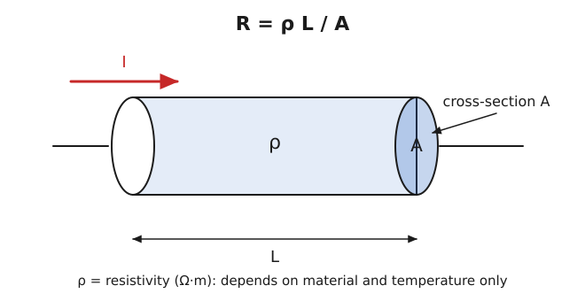

**Step 1.** Experiment: resistance grows with length and falls with area:

$$
R \propto L, \qquad R \propto \frac{1}{A}
$$

**Step 2.** Introduce the constant $\rho$:

$$
R = \rho\,\frac{L}{A} \qquad\Rightarrow\qquad \rho = \frac{RA}{L}
$$

**Step 3.** Units: $\rho = \Omega\,\mathrm{m^2}/\mathrm{m} = \Omega\,\mathrm{m}$. The reciprocal $\sigma = 1/\rho$ is the conductivity.

> [!IMPORTANT]
> $R = \rho L/A$; $\rho$ in $\Omega\,\mathrm{m}$; Ohm's law $V = IR$ at constant temperature.

**Worked example (house wiring).** A $1.5\,\mathrm{mm^2}$ copper cable ($\rho \approx 1.7\times10^{-8}\,\Omega\,\mathrm{m}$) runs $20\,\mathrm{m}$ to a socket:

$$
R = \frac{1.7\times10^{-8} \times 20}{1.5\times10^{-6}} \approx 0.23\,\Omega
$$

At $10\,\mathrm{A}$ the voltage drop is $IR \approx 2.3\,\mathrm{V}$ and the heating is $I^{2}R \approx 23\,\mathrm{W}$ spread along the cable, which is why long runs need thicker wire.

<b>Extra: temperature dependence</b>

For metals over a modest range, $\rho = \rho_0\left[1 + \alpha(T - T_0)\right]$, with $\alpha \approx 4\times10^{-3}\,\mathrm{K^{-1}}$ for copper. Resistance rises with temperature because more frequent collisions shorten the collision time $\tau_c$ in $\rho = m/(ne^{2}\tau_c)$ (see the Extra in [2016 Q1(a)](#2016-q1a-ohms-law-and-resonance)).

> [!TIP]
> Do not write the unit of $\rho$ as $\Omega/\mathrm{m}$. Convert $\mathrm{mm^2}$ to $\mathrm{m^2}$ ($1\,\mathrm{mm^2} = 10^{-6}\,\mathrm{m^2}$).

### 2017 Q2(b) Kirchhoff's laws of electricity

> State and explain Kirchhoff's laws of electricity.
>
> Asked in: 2017 Q2(b), 2022 Q2(b) (second law), 2022 Q3(b).

#### Ans. to the question no. 2(b) of 2017

**First law (junction rule, KCL).** The algebraic sum of the currents meeting at a junction is zero; equivalently, current entering a junction equals current leaving it.

**Second law (loop rule, KVL).** In any closed loop the algebraic sum of the emfs equals the algebraic sum of the products $IR$ round the loop; equivalently, the sum of potential changes round a closed loop is zero.

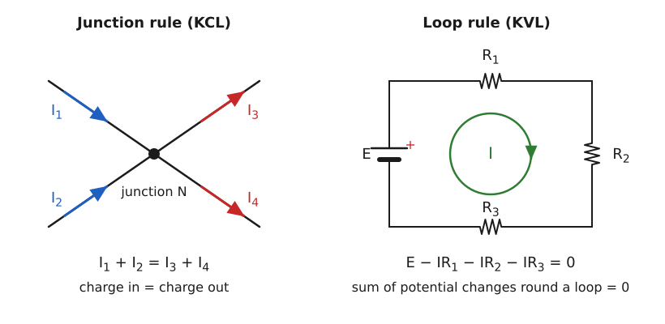

**Step 1 (KCL, conservation of charge).** In steady state charge cannot accumulate at a node:

$$
\sum I_{\mathrm{in}} = \sum I_{\mathrm{out}}, \qquad I_1 + I_2 = I_3 + I_4
$$

**Step 2 (KVL, conservation of energy).** The electrostatic potential has one value at each point, so returning to the start gives zero net change:

$$
\sum \mathcal{E} - \sum IR = 0
$$

**Step 3 (sign convention).** Taking the loop direction as positive: an emf is $+$ if traversed from $-$ to $+$ terminal; $IR$ is $+$ if the loop direction is along the current.

> [!IMPORTANT]
> KCL: $\sum I = 0$ at a node (charge conservation). KVL: $\sum \mathcal{E} = \sum IR$ in a loop (energy conservation).

**Worked example (fuse and household wiring).** On a $220\,\mathrm{V}$ ring main a kettle ($1500\,\mathrm{W}$), TV ($150\,\mathrm{W}$) and fan ($75\,\mathrm{W}$) are in parallel. By KCL the branch currents add:

$$
I = \frac{1500}{220} + \frac{150}{220} + \frac{75}{220} = 6.82 + 0.68 + 0.34 \approx 7.84\,\mathrm{A}
$$

A $10\,\mathrm{A}$ fuse on the circuit is therefore adequate, but adding another heater would blow it.

<b>Extra: KCL and KVL together on a two-loop circuit</b>

Two cells $E_1 = 10\,\mathrm{V}$ ($R_1 = 2\,\Omega$) and $E_2 = 4\,\mathrm{V}$ ($R_2 = 1\,\Omega$) feed a common resistor $R_3 = 3\,\Omega$. With $I_1$ and $I_2$ leaving the cells, KCL gives $I_3 = I_1 + I_2$ through $R_3$. KVL on the two loops:

$$
10 = 2I_1 + 3(I_1 + I_2) = 5I_1 + 3I_2
$$

$$
4 = I_2 + 3(I_1 + I_2) = 3I_1 + 4I_2
$$

Solving: $I_1 = 28/11 = 2.55\,\mathrm{A}$, $I_2 = -10/11 = -0.91\,\mathrm{A}$ (the second cell is being charged) and $I_3 = 18/11 = 1.64\,\mathrm{A}$. Check: $5(2.545) + 3(-0.909) = 10$.

> [!TIP]
> Name both laws with their conservation principle. A negative answer for a current only means the assumed direction was opposite; it is not an error.

### 2017 Q2(c) Wheatstone bridge numerical: balancing resistor

> Four resistances $8\,\Omega$, $16\,\Omega$, $12\,\Omega$ and $48\,\Omega$ are on the arms of a Wheatstone bridge. What resistance must be connected in series or parallel with the fourth arm for balance?
>
> Asked in: 2017 Q2(c), 2022 Q2(c), 2022 Q3(c).

#### Ans. to the question no. 2(c) of 2017

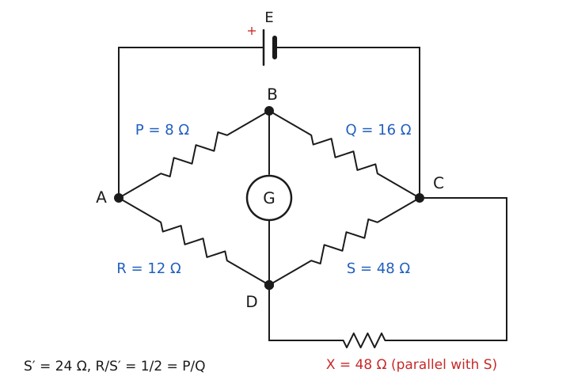

**Assumption (arm order).** The arms are taken in the order $P = 8\,\Omega$, $Q = 16\,\Omega$, $R = 12\,\Omega$, $S = 48\,\Omega$ with the balance condition $P/Q = R/S$; the fourth arm is $S$.

Given: $P = 8$, $Q = 16$, $R = 12$, $S = 48$ (all in $\Omega$).

Formula: balance requires $P/Q = R/S'$.

Substitution: $P/Q = 8/16 = 1/2$ but $R/S = 12/48 = 1/4$, so the bridge is not balanced. The fourth arm must become

$$
S' = \frac{RQ}{P} = \frac{12 \times 16}{8} = 24\,\Omega
$$

Series cannot work: a series resistor makes $S'$ larger than $48\,\Omega$, but $24\,\Omega$ is smaller. A parallel resistor $X$ lowers it:

$$
\frac{1}{X} = \frac{1}{S'} - \frac{1}{S} = \frac{1}{24} - \frac{1}{48} = \frac{1}{48} \quad\Rightarrow\quad X = 48\,\Omega
$$

Check: $48\,\Omega \parallel 48\,\Omega = 24\,\Omega$ and $R/S' = 12/24 = 1/2 = P/Q$.

> [!IMPORTANT]
> Connect a $48\,\Omega$ resistor in **parallel** with the $48\,\Omega$ arm; the arm becomes $24\,\Omega$ and the bridge balances.

**Worked example (bridge zeroing).** A strain bridge has three $120.0\,\Omega$ arms and a fourth of $121.2\,\Omega$ (tolerance). A trim resistor in parallel fixes the offset:

$$
X = \frac{S\,S'}{S - S'} = \frac{121.2 \times 120}{1.2} = 12\,120\,\Omega \approx 12.1\,\mathrm{k\Omega}
$$

<b>Extra: general rule for trimming an arm</b>

If the arm is too small, add a series resistor $X = S' - S$. If it is too large, add a parallel resistor $X = \dfrac{SS'}{S - S'}$. For this question, $X = \dfrac{48 \times 24}{48 - 24} = 48\,\Omega$, the same result. If another arm labelling were used, recompute $S'$ from that bridge's own balance condition.

> [!TIP]
> Compare the two ratios first to see whether the arm must go up or down. Too large means parallel, too small means series; check by recomputing $R/S'$.

### 2017 Q4(b) Time constant and charging of an RC circuit

> What is time constant? Discuss the charging of an RC circuit.
>
> Asked in: 2017 Q4(b), 2018 Q4(a), 2023 Q4(a) (define the time constant and derive the charge equation).

#### Ans. to the question no. 4(b) of 2017

**Time constant.** The time constant $\tau = RC$ of an RC circuit is the time in which the charging capacitor reaches $(1 - 1/e) = 63.2\%$ of its final charge (equivalently, the time in which the charging current falls to $1/e = 36.8\%$ of its initial value). Unit: second.

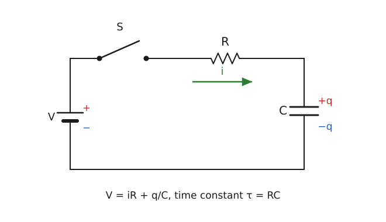

Symbols: $V$ cell emf, $q$ charge on $C$ at time $t$, $i = dq/dt$, $Q_0 = CV$ final charge.

**Step 1 (KVL after closing the switch).**

$$
V = iR + \frac{q}{C} = R\frac{dq}{dt} + \frac{q}{C}
$$

**Step 2 (separate variables).**

$$
\frac{dq}{CV - q} = \frac{dt}{RC}
$$

**Step 3 (integrate from $q = 0$ at $t = 0$).**

$$
-\ln\!\left(\frac{Q_0 - q}{Q_0}\right) = \frac{t}{RC}
$$

**Step 4.**

$$
q = Q_0\left(1 - e^{-t/RC}\right)
$$

**Step 5 (current and voltages).**

$$
i = \frac{dq}{dt} = \frac{V}{R}\,e^{-t/RC} = I_0 e^{-t/\tau}, \qquad V_C = V(1 - e^{-t/\tau}), \qquad V_R = V e^{-t/\tau}
$$

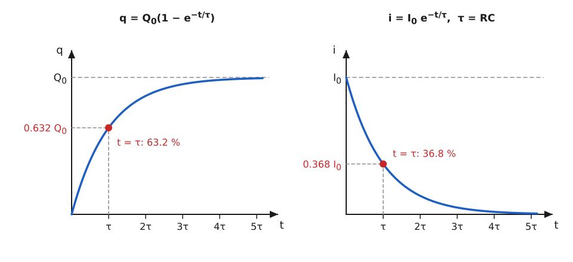

| Time | Charge reached |
|---|---|
| $\tau$ | 63.2 % |
| $2\tau$ | 86.5 % |
| $3\tau$ | 95.0 % |
| $5\tau$ | 99.3 % |

> [!IMPORTANT]
> $\tau = RC$; $q = Q_0(1 - e^{-t/RC})$; $i = I_0 e^{-t/RC}$ with $Q_0 = CV$ and $I_0 = V/R$.

**Worked example (switch debounce).** $R = 10\,\mathrm{k\Omega}$ and $C = 0.1\,\mu\mathrm{F}$ give $\tau = 10^{4}\times10^{-7} = 1\,\mathrm{ms}$. Across a $5\,\mathrm{V}$ supply the capacitor voltage is $3.16\,\mathrm{V}$ at $1\,\mathrm{ms}$ and $4.97\,\mathrm{V}$ at $5\,\mathrm{ms}$, so contact bounce shorter than about a millisecond is filtered out.

<b>Extra: energy balance, discharge and half-time</b>

The cell supplies $QV = CV^{2}$ in total. The resistor dissipates

$$
\int_0^\infty i^{2}R\,dt = \frac{V^{2}}{R}\cdot\frac{RC}{2} = \tfrac{1}{2}CV^{2}
$$

and the capacitor stores the other $\tfrac{1}{2}CV^{2}$, whatever the value of $R$. On discharge, $q = Q_0e^{-t/\tau}$. The half-time is $t_{1/2} = \tau\ln 2 = 0.693\,RC$.

> [!TIP]
> $\tau$ is not the time to full charge (that takes about $5\tau$). Quote both $q(t)$ and $i(t)$ and mark $\tau$ on the graphs.

## Year 2018 Questions

### 2018 Q1(a) Definitions: Gauss's law, Ohm's law, capacitor

> Define: (i) Gauss's law (ii) Ohm's law (iii) Capacitor.
>
> Asked in: 2018 Q1(a), 2023 Q1(a); capacitor and capacitance also 2019 Q3(a), 2021 Q1(a); Gauss's law also 2021 Q3(a).

#### Ans. to the question no. 1(a) of 2018

**(i) Gauss's law.** The net electric flux through any closed surface equals the net charge enclosed by the surface divided by $\varepsilon_0$:

$$
\Phi_E = \oint \vec{E}\cdot d\vec{A} = \frac{q_{\mathrm{enc}}}{\varepsilon_0}
$$

The surface is called the Gaussian surface. Charges outside it contribute no net flux. The proof is in [2020 Q1(a)](#2020-q1a-gausss-law-statement-and-proof).

**(ii) Ohm's law.** At constant temperature the current through a conductor is proportional to the potential difference across it, $V = IR$ (full answer: [2016 Q1(a)](#2016-q1a-ohms-law-and-resonance)).

**(iii) Capacitor.** A capacitor is a device that stores electric charge and energy; it consists of two conductors separated by an insulator (dielectric). Its capacitance is the charge stored per unit potential difference:

$$
C = \frac{Q}{V}, \qquad 1\,\mathrm{F} = 1\,\mathrm{C/V}
$$

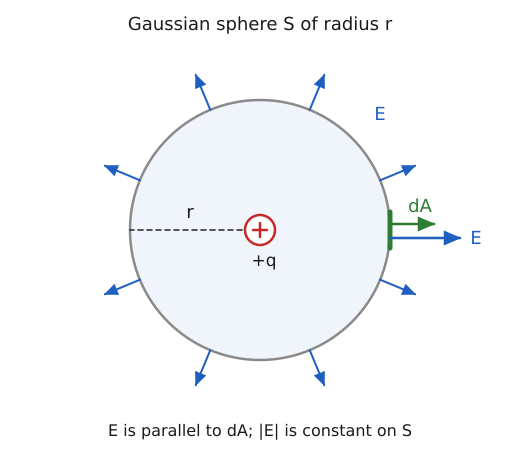

**Step 1.** Flux through a small area: $d\Phi = \vec{E}\cdot d\vec{A} = E\,dA\cos\theta$.

**Step 2.** Sum over the closed surface; for a point charge in a sphere $\theta = 0$ and $E$ is constant, so $\Phi = E(4\pi r^{2}) = q/\varepsilon_0$.

> [!IMPORTANT]
> Gauss: $\oint \vec{E}\cdot d\vec{A} = q_{\mathrm{enc}}/\varepsilon_0$. Ohm: $V = IR$. Capacitor: two conductors plus dielectric, $C = Q/V$.

**Worked example (Van de Graaff dome).** A metal dome of radius $0.15\,\mathrm{m}$ carries $1\,\mu\mathrm{C}$. By Gauss's law the field just outside is that of a point charge:

$$
E = \frac{kQ}{R^{2}} = \frac{9\times10^{9} \times 10^{-6}}{(0.15)^{2}} = 4.0\times10^{5}\,\mathrm{V/m}
$$

This is below the breakdown field of air ($\approx 3\times10^{6}\,\mathrm{V/m}$), so the dome holds its charge. A $100\,\mu\mathrm{F}$ capacitor at $12\,\mathrm{V}$ stores $Q = CV = 1.2\,\mathrm{mC}$.

<b>Extra: field just outside a conductor, E = sigma / epsilon_0</b>

Take a small pillbox straddling the surface of a charged conductor, with its flat faces of area $\Delta A$ parallel to the surface. Inside the conductor $E = 0$ and the side walls carry no flux, so only the outer face counts:

$$
E\,\Delta A = \frac{\sigma\,\Delta A}{\varepsilon_0} \quad\Rightarrow\quad E = \frac{\sigma}{\varepsilon_0}
$$

For the dome: $\sigma = Q/4\pi R^{2} = 3.54\times10^{-6}\,\mathrm{C/m^2}$ and $E = \sigma/\varepsilon_0 = 4.0\times10^{5}\,\mathrm{V/m}$, matching the result above.

> [!TIP]
> Write the closed-surface integral, not just words, and say "net charge enclosed". For the capacitor, name both the conductors and the dielectric.

### 2018 Q1(b) Wheatstone bridge principle (repeat)

> Deduce the Wheatstone bridge principle using Kirchhoff's law.

Same as [2016 Q1(b)](#2016-q1b-wheatstone-bridge-principle-using-kirchhoffs-laws).

### 2018 Q1(c) Capacitors in series

> Show that $1/C_s = 1/C_1 + 1/C_2 + 1/C_3$.
>
> Asked in: 2018 Q1(c), 2023 Q1(c).

#### Ans. to the question no. 1(c) of 2018

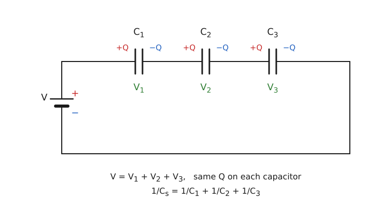

**Statement.** For capacitors connected end to end, the reciprocal of the equivalent capacitance is the sum of the reciprocals. Symbols: $C_s$ equivalent capacitance, $Q$ common charge, $V_i$ the voltage across $C_i$.

**Step 1 (same charge).** The inner plates are isolated, so each capacitor carries the same charge $Q$.

**Step 2 (voltages add).**

$$
V = V_1 + V_2 + V_3
$$

**Step 3 (use $V_i = Q/C_i$).**

$$
\frac{Q}{C_s} = \frac{Q}{C_1} + \frac{Q}{C_2} + \frac{Q}{C_3}
$$

**Step 4 (cancel $Q$).**

$$
\frac{1}{C_s} = \frac{1}{C_1} + \frac{1}{C_2} + \frac{1}{C_3}
$$

> [!IMPORTANT]
> $\dfrac{1}{C_s} = \dfrac{1}{C_1} + \dfrac{1}{C_2} + \dfrac{1}{C_3}$; $C_s$ is smaller than the smallest capacitor.

**Worked example (power-supply stack).** Two $100\,\mu\mathrm{F}$ capacitors rated $450\,\mathrm{V}$ are stacked in series on a $600\,\mathrm{V}$ DC bus. $C_s = 50\,\mu\mathrm{F}$ and each carries $300\,\mathrm{V}$, within its rating (balancing resistors are added in practice because real capacitors differ). Numerical check: $2$, $3$ and $6\,\mu\mathrm{F}$ give $1/C_s = 1/2 + 1/3 + 1/6 = 1$, so $C_s = 1\,\mu\mathrm{F}$; at $12\,\mathrm{V}$, $Q = 12\,\mu\mathrm{C}$ and the voltages are $6$, $4$ and $2\,\mathrm{V}$.

<b>Extra: voltage division and parallel combination</b>

Since $V_i = Q/C_i$ and $Q = C_sV$, the voltage on each capacitor is $V_i = V\,C_s/C_i$: the smallest capacitor takes the largest share. For two capacitors $C_s = \dfrac{C_1C_2}{C_1 + C_2}$; for $n$ equal ones $C_s = C/n$. In parallel the voltage is common and the charges add, so $C_p = C_1 + C_2 + C_3$.

> [!TIP]
> Start from "same $Q$, voltages add". Do not mix up with parallel (where $C$ adds directly).

### 2018 Q4(a) Time constant and RC charging (repeat)

> Define the time constant of an RC circuit. Derive the equation of charge while the capacitor is charging.

Same as [2017 Q4(b)](#2017-q4b-time-constant-and-charging-of-an-rc-circuit).

### 2018 Q4(b) Resonance and resonant frequency of an RLC circuit

> What is resonance? Deduce the resonant frequency of an RLC circuit.
>
> Asked in: 2018 Q4(b), 2023 Q4(b); resonance also in 2016 Q1(a).

#### Ans. to the question no. 4(b) of 2018

**Resonance.** In a series RLC circuit driven by an alternating emf of variable frequency, resonance occurs at the frequency where the inductive and capacitive reactances are equal. The impedance is minimum and equal to $R$, and the current amplitude is maximum.

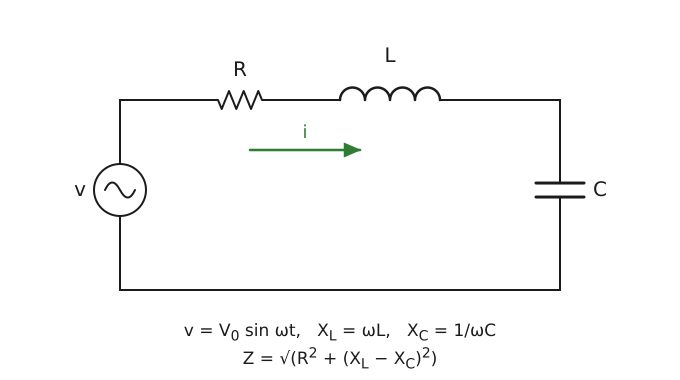

Symbols: $v = V_0\sin\omega t$, $X_L = \omega L$, $X_C = 1/\omega C$.

**Step 1 (impedance).**

$$
Z = \sqrt{R^{2} + (X_L - X_C)^{2}}, \qquad I_0 = \frac{V_0}{Z}
$$

**Step 2 (maximum current needs minimum $Z$, so $X_L = X_C$).**

$$
\omega_0 L = \frac{1}{\omega_0 C}
$$

**Step 3.**

$$
\omega_0 = \frac{1}{\sqrt{LC}}
$$

**Step 4.**

$$
f_0 = \frac{1}{2\pi\sqrt{LC}}
$$

At resonance $Z = R$, $I_{\max} = V_0/R$ and the phase angle ($\tan\phi = (X_L - X_C)/R$) is zero.

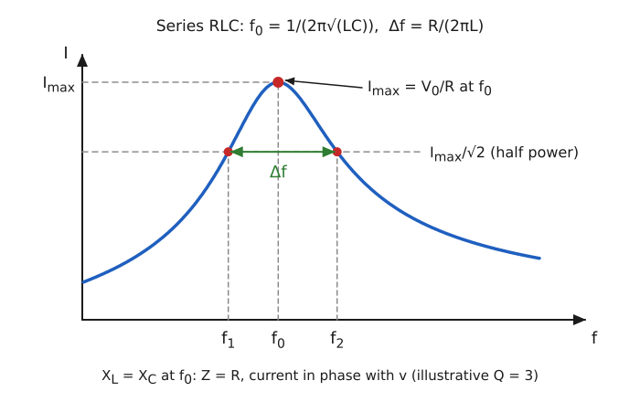

> [!IMPORTANT]
> $X_L = X_C \Rightarrow \omega_0 = 1/\sqrt{LC}$, $f_0 = \dfrac{1}{2\pi\sqrt{LC}}$, $Z = R$, $I_{\max} = V_0/R$.

**Worked example (radio tuning).** An AM tuner uses $L = 250\,\mu\mathrm{H}$. To receive $1000\,\mathrm{kHz}$:

$$
C = \frac{1}{(2\pi f_0)^{2}L} = \frac{1}{(6.283\times10^{6})^{2}\times 2.5\times10^{-4}} \approx 101\,\mathrm{pF}
$$

For $600\,\mathrm{kHz}$ the same formula gives $C \approx 281\,\mathrm{pF}$, which is why the tuning capacitor is variable.

<b>Extra: quality factor and bandwidth</b>

$$
Q = \frac{\omega_0 L}{R} = \frac{1}{\omega_0 CR} = \frac{1}{R}\sqrt{\frac{L}{C}}
$$

The half-power points occur where $\lvert X_L - X_C\rvert = R$, giving a bandwidth $\Delta f = R/(2\pi L) = f_0/Q$. At resonance the voltage across $L$ (or $C$) is $Q$ times the supply voltage. For the numerical in [2018 Q4(c)](#2018-q4c-rlc-numerical): $Q = 3.16$ and $\Delta f \approx 318\,\mathrm{kHz}$.

> [!TIP]
> Define resonance before deriving. Mention that the resonant frequency does not depend on $R$, although the peak height does.

### 2018 Q4(c) RLC numerical

> An RLC circuit has $L = 50\,\mu\mathrm{H}$, $C = 5\times10^{-4}\,\mu\mathrm{F}$ and $R = 100\,\Omega$. Find the frequency of the circuit.
>
> Asked in: 2018 Q4(c), 2023 Q4(c).

#### Ans. to the question no. 4(c) of 2018

Given: $L = 50\times10^{-6}\,\mathrm{H}$, $C = 5\times10^{-4}\times10^{-6} = 5\times10^{-10}\,\mathrm{F}$, $R = 100\,\Omega$.

Formula: $f_0 = \dfrac{1}{2\pi\sqrt{LC}}$.

Substitution: $LC = 5\times10^{-5}\times5\times10^{-10} = 2.5\times10^{-14}$, so $\sqrt{LC} = 1.581\times10^{-7}\,\mathrm{s}$ and

$$
f_0 = \frac{1}{2\pi \times 1.581\times10^{-7}} = 1.007\times10^{6}\,\mathrm{Hz}
$$

> [!IMPORTANT]
> $f_0 \approx 1.007\,\mathrm{MHz}$. This is the resonant frequency, which is what the question most likely asks for.

**Which value is wanted.** The free (damped) oscillation frequency with $R = 100\,\Omega$ is slightly lower:

$$
f_d = \frac{1}{2\pi}\sqrt{\frac{1}{LC} - \left(\frac{R}{2L}\right)^{2}} = \frac{1}{2\pi}\sqrt{4\times10^{13} - 10^{12}} \approx 0.994\,\mathrm{MHz}
$$

Because the question asks for "the frequency of the circuit" in the resonance context, $1.007\,\mathrm{MHz}$ is the expected answer; the damped value is given for completeness.

**Worked example (selecting one AM station).** With $Q = \omega_0L/R = 3.16$ the bandwidth is $\Delta f = R/2\pi L \approx 318\,\mathrm{kHz}$, far too wide for stations $10\,\mathrm{kHz}$ apart. Selecting one station needs $R = 2\pi L\,\Delta f = 3.14\times10^{-4}\times10^{4} \approx 3.1\,\Omega$, a much higher $Q$.

<b>Extra: reactances at resonance</b>

At $f_0$: $X_L = 2\pi f_0 L = 6.33\times10^{6}\times5\times10^{-5} = 316\,\Omega$ and $X_C = 1/(2\pi f_0 C) = 316\,\Omega$. They cancel, leaving $Z = R = 100\,\Omega$, and the voltage across $L$ is $316/100 = 3.16$ times the supply voltage.

> [!TIP]
> Convert $\mu\mathrm{H}$ and $\mu\mathrm{F}$ carefully: $5\times10^{-4}\,\mu\mathrm{F} = 5\times10^{-10}\,\mathrm{F}$. Answer in MHz or Hz with units.

### 2018 Q5(d) Kirchhoff's law of radiation

> State and deduce Kirchhoff's law of radiation.
>
> Asked in: 2018 Q5(d).

> [!NOTE]
> This is a thermal radiation (heat) topic, not electricity, but it is listed under Electricity in the question bank, so it is solved here.

#### Ans. to the question no. 5(d) of 2018

**Statement.** At a given temperature, the ratio of the emissive power $E_\lambda$ to the absorptive power $a_\lambda$ for radiation of a given wavelength is the same for all bodies and equals the emissive power $E_{b\lambda}$ of a perfect black body at that temperature and wavelength:

$$
\frac{E_\lambda}{a_\lambda} = E_{b\lambda}
$$

Good absorbers are good emitters, and a black body ($a = 1$) is the best emitter.

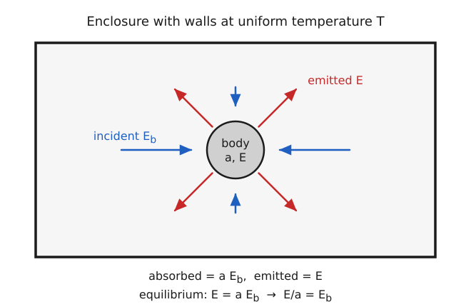

**Step 1 (isothermal enclosure).** Place the body in an enclosure with walls at a uniform temperature $T$, in thermal equilibrium. Let $J$ be the radiant energy falling per unit area of the body per second. A black body in the same enclosure absorbs all of $J$ and stays at $T$, so it must emit the same amount: $J = E_b$.

**Step 2 (the given body).** It absorbs the fraction $a$ of $J$ and emits $E$ per unit area per second.

**Step 3 (equilibrium, temperature constant).**

$$
\text{absorbed} = \text{emitted} \quad\Rightarrow\quad aE_b = E
$$

**Step 4.**

$$
\frac{E}{a} = E_b
$$

$E_b$ depends only on $T$ (and $\lambda$), so the ratio is the same for every body.

> [!IMPORTANT]
> $E/a = E_b$ for all bodies at the same $T$; hence $E \le E_b$ because $a \le 1$.

**Worked example (thermal imaging).** At $300\,\mathrm{K}$ a black body radiates $\sigma T^{4} = 5.67\times10^{-8}\times300^{4} \approx 459\,\mathrm{W/m^2}$. A matt black surface with $a = 0.95$ emits $0.95\times459 \approx 436\,\mathrm{W/m^2}$ but a polished metal with $a = 0.05$ emits only $\approx 23\,\mathrm{W/m^2}$. At the same temperature the shiny object looks "colder" to a thermal camera.

<b>Extra: Fraunhofer lines</b>

Since emission and absorption at each wavelength are linked by $E_\lambda = a_\lambda E_{b\lambda}$, a cooler gas absorbs exactly the wavelengths it would emit. The dark Fraunhofer lines in the solar spectrum are such wavelengths absorbed by gases in the Sun's cooler outer layer.

> [!TIP]
> Say "same temperature and same wavelength", and describe the enclosure in the deduction. Do not write $E = aE_b$ without stating the equilibrium condition.

## Year 2019 Questions

### 2019 Q1(a) Electric field and electric field intensity

> Define electric field and electric field intensity.
>
> Asked in: 2019 Q1(a), 2022 Q1(a).

#### Ans. to the question no. 1(a) of 2019

**Electric field.** The region around a charge in which another charge experiences an electric force.

**Electric field intensity.** The electric field intensity at a point is the force per unit positive test charge placed there:

$$
\vec{E} = \lim_{q_0\to 0}\frac{\vec{F}}{q_0}
$$

Unit: $\mathrm{N/C}$ ($=\mathrm{V/m}$); it is a vector along the force on a positive charge.

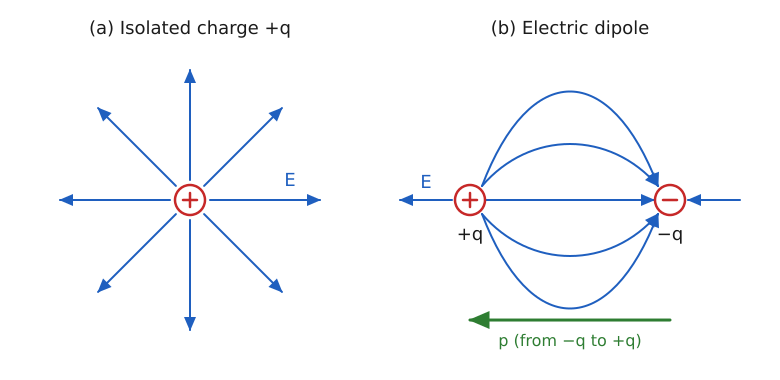

**Step 1.** Use a very small positive test charge $q_0$ so that it does not disturb the source charges.

**Step 2.** Measure the force $\vec{F}$ on it: $\vec{E} = \vec{F}/q_0$.

**Step 3.** For a point charge $q$, Coulomb's law gives

$$
E = \frac{1}{4\pi\varepsilon_0}\frac{q}{r^{2}}
$$

directed away from $+q$ and towards $-q$.

> [!IMPORTANT]
> $\vec{E} = \vec{F}/q_0$ in $\mathrm{N/C}$; for a point charge $E = q/(4\pi\varepsilon_0 r^{2})$.

**Worked example (lightning rod).** Air breaks down at about $3\times10^{6}\,\mathrm{V/m}$. A conducting sphere of radius $5\,\mathrm{cm}$ reaches this surface field when

$$
Q = \frac{E r^{2}}{k} = \frac{3\times10^{6}\times(0.05)^{2}}{9\times10^{9}} \approx 0.83\,\mu\mathrm{C}
$$

A sharp point has a much smaller effective radius, so it reaches breakdown at a far smaller charge; this is why lightning rods are pointed.

<b>Extra: field lines and superposition</b>

Field lines start on positive charges and end on negative charges, never cross, and are closer where the field is stronger; the tangent gives the direction of $\vec{E}$. For several charges $\vec{E} = \sum\vec{E}_i$ (superposition). Also $E = -dV/dx$.

> [!TIP]
> Say "small positive test charge" and give the unit and the vector nature of $E$.

### 2019 Q1(b) Coulomb's law and the unit of charge

> State and explain Coulomb's law. Hence define unit charge.
>
> Asked in: 2019 Q1(b).

#### Ans. to the question no. 1(b) of 2019

**Coulomb's law.** Same as [2017 Q1(a)](#2017-q1a-coulombs-law): $F = \dfrac{1}{4\pi\varepsilon_0}\dfrac{q_1q_2}{r^{2}}$.

**Unit charge.** One coulomb is the charge which, placed $1\,\mathrm{m}$ from an equal charge in vacuum, repels it with a force of $9\times10^{9}\,\mathrm{N}$.

**Step 1.** Put $q_1 = q_2 = q$, $r = 1\,\mathrm{m}$ and $F = 9\times10^{9}\,\mathrm{N}$ in Coulomb's law:

$$
q^{2} = \frac{F r^{2}}{k} = \frac{9\times10^{9}\times1^{2}}{9\times10^{9}} = 1\,\mathrm{C^2}
$$

**Step 2.**

$$
q = 1\,\mathrm{C}
$$

(In the CGS system the unit is the statcoulomb: the charge that repels an equal charge $1\,\mathrm{cm}$ away in vacuum with a force of $1\,\mathrm{dyne}$; $1\,\mathrm{C} \approx 3\times10^{9}\,\mathrm{statC}$.)

> [!IMPORTANT]
> $1\,\mathrm{C}$: two equal charges $1\,\mathrm{m}$ apart in vacuum repel with $9\times10^{9}\,\mathrm{N}$.

**Worked example (how big is a coulomb).** Two $1\,\mathrm{C}$ charges $1\,\mathrm{m}$ apart would repel with $9\times10^{9}\,\mathrm{N}$, the weight of about $9\times10^{5}$ tonnes. Everyday static charges are microcoulombs: two $1\,\mu\mathrm{C}$ charges $3\,\mathrm{cm}$ apart repel with $9\times10^{9}\times10^{-12}/(0.03)^{2} = 10\,\mathrm{N}$.

<b>Extra: electrons in a coulomb</b>

$$
n = \frac{1\,\mathrm{C}}{1.602\times10^{-19}\,\mathrm{C}} = 6.24\times10^{18}\ \text{electrons}
$$

In the modern SI the coulomb is $1\,\mathrm{A\,s}$, defined through the fixed value of the elementary charge $e$; the force definition above is the classical one used in textbooks.

> [!TIP]
> The definition needs all four conditions: equal charges, $1\,\mathrm{m}$ apart, in vacuum, force $9\times10^{9}\,\mathrm{N}$.

### 2019 Q3(a) Capacitor and capacitance (repeat)

> What is a capacitor? Define capacitance.

Same as [2018 Q1(a)](#2018-q1a-definitions-gausss-law-ohms-law-capacitor), part (iii).

### 2019 Q3(b) Ohm's law (repeat)

> State and explain Ohm's law.

Same as [2016 Q1(a)](#2016-q1a-ohms-law-and-resonance).

## Year 2020 Questions

### 2020 Q1(a) Gauss's law: statement and proof

> State and prove Gauss's law of electrostatics.
>
> Asked in: 2020 Q1(a); statement also in 2018 Q1(a), 2021 Q3(a), 2023 Q1(a).

#### Ans. to the question no. 1(a) of 2020

**Statement.** The total electric flux through any closed surface is $1/\varepsilon_0$ times the net charge enclosed by it:

$$
\oint \vec{E}\cdot d\vec{A} = \frac{q_{\mathrm{enc}}}{\varepsilon_0}
$$

**Step 1 (point charge, spherical surface of radius $r$).** By Coulomb's law $E = q/(4\pi\varepsilon_0 r^{2})$, radial and constant on the sphere, parallel to $d\vec{A}$:

$$
\Phi = E\,(4\pi r^{2}) = \frac{q}{4\pi\varepsilon_0 r^{2}}\,4\pi r^{2} = \frac{q}{\varepsilon_0}
$$

**Step 2 (surface of any shape).** The flux through a small area $dA$ whose normal makes angle $\theta$ with the radial line is

$$
d\Phi = \frac{q}{4\pi\varepsilon_0}\frac{dA\cos\theta}{r^{2}} = \frac{q}{4\pi\varepsilon_0}\,d\Omega
$$

where $d\Omega = dA\cos\theta/r^{2}$ is the solid angle subtended at the charge. Over any closed surface enclosing the charge $\oint d\Omega = 4\pi$, so $\Phi = q/\varepsilon_0$ whatever the shape.

**Step 3 (charge outside).** Each narrow cone from the charge enters the surface and leaves it, contributing equal and opposite flux; the net flux is zero.

**Step 4 (many charges, superposition).** With $\vec{E} = \sum\vec{E}_i$,

$$
\Phi = \sum_i \frac{q_i}{\varepsilon_0}\ \ (\text{enclosed charges only}) = \frac{q_{\mathrm{enc}}}{\varepsilon_0}
$$

> [!IMPORTANT]
> $\Phi_E = \oint \vec{E}\cdot d\vec{A} = q_{\mathrm{enc}}/\varepsilon_0$, independent of the shape of the surface and of charges outside it.

**Worked example (Faraday cage in a car).** A closed metal body has no net charge inside. Taking a Gaussian surface just inside the metal, $q_{\mathrm{enc}} = 0$ for the cavity, so there is no net charge on the inner wall and $E = 0$ inside, which protects passengers during a lightning strike. Numerically, a $2.0\,\mathrm{nC}$ charge inside any closed surface gives $\Phi = 2.0\times10^{-9}/8.854\times10^{-12} \approx 226\,\mathrm{N\,m^2/C}$.

<b>Extra: differential form</b>

For a continuous charge density $\rho$, $q_{\mathrm{enc}} = \int\rho\,dV$ and the divergence theorem turns Gauss's law into

$$
\nabla\cdot\vec{E} = \frac{\rho}{\varepsilon_0}
$$

the first of Maxwell's equations. Gauss's law is equivalent to the inverse-square form of Coulomb's law (see [2020 Q1(b)](#2020-q1b-coulombs-law-from-gausss-law)).

> [!TIP]
> A proof needs the single charge case first and then the general case (solid angle plus superposition). Mention that outside charges give zero net flux.

### 2020 Q1(b) Coulomb's law from Gauss's law

> Show that Coulomb's law can be deduced from Gauss's law.
>
> Asked in: 2020 Q1(b).

#### Ans. to the question no. 1(b) of 2020

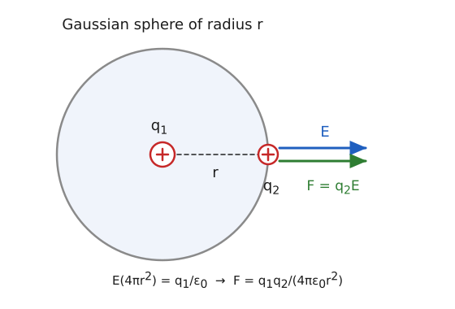

**Step 1.** Put $q_1$ at the centre of a Gaussian sphere of radius $r$. By symmetry $\vec{E}$ is radial with the same magnitude everywhere on the sphere, parallel to $d\vec{A}$.

**Step 2 (Gauss).**

$$
\oint \vec{E}\cdot d\vec{A} = E\,(4\pi r^{2}) = \frac{q_1}{\varepsilon_0}
$$

**Step 3.**

$$
E = \frac{q_1}{4\pi\varepsilon_0 r^{2}}
$$

**Step 4 (force on a test charge $q_2$ at distance $r$).**

$$
F = q_2E = \frac{1}{4\pi\varepsilon_0}\frac{q_1q_2}{r^{2}}
$$

> [!IMPORTANT]
> Gauss's law plus spherical symmetry gives Coulomb's law: $F = \dfrac{q_1q_2}{4\pi\varepsilon_0 r^{2}}$.

**Worked example (proton field in hydrogen).** At the Bohr radius $5.29\times10^{-11}\,\mathrm{m}$:

$$
E = \frac{8.99\times10^{9}\times1.602\times10^{-19}}{(5.29\times10^{-11})^{2}} \approx 5.1\times10^{11}\,\mathrm{N/C}
$$

<b>Extra: why the inverse square matters</b>

The area of the sphere grows as $r^{2}$ while the total flux is fixed at $q/\varepsilon_0$, so $E \propto 1/r^{2}$. If the force law were $1/r^{n}$ with $n \ne 2$, the flux through spheres of different radii would differ and Gauss's law could not hold.

> [!TIP]
> Justify the symmetry argument (why $E$ is constant and radial) and finish by multiplying by $q_2$.

### 2020 Q1(c) Field that balances the weight of an electron

> What field strength makes the electric force on an electron equal to its weight?
>
> Asked in: 2020 Q1(c).

#### Ans. to the question no. 1(c) of 2020

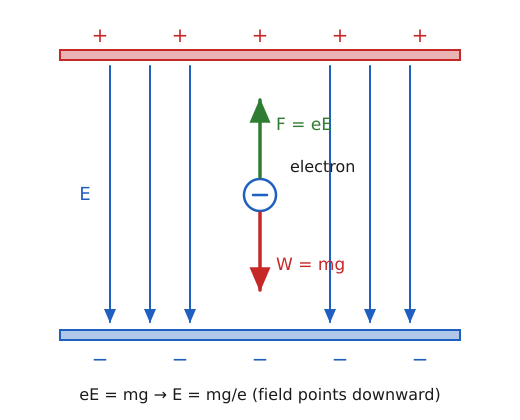

Given: $m_e = 9.109\times10^{-31}\,\mathrm{kg}$, $g = 9.8\,\mathrm{m/s^2}$, $e = 1.602\times10^{-19}\,\mathrm{C}$.

Formula: $eE = m_eg$.

Substitution:

$$
E = \frac{m_eg}{e} = \frac{9.109\times10^{-31}\times9.8}{1.602\times10^{-19}} = \frac{8.93\times10^{-30}}{1.602\times10^{-19}} \approx 5.57\times10^{-11}\,\mathrm{N/C}
$$

Direction: the electron is negative, so the force on it is opposite to $\vec{E}$. To push it upward against its weight the field must point **downward**.

> [!IMPORTANT]
> $E = m_eg/e \approx 5.57\times10^{-11}\,\mathrm{N/C}$, directed downward.

**Worked example (Millikan-type drop).** In an oil-drop experiment with $E = 3.0\times10^{4}\,\mathrm{V/m}$, a drop carrying one extra electron is held still if

$$
m = \frac{eE}{g} = \frac{1.602\times10^{-19}\times3.0\times10^{4}}{9.8} \approx 4.9\times10^{-16}\,\mathrm{kg}
$$

which corresponds to a drop about half a micrometre in radius.

<b>Extra: gravity is negligible for electrons, and the proton case</b>

In a field of only $1\,\mathrm{V/m}$ the electric force exceeds the weight of an electron by $eE/(m_eg) \approx 1.8\times10^{10}$. For a proton, the balancing field is $E = m_pg/e = 1.673\times10^{-27}\times9.8/1.602\times10^{-19} \approx 1.0\times10^{-7}\,\mathrm{N/C}$.

> [!TIP]
> Mention the direction of $E$ (downward for an electron held up). The answer is extremely small, which is expected.

### 2020 Q2(a) Lenz's law and conservation of energy

> State Lenz's law. Show that it follows conservation of energy.
>
> Asked in: 2020 Q2(a).

> [!NOTE]
> Lenz's law belongs to magnetism (electromagnetic induction) but is listed under Electricity in the question bank. The answer below is self-contained.

#### Ans. to the question no. 2(a) of 2020

**Statement.** The direction of an induced emf (and current) is such that it opposes the change of magnetic flux that produces it. In Faraday's law the minus sign expresses this:

$$
\mathcal{E} = -\frac{d\Phi_B}{dt}
$$

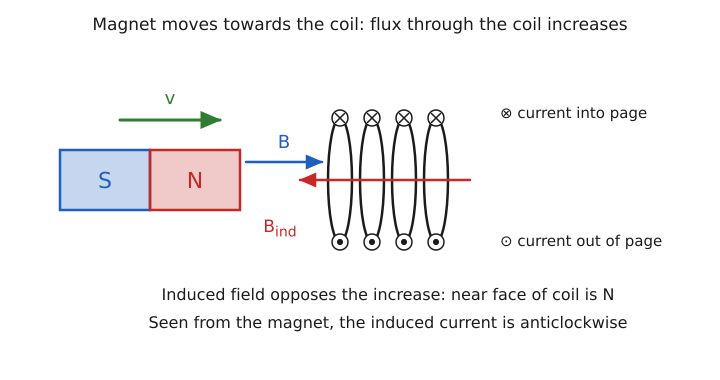

**Step 1 (what Lenz predicts).** Push the north pole of a magnet towards a coil. The flux through the coil increases, so the induced current produces a north face towards the magnet; it repels the magnet and opposes the motion.

**Step 2 (suppose the opposite).** If the induced current instead made a south face, it would attract the magnet, pulling it in faster. The motion and the flux change would grow without any effort, while current in the coil also produced heat. Energy would be created from nothing, which violates conservation of energy.

**Step 3 (so the opposition is required).** With the actual direction the external agent does positive work $W$ against the repulsion. This work becomes the electrical energy $\int I^{2}R\,dt$ dissipated in the coil, so energy is conserved.

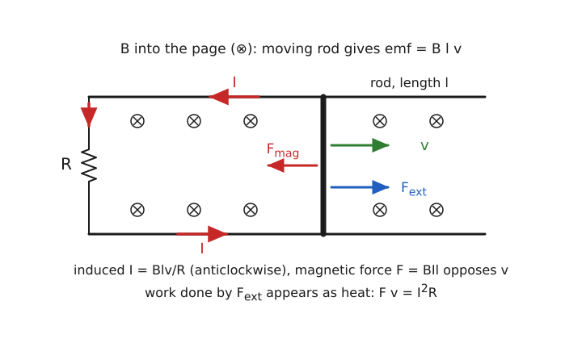

**Step 4 (quantitative check, rod of length $l$ on rails, speed $v$, field $B$, circuit resistance $R$).**

$$
\mathcal{E} = Blv, \qquad I = \frac{Blv}{R}, \qquad F = BIl = \frac{B^{2}l^{2}v}{R}\ \ (\text{opposing } v)
$$

$$
\text{mechanical power } Fv = \frac{B^{2}l^{2}v^{2}}{R} = I^{2}R = \text{electrical power}
$$

> [!IMPORTANT]
> Lenz's law: induced current opposes the change in flux. It is the conservation of energy: the mechanical work done against the induced force equals the electrical energy dissipated.

**Worked example (eddy-current brake).** Take $B = 0.5\,\mathrm{T}$, $l = 0.4\,\mathrm{m}$, $v = 3\,\mathrm{m/s}$, $R = 0.2\,\Omega$. Then $\mathcal{E} = 0.5\times0.4\times3 = 0.6\,\mathrm{V}$, $I = 3\,\mathrm{A}$, $F = BIl = 0.6\,\mathrm{N}$. Mechanical power $Fv = 1.8\,\mathrm{W}$ and electrical power $I^{2}R = 9\times0.2 = 1.8\,\mathrm{W}$: equal, as the law requires. This is how electromagnetic and regenerative brakes turn motion into heat or stored energy.

<b>Extra: falling magnet in a copper tube</b>

A magnet dropped down a copper pipe induces eddy currents that oppose its fall. The drag grows with speed, so it quickly reaches a small terminal velocity, and the lost gravitational energy appears as heating of the pipe. If the induced currents instead helped the fall, the magnet would accelerate without limit.

> [!TIP]
> Do not stop at the statement: show the "what if opposite" argument. The word "opposes" refers to the change in flux, not to the flux itself.

### 2020 Q2(b) Exponential rise of current in an LR circuit (repeat)

> Show that in an LR circuit the current increases exponentially.

Same as [2016 Q4(b)](#2016-q4b-the-l-r-circuit-growth-and-decay-of-current) (growth, Steps 1 to 4): $I = I_0(1 - e^{-Rt/L})$.

### 2020 Q2(c) LR numerical: time constant

> In an LR circuit with a source, the current reaches one third of its maximum value in $5\,\mathrm{s}$. Find the time constant.
>
> Asked in: 2020 Q2(c).

#### Ans. to the question no. 2(c) of 2020

Given: $I = I_0/3$ at $t = 5\,\mathrm{s}$.

Formula: $I = I_0(1 - e^{-t/\tau})$.

Substitution:

$$
1 - e^{-t/\tau} = \frac{1}{3} \quad\Rightarrow\quad e^{-t/\tau} = \frac{2}{3} \quad\Rightarrow\quad \frac{t}{\tau} = \ln\frac{3}{2} = 0.4055
$$

$$
\tau = \frac{5\,\mathrm{s}}{0.4055} \approx 12.3\,\mathrm{s}
$$

> [!IMPORTANT]
> $\tau \approx 12.3\,\mathrm{s}$ (so $\tau = L/R$).

**Worked example (large electromagnet).** A coil with $L = 24.6\,\mathrm{H}$ and $R = 2.0\,\Omega$ has $\tau = 12.3\,\mathrm{s}$; it needs about $5\tau \approx 62\,\mathrm{s}$ to reach $99\%$ of full current, which is why big magnets are ramped slowly.

<b>Extra: time to reach any fraction f of the final current</b>

$$
t = \tau\ln\frac{1}{1 - f}
$$

$f = 1/2$: $0.693\tau$; $f = 0.9$: $2.303\tau$; $f = 0.99$: $4.605\tau$. Check: at $t = 12.3\,\mathrm{s}$ the current is $63.2\%$ of $I_0$.

> [!TIP]
> Use the growth formula, not the decay formula. Check that $5\,\mathrm{s}$ is less than $\tau$ (the current is only $33\%$ at that time).

### 2020 Q3(b) The L-R circuit (repeat)

> Describe the L-R circuit and plot growth and decay of current with time.

Same as [2016 Q4(b)](#2016-q4b-the-l-r-circuit-growth-and-decay-of-current).

## Year 2021 Questions

### 2021 Q1(a) Capacitor and capacitance (repeat)

> Define capacitor and capacitance.

Same as [2018 Q1(a)](#2018-q1a-definitions-gausss-law-ohms-law-capacitor), part (iii).

### 2021 Q1(b) Capacitance of a parallel plate capacitor (repeat)

> Derive the capacitance of a parallel plate capacitor.

Same as [2017 Q1(b)](#2017-q1b-capacitance-of-a-parallel-plate-capacitor).

### 2021 Q1(c) Parallel plate numerical

> Plate area $1.5\,\mathrm{m^2}$, separation $0.02\,\mathrm{m}$ in air. Calculate the capacitance ($\varepsilon_0 = 1$ as given).
>
> Asked in: 2021 Q1(c).

#### Ans. to the question no. 1(c) of 2021

Given: $A = 1.5\,\mathrm{m^2}$, $d = 0.02\,\mathrm{m}$, $\varepsilon_0 = 1$ (as given in the question).

Formula: $C = \varepsilon_0A/d$.

Substitution with the given value:

$$
C = \frac{1\times1.5}{0.02} = 75 \quad(\text{in the units implied by } \varepsilon_0 = 1)
$$

With the true SI value $\varepsilon_0 = 8.854\times10^{-12}\,\mathrm{F/m}$:

$$
C = \frac{8.854\times10^{-12}\times1.5}{0.02} \approx 6.64\times10^{-10}\,\mathrm{F}
$$

> [!IMPORTANT]
> With $\varepsilon_0 = 1$ as given: $C = 75$. In SI: $C \approx 6.64\times10^{-10}\,\mathrm{F}$ ($\approx 664\,\mathrm{pF}$).

**Worked example (why a farad is huge).** A $1\,\mathrm{F}$ air capacitor with a $1\,\mathrm{mm}$ gap would need $A = Cd/\varepsilon_0 = 10^{-3}/8.854\times10^{-12} \approx 1.1\times10^{8}\,\mathrm{m^2}$ (about $113\,\mathrm{km^2}$). Practical large capacitors use rolled foils, thin dielectrics or porous electrodes (supercapacitors) to pack in that area.

<b>Extra: effect of changing d and the dielectric</b>

$C \propto 1/d$: doubling the gap halves $C$. Filling the gap with a dielectric of $K = 5$ (illustrative) raises $C$ from $664\,\mathrm{pF}$ to $3.32\,\mathrm{nF}$.

> [!TIP]
> The given $\varepsilon_0 = 1$ is not realistic; show the given-unit answer (75) and add the SI value so either marking scheme is covered.

### 2021 Q3(a) Gauss's law (repeat)

> State and explain Gauss's law.

Same as [2018 Q1(a)](#2018-q1a-definitions-gausss-law-ohms-law-capacitor), part (i); the proof is in [2020 Q1(a)](#2020-q1a-gausss-law-statement-and-proof).

### 2021 Q3(b) Wheatstone bridge: balanced condition (repeat)

> For the balanced Wheatstone bridge show that $P/Q = R/S$.

Same as [2016 Q1(b)](#2016-q1b-wheatstone-bridge-principle-using-kirchhoffs-laws) (the arms $P$, $Q$, $R$, $S$ are named identically).

### 2021 Q3(c) Field on the perpendicular bisector

> Calculate the field $E$ at a point $P$ at distance $R$ along the perpendicular bisector of the line joining the charges.
>
> Asked in: 2021 Q3(c).

#### Ans. to the question no. 3(c) of 2021

**Assumption.** The charges are taken as an electric dipole: equal and opposite, $+q$ and $-q$, a distance $2a$ apart. The like-charge case is treated in the Extra.

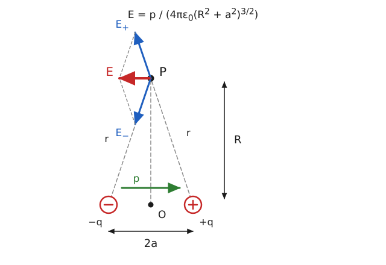

Let $r = \sqrt{R^{2} + a^{2}}$ be the distance of $P$ from each charge.

**Step 1 (magnitudes).**

$$
E_+ = E_- = \frac{1}{4\pi\varepsilon_0}\frac{q}{R^{2} + a^{2}}
$$

**Step 2 (components).** $E_+$ points away from $+q$, $E_-$ towards $-q$. Their components perpendicular to the axis are equal and opposite and cancel. The components along the axis both point from $+q$ towards $-q$, each equal to $E\cos\theta$ with $\cos\theta = a/r$.

**Step 3 (resultant).**

$$
E = 2E_+\cos\theta = \frac{2kq}{R^{2} + a^{2}}\cdot\frac{a}{\sqrt{R^{2} + a^{2}}} = \frac{kp}{(R^{2} + a^{2})^{3/2}}, \qquad p = 2aq
$$

**Step 4 (far field, $R \gg a$).**

$$
E \approx \frac{p}{4\pi\varepsilon_0 R^{3}}
$$

The direction is parallel to the axis, from $+q$ towards $-q$ (opposite to $\vec{p}$).

> [!IMPORTANT]
> $E = \dfrac{p}{4\pi\varepsilon_0(R^{2} + a^{2})^{3/2}} \approx \dfrac{p}{4\pi\varepsilon_0R^{3}}$, antiparallel to $\vec{p}$.

**Worked example.** For $p = 2.5\times10^{-10}\,\mathrm{C\,m}$ at $R = 1\,\mathrm{m}$: $E = 9\times10^{9}\times2.5\times10^{-10}/1 = 2.25\,\mathrm{N/C}$ (half the axial value $4.5\,\mathrm{N/C}$). For a water molecule ($p = 6.17\times10^{-30}\,\mathrm{C\,m}$) at $1\,\mathrm{nm}$ on its bisector, $E \approx 5.6\times10^{7}\,\mathrm{N/C}$.

<b>Extra: two equal like charges</b>

If both charges are $+q$, the components along the axis cancel and those along the bisector add, so the field points along the bisector, away from the charges:

$$
E = \frac{2kqR}{(R^{2} + a^{2})^{3/2}}
$$

For $R \gg a$ this is $2kq/R^{2}$, as if a charge $2q$ sat at the centre. At $R = 0$, $E = 0$ by symmetry, and the maximum occurs at $R = a/\sqrt{2}$.

> [!TIP]
> State that the charges are treated as a dipole, and show the cancelling components explicitly. Do not use $kq/R^{2}$ for this point.

### 2021 Q4(b) LR growth and decay curves (repeat)

> Draw the growth and decay curves of current in an LR circuit and explain them.

Same as [2016 Q4(b)](#2016-q4b-the-l-r-circuit-growth-and-decay-of-current): the curves are shown there with $\tau = L/R$, $63.2\%$ on growth and $36.8\%$ on decay.

### 2021 Q4(c) LR numerical: time to half current

> An LR circuit has $L = 50\,\mathrm{H}$ and $R = 30\,\Omega$ and is connected to a $100\,\mathrm{V}$ battery. How long for the current to reach half its final value?
>
> Asked in: 2021 Q4(c).

#### Ans. to the question no. 4(c) of 2021

Given: $L = 50\,\mathrm{H}$, $R = 30\,\Omega$, $E = 100\,\mathrm{V}$.

Formula: $I = I_0(1 - e^{-Rt/L})$ with $I = I_0/2$.

Substitution:

$$
e^{-Rt/L} = \frac{1}{2} \quad\Rightarrow\quad t = \frac{L}{R}\ln 2 = \frac{50}{30}\times0.693 = 1.155\,\mathrm{s}
$$

> [!IMPORTANT]
> $t = (L/R)\ln 2 \approx 1.16\,\mathrm{s}$. The $100\,\mathrm{V}$ is not needed for the time; it only fixes the final current $I_0 = 100/30 = 3.33\,\mathrm{A}$.

**Worked example (inductor in a switching supply).** A $22\,\mu\mathrm{H}$ inductor with $0.05\,\Omega$ total series resistance has $\tau = 22\times10^{-6}/0.05 = 440\,\mu\mathrm{s}$. In a $100\,\mathrm{kHz}$ converter (period $10\,\mu\mathrm{s}$) the current rises only about $1\%$ of its final value in a $5\,\mu\mathrm{s}$ on-time, so the rise is nearly linear.

<b>Extra: energy and time to 99 percent</b>

The half-time $0.693\tau$ does not depend on $E$. Time to $99\%$: $4.605\tau = 7.68\,\mathrm{s}$. Final stored energy: $\tfrac{1}{2}LI_0^{2} = \tfrac{1}{2}(50)(3.33)^{2} \approx 278\,\mathrm{J}$.

> [!TIP]
> Say explicitly that the battery voltage cancels out in the time. Use $\ln 2 = 0.693$.

### 2021 Q8(a) Energy stored in a capacitor

> Show that the energy stored in an electric field is $U = \tfrac{1}{2}CV^{2}$.
>
> Asked in: 2021 Q8(a).

#### Ans. to the question no. 8(a) of 2021

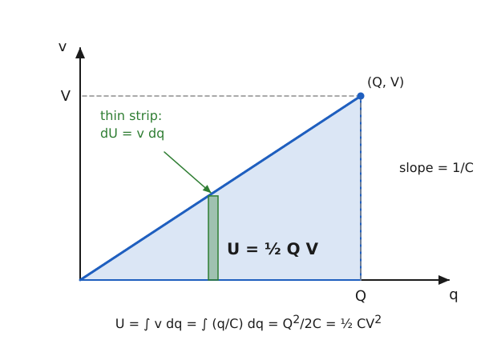

The energy stored equals the work done in charging the capacitor from zero to $Q$.

**Step 1 (work to move a small charge $dq$ when the capacitor has charge $q$).**

$$
dW = v\,dq = \frac{q}{C}\,dq
$$

**Step 2 (integrate from $0$ to $Q$).**

$$
U = \int_0^Q \frac{q}{C}\,dq = \frac{Q^{2}}{2C}
$$

**Step 3 (use $Q = CV$).**

$$
U = \frac{Q^{2}}{2C} = \tfrac{1}{2}QV = \tfrac{1}{2}CV^{2}
$$

Graphically, the area of the triangle under the $v$-$q$ line is $\tfrac{1}{2}QV$.

> [!IMPORTANT]
> $U = \tfrac{1}{2}CV^{2} = \tfrac{1}{2}QV = Q^{2}/2C$.

**Worked example (defibrillator, illustrative values).** $C = 32\,\mu\mathrm{F}$ charged to $3.3\,\mathrm{kV}$:

$$
U = \tfrac{1}{2}(32\times10^{-6})(3300)^{2} \approx 174\,\mathrm{J}
$$

delivered to the patient in a few milliseconds.

<b>Extra: energy density of the field</b>

For a parallel plate capacitor, $C = \varepsilon_0A/d$ and $V = Ed$:

$$
U = \tfrac{1}{2}\frac{\varepsilon_0A}{d}(Ed)^{2} = \tfrac{1}{2}\varepsilon_0E^{2}\,(Ad) \quad\Rightarrow\quad u = \tfrac{1}{2}\varepsilon_0E^{2}
$$

In air at breakdown, $E = 3\times10^{6}\,\mathrm{V/m}$ gives $u \approx 40\,\mathrm{J/m^3}$.

> [!TIP]
> The factor $\tfrac{1}{2}$ appears because the voltage grows from $0$ to $V$ during charging; it is not $QV$ (half the battery's work is lost as heat).

## Year 2022 Questions

### 2022 Q1(a) Electric field and intensity (repeat)

> Define electric field and electric field intensity.

Same as [2019 Q1(a)](#2019-q1a-electric-field-and-electric-field-intensity).

### 2022 Q1(b) Coulomb's law (repeat)

> State and explain Coulomb's law.

Same as [2017 Q1(a)](#2017-q1a-coulombs-law).

### 2022 Q1(c) Parallel plate capacitor expression (repeat)

> Find an expression for a parallel plate capacitor.

Same as [2017 Q1(b)](#2017-q1b-capacitance-of-a-parallel-plate-capacitor): $C = \varepsilon_0A/d$.

### 2022 Q2 Resistivity, Kirchhoff's second law, Wheatstone numerical

> (a) What is specific resistance? State and explain Ohm's law. (b) State and explain Kirchhoff's second law. (c) Four resistances $8\,\Omega$, $16\,\Omega$, $12\,\Omega$ and $48\,\Omega$ are on the arms of a Wheatstone bridge. What resistance must be connected in series or parallel with the fourth arm for balance?
>
> Q3 of 2022 is an identical copy; see [2022 Q3](#2022-q3-cross-reference-to-q2).

#### Ans. to the question no. 2 of 2022

**(a)** Same as [2017 Q2(a)](#2017-q2a-specific-resistance-ohms-law). In brief: specific resistance $\rho$ is the resistance of a unit-length, unit-area conductor of the material, $R = \rho L/A$, in $\Omega\,\mathrm{m}$. Ohm's law: at constant temperature $V = IR$.

**(b)** Same as [2017 Q2(b)](#2017-q2b-kirchhoffs-laws-of-electricity) (second law). In brief: round any closed loop the algebraic sum of the emfs equals the sum of the $IR$ drops, $\sum\mathcal{E} = \sum IR$ (conservation of energy).

**(c)** Same as [2017 Q2(c)](#2017-q2c-wheatstone-bridge-numerical-balancing-resistor); the numerical is kept in full here.

Given: $P = 8\,\Omega$, $Q = 16\,\Omega$, $R = 12\,\Omega$, $S = 48\,\Omega$, balance condition $P/Q = R/S$ (arms taken in this order; the fourth arm is $S$).

Formula and substitution: $P/Q = 1/2$ but $R/S = 1/4$, so the arm must become $S' = RQ/P = 12\times16/8 = 24\,\Omega$. Series addition can only increase $48\,\Omega$, so it cannot work. In parallel:

$$
\frac{1}{X} = \frac{1}{24} - \frac{1}{48} = \frac{1}{48} \quad\Rightarrow\quad X = 48\,\Omega
$$

> [!IMPORTANT]
> Connect $48\,\Omega$ in **parallel** with the $48\,\Omega$ arm.

> [!TIP]
> Write all three parts, even though (a) and (b) refer back; in the exam each needs its own written answer. Re-read the arm labels before choosing series or parallel.

### 2022 Q3 Cross-reference to Q2

> Q3 is an identical copy of Q2: (a) specific resistance and Ohm's law; (b) Kirchhoff's second law; (c) the $8$, $16$, $12$, $48\,\Omega$ Wheatstone numerical.

See [2022 Q2](#2022-q2-resistivity-kirchhoffs-second-law-wheatstone-numerical) for the full solution; the sub-parts also link to [2017 Q2(a)](#2017-q2a-specific-resistance-ohms-law), [2017 Q2(b)](#2017-q2b-kirchhoffs-laws-of-electricity) and [2017 Q2(c)](#2017-q2c-wheatstone-bridge-numerical-balancing-resistor).

## Year 2023 Questions

### 2023 Q1(a) Gauss's law, Ohm's law, capacitor (repeat)

> Define: Gauss's law, Ohm's law, capacitor.

Same as [2018 Q1(a)](#2018-q1a-definitions-gausss-law-ohms-law-capacitor).

### 2023 Q1(b) Wheatstone bridge principle (repeat)

> Deduce the Wheatstone bridge principle using Kirchhoff's law.

Same as [2016 Q1(b)](#2016-q1b-wheatstone-bridge-principle-using-kirchhoffs-laws).

### 2023 Q1(c) Capacitors in series (repeat)

> Show that $1/C_s = 1/C_1 + 1/C_2 + 1/C_3$.

Same as [2018 Q1(c)](#2018-q1c-capacitors-in-series).

### 2023 Q4(a) Time constant and RC charging (repeat)

> Define the time constant of an RC circuit. Derive the equation of charge while charging.

Same as [2017 Q4(b)](#2017-q4b-time-constant-and-charging-of-an-rc-circuit).

### 2023 Q4(b) Resonance and resonant frequency (repeat)

> What is resonance? Deduce the resonant frequency of an RLC circuit.

Same as [2018 Q4(b)](#2018-q4b-resonance-and-resonant-frequency-of-an-rlc-circuit).

### 2023 Q4(c) RLC numerical (year-specific copy)

> An RLC circuit has $L = 50\,\mu\mathrm{H}$, $C = 5\times10^{-4}\,\mu\mathrm{F}$ and $R = 100\,\Omega$. Find the frequency of the circuit.

The numbers are identical to [2018 Q4(c)](#2018-q4c-rlc-numerical); the working is repeated in short.

Given: $L = 5\times10^{-5}\,\mathrm{H}$, $C = 5\times10^{-10}\,\mathrm{F}$, $R = 100\,\Omega$.

Formula: $f_0 = 1/(2\pi\sqrt{LC})$.

Substitution:

$$
f_0 = \frac{1}{2\pi\sqrt{5\times10^{-5}\times5\times10^{-10}}} = \frac{1}{2\pi\times1.581\times10^{-7}} \approx 1.007\times10^{6}\,\mathrm{Hz}
$$

> [!IMPORTANT]
> $f_0 \approx 1.007\,\mathrm{MHz}$ (the damped value with $R = 100\,\Omega$ is about $0.994\,\mathrm{MHz}$; the resonant value is the one asked).

## Concept Map of the Chapter

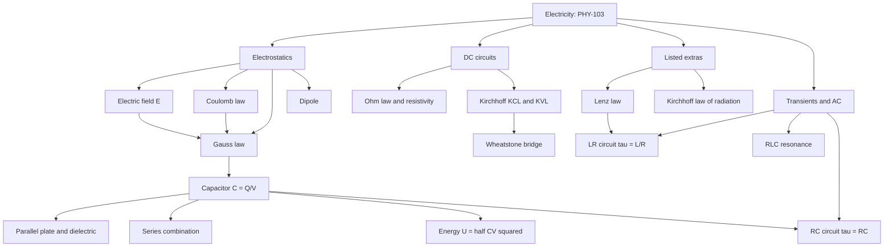

## One-Page Cheat Sheet

| Topic | Result to remember |
|---|---|
| Coulomb's law | $F = \dfrac{q_1q_2}{4\pi\varepsilon_0r^{2}}$, $k = 9\times10^{9}$ |
| Electric field | $\vec{E} = \vec{F}/q_0$; point charge $E = kq/r^{2}$ |
| Gauss's law | $\oint\vec{E}\cdot d\vec{A} = q_{\mathrm{enc}}/\varepsilon_0$ |
| Dipole axial | $V = kp/r^{2}$, $E = 2kp/r^{3}$ |
| Dipole equatorial | $V = 0$, $E = kp/(R^{2} + a^{2})^{3/2} \approx kp/R^{3}$ |
| Capacitance | $C = Q/V$; parallel plate $\varepsilon_0A/d$; with slab $\dfrac{\varepsilon_0A}{d - t + t/K}$ |
| Series / parallel | $\dfrac{1}{C_s} = \sum\dfrac{1}{C_i}$; $C_p = \sum C_i$ |
| Energy | $U = \tfrac{1}{2}CV^{2}$; $u = \tfrac{1}{2}\varepsilon_0E^{2}$ |
| Ohm and resistivity | $V = IR$; $R = \rho L/A$ |
| Kirchhoff | $\sum I = 0$ at a node; $\sum\mathcal{E} = \sum IR$ in a loop |
| Wheatstone | balance $P/Q = R/S$; too-large arm needs a parallel trim |
| RC charging | $q = Q_0(1 - e^{-t/RC})$, $\tau = RC$ |
| LR growth / decay | $I = I_0(1 - e^{-Rt/L})$, $I = I_0e^{-Rt/L}$, $\tau = L/R$ |
| Half-time | $t_{1/2} = 0.693\,\tau$ |
| RLC resonance | $f_0 = \dfrac{1}{2\pi\sqrt{LC}}$, $Q = \dfrac{1}{R}\sqrt{L/C}$, $\Delta f = f_0/Q$ |
| Lenz's law | induced effect opposes the flux change; $\mathcal{E} = -d\Phi/dt$ |
| Kirchhoff radiation | $E/a = E_b$ |

Key numbers from the solved questions: $2.25\,\mathrm{V}$ (dipole), $402\,\mathrm{pF}$ (slab), $24\,\Omega$ then $48\,\Omega$ in parallel (bridge), $1.007\,\mathrm{MHz}$ (RLC), $5.57\times10^{-11}\,\mathrm{N/C}$ (electron), $12.3\,\mathrm{s}$ and $1.16\,\mathrm{s}$ (LR).

## Glossary

| Term | Meaning |
|---|---|
| Back emf | Emf induced in an inductor that opposes a change in its current |
| Bandwidth | Width of the frequency range between the half-power points of a resonance curve |
| Capacitance | Charge stored per unit potential difference, $C = Q/V$ |
| Dielectric | Insulating material that raises capacitance by the factor $K$ |
| Dielectric constant | Ratio $K = \varepsilon/\varepsilon_0$ of a material |
| Dipole moment | $p = 2aq$, pointing from the negative to the positive charge |
| Flux | Measure of field lines through a surface, $\Phi = \int\vec{E}\cdot d\vec{A}$ |
| Gaussian surface | Imaginary closed surface used to apply Gauss's law |
| Impedance | Total opposition $Z$ to alternating current in an RLC circuit |
| Quality factor | $Q = \omega_0L/R$; sharpness of resonance |
| Reactance | Opposition of $L$ or $C$ to alternating current, $X_L = \omega L$, $X_C = 1/\omega C$ |
| Resistivity | Property $\rho$ of a material, $R = \rho L/A$ |
| Resonance | Condition $X_L = X_C$ with maximum current in a series RLC circuit |
| Time constant | $\tau = RC$ or $L/R$, the time for a $63.2\%$ change |
| Test charge | Small positive charge used to probe an electric field |

## Practice Problems with Answers

**Problem 1 (Coulomb and field).** Two point charges of $2\,\mu\mathrm{C}$ and $4\,\mu\mathrm{C}$ are $0.30\,\mathrm{m}$ apart in air. Find the force between them and the field of the $2\,\mu\mathrm{C}$ charge at the position of the other.

Answer

$$
F = \frac{9\times10^{9}\times2\times10^{-6}\times4\times10^{-6}}{(0.30)^{2}} = 0.80\,\mathrm{N} \text{ (repulsive)}, \qquad E = \frac{F}{q_2} = \frac{0.80}{4\times10^{-6}} = 2.0\times10^{5}\,\mathrm{N/C}
$$

**Problem 2 (series capacitors and energy).** A $4\,\mu\mathrm{F}$ and a $12\,\mu\mathrm{F}$ capacitor are connected in series across $16\,\mathrm{V}$. Find the equivalent capacitance, the voltage on each and the total stored energy.

Answer

$C_s = \dfrac{4\times12}{4+12} = 3\,\mu\mathrm{F}$, $Q = C_sV = 48\,\mu\mathrm{C}$. $V_1 = 48/4 = 12\,\mathrm{V}$, $V_2 = 48/12 = 4\,\mathrm{V}$. Energy $U = \tfrac{1}{2}(3\times10^{-6})(16)^{2} = 3.84\times10^{-4}\,\mathrm{J} = 384\,\mu\mathrm{J}$.

**Problem 3 (RC timer).** A $2\,\mathrm{k\Omega}$ resistor charges a $500\,\mu\mathrm{F}$ capacitor from a $12\,\mathrm{V}$ supply. Find $\tau$, the capacitor voltage at $t = \tau$, and the time to reach $90\%$ of $12\,\mathrm{V}$.

Answer

$\tau = RC = 2000\times500\times10^{-6} = 1.0\,\mathrm{s}$. $V_C(\tau) = 12(1 - e^{-1}) = 7.58\,\mathrm{V}$. For $90\%$: $t = \tau\ln 10 = 2.30\,\mathrm{s}$.

**Problem 4 (RLC resonance).** A series circuit has $L = 10\,\mathrm{mH}$, $C = 100\,\mathrm{nF}$ and $R = 20\,\Omega$. Find $f_0$, the quality factor and the bandwidth.

Answer

$f_0 = \dfrac{1}{2\pi\sqrt{10^{-2}\times10^{-7}}} = \dfrac{1}{2\pi\times3.162\times10^{-5}} \approx 5.03\,\mathrm{kHz}$. $Q = \dfrac{1}{R}\sqrt{L/C} = \dfrac{316.2}{20} \approx 15.8$. $\Delta f = R/(2\pi L) = 20/(2\pi\times0.01) \approx 318\,\mathrm{Hz}$ (equals $f_0/Q$).

