# PHY-103 Entropy: Previous-Year Questions Solved (2015-2023)

| Item | Detail |
| --- | --- |
| Course | PHY-103 Physics-II, BUTEX Fabric Engineering |
| Topic | Entropy (PART: B) |
| Years covered | 2016, 2017, 2018, 2021, 2022, 2023 |
| Questions solved | 15 questions, 7 distinct topics |
| Version | v261103-0 |
| Compiled by | sigkill0x00 |
| Location | `PHY-103/quick_rev/`, images in `../../assets/` |

> [!NOTE]
> Questions are in paper order. A repeated question is quoted again with a link to its full solution, except the engine numerical, which is worked out in full every time. The previous-year question bank is used only to cross-check wording.

## Table of Contents

- [Appearance Matrix by Year and Topic](#appearance-matrix-by-year-and-topic)
- [Formula and Units Sheet](#formula-and-units-sheet)
- [2016 Paper](#2016-paper)
  - [2016 Q7(a): What is entropy?](#2016-q7a-what-is-entropy)
  - [2016 Q7(b): Explain the Clausius-Clapeyron equation](#2016-q7b-explain-the-clausius-clapeyron-equation)
  - [2016 Q7(c): Efficiency of an engine using 3x10^6 cal per horsepower-hour](#2016-q7c-efficiency-of-an-engine-using-3x106-cal-per-horsepower-hour)
- [2017 Paper](#2017-paper)
  - [2017 Q7(a): What are entropy and unavailable energy?](#2017-q7a-what-are-entropy-and-unavailable-energy)
  - [2017 Q7(b): Show that entropy remains constant in a reversible process](#2017-q7b-show-that-entropy-remains-constant-in-a-reversible-process)
  - [2017 Q7(c): Derive the Clausius-Clapeyron equation](#2017-q7c-derive-the-clausius-clapeyron-equation)
  - [2017 Q7(d): Engine efficiency numerical (same as 2016 Q7(c))](#2017-q7d-engine-efficiency-numerical-same-as-2016-q7c)
- [2018 Paper](#2018-paper)
  - [2018 Q7(a): What is entropy?](#2018-q7a-what-is-entropy)
  - [2018 Q7(b): Explain the first latent heat (Clausius-Clapeyron) equation](#2018-q7b-explain-the-first-latent-heat-clausius-clapeyron-equation)
  - [2018 Q7(c): Show that the entropy change is zero over a cycle in the reversible Carnot cycle](#2018-q7c-show-that-the-entropy-change-is-zero-over-a-cycle-in-the-reversible-carnot-cycle)
- [2021 Paper](#2021-paper)
  - [2021 Q5(a): Show that entropy in a reversible process remains the same](#2021-q5a-show-that-entropy-in-a-reversible-process-remains-the-same)
- [2022 Paper](#2022-paper)
  - [2022 Q7(a): What are entropy and unavailable energy?](#2022-q7a-what-are-entropy-and-unavailable-energy)
  - [2022 Q7(b): Entropy in an irreversible process (printed as remains constant)](#2022-q7b-entropy-in-an-irreversible-process-printed-as-remains-constant)
  - [2022 Q7(c): Engine efficiency numerical (same as 2016 Q7(c))](#2022-q7c-engine-efficiency-numerical-same-as-2016-q7c)
- [2023 Paper](#2023-paper)
  - [2023 Q6(b): Show that the entropy change is zero over a cycle in the reversible Carnot cycle](#2023-q6b-show-that-the-entropy-change-is-zero-over-a-cycle-in-the-reversible-carnot-cycle)
- [Concept Map](#concept-map)
- [One-Page Cheat Sheet](#one-page-cheat-sheet)
- [Glossary](#glossary)
- [Practice Problems](#practice-problems)
  - [Practice Problem 1: Entropy of melting](#practice-problem-1-entropy-of-melting)
  - [Practice Problem 2: Heat flow between two bodies](#practice-problem-2-heat-flow-between-two-bodies)
  - [Practice Problem 3: Boiling point and pressure](#practice-problem-3-boiling-point-and-pressure)
  - [Practice Problem 4: Free expansion](#practice-problem-4-free-expansion)

## Appearance Matrix by Year and Topic

Read the last column first: the higher the count, the more likely the topic is to return.

| Topic | 2016 | 2017 | 2018 | 2021 | 2022 | 2023 | Times asked |
| --- | --- | --- | --- | --- | --- | --- | --- |
| Clausius-Clapeyron equation (explain or derive) | Q7(b) | Q7(c) | Q7(b) | - | - | - | 3 |
| Engine numerical (3x10^6 cal per hp-hour) | Q7(c) | Q7(d) | - | - | Q7(c) | - | 3 |
| What is entropy | Q7(a) | - | Q7(a) | - | - | - | 2 |
| Entropy and unavailable energy | - | Q7(a) | - | - | Q7(a) | - | 2 |
| Entropy constant in a reversible process | - | Q7(b) | - | Q5(a) | - | - | 2 |
| Entropy change in the Carnot cycle | - | - | Q7(c) | - | - | Q6(b) | 2 |
| Entropy in an irreversible process | - | - | - | - | Q7(b) | - | 1 |

> [!TIP]
> Priority order: (1) Clausius-Clapeyron derivation and (2) the engine numerical, each asked three times; then (3) entropy definition with unavailable energy, (4) reversible process and Carnot-cycle entropy, each asked twice; finally (5) the irreversible-process proof. Prepare the Carnot-cycle proof well: it supports the reversible-process answers too.

## Formula and Units Sheet

| Quantity | Symbol | SI unit | Dimension | Key relation |
| --- | --- | --- | --- | --- |
| Entropy | $S$ | $\mathrm{J\,K^{-1}}$ | $\mathrm{M\,L^{2}\,T^{-2}\,\Theta^{-1}}$ | $dS = \delta Q_{\mathrm{rev}}/T$ |
| Heat, work, energy | $Q$, $W$ | $\mathrm{J}$ | $\mathrm{M\,L^{2}\,T^{-2}}$ | $W = Q_1 - Q_2$ |
| Absolute temperature | $T$ | $\mathrm{K}$ | $\Theta$ | $T = t + 273$ |
| Pressure | $P$ | $\mathrm{Pa}$ | $\mathrm{M\,L^{-1}\,T^{-2}}$ | $1\,\mathrm{atm} = 101325\,\mathrm{Pa}$ |
| Specific latent heat | $L$ | $\mathrm{J\,kg^{-1}}$ | $\mathrm{L^{2}\,T^{-2}}$ | $Q = mL$ |
| Specific volume | $v$ | $\mathrm{m^{3}\,kg^{-1}}$ | $\mathrm{L^{3}\,M^{-1}}$ | $v = 1/\rho$ |
| Slope of coexistence curve | $dP/dT$ | $\mathrm{Pa\,K^{-1}}$ | $\mathrm{M\,L^{-1}\,T^{-2}\,\Theta^{-1}}$ | $L/[T(v_2 - v_1)]$ |
| Efficiency | $\eta$ | none (pure number or %) | $1$ | $\eta = W/Q_1 = 1 - T_2/T_1$ |
| Power | $\dot W$ | $\mathrm{W} = \mathrm{J\,s^{-1}}$ | $\mathrm{M\,L^{2}\,T^{-3}}$ | $1\,\mathrm{hp} = 746\,\mathrm{W}$ |
| Unavailable energy | $T_0\,\Delta S$ | $\mathrm{J}$ | $\mathrm{M\,L^{2}\,T^{-2}}$ | $T_0$ = lowest available sink temperature |

Conversions used in this file: $1\,\mathrm{cal} = 4.2\,\mathrm{J}$, $1\,\mathrm{hp\,h} = 746 \times 3600 = 2.6856\times 10^{6}\,\mathrm{J}$, $R = 8.314\,\mathrm{J\,mol^{-1}\,K^{-1}}$, $k = 1.38\times 10^{-23}\,\mathrm{J\,K^{-1}}$.

## 2016 Paper

### 2016 Q7(a): What is entropy?

> What is entropy?
>
> Asked in: 2016 Q7(a), 2018 Q7(a)

#### Ans. to the question no. 7(a) of 2016

**Definition.** Entropy $S$ is a state function of a system. Its change between two equilibrium states A and B is the integral of $\delta Q_{\mathrm{rev}}/T$ along any reversible path from A to B:

$$
dS = \frac{\delta Q_{\mathrm{rev}}}{T}, \qquad S_B - S_A = \int_A^B \frac{\delta Q_{\mathrm{rev}}}{T}
$$

Here $\delta Q_{\mathrm{rev}}$ is the heat absorbed reversibly (J) and $T$ is the absolute temperature (K) at which it is absorbed. Entropy is measured in $\mathrm{J\,K^{-1}}$. Physically it measures the disorder of the system, or the part of its energy that is unavailable for work.

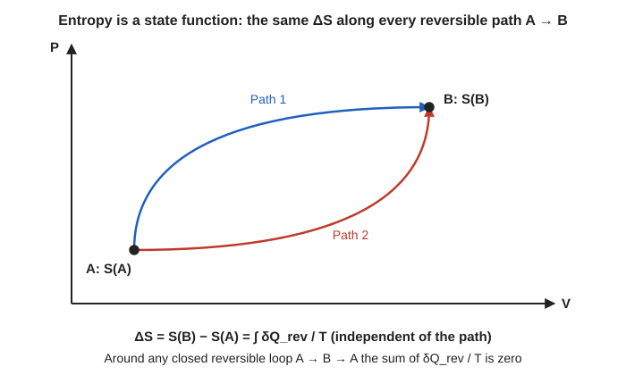

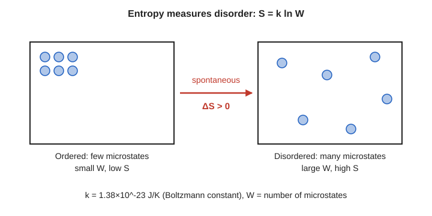

**Derivation (S is a state function).**

**Step 1.** For any reversible cycle the Clausius theorem gives zero. A reversible cycle is a sum of thin Carnot cycles, each with $Q_1/T_1 = Q_2/T_2$ (proved in [2018 Q7(c)](#2018-q7c-show-that-the-entropy-change-is-zero-over-a-cycle-in-the-reversible-carnot-cycle)), and the inner isothermal and adiabatic parts cancel.

$$
\oint \frac{\delta Q_{\mathrm{rev}}}{T} = 0
$$

**Step 2.** Join A to B by reversible path 1 and return from B to A by reversible path 2.

$$
\int_{A,\,1}^{B} \frac{\delta Q_{\mathrm{rev}}}{T} + \int_{B,\,2}^{A} \frac{\delta Q_{\mathrm{rev}}}{T} = 0
$$

**Step 3.** Reversing the limits of the second integral changes its sign.

$$
\int_{A,\,1}^{B} \frac{\delta Q_{\mathrm{rev}}}{T} = \int_{A,\,2}^{B} \frac{\delta Q_{\mathrm{rev}}}{T}
$$

**Step 4.** The integral depends only on the end states, not on the path. It is therefore the difference of a state function, which we call entropy: $S_B - S_A$.

> [!IMPORTANT]
> $dS = \delta Q_{\mathrm{rev}}/T$. Entropy is a state function (path independent), extensive, measured in $\mathrm{J\,K^{-1}}$. For an isolated system $\Delta S \ge 0$.

**Worked example: ice melting in a warm room.**

Given: $m = 0.100\,\mathrm{kg}$ of ice at $273.15\,\mathrm{K}$ melts in a room at $298.15\,\mathrm{K}$; $L = 3.34\times 10^{5}\,\mathrm{J\,kg^{-1}}$.

Formula: $Q = mL$, $\Delta S = Q/T$ for each body.

Substitution:

$$
Q = 0.100 \times 3.34\times 10^{5} = 3.34\times 10^{4}\,\mathrm{J}
$$

$$
\Delta S_{\mathrm{ice}} = \frac{3.34\times 10^{4}}{273.15} = +122.3\,\mathrm{J\,K^{-1}}, \qquad \Delta S_{\mathrm{room}} = -\frac{3.34\times 10^{4}}{298.15} = -112.0\,\mathrm{J\,K^{-1}}
$$

Answer: $\Delta S_{\mathrm{total}} \approx +10.3\,\mathrm{J\,K^{-1}} > 0$. The ice gains more entropy than the room loses, so the universe gains entropy.

> [!NOTE]
> **Extra: entropy change of an ideal gas and the microscopic meaning**
>
> **(i) Ideal gas.** For $n$ moles, $\delta Q_{\mathrm{rev}} = dU + P\,dV = nC_V\,dT + P\,dV$ with $P = nRT/V$.
>
> $$
> dS = nC_V\frac{dT}{T} + nR\frac{dV}{V}
> $$
>
> $$
> \Delta S = nC_V \ln\frac{T_2}{T_1} + nR \ln\frac{V_2}{V_1}
> $$
>
> Example: isothermal doubling of the volume of $1\,\mathrm{mol}$: $\Delta S = R\ln 2 = 5.76\,\mathrm{J\,K^{-1}}$.
>
> **(ii) Boltzmann relation.** $S = k\ln W$, where $W$ is the number of microstates compatible with the macrostate and $k$ is Boltzmann's constant. More microstates means more disorder and higher entropy.

> [!TIP]
> Common exam mistakes: (1) computing $\Delta S$ as $Q/T$ of the actual irreversible process; always use a reversible path. (2) Using $^\circ\mathrm{C}$ instead of kelvin. (3) Writing the unit as J instead of $\mathrm{J\,K^{-1}}$.

### 2016 Q7(b): Explain the Clausius-Clapeyron equation

> Explain the Clausius-Clapeyron equation.
>
> Asked in: 2016 Q7(b), 2017 Q7(c) (derive it), 2018 Q7(b) (first latent heat equation)

#### Ans. to the question no. 7(b) of 2016

**Statement.** When a substance changes phase at temperature $T$ and pressure $P$, the slope of the phase-boundary curve on a $P$-$T$ diagram is

$$
\frac{dP}{dT} = \frac{L}{T\,(v_2 - v_1)}
$$

where $L$ is the latent heat per unit mass absorbed in the change, $v_1$ and $v_2$ are the specific volumes of the initial and final phases ($\mathrm{m^{3}\,kg^{-1}}$). Written as $L = T(v_2 - v_1)\,dP/dT$ it is also called the first latent heat equation. For molar $L$ use molar volumes.

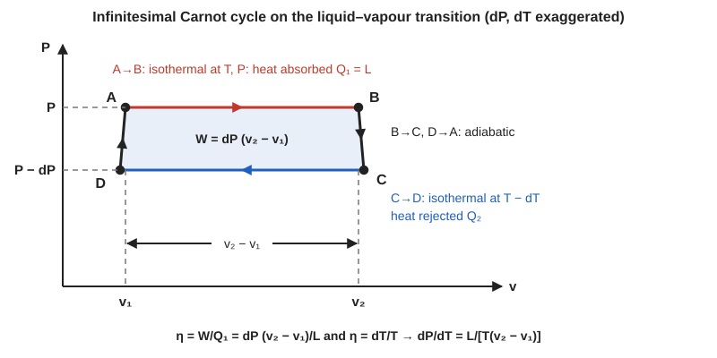

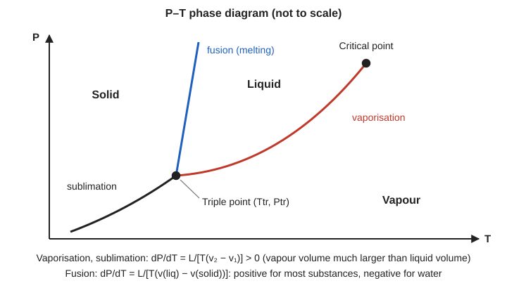

**Derivation (infinitesimal Carnot cycle).** Take $1\,\mathrm{kg}$ of liquid at $(T, P)$ as the working substance.

**Step 1 (A to B).** At constant $T$ and $P$ the liquid turns into vapour, absorbing heat $Q_1 = L$ while the volume rises from $v_1$ to $v_2$.

**Step 2 (B to C).** Adiabatic change: temperature and pressure fall slightly to $T - dT$ and $P - dP$.

**Step 3 (C to D).** At $T - dT$ the vapour condenses isothermally, rejecting heat $Q_2$.

**Step 4 (D to A).** Adiabatic change back to $(T, P)$.

**Step 5.** The cycle is a thin parallelogram of height $dP$ and width $v_2 - v_1$, so the work is its area:

$$
W = dP\,(v_2 - v_1)
$$

**Step 6.** Efficiency from the work and the heat absorbed:

$$
\eta = \frac{W}{Q_1} = \frac{dP\,(v_2 - v_1)}{L}
$$

**Step 7.** The same cycle is a Carnot cycle between $T$ and $T - dT$:

$$
\eta = \frac{T - (T - dT)}{T} = \frac{dT}{T}
$$

**Step 8.** Equate the two efficiencies:

$$
\frac{dP\,(v_2 - v_1)}{L} = \frac{dT}{T} \quad\Longrightarrow\quad \frac{dP}{dT} = \frac{L}{T\,(v_2 - v_1)}
$$

> [!IMPORTANT]
> $\dfrac{dP}{dT} = \dfrac{L}{T\,(v_2 - v_1)}$. For vaporisation $v_2 \gg v_1$ so the slope is positive. For melting of ice $v_2 < v_1$ so the slope is negative.

**Worked examples (approximate values).**

*(1) Boiling water at $100\,^\circ\mathrm{C}$.* Given: $L = 2.26\times 10^{6}\,\mathrm{J\,kg^{-1}}$, $v_2 \approx 1.673\,\mathrm{m^{3}\,kg^{-1}}$, $v_1 \approx 0.001\,\mathrm{m^{3}\,kg^{-1}}$, $T = 373\,\mathrm{K}$.

$$
\frac{dP}{dT} = \frac{2.26\times 10^{6}}{373 \times (1.673 - 0.001)} = \frac{2.26\times 10^{6}}{623.7} \approx 3.6\times 10^{3}\,\mathrm{Pa\,K^{-1}} = 3.6\,\mathrm{kPa\,K^{-1}}
$$

So each extra $3.6\,\mathrm{kPa}$ raises the boiling point by about $1\,\mathrm{K}$ near $100\,^\circ\mathrm{C}$. This is why a pressure cooker cooks faster and why water boils at a lower temperature at altitude where the pressure is lower.

*(2) Melting ice at $0\,^\circ\mathrm{C}$.* Given: $L = 3.34\times 10^{5}\,\mathrm{J\,kg^{-1}}$, $v_{\mathrm{water}} - v_{\mathrm{ice}} \approx -9.1\times 10^{-5}\,\mathrm{m^{3}\,kg^{-1}}$, $T = 273.15\,\mathrm{K}$.

$$
\frac{dT}{dP} = \frac{T\,(v_2 - v_1)}{L} = \frac{273.15 \times (-9.1\times 10^{-5})}{3.34\times 10^{5}} \approx -7.4\times 10^{-8}\,\mathrm{K\,Pa^{-1}} \approx -0.0075\,\mathrm{K\,atm^{-1}}
$$

Answer: the melting point of ice drops by about $0.0075\,\mathrm{K}$ per atmosphere, so about $0.75\,\mathrm{K}$ under $100\,\mathrm{atm}$. This is why ice melts under pressure and refreezes when the pressure is released (regelation, for example a loaded wire passing slowly through an ice block).

> [!NOTE]
> **Extra: three more results from the same equation**
>
> **(i) Maxwell-relation derivation (first latent heat equation).** From $(\partial S/\partial V)_T = (\partial P/\partial T)_V$ and the fact that $P$ depends only on $T$ during a phase change, integrating across the transition gives
>
> $$
> S_2 - S_1 = (v_2 - v_1)\frac{dP}{dT}
> $$
>
> and since the heat absorbed at constant $T$ is $L = T(S_2 - S_1)$, we get $L = T(v_2 - v_1)\,dP/dT$.
>
> **(ii) Vapour treated as an ideal gas** ($v_2 \gg v_1$, $v_2 \approx R_s T/P$, where $R_s$ is the specific gas constant):
>
> $$
> \frac{dP}{dT} \approx \frac{L\,P}{R_s\,T^{2}}
> $$
>
> **(iii) Sign of the melting curve.** Since $L > 0$ and $T > 0$, the sign of $dP/dT$ is the sign of $v_2 - v_1$.
>
> 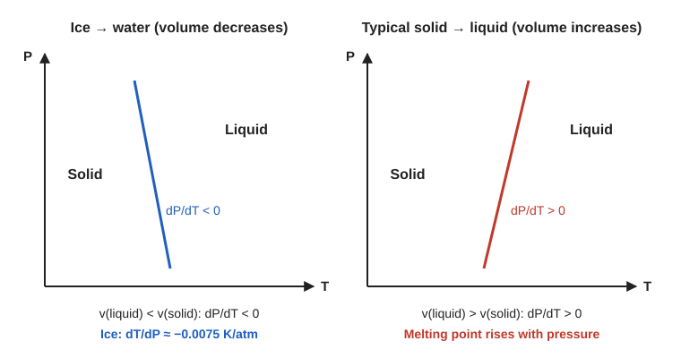

> [!TIP]
> Common exam mistakes: (1) mixing a per-kg $L$ with molar volumes; (2) using $^\circ\mathrm{C}$ for $T$; (3) the wrong sign for ice and water; (4) forgetting that dropping $v_1$ is valid only for liquid to vapour.

### 2016 Q7(c): Efficiency of an engine using 3x10^6 cal per horsepower-hour

> Find the efficiency of an engine requiring $3\times 10^{6}$ cal of heat per horsepower-hour and compare it with that of a perfect reversible engine. Source at $100\,^\circ\mathrm{C}$, sink at $0\,^\circ\mathrm{C}$.
>
> Asked in: 2016 Q7(c), 2017 Q7(d), 2022 Q7(c)

#### Ans. to the question no. 7(c) of 2016

**Statement.** Efficiency is $\eta = W/Q_1$, the work output divided by the heat taken from the source. No engine working between $T_1$ and $T_2$ can exceed the reversible (Carnot) value $\eta_{\mathrm{rev}} = 1 - T_2/T_1$.

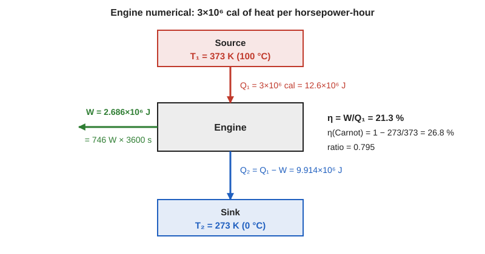

**Given:** $Q_1 = 3\times 10^{6}\,\mathrm{cal}$ per hp-hour; $T_1 = 100 + 273 = 373\,\mathrm{K}$; $T_2 = 0 + 273 = 273\,\mathrm{K}$; $1\,\mathrm{hp} = 746\,\mathrm{W}$; $J = 4.2\,\mathrm{J\,cal^{-1}}$.

**Formula:** $\eta = W/Q_1$, $\quad\eta_{\mathrm{rev}} = 1 - T_2/T_1$, $\quad$ comparison $= \eta/\eta_{\mathrm{rev}}$.

**Substitution:**

$$
W = 746\,\mathrm{W} \times 3600\,\mathrm{s} = 2.6856\times 10^{6}\,\mathrm{J}
$$

$$
Q_1 = 3\times 10^{6} \times 4.2 = 12.6\times 10^{6}\,\mathrm{J}
$$

$$
\eta = \frac{2.6856\times 10^{6}}{12.6\times 10^{6}} = 0.2131 \approx 21.3\,\%
$$

$$
\eta_{\mathrm{rev}} = 1 - \frac{273}{373} = \frac{100}{373} = 0.2681 \approx 26.8\,\%
$$

$$
\frac{\eta}{\eta_{\mathrm{rev}}} = \frac{0.2131}{0.2681} \approx 0.795
$$

**Answer:** the engine has $\eta \approx 21.3\,\%$ against $26.8\,\%$ for a perfect reversible engine, so it reaches about $79.5\,\%$ of the ideal.

> [!IMPORTANT]
> $\eta_{\mathrm{actual}} \approx 21.3\,\%$, $\eta_{\mathrm{rev}} \approx 26.8\,\%$, ratio $\approx 0.795$. With $J = 4.18\,\mathrm{J\,cal^{-1}}$ the answers are $21.4\,\%$ and about $79.9\,\%$.

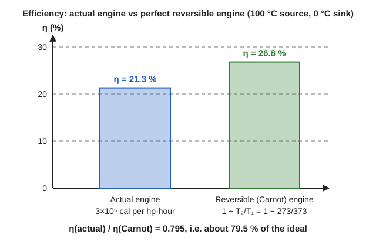

**Worked example: a power plant versus its Carnot limit (illustrative).** Steam at $540\,^\circ\mathrm{C}$ ($813\,\mathrm{K}$) and a condenser at $30\,^\circ\mathrm{C}$ ($303\,\mathrm{K}$) give $\eta_{\mathrm{rev}} = 1 - 303/813 = 62.7\,\%$. A plant that delivers $38\,\%$ reaches $0.38/0.627 \approx 0.61$ of the ideal, a similar kind of gap to this engine's $0.795$.

> [!NOTE]
> **Extra: where the missing work went (entropy generation)**
>
> Heat rejected: $Q_2 = Q_1 - W = 12.6\times 10^{6} - 2.6856\times 10^{6} = 9.9144\times 10^{6}\,\mathrm{J}$.
>
> $$
> \Delta S_{\mathrm{universe}} = \frac{Q_2}{T_2} - \frac{Q_1}{T_1} = \frac{9.9144\times 10^{6}}{273} - \frac{12.6\times 10^{6}}{373} \approx 36316 - 33780 \approx 2.54\times 10^{3}\,\mathrm{J\,K^{-1}}
> $$
>
> The positive value shows the engine is irreversible. A reversible engine would deliver $W_{\mathrm{rev}} = 0.2681 \times 12.6\times 10^{6} \approx 3.378\times 10^{6}\,\mathrm{J}$, so the work lost is $\approx 6.92\times 10^{5}\,\mathrm{J}$, which equals $T_2\,\Delta S_{\mathrm{universe}} = 273 \times 2536 \approx 6.92\times 10^{5}\,\mathrm{J}$.

> [!TIP]
> Common exam mistakes: (1) using $^\circ\mathrm{C}$ in $1 - T_2/T_1$ (it would give $100\,\%$); (2) forgetting the cal to J conversion; (3) not converting one hp-hour into joules ($746 \times 3600$); (4) quoting only the two efficiencies and not the comparison asked for.

## 2017 Paper

### 2017 Q7(a): What are entropy and unavailable energy?

> What are entropy and unavailable energy?
>
> Asked in: 2017 Q7(a), 2022 Q7(a)

#### Ans. to the question no. 7(a) of 2017

**Entropy.** A state function defined by $dS = \delta Q_{\mathrm{rev}}/T$ (full answer: [2016 Q7(a)](#2016-q7a-what-is-entropy)).

**Unavailable energy.** It is the part of the heat taken from a source that cannot be converted into work by any engine, because a heat engine must reject some heat to a sink. If $T_0$ is the lowest temperature available for the sink and $\Delta S$ is the entropy decrease of the source, then

$$
\text{unavailable energy} = T_0\,\Delta S
$$

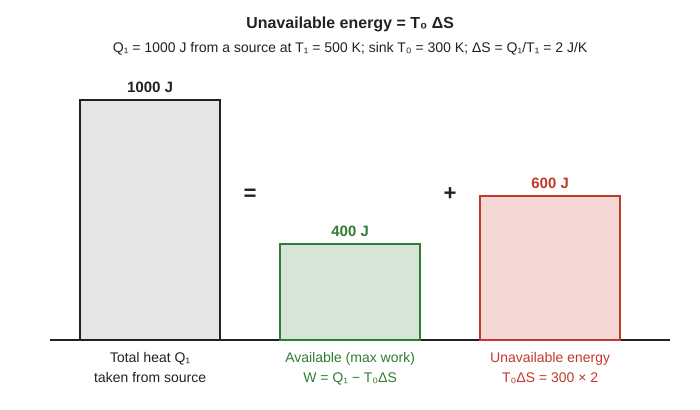

**Derivation.** Let a source at $T_1$ give heat $Q_1$ to a reversible engine whose sink is at $T_0$.

**Step 1.** The source loses entropy:

$$
\Delta S = \frac{Q_1}{T_1}
$$

**Step 2.** The maximum work comes from a reversible (Carnot) engine:

$$
W_{\max} = Q_1\left(1 - \frac{T_0}{T_1}\right)
$$

**Step 3.** Rewrite using Step 1:

$$
W_{\max} = Q_1 - T_0\,\frac{Q_1}{T_1} = Q_1 - T_0\,\Delta S
$$

**Step 4.** The heat that must be rejected, and so can never become work, is

$$
Q_1 - W_{\max} = T_0\,\Delta S
$$

> [!IMPORTANT]
> Unavailable energy $= T_0\,\Delta S$. Available energy $= Q_1 - T_0\,\Delta S$. Any further increase of entropy in the universe adds to the unavailable energy: it degrades the energy.

**Worked example: a heat source at 500 K.**

Given: $Q_1 = 1000\,\mathrm{J}$, $T_1 = 500\,\mathrm{K}$, $T_0 = 300\,\mathrm{K}$.

$$
\Delta S = \frac{1000}{500} = 2\,\mathrm{J\,K^{-1}}, \qquad T_0\,\Delta S = 300 \times 2 = 600\,\mathrm{J}
$$

Answer: $600\,\mathrm{J}$ is unavailable and $W_{\max} = 1000 - 600 = 400\,\mathrm{J}$. Check: $1000 \times (1 - 300/500) = 400\,\mathrm{J}$.

> [!NOTE]
> **Extra: degradation of energy when heat flows down a temperature gradient**
>
> Let $Q$ flow from $T_1$ to $T_2$ ($T_1 > T_2 > T_0$). The entropy created is $\Delta S_{\mathrm{univ}} = Q\,(1/T_2 - 1/T_1)$ and the extra unavailable energy (lost work) is
>
> $$
> W_{\mathrm{lost}} = T_0\,\Delta S_{\mathrm{univ}} = T_0\,Q\left(\frac{1}{T_2} - \frac{1}{T_1}\right)
> $$
>
> Example: $Q = 1000\,\mathrm{J}$, $T_1 = 500\,\mathrm{K}$, $T_2 = 400\,\mathrm{K}$, $T_0 = 300\,\mathrm{K}$: $\Delta S_{\mathrm{univ}} = 1000\,(1/400 - 1/500) = 0.5\,\mathrm{J\,K^{-1}}$, so $W_{\mathrm{lost}} = 150\,\mathrm{J}$. Check: available work before $= 400\,\mathrm{J}$, after $= 1000\,(1 - 300/400) = 250\,\mathrm{J}$, loss $= 150\,\mathrm{J}$.

> [!TIP]
> Common exam mistakes: (1) taking $T_0$ as the source temperature (it is the coldest available sink); (2) writing unavailable energy as $T_1\,\Delta S$; (3) using $^\circ\mathrm{C}$.

### 2017 Q7(b): Show that entropy remains constant in a reversible process

> Show that entropy remains constant in a reversible process.
>
> Asked in: 2017 Q7(b), 2021 Q5(a)

#### Ans. to the question no. 7(b) of 2017

**Statement.** In a reversible process the total entropy of the system plus its surroundings (the universe) stays constant: $\Delta S_{\mathrm{univ}} = 0$. In a reversible adiabatic process the entropy of the system itself is constant (isentropic: $dS = 0$).

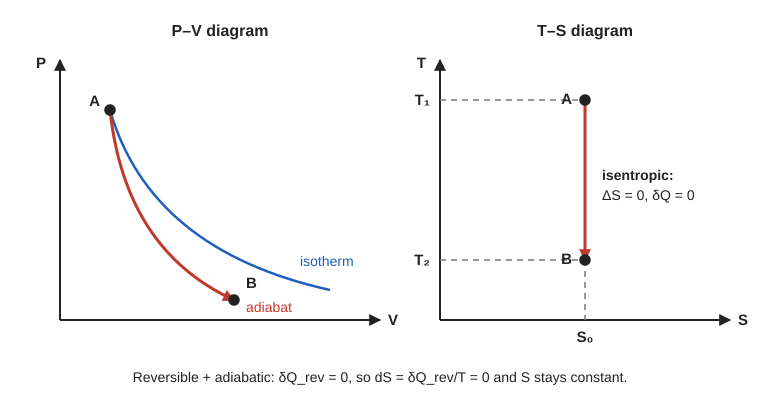

**Proof.**

**Step 1.** In a reversible process the system and its surroundings exchange heat $\delta Q$ at essentially the same temperature $T$ (the temperature difference is infinitesimal). Here $\delta Q$ is the heat absorbed by the system.

**Step 2.** The entropy changes of the system and of the surroundings are

$$
dS_{\mathrm{sys}} = \frac{\delta Q}{T}, \qquad dS_{\mathrm{surr}} = -\frac{\delta Q}{T}
$$

**Step 3.** Add them:

$$
dS_{\mathrm{univ}} = dS_{\mathrm{sys}} + dS_{\mathrm{surr}} = 0
$$

**Step 4 (adiabatic case).** If the process is also adiabatic, $\delta Q_{\mathrm{rev}} = 0$, hence

$$
dS = \frac{\delta Q_{\mathrm{rev}}}{T} = 0 \quad\Longrightarrow\quad S = \text{constant}
$$

**Step 5 (second argument).** For an isolated system every process has $\Delta S \ge 0$. A reversible process can also be run backwards, so $-\Delta S \ge 0$ as well. Both hold only if $\Delta S = 0$.

> [!IMPORTANT]
> Reversible process: $\Delta S_{\mathrm{univ}} = 0$. Reversible adiabatic process: $\Delta S = 0$ (isentropic).

**Worked example: reversible isothermal expansion of an ideal gas.**

Given: $1\,\mathrm{mol}$ at $300\,\mathrm{K}$ expands reversibly to twice its volume, in contact with a reservoir at $300\,\mathrm{K}$.

Formula: $Q = RT\ln(V_2/V_1)$, $\Delta S = Q/T$ for the gas and $-Q/T$ for the reservoir.

$$
Q = 8.314 \times 300 \times \ln 2 \approx 1729\,\mathrm{J}
$$

$$
\Delta S_{\mathrm{gas}} = \frac{1729}{300} = +5.76\,\mathrm{J\,K^{-1}}, \qquad \Delta S_{\mathrm{res}} = -5.76\,\mathrm{J\,K^{-1}}
$$

Answer: $\Delta S_{\mathrm{univ}} = 0$.

> [!NOTE]
> **Extra: reversible adiabatic change of an ideal gas is isentropic**
>
> For a reversible adiabatic change $TV^{\gamma - 1} = \text{constant}$, so $T_2/T_1 = (V_1/V_2)^{\gamma - 1}$, and $R = C_V(\gamma - 1)$. Substitute in $\Delta S = nC_V\ln(T_2/T_1) + nR\ln(V_2/V_1)$:
>
> $$
> \Delta S = nC_V(\gamma - 1)\ln\frac{V_1}{V_2} + nR\ln\frac{V_2}{V_1} = -nR\ln\frac{V_2}{V_1} + nR\ln\frac{V_2}{V_1} = 0
> $$
>
> **Entropy statement of the second law:** $\Delta S_{\mathrm{univ}} \ge 0$, with equality only for reversible processes.

> [!TIP]
> Common exam mistakes: (1) saying the entropy of the system alone is constant in every reversible process (it can change; it is the universe that stays constant); (2) forgetting the adiabatic condition when claiming $dS = 0$ for the system; (3) mixing this up with the irreversible case, where $\Delta S_{\mathrm{univ}} > 0$.

### 2017 Q7(c): Derive the Clausius-Clapeyron equation

> Derive the Clausius-Clapeyron equation.
>
> Asked in: 2016 Q7(b), 2017 Q7(c), 2018 Q7(b)

#### Ans. to the question no. 7(c) of 2017

Same as [2016 Q7(b)](#2016-q7b-explain-the-clausius-clapeyron-equation): the infinitesimal Carnot-cycle derivation there gives $dP/dT = L/[T(v_2 - v_1)]$.

### 2017 Q7(d): Engine efficiency numerical (same as 2016 Q7(c))

> Find the efficiency of an engine requiring $3\times 10^{6}$ cal of heat per horsepower-hour and compare it with that of a perfect reversible engine. Source at $100\,^\circ\mathrm{C}$, sink at $0\,^\circ\mathrm{C}$.
>
> Asked in: 2016 Q7(c), 2017 Q7(d), 2022 Q7(c)

#### Ans. to the question no. 7(d) of 2017

Same data and method as [2016 Q7(c)](#2016-q7c-efficiency-of-an-engine-using-3x106-cal-per-horsepower-hour) (diagram and bar chart are there). Full working:

**Given:** $Q_1 = 3\times 10^{6}\,\mathrm{cal}$ per hp-hour, $T_1 = 373\,\mathrm{K}$, $T_2 = 273\,\mathrm{K}$, $1\,\mathrm{hp} = 746\,\mathrm{W}$, $J = 4.2\,\mathrm{J\,cal^{-1}}$.

**Formula:** $\eta = W/Q_1$, $\quad\eta_{\mathrm{rev}} = 1 - T_2/T_1$.

**Substitution:**

$$
W = 746 \times 3600 = 2.6856\times 10^{6}\,\mathrm{J}, \qquad Q_1 = 3\times 10^{6} \times 4.2 = 12.6\times 10^{6}\,\mathrm{J}
$$

$$
\eta = \frac{2.6856}{12.6} = 0.2131, \qquad \eta_{\mathrm{rev}} = 1 - \frac{273}{373} = 0.2681, \qquad \frac{\eta}{\eta_{\mathrm{rev}}} = 0.795
$$

**Answer:** $\eta \approx 21.3\,\%$, $\eta_{\mathrm{rev}} \approx 26.8\,\%$; the engine achieves about $79.5\,\%$ of the ideal ($21.4\,\%$ and $79.9\,\%$ if $J = 4.18\,\mathrm{J\,cal^{-1}}$ is used).

## 2018 Paper

### 2018 Q7(a): What is entropy?

> What is entropy?
>
> Asked in: 2016 Q7(a), 2018 Q7(a)

#### Ans. to the question no. 7(a) of 2018

Same as [2016 Q7(a)](#2016-q7a-what-is-entropy): $dS = \delta Q_{\mathrm{rev}}/T$, a state function measured in $\mathrm{J\,K^{-1}}$.

### 2018 Q7(b): Explain the first latent heat (Clausius-Clapeyron) equation

> Explain the first latent heat (Clausius-Clapeyron) equation.
>
> Asked in: 2016 Q7(b), 2017 Q7(c), 2018 Q7(b)

#### Ans. to the question no. 7(b) of 2018

Same as [2016 Q7(b)](#2016-q7b-explain-the-clausius-clapeyron-equation): $L = T(v_2 - v_1)\,dP/dT$. The Maxwell-relation route to the same equation is in the Extra block there.

### 2018 Q7(c): Show that the entropy change is zero over a cycle in the reversible Carnot cycle

> Show that the entropy change is constant (zero over a cycle) in the reversible Carnot cycle.
>
> Asked in: 2018 Q7(c), 2023 Q6(b)

#### Ans. to the question no. 7(c) of 2018

**Statement.** In a reversible Carnot cycle the heat ratio satisfies $Q_1/T_1 = Q_2/T_2$, so the net entropy change over the cycle is zero: $\oint dS = 0$.

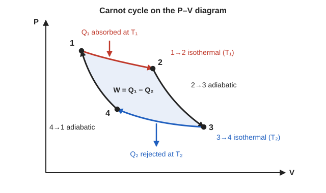

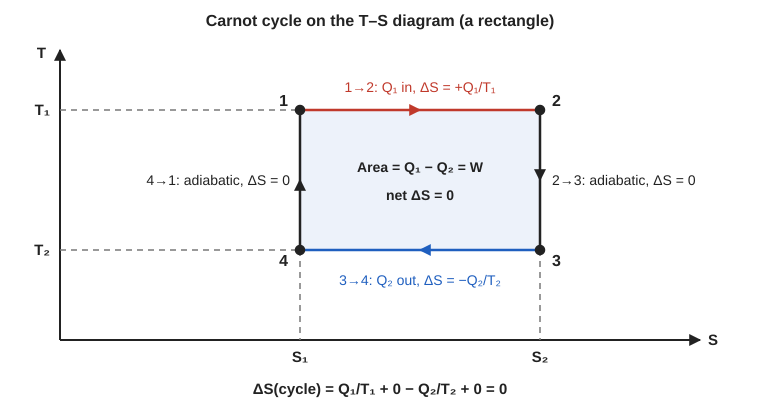

**Derivation.** The working substance absorbs $Q_1$ at $T_1$ and rejects $Q_2$ (magnitude) at $T_2$.

**Step 1 (1 to 2, isothermal at $T_1$).**

$$
\Delta S_{12} = \frac{Q_1}{T_1}
$$

**Step 2 (2 to 3, reversible adiabatic).** $\delta Q = 0$, hence

$$
\Delta S_{23} = 0
$$

**Step 3 (3 to 4, isothermal at $T_2$, heat rejected).**

$$
\Delta S_{34} = -\frac{Q_2}{T_2}
$$

**Step 4 (4 to 1, reversible adiabatic).**

$$
\Delta S_{41} = 0
$$

**Step 5.** Add the four steps:

$$
\oint dS = \frac{Q_1}{T_1} + 0 - \frac{Q_2}{T_2} + 0
$$

**Step 6 (the two ratios are equal).** For an ideal gas, $Q_1 = RT_1\ln(V_2/V_1)$ and $Q_2 = RT_2\ln(V_3/V_4)$ per mole. The adiabats give $T_1V_2^{\gamma - 1} = T_2V_3^{\gamma - 1}$ and $T_1V_1^{\gamma - 1} = T_2V_4^{\gamma - 1}$. Dividing, $V_2/V_1 = V_3/V_4$, so

$$
\frac{Q_1}{T_1} = R\ln\frac{V_2}{V_1} = R\ln\frac{V_3}{V_4} = \frac{Q_2}{T_2}
$$

**Step 7.** Substituting into Step 5:

$$
\oint dS = 0
$$

The source loses $Q_1/T_1$ and the sink gains $Q_2/T_2$, which are equal, so the entropy of the universe is also unchanged.

> [!IMPORTANT]
> Carnot cycle: $\Delta S = +Q_1/T_1,\ 0,\ -Q_2/T_2,\ 0$ for the four steps; $\dfrac{Q_1}{T_1} = \dfrac{Q_2}{T_2}$ and $\oint dS = 0$.

**Worked example: an ideal steam engine.**

Given: $T_1 = 800\,\mathrm{K}$, $T_2 = 300\,\mathrm{K}$, $Q_1 = 2000\,\mathrm{J}$ per cycle.

$$
Q_2 = Q_1\frac{T_2}{T_1} = 2000 \times \frac{300}{800} = 750\,\mathrm{J}
$$

$$
\Delta S:\ \ +\frac{2000}{800} = +2.5,\quad 0,\quad -\frac{750}{300} = -2.5,\quad 0\ \ \mathrm{J\,K^{-1}}
$$

Answer: the sum is $0$. Work $W = 2000 - 750 = 1250\,\mathrm{J}$ and $\eta = 62.5\,\%$, which is the Carnot limit $1 - 300/800$.

> [!NOTE]
> **Extra: the T-S rectangle and a real engine**
>
> On the $T$-$S$ diagram the isothermal steps are horizontal and the adiabats vertical, so the cycle is a rectangle of width $S_2 - S_1$. Then
>
> $$
> Q_1 = T_1(S_2 - S_1), \quad Q_2 = T_2(S_2 - S_1), \quad W = (T_1 - T_2)(S_2 - S_1), \quad \eta = 1 - \frac{T_2}{T_1}
> $$
>
> The enclosed area is the work $W$. For a real (irreversible) engine, $Q_2$ is larger and $Q_1/T_1 - Q_2/T_2 < 0$. In the example above, $Q_2 = 900\,\mathrm{J}$ would give $2.5 - 3.0 = -0.5\,\mathrm{J\,K^{-1}}$, $W = 1100\,\mathrm{J}$ and $\eta = 55\,\%$.

> [!TIP]
> Common exam mistakes: (1) giving $\Delta S = 0$ without showing $Q_1/T_1 = Q_2/T_2$; (2) writing $+Q_2/T_2$ for the rejection step; (3) saying entropy is zero at each step instead of over the whole cycle (steps 1 and 3 are not zero).

## 2021 Paper

### 2021 Q5(a): Show that entropy in a reversible process remains the same

> Show that entropy in a reversible process remains the same.
>
> Asked in: 2017 Q7(b), 2021 Q5(a)

#### Ans. to the question no. 5(a) of 2021

Same as [2017 Q7(b)](#2017-q7b-show-that-entropy-remains-constant-in-a-reversible-process): $dS_{\mathrm{sys}} = \delta Q/T$ and $dS_{\mathrm{surr}} = -\delta Q/T$, so $\Delta S_{\mathrm{univ}} = 0$; for a reversible adiabatic process $dS = 0$.

## 2022 Paper

### 2022 Q7(a): What are entropy and unavailable energy?

> What are entropy and unavailable energy?
>
> Asked in: 2017 Q7(a), 2022 Q7(a)

#### Ans. to the question no. 7(a) of 2022

Same as [2017 Q7(a)](#2017-q7a-what-are-entropy-and-unavailable-energy): $dS = \delta Q_{\mathrm{rev}}/T$ and unavailable energy $= T_0\,\Delta S$.

### 2022 Q7(b): Entropy in an irreversible process (printed as remains constant)

> Show that entropy remains constant in an irreversible process. *(as printed)*
>
> Asked in: 2022 Q7(b)

> [!WARNING]
> The printed wording is a misprint. In an irreversible process the entropy of the universe does not stay constant: it **increases**, $\Delta S_{\mathrm{univ}} > 0$. Entropy is constant only in a reversible process (see [2017 Q7(b)](#2017-q7b-show-that-entropy-remains-constant-in-a-reversible-process)). The examiner most likely meant "show that entropy increases in an irreversible process", and that is what is proved below. This is an interpretation; mention it briefly in the answer script.

#### Ans. to the question no. 7(b) of 2022

**Statement.** In an irreversible process the total entropy of the system and its surroundings increases: $\Delta S_{\mathrm{univ}} > 0$.

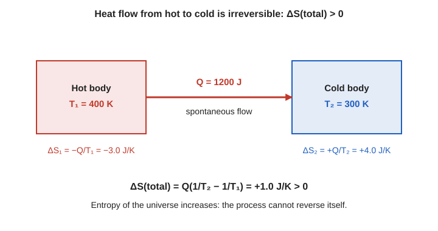

**Proof (heat conduction, the standard irreversible process).** Let heat $Q$ flow directly from a body at $T_1$ to a body at $T_2$, with $T_1 > T_2$. Both bodies are large, so their temperatures stay constant.

**Step 1.** The hot body loses heat $Q$ at $T_1$:

$$
\Delta S_1 = -\frac{Q}{T_1}
$$

**Step 2.** The cold body gains heat $Q$ at $T_2$:

$$
\Delta S_2 = +\frac{Q}{T_2}
$$

**Step 3.** Add them:

$$
\Delta S_{\mathrm{univ}} = Q\left(\frac{1}{T_2} - \frac{1}{T_1}\right) = \frac{Q\,(T_1 - T_2)}{T_1 T_2}
$$

**Step 4.** Since $T_1 > T_2$ and $Q > 0$, every factor is positive:

$$
\Delta S_{\mathrm{univ}} > 0
$$

**Step 5 (general statement).** Take any irreversible adiabatic process taking an isolated system from A to B and close the cycle with a reversible path from B to A. The Clausius inequality (derived in the Extra block) for this irreversible cycle gives

$$
\underbrace{\int_A^B \frac{\delta Q}{T}}_{=\,0\ (\text{adiabatic})} + \int_B^A \frac{\delta Q_{\mathrm{rev}}}{T} = S_A - S_B < 0 \quad\Longrightarrow\quad S_B > S_A
$$

> [!IMPORTANT]
> Irreversible process: $\Delta S_{\mathrm{univ}} > 0$. For heat $Q$ flowing from $T_1$ to $T_2$: $\Delta S = Q\,(1/T_2 - 1/T_1) > 0$. Reversible: $\Delta S_{\mathrm{univ}} = 0$. Together: $\Delta S_{\mathrm{univ}} \ge 0$.

**Worked example: a hot cup of tea cooling in a room.**

Given: $Q = 5000\,\mathrm{J}$ flows from tea at $80\,^\circ\mathrm{C}$ ($353.15\,\mathrm{K}$) to room air at $20\,^\circ\mathrm{C}$ ($293.15\,\mathrm{K}$); treat both temperatures as constant.

Formula: $\Delta S = Q\,(1/T_2 - 1/T_1)$.

Substitution:

$$
\Delta S = 5000\left(\frac{1}{293.15} - \frac{1}{353.15}\right) = 17.06 - 14.16 \approx +2.90\,\mathrm{J\,K^{-1}}
$$

Answer: $+2.90\,\mathrm{J\,K^{-1}} > 0$. The tea loses $14.16\,\mathrm{J\,K^{-1}}$ but the air gains $17.06\,\mathrm{J\,K^{-1}}$.

> [!NOTE]
> **Extra: Clausius inequality, free expansion, and the second law in entropy form**
>
> **(i) Clausius inequality.** An irreversible engine is less efficient than a reversible one between the same temperatures: $1 - Q_2/Q_1 < 1 - T_2/T_1$, so $Q_2/Q_1 > T_2/T_1$, i.e.
>
> $$
> \frac{Q_1}{T_1} - \frac{Q_2}{T_2} < 0
> $$
>
> Any cycle can be cut into such small elements, so $\oint \delta Q/T \le 0$ ($=0$ reversible, $<0$ irreversible).
>
> 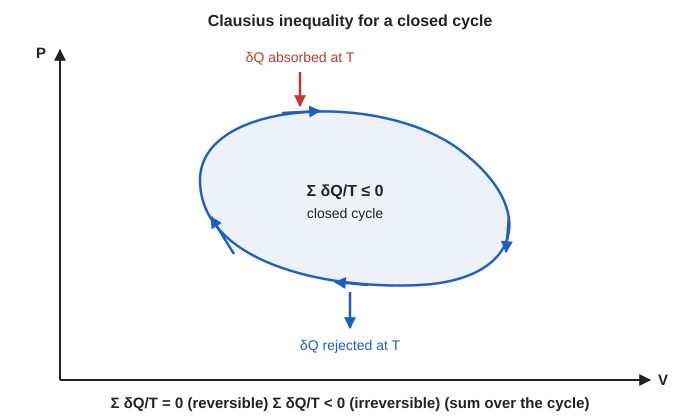
>
> **(ii) Free expansion of an ideal gas.** In a free expansion $Q = 0$, $W = 0$, so $\Delta U = 0$ and $T$ is unchanged. Entropy is a state function, so use a reversible isothermal path between the same end states:
>
> $$
> \Delta S = nR\ln\frac{V_2}{V_1}
> $$
>
> For $n = 2\,\mathrm{mol}$ doubling its volume, $\Delta S = 2 \times 8.314 \times \ln 2 \approx 11.5\,\mathrm{J\,K^{-1}} > 0$, although no heat flowed: the process is irreversible.
>
> 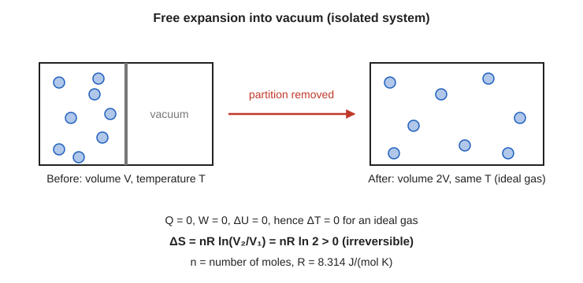
>
> **(iii) Second law (entropy form).** The entropy of an isolated system never decreases, $\Delta S \ge 0$. The system's own entropy can fall (a cooling cup) only if the surroundings gain more.

> [!TIP]
> Common exam mistakes: (1) writing "constant" for irreversible (it is constant only when reversible); (2) computing $\Delta S$ of the irreversible process as $Q/T$ along the actual path; use a reversible path between the same states; (3) forgetting to include the surroundings; (4) a negative $\Delta S_{\mathrm{univ}}$ from mixing up $T_1$ and $T_2$.

### 2022 Q7(c): Engine efficiency numerical (same as 2016 Q7(c))

> Find the efficiency of an engine requiring $3\times 10^{6}$ cal of heat per horsepower-hour and compare it with that of a perfect reversible engine. Source at $100\,^\circ\mathrm{C}$, sink at $0\,^\circ\mathrm{C}$. *(The paper prints "3x106", a typo for $3\times 10^{6}$.)*
>
> Asked in: 2016 Q7(c), 2017 Q7(d), 2022 Q7(c)

#### Ans. to the question no. 7(c) of 2022

Same data and method as [2016 Q7(c)](#2016-q7c-efficiency-of-an-engine-using-3x106-cal-per-horsepower-hour). Full working:

**Given:** $Q_1 = 3\times 10^{6}\,\mathrm{cal}$ per hp-hour, $T_1 = 373\,\mathrm{K}$, $T_2 = 273\,\mathrm{K}$, $1\,\mathrm{hp} = 746\,\mathrm{W}$, $J = 4.2\,\mathrm{J\,cal^{-1}}$.

**Formula:** $\eta = W/Q_1$, $\quad\eta_{\mathrm{rev}} = 1 - T_2/T_1$.

**Substitution:**

$$
W = 746 \times 3600 = 2.6856\times 10^{6}\,\mathrm{J}, \qquad Q_1 = 12.6\times 10^{6}\,\mathrm{J}
$$

$$
\eta = \frac{2.6856}{12.6} = 0.2131, \qquad \eta_{\mathrm{rev}} = 1 - \frac{273}{373} = 0.2681, \qquad \frac{\eta}{\eta_{\mathrm{rev}}} = 0.795
$$

**Answer:** $\eta \approx 21.3\,\%$ against $26.8\,\%$ for the reversible engine: about $79.5\,\%$ of the ideal ($21.4\,\%$ and $79.9\,\%$ with $J = 4.18\,\mathrm{J\,cal^{-1}}$).

## 2023 Paper

### 2023 Q6(b): Show that the entropy change is zero over a cycle in the reversible Carnot cycle

> Show that the entropy change is constant (zero over a cycle) in the reversible Carnot cycle.
>
> Asked in: 2018 Q7(c), 2023 Q6(b)

#### Ans. to the question no. 6(b) of 2023

Same as [2018 Q7(c)](#2018-q7c-show-that-the-entropy-change-is-zero-over-a-cycle-in-the-reversible-carnot-cycle): $\Delta S = +Q_1/T_1,\ 0,\ -Q_2/T_2,\ 0$ with $Q_1/T_1 = Q_2/T_2$, so $\oint dS = 0$.

## Concept Map

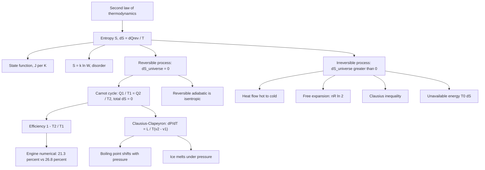

## One-Page Cheat Sheet

- Entropy: $dS = \delta Q_{\mathrm{rev}}/T$, a state function, unit $\mathrm{J\,K^{-1}}$.
- Ideal gas: $\Delta S = nC_V\ln(T_2/T_1) + nR\ln(V_2/V_1)$; isothermal doubling gives $nR\ln 2$.
- Reversible: $\Delta S_{\mathrm{univ}} = 0$; reversible adiabatic: $dS = 0$ (isentropic). Irreversible: $\Delta S_{\mathrm{univ}} > 0$. Second law: $\Delta S_{\mathrm{univ}} \ge 0$.
- Carnot cycle: $\Delta S = +Q_1/T_1,\ 0,\ -Q_2/T_2,\ 0$; $Q_1/T_1 = Q_2/T_2$; $\oint dS = 0$; the $T$-$S$ diagram is a rectangle with area $W$.
- Clausius inequality: $\oint \delta Q/T \le 0$.
- Heat $Q$ from $T_1$ to $T_2$: $\Delta S = Q\,(1/T_2 - 1/T_1) > 0$.
- Unavailable energy $= T_0\,\Delta S$; $W_{\max} = Q_1 - T_0\,\Delta S$; lost work $= T_0\,\Delta S_{\mathrm{univ}}$.
- Clausius-Clapeyron: $dP/dT = L/[T(v_2 - v_1)]$, derived from an infinitesimal Carnot cycle (work $dP\,(v_2 - v_1)$, $\eta = dT/T$).
- Water at $100\,^\circ\mathrm{C}$: $\approx 3.6\,\mathrm{kPa\,K^{-1}}$. Ice at $0\,^\circ\mathrm{C}$: $\approx -0.0075\,\mathrm{K\,atm^{-1}}$.
- Engine numerical: $W = 2.6856\times 10^{6}\,\mathrm{J}$, $Q_1 = 12.6\times 10^{6}\,\mathrm{J}$, $\eta = 21.3\,\%$, $\eta_{\mathrm{rev}} = 26.8\,\%$, ratio $0.795$.
- Always use kelvin. Always include the surroundings. State units ($\mathrm{J\,K^{-1}}$).

## Glossary

| Term | Meaning |
| --- | --- |
| Entropy | State function with $dS = \delta Q_{\mathrm{rev}}/T$; a measure of disorder or unavailable energy |
| State function | A quantity that depends only on the state of the system, not on how it got there |
| Reversible process | A process that can be reversed with no change left in the system or surroundings |
| Irreversible process | A process, such as heat flow across a finite temperature gap or free expansion, that cannot undo itself |
| Isentropic | Constant entropy; the reversible adiabatic process |
| Microstate | One detailed arrangement of particles compatible with the observed macrostate |
| Unavailable energy | Heat that cannot be turned into work; $T_0\,\Delta S$ |
| Latent heat | Heat absorbed or released at constant temperature during a phase change |
| Specific volume | Volume per unit mass, $v$ |
| Clausius-Clapeyron equation | $dP/dT = L/[T(v_2 - v_1)]$, the slope of a phase boundary |
| Triple point | The single $P$, $T$ where solid, liquid and vapour coexist |
| Regelation | Melting under pressure and refreezing when the pressure is removed |
| Carnot cycle | Two isotherms and two adiabats, all reversible |
| Clausius inequality | $\oint \delta Q/T \le 0$ for any cycle |

## Practice Problems

### Practice Problem 1: Entropy of melting

Find the entropy change of $2\,\mathrm{kg}$ of ice melting completely at $0\,^\circ\mathrm{C}$ ($L = 3.34\times 10^{5}\,\mathrm{J\,kg^{-1}}$).

Answer

Given: $m = 2\,\mathrm{kg}$, $T = 273.15\,\mathrm{K}$. Formula: $\Delta S = mL/T$.

$$
\Delta S = \frac{2 \times 3.34\times 10^{5}}{273.15} \approx 2.45\times 10^{3}\,\mathrm{J\,K^{-1}}
$$

### Practice Problem 2: Heat flow between two bodies

$1500\,\mathrm{J}$ of heat flows from a body at $600\,\mathrm{K}$ to one at $300\,\mathrm{K}$. Find $\Delta S_{\mathrm{univ}}$.

Answer

$$
\Delta S = 1500\left(\frac{1}{300} - \frac{1}{600}\right) = 5.0 - 2.5 = +2.5\,\mathrm{J\,K^{-1}}
$$

Positive, so the flow is irreversible, as expected.

### Practice Problem 3: Boiling point and pressure

Using $dP/dT \approx 3.6\,\mathrm{kPa\,K^{-1}}$ for water near $100\,^\circ\mathrm{C}$, estimate the rise in boiling point when the external pressure rises by $7.2\,\mathrm{kPa}$.

Answer

$$
\Delta T \approx \frac{7.2\,\mathrm{kPa}}{3.6\,\mathrm{kPa\,K^{-1}}} = 2.0\,\mathrm{K}
$$

Approximate, since the slope changes slowly with temperature.

### Practice Problem 4: Free expansion

$2\,\mathrm{mol}$ of an ideal gas expand freely into an evacuated container so that the volume doubles. Find $\Delta S$ of the gas.

Answer

$$
\Delta S = nR\ln 2 = 2 \times 8.314 \times 0.693 \approx 11.5\,\mathrm{J\,K^{-1}}
$$

Positive: irreversible, although $Q = 0$.

