# PHY-103 (Physics-II): Kinetic Theory of Gases

| Course | Topic | Years Covered | Version |
|---|---|---|---|
| PHY-103 | Kinetic Theory of Gases | 2016-2023 | v261103-0 |

## Table of Contents
- [Topic Appearance Matrix](#topic-appearance-matrix)
- [Formula and Units Sheet](#formula-and-units-sheet)
- [2016](#2016)
  - [Ans. to the question no. 3(a)](#ans-to-the-question-no-3a)
  - [Ans. to the question no. 3(b)](#ans-to-the-question-no-3b)
  - [Ans. to the question no. 3(c)](#ans-to-the-question-no-3c)
  - [Ans. to the question no. 5(a)](#ans-to-the-question-no-5a)
  - [Ans. to the question no. 7(c)](#ans-to-the-question-no-7c)
- [2017](#2017)
  - [Ans. to the question no. 6(b)](#ans-to-the-question-no-6b)
- [2018](#2018)
  - [Ans. to the question no. 3(a)](#ans-to-the-question-no-3a-1)
  - [Ans. to the question no. 3(b)](#ans-to-the-question-no-3b-1)
  - [Ans. to the question no. 3(c)](#ans-to-the-question-no-3c-1)
  - [Ans. to the question no. 5(a)](#ans-to-the-question-no-5a-1)
  - [Ans. to the question no. 5(b)](#ans-to-the-question-no-5b)
  - [Ans. to the question no. 5(c)](#ans-to-the-question-no-5c)
  - [Ans. to the question no. 6(a)](#ans-to-the-question-no-6a)
  - [Ans. to the question no. 6(b)](#ans-to-the-question-no-6b-1)
  - [Ans. to the question no. 6(c)](#ans-to-the-question-no-6c)
- [2019](#2019)
  - [Ans. to the question no. 4(a)](#ans-to-the-question-no-4a)
  - [Ans. to the question no. 4(b)](#ans-to-the-question-no-4b)
  - [Ans. to the question no. 5(a)](#ans-to-the-question-no-5a-2)
  - [Ans. to the question no. 5(b)](#ans-to-the-question-no-5b-1)
  - [Ans. to the question no. 6](#ans-to-the-question-no-6)
- [2020](#2020)
  - [Ans. to the question no. 4(a)](#ans-to-the-question-no-4a-1)
  - [Ans. to the question no. 4(b)](#ans-to-the-question-no-4b-1)
  - [Ans. to the question no. 4(c)](#ans-to-the-question-no-4c)
  - [Ans. to the question no. 5(a)](#ans-to-the-question-no-5a-3)
  - [Ans. to the question no. 5(b)](#ans-to-the-question-no-5b-2)
  - [Ans. to the question no. 5(c)](#ans-to-the-question-no-5c-1)
- [2021](#2021)
  - [Ans. to the question no. 5(b)](#ans-to-the-question-no-5b-3)
  - [Ans. to the question no. 5(c)](#ans-to-the-question-no-5c-2)
  - [Ans. to the question no. 6(a)](#ans-to-the-question-no-6a-1)
- [2022](#2022)
  - [Ans. to the question no. 4(a)](#ans-to-the-question-no-4a-2)
  - [Ans. to the question no. 4(b)](#ans-to-the-question-no-4b-2)
  - [Ans. to the question no. 4(c)](#ans-to-the-question-no-4c-1)
  - [Ans. to the question no. 5(b)](#ans-to-the-question-no-5b-4)
- [2023](#2023)
  - [Ans. to the question no. 5(a)](#ans-to-the-question-no-5a-4)
  - [Ans. to the question no. 7(a)](#ans-to-the-question-no-7a)
  - [Ans. to the question no. 7(b)](#ans-to-the-question-no-7b)
  - [Ans. to the question no. 7(c)](#ans-to-the-question-no-7c-1)
- [Concept Map](#concept-map)
- [Cheat Sheet](#cheat-sheet)
- [Glossary](#glossary)
- [Practice Problems](#practice-problems)

## Topic Appearance Matrix

| Topic | Frequency | Years Asked |
|---|:---:|---|
| **Mean Free Path (Theory & Num)** | 7 | 2018, 2019, 2020, 2022, 2023 |
| **Newton's Law of Cooling** | 5 | 2016, 2018, 2020, 2021, 2022 |
| **Degrees of Freedom** | 5 | 2018, 2019, 2022, 2023 |
| **Adiabatic vs Isothermal Curves** | 3 | 2018, 2022, 2023 |
| **Kinetic Energy & Pressure ($P=\frac{2}{3}E$)** | 3 | 2016, 2018, 2022 |
| **Isothermal Work Done** | 2 | 2017, 2021 |
| **Van der Waals Equation & Constants** | 3 | 2016, 2018, 2020 |
| **Heat vs Temperature** | 2 | 2018, 2019 |
| **Average Kinetic Energy (Numerical)** | 2 | 2019, 2021 |
| **$C_p - C_v = R$** | 2 | 2019, 2020 |
| **Platinum Resistance Thermometer** | 1 | 2020 |
| **Kinetic Gas Equation ($P=\frac{1}{3}\frac{mnc^2}{V}$)** | 1 | 2019 |
| **Kinetic Postulates** | 2 | 2018, 2023 |

## Formula and Units Sheet

| Symbol | Quantity | SI Unit | Dimension | Formula / Notes |
|---|---|---|---|---|
| $P$ | Pressure | $\mathrm{Pa}$ or $\mathrm{N\,m^{-2}}$ | $[\mathrm{ML^{-1}T^{-2}}]$ | $P = rac{1}{3}rac{mN}{V}\overline{c^2}$ |
| $V$ | Volume | $\mathrm{m^3}$ | $[\mathrm{L^3}]$ | |
| $T$ | Temperature | $\mathrm{K}$ | $[\mathrm{\Theta}]$ | Measure of mean translational KE |
| $k$ | Boltzmann constant | $\mathrm{J\,K^{-1}}$ | $[\mathrm{ML^2T^{-2}\Theta^{-1}}]$ | $1.38 	imes 10^{-23} \mathrm{\,J\,K^{-1}}$ |
| $R$ | Universal gas constant| $\mathrm{J\,mol^{-1}\,K^{-1}}$ | $[\mathrm{ML^2T^{-2}\Theta^{-1}mol^{-1}}]$ | $8.314 \mathrm{\,J\,mol^{-1}\,K^{-1}}$ |
| $c_{\mathrm{rms}}$ | RMS speed | $\mathrm{m\,s^{-1}}$ | $[\mathrm{LT^{-1}}]$ | $c_{\mathrm{rms}} = \sqrt{\overline{c^2}} = \sqrt{rac{3kT}{m}}$ |
| $\lambda$ | Mean free path | $\mathrm{m}$ | $[\mathrm{L}]$ | $\lambda = rac{1}{\sqrt{2}\pi d^2 n}$ |
| $d$ | Molecular diameter | $\mathrm{m}$ | $[\mathrm{L}]$ | |
| $n$ | Number density | $\mathrm{m^{-3}}$ | $[\mathrm{L^{-3}}]$ | $n = N/V$ |
| $a$ | vdW force constant | $\mathrm{Pa\,m^6\,mol^{-2}}$ | $[\mathrm{ML^5T^{-2}mol^{-2}}]$ | $a = 3P_c V_c^2$ |
| $b$ | vdW volume constant| $\mathrm{m^3\,mol^{-1}}$ | $[\mathrm{L^3mol^{-1}}]$ | $b = V_c / 3$ |
| $f$ | Degrees of freedom | unitless | none | Monatomic: 3, Diatomic: 5 |

## 2016

> Asked in: 2016 Q3(a)
> State Newton's law of cooling.

### Ans. to the question no. 3(a)
**Newton's law of cooling** states that the rate of heat loss of a body is directly proportional to the difference in the temperatures between the body and its surroundings, provided the temperature difference is small and the nature of the radiating surface remains unchanged.

  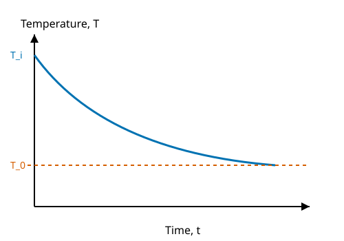

1. Let the temperature of the body be $T$ and the surroundings be $T_0$.
2. The rate of cooling is $-rac{dT}{dt}$.
3. According to the law:
$$ -rac{dT}{dt} \propto (T - T_0) $$
$$ rac{dT}{dt} = -k(T - T_0) $$
where $k$ is a positive constant depending on the area and nature of the surface.

> [!IMPORTANT]
> **Final Result:** 
> $$ T(t) = T_0 + (T_i - T_0)e^{-kt} $$
> The temperature of the cooling body falls exponentially towards the surrounding temperature.

**Worked Example:**
A hot cup of coffee (nature of surface: ceramic mug) initially at $80\mathrm{^\circ C}$ is placed in a room at $20\mathrm{^\circ C}$. According to the law, the coffee will cool rapidly at first, and then the rate of cooling will slow down as its temperature approaches $20\mathrm{^\circ C}$. If it drops by $10\mathrm{^\circ C}$ in the first 2 minutes, the next $10\mathrm{^\circ C}$ drop will take longer than 2 minutes.

**Extra Insight (Logarithmic Plot):**
By integrating the law, we get $\ln(T - T_0) = -kt + C$. A graph of $\ln(T - T_0)$ against time $t$ yields a straight line with a negative slope $-k$. This is often used in laboratory experiments to verify the law.

> [!TIP]
> **Common mistake:** Applying this law for very large temperature differences (e.g., $1000\mathrm{^\circ C}$ difference), where Stefan's Law ($T^4 - T_0^4$) must be used instead.

---

> Asked in: 2016 Q3(b)
> Deduce the relation between pressure and kinetic energy of a gas, P = (2/3)E. (E is the translational kinetic energy per unit volume.)

### Ans. to the question no. 3(b)
The relation connects the macroscopic pressure $P$ exerted by a gas to the microscopic kinetic energy $E$ of its molecules per unit volume.

  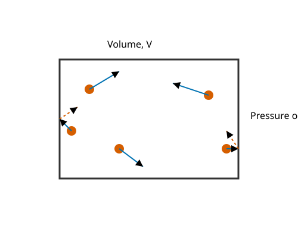

1. From the kinetic theory of gases, the pressure $P$ exerted by a gas of $N$ molecules, each of mass $m$, in a volume $V$ is:
$$ P = rac{1}{3}rac{mN}{V}\overline{c^2} $$
where $\overline{c^2}$ is the mean square speed.
2. The total translational kinetic energy $E_K$ of the gas molecules is:
$$ E_K = N 	imes rac{1}{2}m\overline{c^2} = rac{1}{2}mN\overline{c^2} $$
3. Let $E$ be the translational kinetic energy per unit volume, so $E = rac{E_K}{V}$:
$$ E = rac{1}{2}rac{mN}{V}\overline{c^2} $$
4. Multiplying and dividing by $rac{2}{3}$, we can rewrite the expression for pressure:
$$ P = rac{2}{3} \left( rac{1}{2}rac{mN}{V}\overline{c^2} 
ight) $$
5. Substituting $E$ into the equation:
$$ P = rac{2}{3}E $$

> [!IMPORTANT]
> **Final Result:** 
> $$ P = rac{2}{3}E $$
> The pressure of an ideal gas is numerically equal to two-thirds of its translational kinetic energy per unit volume.

**Worked Example:**
Consider air inside a car tyre at a pressure of $2.0 	imes 10^5 \mathrm{\,Pa}$. The translational kinetic energy density $E$ of the air molecules is $E = rac{3}{2}P = rac{3}{2} 	imes 2.0 	imes 10^5 = 3.0 	imes 10^5 \mathrm{\,J\,m^{-3}}$.

**Extra Insight (RMS Speed):**
Since $P = rac{1}{3}
ho c_{\mathrm{rms}}^2$ where $
ho = mN/V$ is the density, we get $c_{\mathrm{rms}} = \sqrt{rac{3P}{
ho}}$.

> [!TIP]
> **Common mistake:** Confusing total kinetic energy $E_K$ with energy per unit volume $E$. The relation $P = rac{2}{3}E_K$ is dimensionally wrong; it must be $PV = rac{2}{3}E_K$.

---

> Asked in: 2016 Q3(c)
> Calculate the self-inductance of a coil of 400 turns when 2 A creates 4×10^-4 Wb of flux.

### Ans. to the question no. 3(c)
*(Note: This is a magnetism numerical placed here per the question bank's structure.)*

**Self-inductance** $L$ relates the total magnetic flux linkage in a coil to the current flowing through it.

**Given:**
- Number of turns, $N = 400$
- Current, $I = 2\mathrm{\,A}$
- Magnetic flux per turn, $\Phi = 4 	imes 10^{-4}\mathrm{\,Wb}$

**Formula:**
$$ L = rac{N\Phi}{I} $$

**Substitution with units:**
$$ L = rac{400 	imes 4 	imes 10^{-4}\mathrm{\,Wb}}{2\mathrm{\,A}} $$
$$ L = rac{0.16}{2}\mathrm{\,H} = 0.08\mathrm{\,H} $$

> [!IMPORTANT]
> **Final Answer:** 
> The self-inductance of the coil is $0.08\mathrm{\,H}$ (or $80\mathrm{\,mH}$).

**Worked Example:**
This is the principle behind inductors in an electronic crossover circuit. An $80\mathrm{\,mH}$ inductor can be used to filter high frequencies in a speaker system.

**Extra Insight:**
The energy stored in this magnetic field is $U = rac{1}{2}LI^2 = rac{1}{2}(0.08)(2^2) = 0.16\mathrm{\,J}$.

> [!TIP]
> **Common mistake:** Forgetting to multiply the flux by the number of turns $N$. The formula $L = \Phi/I$ is only for a single-turn coil.

---

> Asked in: 2016 Q5(a)
> Define temperature and write the van der Waals equation.

### Ans. to the question no. 5(a)
**Temperature** is the macroscopic physical property that measures the degree of hotness or coldness of a body. In kinetic theory, it is directly proportional to the average translational kinetic energy per molecule of an ideal gas ($E = rac{3}{2}kT$).

**The van der Waals equation** for $n$ moles of a real gas is:
$$ \left( P + rac{an^2}{V^2} 
ight) (V - nb) = nRT $$
For 1 mole of gas ($n = 1$), it is written as:
$$ \left( P + rac{a}{V^2} 
ight) (V - b) = RT $$

where $P$ is pressure, $V$ is volume, $T$ is temperature, $R$ is the universal gas constant, $a$ is the intermolecular attraction constant, and $b$ is the co-volume (excluded volume).

> [!IMPORTANT]
> **Final Result:** Temperature determines the direction of heat flow. The van der Waals equation introduces corrective terms for molecular size ($b$) and intermolecular forces ($a$).

**Worked Example:**
In a high-pressure gas cylinder (like a scuba tank filled with air), the pressure calculated using the ideal gas law ($PV = nRT$) will be noticeably different from the real pressure. The term $a/V^2$ accounts for the molecules attracting each other, and $b$ accounts for the physical space the molecules occupy.

**Extra Insight (Boyle Temperature):**
The temperature at which a real gas behaves like an ideal gas over a range of pressures is called the Boyle temperature, $T_B = rac{a}{Rb}$.

> [!TIP]
> **Common mistake:** Writing the pressure correction as $- a/V^2$ instead of $+ a/V^2$.

---

> Asked in: 2016 Q7(c)
> Discuss the corrections of the van der Waals equation of state.

### Ans. to the question no. 7(c)
The van der Waals equation corrects two faulty postulates of the ideal gas theory: that molecules are point masses with zero volume, and that there are no intermolecular forces.

  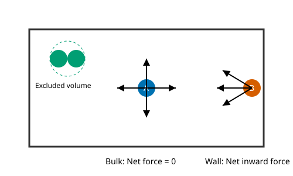

1. **Volume Correction (Excluded Volume):**
Real molecules have a finite size (radius $r$). They cannot move in the entire container volume $V$ because they bump into each other.
The actual "free" volume available for motion is $(V - b)$ for one mole, where $b$ is the co-volume.
$$ b = 4N_A \left(rac{4}{3}\pi r^3
ight) $$
where $N_A$ is Avogadro's number. So, the corrected volume is $V_{\mathrm{corr}} = V - b$.

2. **Pressure Correction (Intermolecular Attraction):**
Molecules in the bulk of the gas are pulled equally in all directions. However, a molecule striking the container wall experiences a net inward pull from the molecules behind it, reducing the force of its impact.
The reduction in pressure is proportional to the number density of molecules striking the wall (which is $\propto 1/V$) and the number density of molecules pulling them back (which is $\propto 1/V$).
Thus, the pressure deficit is $p \propto 1/V^2$, or $p = a/V^2$.
The ideal pressure $P_{\mathrm{ideal}}$ is greater than the measured pressure $P$, so the corrected pressure is:
$$ P_{\mathrm{corr}} = P + rac{a}{V^2} $$

Substituting these into $P_{\mathrm{ideal}} V_{\mathrm{ideal}} = RT$ yields:
$$ \left( P + rac{a}{V^2} 
ight) (V - b) = RT $$

> [!IMPORTANT]
> **Final Result:** The correction terms $+a/V^2$ and $-b$ modify the ideal gas equation to accurately model real gas behaviour under high pressure and low temperature.

**Worked Example:**
For Carbon Dioxide ($\mathrm{CO_2}$), $a = 0.364 \mathrm{\,Pa\,m^6\,mol^{-2}}$ and $b = 4.27 	imes 10^{-5} \mathrm{\,m^3\,mol^{-1}}$. If $\mathrm{CO_2}$ is kept in a small vacuum chamber at high density, ignoring $a$ would cause us to overestimate the pressure acting on the chamber walls.

**Extra Insight:**
The term $a$ relates to the boiling point of the gas; gases with high $a$ values (strong attraction) are easier to liquefy.

> [!TIP]
> **Common mistake:** Stating $b$ is exactly the volume of the molecules. It is actually four times the actual volume of the molecules.

## 2017

> Asked in: 2017 Q6(b)
> What is an isothermal process? Derive the work done during an isothermal process.

### Ans. to the question no. 6(b)
An **isothermal process** is a thermodynamic process in which the temperature of the system remains constant ($T = \mathrm{constant}$, $\Delta T = 0$). It occurs very slowly, allowing heat to exchange with the surroundings so that thermal equilibrium is maintained.

  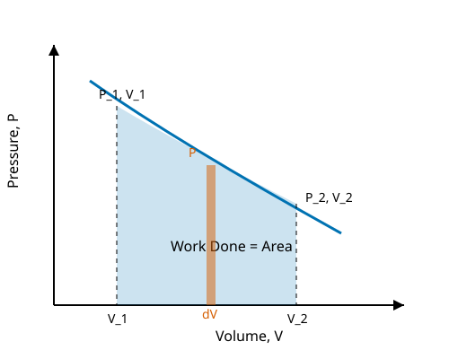

1. Consider $n$ moles of an ideal gas confined in a cylinder with a frictionless, movable piston. Let the gas expand isothermally from an initial volume $V_1$ to a final volume $V_2$.
2. The small amount of work done $dW$ for a small change in volume $dV$ at pressure $P$ is:
$$ dW = P\,dV $$
3. The total work done $W$ is the integral from $V_1$ to $V_2$:
$$ W = \int_{V_1}^{V_2} P\,dV $$
4. From the ideal gas equation, $PV = nRT$, we have $P = rac{nRT}{V}$. Substituting this:
$$ W = \int_{V_1}^{V_2} rac{nRT}{V}\,dV $$
5. Since $T$ is constant (isothermal), we can take $nRT$ out of the integral:
$$ W = nRT \int_{V_1}^{V_2} rac{1}{V}\,dV $$
6. Integrating yields:
$$ W = nRT [\ln V]_{V_1}^{V_2} = nRT (\ln V_2 - \ln V_1) $$
$$ W = nRT \ln \left( rac{V_2}{V_1} 
ight) $$

> [!IMPORTANT]
> **Final Result:** 
> $$ W = nRT \ln \left( rac{V_2}{V_1} 
ight) = 2.303\,nRT \log_{10} \left( rac{V_2}{V_1} 
ight) $$
> Since $P_1 V_1 = P_2 V_2$, this can also be written as $W = nRT \ln \left( rac{P_1}{P_2} 
ight)$.

**Worked Example:**
If an air bubble (treated as an ideal gas) slowly rises from the bottom of a lake to the surface at a constant temperature of $300\mathrm{\,K}$, and its volume doubles ($V_2/V_1 = 2$), the work done by 1 mole of the air is $W = (1)(8.314)(300)\ln(2) pprox 1729\mathrm{\,J}$.

**Extra Insight (First Law):**
For an ideal gas, internal energy depends only on temperature. In an isothermal process, $\Delta U = 0$. By the first law of thermodynamics ($Q = \Delta U + W$), the heat added to the system perfectly equals the work done by the system ($Q = W$).

> [!TIP]
> **Common mistake:** Using the formula for adiabatic work instead, or forgetting that temperature must be kept strictly constant for $nRT$ to be pulled outside the integral.

## 2018

> Asked in: 2018 Q3(a)
> Define heat and temperature.

### Ans. to the question no. 3(a)
- **Heat** is the form of energy in transit that flows from a body at a higher temperature to a body at a lower temperature due solely to the temperature difference. Its SI unit is the Joule ($\mathrm{J}$).
- **Temperature** is the macroscopic thermal state or property of a body which determines the direction of heat flow when it is in thermal contact with another body. Macroscopically, it's a measure of the average translational kinetic energy of the particles. Its SI unit is the Kelvin ($\mathrm{K}$).

  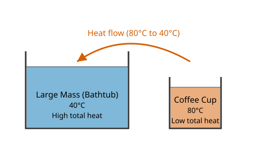

**Worked Example:**
A bathtub full of warm water at $40\mathrm{^\circ C}$ and a small cup of hot coffee at $80\mathrm{^\circ C}$. The coffee has a higher **temperature**, but the bathtub contains far more **heat** energy because of its vastly larger mass and number of molecules.

**Extra Insight:**
At absolute zero ($0\mathrm{\,K}$), all translational motion ceases, meaning temperature is zero. However, quantum mechanics dictates there is still a residual "zero-point energy".

> [!TIP]
> **Common mistake:** Treating heat as a substance that a body "contains". A body contains internal energy, not heat; heat is only defined during the *transfer* of energy.

---

> Asked in: 2018 Q3(b)
> Show that the pressure of a perfect gas is 2/3 of the kinetic energy of the gas molecules per unit volume.

### Ans. to the question no. 3(b)
Same as [2016 Q3(b)](#ans-to-the-question-no-3b).

---

> Asked in: 2018 Q3(c)
> State Newton's law of cooling.

### Ans. to the question no. 3(c)
Same as [2016 Q3(a)](#ans-to-the-question-no-3a).

---

> Asked in: 2018 Q5(a)
> What is degree of freedom? State the van der Waals equation.

### Ans. to the question no. 5(a)
**Degrees of freedom** refers to the number of independent ways or coordinates by which a dynamic system can possess energy. For gas molecules, it includes translational, rotational, and vibrational motions.
(e.g., A monatomic gas like Helium has $f=3$ purely translational degrees of freedom).

**The van der Waals equation** for 1 mole of gas is:
$$ \left( P + rac{a}{V^2} 
ight) (V - b) = RT $$

  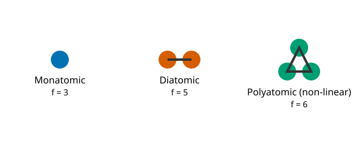

**Worked Example:**
Nitrogen ($\mathrm{N_2}$) at room temperature is diatomic. It has 3 translational and 2 rotational degrees of freedom, giving it $f = 5$. Thus, its molar heat capacity at constant volume is $C_v = rac{5}{2}R$.

**Extra Insight:**
At very high temperatures, vibrational modes in diatomic molecules become active, which adds 2 more degrees of freedom (one for kinetic, one for potential energy), making $f = 7$.

> [!TIP]
> **Common mistake:** Forgetting that non-linear polyatomic molecules (like $\mathrm{H_2O}$) have 3 rotational degrees of freedom ($f=6$), while linear ones (like $\mathrm{CO_2}$) have 2 ($f=5$).

---

> Asked in: 2018 Q5(b)
> Deduce the values of the van der Waals constants.

### Ans. to the question no. 5(b)
*(Reading per instructions: derive the critical constants $V_c, P_c, T_c$ and then invert to find $a, b$.)*

At the critical point, the critical isotherm has a point of inflection. This means the first and second derivatives of pressure with respect to volume at constant temperature are zero:
$$ \left(rac{\partial P}{\partial V}
ight)_T = 0 \quad 	ext{and} \quad \left(rac{\partial^2 P}{\partial V^2}
ight)_T = 0 $$

  

1. Write the van der Waals equation for 1 mole as $P = rac{RT}{V-b} - rac{a}{V^2}$.
2. Differentiate with respect to $V$:
$$ \left(rac{\partial P}{\partial V}
ight)_T = -rac{RT}{(V-b)^2} + rac{2a}{V^3} = 0 \quad \Rightarrow \quad rac{RT_c}{(V_c-b)^2} = rac{2a}{V_c^3} \quad \dots 	ext{(Eq. 1)} $$
3. Differentiate again:
$$ \left(rac{\partial^2 P}{\partial V^2}
ight)_T = rac{2RT}{(V-b)^3} - rac{6a}{V^4} = 0 \quad \Rightarrow \quad rac{2RT_c}{(V_c-b)^3} = rac{6a}{V_c^4} \quad \dots 	ext{(Eq. 2)} $$
4. Divide Eq. 1 by Eq. 2:
$$ rac{V_c - b}{2} = rac{V_c}{3} $$
$$ 3V_c - 3b = 2V_c \quad \Rightarrow \quad V_c = 3b $$
5. Substitute $V_c = 3b$ into Eq. 1:
$$ rac{RT_c}{(2b)^2} = rac{2a}{27b^3} \quad \Rightarrow \quad rac{RT_c}{4b^2} = rac{2a}{27b^3} \quad \Rightarrow \quad T_c = rac{8a}{27Rb} $$
6. Substitute $V_c$ and $T_c$ back into the original pressure equation:
$$ P_c = rac{R(8a/27Rb)}{3b - b} - rac{a}{9b^2} = rac{4a}{27b^2} - rac{3a}{27b^2} = rac{a}{27b^2} $$
7. Now deduce $a$ and $b$ from these critical constants. From $V_c = 3b$:
$$ b = rac{V_c}{3} $$
8. From $P_c = rac{a}{27b^2}$, substitute $b = V_c/3$:
$$ P_c = rac{a}{27(V_c/3)^2} = rac{a}{3V_c^2} \quad \Rightarrow \quad a = 3P_c V_c^2 $$

> [!IMPORTANT]
> **Final Result:** 
> Critical constants: $V_c = 3b$, $P_c = rac{a}{27b^2}$, $T_c = rac{8a}{27Rb}$.
> van der Waals constants: $a = 3P_c V_c^2$ and $b = rac{V_c}{3}$.

**Worked Example:**
For a gas with critical pressure $P_c = 7.3 	imes 10^6 \mathrm{\,Pa}$ and critical volume $V_c = 9.4 	imes 10^{-5} \mathrm{\,m^3\,mol^{-1}}$, the constant $b = 9.4 	imes 10^{-5}/3 = 3.13 	imes 10^{-5} \mathrm{\,m^3\,mol^{-1}}$.

**Extra Insight (Critical Coefficient):**
The dimensionless quantity $rac{P_c V_c}{R T_c}$ is called the critical coefficient. For any van der Waals gas, $rac{P_c V_c}{R T_c} = rac{(a/27b^2)(3b)}{R(8a/27Rb)} = rac{3}{8} = 0.375$. For most real gases, the experimental value is around $0.28$.

> [!TIP]
> **Common mistake:** Expanding $(V-b)$ incorrectly in the denominator during differentiation. Always use the chain rule resulting in negative powers.

---

> Asked in: 2018 Q5(c)
> Show that the adiabatic curves are higher (steeper) than the isothermal curves.

### Ans. to the question no. 5(c)
We must show that the slope of an adiabatic curve ($P$-$V$ graph) at any point is $\gamma$ times the slope of an isothermal curve at that same point, making it steeper.

  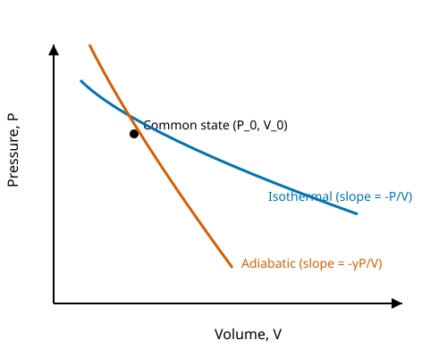

1. **For an isothermal process:** The equation is $PV = \mathrm{constant}$.
   Differentiating both sides with respect to $V$:
   $$ P + V\left(rac{dP}{dV}
ight)_{\mathrm{iso}} = 0 $$
   $$ \left(rac{dP}{dV}
ight)_{\mathrm{iso}} = -rac{P}{V} $$
   This is the slope of the isothermal curve.

2. **For an adiabatic process:** The equation is $PV^\gamma = \mathrm{constant}$, where $\gamma = C_p/C_v$.
   Differentiating both sides with respect to $V$:
   $$ rac{d}{dV}(P V^\gamma) = 0 $$
   $$ V^\gamma \left(rac{dP}{dV}
ight)_{\mathrm{ad}} + P (\gamma V^{\gamma-1}) = 0 $$
   Divide by $V^{\gamma-1}$:
   $$ V \left(rac{dP}{dV}
ight)_{\mathrm{ad}} + \gamma P = 0 $$
   $$ \left(rac{dP}{dV}
ight)_{\mathrm{ad}} = -\gamma rac{P}{V} $$
   This is the slope of the adiabatic curve.

3. **Comparison:** 
   $$ \left(rac{dP}{dV}
ight)_{\mathrm{ad}} = \gamma \left( -rac{P}{V} 
ight) = \gamma \left(rac{dP}{dV}
ight)_{\mathrm{iso}} $$

Since for all ideal gases $\gamma > 1$ (e.g., 1.67 for monatomic, 1.4 for diatomic), the magnitude of the adiabatic slope is greater than the isothermal slope.

> [!IMPORTANT]
> **Final Result:** 
> $$ 	ext{Adiabatic slope} = \gamma 	imes 	ext{Isothermal slope} $$
> Because $\gamma > 1$, the adiabatic curve is steeper. Starting from a common point, for expansion (increasing V) it lies below the isotherm, and for compression (decreasing V) it is "higher" or lies above the isotherm.

**Worked Example:**
In a diesel engine piston, air is compressed rapidly (adiabatically). Because the adiabatic curve is steeper, the pressure rises much higher than it would if the compression were slow (isothermal). This high pressure and corresponding high temperature ignite the fuel.

**Extra Insight:**
The steeper slope means that during adiabatic expansion, the pressure drops faster because the gas is doing work at the expense of its own internal energy, which causes the temperature to drop simultaneously.

> [!TIP]
> **Common mistake:** Forgetting the product rule when differentiating $PV^\gamma$.

---

> Asked in: 2018 Q6(a)
> Define degrees of freedom. Describe the fundamental postulates of gas molecules.

### Ans. to the question no. 6(a)
**Degrees of freedom** refers to the number of independent coordinates or independent ways by which a molecule can store energy (translation, rotation, vibration).

**Fundamental Postulates of Kinetic Theory of Gases:**
1. **Composition:** A gas consists of a very large number of identical, tiny particles called molecules.
2. **Point Masses:** The actual volume of the molecules is negligible compared to the total volume of the container.
3. **Random Motion:** Molecules are in constant, random, straight-line motion in all directions with all possible velocities.
4. **Collisions:** They frequently collide with each other and with the walls of the container. These collisions are perfectly elastic (no loss of kinetic energy).
5. **No Intermolecular Forces:** There are no attractive or repulsive forces between molecules except during collisions.
6. **Time of Collision:** The time spent during a collision is negligible compared to the time between consecutive collisions.

**Worked Example:**
The air in a balloon behaves like an ideal gas. Because the molecules are in continuous random motion, they constantly bombard the inner rubber wall, creating a steady macroscopic pressure that keeps the balloon inflated.

**Extra Insight (Equipartition Theorem):**
According to the principle of equipartition of energy, for a system in thermal equilibrium at temperature $T$, the average energy associated with each degree of freedom is $rac{1}{2}kT$ per molecule.

> [!TIP]
> **Common mistake:** Claiming molecules move in curved paths. Under the postulates, they move in straight lines until a collision occurs.

---

> Asked in: 2018 Q6(b)
> What is mean free path? Derive an expression for the mean free path.

### Ans. to the question no. 6(b)
**Mean free path ($\lambda$)** is the average distance travelled by a gas molecule between two successive collisions.

  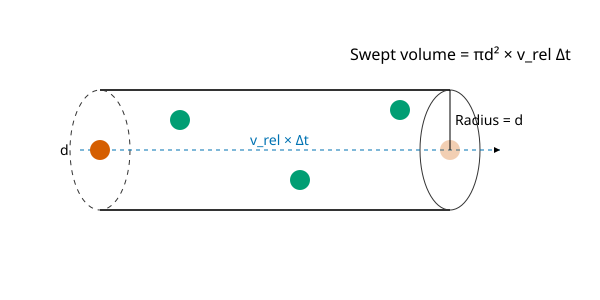

**Derivation:**
1. Consider a gas where all molecules have a diameter $d$ and number density $n$ (molecules per unit volume).
2. Assume one molecule is moving with an average relative speed $v_{\mathrm{rel}}$ while all others are momentarily stationary.
3. In a time interval $\Delta t$, the molecule sweeps out a "collision cylinder" of radius $d$ and length $v_{\mathrm{rel}}\Delta t$. Any molecule whose centre lies within this cylinder will be struck.
4. The volume of this swept cylinder is:
$$ V_{\mathrm{cyl}} = \pi d^2 (v_{\mathrm{rel}} \Delta t) $$
5. The number of collisions in time $\Delta t$ is the number of molecules inside this volume:
$$ N_{\mathrm{col}} = n 	imes V_{\mathrm{cyl}} = n \pi d^2 v_{\mathrm{rel}} \Delta t $$
6. The collision frequency (collisions per unit time) is:
$$ f = rac{N_{\mathrm{col}}}{\Delta t} = n \pi d^2 v_{\mathrm{rel}} $$
7. The mean free path is the average distance travelled divided by the number of collisions:
$$ \lambda = rac{v_{\mathrm{avg}} \Delta t}{N_{\mathrm{col}}} = rac{v_{\mathrm{avg}}}{f} = rac{v_{\mathrm{avg}}}{n \pi d^2 v_{\mathrm{rel}}} $$
8. Taking Maxwell's velocity distribution into account, molecules are moving in all directions. The average relative velocity is $\sqrt{2}$ times the average velocity ($v_{\mathrm{rel}} = \sqrt{2}v_{\mathrm{avg}}$).
9. Substituting this gives:
$$ \lambda = rac{1}{\sqrt{2} \pi d^2 n} $$

> [!IMPORTANT]
> **Final Result:** 
> $$ \lambda = rac{1}{\sqrt{2} \pi d^2 n} $$

**Worked Example:**
In a vacuum chamber at extremely low pressure, $n$ becomes very small. As a result, $\lambda$ becomes very large—sometimes larger than the chamber itself! In such cases, molecules hit the walls more often than they hit each other.

**Extra Insight:**
Using $P = nkT$, we can substitute $n = P / kT$ to express the mean free path in terms of temperature and pressure: $\lambda = rac{kT}{\sqrt{2} \pi d^2 P}$. This shows that $\lambda \propto T/P$.

> [!TIP]
> **Common mistake:** Forgetting the $\sqrt{2}$ factor. The simpler form $\lambda = 1/(\pi d^2 n)$ assumes all other molecules are stationary, which is physically inaccurate.

---

> Asked in: 2018 Q6(c)
> The mean free path of a nitrogen molecule at 0°C and 1 atm is 0.8×10^-7 m. At this temperature and pressure its density is 2.7×10^19 molecules/cm³. Find the molecular diameter.

### Ans. to the question no. 6(c)
**Given:**
- Mean free path, $\lambda = 0.8 	imes 10^{-7}\mathrm{\,m}$
- Number density, $n = 2.7 	imes 10^{19}\mathrm{\,molecules\,cm^{-3}}$ 
  $$ = 2.7 	imes 10^{19} 	imes 10^6 \mathrm{\,m^{-3}} = 2.7 	imes 10^{25} \mathrm{\,m^{-3}} $$

**Formula:**
The exact relation (Maxwell) is:
$$ \lambda = rac{1}{\sqrt{2} \pi d^2 n} $$
Rearranging for the diameter $d$:
$$ d^2 = rac{1}{\sqrt{2} \pi n \lambda} $$
*(Note: If the simpler form $\lambda = 1/(\pi d^2 n)$ is used, it yields $d pprox 3.8 	imes 10^{-10}\mathrm{\,m}$. We use the correct $\sqrt{2}$ form).*

**Substitution with units:**
$$ d^2 = rac{1}{1.414 	imes 3.1416 	imes (2.7 	imes 10^{25}\mathrm{\,m^{-3}}) 	imes (0.8 	imes 10^{-7}\mathrm{\,m})} $$
$$ d^2 = rac{1}{9.597 	imes 10^{18}}\mathrm{\,m^2} pprox 1.042 	imes 10^{-19}\mathrm{\,m^2} $$
$$ d = \sqrt{1.042 	imes 10^{-19}} pprox 3.2 	imes 10^{-10}\mathrm{\,m} $$

> [!IMPORTANT]
> **Final Answer:** 
> The molecular diameter of the nitrogen molecule is approximately $3.2 	imes 10^{-10}\mathrm{\,m}$ (or $3.2\mathrm{\,\AA}$).

**Worked Example:**
This calculated molecular diameter of $3.2\mathrm{\,\AA}$ is physically realistic for small diatomic molecules like Nitrogen, which aligns with modern x-ray crystallography data.

**Extra Insight:**
The collision cross-section is given by $\sigma = \pi d^2 = \pi (3.2 	imes 10^{-10})^2 pprox 3.2 	imes 10^{-19}\mathrm{\,m^2}$.

> [!TIP]
> **Common mistake:** Forgetting to convert $cm^{-3}$ to $m^{-3}$. Multiply by $10^6$, not $10^{-6}$.

## 2019

> Asked in: 2019 Q4(a)
> Differentiate between heat and temperature.

### Ans. to the question no. 4(a)
Same as [2018 Q3(a)](#ans-to-the-question-no-3a-1).

Here is a formal differentiation table:

| Characteristic | Heat ($Q$) | Temperature ($T$) |
|---|---|---|
| **Definition** | Energy in transit due to temperature difference. | A thermal state determining the direction of heat flow. |
| **Microscopic** | Total kinetic & potential energy of molecules transferring. | Average translational kinetic energy per molecule. |
| **Property Type** | Extensive (depends on mass/quantity). | Intensive (independent of mass/quantity). |
| **SI Unit** | Joule ($\mathrm{J}$) | Kelvin ($\mathrm{K}$) |
| **Measurement** | Calorimeter | Thermometer |

---

> Asked in: 2019 Q4(b)
> Show that the difference between the specific heats at constant pressure and constant volume of a gas equals the characteristic gas constant of the gas.

### Ans. to the question no. 4(b)
We need to derive Mayer's relation. For unit mass, the relation is $c_p - c_v = r$. For one mole, it is $C_p - C_v = R$.

  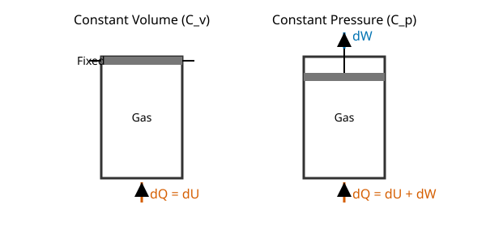

1. **At constant volume:** If 1 mole of an ideal gas is heated, the heat added $dQ_v$ increases only its internal energy $dU$. By the first law ($dQ = dU + dW$):
$$ dQ_v = dU + 0 \quad \Rightarrow \quad C_v dT = dU \quad \Rightarrow \quad C_v = rac{dU}{dT} $$
2. **At constant pressure:** If the same gas is heated at constant pressure, it expands and does work $dW = P\,dV$. The heat added $dQ_p$ is:
$$ dQ_p = dU + P\,dV $$
By definition, $dQ_p = C_p dT$. So:
$$ C_p dT = dU + P\,dV $$
3. From the ideal gas law for 1 mole, $PV = RT$. Differentiating at constant pressure:
$$ P\,dV = R\,dT $$
4. Substitute $P\,dV = R\,dT$ and $dU = C_v dT$ into the constant pressure heat equation:
$$ C_p dT = C_v dT + R\,dT $$
5. Dividing entirely by $dT$:
$$ C_p = C_v + R $$
$$ C_p - C_v = R $$
6. **For unit mass:** Let $M$ be the molar mass. Then $C_p = M c_p$ and $C_v = M c_v$, and the characteristic gas constant is $r = R/M$.
$$ M c_p - M c_v = R \quad \Rightarrow \quad c_p - c_v = rac{R}{M} = r $$

> [!IMPORTANT]
> **Final Result:** 
> $$ C_p - C_v = R \quad 	ext{(Molar specific heats)} $$
> $$ c_p - c_v = r \quad 	ext{(Specific heats per unit mass)} $$

**Worked Example:**
For air, $C_p pprox 29.1 \mathrm{\,J\,mol^{-1}\,K^{-1}}$ and $C_v pprox 20.8 \mathrm{\,J\,mol^{-1}\,K^{-1}}$. The difference is exactly $8.3 \mathrm{\,J\,mol^{-1}\,K^{-1}}$, which is the universal gas constant $R$.

**Extra Insight:**
The ratio $\gamma = C_p / C_v$ is crucial for adiabatic processes. Using $C_v = (f/2)R$ and $C_p = (1 + f/2)R$, we can write $\gamma = 1 + rac{2}{f}$.

> [!TIP]
> **Common mistake:** Stating $dQ = dU$ for the constant pressure case. Work is only zero when volume is kept strictly constant.

---

> Asked in: 2019 Q5(a)
> Define mean free path and degrees of freedom.

### Ans. to the question no. 5(a)
- **Mean free path:** Same as [2018 Q6(b)](#ans-to-the-question-no-6b-1).
- **Degrees of freedom:** Same as [2018 Q5(a)](#ans-to-the-question-no-5a-1).

---

> Asked in: 2019 Q5(b)
> Calculate the average kinetic energy of a molecule of gas at 300 K.

### Ans. to the question no. 5(b)
**Given:**
- Temperature, $T = 300\mathrm{\,K}$
- Boltzmann constant, $k = 1.38 	imes 10^{-23}\mathrm{\,J\,K^{-1}}$

**Formula:**
According to the equipartition theorem, the average translational kinetic energy per molecule is:
$$ E = rac{3}{2}kT $$

**Substitution with units:**
$$ E = 1.5 	imes (1.38 	imes 10^{-23}\mathrm{\,J\,K^{-1}}) 	imes 300\mathrm{\,K} $$
$$ E = 6.21 	imes 10^{-21}\mathrm{\,J} $$

> [!IMPORTANT]
> **Final Answer:** 
> The average translational kinetic energy of a gas molecule at $300\mathrm{\,K}$ is $6.21 	imes 10^{-21}\mathrm{\,J}$.

**Worked Example:**
This implies that at room temperature ($300\mathrm{\,K}$), every molecule moving in the air of a room holds about $6.2 	imes 10^{-21}\mathrm{\,J}$ of kinetic energy. In electron-volts, this is $E / (1.6 	imes 10^{-19}) pprox 0.039\mathrm{\,eV}$, commonly known as "thermal energy".

**Extra Insight:**
Because $E = rac{1}{2}m\overline{c^2}$, lighter molecules (like Hydrogen) must move much faster on average to have the same $E$ as heavier molecules (like Oxygen) at the same temperature.

> [!TIP]
> **Common mistake:** Using $E = rac{3}{2}RT$. That formula gives the kinetic energy for a **mole** of gas, not a single molecule.

---

> Asked in: 2019 Q6
> According to the kinetic theory of gases prove P = (1/3)(m n c²)/V, where the symbols have their usual meaning.

### Ans. to the question no. 6
*(Note: To match standard notation where $n$ is the total number of molecules, we use $n$ (or $N$). Let there be $n$ molecules in volume $V$.)*

  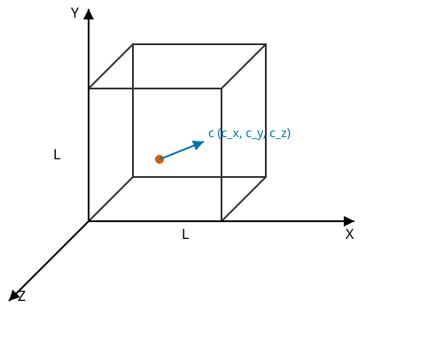

1. Consider a gas of $n$ molecules, each of mass $m$, in a cubic container of side $L$. The volume is $V = L^3$.
2. A single molecule moves with velocity $c$, with components $c_x, c_y, c_z$. So $c^2 = c_x^2 + c_y^2 + c_z^2$.
3. The molecule hits the right wall (perpendicular to X-axis) with momentum $mc_x$ and rebounds elastically with $-mc_x$.
   Change in momentum per collision = $mc_x - (-mc_x) = 2mc_x$.
4. The time taken to travel to the opposite wall and back is $\Delta t = rac{2L}{c_x}$.
5. The rate of change of momentum (Force exerted by this molecule on the wall) is:
$$ f_x = rac{\Delta p}{\Delta t} = rac{2mc_x}{2L / c_x} = rac{mc_x^2}{L} $$
6. The total force on the wall by all $n$ molecules is:
$$ F_x = rac{m}{L} (c_{x1}^2 + c_{x2}^2 + \dots + c_{xn}^2) $$
Since the mean square x-velocity is $\overline{c_x^2} = rac{\sum c_x^2}{n}$, we get $F_x = rac{mn}{L}\overline{c_x^2}$.
7. Because motion is random, there is no preferred direction: $\overline{c_x^2} = \overline{c_y^2} = \overline{c_z^2}$.
   Since $\overline{c^2} = \overline{c_x^2} + \overline{c_y^2} + \overline{c_z^2}$, we have $\overline{c_x^2} = rac{1}{3}\overline{c^2}$.
8. Substitute this into the force equation:
$$ F_x = rac{mn}{L} \left(rac{1}{3}\overline{c^2}
ight) = rac{1}{3}rac{mn}{L}\overline{c^2} $$
9. Pressure $P$ is force per unit area. Area $A = L^2$:
$$ P = rac{F_x}{L^2} = rac{1}{3}rac{mn}{L^3}\overline{c^2} $$
Since $L^3 = V$:
$$ P = rac{1}{3}rac{mn\overline{c^2}}{V} $$

> [!IMPORTANT]
> **Final Result:** 
> $$ P = rac{1}{3}rac{mn\overline{c^2}}{V} $$

**Worked Example:**
In a $1\mathrm{\,m^3}$ container holding helium atoms of mass $m$, if we double the number of molecules $n$ or increase their RMS speed (by heating), the pressure increases proportionally.

**Extra Insight:**
If we define number density $
u = n/V$, then $P = rac{1}{3}m
u\overline{c^2}$. Alternatively, using mass density $
ho = mn/V$, the equation becomes $P = rac{1}{3}
ho\overline{c^2}$.

> [!TIP]
> **Common mistake:** Assuming the change in momentum is $mc_x$. Since it rebounds elastically, it is $p_{final} - p_{initial} = -mc_x - (mc_x) = -2mc_x$ (the wall receives $+2mc_x$).

## 2020

> Asked in: 2020 Q4(a)
> What are the critical constants of a gas? Calculate their values in terms of the van der Waals constants.

### Ans. to the question no. 4(a)
Same as [2018 Q5(b)](#ans-to-the-question-no-5b).

---

> Asked in: 2020 Q4(b)
> Describe the principle of a platinum resistance thermometer. Discuss its advantages and disadvantages.

### Ans. to the question no. 4(b)
**Principle:** 
A platinum resistance thermometer (PRT) works on the principle that the electrical resistance of a pure metal (like platinum) increases uniformly with temperature.
For small temperature ranges, $R_t = R_0(1 + lpha t)$. 
The temperature on the platinum scale $t_{pt}$ is determined by measuring resistances at the unknown temperature ($R_t$), at the ice point ($R_0$), and at the steam point ($R_{100}$):
$$ t_{pt} = rac{R_t - R_0}{R_{100} - R_0} 	imes 100 $$

  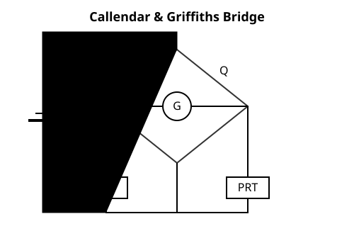

**Advantages:**
1. **Wide Range & High Accuracy:** It can measure temperatures from $-200\mathrm{^\circ C}$ to $1200\mathrm{^\circ C}$ with excellent precision.
2. **Stability:** Platinum does not oxidize and maintains its resistance properties reliably over time.
3. **Reproducibility:** Different platinum thermometers yield exactly the same reading for the same environment.

**Disadvantages:**
1. **Slow Response:** The sensor is bulky and has a high heat capacity, so it cannot track rapidly changing temperatures (unlike a thermocouple).
2. **Fragility:** The fine platinum wire is easily damaged by mechanical shocks or vibration.
3. **Complex Setup:** Requires a precise resistance bridge (like Callendar and Griffiths bridge) for measurement.

**Worked Example:**
A PRT is standard equipment for calibrating industrial ovens and checking other types of thermometers, where stability is more important than a fast reading speed.

**Extra Insight:**
For a more accurate conversion to the standard gas scale, the Callendar equation is used to correct $t_{pt}$: 
$t - t_{pt} = \delta \left[ \left(rac{t}{100}
ight)^2 - \left(rac{t}{100}
ight) 
ight]$.

> [!TIP]
> **Common mistake:** Confusing it with a thermocouple. A PRT uses resistance change, a thermocouple uses the Seebeck effect (voltage generation).

---

> Asked in: 2020 Q4(c)
> The resistances of a platinum thermometer are 2.585 Ω at 0°C and 3.510 Ω at 100°C. In a hot bath it reads 9.098 Ω. Find the temperature of the bath on the gas scale, taking δ = 1.5 for platinum.

### Ans. to the question no. 4(c)
**Given:**
- Ice point resistance, $R_0 = 2.585\mathrm{\,\Omega}$
- Steam point resistance, $R_{100} = 3.510\mathrm{\,\Omega}$
- Unknown bath resistance, $R_t = 9.098\mathrm{\,\Omega}$
- Callendar correction constant, $\delta = 1.5$

**Formula:**
1. First, find the temperature on the platinum scale, $t_{pt}$:
$$ t_{pt} = \left( rac{R_t - R_0}{R_{100} - R_0} 
ight) 	imes 100 $$
2. Second, apply the Callendar equation to find the gas scale temperature $t$:
$$ t - t_{pt} = \delta \left[ \left(rac{t}{100}
ight)^2 - rac{t}{100} 
ight] $$

**Substitution with units:**
1. Calculate $t_{pt}$:
$$ t_{pt} = \left( rac{9.098 - 2.585}{3.510 - 2.585} 
ight) 	imes 100 $$
$$ t_{pt} = \left( rac{6.513}{0.925} 
ight) 	imes 100 pprox 704.1\mathrm{^\circ C} $$

2. Calculate $t$:
Let $x = t/100$. The Callendar equation becomes:
$$ 100x - 704.1 = 1.5(x^2 - x) $$
$$ 100x - 704.1 = 1.5x^2 - 1.5x $$
$$ 1.5x^2 - 101.5x + 704.1 = 0 $$
Solve this quadratic equation for $x$:
$$ x = rac{101.5 \pm \sqrt{(-101.5)^2 - 4(1.5)(704.1)}}{2(1.5)} $$
$$ x = rac{101.5 \pm \sqrt{10302.25 - 4224.6}}{3} $$
$$ x = rac{101.5 \pm \sqrt{6077.65}}{3} pprox rac{101.5 \pm 77.96}{3} $$
Taking the smaller root (the larger root is non-physical for this thermometer's range):
$$ x pprox rac{23.54}{3} pprox 7.847 $$
$$ t = 100x = 784.7 pprox 785\mathrm{^\circ C} $$

> [!IMPORTANT]
> **Final Answer:** 
> The temperature of the hot bath on the gas scale is approximately $785\mathrm{^\circ C}$.
> *(The discarded root $x pprox 59.8$ gives $t pprox 5980\mathrm{^\circ C}$, which is well above the melting point of platinum, so it is physically rejected.)*

**Worked Example:**
This temperature ($785\mathrm{^\circ C}$) is typical for a salt bath used in the heat treatment of steel tools.

**Extra Insight:**
The Callendar equation is essentially a parabolic correction derived from the empirical relation $R_t = R_0(1 + At + Bt^2)$.

> [!TIP]
> **Common mistake:** Forgetting to divide $t$ by 100 before squaring in the Callendar equation.

---

> Asked in: 2020 Q5(a)
> What is mean free path? Derive an expression for the mean free path.

### Ans. to the question no. 5(a)
Same as [2018 Q6(b)](#ans-to-the-question-no-6b-1).

---

> Asked in: 2020 Q5(b)
> State and explain Newton's law of cooling.

### Ans. to the question no. 5(b)
Same as [2016 Q3(a)](#ans-to-the-question-no-3a).

---

> Asked in: 2020 Q5(c)
> Define molar specific heat. Find the relation between Cp and Cv.

### Ans. to the question no. 5(c)
**Molar specific heat** is defined as the amount of heat required to raise the temperature of 1 mole of a substance by $1\mathrm{\,K}$ (or $1\mathrm{^\circ C}$).

**Relation between $C_p$ and $C_v$:**
Same as [2019 Q4(b)](#ans-to-the-question-no-4b). The relation is $C_p - C_v = R$.

## 2021

> Asked in: 2021 Q5(b)
> What is an isothermal process? Derive the work done during an isothermal process.

### Ans. to the question no. 5(b)
Same as [2017 Q6(b)](#ans-to-the-question-no-6b).

---

> Asked in: 2021 Q5(c)
> Calculate the average kinetic energy of a molecule of a gas at 300 K.

### Ans. to the question no. 5(c)
Same as [2019 Q5(b)](#ans-to-the-question-no-5b-1).

---

> Asked in: 2021 Q6(a)
> Explain Newton's law of cooling.

### Ans. to the question no. 6(a)
Same as [2016 Q3(a)](#ans-to-the-question-no-3a).

## 2022

> Asked in: 2022 Q4(a)
> "Show that the work done is directly proportional to the kinetic energy" in the kinetic theory of gases.

### Ans. to the question no. 4(a)
*(Reading per instructions: Prove that isobaric work $W \propto \Delta E_K$.)*

1. For an ideal gas, the pressure and total translational kinetic energy $E_K$ are related by:
$$ PV = rac{2}{3}E_K $$
2. Suppose the gas undergoes an isobaric (constant pressure) expansion where the volume changes from $V_1$ to $V_2$, and the kinetic energy changes from $E_{K1}$ to $E_{K2}$.
3. Writing the equation for the initial and final states:
$$ P V_1 = rac{2}{3}E_{K1} $$
$$ P V_2 = rac{2}{3}E_{K2} $$
4. Subtracting the initial state from the final state:
$$ P(V_2 - V_1) = rac{2}{3}(E_{K2} - E_{K1}) $$
$$ P\Delta V = rac{2}{3}\Delta E_K $$
5. Since the work done $W$ in an isobaric expansion is $W = P\Delta V$:
$$ W = rac{2}{3}\Delta E_K $$

> [!IMPORTANT]
> **Final Result:** 
> $$ W \propto \Delta E_K $$
> The work done by the gas is directly proportional to the change in its total translational kinetic energy.

**Worked Example:**
In a piston kept at constant pressure, if heat is added and the translational kinetic energy of the gas molecules increases by $300\mathrm{\,J}$, the work done by the gas in pushing the piston outward is $W = rac{2}{3} 	imes 300 = 200\mathrm{\,J}$.

**Extra Insight:**
For 1 mole of a monatomic gas, $E_K = rac{3}{2}RT$. The heat added is $Q = C_p \Delta T = rac{5}{2}R \Delta T$. The work done is $R \Delta T$, which exactly matches $rac{2}{3} \Delta E_K = rac{2}{3}(rac{3}{2}R \Delta T) = R \Delta T$.

> [!TIP]
> **Common mistake:** Trying to prove this for an isothermal process. In an isothermal process, $\Delta E_K = 0$, but work is done, breaking the proportionality. It must be an isobaric (or generic non-isothermal) process.

---

> Asked in: 2022 Q4(b)
> What is mean free path? Derive an expression for the mean free path.

### Ans. to the question no. 4(b)
Same as [2018 Q6(b)](#ans-to-the-question-no-6b-1).

---

> Asked in: 2022 Q4(c)
> What is degree of freedom? State and explain Newton's law of cooling with a graph.

### Ans. to the question no. 4(c)
- **Degree of freedom:** Same as [2018 Q5(a)](#ans-to-the-question-no-5a-1).
- **Newton's law of cooling:** Same as [2016 Q3(a)](#ans-to-the-question-no-3a).

---

> Asked in: 2022 Q5(b)
> Show that the adiabatic curves are higher (steeper) than the isothermal curves.

### Ans. to the question no. 5(b)
Same as [2018 Q5(c)](#ans-to-the-question-no-5c).

## 2023

> Asked in: 2023 Q5(a)
> Show that the adiabatic curves are higher (steeper) than the isothermal curves.

### Ans. to the question no. 5(a)
Same as [2018 Q5(c)](#ans-to-the-question-no-5c).

---

> Asked in: 2023 Q7(a)
> Define degrees of freedom. Describe the fundamental postulates of gas molecules.

### Ans. to the question no. 7(a)
Same as [2018 Q6(a)](#ans-to-the-question-no-6a).

---

> Asked in: 2023 Q7(b)
> What is mean free path? Derive an expression for the mean free path.

### Ans. to the question no. 7(b)
Same as [2018 Q6(b)](#ans-to-the-question-no-6b-1).

---

> Asked in: 2023 Q7(c)
> The mean free path of a nitrogen molecule at 0°C and 1 atm is 0.8×10^-7 m. At this temperature and pressure its density is 2.7×10^19 molecules/cm³. Find the molecular diameter.

### Ans. to the question no. 7(c)
Same as [2018 Q6(c)](#ans-to-the-question-no-6c).

## Concept Map

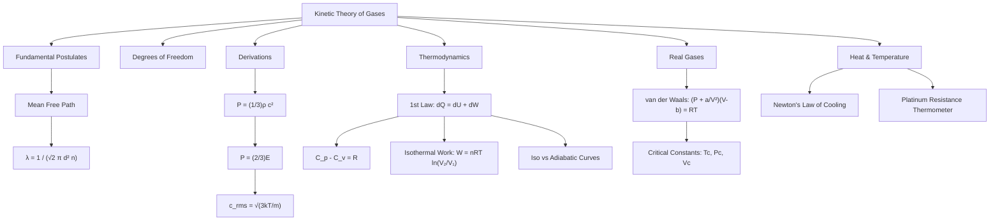

## Cheat Sheet

- **Kinetic Pressure:** $P = rac{1}{3}rac{mN}{V}\overline{c^2} = rac{1}{3}
ho c_{\mathrm{rms}}^2$
- **Energy density:** $E = rac{1}{2}rac{mN}{V}\overline{c^2}$, yielding $P = rac{2}{3}E$
- **Total energy per molecule:** $E_{avg} = rac{f}{2}kT$
- **RMS Speed:** $c_{\mathrm{rms}} = \sqrt{rac{3kT}{m}} = \sqrt{rac{3RT}{M}} = \sqrt{rac{3P}{
ho}}$
- **Mean Free Path:** $\lambda = rac{1}{\sqrt{2}\pi d^2 n}$
- **Mayer's Relation:** $C_p - C_v = R$ (molar), $c_p - c_v = r$ (mass)
- **Work (Isothermal):** $W = nRT \ln(V_2/V_1) = nRT \ln(P_1/P_2)$
- **Curve Slopes:** Slope$_{\mathrm{ad}} = \gamma 	imes$ Slope$_{\mathrm{iso}}$
- **van der Waals:** $(P + a/V^2)(V - b) = RT$
- **Critical Constants:** $V_c = 3b$, $P_c = a / 27b^2$, $T_c = 8a / 27Rb$
- **Newton's Cooling:** $T = T_0 + (T_i - T_0)e^{-kt}$
- **Callendar Equation:** $t - t_{pt} = \delta[(t/100)^2 - (t/100)]$

## Glossary

- **Isothermal Process:** Process occurring at constant temperature.
- **Adiabatic Process:** Process occurring without heat exchange ($dQ = 0$).
- **Translational Kinetic Energy:** Energy of a molecule due to its motion through space.
- **Equipartition of Energy:** Each degree of freedom holds $rac{1}{2}kT$ energy on average.
- **Co-volume ($b$):** The excluded volume correction in a real gas, accounting for finite molecular size.

## Practice Problems

1. **Calculate the RMS speed** of an Oxygen molecule ($\mathrm{O_2}$) at $27\mathrm{^\circ C}$. 
   *Answer:* $M = 0.032 \mathrm{\,kg/mol}$, $T = 300\mathrm{\,K}$. $c = \sqrt{3RT/M} = \sqrt{3(8.314)(300)/0.032} pprox 483 \mathrm{\,m/s}$.
2. **Find the work done** when 2 moles of an ideal gas expand isothermally at $400\mathrm{\,K}$ from $10\mathrm{\,L}$ to $30\mathrm{\,L}$.
   *Answer:* $W = 2(8.314)(400)\ln(3) pprox 7307\mathrm{\,J}$.
3. **Cooling rate:** A body cools from $60\mathrm{^\circ C}$ to $50\mathrm{^\circ C}$ in 10 minutes in a room at $20\mathrm{^\circ C}$. How long will it take to cool from $50\mathrm{^\circ C}$ to $40\mathrm{^\circ C}$?
   *Answer:* Use average temperatures for intervals. $(60-50)/10 = k(55-20) \Rightarrow k = 1/35$. Next interval: $(50-40)/t = (1/35)(45-20) \Rightarrow 10/t = 25/35 \Rightarrow t = 14 \mathrm{\,minutes}$.
4. **Mean free path:** If pressure is doubled at constant temperature, what happens to the mean free path?
   *Answer:* $\lambda \propto T/P$. If $P$ doubles while $T$ is constant, $\lambda$ becomes halved.
