# PHY-103 Physics-II: Kinetic Theory of Gases — Solved Questions (2016–2023)

> Exam-revision notes for BUTEX Fabric Engineering. Answers follow the supplied question scope and paper order. Full solutions appear at the first appearance of a topic; repeated questions link back to that solution, except that the repeated nitrogen numerical is worked in full for both years.

| Metadata | Details |
|---|---|
| Course | PHY-103 — Physics-II |
| Programme | BUTEX Fabric Engineering |
| Topic | Kinetic Theory of Gases (plus the explicitly listed self-inductance numerical) |
| Years covered | 2016–2023 question list; source title refers to 2015–2023 |
| Version | `v261103-0` |
| Format | GitHub-flavored Markdown with separate SVG assets |

> [!NOTE]
> The supplied scope is authoritative. The separately mentioned previous-year-question DOCX was not present among the files supplied in this turn, so its wording could not be independently cross-checked. The self-inductance item is retained because it appears in the authoritative list; it is a magnetism numerical, not a kinetic-theory topic.

## Table of contents

- [Year-topic appearance matrix](#year-topic-appearance-matrix)
- [Formula and units sheet](#formula-and-units-sheet)
- [Year-wise question answers](#year-wise-question-answers)
  - [2016](#2016)
    - [Q3(a) Newton's law of cooling](#2016-q3a-newtons-law-of-cooling)
    - [Q3(b) Pressure and translational kinetic energy](#2016-q3b-pressure-and-translational-kinetic-energy)
    - [Q3(c) Self-inductance numerical](#2016-q3c-self-inductance-numerical)
    - [Q5(a) Temperature and van der Waals equation](#2016-q5a-temperature-and-van-der-waals-equation)
    - [Q7(c) Corrections to the van der Waals equation](#2016-q7c-corrections-to-the-van-der-waals-equation)
  - [2017](#2017)
    - [Q6(b) Isothermal work](#2017-q6b-isothermal-work)
  - [2018](#2018)
    - [Q3(a) Heat and temperature](#2018-q3a-heat-and-temperature)
    - [Q3(b) Pressure–kinetic-energy relation](#2018-q3b-pressure-kinetic-energy-relation)
    - [Q3(c) Newton's law of cooling](#2018-q3c-newtons-law-of-cooling)
    - [Q5(a) Degrees of freedom and van der Waals equation](#2018-q5a-degrees-of-freedom-and-van-der-waals-equation)
    - [Q5(b) Critical constants](#2018-q5b-critical-constants-from-van-der-waals-constants)
    - [Q5(c) Adiabatic and isothermal curves](#2018-q5c-adiabatic-and-isothermal-curves)
    - [Q6(a) Degrees of freedom and postulates](#2018-q6a-degrees-of-freedom-and-postulates)
    - [Q6(b) Mean free path](#2018-q6b-mean-free-path)
    - [Q6(c) Nitrogen molecular diameter](#2018-q6c-nitrogen-molecular-diameter)
  - [2019](#2019)
    - [Q4(a) Heat versus temperature](#2019-q4a-heat-versus-temperature)
    - [Q4(b) Mayer's relation](#2019-q4b-mayers-relation-cp-minus-cv)
    - [Q5(a) Mean free path and degrees of freedom](#2019-q5a-mean-free-path-and-degrees-of-freedom)
    - [Q5(b) Average kinetic energy at 300 K](#2019-q5b-average-kinetic-energy-at-300-k)
    - [Q6 Pressure from kinetic theory](#2019-q6-pressure-from-kinetic-theory)
  - [2020](#2020)
    - [Q4(a) Critical constants](#2020-q4a-critical-constants)
    - [Q4(b) Platinum resistance thermometer](#2020-q4b-platinum-resistance-thermometer)
    - [Q4(c) Platinum thermometer numerical](#2020-q4c-platinum-thermometer-numerical)
    - [Q5(a) Mean free path](#2020-q5a-mean-free-path)
    - [Q5(b) Newton's law of cooling](#2020-q5b-newtons-law-of-cooling)
    - [Q5(c) Molar specific heat and Cp–Cv](#2020-q5c-molar-specific-heat-and-cp-cv)
  - [2021](#2021)
    - [Q5(b) Isothermal work](#2021-q5b-isothermal-work)
    - [Q5(c) Average kinetic energy at 300 K](#2021-q5c-average-kinetic-energy-at-300-k)
    - [Q6(a) Newton's law of cooling](#2021-q6a-newtons-law-of-cooling)
  - [2022](#2022)
    - [Q4(a) Work and kinetic energy](#2022-q4a-work-and-kinetic-energy)
    - [Q4(b) Mean free path](#2022-q4b-mean-free-path)
    - [Q4(c) Degrees of freedom and Newton cooling](#2022-q4c-degrees-of-freedom-and-newton-cooling)
    - [Q5(b) Adiabatic and isothermal curves](#2022-q5b-adiabatic-and-isothermal-curves)
  - [2023](#2023)
    - [Q5(a) Adiabatic and isothermal curves](#2023-q5a-adiabatic-and-isothermal-curves)
    - [Q7(a) Degrees of freedom and postulates](#2023-q7a-degrees-of-freedom-and-postulates)
    - [Q7(b) Mean free path](#2023-q7b-mean-free-path)
    - [Q7(c) Nitrogen molecular diameter](#2023-q7c-nitrogen-molecular-diameter)
- [Mermaid concept map](#mermaid-concept-map)
- [One-page cheat sheet](#one-page-cheat-sheet)
- [Glossary](#glossary)
- [New practice problems with answers](#new-practice-problems-with-answers)

## Year-topic appearance matrix

A filled cell means that the paper contains a question on that topic. A combined cell can represent more than one question in the same year.

| Year | Cooling | Pressure–KE | Mean free path | Degrees of freedom / postulates | Isothermal work | Adiabatic vs isothermal | van der Waals / critical | Heat / temperature | Specific heats | Average KE | Platinum thermometer |
|---|---:|---:|---:|---:|---:|---:|---:|---:|---:|---:|---:|
| 2016 | ✓ | ✓ | — | — | — | — | ✓ | ✓ | — | — | — |
| 2017 | — | — | — | — | ✓ | — | — | — | — | — | — |
| 2018 | ✓ | ✓ | ✓ | ✓ | — | ✓ | ✓ | ✓ | — | — | — |
| 2019 | — | ✓ | ✓ | ✓ | — | — | — | ✓ | ✓ | ✓ | — |
| 2020 | ✓ | — | ✓ | — | — | — | ✓ | — | ✓ | — | ✓ |
| 2021 | ✓ | — | — | — | ✓ | — | — | — | — | ✓ | — |
| 2022 | ✓ | — | ✓ | ✓ | — | ✓ | — | — | — | — | — |
| 2023 | — | — | ✓ | ✓ | — | ✓ | — | — | — | — | — |

### Priority by recurrence

| Priority | Topic | Papers in which it appears |
|---|---|---|
| Very high | Newton's law of cooling | 2016, 2018, 2020, 2021, 2022 |
| Very high | Mean free path | 2018, 2019, 2020, 2022, 2023 |
| Very high | Degrees of freedom / molecular postulates | 2018, 2019, 2022, 2023 |
| High | Pressure–kinetic-energy relation | 2016, 2018, 2019; related work–KE form in 2022 |
| High | Adiabatic versus isothermal curves | 2018, 2022, 2023 |
| High | van der Waals equation / critical constants | 2016, 2018, 2020 |
| Moderate | Isothermal work | 2017, 2021 |
| Moderate | Heat and temperature | 2016, 2018, 2019 |
| Moderate | Specific heats | 2019, 2020 |
| Moderate | Average molecular kinetic energy at 300 K | 2019, 2021 |

## Formula and units sheet

| Quantity | Symbol | SI unit | Dimensional formula |
|---|---|---|---|
| Pressure | $P$ | Pa = N m⁻² | $[ML^{-1}T^{-2}]$ |
| Volume | $V$ | m³ | $[L^3]$ |
| Temperature | $T$ | K | $[\Theta]$ |
| Boltzmann constant | $k$ | J K⁻¹ | $[ML^2T^{-2}\Theta^{-1}]$ |
| Molar gas constant | $R$ | J mol⁻¹ K⁻¹ | $[ML^2T^{-2}\Theta^{-1}N^{-1}]$ |
| RMS speed | $c_{\mathrm{rms}}$ | m s⁻¹ | $[LT^{-1}]$ |
| Mean free path | $\lambda$ | m | $[L]$ |
| Molecular diameter | $d$ | m | $[L]$ |
| Number density | $n$ | m⁻³ | $[L^{-3}]$ |
| van der Waals constant | $a$ | Pa m⁶ mol⁻² | $[ML^5T^{-2}N^{-2}]$ |
| van der Waals constant | $b$ | m³ mol⁻¹ | $[L^3N^{-1}]$ |
| Degrees of freedom | $f$ | dimensionless | $[1]$ |

Here $\Theta$ denotes the thermodynamic-temperature dimension and $N$ in a dimensional formula denotes amount of substance (not the molecule count). Use $k=1.38\times10^{-23}\,\mathrm{J\,K^{-1}}$ and $R=8.314\,\mathrm{J\,mol^{-1}\,K^{-1}}$ unless another value is specified. In equations, $N$ denotes the number of molecules and $n=N/V$ denotes molecular number density; in the molar van der Waals equation, $V_m$ denotes molar volume.

---

## Year-wise question answers

## 2016

### 2016 Q3(a) Newton's law of cooling

> State Newton's law of cooling.
>
> **Asked in:** 2016 Q3(a), 2018 Q3(c), 2020 Q5(b), 2021 Q6(a), 2022 Q4(c).

#### Ans. to the question no. 3(a)

**Newton's law of cooling:** For a body whose temperature is only slightly higher than that of its surroundings, the rate of loss of temperature (and hence the rate of heat loss for constant heat capacity) is directly proportional to the excess temperature of the body over its surroundings, provided the surrounding temperature and other conditions remain constant.

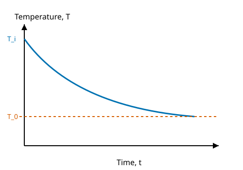

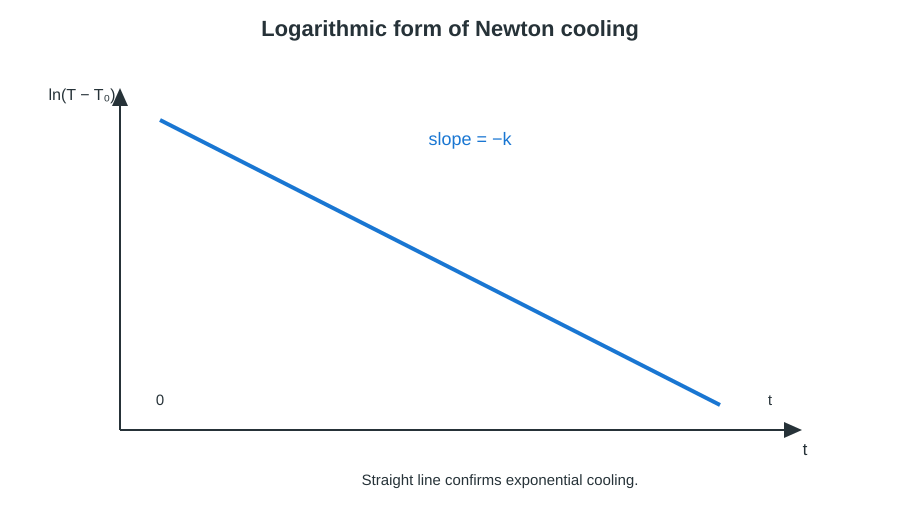

**Derivation**

Let $T$ be the body temperature at time $t$, $T_0$ the constant surrounding temperature, $T_i$ the initial temperature and $k$ a positive cooling constant.

1. By Newton's law, the rate of cooling is proportional to the excess temperature:

   $$-\frac{dT}{dt}\propto T-T_0$$

2. Introducing the proportionality constant $k$:

   $$\frac{dT}{dt}=-k(T-T_0)$$

3. Separate variables and integrate:

   $$\int\frac{dT}{T-T_0}=-k\int dt$$

4. Apply $T=T_i$ at $t=0$:

   $$\ln\left(\frac{T-T_0}{T_i-T_0}\right)=-kt$$

5. Taking the exponential gives the cooling equation:

   $$T=T_0+(T_i-T_0)e^{-kt}$$

> [!IMPORTANT]
> $$\boxed{\frac{dT}{dt}=-k(T-T_0),\qquad T(t)=T_0+(T_i-T_0)e^{-kt}}$$
> The law is an approximation valid for a small temperature excess and approximately constant surroundings.

**Worked example.** A cup of coffee cools from $90^\circ\mathrm{C}$ in a room at $25^\circ\mathrm{C}$. Let $k=0.040\,\mathrm{min^{-1}}$. After 10 min,

$$T=25+(90-25)e^{-0.040(10)}=25+65e^{-0.4}=68.6^\circ\mathrm{C}$$

The model predicts approximately $68.6^\circ\mathrm{C}$.

**Extra.** Taking logarithms gives a straight-line form:

$$\ln(T-T_0)=\ln(T_i-T_0)-kt$$

Thus, a plot of $\ln(T-T_0)$ against $t$ is a straight line with slope $-k$. If common logarithms are used, the slope is $-k/2.303$.

> [!TIP]
> Do not write the rate as proportional to $T$; it is proportional to the excess temperature $(T-T_0)$. State the small-temperature-difference condition and keep the minus sign because the body is cooling.

### 2016 Q3(b) Pressure and translational kinetic energy

> Deduce the relation between pressure and kinetic energy of a gas, $P=\frac{2}{3}E$. Here $E$ is the translational kinetic energy per unit volume.
>
> **Asked in:** 2016 Q3(b), 2018 Q3(b), 2019 Q6.

#### Ans. to the question no. 3(b)

The pressure exerted by an ideal gas is two-thirds of its total translational kinetic energy per unit volume. The result follows from molecular impacts on the container walls.

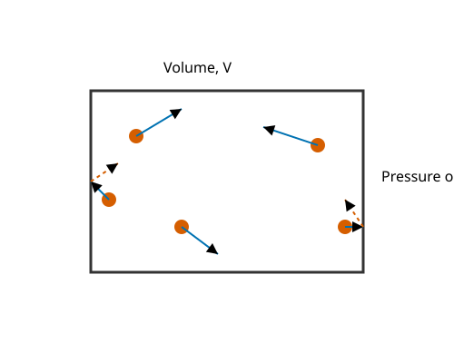

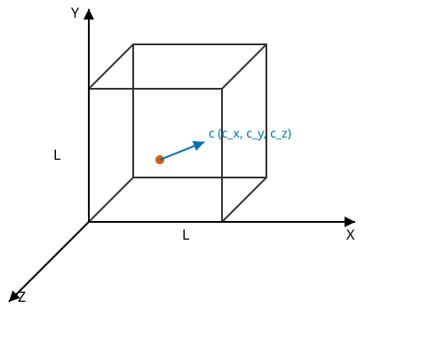

**Derivation**

Let each molecule have mass $m$, let there be $N$ molecules in a cube of side $l$ and volume $V=l^3$, and let a representative molecule have velocity components $(c_x,c_y,c_z)$. The mean square speed is $\overline{c^2}$.

1. On striking a wall perpendicular to the $x$-axis, the molecule's $x$-momentum changes from $mc_x$ to $-mc_x$. The magnitude of the momentum change is:

   $$\Delta p_x=2mc_x$$

2. The time between two successive collisions of this molecule with the same wall is:

   $$\Delta t=\frac{2l}{c_x}$$

3. Its average force on that wall is momentum change per unit time:

   $$F_x=\frac{\Delta p_x}{\Delta t}=\frac{2mc_x}{2l/c_x}=\frac{mc_x^2}{l}$$

4. Summing over all molecules and dividing by wall area $l^2$ gives:

   $$P=\frac{m}{V}\sum_{i=1}^{N}c_{xi}^{2}=\frac{Nm}{V}\overline{c_x^2}$$

5. Molecular motion is random and isotropic, so the three component mean squares are equal:

   $$\overline{c_x^2}=\overline{c_y^2}=\overline{c_z^2}=\frac{1}{3}\overline{c^2}$$

6. Substituting gives the kinetic-theory pressure equation:

   $$P=\frac{1}{3}\frac{Nm}{V}\overline{c^2}$$

7. The translational kinetic energy per unit volume is:

   $$E=\frac{1}{2}\frac{Nm}{V}\overline{c^2}$$

8. Comparing the last two expressions:

   $$P=\frac{2}{3}E$$

> [!IMPORTANT]
> $$\boxed{P=\frac{1}{3}\frac{Nm}{V}\overline{c^2}=\frac{2}{3}E}$$

**Worked example.** For helium at $300\,\mathrm{K}$, take $m=6.64\times10^{-27}\,\mathrm{kg}$ and $n=N/V=2.4\times10^{25}\,\mathrm{m^{-3}}$. From $c_{\mathrm{rms}}=\sqrt{3kT/m}$, $c_{\mathrm{rms}}\approx1.37\times10^3\,\mathrm{m\,s^{-1}}$. Then

$$P=\frac{1}{3}mn c_{\mathrm{rms}}^2\approx9.93\times10^4\,\mathrm{Pa}$$

This is approximately atmospheric pressure.

**Extra.** Combining the pressure equation with $PV=NkT$ gives

$$\frac{1}{2}m\overline{c^2}=\frac{3}{2}kT,\qquad c_{\mathrm{rms}}=\sqrt{\frac{3kT}{m}}$$

The mean translational kinetic energy per molecule depends only on absolute temperature for an ideal gas.

> [!TIP]
> Use the mean square speed $\overline{c^2}$, not the square of the mean speed. Do not omit the factor $1/3$ from isotropic motion or confuse total kinetic energy with kinetic energy per unit volume.

### 2016 Q3(c) Self-inductance numerical

> Calculate the self-inductance of a coil of 400 turns when a current of $2\,\mathrm{A}$ creates $4\times10^{-4}\,\mathrm{Wb}$ of flux.
>
> **Asked in:** 2016 Q3(c) only.

#### Ans. to the question no. 3(c)

> [!NOTE]
> This is a **magnetism numerical placed in the listed question sequence**, not a kinetic-theory question. It is included because the supplied scope explicitly asks for it.

For a coil, self-inductance is the flux linkage per unit current. Here the stated flux is treated as flux per turn, as required by the supplied numerical convention.

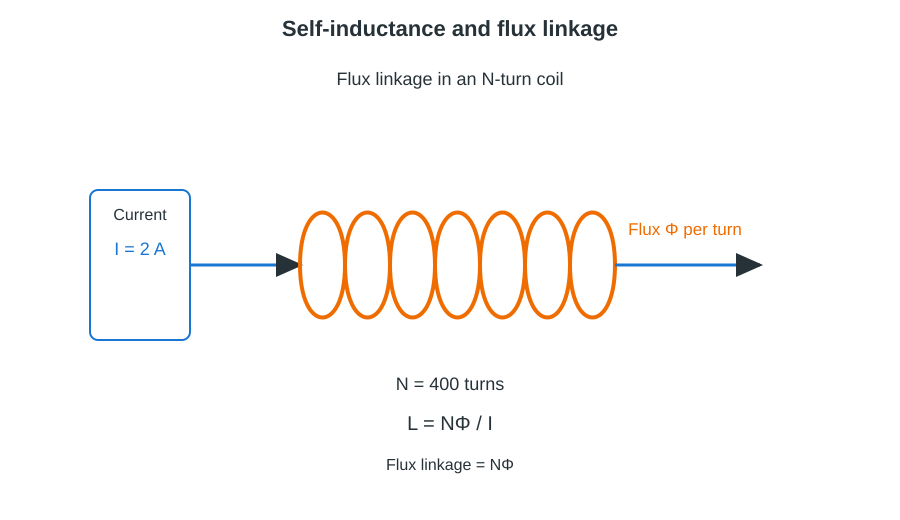

**Given**

- Number of turns, $N=400$.
- Current, $I=2\,\mathrm{A}$.
- Flux per turn, $\Phi=4\times10^{-4}\,\mathrm{Wb}$.

**Derivation**

1. Flux linkage is $N\Phi$:

   $$N\Phi=400\times4\times10^{-4}=0.16\,\mathrm{Wb\,turn}$$

2. Self-inductance is flux linkage divided by current:

   $$L=\frac{N\Phi}{I}$$

3. Substitute the data:

   $$L=\frac{400\times4\times10^{-4}}{2}=0.08\,\mathrm{H}$$

> [!IMPORTANT]
> $$\boxed{L=0.08\,\mathrm{H}}$$

**Worked example.** A 200-turn coil has flux $2.5\times10^{-4}\,\mathrm{Wb}$ per turn when its current is $1.0\,\mathrm{A}$. Its inductance is $L=200(2.5\times10^{-4})/1.0=0.050\,\mathrm{H}$.

**Extra.** The magnetic energy stored in an ideal inductor is

$$U=\frac{1}{2}LI^2$$

For the given coil at $2\,\mathrm{A}$, $U=\frac12(0.08)(2)^2=0.16\,\mathrm{J}$.

> [!TIP]
> Use flux linkage $N\Phi$, not flux alone. The henry is equivalent to $\mathrm{Wb\,A^{-1}}$; check that the current is in amperes and flux in webers.

### 2016 Q5(a) Temperature and van der Waals equation

> Define temperature and write the van der Waals equation.
>
> **Asked in:** 2016 Q5(a); the equation is also requested in 2018 Q5(a).

#### Ans. to the question no. 5(a)

**Temperature** is the thermodynamic property that determines the direction of heat transfer and, for an ideal gas, is proportional to the mean translational kinetic energy per molecule:

$$\overline{\epsilon}=\frac{3}{2}kT$$

For $n_m$ moles of a real gas, the van der Waals equation is

$$\left(P+a\frac{n_m^2}{V^2}\right)(V-n_m b)=n_mRT$$

For one mole, using molar volume $V_m$:

$$\left(P+\frac{a}{V_m^2}\right)(V_m-b)=RT$$


**Derivation / explanation**

1. The ideal-gas equation assumes negligible molecular size and negligible intermolecular attraction:

   $$PV=n_mRT$$

2. A real molecule occupies finite space, so the volume available for molecular motion is reduced from $V$ to $V-n_m b$:

   $$V_{\mathrm{free}}=V-n_m b$$

3. Attractive forces reduce the measured pressure. The pressure correction is $a n_m^2/V^2$:

   $$P_{\mathrm{idealized}}=P+a\frac{n_m^2}{V^2}$$

4. Substitution of both corrections gives:

   $$\left(P+a\frac{n_m^2}{V^2}\right)(V-n_m b)=n_mRT$$

> [!IMPORTANT]
> $$\boxed{\left(P+a\frac{n_m^2}{V^2}\right)(V-n_m b)=n_mRT}$$
> Here $a$ measures intermolecular attraction and $b$ accounts for finite molecular size.

**Worked example.** At $300\,\mathrm{K}$, one mole of a CO₂-like gas has $a=0.364\,\mathrm{Pa\,m^6\,mol^{-2}}$, $b=4.27\times10^{-5}\,\mathrm{m^3\,mol^{-1}}$ and $V=0.0250\,\mathrm{m^3}$. The van der Waals pressure is

$$P=\frac{RT}{V-b}-\frac{a}{V^2}=\frac{8.314(300)}{0.0250-4.27\times10^{-5}}-\frac{0.364}{(0.0250)^2}$$

$$P\approx9.936\times10^4\,\mathrm{Pa}$$

The ideal-gas estimate is $RT/V\approx9.977\times10^4\,\mathrm{Pa}$; the corrected pressure is slightly lower for these data.

**Extra.** For one mole, the Boyle temperature predicted by the van der Waals model is

$$T_B=\frac{a}{Rb}$$

At this temperature, the second virial coefficient in the low-pressure expansion vanishes.

> [!TIP]
> Keep the two corrections in the correct places: add $a/V_m^2$ to pressure and subtract $b$ from molar volume. Do not use total volume and molar volume interchangeably.

### 2016 Q7(c) Corrections to the van der Waals equation

> Discuss the corrections of the van der Waals equation of state.
>
> **Asked in:** 2016 Q7(c); the corrected equation is reused in 2018 Q5(a) and the critical-constant questions.

#### Ans. to the question no. 7(c)

The van der Waals equation corrects the ideal-gas model for (i) the finite size of molecules and (ii) attractive intermolecular forces.

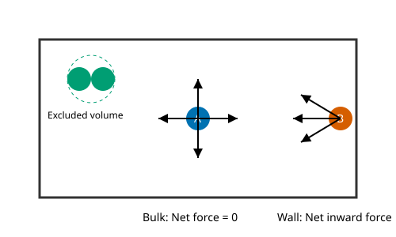

**Derivation / explanation**

1. **Volume correction.** Gas molecules are not point particles. Their centres cannot approach one another arbitrarily closely, so the free volume is smaller than the vessel volume. For $n_m$ moles, the corrected volume is $V-n_m b$:

   $$V_{\mathrm{free}}=V-n_m b$$

2. If the molecules are modelled as hard spheres of radius $r$, the excluded-volume parameter is four times the total molecular volume per mole:

   $$b=4N_A\left(\frac{4}{3}\pi r^3\right)$$

3. **Pressure correction.** Molecules near a wall are pulled inward by molecules behind them. Their momentum transfer to the wall is therefore less than it would be without attraction. The measured pressure is corrected by adding the attraction term:

   $$P_{\mathrm{corrected}}=P+a\frac{n_m^2}{V^2}$$

4. Inserting both corrections into the ideal-gas equation gives:

   $$\left(P+a\frac{n_m^2}{V^2}\right)(V-n_m b)=n_mRT$$

> [!IMPORTANT]
> $$\boxed{\left(P+a\frac{n_m^2}{V^2}\right)(V-n_m b)=n_mRT}$$
> The $b$ correction increases the effective pressure by reducing free volume; the $a$ correction raises the pressure term to compensate for attractions that lower the observed pressure.

**Worked example.** For the one-mole CO₂-like sample in the previous section, $P_{\mathrm{ideal}}=RT/V=99.768\,\mathrm{kPa}$, while the corrected van der Waals pressure is approximately $99.356\,\mathrm{kPa}$. The attraction term alone is $a/V^2=0.582\,\mathrm{kPa}$; the excluded-volume correction partly offsets it.

**Extra.** For one mole the equation can be written in terms of molar volume as $P=RT/(V_m-b)-a/V_m^2$. The parameters have distinct physical roles: large $a$ indicates stronger attraction, while large $b$ indicates larger effective molecular size.

> [!TIP]
> The pressure correction has a plus sign inside the bracket, even though attraction lowers the observed pressure. The volume correction is $V-n_m b$, not $V+n_m b$.

## 2017

### 2017 Q6(b) Isothermal work

> What is an isothermal process? Derive the work done during an isothermal process.
>
> **Asked in:** 2017 Q6(b), 2021 Q5(b).

#### Ans. to the question no. 6(b)

An **isothermal process** is a thermodynamic process in which the temperature of the gas remains constant throughout. For an ideal gas, pressure and volume change so that $PV=n_mRT$ remains constant at fixed $T$.

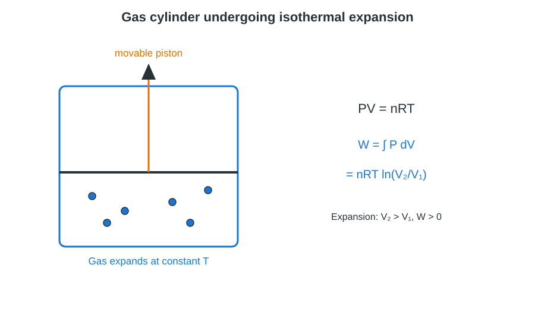

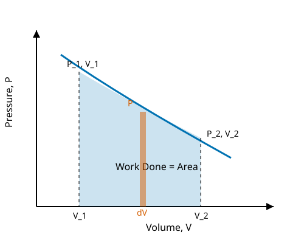

**Derivation**

Let $n_m$ be the number of moles, $T$ the constant absolute temperature, and $V_1$ and $V_2$ the initial and final volumes. The work done by the gas is

1. For a small volume change $dV$:

   $$dW=P\,dV$$

2. For an ideal gas in an isothermal process:

   $$P=\frac{n_mRT}{V}$$

3. Integrate between the initial and final volumes:

   $$W=\int_{V_1}^{V_2}P\,dV=n_mRT\int_{V_1}^{V_2}\frac{dV}{V}$$

4. Evaluate the integral:

   $$W=n_mRT\left[\ln V\right]_{V_1}^{V_2}$$

5. Hence:

   $$W=n_mRT\ln\left(\frac{V_2}{V_1}\right)$$

> [!IMPORTANT]
> $$\boxed{W_{\mathrm{by\ gas}}=n_mRT\ln\left(\frac{V_2}{V_1}\right)}$$
> The work is positive for expansion ($V_2>V_1$) and negative for compression ($V_2<V_1$).

**Worked example.** One mole of an ideal gas expands isothermally at $300\,\mathrm{K}$ from $10.0\,\mathrm{L}$ to $20.0\,\mathrm{L}$:

$$W=1(8.314)(300)\ln\left(\frac{20.0}{10.0}\right)=1.73\times10^3\,\mathrm{J}$$

The gas does approximately $1.73\,\mathrm{kJ}$ of work.

**Extra.** In a reversible isothermal expansion of an ideal gas, the internal energy depends only on temperature, so $\Delta U=0$. From the first law, heat supplied equals work done by the gas: $Q=W$.

> [!TIP]
> Use the natural logarithm, not a common logarithm. The result is for work done **by** the gas; work done **on** the gas has the opposite sign.

## 2018

### 2018 Q3(a) Heat and temperature

> Define heat and temperature.
>
> **Asked in:** 2018 Q3(a); related definitions also occur in 2016 Q5(a) and the comparison question in 2019 Q4(a).

#### Ans. to the question no. 3(a)

**Heat** is energy transferred from one body to another solely because of a temperature difference. It is energy in transit, not a property stored as “heat” in a body.

**Temperature** is a thermodynamic state variable that indicates the thermal condition of a body and determines the direction of spontaneous heat transfer. For an ideal gas it is proportional to the mean translational kinetic energy per molecule.

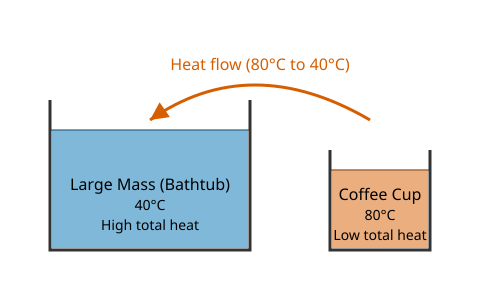

**Derivation / explanation**

1. When two bodies at different temperatures are placed in thermal contact, energy is transferred from the hotter body to the colder body until thermal equilibrium is reached:

   $$T_{\mathrm{hot}}>T_{\mathrm{cold}}\quad\Longrightarrow\quad Q_{\mathrm{hot\ to\ cold}}>0$$

2. For a body of mass $m_b$ and specific heat capacity $c_s$ undergoing a small temperature change $\Delta T$:

   $$Q=m_b c_s\Delta T$$

3. For an ideal gas, the mean translational kinetic energy per molecule is:

   $$\overline{\epsilon}=\frac{3}{2}kT$$

> [!IMPORTANT]
> **Heat is energy transfer (joule, J); temperature is a state variable (kelvin, K).** Heat flows spontaneously from higher temperature to lower temperature.

**Worked example.** Heating $0.100\,\mathrm{kg}$ of water from $20^\circ\mathrm{C}$ to $30^\circ\mathrm{C}$, using $c_s=4180\,\mathrm{J\,kg^{-1}\,K^{-1}}$:

$$Q=0.100(4180)(10)=4180\,\mathrm{J}=4.18\,\mathrm{kJ}$$

The temperature rise is $10\,\mathrm{K}$; the transferred heat is $4.18\,\mathrm{kJ}$.

**Extra.** Heat transfer can change internal energy, perform work, or both. For a closed system using the convention that $W$ is work done by the system:

$$\Delta Q=\Delta U+W$$

> [!TIP]
> Do not define heat as the temperature of a body. Heat is measured in joules, while temperature is measured in kelvin; a larger amount of heat does not necessarily mean a higher final temperature.

### 2018 Q3(b) Pressure-kinetic-energy relation

> Show that the pressure of a perfect gas is two-thirds of the kinetic energy of the gas molecules per unit volume.
>
> **Asked in:** 2018 Q3(b); same derivation as 2016 Q3(b), also used in 2019 Q6.

#### Ans. to the question no. 3(b)

Same as [2016 Q3(b)](#2016-q3b-pressure-and-translational-kinetic-energy).

### 2018 Q3(c) Newton's law of cooling

> State Newton's law of cooling.
>
> **Asked in:** 2018 Q3(c); same law and derivation as 2016 Q3(a).

#### Ans. to the question no. 3(c)

Same as [2016 Q3(a)](#2016-q3a-newtons-law-of-cooling).

### 2018 Q5(a) Degrees of freedom and van der Waals equation

> What is degree of freedom? State the van der Waals equation.
>
> **Asked in:** 2018 Q5(a); the van der Waals equation was first stated in 2016 Q5(a).

#### Ans. to the question no. 5(a)

The **degree of freedom** of a molecule is the number of independent coordinates or modes of motion required to specify its configuration and motion. At ordinary temperatures, a monatomic molecule has 3, a diatomic molecule has 5, and a non-linear polyatomic molecule has 6 active mechanical degrees of freedom.

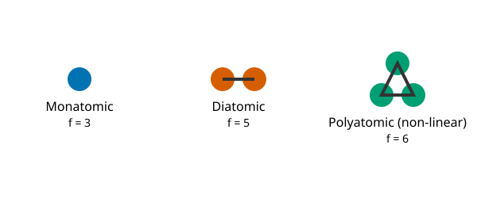

The van der Waals equation is the same equation given in [2016 Q5(a)](#2016-q5a-temperature-and-van-der-waals-equation):

$$\boxed{\left(P+a\frac{n_m^2}{V^2}\right)(V-n_m b)=n_mRT}$$

**Derivation / explanation**

1. Translational motion is possible independently along the three Cartesian axes:

   $$f_{\mathrm{trans}}=3$$

2. A diatomic molecule at ordinary temperatures has two active rotations about axes perpendicular to its bond, in addition to translation:

   $$f_{\mathrm{diatomic}}=3+2=5$$

3. A non-linear polyatomic molecule has three independent rotations as well as three translations:

   $$f_{\mathrm{nonlinear}}=3+3=6$$

> [!IMPORTANT]
> $$\boxed{f_{\mathrm{mono}}=3,\qquad f_{\mathrm{diatomic}}=5,\qquad f_{\mathrm{nonlinear}}=6}$$
> The van der Waals equation includes attraction ($a$) and excluded-volume ($b$) corrections.

**Worked example.** Nitrogen is diatomic. At ordinary temperatures its active degrees of freedom are $f=5$. For one mole at $300\,\mathrm{K}$, its ideal-gas internal energy is

$$U=\frac{f}{2}RT=\frac{5}{2}(8.314)(300)=6.24\times10^3\,\mathrm{J\,mol^{-1}}$$

**Extra.** By equipartition, each active quadratic degree of freedom contributes $\tfrac12 kT$ per molecule (or $\tfrac12 RT$ per mole). Thus, for an ideal gas:

$$U=\frac{f}{2}n_mRT,\qquad C_V=\frac{f}{2}R,\qquad \gamma=\frac{C_P}{C_V}=1+\frac{2}{f}$$

> [!TIP]
> A diatomic molecule has 5 active degrees of freedom at ordinary temperatures, not 6. Do not include vibration unless the temperature is high enough for vibrational modes to be excited.

### 2018 Q5(b) Critical constants from van der Waals constants

> Deduce the values of the van der Waals constants. (Here the required reading is to derive the critical constants $V_c=3b$, $P_c=a/(27b^2)$ and $T_c=8a/(27bR)$, and hence $a=3P_cV_c^2$ and $b=V_c/3$.)
>
> **Asked in:** 2018 Q5(b), 2020 Q4(a).

#### Ans. to the question no. 5(b)

The **critical constants** are the critical temperature $T_c$, critical pressure $P_c$ and critical molar volume $V_c$ at the critical point, where the liquid and gas phases become indistinguishable. For one mole, the van der Waals equation is

$$P=\frac{RT}{V_m-b}-\frac{a}{V_m^2}$$

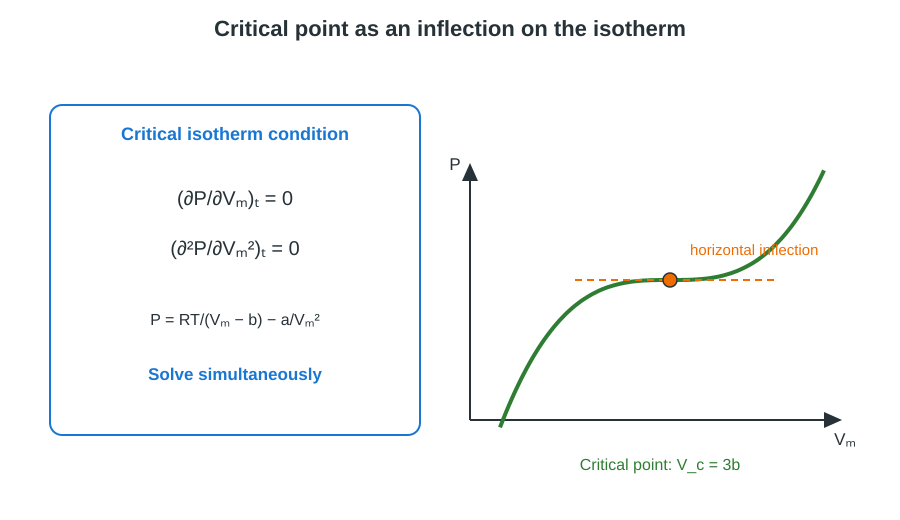


**Derivation**

At the critical point, the critical isotherm has a horizontal point of inflection. Therefore,

1. First derivative condition:

   $$\left(\frac{\partial P}{\partial V_m}\right)_T=-\frac{RT}{(V_m-b)^2}+\frac{2a}{V_m^3}=0$$

2. Second derivative condition:

   $$\left(\frac{\partial^2P}{\partial V_m^2}\right)_T=\frac{2RT}{(V_m-b)^3}-\frac{6a}{V_m^4}=0$$

3. At the critical point, divide the second condition by the first condition after rearranging to eliminate $RT$:

   $$\frac{2}{V_c-b}=\frac{6}{2V_c}\quad\Longrightarrow\quad V_c=3b$$

4. Substitute $V_c=3b$ into the first derivative condition:

   $$RT_c=\frac{2a(V_c-b)^2}{V_c^3}=\frac{8a}{27b}$$

5. Hence the critical temperature is:

   $$T_c=\frac{8a}{27Rb}$$

6. Substitute $V_c=3b$ and $T_c=8a/(27Rb)$ into the van der Waals equation:

   $$P_c=\frac{RT_c}{V_c-b}-\frac{a}{V_c^2}=\frac{a}{27b^2}$$

7. Rearranging the critical relations gives the constants in terms of measurable critical values:

   $$a=3P_cV_c^2,\qquad b=\frac{V_c}{3}$$

> [!IMPORTANT]
> $$\boxed{V_c=3b,\qquad P_c=\frac{a}{27b^2},\qquad T_c=\frac{8a}{27Rb}}$$
> $$\boxed{a=3P_cV_c^2,\qquad b=\frac{V_c}{3}}$$

**Worked example (CO₂-like van der Waals parameters).** Take $a=0.364\,\mathrm{Pa\,m^6\,mol^{-2}}$ and $b=4.27\times10^{-5}\,\mathrm{m^3\,mol^{-1}}$.

$$V_c=3b=1.281\times10^{-4}\,\mathrm{m^3\,mol^{-1}}$$

$$P_c=\frac{0.364}{27(4.27\times10^{-5})^2}=7.39\times10^6\,\mathrm{Pa}=7.39\,\mathrm{MPa}$$

$$T_c=\frac{8(0.364)}{27(4.27\times10^{-5})(8.314)}=303.8\,\mathrm{K}$$

These are the approximate critical values predicted by the stated van der Waals parameters.

**Extra.** The van der Waals critical compressibility factor is

$$Z_c=\frac{P_cV_c}{RT_c}=\frac{3}{8}=0.375$$

> [!TIP]
> Use molar volume $V_m$ in the one-mole equation. The second derivative must also be zero at the critical point; using only the first derivative is insufficient to determine all three critical constants.

### 2018 Q5(c) Adiabatic and isothermal curves

> Show that the adiabatic curves are higher (steeper) than the isothermal curves.
>
> **Asked in:** 2018 Q5(c), 2022 Q5(b), 2023 Q5(a).

#### Ans. to the question no. 5(c)

An **isothermal process** has constant temperature and obeys $PV=\text{constant}$ for an ideal gas. An **adiabatic process** involves no heat transfer and obeys $PV^\gamma=\text{constant}$ for a reversible ideal-gas process, where $\gamma=C_P/C_V>1$.

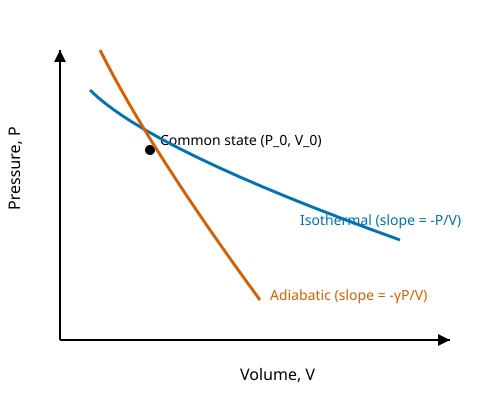

**Derivation**

Let $P$ and $V$ be pressure and volume at a common state, and $\gamma>1$ the adiabatic index.

1. For an isothermal curve, $PV=C$:

   $$P=\frac{C}{V}$$

2. Differentiate with respect to volume:

   $$\left(\frac{dP}{dV}\right)_{\mathrm{iso}}=-\frac{P}{V}$$

3. For a reversible adiabatic curve, $PV^\gamma=C'$:

   $$P=C'V^{-\gamma}$$

4. Differentiate:

   $$\left(\frac{dP}{dV}\right)_{\mathrm{ad}}=-\gamma\frac{P}{V}$$

5. Compare the magnitudes of the slopes at the same state:

   $$\left|\frac{dP}{dV}\right|_{\mathrm{ad}}=\gamma\left|\frac{dP}{dV}\right|_{\mathrm{iso}}>\left|\frac{dP}{dV}\right|_{\mathrm{iso}}$$

> [!IMPORTANT]
> $$\boxed{\left(\frac{dP}{dV}\right)_{\mathrm{ad}}=-\gamma\frac{P}{V},\qquad \left(\frac{dP}{dV}\right)_{\mathrm{iso}}=-\frac{P}{V}}$$
> The adiabat is steeper because $\gamma>1$. For the paper's word “higher”: to the **left** of the common state (compression), the adiabat lies above the isotherm; to the **right** (expansion), it lies below the isotherm.

**Worked example.** At a common state $P=100\,\mathrm{kPa}$ and $V=0.010\,\mathrm{m^3}$, let $\gamma=1.4$:

$$\left(\frac{dP}{dV}\right)_{\mathrm{iso}}=-\frac{100000}{0.010}=-1.00\times10^7\,\mathrm{Pa\,m^{-3}}$$

$$\left(\frac{dP}{dV}\right)_{\mathrm{ad}}=-1.4\frac{100000}{0.010}=-1.40\times10^7\,\mathrm{Pa\,m^{-3}}$$

The adiabatic slope magnitude is 1.4 times larger.

**Extra.** For a diatomic ideal gas at ordinary temperatures, $f=5$, so $\gamma=1+2/f=7/5=1.4$. This explains the common value used in the numerical example.

> [!TIP]
> “Higher” depends on which side of the common state is considered. The safest proof is to compare slope magnitudes and then state compression and expansion separately.

### 2018 Q6(a) Degrees of freedom and postulates

> Define degrees of freedom. Describe the fundamental postulates of gas molecules.
>
> **Asked in:** 2018 Q6(a), 2023 Q7(a); the degree-of-freedom definition is also in 2018 Q5(a).

#### Ans. to the question no. 6(a)

The degrees of freedom are the independent coordinates or modes of motion needed to describe a molecule. The standard kinetic theory of an ideal gas is based on the following postulates.

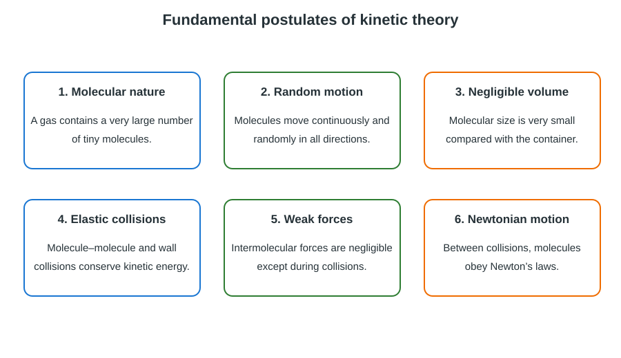

**Fundamental postulates**

1. A gas consists of a very large number of tiny molecules, treated as identical particles for a given gas.
2. The molecules are in continuous, random motion in all directions. Their motion is governed by Newton's laws between collisions.
3. The actual volume of the molecules is negligible compared with the volume occupied by the gas.
4. Intermolecular forces are negligible except during collisions; molecules move in straight lines between collisions.
5. Collisions between molecules and between molecules and the container walls are perfectly elastic. Total kinetic energy is conserved in a collision.
6. Collision duration is negligible compared with the time between collisions. Gas pressure arises from molecular impacts on the container walls.

> [!IMPORTANT]
> The ideal-gas kinetic model assumes random Newtonian motion, negligible molecular volume and intermolecular force between collisions, and perfectly elastic collisions.

**Worked example.** One mole of nitrogen at ordinary temperature is modelled as a collection of diatomic molecules. Its active degrees of freedom are $f=5$; the equipartition estimate at $300\,\mathrm{K}$ is $U=(5/2)RT=6.24\,\mathrm{kJ\,mol^{-1}}$.

**Extra.** For a dilute gas, the molecular pressure is due to momentum transfer at the container walls. The isotropic distribution of molecular velocities makes the mean square components equal:

$$\overline{c_x^2}=\overline{c_y^2}=\overline{c_z^2}=\frac13\overline{c^2}$$

> [!TIP]
> Do not say molecules are stationary between collisions; they move continuously. “Elastic” means kinetic energy is conserved in each ideal collision, not that every molecule has the same speed.

### 2018 Q6(b) Mean free path

> What is mean free path? Derive an expression for the mean free path.
>
> **Asked in:** 2018 Q6(b), 2019 Q5(a), 2020 Q5(a), 2022 Q4(b), 2023 Q7(b).

#### Ans. to the question no. 6(b)

The **mean free path** $\lambda$ is the average distance travelled by a gas molecule between two successive collisions.

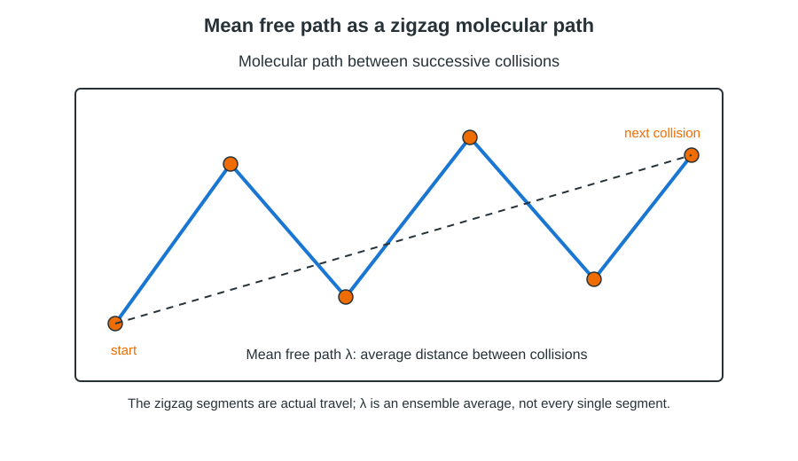

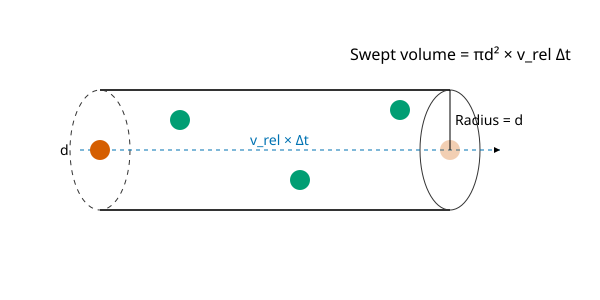

**Derivation**

Let $d$ be the molecular diameter, $n=N/V$ the number of molecules per unit volume, and $\bar c$ the mean molecular speed.

1. In time $t$, a molecule moving at speed $\bar c$ travels distance $\bar c t$. Its collision cross-section is $\pi d^2$.

   $$\text{Swept volume}=\pi d^2\bar c t$$

2. If all other molecules were at rest, the number of molecular centres swept out would be $n\pi d^2\bar c t$. Thus the collision frequency in that stationary-target approximation would be:

   $$z_0=n\pi d^2\bar c$$

3. In a real gas, the other molecules also move. The mean relative speed is $\sqrt2$ times the mean speed for a Maxwellian gas, so the collision frequency is:

   $$z=\sqrt2\,n\pi d^2\bar c$$

4. Mean free path is distance travelled per collision frequency:

   $$\lambda=\frac{\bar c}{z}$$

5. Substitute $z$:

   $$\lambda=\frac{\bar c}{\sqrt2\,n\pi d^2\bar c}$$

> [!IMPORTANT]
> $$\boxed{\lambda=\frac{1}{\sqrt2\,\pi d^2n}}$$
> The factor $\sqrt2$ accounts for the motion of both the molecule being followed and its collision partners.

**Worked example.** For air, take $d=3.7\times10^{-10}\,\mathrm{m}$ and $n=2.5\times10^{25}\,\mathrm{m^{-3}}$:

$$\lambda=\frac{1}{\sqrt2\pi(3.7\times10^{-10})^2(2.5\times10^{25})}=6.58\times10^{-8}\,\mathrm{m}$$

**Extra.** If the relative-motion correction is omitted, the simpler stationary-target estimate is $\lambda_0=1/(\pi d^2n)$, which is $\sqrt2$ times larger than the correct mean free path. Use the $\sqrt2$ form for the gas at equilibrium.

> [!TIP]
> Convert number density to m⁻³ before substituting. The cross-section is $\pi d^2$ (not $\pi d$), and the correct equilibrium result includes $\sqrt2$ in the denominator.

### 2018 Q6(c) Nitrogen molecular diameter

> The mean free path of a nitrogen molecule at $0^\circ\mathrm{C}$ and 1 atm is $0.8\times10^{-7}\,\mathrm{m}$. At this temperature and pressure its density is $2.7\times10^{19}$ molecules/cm³. Find the molecular diameter.
>
> **Asked in:** 2018 Q6(c), 2023 Q7(c). The numerical is fully worked in both years.

#### Ans. to the question no. 6(c)

Use the mean-free-path expression with the relative-velocity correction:

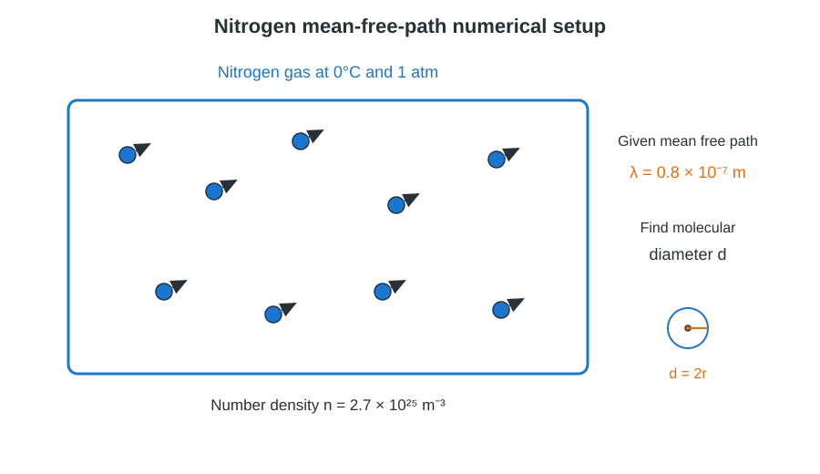

**Given**

- $\lambda=0.8\times10^{-7}\,\mathrm{m}$.
- $n=2.7\times10^{19}\,\mathrm{cm^{-3}}$.
- $1\,\mathrm{cm^{-3}}=10^6\,\mathrm{m^{-3}}$.

**Formula**

$$\lambda=\frac{1}{\sqrt2\pi d^2n}\quad\Longrightarrow\quad d=\sqrt{\frac{1}{\sqrt2\pi n\lambda}}$$

**Substitution with units**

1. Convert the number density:

   $$n=2.7\times10^{19}\times10^6=2.7\times10^{25}\,\mathrm{m^{-3}}$$

2. Calculate the squared diameter:

   $$d^2=\frac{1}{(1.414)(3.1416)(2.7\times10^{25})(0.8\times10^{-7})}$$

   $$d^2\approx1.04\times10^{-19}\,\mathrm{m^2}$$

3. Take the square root:

   $$d=\sqrt{1.04\times10^{-19}}\approx3.2\times10^{-10}\,\mathrm{m}$$

> [!IMPORTANT]
> $$\boxed{d\approx3.2\times10^{-10}\,\mathrm{m}=3.2\,\text{Å}}$$

**Worked example.** The calculation above is the worked numerical for the stated nitrogen sample. As a check, inserting $d=3.2\times10^{-10}\,\mathrm{m}$ and $n=2.7\times10^{25}\,\mathrm{m^{-3}}$ into $\lambda=1/(\sqrt2\pi d^2n)$ returns approximately $0.8\times10^{-7}\,\mathrm{m}$.

**Extra.** If the simpler stationary-target formula $\lambda=1/(\pi d^2n)$ is used, the diameter is

$$d_0=\sqrt{\frac{1}{\pi n\lambda}}\approx3.8\times10^{-10}\,\mathrm{m}$$

This is larger by a factor of $2^{1/4}$; the $\sqrt2$ relative-velocity form is the correct expression for a gas in which all molecules move.

> [!TIP]
> The density is given per cm³, so multiply by $10^6$ to convert to m⁻³. Do not drop the $\sqrt2$ factor; the expected answer is approximately $3.2\times10^{-10}\,\mathrm{m}$.

## 2019

### 2019 Q4(a) Heat versus temperature

> Differentiate between heat and temperature.
>
> **Asked in:** 2019 Q4(a); definitions appear in 2016 Q5(a) and 2018 Q3(a).

#### Ans. to the question no. 4(a)

| Heat | Temperature |
|---|---|
| Heat is energy transferred because of a temperature difference. | Temperature is a thermodynamic state variable that indicates the thermal condition of a body. |
| It is energy in transit, not a property stored in a body. | It is a property of the state of a body. |
| SI unit is joule (J). | SI unit is kelvin (K). |
| It depends on the amount of substance and the process. | It does not depend on the amount of substance; it is an intensive property. |
| It flows spontaneously from higher temperature to lower temperature. | It determines the direction of spontaneous heat transfer. |
| For sensible heating, $Q=mc\Delta T$. | For an ideal gas, $\overline{\epsilon}=\frac32 kT$. |


**Derivation / explanation**

1. A temperature difference establishes the direction of spontaneous heat transfer:

   $$T_h>T_c\quad\Rightarrow\quad Q\text{ flows from }h\text{ to }c$$

2. For a body with mass $m$, specific heat capacity $c$ and temperature change $\Delta T$:

   $$Q=mc\Delta T$$

3. For an ideal gas, temperature is related to the average translational kinetic energy per molecule:

   $$\overline{\epsilon}=\frac{3}{2}kT$$

> [!IMPORTANT]
> **Heat is transferred energy; temperature is a measure of thermal state.** The two quantities are not interchangeable.

**Worked example.** A $0.20\,\mathrm{kg}$ metal block of specific heat capacity $450\,\mathrm{J\,kg^{-1}\,K^{-1}}$ is heated from $25^\circ\mathrm{C}$ to $75^\circ\mathrm{C}$:

$$Q=mc\Delta T=0.20(450)(50)=4500\,\mathrm{J}$$

The temperature change is $50\,\mathrm{K}$; the energy transferred is $4.50\,\mathrm{kJ}$.

**Extra.** Heat is path-dependent, whereas temperature is a state variable. Two bodies can have the same temperature but different internal energies and can require different amounts of heat to undergo the same temperature rise.

> [!TIP]
> Do not say that a body “contains heat”; it contains internal energy. Heat is the energy transferred during a process, while temperature is measured at a state.

### 2019 Q4(b) Mayer's relation: Cp minus Cv

> Show that the difference between the specific heats at constant pressure and constant volume of a gas equals the characteristic gas constant of the gas.
>
> **Asked in:** 2019 Q4(b); the molar form is also requested in 2020 Q5(c).

#### Ans. to the question no. 4(b)

For an ideal gas, the difference between the specific heats per unit mass is the specific gas constant:

$$c_p-c_v=r=\frac{R}{M}$$

For molar heat capacities:

$$C_P-C_V=R$$

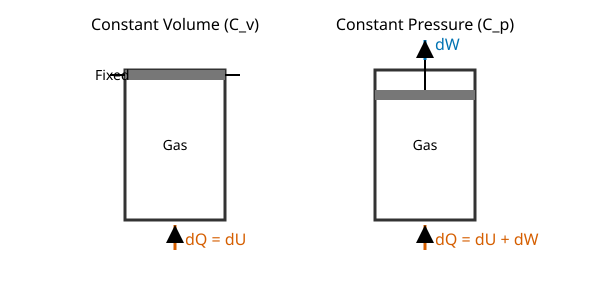

**Derivation**

Let one mole of an ideal gas be heated through a small temperature rise $dT$. $C_V$ and $C_P$ are its molar heat capacities, and $R$ is the universal gas constant.

1. At constant volume, $dV=0$, so no external work is done. From the first law:

   $$dQ_V=dU=C_V\,dT$$

2. At constant pressure, the first law gives:

   $$dQ_P=dU+P\,dV=C_V\,dT+P\,dV$$

3. From the ideal-gas equation for one mole, $PV=RT$. At constant pressure:

   $$P\,dV=R\,dT$$

4. Since $dQ_P=C_PdT$, substitute the preceding result:

   $$C_PdT=C_VdT+R dT$$

5. Divide by $dT$:

   $$C_P-C_V=R$$

6. Divide by molar mass $M$ to express the result per unit mass:

   $$c_p-c_v=\frac{R}{M}=r$$

> [!IMPORTANT]
> $$\boxed{C_P-C_V=R\quad\text{(per mole)}}$$
> $$\boxed{c_p-c_v=r=\frac{R}{M}\quad\text{(per unit mass)}}$$

**Worked example.** For nitrogen at ordinary temperatures, take $f=5$. Then

$$C_V=\frac52R=20.8\,\mathrm{J\,mol^{-1}\,K^{-1}}$$

$$C_P=\frac72R=29.1\,\mathrm{J\,mol^{-1}\,K^{-1}}$$

Therefore $C_P-C_V=8.31\,\mathrm{J\,mol^{-1}\,K^{-1}}=R$.

**Extra.** The ratio of specific heats is

$$\gamma=\frac{C_P}{C_V}=1+\frac{R}{C_V}$$

For a gas with $f$ active quadratic degrees of freedom, equipartition gives $C_V=(f/2)R$ and $\gamma=1+2/f$.

> [!TIP]
> Do not confuse molar heat capacities ($C_P,C_V$) with mass-specific heat capacities ($c_p,c_v$). The right-hand side is $R$ for the molar form and $r=R/M$ for the mass-specific form.

### 2019 Q5(a) Mean free path and degrees of freedom

> Define mean free path and degrees of freedom.
>
> **Asked in:** 2019 Q5(a); both definitions have full solutions earlier in 2018.

#### Ans. to the question no. 5(a)

Same as [2018 Q6(b)](#2018-q6b-mean-free-path) for mean free path and [2018 Q5(a)](#2018-q5a-degrees-of-freedom-and-van-der-waals-equation) for degrees of freedom.

### 2019 Q5(b) Average kinetic energy at 300 K

> Calculate the average kinetic energy of a molecule of gas at $300\,\mathrm{K}$.
>
> **Asked in:** 2019 Q5(b), 2021 Q5(c).

#### Ans. to the question no. 5(b)

The average translational kinetic energy of one ideal-gas molecule is

$$\overline{E_k}=\frac{3}{2}kT$$

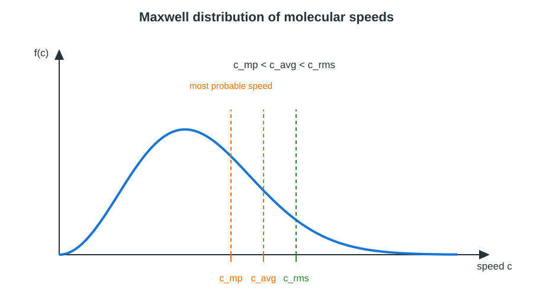

**Given**

- $T=300\,\mathrm{K}$.
- $k=1.38\times10^{-23}\,\mathrm{J\,K^{-1}}$.

**Formula**

$$\overline{E_k}=\frac{3}{2}kT$$

**Substitution with units**

$$\overline{E_k}=\frac32(1.38\times10^{-23})(300)\,\mathrm{J}$$

$$\overline{E_k}=6.21\times10^{-21}\,\mathrm{J}$$

Convert to electronvolts using $1\,\mathrm{eV}=1.602\times10^{-19}\,\mathrm{J}$:

$$\overline{E_k}=\frac{6.21\times10^{-21}}{1.602\times10^{-19}}\,\mathrm{eV}=0.0388\,\mathrm{eV}$$

> [!IMPORTANT]
> $$\boxed{\overline{E_k}=6.21\times10^{-21}\,\mathrm{J}\approx0.039\,\mathrm{eV\ per\ molecule}}$$

**Worked example.** The numerical above is the full result at $300\,\mathrm{K}$. At $600\,\mathrm{K}$, the average translational energy would be twice as large because it is directly proportional to absolute temperature:

$$\overline{E_k}=\frac32k(600)=1.24\times10^{-20}\,\mathrm{J}$$

**Extra.** The characteristic speeds in a Maxwell distribution are

$$c_{mp}=\sqrt{\frac{2kT}{m}},\qquad c_{avg}=\sqrt{\frac{8kT}{\pi m}},\qquad c_{rms}=\sqrt{\frac{3kT}{m}}$$

They satisfy $c_{mp}<c_{avg}<c_{rms}$; these speeds are not equal to one another.

> [!TIP]
> Use $T$ in kelvin and $k$ in joules per kelvin. The expression $\frac32kT$ is the average **translational** energy per molecule, not the total energy of a mole.

### 2019 Q6 Pressure from kinetic theory

> According to the kinetic theory of gases prove $P=\frac13\frac{mn c^2}{V}$, where the symbols have their usual meaning.
>
> **Asked in:** 2019 Q6; same kinetic-theory derivation as 2016 Q3(b), with notation clarified.

#### Ans. to the question no. 6

Same as [2016 Q3(b)](#2016-q3b-pressure-and-translational-kinetic-energy). In unambiguous notation, the relation is

$$P=\frac13\frac{mN}{V}\overline{c^2}$$

where $N$ is the number of molecules and $\overline{c^2}$ is the mean square speed. The question's compact symbols are interpreted in this standard form.

## 2020

### 2020 Q4(a) Critical constants

> What are the critical constants of a gas? Calculate their values in terms of the van der Waals constants.
>
> **Asked in:** 2020 Q4(a); same derivation as 2018 Q5(b).

#### Ans. to the question no. 4(a)

The critical constants are the critical temperature, critical pressure and critical molar volume. Their van der Waals values are

$$V_c=3b,\qquad P_c=\frac{a}{27b^2},\qquad T_c=\frac{8a}{27Rb}$$

Same as [2018 Q5(b)](#2018-q5b-critical-constants-from-van-der-waals-constants) for the full derivation and CO₂-like worked check.

### 2020 Q4(b) Platinum resistance thermometer

> Describe the principle of a platinum resistance thermometer. Discuss its advantages and disadvantages.
>
> **Asked in:** 2020 Q4(b), followed by the numerical in 2020 Q4(c).

#### Ans. to the question no. 4(b)

A **platinum resistance thermometer (PRT)** works on the principle that the electrical resistance of a platinum wire changes reproducibly with temperature. The resistance of a fine platinum coil placed in the body whose temperature is to be measured is determined using a resistance-measuring circuit, commonly a Wheatstone bridge. The measured resistance is converted to temperature using calibration data.

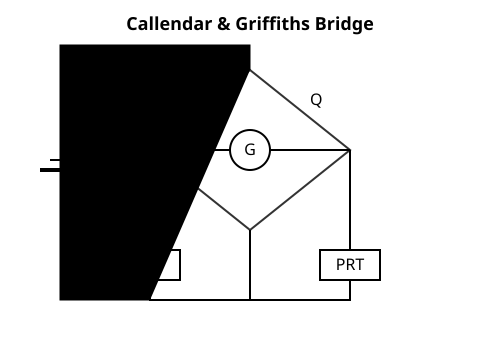

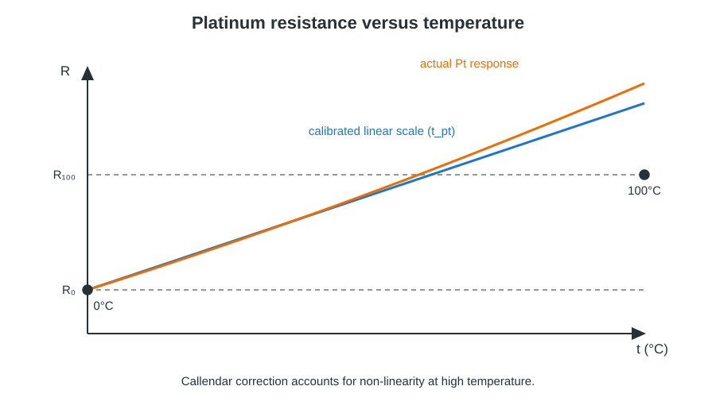

**Principle / derivation**

1. Let $R_0$ be the platinum resistance at $0^\circ\mathrm{C}$ and $R_{100}$ the resistance at $100^\circ\mathrm{C}$. The platinum thermometer scale reading at resistance $R_t$ is defined by linear interpolation:

   $$t_{pt}=100\frac{R_t-R_0}{R_{100}-R_0}$$

2. The bridge is balanced (or a calibrated resistance instrument is used) to determine the unknown coil resistance $R_t$.

   $$\frac{R_t-R_0}{R_{100}-R_0}=\frac{t_{pt}}{100}$$

3. At high temperatures the resistance-temperature relation is not perfectly linear. The Callendar correction is therefore applied when converting the platinum scale to the gas scale.

   $$t-t_{pt}=\delta\left[\left(\frac{t}{100}\right)^2-\frac{t}{100}\right]$$

> [!IMPORTANT]
> The PRT measures temperature by measuring the resistance of platinum. Its fixed-point-calibrated scale is corrected for non-linearity when high-temperature accuracy is required.

**Advantages**

- Platinum is chemically stable and has a reproducible resistance-temperature relation.
- The thermometer is sensitive and can measure small temperature changes.
- It can be calibrated accurately and used for remote electrical measurement.
- It is suitable over a broad temperature range compared with many liquid-in-glass thermometers.

**Disadvantages**

- The platinum element and associated measuring circuit are comparatively expensive.
- The fine wire or coil can be fragile and may be damaged by shock or vibration.
- Lead-wire resistance and electrical self-heating can introduce errors unless controlled.
- Its resistance-temperature relation is not perfectly linear, so calibration/correction is required.

**Worked example.** Suppose $R_0=2.585\,\Omega$, $R_{100}=3.510\,\Omega$ and $R_t=3.100\,\Omega$. The platinum scale reads

$$t_{pt}=100\frac{3.100-2.585}{3.510-2.585}=55.7^\circ\mathrm{C}$$

**Extra.** The Callendar correction is especially important when the thermometer is used well above its two calibration fixed points. The coefficient $\delta$ is a calibration constant for the particular platinum thermometer.

> [!TIP]
> State the resistance principle, the bridge measurement and the calibration formula. Do not claim that resistance is perfectly linear with temperature over the full operating range.

### 2020 Q4(c) Platinum thermometer numerical

> The resistances of a platinum thermometer are $2.585\,\Omega$ at $0^\circ\mathrm{C}$ and $3.510\,\Omega$ at $100^\circ\mathrm{C}$. In a hot bath it reads $9.098\,\Omega$. Find the temperature of the bath on the gas scale, taking $\delta=1.5$ for platinum.
>
> **Asked in:** 2020 Q4(c) only.

#### Ans. to the question no. 4(c)

The gas-scale temperature is found by first calculating the platinum scale reading and then applying the Callendar correction.


**Given**

- $R_0=2.585\,\Omega$ at $0^\circ\mathrm{C}$.
- $R_{100}=3.510\,\Omega$ at $100^\circ\mathrm{C}$.
- $R_t=9.098\,\Omega$.
- $\delta=1.5$.

**Formula**

$$t_{pt}=100\frac{R_t-R_0}{R_{100}-R_0}$$

$$t-t_{pt}=\delta\left[\left(\frac{t}{100}\right)^2-\frac{t}{100}\right]$$

**Substitution with units**

1. Platinum-scale reading:

   $$t_{pt}=100\frac{9.098-2.585}{3.510-2.585}=704.1^\circ\mathrm{C}$$

2. Put $x=t/100$. Then $t=100x$, and substitute $t_{pt}=704.1$ and $\delta=1.5$:

   $$100x-704.1=1.5(x^2-x)$$

3. Rearrange into a quadratic:

   $$1.5x^2-101.5x+704.1=0$$

4. Apply the quadratic formula:

   $$x=\frac{101.5\pm\sqrt{101.5^2-4(1.5)(704.1)}}{3}$$

5. The two roots are approximately:

   $$x_1=7.847,\qquad x_2=59.820$$

6. The smaller root gives the physically relevant gas-scale temperature:

   $$t=100x_1=784.7^\circ\mathrm{C}\approx785^\circ\mathrm{C}$$

7. Convert to kelvin:

   $$T=784.7+273.15=1057.9\,\mathrm{K}\approx1058\,\mathrm{K}$$

> [!IMPORTANT]
> $$\boxed{t\approx785^\circ\mathrm{C}\quad\text{or}\quad T\approx1058\,\mathrm{K}}$$
> The larger root, $x_2\approx59.820$ (about $5982^\circ\mathrm{C}$), is rejected because it lies far outside the useful temperature range and calibration/model validity of a platinum resistance thermometer.

**Worked example.** The above calculation is the complete numerical solution. A useful check is that the linear platinum-scale reading is $704.1^\circ\mathrm{C}$ and the Callendar correction raises it to approximately $784.7^\circ\mathrm{C}$ for $\delta=1.5$.

**Extra.** The Callendar equation is an empirical correction; it should be used with the coefficient supplied for the thermometer. The smaller root is selected because the mathematical quadratic may have an additional root outside the physical/calibrated domain.

> [!TIP]
> Calculate $t_{pt}$ first, then solve the quadratic. Do not take both roots as valid thermometer readings; show the rejected root and explain why the calibration model cannot be extrapolated to it.

### 2020 Q5(a) Mean free path

> What is mean free path? Derive an expression for the mean free path.
>
> **Asked in:** 2020 Q5(a); same derivation as 2018 Q6(b).

#### Ans. to the question no. 5(a)

Same as [2018 Q6(b)](#2018-q6b-mean-free-path).

### 2020 Q5(b) Newton's law of cooling

> State and explain Newton's law of cooling.
>
> **Asked in:** 2020 Q5(b); same statement, derivation, graph and example as 2016 Q3(a).

#### Ans. to the question no. 5(b)

Same as [2016 Q3(a)](#2016-q3a-newtons-law-of-cooling).

### 2020 Q5(c) Molar specific heat and Cp-Cv

> Define molar specific heat. Find the relation between $C_P$ and $C_V$.
>
> **Asked in:** 2020 Q5(c); the relation is derived in 2019 Q4(b).

#### Ans. to the question no. 5(c)

**Molar specific heat** is the amount of heat required to raise the temperature of one mole of a substance by one kelvin under a specified condition. $C_V$ is the molar specific heat at constant volume; $C_P$ is the molar specific heat at constant pressure.


The relation is Mayer's relation:

> [!IMPORTANT]
> $$\boxed{C_P-C_V=R}$$

Same as [2019 Q4(b)](#2019-q4b-mayers-relation-cp-minus-cv) for the complete first-law derivation and its nitrogen example.

**Worked example.** For one mole of nitrogen at ordinary temperature, take $f=5$. Then

$$C_V=\frac52R=20.8\,\mathrm{J\,mol^{-1}\,K^{-1}}$$

$$C_P=C_V+R=29.1\,\mathrm{J\,mol^{-1}\,K^{-1}}$$

Therefore, $C_P-C_V=8.31\,\mathrm{J\,mol^{-1}\,K^{-1}}=R$.

**Extra.** The heat-capacity difference per unit mass is $c_p-c_v=r=R/M$, where $M$ is molar mass. For a gas with $f$ active quadratic degrees of freedom, equipartition gives $C_V=(f/2)R$ and $\gamma=C_P/C_V=1+2/f$.

> [!TIP]
> “Molar” means per mole, so use $R$ in $C_P-C_V=R$. For mass-specific heat capacities, use the specific gas constant $r=R/M$ instead.

## 2021

### 2021 Q5(b) Isothermal work

> What is an isothermal process? Derive the work done during an isothermal process.
>
> **Asked in:** 2021 Q5(b); same derivation as 2017 Q6(b).

#### Ans. to the question no. 5(b)

Same as [2017 Q6(b)](#2017-q6b-isothermal-work).

### 2021 Q5(c) Average kinetic energy at 300 K

> Calculate the average kinetic energy of a molecule of a gas at $300\,\mathrm{K}$.
>
> **Asked in:** 2021 Q5(c); same numerical as 2019 Q5(b).

#### Ans. to the question no. 5(c)

Same as [2019 Q5(b)](#2019-q5b-average-kinetic-energy-at-300-k).

### 2021 Q6(a) Newton's law of cooling

> Explain Newton's law of cooling.
>
> **Asked in:** 2021 Q6(a); same law and derivation as 2016 Q3(a).

#### Ans. to the question no. 6(a)

Same as [2016 Q3(a)](#2016-q3a-newtons-law-of-cooling).

## 2022

### 2022 Q4(a) Work and kinetic energy

> Show that the work done is directly proportional to the kinetic energy in the kinetic theory of gases.
>
> **Asked in:** 2022 Q4(a) only. The paper's wording is read as the constant-pressure relation derived below.

#### Ans. to the question no. 4(a)

For an ideal gas, the pressure–kinetic-energy relation is $PV=\frac23E_K$, where $E_K$ is the total translational kinetic energy of all gas molecules. At constant pressure, work done by the gas is directly proportional to the change in this kinetic energy.

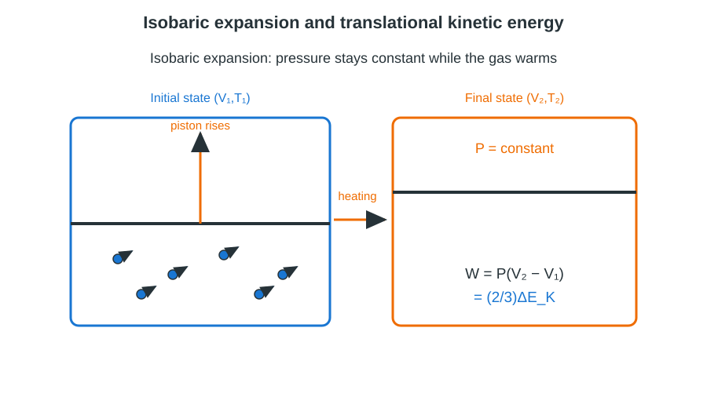

**Derivation**

1. From kinetic theory, the pressure-volume product is related to the total translational kinetic energy:

   $$PV=\frac{2}{3}E_K$$

2. For one mole of an ideal gas, $PV=RT$. Comparing gives:

   $$E_K=\frac{3}{2}RT$$

3. For an isobaric (constant-pressure) expansion, work done by the gas is:

   $$W=P\Delta V$$

4. Since the pressure is constant, take the change in $PV=\frac23E_K$:

   $$P\Delta V=\frac{2}{3}\Delta E_K$$

> [!IMPORTANT]
> $$\boxed{W=P\Delta V=\frac{2}{3}\Delta E_K\quad\text{(constant pressure)}}$$
> Thus, the work done is directly proportional to the increase in total translational kinetic energy for an isobaric expansion.

**Worked example.** One mole of an ideal gas is heated from $300\,\mathrm{K}$ to $350\,\mathrm{K}$ at constant pressure:

$$\Delta E_K=\frac32R\Delta T=\frac32(8.314)(50)=623.6\,\mathrm{J}$$

$$W=\frac23\Delta E_K=415.7\,\mathrm{J}$$

**Extra.** For one mole, the total translational kinetic energy is $E_K=\frac32RT$. For $n_m$ moles, it becomes $E_K=\frac32n_mRT$; the proportionality $W=\frac23\Delta E_K$ remains valid for constant-pressure changes of an ideal gas.

> [!TIP]
> State the required reading: this is an **isobaric** result. Do not claim $W$ is proportional to the absolute kinetic energy for every possible process; the relation shown is for constant-pressure work and changes in $E_K$.

### 2022 Q4(b) Mean free path

> What is mean free path? Derive an expression for the mean free path.
>
> **Asked in:** 2022 Q4(b); same derivation as 2018 Q6(b).

#### Ans. to the question no. 4(b)

Same as [2018 Q6(b)](#2018-q6b-mean-free-path).

### 2022 Q4(c) Degrees of freedom and Newton cooling

> What is degree of freedom? State and explain Newton's law of cooling with a graph.
>
> **Asked in:** 2022 Q4(c); degree of freedom is defined in 2018 Q5(a), and Newton's law with both cooling graphs is in 2016 Q3(a).

#### Ans. to the question no. 4(c)

Same as [2018 Q5(a)](#2018-q5a-degrees-of-freedom-and-van-der-waals-equation) for degrees of freedom and [2016 Q3(a)](#2016-q3a-newtons-law-of-cooling) for Newton's law, its derivation and graph.

### 2022 Q5(b) Adiabatic and isothermal curves

> Show that the adiabatic curves are higher (steeper) than the isothermal curves.
>
> **Asked in:** 2022 Q5(b); same proof and slope comparison as 2018 Q5(c).

#### Ans. to the question no. 5(b)

Same as [2018 Q5(c)](#2018-q5c-adiabatic-and-isothermal-curves).

## 2023

### 2023 Q5(a) Adiabatic and isothermal curves

> Show that the adiabatic curves are higher (steeper) than the isothermal curves.
>
> **Asked in:** 2023 Q5(a); same proof and clarification as 2018 Q5(c).

#### Ans. to the question no. 5(a)

Same as [2018 Q5(c)](#2018-q5c-adiabatic-and-isothermal-curves).

### 2023 Q7(a) Degrees of freedom and postulates

> Define degrees of freedom. Describe the fundamental postulates of gas molecules.
>
> **Asked in:** 2023 Q7(a); same answer as 2018 Q6(a).

#### Ans. to the question no. 7(a)

Same as [2018 Q6(a)](#2018-q6a-degrees-of-freedom-and-postulates).

### 2023 Q7(b) Mean free path

> What is mean free path? Derive an expression for the mean free path.
>
> **Asked in:** 2023 Q7(b); same derivation as 2018 Q6(b).

#### Ans. to the question no. 7(b)

Same as [2018 Q6(b)](#2018-q6b-mean-free-path).

### 2023 Q7(c) Nitrogen molecular diameter

> The mean free path of a nitrogen molecule at $0^\circ\mathrm{C}$ and 1 atm is $0.8\times10^{-7}\,\mathrm{m}$. At this temperature and pressure its density is $2.7\times10^{19}$ molecules/cm³. Find the molecular diameter.
>
> **Asked in:** 2023 Q7(c), same numerical data as 2018 Q6(c). The full working is repeated here as required for the year-specific numerical.

#### Ans. to the question no. 7(c)

Use $\lambda=1/(\sqrt2\pi d^2n)$, including the relative-velocity correction.


**Given**

- $\lambda=0.8\times10^{-7}\,\mathrm{m}$.
- $n=2.7\times10^{19}\,\mathrm{cm^{-3}}$.

**Formula**

$$d=\sqrt{\frac{1}{\sqrt2\pi n\lambda}}$$

**Substitution with units**

1. Convert the molecular number density:

   $$n=2.7\times10^{19}\,\mathrm{cm^{-3}}=2.7\times10^{25}\,\mathrm{m^{-3}}$$

2. Substitute into the expression:

   $$d^2=\frac{1}{(4.443)(2.7\times10^{25}\,\mathrm{m^{-3}})(0.8\times10^{-7}\,\mathrm{m})}$$

3. Simplify and take the square root:

   $$d^2\approx1.04\times10^{-19}\,\mathrm{m^2},\qquad d\approx3.2\times10^{-10}\,\mathrm{m}$$

> [!IMPORTANT]
> $$\boxed{d\approx3.2\times10^{-10}\,\mathrm{m}\approx3.2\,\text{Å}}$$

**Worked example.** Substitution of the rounded diameter back into the formula gives

$$\lambda\approx\frac{1}{\sqrt2\pi(3.2\times10^{-10})^2(2.7\times10^{25})}\approx0.8\times10^{-7}\,\mathrm{m}$$

which agrees with the stated mean free path within rounding.

**Extra.** Using the simpler formula $\lambda=1/(\pi d^2n)$ would give $d\approx3.8\times10^{-10}\,\mathrm{m}$. This is not the correct result for the equilibrium gas because it omits the $\sqrt2$ relative-speed correction.

> [!TIP]
> Convert cm⁻³ to m⁻³ before substitution and retain the square root at the end. The expected diameter with the correct relative-speed correction is about $3.2\,\text{Å}$.

## Mermaid concept map

```mermaid
flowchart TD
    A[Kinetic theory of gases] --> B[Molecular model]
    A --> C[Pressure and kinetic energy]
    A --> D[Degrees of freedom]
    A --> E[Collisions]
    A --> F[Real-gas behaviour]
    B --> B1[Random molecular motion]
    B --> B2[Elastic collisions]
    B --> B3[Negligible intermolecular forces between collisions]
    C --> C1[Wall momentum transfer]
    C1 --> C2[ P = 1/3 mn c-bar-squared ]
    C2 --> C3[ P = 2/3 E ]
    D --> D1[Equipartition]
    D1 --> D2[ Cv = fR/2 ]
    D2 --> D3[ Gamma = 1 + 2/f ]
    E --> E1[Collision cylinder]
    E1 --> E2[Mean free path]
    E2 --> E3[Lambda = 1/(sqrt(2) pi d-squared n)]
    F --> F1[Finite molecular size b]
    F --> F2[Attractive forces a]
    F1 --> F3[van der Waals equation]
    F2 --> F3
    F3 --> F4[Critical constants]
    A --> G[Thermal processes]
    G --> G1[Isothermal: PV = constant]
    G --> G2[Adiabatic: PV-gamma = constant]
    G --> G3[Newton cooling]
    G3 --> G4[Exponential approach to ambient temperature]
```

## One-page cheat sheet

### Core kinetic-theory equations

$$P=\frac13\frac{Nm}{V}\overline{c^2}=\frac13 mn\overline{c^2}=\frac23E$$

$$\overline{E_k}=\frac32kT,\qquad c_{rms}=\sqrt{\frac{3kT}{m}}$$

$$\lambda=\frac{1}{\sqrt2\pi d^2n}$$

### Degrees of freedom and heat capacities

| Gas model at ordinary temperature | $f$ | $C_V$ | $C_P$ | $\gamma$ |
|---|---:|---:|---:|---:|
| Monatomic | 3 | $3R/2$ | $5R/2$ | $5/3$ |
| Diatomic, linear | 5 | $5R/2$ | $7R/2$ | $7/5$ |
| Non-linear polyatomic | 6 | $3R$ | $4R$ | $4/3$ |

All heat capacities in this table are molar. Use $C_P-C_V=R$.

### Real gas and critical point

$$\left(P+\frac{a}{V_m^2}\right)(V_m-b)=RT$$

$$V_c=3b,\qquad P_c=\frac{a}{27b^2},\qquad T_c=\frac{8a}{27Rb},\qquad Z_c=\frac38$$

### Processes and cooling

$$W_{iso}=n_mRT\ln\left(\frac{V_2}{V_1}\right)$$

$$PV^\gamma=\mathrm{constant},\qquad \left(\frac{dP}{dV}\right)_{ad}=-\gamma\frac{P}{V}$$

$$\frac{dT}{dt}=-k(T-T_0),\qquad T=T_0+(T_i-T_0)e^{-kt}$$

### Platinum resistance thermometer

$$t_{pt}=100\frac{R_t-R_0}{R_{100}-R_0}$$

$$t-t_{pt}=\delta\left[\left(\frac{t}{100}\right)^2-\frac{t}{100}\right]$$

### Essential numerical constants

- $k=1.38\times10^{-23}\,\mathrm{J\,K^{-1}}$.
- $R=8.314\,\mathrm{J\,mol^{-1}\,K^{-1}}$.
- $1\,\mathrm{eV}=1.602\times10^{-19}\,\mathrm{J}$.
- $1\,\mathrm{cm^{-3}}=10^6\,\mathrm{m^{-3}}$.
- $1\,\text{Å}=10^{-10}\,\mathrm{m}$.

## Glossary

| Term | Meaning |
|---|---|
| Absolute temperature | Temperature measured from absolute zero on the kelvin scale. |
| Adiabatic process | Process with no heat transfer, $Q=0$. |
| Average kinetic energy | Mean translational kinetic energy per molecule, $\frac32kT$ for an ideal gas. |
| Critical constants | $T_c$, $P_c$ and $V_c$ at the critical point. |
| Degree of freedom | Independent coordinate or mode of motion of a molecule. |
| Excluded volume | Volume unavailable to molecular centres because molecules have finite size. |
| Heat | Energy transferred because of a temperature difference. |
| Isothermal process | Process at constant temperature. |
| Mean free path | Average distance travelled by a molecule between successive collisions. |
| Mean square speed | Average of the square of molecular speed, $\overline{c^2}$. |
| Number density | Number of molecules per unit volume, $n=N/V$. |
| Platinum scale temperature | Resistance-interpolated temperature $t_{pt}$ before high-temperature correction. |
| RMS speed | Root-mean-square molecular speed, $c_{rms}=\sqrt{\overline{c^2}}$. |
| Specific heat | Heat required per unit mass per unit temperature rise under a stated condition. |
| Molar specific heat | Heat required per mole per kelvin under a stated condition. |
| Temperature | Thermodynamic state variable determining the direction of heat transfer. |
| van der Waals constant $a$ | Parameter representing the effect of intermolecular attraction. |
| van der Waals constant $b$ | Parameter representing finite molecular size / excluded volume. |

## New practice problems with answers

These are new revision problems, not copied from the listed examination questions.

### Practice 1: Pressure from molecular density and RMS speed

A gas has molecular mass $m=4.65\times10^{-26}\,\mathrm{kg}$, number density $n=2.0\times10^{25}\,\mathrm{m^{-3}}$ and RMS speed $c_{rms}=450\,\mathrm{m\,s^{-1}}$. Calculate its pressure.

**Solution**

$$P=\frac13mn c_{rms}^2$$

$$P=\frac13(4.65\times10^{-26})(2.0\times10^{25})(450)^2$$

$$\boxed{P=6.28\times10^4\,\mathrm{Pa}}$$

### Practice 2: Mean free path

For a gas, take $d=3.0\times10^{-10}\,\mathrm{m}$ and $n=2.5\times10^{25}\,\mathrm{m^{-3}}$. Find the mean free path using the relative-velocity correction.

**Solution**

$$\lambda=\frac{1}{\sqrt2\pi d^2n}$$

$$\lambda=\frac{1}{(1.414)(3.1416)(3.0\times10^{-10})^2(2.5\times10^{25})}$$

$$\boxed{\lambda\approx1.00\times10^{-7}\,\mathrm{m}}$$

### Practice 3: Isothermal expansion work

Two moles of an ideal gas expand reversibly at $350\,\mathrm{K}$ from $5.0\,\mathrm{L}$ to $8.0\,\mathrm{L}$. Calculate the work done by the gas.

**Solution**

$$W=n_mRT\ln\left(\frac{V_2}{V_1}\right)$$

$$W=2(8.314)(350)\ln\left(\frac{8.0}{5.0}\right)$$

$$\boxed{W\approx2.74\times10^3\,\mathrm{J}}$$

### Practice 4: Newton cooling

A hot drink cools from $95^\circ\mathrm{C}$ in surroundings at $25^\circ\mathrm{C}$. If $k=0.030\,\mathrm{min^{-1}}$, estimate its temperature after 12 min.

**Solution**

$$T=T_0+(T_i-T_0)e^{-kt}$$

$$T=25+(95-25)e^{-0.030(12)}$$

$$\boxed{T\approx73.8^\circ\mathrm{C}}$$

---

**End of revision guide.**

