# PHY-103 Magnetism: Previous-Year Question Solutions (2016 to 2023)

| Item | Detail |
| --- | --- |
| Course | PHY-103 Physics-II, BUTEX Fabric Engineering |
| Topic | Magnetism (Part A of the question bank) |
| Years covered | 2016, 2017, 2018, 2019, 2020, 2021, 2023 |
| Questions solved | 25 questions: 13 solved in full, 12 repeats linked to the full answer |
| Figures | 17 SVG diagrams in `../../assets/` |
| Version | v261103-0 |

> [!NOTE]
> Every question is solved in exam style: statement, diagram, derivation, boxed result, worked example, an "Extra" block for deeper understanding, and a tip on common mistakes. Repeated questions are solved once, at the first appearance, and linked afterwards.

## Table of contents

- [Appearance matrix](#appearance-matrix)
- [Formula and units sheet](#formula-and-units-sheet)
- [Year 2016](#year-2016)
  - [Q2(a) Faraday's laws](#ans-to-the-question-no-2a-2016)
  - [Q2(b) Torque on a current loop](#ans-to-the-question-no-2b-2016)
  - [Q2(c) Magnetic induction, mutual and self induction](#ans-to-the-question-no-2c-2016)
  - [Q4(a) Magnetic materials and classification](#ans-to-the-question-no-4a-2016)
  - [Q4(c) Hall effect](#ans-to-the-question-no-4c-2016)
- [Year 2017](#year-2017)
  - [Q3(a) Definitions (repeat)](#ans-to-the-question-no-3a-2017)
  - [Q3(b) Torque on a loop (repeat)](#ans-to-the-question-no-3b-2017)
  - [Q3(c) Faraday's law (repeat)](#ans-to-the-question-no-3c-2017)
  - [Q4(a) Force on a moving charge](#ans-to-the-question-no-4a-2017)
  - [Q4(c) Lenz's law and energy conservation](#ans-to-the-question-no-4c-2017)
- [Year 2018](#year-2018)
  - [Q2(a) Hall voltage (repeat)](#ans-to-the-question-no-2a-2018)
  - [Q2(b) Lenz's law and energy (repeat)](#ans-to-the-question-no-2b-2018)
  - [Q2(c) Self-induction and torque numerical](#ans-to-the-question-no-2c-2018)
- [Year 2019](#year-2019)
  - [Q2 Dia, para and ferro magnetic materials](#ans-to-the-question-no-2-2019)
- [Year 2020](#year-2020)
  - [Q3(a) Hall voltage (repeat)](#ans-to-the-question-no-3a-2020)
- [Year 2021](#year-2021)
  - [Q2(a) Faraday's law and Lenz's law (repeat)](#ans-to-the-question-no-2a-2021)
  - [Q2(b) Lenz's law and energy (repeat)](#ans-to-the-question-no-2b-2021)
  - [Q2(c) Self-inductance numerical](#ans-to-the-question-no-2c-2021)
  - [Q4(a) Hysteresis](#ans-to-the-question-no-4a-2021)
- [Year 2023](#year-2023)
  - [Q2(a) Hall voltage (repeat)](#ans-to-the-question-no-2a-2023)
  - [Q2(b) Torque on a loop (repeat)](#ans-to-the-question-no-2b-2023)
  - [Q2(c) Force on a conductor numerical](#ans-to-the-question-no-2c-2023)
  - [Q3(a) Faraday's law (repeat)](#ans-to-the-question-no-3a-2023)
  - [Q3(b) Hysteresis (repeat)](#ans-to-the-question-no-3b-2023)
  - [Q3(c) Lenz's law and direction of induced current](#ans-to-the-question-no-3c-2023)
- [Concept map](#concept-map)
- [One-page cheat sheet](#one-page-cheat-sheet)
- [Glossary](#glossary)
- [New practice problems](#new-practice-problems)

## Appearance matrix

Each cell lists the question numbers in which the topic was asked. A topic with a larger count in the last column is a safer bet for the exam.

| Topic | 2016 | 2017 | 2018 | 2019 | 2020 | 2021 | 2023 | Times asked |
| --- | --- | --- | --- | --- | --- | --- | --- | --- |
| Lenz's law (statement, energy, direction) | - | Q4(c) | Q2(b) | - | - | Q2(a), Q2(b) | Q3(c) | 5 |
| Faraday's law | Q2(a) | Q3(c) | - | - | - | Q2(a) | Q3(a) | 4 |
| Torque on a current loop (derivation or numerical) | Q2(b) | Q3(b) | Q2(c) | - | - | - | Q2(b) | 4 |
| Hall effect and Hall voltage | Q4(c) | - | Q2(a) | - | Q3(a) | - | Q2(a) | 4 |
| Definitions: B, mutual and self induction | Q2(c) | Q3(a) | Q2(c) | - | - | - | - | 3 |
| Force on a moving charge or a conductor | - | Q4(a) | - | - | - | - | Q2(c) | 2 |
| Magnetic materials (classification, dia, para, ferro) | Q4(a) | - | - | Q2 | - | - | - | 2 |
| Hysteresis | - | - | - | - | - | Q4(a) | Q3(b) | 2 |
| Self-inductance numerical | - | - | - | - | - | Q2(c) | - | 1 |

> [!TIP]
> Priority order: Lenz's law (5), then Faraday's law, torque on a loop and Hall voltage (4 each). These four topics cover 17 of the 27 topic hits. Note that 2021 Q2(a) counts under both Faraday and Lenz, and 2018 Q2(c) counts under both definitions and torque, so the total is 27 hits for 25 questions.

## Formula and units sheet

| Quantity | Symbol | Defining relation | SI unit | Dimensions |
| --- | --- | --- | --- | --- |
| Magnetic induction (flux density) | $B$ | $F = qvB\sin\theta$ | tesla, $\mathrm{T} = \mathrm{Wb\,m^{-2}}$ | $\mathrm{M\,T^{-2}\,I^{-1}}$ |
| Magnetic flux | $\Phi$ | $\Phi = BA\cos\theta$ | weber, $\mathrm{Wb} = \mathrm{T\,m^{2}}$ | $\mathrm{M\,L^{2}\,T^{-2}\,I^{-1}}$ |
| Self-inductance | $L$ | $L = N\Phi/I$ | henry, $\mathrm{H} = \mathrm{Wb\,A^{-1}}$ | $\mathrm{M\,L^{2}\,T^{-2}\,I^{-2}}$ |
| Mutual inductance | $M$ | $M = N_2\Phi_{21}/I_1$ | henry, $\mathrm{H}$ | $\mathrm{M\,L^{2}\,T^{-2}\,I^{-2}}$ |
| Induced emf | $\varepsilon$ | $\varepsilon = -N\,d\Phi/dt$ | volt, $\mathrm{V}$ | $\mathrm{M\,L^{2}\,T^{-3}\,I^{-1}}$ |
| Torque | $\tau$ | $\tau = NIAB\sin\theta$ | newton metre, $\mathrm{N\,m}$ | $\mathrm{M\,L^{2}\,T^{-2}}$ |
| Hall coefficient | $R_H$ | $R_H = 1/(ne)$ | $\mathrm{m^{3}\,C^{-1}}$ | $\mathrm{L^{3}\,T^{-1}\,I^{-1}}$ |
| Magnetising field | $H$ | $B = \mu_0(H + M)$ | $\mathrm{A\,m^{-1}}$ | $\mathrm{L^{-1}\,I}$ |
| Susceptibility | $\chi$ | $\chi = M/H$ | dimensionless | none |
| Magnetic moment | $m$ | $m = NIA$ | $\mathrm{A\,m^{2}}$ | $\mathrm{L^{2}\,I}$ |
| Energy in an inductor | $U$ | $U = \tfrac{1}{2}LI^{2}$ | joule, $\mathrm{J}$ | $\mathrm{M\,L^{2}\,T^{-2}}$ |

Constants used: $e = 1.6\times10^{-19}\,\mathrm{C}$, $\mu_0 = 4\pi\times10^{-7}\,\mathrm{T\,m\,A^{-1}}$, proton mass $1.67\times10^{-27}\,\mathrm{kg}$.

## Year 2016

> Write down Faraday's laws of electromagnetic induction.
>
> Asked in: 2016 Q2(a), 2017 Q3(c), 2021 Q2(a), 2023 Q3(a)

### Ans. to the question no. 2(a) (2016)

**Magnetic flux.** The flux through a surface of area $A$ in a uniform field $B$ is $\Phi_B = BA\cos\theta$, where $\theta$ is the angle between $\vec B$ and the normal to the surface. Unit: weber ($\mathrm{Wb}$).

**First law.** Whenever the magnetic flux linked with a closed circuit changes, an emf is induced in the circuit. The emf lasts only as long as the flux is changing.

**Second law.** The magnitude of the induced emf equals the rate of change of flux linkage.

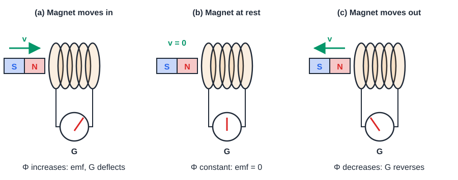

**Derivation of the mathematical form**

1. Flux through one turn: $\Phi_B = BA\cos\theta$. It can change by changing $B$, $A$ or $\theta$.
2. For a coil of $N$ turns the flux linkage is $N\Phi_B$.
3. Second law, with the sign fixed by Lenz's law:

$$\varepsilon = -N\frac{d\Phi_B}{dt}$$

4. For a circuit of resistance $R$ the induced current is $I = \varepsilon/R$, so the charge that flows in a time $\Delta t$ is $q = N\,\Delta\Phi_B/R$, independent of how fast the flux changes.

> [!IMPORTANT]
> $\varepsilon = -N\,\dfrac{d\Phi_B}{dt}$. The emf depends on the rate of change of flux, not on the size of the flux. The minus sign is Lenz's law.

**Worked example (bicycle dynamo).**
Given: $N = 500$ turns, flux through each turn falls from $0.8\,\mathrm{mWb}$ to $0$ in $0.01\,\mathrm{s}$ as the magnet turns.
Formula: $|\varepsilon| = N\,\Delta\Phi_B/\Delta t$.
Substitution: $|\varepsilon| = \dfrac{500 \times 0.8\times10^{-3}\,\mathrm{Wb}}{0.01\,\mathrm{s}} = 40\,\mathrm{V}$.
Answer: the average induced emf is $40\,\mathrm{V}$.

> [!NOTE]
> **Extra: emf from the force on moving charges.** A rod of length $l$ moves with speed $v$ perpendicular to a field $B$. A charge $q$ in the rod feels a magnetic force $qvB$ along the rod, which is equivalent to an electric field $E = vB$. The emf is
>
> $$\varepsilon = El = Blv$$
>
> In time $dt$ the rod sweeps an area $dA = l\,v\,dt$, so the flux changes by $d\Phi_B = B\,dA = Blv\,dt$. Hence $\varepsilon = d\Phi_B/dt$ in magnitude, which agrees with Faraday's law.

> [!TIP]
> Do not confuse flux $\Phi_B$ with flux linkage $N\Phi_B$. Do not drop the minus sign or the words "rate of change". A large steady flux induces no emf.

> What is torque? Derive an expression for torque on a current carrying loop.
>
> Asked in: 2016 Q2(b), 2017 Q3(b), 2023 Q2(b)

### Ans. to the question no. 2(b) (2016)

**Torque.** Torque is the turning effect of a force about an axis: $\vec\tau = \vec r\times\vec F$, so $\tau = F r_\perp$, where $r_\perp$ is the perpendicular distance of the line of action from the axis. Unit: $\mathrm{N\,m}$.

**Statement.** A rectangular loop of $N$ turns, area $A$, carrying current $I$ in a uniform field $B$ experiences a torque $\tau = NIAB\sin\theta$, where $\theta$ is the angle between $\vec B$ and the normal $\hat n$ to the loop.

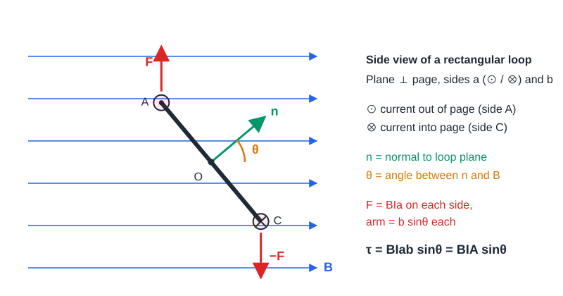

**Derivation.** Let the loop have sides $a$ (perpendicular to the page in the figure) and $b$ (in the page), so $A = ab$. Take $N = 1$ first.

1. Force on a side of length $a$, which is perpendicular to $\vec B$:

$$F = BIa\sin 90^\circ = BIa$$

2. The two sides of length $a$ carry currents in opposite directions, so the forces are equal and opposite ($F$ and $-F$). The net force on the loop is zero.
3. The forces on the two sides of length $b$ are $BIb\cos\theta$ each, directed along the axis of rotation, equal, opposite and collinear. They stretch the loop but give no torque.
4. The perpendicular distance between the lines of action of $F$ and $-F$ is $b\sin\theta$.
5. Torque of the couple:

$$\tau = F\,(b\sin\theta) = BIa\,b\sin\theta = BIA\sin\theta$$

6. For $N$ turns the torque is $N$ times larger. In vector form, with $\vec m = NIA\,\hat n$:

$$\vec\tau = \vec m\times\vec B$$

> [!IMPORTANT]
> $\tau = NIAB\sin\theta = mB\sin\theta$, with $\theta$ measured from the normal of the loop to $\vec B$. Maximum torque $NIAB$ at $\theta = 90^\circ$ (plane parallel to $\vec B$); zero torque at $\theta = 0^\circ$ and $180^\circ$.

**Worked example (DC motor coil).**
Given: $N = 100$, $A = 5\,\mathrm{cm}\times4\,\mathrm{cm} = 2.0\times10^{-3}\,\mathrm{m^{2}}$, $I = 2\,\mathrm{A}$, $B = 0.3\,\mathrm{T}$.
Formula: $\tau = NIAB\sin\theta$.
Substitution (plane parallel to the field, $\theta = 90^\circ$): $\tau = 100\times2\,\mathrm{A}\times2.0\times10^{-3}\,\mathrm{m^{2}}\times0.3\,\mathrm{T}\times1$.
Answer: $\tau = 0.12\,\mathrm{N\,m}$. At $\theta = 30^\circ$ the torque is $0.06\,\mathrm{N\,m}$.

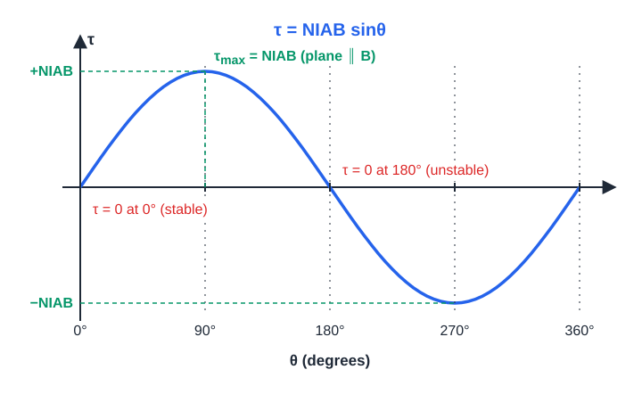

> [!NOTE]
> **Extra: potential energy and equilibrium.** The work done in turning the loop from $\theta_1$ to $\theta_2$ against the torque gives the potential energy
>
> $$U = -\vec m\cdot\vec B = -mB\cos\theta$$
>
> $\theta = 0$ (normal along $\vec B$) is the stable equilibrium with minimum $U$; $\theta = 180^\circ$ is unstable. A DC motor uses a commutator to reverse the current every half turn, so the torque keeps the same sense.

> [!TIP]
> $\theta$ is the angle between the normal and $\vec B$, not between the plane and $\vec B$. Remember the factor $N$. The net force on the loop is zero; only the torque is non-zero.

> Define: (i) magnetic induction (ii) mutual induction (iii) self induction.
>
> Asked in: 2016 Q2(c), 2017 Q3(a), 2018 Q2(c) (self induction part)

### Ans. to the question no. 2(c) (2016)

**(i) Magnetic induction** (magnetic flux density) $\vec B$ is the vector field defined by the force on a moving charge, $\vec F = q\,\vec v\times\vec B$. Its magnitude is the force on a unit charge moving with unit speed perpendicular to the field, $B = F/(qv)$. Equivalently, it is the force per unit length on a conductor of unit current perpendicular to the field, $B = F/(Il)$. Unit: tesla, $1\,\mathrm{T} = 1\,\mathrm{N\,A^{-1}\,m^{-1}} = 1\,\mathrm{Wb\,m^{-2}}$.

**(ii) Mutual induction** is the phenomenon in which a changing current in one coil (primary) induces an emf in a neighbouring coil (secondary) because the changing flux of the primary links the secondary. The mutual inductance $M$ is the flux linkage of the secondary per unit primary current.

**(iii) Self induction** is the phenomenon in which a changing current in a coil induces an emf in the same coil, opposing the change of current. The self-inductance $L$ is the flux linkage per unit current in the coil. Unit of $M$ and $L$: henry ($\mathrm{H} = \mathrm{Wb\,A^{-1}} = \mathrm{V\,s\,A^{-1}}$).

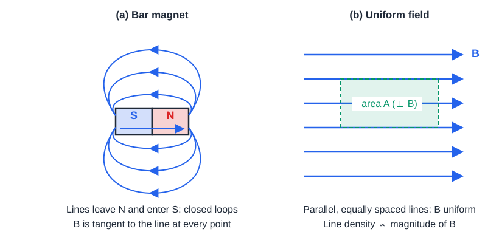

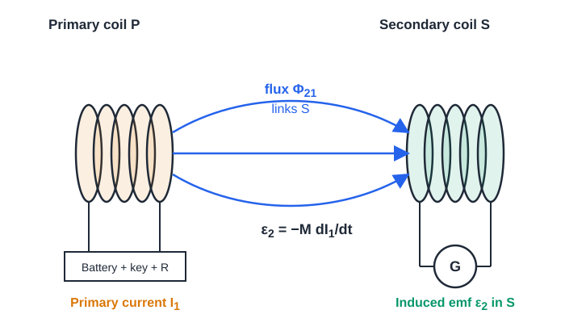

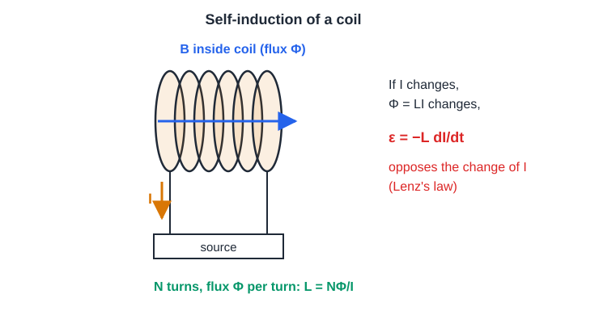

**Derivation of $M$ and $L$**

1. The flux produced by a coil is proportional to its current. For the self case, $N\Phi = LI$.
2. Differentiate, $N\,d\Phi/dt = L\,dI/dt$. Faraday's law with Lenz's sign gives:

$$\varepsilon = -L\frac{dI}{dt}$$

3. For the mutual case, the flux of the primary linked with the secondary gives $N_2\Phi_{21} = MI_1$, so:

$$\varepsilon_2 = -M\frac{dI_1}{dt}$$

> [!IMPORTANT]
> $B = \dfrac{F}{qv\sin\theta}$, $\quad L = \dfrac{N\Phi}{I}$, $\quad \varepsilon = -L\dfrac{dI}{dt}$, $\quad M = \dfrac{N_2\Phi_{21}}{I_1}$, $\quad \varepsilon_2 = -M\dfrac{dI_1}{dt}$. Unit of $L$ and $M$: henry.

**Worked example (spark or ignition coil).**
Given: $M = 1.0\,\mathrm{H}$ (illustrative), primary current falls from $4\,\mathrm{A}$ to $0$ in $0.5\,\mathrm{ms}$.
Formula: $|\varepsilon_2| = M\,|\Delta I_1|/\Delta t$.
Substitution: $|\varepsilon_2| = 1.0\,\mathrm{H}\times\dfrac{4\,\mathrm{A}}{0.5\times10^{-3}\,\mathrm{s}}$.
Answer: $|\varepsilon_2| = 8000\,\mathrm{V} = 8\,\mathrm{kV}$, enough to make a spark.

> [!NOTE]
> **Extra: energy stored in an inductor.** While the current rises, the source works against the back emf. In time $dt$:
>
> $$dW = |\varepsilon|\,I\,dt = L\,I\,dI$$
>
> $$U = \int_0^I L\,I\,dI = \tfrac{1}{2}LI^{2}$$
>
> **Inductance of a long solenoid** (length $\ell$, $N$ turns, area $A$): $B = \mu_0NI/\ell$, so $\Phi = BA$ and $L = N\Phi/I = \mu_0N^{2}A/\ell$. For two coils, $M = k\sqrt{L_1L_2}$ with coupling $0\le k\le1$, and $M_{12} = M_{21}$.

> [!TIP]
> "Magnetic induction" means $\vec B$ (flux density), not the phenomenon of induction. Self-induction opposes the change of current, not the current itself. Both $L$ and $M$ are in henry.

> State magnetic material. Write down the classification of magnetic material.
>
> Asked in: 2016 Q4(a)

### Ans. to the question no. 4(a) (2016)

**Magnetic material.** A magnetic material is a substance that becomes magnetised when placed in a magnetic field, acquiring a magnetisation $\vec M$ (magnetic moment per unit volume). The total field inside is

$$B = \mu_0(H + M)$$

**Classification.** With $\chi = M/H$ (susceptibility) and $\mu_r = 1 + \chi$, magnetic materials are classified as:

1. **Diamagnetic:** $\chi<0$ and small ($\approx-10^{-5}$), $\mu_r$ slightly less than 1. Atoms have no permanent moment; the induced moment opposes the field. Weakly repelled. Examples: Bi, Cu, Au, water.
2. **Paramagnetic:** $\chi>0$ and small, $\mu_r$ slightly more than 1. Atoms have permanent moments that are randomly oriented and partly align in a field. Weakly attracted. Examples: Al, Pt, Na, $\mathrm{O_2}$.
3. **Ferromagnetic:** $\chi\gg1$ ($10^{2}$ to $10^{5}$), $\mu_r\gg1$. Strong attraction, domains, hysteresis, and loss of ferromagnetism above the Curie temperature. Examples: Fe, Co, Ni.
4. **Antiferromagnetic and ferrimagnetic** (extra classes): neighbouring moments are anti-parallel; equal in antiferromagnets (MnO), unequal in ferrimagnets (ferrites, $\mathrm{Fe_3O_4}$).

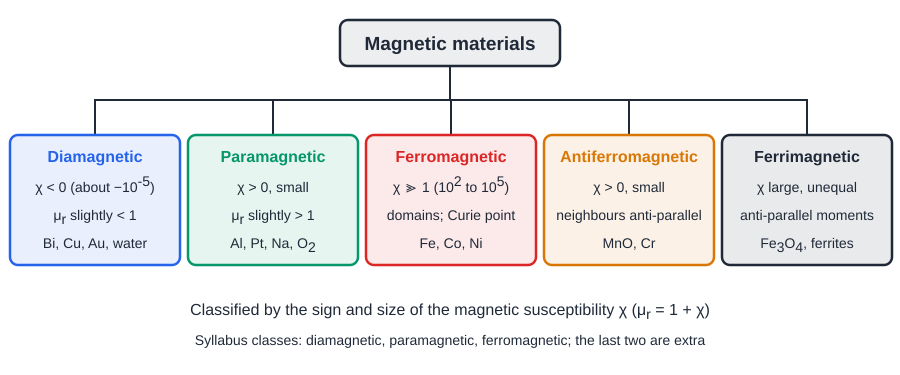

**Relation between $\mu_r$ and $\chi$**

1. Put $M = \chi H$ in $B = \mu_0(H + M)$.
2. $B = \mu_0H(1 + \chi)$.
3. Compare with $B = \mu_0\mu_rH$:

$$\mu_r = 1 + \chi$$

> [!IMPORTANT]
> Diamagnetic: $\chi<0$. Paramagnetic: $\chi>0$ (small). Ferromagnetic: $\chi\gg1$. In all cases $\mu_r = 1 + \chi$.

**Worked example (transformer core).**
Given: solenoid with magnetising field $H = 200\,\mathrm{A\,m^{-1}}$; iron core with $\mu_r = 5000$.
Formula: $B = \mu_0\mu_rH$.
Substitution: $B = 4\pi\times10^{-7}\times5000\times200\,\mathrm{T}$.
Answer: $B\approx1.26\,\mathrm{T}$, against $2.5\times10^{-4}\,\mathrm{T}$ with an air core. This is why transformers use ferromagnetic cores.

> [!NOTE]
> **Extra: Curie temperature.** Above the Curie temperature $T_C$ a ferromagnet becomes paramagnetic and follows the Curie-Weiss law $\chi = C'/(T - T_C)$. Approximate values: Fe $1043\,\mathrm{K}$, Ni $627\,\mathrm{K}$, Co $1388\,\mathrm{K}$. Paramagnets follow the Curie law $\chi = C/T$ (see [2019 Q2](#ans-to-the-question-no-2-2019)).

> [!TIP]
> Do not write "diamagnetic" for a ferromagnet above $T_C$; it becomes paramagnetic. Quote the sign of $\chi$, the size of $\mu_r$ and an example for each class. Antiferro and ferri are extra, mention them briefly.

> What is Hall effect?
>
> Asked in: 2016 Q4(c), 2018 Q2(a), 2020 Q3(a), 2023 Q2(a) (typed "half effect" in the paper)

### Ans. to the question no. 4(c) (2016)

> [!NOTE]
> 2016 asked only "What is Hall effect?". The full derivation of the Hall voltage is given here because 2018, 2020 and 2023 ask for it, and those years link back to this answer.

**Hall effect.** When a current-carrying conductor or semiconductor slab is placed in a magnetic field perpendicular to the current, a potential difference, the Hall voltage $V_H$, appears across the faces perpendicular to both the current and the field.

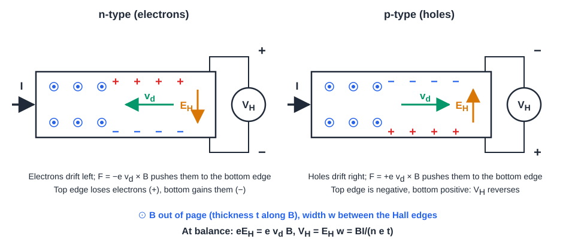

**Derivation of the Hall voltage.** Slab of width $w$ (between the Hall faces) and thickness $t$ (along $\vec B$), carrier density $n$, carrier charge magnitude $e$, drift speed $v_d$.

1. Current through the cross-section $w\,t$:

$$I = n\,e\,v_d\,(w\,t)$$

2. The magnetic force $ev_dB$ pushes carriers towards one Hall face. Charge piles up and a transverse Hall field $E_H$ builds up.
3. Equilibrium (the electric force cancels the magnetic force):

$$eE_H = e\,v_d\,B$$

4. Hall voltage across the width:

$$V_H = E_Hw = v_dBw$$

5. Substitute $v_d = I/(n e\,w\,t)$ from step 1; $w$ cancels:

$$V_H = \frac{BI}{n\,e\,t}$$

6. With current density $J = I/(wt)$, $E_H = v_dB = JB/(ne)$, so $E_H = R_H\,J\,B$ with the Hall coefficient

$$R_H = \frac{1}{ne}$$

7. **Sign rule.** For electrons (n-type) $R_H = -1/(ne)$; for holes (p-type) $R_H = +1/(pe)$. For the same $I$ and $B$ the Hall voltage has opposite polarity in the two types, which identifies the sign of the carriers.

> [!IMPORTANT]
> $V_H = \dfrac{BI}{n\,e\,t} = R_H\dfrac{BI}{t}$, with $R_H = \dfrac{1}{ne}$ in magnitude. Here $t$ is the thickness along $\vec B$. Negative $R_H$: n-type; positive $R_H$: p-type.

**Worked example (Hall sensor in a phone magnetometer or ABS wheel-speed sensor).**
Given: n-type slab, $n = 1\times10^{22}\,\mathrm{m^{-3}}$, $t = 0.1\,\mathrm{mm}$, $I = 5\,\mathrm{mA}$, $B = 0.05\,\mathrm{T}$.
Formula: $V_H = BI/(net)$.
Substitution: $V_H = \dfrac{0.05\times5\times10^{-3}}{10^{22}\times1.6\times10^{-19}\times10^{-4}}\,\mathrm{V}$.
Answer: $V_H\approx1.6\,\mathrm{mV}$. A copper slab of the same size ($n\approx8.5\times10^{28}\,\mathrm{m^{-3}}$) would give only about $0.2\,\mathrm{nV}$, which is why semiconductors are used for Hall sensors.

> [!NOTE]
> **Extra: finding $n$ and mobility.** Measuring $V_H$ gives the carrier density $n = BI/(etV_H)$ and the carrier type from the polarity. With the conductivity $\sigma = ne\mu$, the Hall mobility is $\mu = |R_H|\,\sigma$. Hall probes also measure $B$ itself, since $V_H\propto B$.

> [!TIP]
> $V_H$ depends on the thickness $t$ along $\vec B$, not on the width $w$. State the sign for n-type and p-type. Use conventional current direction for $I$ but electron motion for the drift in an n-type slab.

## Year 2017

> Define: magnetic induction, mutual induction, self induction.

### Ans. to the question no. 3(a) (2017)

Same as [2016 Q2(c)](#ans-to-the-question-no-2c-2016).

> Derive an expression for torque on a current carrying loop.

### Ans. to the question no. 3(b) (2017)

Same as [2016 Q2(b)](#ans-to-the-question-no-2b-2016).

> Write down Faraday's law of electromagnetic induction.

### Ans. to the question no. 3(c) (2017)

Same as [2016 Q2(a)](#ans-to-the-question-no-2a-2016).

> Define magnetic induction. Derive an equation of magnetic force on a moving charge in a magnetic field.
>
> Asked in: 2017 Q4(a)

### Ans. to the question no. 4(a) (2017)

**Magnetic induction** $\vec B$ is the vector whose magnitude is the force per unit charge per unit speed on a charge moving perpendicular to the field, $B = F/(qv)$; unit tesla (full definition at [2016 Q2(c)](#ans-to-the-question-no-2c-2016)).

**Statement.** A charge $q$ moving with velocity $\vec v$ in a magnetic field $\vec B$ experiences the force $\vec F = q\,\vec v\times\vec B$, of magnitude $F = qvB\sin\theta$, where $\theta$ is the angle between $\vec v$ and $\vec B$.

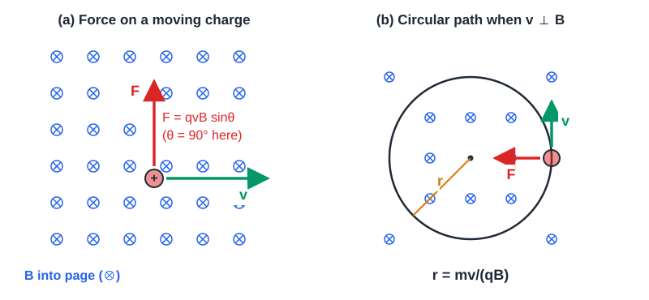

**Derivation from $F = BIl\sin\theta$.** A straight conductor of length $l$ and cross-section $S$ carries a current $I$ at angle $\theta$ to a uniform field $B$. Experiment gives the force on the conductor.

1. Force on the conductor:

$$F = BIl\sin\theta$$

2. The current in terms of the carriers: $n$ carriers per unit volume, each of charge $q$ and drift speed $v$:

$$I = n\,q\,v\,S$$

3. Number of carriers in the length $l$:

$$N = n\,S\,l$$

4. Substitute step 2 in step 1:

$$F = B\,(n q v S)\,l\sin\theta = (nSl)\,q\,v\,B\sin\theta = N\,q\,v\,B\sin\theta$$

5. The force on one carrier is $F/N$:

$$F = qvB\sin\theta\qquad\text{or}\qquad \vec F = q\,\vec v\times\vec B$$

6. **Circular motion** for $\theta = 90^\circ$: the force is always perpendicular to $\vec v$, so it does no work and the speed stays constant. It supplies the centripetal force:

$$qvB = \frac{mv^{2}}{r}\;\Rightarrow\; r = \frac{mv}{qB},\qquad T = \frac{2\pi m}{qB}$$

> [!IMPORTANT]
> $F = qvB\sin\theta$, direction by $\vec F = q\vec v\times\vec B$ (right-hand rule for $+q$, reversed for $-q$). For $\vec v\perp\vec B$: $r = mv/(qB)$, $T = 2\pi m/(qB)$.

**Worked example (proton in a cyclotron or mass spectrometer).**
Given: proton, $q = 1.6\times10^{-19}\,\mathrm{C}$, $m = 1.67\times10^{-27}\,\mathrm{kg}$, $v = 2\times10^{6}\,\mathrm{m\,s^{-1}}$ perpendicular to $B = 0.5\,\mathrm{T}$.
Formula: $F = qvB$, $r = mv/(qB)$, $T = 2\pi m/(qB)$.
Substitution: $F = 1.6\times10^{-19}\times2\times10^{6}\times0.5 = 1.6\times10^{-13}\,\mathrm{N}$; $r = \dfrac{1.67\times10^{-27}\times2\times10^{6}}{1.6\times10^{-19}\times0.5}\,\mathrm{m}$.
Answer: $F = 1.6\times10^{-13}\,\mathrm{N}$, $r\approx4.2\,\mathrm{cm}$, $T\approx1.3\times10^{-7}\,\mathrm{s}$ (frequency about $7.6\,\mathrm{MHz}$, independent of $v$).

> [!NOTE]
> **Extra: Lorentz force and helical motion.** In both $\vec E$ and $\vec B$ the force is $\vec F = q(\vec E + \vec v\times\vec B)$. If $\vec v$ makes an angle $\theta$ with $\vec B$, the component $v\cos\theta$ along $\vec B$ is unchanged and the component $v\sin\theta$ makes circles, so the path is a helix of pitch $2\pi m\,v\cos\theta/(qB)$.

> [!TIP]
> Say that the magnetic force does no work and changes only the direction of $\vec v$. The force is zero when $\vec v\parallel\vec B$. For an electron the direction is opposite to the right-hand-rule result for a positive charge.

> State Lenz's law. Show that the law obeys the principle of conservation of energy.
>
> Asked in: 2017 Q4(c), 2018 Q2(b), 2021 Q2(a), 2021 Q2(b), 2023 Q3(c)

### Ans. to the question no. 4(c) (2017)

**Lenz's law.** The direction of the induced emf (and current) in a closed circuit is such that it opposes the change of flux that produces it.

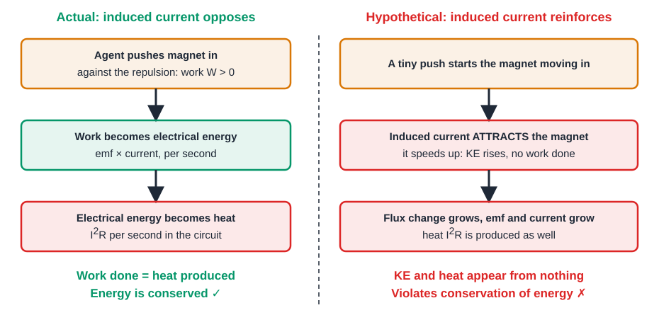

**Proof from conservation of energy.** Push the north pole of a magnet towards a closed coil. The flux through the coil increases.

1. **Actual case (Lenz).** The induced current makes the near face of the coil a north pole, which repels the magnet. An external agent must push against this repulsion, so it does work $W>0$.
2. This work is converted into electrical energy $\varepsilon I\,dt$ and then into heat $I^{2}R\,dt$ in the circuit. So $W = \int I^{2}R\,dt$ and energy is conserved.
3. **Opposite case (reinforcing current).** Suppose the induced current made the near face a south pole. The coil would attract the magnet, so it would speed up with no work done on it. The faster motion increases the rate of flux change, which increases the current and the attraction further.
4. In this case kinetic energy and heat $I^{2}R$ both appear without any energy supplied. A tiny push would give unlimited energy, which violates the conservation of energy. So the reinforcing current is impossible, and the induced current must oppose the change.
5. **Quantitative check (rod on rails).** A rod of length $l$ moves with speed $v$ in field $B$, circuit resistance $R$:

$$\varepsilon = Blv,\qquad I = \frac{Blv}{R},\qquad F = BIl = \frac{B^{2}l^{2}v}{R}\ \text{(opposing the motion)}$$

6. Mechanical power supplied equals electrical power dissipated:

$$P = Fv = \frac{B^{2}l^{2}v^{2}}{R} = \frac{\varepsilon^{2}}{R} = I^{2}R$$

> [!IMPORTANT]
> Lenz's law is the law of conservation of energy applied to induction: work done against the magnetic force $=$ electrical energy $=$ heat, $Fv = I^{2}R$. A reinforcing induced current would create energy from nothing.

**Worked example (sliding rod, like a simple generator or an eddy-current brake).**
Given: $l = 0.5\,\mathrm{m}$, $v = 4\,\mathrm{m\,s^{-1}}$, $B = 0.6\,\mathrm{T}$, $R = 2\,\Omega$.
Formula: $\varepsilon = Blv$, $I = \varepsilon/R$, $F = BIl$, $P = Fv$.
Substitution: $\varepsilon = 0.6\times0.5\times4 = 1.2\,\mathrm{V}$; $I = 1.2/2 = 0.6\,\mathrm{A}$; $F = 0.6\times0.6\times0.5 = 0.18\,\mathrm{N}$.
Answer: $P_{\text{mech}} = Fv = 0.18\times4 = 0.72\,\mathrm{W}$ and $P_{\text{elec}} = I^{2}R = 0.6^{2}\times2 = 0.72\,\mathrm{W}$. The two are equal.

> [!NOTE]
> **Extra: the minus sign.** Lenz's law is the minus sign in $\varepsilon = -d\Phi_B/dt$. Eddy currents in a metal plate moving through a field obey the same rule, so the plate feels a braking force; this is how an eddy-current brake works. The method for finding the current direction is in [2023 Q3(c)](#ans-to-the-question-no-3c-2023).

> [!TIP]
> Lenz's law opposes the change of flux, not the flux itself. If the flux decreases, the induced field is in the same direction as the original. Always discuss the opposite case; that is what "show" asks for.

## Year 2018

> What is Hall effect? Deduce the equation of Hall voltage.

### Ans. to the question no. 2(a) (2018)

Same as [2016 Q4(c)](#ans-to-the-question-no-4c-2016).

> Show that Lenz's law follows the law of conservation of energy.

### Ans. to the question no. 2(b) (2018)

Same as [2017 Q4(c)](#ans-to-the-question-no-4c-2017).

> Define self-induction. A current carrying loop of length 2.5 cm and width 1 cm carries 4 A. It is placed parallel to a uniform magnetic field of 2 T. Calculate the torque.
>
> Asked in: 2018 Q2(c)

### Ans. to the question no. 2(c) (2018)

**Self-induction.** The phenomenon in which a changing current in a coil induces an emf in the same coil that opposes the change; $\varepsilon = -L\,dI/dt$. Full definition at [2016 Q2(c)](#ans-to-the-question-no-2c-2016).

**Interpretation.** "Placed parallel to the field" is taken to mean the plane of the loop is parallel to $\vec B$. Then the normal $\hat n$ is perpendicular to $\vec B$ and $\theta = 90^\circ$ in the general formula $\tau = NIAB\sin\theta$ ($\theta$ measured from the normal). The loop is a single turn, $N = 1$. (If "parallel" meant the normal along $\vec B$, the torque would be zero.)

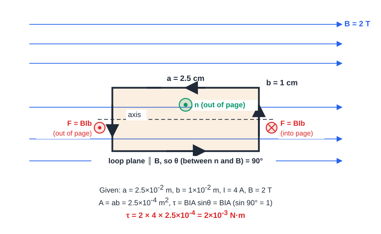

**Given:** $a = 2.5\,\mathrm{cm} = 2.5\times10^{-2}\,\mathrm{m}$, $b = 1\,\mathrm{cm} = 1\times10^{-2}\,\mathrm{m}$, $I = 4\,\mathrm{A}$, $B = 2\,\mathrm{T}$, $N = 1$, $\theta = 90^\circ$.

**Formula:** $\tau = NIAB\sin\theta$ with $A = ab$.

**Substitution:**

$$A = 2.5\times10^{-2}\,\mathrm{m}\times1\times10^{-2}\,\mathrm{m} = 2.5\times10^{-4}\,\mathrm{m^{2}}$$

$$\tau = 1\times4\,\mathrm{A}\times2.5\times10^{-4}\,\mathrm{m^{2}}\times2\,\mathrm{T}\times\sin90^\circ$$

> [!IMPORTANT]
> $\tau = BIA = 2\times10^{-3}\,\mathrm{N\,m}$

**Worked example (moving-coil galvanometer).**
Given: $N = 100$, $A = 2\times10^{-4}\,\mathrm{m^{2}}$, radial field $B = 0.1\,\mathrm{T}$ (so the plane is always parallel to $\vec B$), $I = 1\,\mathrm{mA}$.
Formula: $\tau = NIAB$.
Substitution: $\tau = 100\times10^{-3}\,\mathrm{A}\times2\times10^{-4}\,\mathrm{m^{2}}\times0.1\,\mathrm{T}$.
Answer: $\tau = 2\times10^{-6}\,\mathrm{N\,m}$, balanced by the restoring torque of the hairspring.

> [!NOTE]
> **Extra: other angles for the same loop.** The torque falls as $\sin\theta$: $\tau = 2\times10^{-3}\sin\theta\,\mathrm{N\,m}$. At $\theta = 30^\circ$ it is $1\times10^{-3}\,\mathrm{N\,m}$ and at $\theta = 0^\circ$ it is zero. Each short side feels $F = BIb = 2\times4\times10^{-2} = 8\times10^{-2}\,\mathrm{N}$, and the arm is $a = 2.5\,\mathrm{cm}$, giving $8\times10^{-2}\times2.5\times10^{-2} = 2\times10^{-3}\,\mathrm{N\,m}$, the same answer.

> [!TIP]
> Convert cm to m before multiplying. State the interpretation of "parallel". Write units ($\mathrm{N\,m}$), and do not use $\cos\theta$ when $\theta$ is measured from the normal.

## Year 2019

> Distinguish dia, para and ferro magnetic materials.
>
> Asked in: 2019 Q2

### Ans. to the question no. 2 (2019)

**Statement.** The three classes differ in the origin of their magnetism, the sign and size of $\chi$, the response to temperature and the strength of attraction. Classification tree: [2016 Q4(a)](#ans-to-the-question-no-4a-2016).

| Property | Diamagnetic | Paramagnetic | Ferromagnetic |
| --- | --- | --- | --- |
| Atomic dipoles | No permanent moment | Permanent moments, random | Permanent moments, aligned in domains |
| Effect of field | Induced moment opposes $\vec B$ | Moments partly align with $\vec B$ | Domains grow and align strongly |
| Susceptibility $\chi$ | Small, negative ($\approx-10^{-5}$) | Small, positive | Very large, positive ($10^{2}$ to $10^{5}$) |
| Relative permeability $\mu_r$ | Slightly less than 1 | Slightly more than 1 | Much greater than 1 |
| Force in a non-uniform field | Weakly repelled | Weakly attracted | Strongly attracted |
| Field lines | Slightly expelled | Slightly concentrated | Strongly concentrated |
| Temperature dependence | Almost independent | Curie law $\chi = C/T$ | Becomes paramagnetic above $T_C$ |
| Hysteresis, retentivity | None | None | Present |
| Examples | Bi, Cu, Au, water | Al, Pt, Na, $\mathrm{O_2}$ | Fe, Co, Ni |

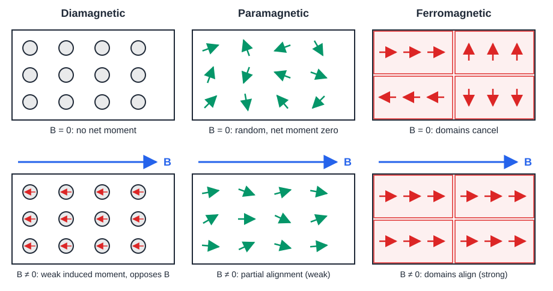

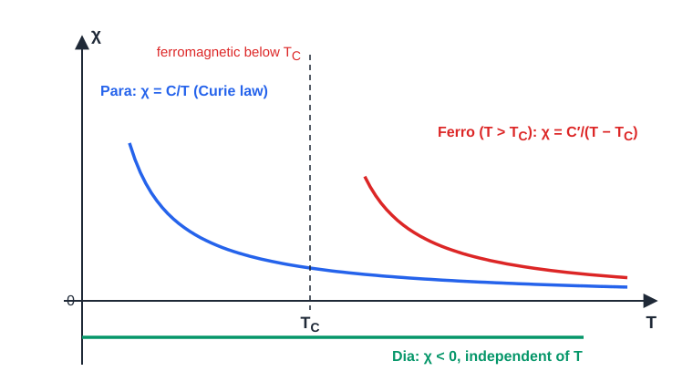

**Quantities used.** $M = \chi H$, $B = \mu_0(1 + \chi)H$.

> [!IMPORTANT]
> Dia: $\chi<0$, repelled. Para: $\chi>0$ small, $\chi = C/T$. Ferro: $\chi\gg1$, domains, hysteresis, $T_C$.

**Worked example (illustrative values at $H = 100\,\mathrm{A\,m^{-1}}$).**
Given: $\chi_{\text{dia}} = -1\times10^{-5}$, $\chi_{\text{para}} = +2\times10^{-5}$, iron-like $\mu_r = 5000$ (so $\chi\approx5000$).
Formula: $M = \chi H$.
Substitution: $M_{\text{dia}} = -10^{-5}\times100$; $M_{\text{para}} = 2\times10^{-5}\times100$; $M_{\text{ferro}} = 5000\times100$.
Answer: $M_{\text{dia}} = -1\times10^{-3}\,\mathrm{A\,m^{-1}}$, $M_{\text{para}} = 2\times10^{-3}\,\mathrm{A\,m^{-1}}$, $M_{\text{ferro}} = 5\times10^{5}\,\mathrm{A\,m^{-1}}$: the ferromagnet responds about $10^{8}$ times more strongly. (The iron-like value is used only below saturation.)

> [!NOTE]
> **Extra: Curie law and superconductors.** Thermal motion randomises the moments of a paramagnet, so the response falls as the temperature rises: $\chi = C/T$. If $\chi = 4\times10^{-5}$ at $300\,\mathrm{K}$, it is $8\times10^{-5}$ at $150\,\mathrm{K}$. Above $T_C$ a ferromagnet follows $\chi = C'/(T - T_C)$. A superconductor is a perfect diamagnet with $\chi = -1$ (Meissner effect).

> [!TIP]
> Give the table with at least six rows, the sign and size of $\chi$ and one example each. A ferromagnet above $T_C$ is paramagnetic, not diamagnetic. Every material has some diamagnetism, but it is masked in the other two classes.

## Year 2020

> What is Hall effect? Deduce the equation of Hall voltage.

### Ans. to the question no. 3(a) (2020)

Same as [2016 Q4(c)](#ans-to-the-question-no-4c-2016).

## Year 2021

> Explain Faraday's law and Lenz's law.

### Ans. to the question no. 2(a) (2021)

Faraday's law: same as [2016 Q2(a)](#ans-to-the-question-no-2a-2016). Lenz's law: same as [2017 Q4(c)](#ans-to-the-question-no-4c-2017). Combined form: $\varepsilon = -N\,d\Phi_B/dt$, where the magnitude is Faraday's law and the minus sign is Lenz's law.

> Show that Lenz's law obeys the principle of conservation of energy.

### Ans. to the question no. 2(b) (2021)

Same as [2017 Q4(c)](#ans-to-the-question-no-4c-2017).

> Calculate the self-inductance of a coil of 400 turns when 2 A current creates 4×10^-4 Wb of flux.
>
> Asked in: 2021 Q2(c)

### Ans. to the question no. 2(c) (2021)

> [!NOTE]
> The same numerical appears as 2016 Q3(c) in the KTG section of the question bank. It is not solved there in this file; this answer covers both.

**Statement.** Self-inductance is the flux linkage per unit current in the coil, $L = N\Phi/I$, where $\Phi$ is the flux through each turn. Diagram: [self-induction coil](#ans-to-the-question-no-2c-2016).

**Given:** $N = 400$, $I = 2\,\mathrm{A}$, $\Phi = 4\times10^{-4}\,\mathrm{Wb}$ (flux through each turn).

**Formula:** $L = \dfrac{N\Phi}{I}$

**Substitution:**

$$L = \frac{400\times4\times10^{-4}\,\mathrm{Wb}}{2\,\mathrm{A}}$$

> [!IMPORTANT]
> $L = 0.08\,\mathrm{H} = 80\,\mathrm{mH}$

**Worked example (relay coil or choke).**
Given: the same coil, $L = 0.08\,\mathrm{H}$, with its current switched from $2\,\mathrm{A}$ to $0$ in $10\,\mathrm{ms}$.
Formula: $|\varepsilon| = L\,|\Delta I|/\Delta t$.
Substitution: $|\varepsilon| = 0.08\,\mathrm{H}\times\dfrac{2\,\mathrm{A}}{10\times10^{-3}\,\mathrm{s}}$.
Answer: $|\varepsilon| = 16\,\mathrm{V}$. This back emf is why a relay coil needs a flyback diode.

> [!NOTE]
> **Extra: energy stored.** $U = \tfrac{1}{2}LI^{2} = \tfrac{1}{2}\times0.08\times2^{2} = 0.16\,\mathrm{J}$ (derivation at [2016 Q2(c)](#ans-to-the-question-no-2c-2016)). Unit check: $\mathrm{Wb\,A^{-1}} = \mathrm{H}$.

> [!TIP]
> $\Phi$ is the flux per turn, so multiply by $N$. If the question had given the total flux linkage, there would be no $N$. Write the unit henry.

> What is hysteresis? State and explain the hysteresis curve of a magnetic material.
>
> Asked in: 2021 Q4(a), 2023 Q3(b)

### Ans. to the question no. 4(a) (2021)

**Hysteresis.** Hysteresis is the lagging of the magnetic induction $B$ behind the magnetising field $H$ when a ferromagnetic material is taken through a complete cycle of magnetisation and demagnetisation.

**Definitions**

- **Saturation** ($B_s$): the state in which all domains are aligned; a further increase of $H$ adds only $\mu_0H$.
- **Retentivity** (remanence, $B_r$): the value of $B$ left in the material when $H$ is reduced to zero after saturation.
- **Coercivity** ($H_c$): the reverse field needed to reduce $B$ to zero.
- **Loop area** $=\oint H\,dB$: the energy lost per unit volume per cycle.

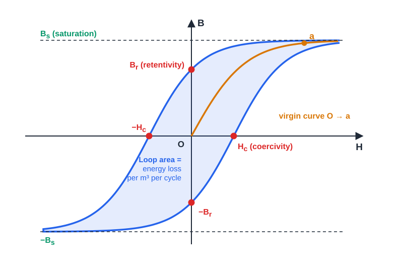

**Explanation of the curve** (unmagnetised specimen, $B = H = 0$ at O)

1. **O to a (virgin curve):** as $H$ increases, domain walls move and domains rotate, so $B$ rises steeply and then flattens at saturation $B_s$ (point a).
2. **a to $B_r$:** when $H$ is reduced to zero, $B$ does not return to zero; it stays at $B_r$.
3. **$B_r$ to $-H_c$:** the field must be reversed to $-H_c$ to bring $B$ to zero.
4. **$-H_c$ to $-B_s$:** further reverse field gives saturation in the opposite direction.
5. **$-B_s$ to $+B_s$:** reducing $H$ to zero leaves $-B_r$, and $+H_c$ brings $B$ to zero again. Increasing $H$ completes the closed loop back to a. The virgin curve is never retraced.

**Loop area equals the energy loss.** For a core of volume $V = A\ell$ in a solenoid of $N$ turns:

1. The source must overcome the back emf $NA\,dB/dt$, so in time $dt$ it supplies $dW = I\,NA\,\dfrac{dB}{dt}\,dt = (NI)\,A\,dB$.
2. With $H = NI/\ell$ this is $dW = H\ell\,A\,dB = V\,H\,dB$.
3. Energy per unit volume per cycle:

$$w = \oint H\,dB$$

   This is the area of the loop ($\mathrm{A\,m^{-1}\times T} = \mathrm{J\,m^{-3}}$). It is dissipated as heat by domain-wall friction.

> [!IMPORTANT]
> Loop area $=\oint H\,dB =$ energy lost per unit volume per cycle. $B_r$ = retentivity, $H_c$ = coercivity, $B_s$ = saturation.

**Worked example (transformer core).**
Given: loop area $40\,\mathrm{J\,m^{-3}}$ per cycle (illustrative), core volume $2\times10^{-3}\,\mathrm{m^{3}}$, frequency $50\,\mathrm{Hz}$.
Formula: $P = (\text{area})\times V\times f$.
Substitution: $P = 40\,\mathrm{J\,m^{-3}}\times2\times10^{-3}\,\mathrm{m^{3}}\times50\,\mathrm{s^{-1}}$.
Answer: $P = 4\,\mathrm{W}$ of hysteresis loss, which is why cores use soft magnetic steel with a narrow loop.

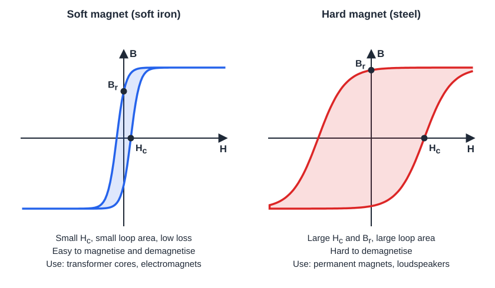

> [!NOTE]
> **Extra: hard and soft magnets.**
>
> | Property | Soft magnet (soft iron) | Hard magnet (steel) |
> | --- | --- | --- |
> | Coercivity $H_c$ | Small | Large |
> | Loop area | Small, low loss | Large, high loss |
> | Magnetise and demagnetise | Easily | With difficulty |
> | Uses | Transformer cores, electromagnets | Permanent magnets, loudspeakers |
>
> A magnet is demagnetised by taking it through hysteresis cycles of slowly decreasing amplitude, or by heating it above $T_C$.

> [!TIP]
> Label the axes ($B$ vertical, $H$ horizontal), mark $B_r$ on the $B$ axis and $H_c$ on the $H$ axis, and add arrows on the loop. The loop area is not the area under a curve; it is the energy loss per cycle.

## Year 2023

> "What is half effect?" Deduce the equation of Hall voltage.
>
> Note: "half effect" is a typing error in the paper and means the Hall effect.

### Ans. to the question no. 2(a) (2023)

Same as [2016 Q4(c)](#ans-to-the-question-no-4c-2016).

> Derive an expression for torque on a current carrying loop.

### Ans. to the question no. 2(b) (2023)

Same as [2016 Q2(b)](#ans-to-the-question-no-2b-2016).

> A conductor of length 0.5 m is at 30° to a uniform field of 1.5 T and carries 10 A. Find the magnetic force.
>
> Asked in: 2023 Q2(c)

### Ans. to the question no. 2(c) (2023)

**Statement.** A conductor of length $l$ carrying current $I$ at angle $\theta$ to a uniform field $B$ feels a force $F = BIl\sin\theta$, perpendicular to both the conductor and $\vec B$ (it is the force on moving charges, derived in [2017 Q4(a)](#ans-to-the-question-no-4a-2017)).

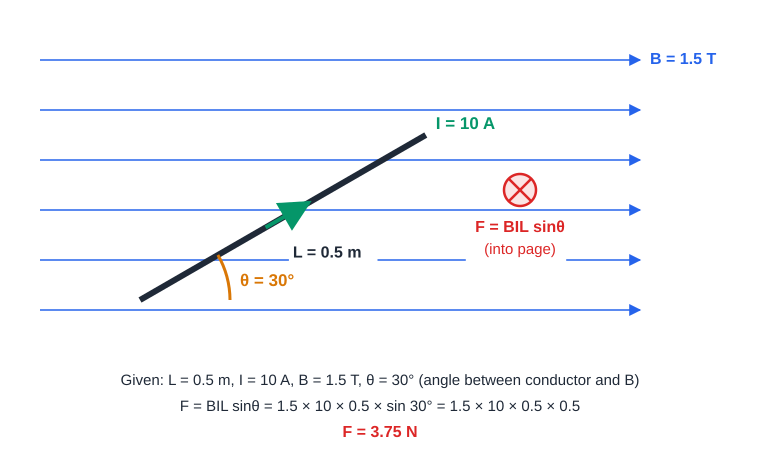

**Given:** $l = 0.5\,\mathrm{m}$, $\theta = 30^\circ$ (between the conductor and $\vec B$), $B = 1.5\,\mathrm{T}$, $I = 10\,\mathrm{A}$.

**Formula:** $F = BIl\sin\theta$

**Substitution:**

$$F = 1.5\,\mathrm{T}\times10\,\mathrm{A}\times0.5\,\mathrm{m}\times\sin30^\circ = 1.5\times10\times0.5\times0.5\,\mathrm{N}$$

> [!IMPORTANT]
> $F = 3.75\,\mathrm{N}$, directed perpendicular to the plane containing the conductor and $\vec B$ (into the page in the figure, from $\vec l\times\vec B$).

**Worked example (loudspeaker voice coil).**
Given: $10\,\mathrm{m}$ of wire in a radial field of $1.0\,\mathrm{T}$ carrying $0.5\,\mathrm{A}$ (illustrative), $\theta = 90^\circ$.
Formula: $F = BIl\sin\theta$.
Substitution: $F = 1.0\times0.5\times10\times1$.
Answer: $F = 5\,\mathrm{N}$, which pushes the cone; the force reverses with the current, so the cone vibrates.

> [!NOTE]
> **Extra: effective component.** Only the component of $\vec B$ perpendicular to the conductor, $B_\perp = B\sin\theta = 1.5\times0.5 = 0.75\,\mathrm{T}$, exerts a force, so $F = B_\perp Il = 0.75\times10\times0.5 = 3.75\,\mathrm{N}$. At $\theta = 0^\circ$ the force is zero and at $90^\circ$ it is maximum, $7.5\,\mathrm{N}$.

> [!TIP]
> Here $\theta$ is the angle between the conductor and the field (not the normal). $\sin30^\circ = 0.5$. Give the direction as well as the magnitude.

> State and explain Faraday's law of electromagnetic induction.

### Ans. to the question no. 3(a) (2023)

Same as [2016 Q2(a)](#ans-to-the-question-no-2a-2016) (use the experiment figure there to explain).

> What is hysteresis? State and explain the hysteresis curve.

### Ans. to the question no. 3(b) (2023)

Same as [2021 Q4(a)](#ans-to-the-question-no-4a-2021).

> State Lenz's law. Explain how Lenz's law indicates the direction of induced current.
>
> Asked in: 2023 Q3(c)

### Ans. to the question no. 3(c) (2023)

**Lenz's law.** The induced current flows in the direction such that its magnetic field opposes the change of flux that produces it (energy proof: [2017 Q4(c)](#ans-to-the-question-no-4c-2017)).

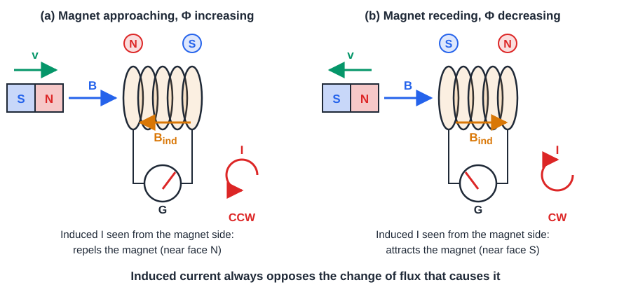

**Method to find the direction**

1. Find the direction of the external field $\vec B$ through the loop.
2. Decide whether the flux through the loop is increasing or decreasing.
3. The induced field $\vec B_{\text{ind}}$ opposes the change: opposite to $\vec B$ if the flux is increasing, along $\vec B$ if the flux is decreasing.
4. Use the right-hand rule: thumb along $\vec B_{\text{ind}}$, curled fingers give the sense of the induced current.

**Application to the figure**

- **(a) North pole approaching.** $\vec B$ points to the right and is increasing, so $\vec B_{\text{ind}}$ points left. The near face is a north pole, which repels the magnet. The current is counter-clockwise as seen from the magnet side.
- **(b) North pole receding.** $\vec B$ points to the right and is decreasing, so $\vec B_{\text{ind}}$ points right. The near face is a south pole, which attracts the magnet and resists its removal. The current is clockwise as seen from the magnet side.

> [!IMPORTANT]
> Induced current: opposes the change of flux. Flux increasing: $\vec B_{\text{ind}}$ opposite to $\vec B$. Flux decreasing: $\vec B_{\text{ind}}$ along $\vec B$. Quick rule: the face nearest the approaching pole has the same polarity (repels); the face nearest the receding pole has the opposite polarity (attracts).

**Worked example (search coil or wireless-charger pick-up coil).**
Given: one-turn loop of area $0.01\,\mathrm{m^{2}}$, resistance $0.5\,\Omega$, field out of the page rising uniformly from $0$ to $0.2\,\mathrm{T}$ in $0.05\,\mathrm{s}$.
Formula: $|\varepsilon| = A\,\Delta B/\Delta t$, $I = |\varepsilon|/R$.
Substitution: $|\varepsilon| = \dfrac{0.01\times0.2}{0.05}\,\mathrm{V}$.
Answer: $|\varepsilon| = 0.04\,\mathrm{V}$ and $I = 0.04/0.5 = 0.08\,\mathrm{A}$. The flux out of the page increases, so $\vec B_{\text{ind}}$ is into the page and the current is clockwise as seen from the front.

> [!NOTE]
> **Extra: magnet falling through a copper tube.** A magnet dropped through a copper pipe falls slowly because eddy currents in the pipe oppose the change of flux, with the same near-face rule as in the figure. The kinetic energy lost is converted to heat in the pipe, which is Lenz's law and energy conservation together.

> [!TIP]
> Lenz's law says "opposes the change", not "opposite to the field". State whether the flux is increasing or decreasing before giving the direction. Clockwise or counter-clockwise depends on the side you view from, so say which side.

## Concept map

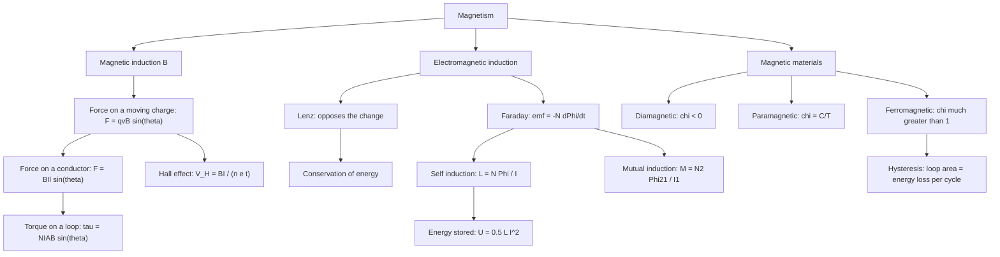

## One-page cheat sheet

| Topic | Key statement or formula |
| --- | --- |
| Flux | $\Phi_B = BA\cos\theta$, unit Wb, $\theta$ from the normal |
| Faraday | $\varepsilon = -N\,d\Phi_B/dt$; emf depends on the rate of change of flux |
| Lenz | Induced current opposes the change of flux; consequence of energy conservation, $Fv = I^{2}R$ |
| Motional emf | $\varepsilon = Blv$ |
| Force on a charge | $\vec F = q\vec v\times\vec B$, $F = qvB\sin\theta$; no work done; $r = mv/(qB)$, $T = 2\pi m/(qB)$ |
| Force on a conductor | $F = BIl\sin\theta$, $\theta$ between conductor and $\vec B$ |
| Torque on a loop | $\tau = NIAB\sin\theta = mB\sin\theta$, $\theta$ from the normal; $U = -mB\cos\theta$ |
| Self induction | $L = N\Phi/I$, $\varepsilon = -L\,dI/dt$, $U = \tfrac{1}{2}LI^{2}$; solenoid $L = \mu_0N^{2}A/\ell$ |
| Mutual induction | $M = N_2\Phi_{21}/I_1$, $\varepsilon_2 = -M\,dI_1/dt$ |
| Hall effect | $V_H = BI/(net)$, $R_H = \pm1/(ne)$ (n-type negative, p-type positive), $t$ along $\vec B$ |
| Materials | $B = \mu_0(H + M)$, $\chi = M/H$, $\mu_r = 1 + \chi$ |
| Dia / para / ferro | $\chi<0$ small / $\chi>0$ small, $C/T$ / $\chi\gg1$, domains, $T_C$ |
| Hysteresis | $B_r$ retentivity, $H_c$ coercivity, $B_s$ saturation; loop area $=\oint H\,dB$ per unit volume per cycle |

**Numerical answers in this file:** 2018 Q2(c) torque $= 2\times10^{-3}\,\mathrm{N\,m}$; 2021 Q2(c) $L = 0.08\,\mathrm{H}$; 2023 Q2(c) $F = 3.75\,\mathrm{N}$.

## Glossary

| Term | Meaning |
| --- | --- |
| Magnetic induction $B$ | Magnetic flux density; force per unit charge per unit speed; unit tesla |
| Magnetic flux $\Phi$ | $\int\vec B\cdot d\vec A$; number of field lines through an area; unit weber |
| Flux linkage | $N\Phi$ for a coil of $N$ turns |
| emf | Energy supplied per unit charge; here the induced voltage, unit volt |
| Lenz's law | The induced current opposes the change of flux that causes it |
| Self-inductance $L$ | Flux linkage per unit current in the same coil; unit henry |
| Mutual inductance $M$ | Flux linkage in one coil per unit current in another; unit henry |
| Torque | Turning effect of a force, $\vec r\times\vec F$ |
| Magnetic moment $\vec m$ | $NIA\hat n$ for a loop; torque is $\vec m\times\vec B$ |
| Hall voltage | Transverse voltage across a current-carrying slab in a perpendicular field |
| Hall coefficient $R_H$ | $E_H/(JB) = \pm1/(ne)$; its sign gives the carrier type |
| Susceptibility $\chi$ | $M/H$; dimensionless response of a material |
| Curie temperature $T_C$ | Temperature above which a ferromagnet becomes paramagnetic |
| Domain | Region of a ferromagnet in which atomic moments are aligned |
| Retentivity | Value of $B$ left when $H = 0$ after saturation |
| Coercivity | Reverse $H$ needed to bring $B$ to zero |
| Saturation | State with all domains aligned |
| Hysteresis | Lag of $B$ behind $H$ in a magnetisation cycle |
| Eddy current | Circulating induced current in a bulk conductor |

## New practice problems

These four are new problems, not from the exam list. Try them first, then open the answer.

**P1.** A flat coil of $250$ turns and area $40\,\mathrm{cm^{2}}$ has a uniform field of $0.6\,\mathrm{T}$ perpendicular to it. The field falls to zero in $0.03\,\mathrm{s}$. Find the average induced emf.

Answer to P1

Given: $N = 250$, $A = 4\times10^{-3}\,\mathrm{m^{2}}$, $\Delta B = 0.6\,\mathrm{T}$, $\Delta t = 0.03\,\mathrm{s}$.
Formula: $|\varepsilon| = NA\,\Delta B/\Delta t$.
Substitution: $|\varepsilon| = \dfrac{250\times4\times10^{-3}\times0.6}{0.03}\,\mathrm{V}$.
Answer: $|\varepsilon| = 20\,\mathrm{V}$.

**P2.** A coil of $50$ turns measuring $3\,\mathrm{cm}\times4\,\mathrm{cm}$ carries $2\,\mathrm{A}$ in a uniform field of $0.5\,\mathrm{T}$. The normal to the coil makes $60^\circ$ with the field. Find the torque.

Answer to P2

Given: $N = 50$, $A = 1.2\times10^{-3}\,\mathrm{m^{2}}$, $I = 2\,\mathrm{A}$, $B = 0.5\,\mathrm{T}$, $\theta = 60^\circ$.
Formula: $\tau = NIAB\sin\theta$.
Substitution: $\tau = 50\times2\times1.2\times10^{-3}\times0.5\times\sin60^\circ\,\mathrm{N\,m}$.
Answer: $\tau\approx5.2\times10^{-2}\,\mathrm{N\,m}$.

**P3.** An n-type semiconductor slab of thickness $0.5\,\mathrm{mm}$ and carrier density $5\times10^{21}\,\mathrm{m^{-3}}$ carries $10\,\mathrm{mA}$ in a perpendicular field of $0.2\,\mathrm{T}$. Find the Hall voltage and the Hall coefficient.

Answer to P3

Given: $t = 5\times10^{-4}\,\mathrm{m}$, $n = 5\times10^{21}\,\mathrm{m^{-3}}$, $I = 10^{-2}\,\mathrm{A}$, $B = 0.2\,\mathrm{T}$.
Formula: $V_H = BI/(net)$, $R_H = -1/(ne)$.
Substitution: $V_H = \dfrac{0.2\times10^{-2}}{5\times10^{21}\times1.6\times10^{-19}\times5\times10^{-4}}\,\mathrm{V}$.
Answer: $V_H = 5\,\mathrm{mV}$; $R_H = -1/(5\times10^{21}\times1.6\times10^{-19})\approx-1.25\times10^{-3}\,\mathrm{m^{3}\,C^{-1}}$ (negative for n-type).

**P4.** A long solenoid has $800$ turns, length $0.4\,\mathrm{m}$ and cross-section $5\,\mathrm{cm^{2}}$. Find its self-inductance, the energy stored at $3\,\mathrm{A}$, and the average emf if the current falls from $3\,\mathrm{A}$ to zero in $2\,\mathrm{ms}$.

Answer to P4

Given: $N = 800$, $\ell = 0.4\,\mathrm{m}$, $A = 5\times10^{-4}\,\mathrm{m^{2}}$, $I = 3\,\mathrm{A}$.
Formula: $L = \mu_0N^{2}A/\ell$, $U = \tfrac{1}{2}LI^{2}$, $|\varepsilon| = L\,\Delta I/\Delta t$.
Substitution: $L = \dfrac{4\pi\times10^{-7}\times800^{2}\times5\times10^{-4}}{0.4}\,\mathrm{H}$.
Answer: $L\approx1.0\times10^{-3}\,\mathrm{H}$ ($1.0\,\mathrm{mH}$); $U = \tfrac{1}{2}\times1.005\times10^{-3}\times9\approx4.5\times10^{-3}\,\mathrm{J}$; $|\varepsilon| = 1.005\times10^{-3}\times3/(2\times10^{-3})\approx1.5\,\mathrm{V}$.

