# PHY-103 Thermodynamics — Quick-Rev Solutions (2015–2023)

| Field | Value |
|---|---|
| Course | BUTEX · PHY-103 (Physics-II) |
| Topic | Thermodynamics (PART B only) |
| Years covered | 2016, 2017, 2018, 2020, 2021, 2022, 2023 |
| Author | Itachi_re's revision notes |
| Version | v261103-0 |
| Date | 2026-11-03 |

> [!NOTE]
> Only PART B (Thermodynamics) is covered here. Entropy as a standalone topic, modern physics, electricity, magnetism and kinetic theory are **not** included.

---

## Table of Contents

- [Year × Topic Appearance Matrix](#year--topic-appearance-matrix)
- [Formula & Units Sheet](#formula--units-sheet)
- [2016](#2016)
  - [Q5(b) Van der Waals critical constants](#q5b-van-der-waals-critical-constants)
  - [Q5(c) Tc in terms of Boyle temperature](#q5c-tc-in-terms-of-boyle-temperature)
  - [Q6(b) The four laws of thermodynamics](#q6b-the-four-laws-of-thermodynamics)
  - [Q6(c) CO2 critical temperature](#q6c-co2-critical-temperature)
- [2017](#2017)
  - [Q5(a) Internal energy and thermodynamic functions](#q5a-internal-energy-and-thermodynamic-functions)
  - [Q5(b) Reversible vs irreversible processes](#q5b-reversible-vs-irreversible-processes)
  - [Q5(c) Carnot engine efficiency](#q5c-carnot-engine-efficiency)
  - [Q6(a) Second law of thermodynamics](#q6a-second-law-of-thermodynamics)
  - [Q6(c) Carnot numerical (177 °C / 77 °C)](#q6c-carnot-numerical-177-c--77-c)
- [2018](#2018)
  - [Q8(a) Second law of thermodynamics](#q8a-second-law-of-thermodynamics)
  - [Q8(b) Specific heat capacity; Cp − Cv = R](#q8b-specific-heat-capacity-cp--cv--r)
  - [Q8(c) Carnot engine and reversibility](#q8c-carnot-engine-and-reversibility)
- [2020](#2020)
  - [Q6(a) Maxwell thermodynamic relations — general derivation](#q6a-maxwell-thermodynamic-relations--general-derivation)
  - [Q6(b) TdS-equation and Maxwell result](#q6b-tds-equation-and-maxwell-result)
  - [Q7(a) Carnot engine and reversibility](#q7a-carnot-engine-and-reversibility)
  - [Q7(b) Carnot efficiency between steam and ice points](#q7b-carnot-efficiency-between-steam-and-ice-points)
- [2021](#2021)
  - [Q7(a) Carnot cycle](#q7a-carnot-cycle)
  - [Q7(b) Carnot efficiency derivation](#q7b-carnot-efficiency-derivation)
  - [Q7(c) First vs second law](#q7c-first-vs-second-law)
  - [Q7(d) Specific heat](#q7d-specific-heat)
  - [Q8(a) Second law of thermodynamics](#q8a-second-law-of-thermodynamics-1)
  - [Q8(c) Adiabatic expansion of dry air](#q8c-adiabatic-expansion-of-dry-air)
- [2022](#2022)
  - [Q5(a) Zeroth law; first law as energy conservation](#q5a-zeroth-law-first-law-as-energy-conservation)
  - [Q5(c) Carnot engine and reversibility](#q5c-carnot-engine-and-reversibility)
  - [Q6(a) Molar specific heat; Cp vs Cv](#q6a-molar-specific-heat-cp-vs-cv)
  - [Q6(b) Isentropic process and work](#q6b-isentropic-process-and-work)
  - [Q6(c) Isothermal expansion numerical](#q6c-isothermal-expansion-numerical)
- [2023](#2023)
  - [Q5(b) PV^γ = constant](#q5b-pvγ--constant)
  - [Q5(c) Tyre-burst adiabatic cooling](#q5c-tyre-burst-adiabatic-cooling)
  - [Q6(a) Cp vs Cv relation](#q6a-cp-vs-cv-relation)
  - [Q6(c) First vs second law](#q6c-first-vs-second-law)
  - [Q6(d) Carnot numerical (450 K / 350 K)](#q6d-carnot-numerical-450-k--350-k)
  - [Q8(a) Second law](#q8a-second-law)
  - [Q8(b) Cp − Cv = R](#q8b-cp--cv--r)
  - [Q8(c) Carnot engine and reversibility](#q8c-carnot-engine-and-reversibility-1)
- [Concept Map (Mermaid)](#concept-map-mermaid)
- [One-Page Cheat Sheet](#one-page-cheat-sheet)
- [Glossary](#glossary)
- [Four New Practice Problems](#four-new-practice-problems)

---

## Year × Topic Appearance Matrix

| Topic | 2016 | 2017 | 2018 | 2020 | 2021 | 2022 | 2023 | Total |
|---|:---:|:---:|:---:|:---:|:---:|:---:|:---:|:---:|
| Second law (statement) | Q6(b) | Q6(a) | Q8(a) | — | Q7(c), Q8(a) | Q5(a) | Q6(c), Q8(a) | **8** |
| Carnot engine / cycle / η | — | Q5(c), Q6(c) | Q8(c) | Q7(a), Q7(b) | Q7(a), Q7(b) | Q5(c) | Q6(d), Q8(c) | **9** |
| Cp − Cv = R | — | — | Q8(b) | — | — | Q6(a) | Q6(a), Q8(b) | **4** |
| Maxwell / TdS relations | — | — | — | Q6(a), Q6(b) | — | — | — | **2** |
| Laws (Zeroth/First/Third) | Q6(b) | — | — | — | — | Q5(a) | — | **2** |
| Reversible vs irreversible | — | Q5(b) | — | — | — | — | — | **1** |
| State functions (U,H,F,G,S) | — | Q5(a) | — | — | — | — | — | **1** |
| Van der Waals critical const. | Q5(b), Q5(c), Q6(c) | — | — | — | — | — | — | **3** |
| Adiabatic relations / PV^γ | — | — | — | — | Q8(c) | Q6(b) | Q5(b), Q5(c) | **4** |
| Numerical problems | Q6(c) | Q6(c) | — | Q7(b) | Q8(c) | Q6(c) | Q5(c), Q6(d) | **7** |

> [!TIP]
> **Priority order:** Carnot cycle & efficiency (9 appearances) > Second law (8) > Numericals (7) > Cp − Cv and adiabatic relations (4 each). Master these first.

---

## Formula & Units Sheet

| Quantity | Symbol | SI unit | Dimension |
|---|---|---|---|
| Internal energy | $U$ | $\mathrm{J}$ | $[M L^2 T^{-2}]$ |
| Heat | $Q$ | $\mathrm{J}$ | $[M L^2 T^{-2}]$ |
| Work | $W$ | $\mathrm{J}$ | $[M L^2 T^{-2}]$ |
| Molar heat at const. P | $C_p$ | $\mathrm{J\,mol^{-1}\,K^{-1}}$ | $[M L^2 T^{-2}\,\Theta^{-1}]$ |
| Molar heat at const. V | $C_v$ | $\mathrm{J\,mol^{-1}\,K^{-1}}$ | $[M L^2 T^{-2}\,\Theta^{-1}]$ |
| Ratio of specific heats | $\gamma = C_p/C_v$ | — | dimensionless |
| Efficiency | $\eta$ | — | dimensionless |
| Temperature | $T$ | $\mathrm{K}$ | $[\Theta]$ |
| Pressure | $P$ | $\mathrm{Pa}$ | $[M L^{-1} T^{-2}]$ |
| Volume | $V$ | $\mathrm{m^3}$ | $[L^3]$ |
| Entropy | $S$ | $\mathrm{J\,K^{-1}}$ | $[M L^2 T^{-2}\,\Theta^{-1}]$ |
| Enthalpy | $H = U + PV$ | $\mathrm{J}$ | $[M L^2 T^{-2}]$ |
| Helmholtz free energy | $F = U - TS$ | $\mathrm{J}$ | $[M L^2 T^{-2}]$ |
| Gibbs free energy | $G = H - TS$ | $\mathrm{J}$ | $[M L^2 T^{-2}]$ |

**Key relations**

$$
C_p - C_v = R, \qquad \gamma = \frac{C_p}{C_v}, \qquad C_v = \frac{R}{\gamma - 1}, \qquad C_p = \frac{\gamma R}{\gamma - 1}
$$

$$
\eta_{\text{Carnot}} = 1 - \frac{T_2}{T_1} = \frac{T_1 - T_2}{T_1}
$$

$$
PV^\gamma = \text{const}, \qquad TV^{\gamma-1} = \text{const}, \qquad T P^{(1-\gamma)/\gamma} = \text{const}
$$

---

## 2016

### Q5(b) Van der Waals critical constants

> Deduce $V_c = 3b$, $P_c = \dfrac{a}{27b^2}$, $T_c = \dfrac{8a}{27bR}$.
>
> *Asked in: 2016 Q5(b).* (Van der Waals equation is listed under Thermodynamics in this paper.)

#### Ans. to the question no. 5(b)

At the critical point the isotherm has a horizontal inflection: both the first and second derivatives of $P$ with respect to $V$ (at constant $T$) vanish.

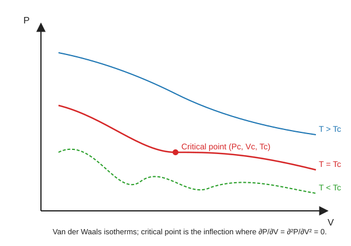

#### Derivation

The Van der Waals equation for one mole is

$$
\left(P + \frac{a}{V^2}\right)(V - b) = RT
$$

1. Solve for $P$:

$$
P = \frac{RT}{V - b} - \frac{a}{V^2}
$$

2. First derivative at constant $T$:

$$
\left(\frac{\partial P}{\partial V}\right)_T = -\frac{RT}{(V - b)^2} + \frac{2a}{V^3}
$$

3. Second derivative at constant $T$:

$$
\left(\frac{\partial^2 P}{\partial V^2}\right)_T = \frac{2RT}{(V - b)^3} - \frac{6a}{V^4}
$$

4. At the critical point $(P_c, V_c, T_c)$ both derivatives vanish:

$$
\frac{RT_c}{(V_c - b)^2} = \frac{2a}{V_c^3} \quad \text{(i)}
$$

$$
\frac{2RT_c}{(V_c - b)^3} = \frac{6a}{V_c^4} \quad \text{(ii)}
$$

5. Divide (ii) by (i):

$$
\frac{2}{V_c - b} = \frac{3}{V_c}
$$

6. Cross-multiply: $2V_c = 3V_c - 3b$, hence

$$
V_c = 3b
$$

7. Substitute $V_c = 3b$ into (i):

$$
\frac{RT_c}{(2b)^2} = \frac{2a}{27b^3} \;\;\Longrightarrow\;\; T_c = \frac{8a}{27bR}
$$

8. Substitute $V_c$ and $T_c$ back into the Van der Waals equation:

$$
P_c = \frac{R \cdot \frac{8a}{27bR}}{3b - b} - \frac{a}{9b^2} = \frac{4a}{27b^2} - \frac{a}{9b^2} = \frac{a}{27b^2}
$$

> [!IMPORTANT]
> $$V_c = 3b, \qquad P_c = \frac{a}{27b^2}, \qquad T_c = \frac{8a}{27bR}$$
> The **critical coefficient** is $\dfrac{P_c V_c}{R T_c} = \dfrac{3}{8} = 0.375$, a universal prediction of the Van der Waals model.

#### Worked example (real-world)

For CO₂ the Van der Waals constants are $a = 3.59\,\mathrm{L^2\,atm\,mol^{-2}}$ and $b = 0.0427\,\mathrm{L\,mol^{-1}}$.

$$
V_c = 3(0.0427) = 0.128\,\mathrm{L\,mol^{-1}}, \quad T_c = \frac{8(3.59)}{27(0.0427)(0.0821)} \approx 304\,\mathrm{K}
$$

The measured critical temperature of CO₂ is 304.1 K — excellent agreement.

#### Extra

The three real roots of the cubic in $V$ at $T = T_c$ coalesce to a triple root $V = V_c$, so

$$
(V - V_c)^3 = 0 \;\;\Longrightarrow\;\; V^3 - 3V_c V^2 + 3V_c^2 V - V_c^3 = 0
$$

Expanding the Van der Waals equation into a cubic in $V$ and matching coefficients gives the same $V_c = 3b$, $P_c = a/27b^2$, $T_c = 8a/27bR$ without any differentiation — an elegant alternative.

> [!TIP]
> Common mistakes: (i) forgetting that **both** $\partial P/\partial V$ and $\partial^2 P/\partial V^2$ must vanish; (ii) mixing up $a/V^2$ with $a/V$; (iii) writing $T_c = 8a/(27b^2 R)$ — the $b$ is to the first power only.

---

### Q5(c) $T_c$ in terms of Boyle temperature

> Prove $T_c = \dfrac{8}{27}\,T_0$, where $T_0$ is the Boyle temperature.
>
> *Asked in: 2016 Q5(c).*

#### Ans. to the question no. 5(c)

The Boyle temperature of a Van der Waals gas is

$$
T_0 = \frac{a}{bR}
$$

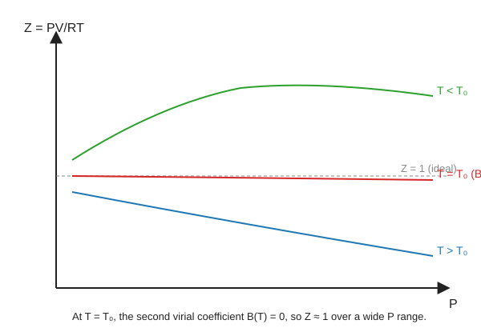

#### Derivation

1. From Q5(b), $T_c = \dfrac{8a}{27bR}$.
2. Rewrite:

$$
T_c = \frac{8}{27} \cdot \frac{a}{bR}
$$

3. Substitute $T_0 = a/(bR)$:

$$
T_c = \frac{8}{27}\,T_0
$$

> [!IMPORTANT]
> $$T_c = \frac{8}{27}\,T_0 \approx 0.296\,T_0$$
> The critical temperature is always **less** than the Boyle temperature for a Van der Waals gas.

#### Worked example

For nitrogen, $T_0 \approx 327\,\mathrm{K}$, so $T_c \approx (8/27)(327) \approx 96.9\,\mathrm{K}$ — close to the measured $126\,\mathrm{K}$ (the Van der Waals model underestimates $T_c$).

#### Extra

The Boyle temperature is where the second virial coefficient $B(T) = b - a/(RT)$ vanishes. Above $T_0$, the gas is "more ideal" over a wider pressure range because attractive and repulsive corrections cancel.

> [!TIP]
> Memorise $T_0 = a/(bR)$ — without it the proof is one line but you lose the setup marks.

---

### Q6(b) The four laws of thermodynamics

> Explain all the thermodynamic laws.
>
> *Asked in: 2016 Q6(b).*

#### Ans. to the question no. 6(b)

There are four laws, numbered Zeroth to Third, each capturing a different empirical fact about thermal systems.

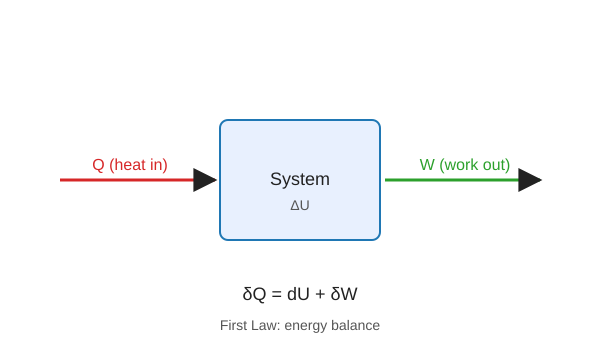

#### Derivation / Statements

1. **Zeroth law.** If system A is in thermal equilibrium with system C, and system B is also in thermal equilibrium with C, then A and B are in thermal equilibrium with each other. This justifies **temperature** as a transitive property and makes thermometry possible.

2. **First law.** Energy is conserved. For any cyclic process $\oint \delta Q = \oint \delta W$; for an infinitesimal change of a closed system,

$$
\delta Q = dU + \delta W
$$

where $U$ is the internal energy (a state function).

3. **Second law.** (a) *Kelvin–Planck:* No process is possible whose sole result is the complete conversion of heat into work. (b) *Clausius:* No process is possible whose sole result is the transfer of heat from a colder to a hotter body. Equivalently, for any cycle $\oint \dfrac{\delta Q}{T} \le 0$, with equality for a reversible cycle.

4. **Third law.** As $T \to 0$, the entropy of a perfectly crystalline substance approaches zero: $\lim_{T \to 0} S = 0$. Equivalently, absolute zero cannot be reached in a finite number of operations (Nernst heat theorem).

> [!IMPORTANT]
> - **Zeroth** → defines temperature.
> - **First** → defines internal energy (conservation).
> - **Second** → defines entropy (direction of processes).
> - **Third** → fixes the zero of entropy.

#### Worked example

A refrigerator (second law) moves heat from a cold interior (4 °C) to a warm kitchen (30 °C) — but only because electrical work is supplied. Without the compressor running, heat flows the other way (spontaneously), never from cold to hot.

#### Extra

The **Carnot theorem** (a consequence of the second law): *No engine operating between two reservoirs can be more efficient than a reversible (Carnot) engine between the same reservoirs.* This gives a universal efficiency ceiling $\eta \le 1 - T_2/T_1$.

> [!TIP]
> Students often forget the **Zeroth law**. Always list all four. For the third law, mentioning "absolute zero unattainable" earns an extra mark.

---

### Q6(c) CO₂ critical temperature

> For CO₂, with unit pressure = standard barometric pressure and unit volume = volume at NTP, $a = 0.00874$ and $b = 0.0023$. Calculate $T_c$.
>
> *Asked in: 2016 Q6(c).*

#### Ans. to the question no. 6(c)

In the stated units, $P_0 = 1$ (atm), $V_0 = $ volume of 1 mol at NTP, $T_0 = 273\,\mathrm{K}$, so $R = P_0 V_0 / T_0 = 1/273$.

#### Derivation

1. From Q5(b), $T_c = \dfrac{8a}{27 b R}$.
2. Substitute $R = 1/273$:

$$
T_c = \frac{8 \times 0.00874 \times 273}{27 \times 0.0023}
$$

3. Numerator: $8 \times 0.00874 \times 273 = 19.088$.
4. Denominator: $27 \times 0.0023 = 0.0621$.
5. $T_c = 19.088 / 0.0621 = 307.4\,\mathrm{K}$.

> [!IMPORTANT]
> $$T_c \approx 307.4\,\mathrm{K} \approx 34.4\,^\circ\mathrm{C}$$
> The measured critical temperature of CO₂ is about $304\,\mathrm{K}$; the Van der Waals prediction is within 1 %.

#### Worked example

The critical temperature tells us the highest temperature at which CO₂ can be liquefied by pressure alone. Above 304 K, no amount of pressure will liquefy CO₂ — which is why supercritical CO₂ is used as a solvent in decaffeination.

#### Extra

The constants $a$ and $b$ given are in "atm, NTP-volume, atm·NTP-volume" units. Converting to SI: $a_{\mathrm{SI}} = a \cdot P_0 V_0^2 \approx 3.6\,\mathrm{L^2\,atm\,mol^{-2}}$, matching the textbook value.

> [!TIP]
> The trap is the **unit system**: $R = 1/273$, not $8.314$. Forgetting this gives an answer off by a factor of ~2300.

---

## 2017

### Q5(a) Internal energy and thermodynamic functions

> What are internal energy and thermodynamical function?
>
> *Asked in: 2017 Q5(a).*

#### Ans. to the question no. 5(a)

A **state function** (or thermodynamic function) is a property whose value depends only on the current state of the system, not on how that state was reached. Its differential is exact.

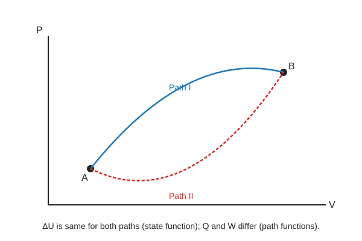

#### Derivation / Definitions

1. **Internal energy $U$.** The sum of all microscopic kinetic and potential energies of the molecules. For an ideal gas $U = C_v T$ (depends only on $T$). First law: $\delta Q = dU + \delta W$.

2. **Thermodynamic (state) functions.** The four principal ones are:

| Function | Definition | Natural variables |
|---|---|---|
| Internal energy | $U$ | $S, V$ |
| Enthalpy | $H = U + PV$ | $S, P$ |
| Helmholtz free energy | $F = U - TS$ | $T, V$ |
| Gibbs free energy | $G = H - TS$ | $T, P$ |

3. Entropy $S$ is also a state function, defined by $dS = \delta Q_{\text{rev}}/T$.

> [!IMPORTANT]
> $U, H, F, G, S$ are all **state functions**; $Q$ and $W$ are **path functions**. For any cyclic process $\oint dU = 0$ but $\oint \delta Q \ne 0$ in general.

#### Worked example

Heating 1 mol of ideal gas from 300 K to 400 K at constant volume: $\Delta U = C_v \Delta T$, regardless of whether the heating is done by a flame, an electric heater, or friction. The path doesn't matter — that is what makes $U$ a state function.

#### Extra

The differential forms are

$$
dU = T\,dS - P\,dV, \qquad dH = T\,dS + V\,dP
$$

$$
dF = -S\,dT - P\,dV, \qquad dG = -S\,dT + V\,dP
$$

These are the starting points for all four Maxwell relations.

> [!TIP]
> Don't confuse "thermodynamic function" (state function) with "thermodynamic process" (path). Examiners deduct marks for this.

---

### Q5(b) Reversible vs irreversible processes

> Distinguish between reversible and irreversible processes.
>
> *Asked in: 2017 Q5(b).*

#### Ans. to the question no. 5(b)

A **reversible** process is one that can be retraced in the opposite direction by an infinitesimal change in the surroundings, with both system and surroundings returning to their original states. An **irreversible** process cannot be so retraced.

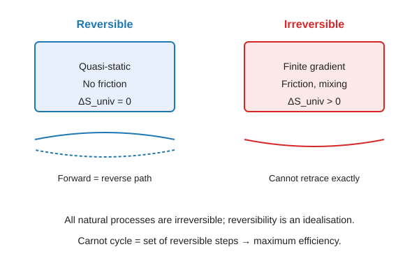

#### Derivation / Comparison

| Feature | Reversible | Irreversible |
|---|---|---|
| Speed | Quasi-static (infinitesimally slow) | Finite rate |
| Driving force | Infinitesimal gradient | Finite gradient |
| Dissipation | None | Present (friction, turbulence, etc.) |
| Entropy change of universe | $\Delta S_{\text{univ}} = 0$ | $\Delta S_{\text{univ}} > 0$ |
| Work output | Maximum | Less than maximum |
| Examples | Frictionless quasi-static expansion | Free expansion, mixing, heat flow across finite $\Delta T$ |

> [!IMPORTANT]
> All natural (spontaneous) processes are **irreversible**. Reversible processes are idealisations that set the upper bound on efficiency (Carnot).

#### Worked example

A gas expanding against a piston with friction is irreversible — some work is lost as heat. If the piston is massless and frictionless and the external pressure is reduced grain by grain, the expansion is (ideally) reversible.

#### Extra

Mathematically, for a reversible process $\delta Q = T\,dS$ (exact); for irreversible $\delta Q < T\,dS$, i.e. $dS > \delta Q/T$ (Clausius inequality).

> [!TIP]
> Always mention **both** system and surroundings returning to original states — that is the full definition.

---

### Q5(c) Carnot engine efficiency

> Find an expression for the efficiency of a Carnot engine.
>
> *Asked in: 2017 Q5(c).*

#### Ans. to the question no. 5(c)

The efficiency of a Carnot engine working between a source at $T_1$ and a sink at $T_2$ is

$$
\eta = 1 - \frac{T_2}{T_1} = \frac{T_1 - T_2}{T_1}
$$

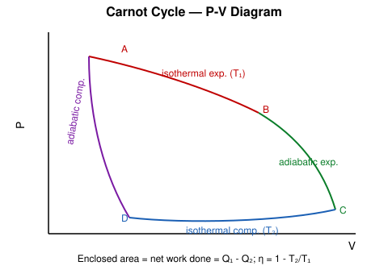

#### Derivation

1. The Carnot cycle has four reversible steps on 1 mol of ideal gas:
   - **A → B**: isothermal expansion at $T_1$, heat $Q_1$ absorbed.
   - **B → C**: adiabatic expansion, $T_1 \to T_2$.
   - **C → D**: isothermal compression at $T_2$, heat $Q_2$ rejected.
   - **D → A**: adiabatic compression, $T_2 \to T_1$.

2. Isothermal steps:

$$
Q_1 = RT_1 \ln\frac{V_B}{V_A}, \qquad Q_2 = RT_2 \ln\frac{V_C}{V_D}
$$

3. Adiabatic steps give $T_1 V_B^{\gamma-1} = T_2 V_C^{\gamma-1}$ and $T_1 V_A^{\gamma-1} = T_2 V_D^{\gamma-1}$. Dividing:

$$
\frac{V_B}{V_A} = \frac{V_C}{V_D}
$$

4. Therefore $Q_1/Q_2 = T_1/T_2$.

5. Efficiency:

$$
\eta = \frac{W}{Q_1} = \frac{Q_1 - Q_2}{Q_1} = 1 - \frac{Q_2}{Q_1} = 1 - \frac{T_2}{T_1}
$$

> [!IMPORTANT]
> $$\boxed{\eta = 1 - \frac{T_2}{T_1} = \frac{T_1 - T_2}{T_1}}$$
> $\eta = 1$ only if $T_2 = 0\,\mathrm{K}$, which the third law forbids — hence no perfect engine.

#### Worked example

A steam power plant with boiler at 500 °C (773 K) and condenser at 40 °C (313 K):

$$
\eta = 1 - \frac{313}{773} = 0.595 \approx 59.5\,\%
$$

Real plants achieve ~40 % because of irreversibilities.

#### Extra

**Carnot's theorem** (from the second law): no engine between $T_1$ and $T_2$ can beat $\eta_{\text{Carnot}}$. If one could, coupling it to a Carnot refrigerator would violate Clausius's statement.

> [!TIP]
> Always convert °C to K before using the formula — a classic exam killer.

---

### Q6(a) Second law of thermodynamics

> State and explain the second law of thermodynamics. How does it differ from the first law?
>
> *Asked in: 2017 Q6(a).*

#### Ans. to the question no. 6(a)

**Kelvin–Planck statement:** No process is possible whose sole result is the absorption of heat from a reservoir and its complete conversion into work.

**Clausius statement:** No process is possible whose sole result is the transfer of heat from a colder to a hotter body.

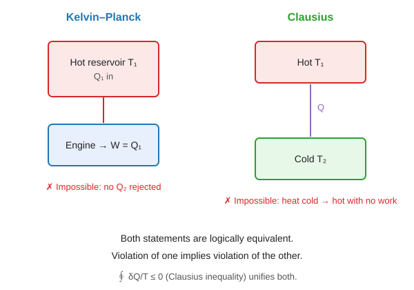

#### Derivation / Explanation

1. The **first law** says energy is conserved — it does **not** forbid heat flowing from cold to hot, or a ship powering itself by extracting heat from the sea.
2. The **second law** adds a **direction**: heat flows spontaneously from hot to cold; work can be fully converted to heat but not vice versa.
3. Mathematically, for any cycle $\oint \dfrac{\delta Q}{T} \le 0$ (Clausius inequality), with equality for reversible cycles. This defines entropy $S$ via $dS \ge \delta Q/T$.

| Aspect | First law | Second law |
|---|---|---|
| Concerns | Quantity of energy | Quality / direction |
| Forbids | Perpetual motion of 1st kind | Perpetual motion of 2nd kind |
| Introduces | $U$ | $S$ |
| Reversibility | Time-symmetric | Gives time's arrow |

> [!IMPORTANT]
> The first law says "you can't win"; the second law says "you can't even break even".

#### Worked example

A cup of hot coffee cools in a room. The first law is satisfied (energy goes from coffee to room). But the reverse — a lukewarm cup spontaneously heating up while the room cools — never happens, even though it would also satisfy the first law. The second law explains why.

#### Extra

**Equivalence of Kelvin–Planck and Clausius.** If Clausius were false (heat flows cold → hot for free), combine it with a heat engine to produce a Kelvin–Planck violator, and vice versa. Hence the two statements are logically equivalent.

> [!TIP]
> Always state **both** Kelvin–Planck and Clausius forms — examiners look for both.

---

### Q6(c) Carnot numerical (177 °C / 77 °C)

> A Carnot engine works between 177 °C and 77 °C and receives 4200 J per cycle. Find the heat rejected, the efficiency and the work done.
>
> *Asked in: 2017 Q6(c).* (Same physical problem as 2023 Q6(d), in different units.)

#### Ans. to the question no. 6(c)

Given → Formula → Substitution → Answer.

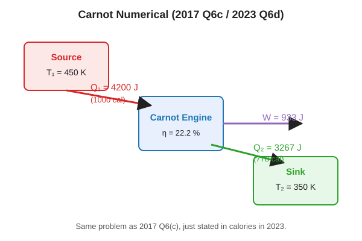

#### Derivation

1. $T_1 = 177 + 273 = 450\,\mathrm{K}$, $T_2 = 77 + 273 = 350\,\mathrm{K}$, $Q_1 = 4200\,\mathrm{J}$.
2. Efficiency:

$$
\eta = 1 - \frac{T_2}{T_1} = 1 - \frac{350}{450} = 1 - \frac{7}{9} = \frac{2}{9} \approx 0.2222
$$

3. Work done:

$$
W = \eta \, Q_1 = \frac{2}{9} \times 4200 = \frac{8400}{9} \approx 933.3\,\mathrm{J}
$$

4. Heat rejected:

$$
Q_2 = Q_1 - W = 4200 - 933.3 = 3266.7\,\mathrm{J}
$$

(Cross-check: $Q_2 = Q_1 \cdot T_2/T_1 = 4200 \times 350/450 = 3266.7\,\mathrm{J}$ ✓)

> [!IMPORTANT]
> $$\eta = 22.2\,\%, \qquad W = 933.3\,\mathrm{J}, \qquad Q_2 = 3266.7\,\mathrm{J}$$

#### Worked example

This is equivalent to a small heat engine taking 1 kcal (4200 J) from a hot reservoir and producing ~222 cal of useful work — typical of a low-temperature-difference engine.

#### Extra

The ratio $Q_1/T_1 = Q_2/T_2$ is a hallmark of the Carnot cycle; for any real engine $Q_1/T_1 > Q_2/T_2$ (entropy of universe increases).

> [!TIP]
> Always convert °C → K first. Also, $Q_2$ is the magnitude of heat rejected — write it as positive and state "rejected".

---

## 2018

### Q8(a) Second law of thermodynamics

> State and explain the second law of thermodynamics.
>
> *Asked in: 2018 Q8(a); repeated in 2021 Q8(a), 2023 Q8(a).*

Same as [2017 Q6(a)](#q6a-second-law-of-thermodynamics).

---

### Q8(b) Specific heat capacity; $C_p - C_v = R$

> What is specific heat capacity? For one mole of an ideal gas show $C_p - C_v = R$.
>
> *Asked in: 2018 Q8(b); repeated in 2023 Q8(b).*

#### Ans. to the question no. 8(b)

**Specific heat capacity** is the heat required to raise the temperature of unit quantity (1 kg or 1 mol) of a substance by 1 K. **Molar** specific heats at constant pressure and volume are $C_p$ and $C_v$.

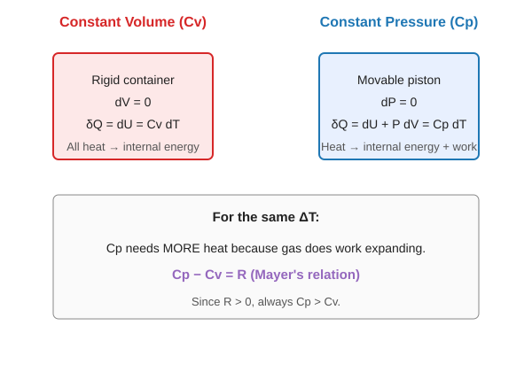

#### Derivation

1. First law for 1 mol: $\delta Q = dU + P\,dV$.
2. At constant volume ($dV = 0$): $\delta Q_V = dU = C_v\,dT$, so $dU = C_v\,dT$ for any process of an ideal gas (since $U$ depends only on $T$).
3. At constant pressure:

$$
\delta Q_P = dU + P\,dV = C_v\,dT + P\,dV
$$

4. But $\delta Q_P = C_p\,dT$ by definition, so

$$
C_p\,dT = C_v\,dT + P\,dV
$$

5. For 1 mol of ideal gas, $PV = RT \Rightarrow P\,dV = R\,dT$ at constant $P$.
6. Therefore

$$
C_p\,dT = C_v\,dT + R\,dT \;\;\Longrightarrow\;\; C_p - C_v = R
$$

> [!IMPORTANT]
> $$\boxed{C_p - C_v = R}$$
> This is **Mayer's relation**. Since $R > 0$, $C_p > C_v$ always — at constant pressure the gas does work as it expands, so more heat is needed.

#### Worked example

For air (mostly diatomic), $C_v \approx \frac{5}{2}R = 20.8\,\mathrm{J\,mol^{-1}\,K^{-1}}$, $C_p = C_v + R = \frac{7}{2}R = 29.1\,\mathrm{J\,mol^{-1}\,K^{-1}}$, $\gamma = 7/5 = 1.40$.

#### Extra

From $C_p - C_v = R$ and $\gamma = C_p/C_v$:

$$
C_v = \frac{R}{\gamma - 1}, \qquad C_p = \frac{\gamma R}{\gamma - 1}
$$

For monatomic gas $\gamma = 5/3$; diatomic $\gamma = 7/5$; polyatomic $\gamma = 4/3$.

> [!TIP]
> The step "$dU = C_v\,dT$ for any process of an ideal gas" is crucial — students lose marks by using it only at constant volume.

---

### Q8(c) Carnot engine and reversibility

> What is a Carnot engine? Show that the Carnot cycle is a reversible process.
>
> *Asked in: 2018 Q8(c); repeated in 2020 Q7(a), 2022 Q5(c), 2023 Q8(c).*

#### Ans. to the question no. 8(c)

A **Carnot engine** is an ideal heat engine working on the **Carnot cycle** — a completely reversible cycle between two reservoirs at $T_1$ (source) and $T_2$ (sink), consisting of two isothermal and two adiabatic processes.

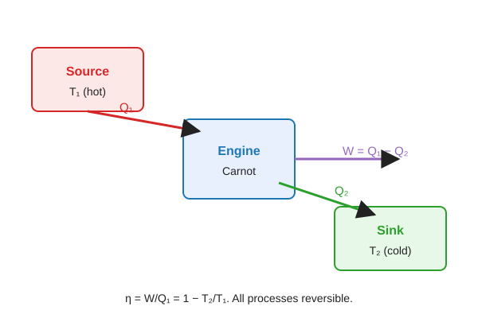

#### Derivation

1. The four steps (forward, on 1 mol of ideal gas):
   - **A → B**: reversible isothermal expansion at $T_1$; absorbs $Q_1$.
   - **B → C**: reversible adiabatic expansion; $T_1 \to T_2$.
   - **C → D**: reversible isothermal compression at $T_2$; rejects $Q_2$.
   - **D → A**: reversible adiabatic compression; $T_2 \to T_1$.

2. **Each step is quasi-static** (no finite gradients) and **dissipation-free** (no friction, no turbulence).
3. Reversing the direction (D → C → B → A → D) retraces every state:
   - Adiabats become adiabats (no heat exchange either way).
   - Isotherms become isotherms with heat flow reversed.
4. The system and surroundings both return exactly to their original states.

> [!IMPORTANT]
> The Carnot cycle is reversible because **every step is quasi-static and free of dissipative forces**. Running it backwards gives a Carnot refrigerator with the same $|Q_1|/|Q_2| = T_1/T_2$.

#### Worked example

A Carnot refrigerator between 0 °C (273 K) and 30 °C (303 K) has COP $= T_2/(T_1 - T_2) = 273/30 = 9.1$. For every 1 kJ of work, it extracts 9.1 kJ from the cold space.

#### Extra

The Carnot cycle on a $T$–$S$ diagram is a **rectangle**: two horizontal isotherms and two vertical isentropes. Area = $W = (T_1 - T_2)(S_B - S_A)$.

> [!TIP]
> "Reversible" must be justified step-by-step — just stating it is not enough.

---

## 2020

### Q6(a) Maxwell thermodynamic relations — general derivation

> Derive the general expression for the establishment of the Maxwell thermodynamic relations.
>
> *Asked in: 2020 Q6(a).*

#### Ans. to the question no. 6(a)

The Maxwell relations follow from the **exactness** of the differentials of the four thermodynamic potentials $U, H, F, G$.

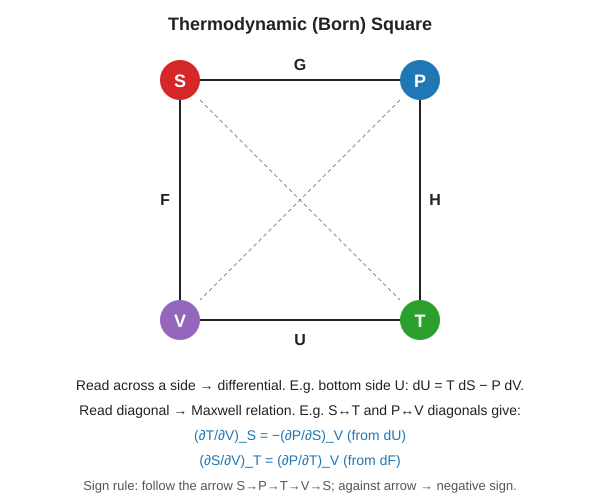

#### Derivation

1. If $dz = M\,dx + N\,dy$ is an exact differential, then

$$
\left(\frac{\partial M}{\partial y}\right)_x = \left(\frac{\partial N}{\partial x}\right)_y
$$

2. The four potentials and their differentials:

$$
dU = T\,dS - P\,dV \quad (M = T,\, N = -P,\, x = S,\, y = V)
$$

$$
dH = T\,dS + V\,dP \quad (M = T,\, N = V,\, x = S,\, y = P)
$$

$$
dF = -S\,dT - P\,dV \quad (M = -S,\, N = -P,\, x = T,\, y = V)
$$

$$
dG = -S\,dT + V\,dP \quad (M = -S,\, N = V,\, x = T,\, y = P)
$$

3. Applying exactness to each:

> [!IMPORTANT]
> $$\left(\frac{\partial T}{\partial V}\right)_S = -\left(\frac{\partial P}{\partial S}\right)_V \qquad \text{(from } dU \text{)}$$
> $$\left(\frac{\partial T}{\partial P}\right)_S = \left(\frac{\partial V}{\partial S}\right)_P \qquad \text{(from } dH \text{)}$$
> $$\left(\frac{\partial S}{\partial V}\right)_T = \left(\frac{\partial P}{\partial T}\right)_V \qquad \text{(from } dF \text{)}$$
> $$\left(\frac{\partial S}{\partial P}\right)_T = -\left(\frac{\partial V}{\partial T}\right)_P \qquad \text{(from } dG \text{)}$$

#### Worked example

From the third Maxwell relation, $(\partial S/\partial V)_T = (\partial P/\partial T)_V$. For an ideal gas $P = RT/V$, so $(\partial P/\partial T)_V = R/V$, hence $(\partial S/\partial V)_T = R/V$. Integrating gives the familiar $\Delta S = nR \ln(V_2/V_1)$ for isothermal expansion.

#### Extra

**Thermodynamic square (Born square).** Place $S, P, T, V$ at the corners with $F, U, H, G$ on the sides. Reading across gives the differential (e.g. $dU = T\,dS - P\,dV$); reading diagonals gives Maxwell relations. A handy mnemonic.

> [!TIP]
> Memorise the signs: $dU$ and $dF$ have "$-P\,dV$"; $dH$ and $dG$ have "$+V\,dP$". Sign errors are the #1 mistake.

---

### Q6(b) TdS-equation and Maxwell result

> Show that (i) $(\partial Q/\partial V)_T = T(\partial P/\partial T)_V$ and (ii) $(\partial T/\partial V)_S = -T(\partial P/\partial Q)_V$.
>
> *Asked in: 2020 Q6(b).*
>
> **Note:** Here $Q$ denotes **heat**, with $\delta Q = T\,dS$ along a reversible path. So (i) is the first TdS-equation and (ii) should read $(\partial T/\partial V)_S = -(\partial P/\partial S)_V$, which is the Maxwell relation from $dU$.

#### Ans. to the question no. 6(b)

#### Derivation

**Part (i).** Write $S = S(T, V)$:

$$
dS = \left(\frac{\partial S}{\partial T}\right)_V dT + \left(\frac{\partial S}{\partial V}\right)_T dV
$$

Multiply by $T$:

$$
T\,dS = T\left(\frac{\partial S}{\partial T}\right)_V dT + T\left(\frac{\partial S}{\partial V}\right)_T dV
$$

For a reversible process $\delta Q = T\,dS$, so at constant $T$:

$$
\left(\frac{\partial Q}{\partial V}\right)_T = T\left(\frac{\partial S}{\partial V}\right)_T
$$

By the Maxwell relation from $dF$: $(\partial S/\partial V)_T = (\partial P/\partial T)_V$. Therefore

$$
\left(\frac{\partial Q}{\partial V}\right)_T = T\left(\frac{\partial P}{\partial T}\right)_V
$$

**Part (ii).** The printed form "$-T(\partial P/\partial Q)_V$" is a typo; the intended Maxwell relation from $dU = T\,dS - P\,dV$ is

$$
\left(\frac{\partial T}{\partial V}\right)_S = -\left(\frac{\partial P}{\partial S}\right)_V
$$

Proof: $dU$ is exact with $M = T$, $N = -P$, $x = S$, $y = V$, so $(\partial T/\partial V)_S = (\partial (-P)/\partial S)_V$.

> [!IMPORTANT]
> $$\left(\frac{\partial Q}{\partial V}\right)_T = T\left(\frac{\partial P}{\partial T}\right)_V, \qquad \left(\frac{\partial T}{\partial V}\right)_S = -\left(\frac{\partial P}{\partial S}\right)_V$$

#### Worked example

For an ideal gas, $(\partial Q/\partial V)_T = T(R/V) = RT/V = P$. So isothermal expansion of an ideal gas absorbs heat $Q = \int P\,dV = nRT \ln(V_2/V_1)$, consistent with $\Delta U = 0$.

#### Extra

The **first TdS equation** is

$$
T\,dS = C_v\,dT + T\left(\frac{\partial P}{\partial T}\right)_V dV
$$

The **second TdS equation** (using $S = S(T, P)$) is

$$
T\,dS = C_p\,dT - T\left(\frac{\partial V}{\partial T}\right)_P dP
$$

These are workhorses for real-gas calculations.

> [!TIP]
> Read "$Q$" as "$T\,dS$" throughout — the question's notation is non-standard.

---

### Q7(a) Carnot engine and reversibility

> What is a Carnot engine? Show that the Carnot cycle is a reversible process.
>
> *Asked in: 2020 Q7(a).*

Same as [2018 Q8(c)](#q8c-carnot-engine-and-reversibility).

---

### Q7(b) Carnot efficiency between steam and ice points

> Define the efficiency of a Carnot engine. Find the efficiency of a Carnot engine working between the steam point and the ice point.
>
> *Asked in: 2020 Q7(b).*

#### Ans. to the question no. 7(b)

**Efficiency** $\eta = W/Q_1 = (Q_1 - Q_2)/Q_1 = 1 - T_2/T_1$.

#### Derivation

1. Steam point $T_1 = 100\,^\circ\mathrm{C} = 373\,\mathrm{K}$.
2. Ice point $T_2 = 0\,^\circ\mathrm{C} = 273\,\mathrm{K}$.
3. $\eta = 1 - 273/373 = 100/373$.

> [!IMPORTANT]
> $$\eta = \frac{100}{373} \approx 0.268 = 26.8\,\%$$

#### Worked example

Even with a 100 °C temperature difference, a perfect engine converts only ~27 % of heat into work — the rest must be rejected. This is why power plants use superheated steam at 500+ °C.

#### Extra

The **absolute thermodynamic temperature scale** (Kelvin) is *defined* by $Q_1/Q_2 = T_1/T_2$ for a Carnot engine — making temperature independent of any working substance.

> [!TIP]
> Always convert to kelvin — using 100 and 0 directly gives the wrong answer 100 %.

---

## 2021

### Q7(a) Carnot cycle

> What is the Carnot cycle?
>
> *Asked in: 2021 Q7(a).*

Same as [2018 Q8(c)](#q8c-carnot-engine-and-reversibility) (cycle description part).

---

### Q7(b) Carnot efficiency derivation

> Show that between $T_1$ and $T_2$ the efficiency is $\eta = (T_1 - T_2)/T_1$.
>
> *Asked in: 2021 Q7(b).*
>
> **Note:** The paper prints this wrongly; the correct form is $\eta = (T_1 - T_2)/T_1$.

Same derivation as [2017 Q5(c)](#q5c-carnot-engine-efficiency).

---

### Q7(c) First vs second law

> Distinguish between the first and the second law of thermodynamics.
>
> *Asked in: 2021 Q7(c); repeated in 2023 Q6(c).*

Same as [2017 Q6(a)](#q6a-second-law-of-thermodynamics) (comparison table part).

---

### Q7(d) Specific heat

> What is specific heat?
>
> *Asked in: 2021 Q7(d).*

#### Ans. to the question no. 7(d)

**Specific heat** $c$ of a substance is the amount of heat required to raise the temperature of unit mass (1 kg) by 1 K: $c = \dfrac{1}{m}\dfrac{\delta Q}{dT}$, unit $\mathrm{J\,kg^{-1}\,K^{-1}}$.

**Molar specific heat** $C$ is per mole: $C = \dfrac{1}{n}\dfrac{\delta Q}{dT}$, unit $\mathrm{J\,mol^{-1}\,K^{-1}}$.

> [!IMPORTANT]
> Specific heat is a **path-dependent** quantity in general; $C_p$ and $C_v$ are the two standard values for gases.

#### Worked example

Water: $c = 4186\,\mathrm{J\,kg^{-1}\,K^{-1}}$. Heating 1 kg by 10 K needs $Q = 1 \times 4186 \times 10 = 41{,}860\,\mathrm{J}$.

#### Extra

For solids at high temperature, Dulong–Petit law: $C \approx 3R \approx 25\,\mathrm{J\,mol^{-1}\,K^{-1}}$.

> [!TIP]
> Don't confuse **specific heat** (per kg) with **molar heat capacity** (per mol). State units.

---

### Q8(a) Second law of thermodynamics

> State and explain the second law of thermodynamics.
>
> *Asked in: 2021 Q8(a).*

Same as [2017 Q6(a)](#q6a-second-law-of-thermodynamics).

---

### Q8(c) Adiabatic expansion of dry air

> Dry air at 15 °C is expanded adiabatically to double its volume. Find the temperature ($\gamma = 1.40$).
>
> *Asked in: 2021 Q8(c).*

#### Ans. to the question no. 8(c)

#### Derivation

1. $T_1 = 15 + 273 = 288\,\mathrm{K}$, $V_2 = 2V_1$, $\gamma = 1.40$.
2. Adiabatic relation: $T_1 V_1^{\gamma - 1} = T_2 V_2^{\gamma - 1}$.
3. $T_2 = T_1 \left(\dfrac{V_1}{V_2}\right)^{\gamma - 1} = 288 \times \left(\dfrac{1}{2}\right)^{0.4}$.
4. $(1/2)^{0.4} = 2^{-0.4} = e^{-0.4 \ln 2} = e^{-0.2773} = 0.7579$.
5. $T_2 = 288 \times 0.7579 = 218.3\,\mathrm{K}$.

> [!IMPORTANT]
> $$T_2 \approx 218.3\,\mathrm{K} \approx -54.7\,^\circ\mathrm{C}$$

#### Worked example

This is why air released from a pressurised cylinder feels cold — adiabatic expansion cools it dramatically. Cloud formation on mountain slopes works the same way: rising air expands adiabatically and cools below the dew point.

#### Extra

Final pressure: $P_2 = P_1 (V_1/V_2)^\gamma = P_1 / 2^{1.4} = P_1 / 2.639 \approx 0.379\,P_1$.

> [!TIP]
> The exponent is $\gamma - 1 = 0.4$, not $\gamma = 1.4$. This is the most common numerical mistake.

---

## 2022

### Q5(a) Zeroth law; first law as energy conservation

> What is the zeroth law of thermodynamics? Show that the first law is the law of conservation of energy.
>
> *Asked in: 2022 Q5(a).*

#### Ans. to the question no. 5(a)

**Zeroth law:** If two systems are each in thermal equilibrium with a third, they are in thermal equilibrium with each other. This establishes **temperature** as a measurable, transitive property.

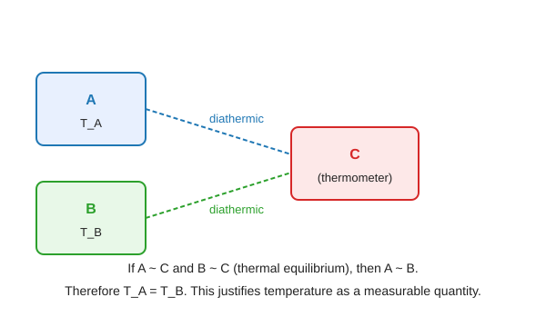

#### Derivation (first law = conservation of energy)

1. Joule's experiments showed that a given amount of work (mechanical, electrical, etc.) always produces the same temperature rise in an adiabatically enclosed system — independent of the method.
2. Hence there exists a state function $U$ (internal energy) such that the adiabatic work between two states is $W_{\text{ad}} = U_2 - U_1$, path-independent.
3. For a general (non-adiabatic) process, define heat $\delta Q = dU + \delta W$.
4. Over a cycle, $\oint dU = 0$ (since $U$ is a state function), so $\oint \delta Q = \oint \delta W$: net heat in = net work out.
5. Energy is neither created nor destroyed — only converted between heat, work and internal energy.

> [!IMPORTANT]
> The first law **defines** internal energy and **asserts** that energy is conserved in all processes.

#### Worked example

An electric heater (1 kW, 1 hour) in an insulated room adds $3.6 \times 10^6\,\mathrm{J}$ of electrical work, which becomes internal energy of the air — the room warms. Same $\Delta U$ whether the heat came from a flame or a heater.

#### Extra

The zeroth law was formulated **after** the first and second laws (hence "zeroth") because it logically underpins the concept of temperature used in both.

> [!TIP]
> Mention **Joule's experiments** — they are the experimental basis for $U$ being a state function.

---

### Q5(c) Carnot engine and reversibility

> What is a Carnot engine? Show that the Carnot cycle is a reversible process.
>
> *Asked in: 2022 Q5(c).*

Same as [2018 Q8(c)](#q8c-carnot-engine-and-reversibility).

---

### Q6(a) Molar specific heat; $C_p$ vs $C_v$

> Define molar specific heat. Find the relation between $C_p$ and $C_v$.
>
> *Asked in: 2022 Q6(a); repeated in 2023 Q6(a).*

Same as [2018 Q8(b)](#q8b-specific-heat-capacity-cp--cv--r).

---

### Q6(b) Isentropic process and work

> What is an isentropic process? Derive the work done in an isentropic process.
>
> *Asked in: 2022 Q6(b).*

#### Ans. to the question no. 6(b)

An **isentropic process** is one in which the entropy of the system remains constant ($dS = 0$). For a reversible process, $dS = \delta Q/T$, so isentropic = reversible adiabatic.

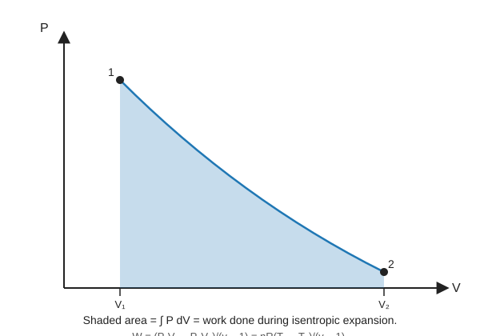

#### Derivation

1. $dS = 0 \Rightarrow \delta Q = 0$. First law: $dU = -\delta W = -P\,dV$.
2. For ideal gas: $C_v\,dT = -P\,dV$.
3. From $PV = RT$, differentiate: $P\,dV + V\,dP = R\,dT$.
4. Eliminate $dT$: $C_v(P\,dV + V\,dP)/R = -P\,dV$.
5. Using $C_p - C_v = R$ and $\gamma = C_p/C_v$:

$$
C_v P\,dV + C_v V\,dP = -R P\,dV = -(C_p - C_v) P\,dV
$$

$$
C_v V\,dP = -C_p P\,dV \;\;\Longrightarrow\;\; \frac{dP}{P} + \gamma \frac{dV}{V} = 0
$$

6. Integrate: $\ln P + \gamma \ln V = \text{const}$, so

$$
PV^\gamma = \text{const}
$$

7. Work for 1 mol from state 1 to state 2:

$$
W = \int_{V_1}^{V_2} P\,dV = \int_{V_1}^{V_2} \frac{K}{V^\gamma}\,dV = \frac{K}{1-\gamma}\left[V_2^{1-\gamma} - V_1^{1-\gamma}\right]
$$

Since $K = P_1 V_1^\gamma = P_2 V_2^\gamma$:

$$
W = \frac{P_2 V_2 - P_1 V_1}{1 - \gamma} = \frac{P_1 V_1 - P_2 V_2}{\gamma - 1}
$$

For $n$ moles, $W = \dfrac{nR(T_1 - T_2)}{\gamma - 1}$.

> [!IMPORTANT]
> $$W_{\text{isentropic}} = \frac{P_1 V_1 - P_2 V_2}{\gamma - 1} = \frac{nR(T_1 - T_2)}{\gamma - 1}$$

#### Worked example

1 mol of air ($\gamma = 1.4$) expands adiabatically from 300 K to 200 K:

$$
W = \frac{1 \times 8.314 \times (300 - 200)}{0.4} = \frac{831.4}{0.4} = 2078.5\,\mathrm{J}
$$

#### Extra

The work equals the area under the $PV$ curve. Since the adiabatic curve is steeper than the isotherm ($PV^\gamma$ vs $PV = \text{const}$), the area (and work) is less than for isothermal expansion between the same volumes.

> [!TIP]
> Remember: isentropic = reversible + adiabatic. Irreversible adiabatic processes are NOT isentropic ($\Delta S > 0$).

---

### Q6(c) Isothermal expansion numerical

> 0.1 m³ of air at 1.5 bar expands isothermally to 0.5 m³. Find the final pressure and the heat supplied.
>
> *Asked in: 2022 Q6(c).*

#### Ans. to the question no. 6(c)

#### Derivation

1. $V_1 = 0.1\,\mathrm{m^3}$, $P_1 = 1.5\,\mathrm{bar} = 1.5 \times 10^5\,\mathrm{Pa}$, $V_2 = 0.5\,\mathrm{m^3}$.
2. Isothermal: $P_1 V_1 = P_2 V_2$, so

$$
P_2 = \frac{P_1 V_1}{V_2} = \frac{1.5 \times 10^5 \times 0.1}{0.5} = 3 \times 10^4\,\mathrm{Pa} = 0.3\,\mathrm{bar}
$$

3. For isothermal process of ideal gas, $\Delta U = 0$, so $Q = W$.
4. $W = P_1 V_1 \ln(V_2/V_1) = 1.5 \times 10^5 \times 0.1 \times \ln 5$.
5. $\ln 5 = 1.6094$.
6. $Q = W = 15000 \times 1.6094 = 24{,}141\,\mathrm{J}$.

> [!IMPORTANT]
> $$P_2 = 0.3\,\mathrm{bar} = 3 \times 10^4\,\mathrm{Pa}, \qquad Q = W \approx 2.41 \times 10^4\,\mathrm{J}$$

#### Worked example

This is like a slow, isothermal expansion in a piston submerged in a thermostat at constant temperature — all heat in becomes work out.

#### Extra

Number of moles: $n = P_1 V_1 / (RT)$. If $T = 300\,\mathrm{K}$, $n = 1.5 \times 10^5 \times 0.1 / (8.314 \times 300) = 6.01\,\mathrm{mol}$.

> [!TIP]
> Convert bar to Pa (1 bar = $10^5$ Pa) before computing work in joules.

---

## 2023

### Q5(b) $PV^\gamma = \text{constant}$

> Prove $PV^\gamma = \text{constant}$.
>
> *Asked in: 2023 Q5(b).*

#### Ans. to the question no. 5(b)

For a reversible adiabatic process on an ideal gas, $PV^\gamma = \text{const}$.

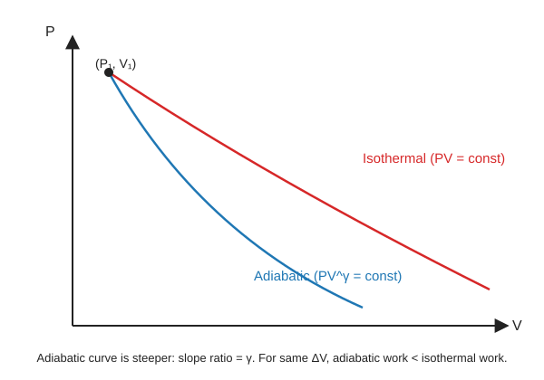

#### Derivation

1. Adiabatic: $\delta Q = 0$. First law: $dU = -P\,dV$.
2. For ideal gas: $dU = C_v\,dT$, so $C_v\,dT = -P\,dV$. … (A)
3. Differentiate $PV = RT$: $P\,dV + V\,dP = R\,dT$. … (B)
4. From (A): $dT = -P\,dV/C_v$. Substitute into (B):

$$
P\,dV + V\,dP = -\frac{R}{C_v} P\,dV
$$

5. Since $R/C_v = (C_p - C_v)/C_v = \gamma - 1$:

$$
P\,dV + V\,dP = -(\gamma - 1) P\,dV
$$

$$
V\,dP + \gamma P\,dV = 0
$$

6. Divide by $PV$:

$$
\frac{dP}{P} + \gamma \frac{dV}{V} = 0
$$

7. Integrate: $\ln P + \gamma \ln V = \text{const}$, hence

$$
PV^\gamma = \text{const}
$$

> [!IMPORTANT]
> $$\boxed{PV^\gamma = \text{const}}$$
> Companion forms: $TV^{\gamma - 1} = \text{const}$ and $T P^{(1-\gamma)/\gamma} = \text{const}$.

#### Worked example

A bicycle pump compresses air rapidly (approximately adiabatically). With $\gamma = 1.4$ and $V_2 = V_1/5$, $P_2 = P_1 \cdot 5^{1.4} \approx 9.5\,P_1$ — explaining why the pump gets hot.

#### Extra

The adiabatic bulk modulus is $K_S = \gamma P$, greater than the isothermal bulk modulus $K_T = P$ by factor $\gamma$. Sound travels faster than pressure would diffuse because compression is nearly adiabatic.

> [!TIP]
> The step "$R/C_v = \gamma - 1$" is where most students slip — write it out explicitly.

---

### Q5(c) Tyre-burst adiabatic cooling

> A motor tyre at 27 °C is pumped until its pressure is 2 atmospheres, then bursts suddenly. Find the final temperature ($\gamma = 1.4$).
>
> *Asked in: 2023 Q5(c).*
>
> **Assumption:** The burst is a sudden (adiabatic) expansion from $P_1 = 2\,\mathrm{atm}$ down to $P_2 = 1\,\mathrm{atm}$ (atmospheric pressure).

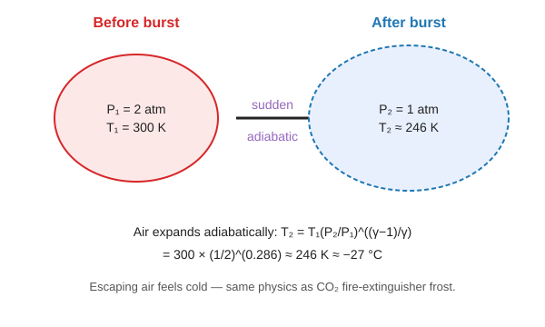

#### Ans. to the question no. 5(c)

#### Derivation

1. $T_1 = 27 + 273 = 300\,\mathrm{K}$, $P_1 = 2\,\mathrm{atm}$, $P_2 = 1\,\mathrm{atm}$, $\gamma = 1.4$.
2. Adiabatic relation: $T_1 P_1^{(1-\gamma)/\gamma} = T_2 P_2^{(1-\gamma)/\gamma}$.
3. $(1 - \gamma)/\gamma = -0.4/1.4 = -2/7$.
4. $T_2 = T_1 \left(\dfrac{P_2}{P_1}\right)^{(1-\gamma)/\gamma} = 300 \times \left(\dfrac{1}{2}\right)^{-2/7} = 300 \times \left(\dfrac{1}{2}\right)^{2/7}$ wait — let me redo carefully.

Actually: $T P^{(1-\gamma)/\gamma} = \text{const}$, so $T_2 = T_1 (P_1/P_2)^{(1-\gamma)/\gamma} = T_1 (P_2/P_1)^{(\gamma-1)/\gamma}$.

$$
T_2 = 300 \times \left(\frac{1}{2}\right)^{0.4/1.4} = 300 \times \left(\frac{1}{2}\right)^{2/7}
$$

5. $(1/2)^{2/7} = 2^{-2/7} = e^{-(2/7)\ln 2} = e^{-0.1980} = 0.8203$.
6. $T_2 = 300 \times 0.8203 = 246.1\,\mathrm{K}$.

> [!IMPORTANT]
> $$T_2 \approx 246\,\mathrm{K} \approx -27\,^\circ\mathrm{C}$$
> The escaping air is dramatically colder than the ambient — which is why a burst tyre releases cold air.

#### Worked example

This is the same physics behind the cooling of CO₂ as it escapes a fire extinguisher, sometimes forming dry ice.

#### Extra

Final temperature in Celsius: $246 - 273 = -27\,^\circ\mathrm{C}$. The drop is $300 - 246 = 54\,\mathrm{K}$.

> [!TIP]
> The exponent is $(\gamma - 1)/\gamma = 0.4/1.4 = 2/7$, not $(\gamma - 1) = 0.4$ (that's for $T$ vs $V$).

---

### Q6(a) $C_p$ vs $C_v$ relation

> Establish the relation between the two specific heats of a gas.
>
> *Asked in: 2023 Q6(a).*

Same as [2018 Q8(b)](#q8b-specific-heat-capacity-cp--cv--r).

---

### Q6(c) First vs second law

> Distinguish between the first and the second law of thermodynamics.
>
> *Asked in: 2023 Q6(c).*

Same as [2017 Q6(a)](#q6a-second-law-of-thermodynamics).

---

### Q6(d) Carnot numerical (450 K / 350 K)

> A Carnot engine working between 450 K and 350 K takes 1000 cal from the source. Find the heat rejected and the efficiency ($1\,\mathrm{cal} = 4.2\,\mathrm{J}$).
>
> *Asked in: 2023 Q6(d).*
>
> **Note:** This is the same physical problem as 2017 Q6(c), with $Q_1 = 1000\,\mathrm{cal} = 4200\,\mathrm{J}$ and the same temperatures $T_1 = 450\,\mathrm{K}$, $T_2 = 350\,\mathrm{K}$.

#### Ans. to the question no. 6(d)

#### Derivation

1. $T_1 = 450\,\mathrm{K}$, $T_2 = 350\,\mathrm{K}$, $Q_1 = 1000\,\mathrm{cal} = 4200\,\mathrm{J}$.
2. Efficiency:

$$
\eta = 1 - \frac{T_2}{T_1} = 1 - \frac{350}{450} = \frac{2}{9} \approx 0.2222 = 22.2\,\%
$$

3. Heat rejected:

$$
Q_2 = Q_1 \cdot \frac{T_2}{T_1} = 1000 \times \frac{350}{450} = \frac{7000}{9} \approx 777.8\,\mathrm{cal}
$$

4. Work done:

$$
W = Q_1 - Q_2 = 1000 - 777.8 = 222.2\,\mathrm{cal} = 933.3\,\mathrm{J}
$$

> [!IMPORTANT]
> $$\eta = 22.2\,\%, \qquad Q_2 = 777.8\,\mathrm{cal} \approx 3266.7\,\mathrm{J}, \qquad W = 222.2\,\mathrm{cal} \approx 933.3\,\mathrm{J}$$

#### Worked example

Same engine as 2017 Q6(c) — just stated in calories instead of joules.

#### Extra

The ratio $Q_1 : Q_2 : W = 9 : 7 : 2$, a clean integer ratio from $T_1 : T_2 = 9 : 7$.

> [!TIP]
> Either work in calories throughout or convert everything to joules — mixing them is the usual error.

---

### Q8(a) Second law

> State and explain the second law of thermodynamics.
>
> *Asked in: 2023 Q8(a).*

Same as [2017 Q6(a)](#q6a-second-law-of-thermodynamics).

---

### Q8(b) $C_p - C_v = R$

> What is specific heat capacity? For one mole of an ideal gas show $C_p - C_v = R$.
>
> *Asked in: 2023 Q8(b).*

Same as [2018 Q8(b)](#q8b-specific-heat-capacity-cp--cv--r).

---

### Q8(c) Carnot engine and reversibility

> What is a Carnot engine? Show that the Carnot cycle is a reversible process.
>
> *Asked in: 2023 Q8(c).*

Same as [2018 Q8(c)](#q8c-carnot-engine-and-reversibility).

---

## Concept Map (Mermaid)

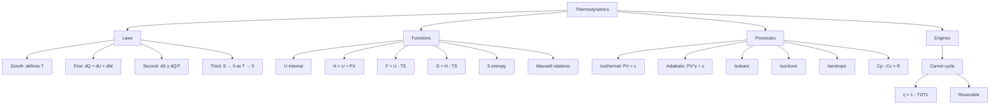

---

## One-Page Cheat Sheet

| Topic | Key formula |
|---|---|
| First law | $\delta Q = dU + \delta W$ |
| Mayer's relation | $C_p - C_v = R$ |
| Adiabatic | $PV^\gamma = \text{const},\; TV^{\gamma-1} = \text{const}$ |
| Carnot η | $\eta = 1 - T_2/T_1$ |
| Maxwell 1 (from $U$) | $(\partial T/\partial V)_S = -(\partial P/\partial S)_V$ |
| Maxwell 2 (from $H$) | $(\partial T/\partial P)_S = (\partial V/\partial S)_P$ |
| Maxwell 3 (from $F$) | $(\partial S/\partial V)_T = (\partial P/\partial T)_V$ |
| Maxwell 4 (from $G$) | $(\partial S/\partial P)_T = -(\partial V/\partial T)_P$ |
| TdS eqn 1 | $T\,dS = C_v\,dT + T(\partial P/\partial T)_V\,dV$ |
| TdS eqn 2 | $T\,dS = C_p\,dT - T(\partial V/\partial T)_P\,dP$ |
| VdW critical | $V_c = 3b,\; P_c = a/27b^2,\; T_c = 8a/27bR$ |
| Boyle temp | $T_0 = a/(bR)$, and $T_c = \tfrac{8}{27} T_0$ |
| Isentropic work | $W = (P_1 V_1 - P_2 V_2)/(\gamma - 1)$ |

---

## Glossary

- **Adiabatic:** no heat exchange ($\delta Q = 0$).
- **Boyle temperature $T_0$:** temperature at which a real gas most closely obeys Boyle's law; for VdW gas $T_0 = a/(bR)$.
- **Carnot cycle:** ideal reversible cycle of two isotherms and two adiabats.
- **Critical point:** $(P_c, V_c, T_c)$ where liquid and vapour phases become indistinguishable.
- **Enthalpy $H$:** $H = U + PV$; heat at constant pressure.
- **Entropy $S$:** measure of disorder; $dS = \delta Q_{\text{rev}}/T$.
- **Helmholtz free energy $F$:** $F = U - TS$; useful work at constant $T, V$.
- **Gibbs free energy $G$:** $G = H - TS$; useful work at constant $T, P$.
- **Isentropic:** constant entropy; for reversible processes, same as adiabatic.
- **Isothermal:** constant temperature.
- **Maxwell relations:** four identities from exactness of $dU, dH, dF, dG$.
- **Reversible:** can be retraced with no net change to universe.
- **State function:** path-independent property ($U, H, S, \ldots$).
- **Zeroth law:** transitivity of thermal equilibrium; defines temperature.

---

## Four New Practice Problems

### P1. Adiabatic compression in a diesel engine

Air at 300 K and 1 atm is compressed adiabatically to 1/16 of its original volume. With $\gamma = 1.4$, find the final temperature and pressure.

**Solution.** $T_2 = T_1 (V_1/V_2)^{\gamma-1} = 300 \times 16^{0.4} = 300 \times 3.031 = 909\,\mathrm{K}$.
$P_2 = P_1 (V_1/V_2)^\gamma = 1 \times 16^{1.4} = 48.5\,\mathrm{atm}$.

### P2. Carnot refrigerator COP

A Carnot refrigerator maintains a cold space at −10 °C while rejecting heat to a room at 35 °C. Find the COP and the work required to remove 1 kW of heat from the cold space.

**Solution.** $T_2 = 263\,\mathrm{K}$, $T_1 = 308\,\mathrm{K}$. $\text{COP} = T_2/(T_1 - T_2) = 263/45 = 5.84$.
$W = Q_2/\text{COP} = 1000/5.84 = 171\,\mathrm{W}$.

### P3. Entropy change on mixing

2 mol of ideal gas A and 3 mol of ideal gas B, both at the same $T$ and $P$, are mixed isothermally. Find $\Delta S$.

**Solution.** $\Delta S = -nR \sum x_i \ln x_i$. Total $n = 5$, $x_A = 0.4$, $x_B = 0.6$.
$\Delta S = -5 \times 8.314 \times (0.4 \ln 0.4 + 0.6 \ln 0.6) = -41.57 \times (-0.3665 - 0.3065) = 27.9\,\mathrm{J\,K^{-1}}$.

### P4. Van der Waals Boyle temperature

For a gas with $a = 5.46\,\mathrm{L^2\,atm\,mol^{-2}}$ and $b = 0.0638\,\mathrm{L\,mol^{-1}}$, find $T_0$, $T_c$, and the critical coefficient $P_c V_c/(RT_c)$.

**Solution.** $T_0 = a/(bR) = 5.46/(0.0638 \times 0.0821) = 1041\,\mathrm{K}$.
$T_c = (8/27) T_0 = 308\,\mathrm{K}$.
Critical coefficient = $3/8 = 0.375$ (universal for VdW gas).