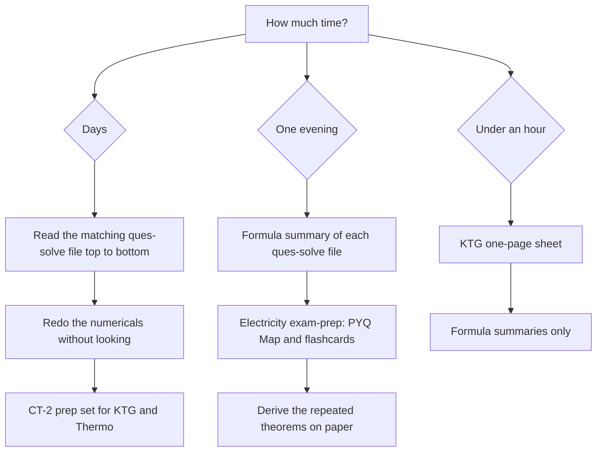

# PHY-103 (Physics-II) — Quick Revision & Solved Past Papers

> **BUTEX · B.Sc. in Textile Engineering · Physics-II (AS 107 / PHY-103)**
> Solved previous-year questions (2015 – 2024), one-page revision sheets, and a CT-2 practice set, all in GitHub-flavoured Markdown.

Last updated: **2026-11-02**

---

## Contents

1. [Which file should I open?](#which-file-should-i-open)
2. [Topic → file map](#topic--file-map)
3. [File catalogue](#file-catalogue)
4. [Earlier editions (kept for reference)](#earlier-editions-kept-for-reference)
5. [Suggested study paths](#suggested-study-paths)
6. [Conventions that differ between files](#conventions-that-differ-between-files)
7. [Known caveats](#known-caveats)
8. [Format, figures and file naming](#format-figures-and-file-naming)
9. [Adding or revising a file](#adding-or-revising-a-file)

---

## Which file should I open?

| Situation | Open this |
|---|---|
| Night before the exam, Electricity | [`phy-103-electricity-exam-prep-v261003-0.md`](phy-103-electricity-exam-prep-v261003-0.md) |
| Night before the exam, anything else | The matching `*-ques-solve-v261102-0.md` file, then its **Formula summary** at the bottom |
| Preparing for **CT-2** (KTG + Thermodynamics) | [`phy-103-ct2-prep-qna-v261004-0.md`](phy-103-ct2-prep-qna-v261004-0.md), attempt first, then reveal solutions |
| 10-minute skim of KTG | [`phy-103-kinetic-theory-of-gases-qna-2015-2023-v261003-0.md`](phy-103-kinetic-theory-of-gases-qna-2015-2023-v261003-0.md) |
| "Where is the answer to *2019 Q4(b)*?" | Use the [topic map](#topic--file-map), then the year/question index inside the file |
| Full derivation of a specific theorem | The solved-question file for that chapter |

---

## Topic → file map

Chapter numbers follow the Physics-II chapter-wise question bank (2015 – 2023).

| Ch. | Topic | Primary file | Also see |
|---|---|---|---|
| — | Electricity (Coulomb, Gauss, dipole, capacitors, RC, Kirchhoff, Wheatstone, Faraday, LR, Hall, RLC) | [`electricity-qna-2015-2024`](phy-103-electricity-qna-2015-2024-v261003-0.md) | [`electricity-exam-prep`](phy-103-electricity-exam-prep-v261003-0.md) · [`../electricity/`](../electricity/) |
| 4 | Magnetic effects of current (torque, Hall effect, magnetic materials, hysteresis) | [`magnetism`](phy-103-magnetism-2015-2023-ques-solve-v261102-0.md) | |
| 5 | EMI, inductance, LR / RC circuits, AC, series resonance | [`magnetism`](phy-103-magnetism-2015-2023-ques-solve-v261102-0.md) | |
| 6 | Kinetic theory of gases, thermal physics, thermometry | [`thermodynamics`](phy-103-thermodynamics-2015-2023-ques-solve-v261102-0.md) | [`kinetic-theory-of-gases-qna-2018-2023`](phy-103-kinetic-theory-of-gases-qna-2018-2023-v260912-0.md) · [KTG quick sheet](phy-103-kinetic-theory-of-gases-qna-2015-2023-v261003-0.md) · [CT-2 prep](phy-103-ct2-prep-qna-v261004-0.md) |
| 7 | Thermodynamics: first law, specific heats, isothermal / adiabatic processes | [`thermodynamics`](phy-103-thermodynamics-2015-2023-ques-solve-v261102-0.md) | [CT-2 prep](phy-103-ct2-prep-qna-v261004-0.md) |
| 7 | Second law, Carnot engine, entropy, Clausius–Clapeyron, Maxwell relations | [`entropy`](phy-103-entropy-2015-2023-ques-solve-v261102-0.md) | |
| 8 | Thermal radiation (black body, Stefan–Boltzmann, Kirchhoff) | [`thermodynamics`](phy-103-thermodynamics-2015-2023-ques-solve-v261102-0.md) | |
| 9 | Quantum & modern physics (photoelectric effect, photon, Compton effect) | [`modern-physics`](phy-103-modern-physics-2015-2023-ques-solve-v261102-0.md) | |

> The `thermodynamics` and `entropy` files are companions. Each opens with a table saying which file holds which year/question, so a question is never "missing", only in the other file.

---

## File catalogue

### Fast revision and practice

| File | Size | What is inside |
|---|---|---|
| [`phy-103-electricity-exam-prep-v261003-0.md`](phy-103-electricity-exam-prep-v261003-0.md) | ~18 KB | Night-before edition. Whole-chapter Mermaid map, master formula sheet, 15 condensed topic sections, **High-Yield PYQ Map** (most-repeated first), rapid-fire flashcards, final checklist |
| [`phy-103-kinetic-theory-of-gases-qna-2015-2023-v261003-0.md`](phy-103-kinetic-theory-of-gases-qna-2015-2023-v261003-0.md) | ~3 KB | One-page sheet: key definitions, 14 core formulae, answer skeletons for the five common question types (calorimetry, Newton's cooling, adiabatic/isothermal, KTG speeds, van der Waals) |
| [`phy-103-ct2-prep-qna-v261004-0.md`](phy-103-ct2-prep-qna-v261004-0.md) | ~19 KB | CT-2 practice for KTG + Thermodynamics: **10 MCQs, 6 short answers, 8 derivations with marking scheme, 12 numericals, a mock CT paper**. Solutions are collapsible (`<details>`) |

### Solved past-paper banks (current set)

| File | Size | Years | Coverage |
|---|---|---|---|
| [`phy-103-electricity-qna-2015-2024-v261003-0.md`](phy-103-electricity-qna-2015-2024-v261003-0.md) | ~66 KB | 2015–2024 | 26 topics, each theory derived once in full and cross-referenced from repeat years; year-wise index and final checklist at the end |
| [`phy-103-magnetism-2015-2023-ques-solve-v261102-0.md`](phy-103-magnetism-2015-2023-ques-solve-v261102-0.md) | ~39 KB | 2015–2023 | Ch. 4 (magnetic effects of current) and Ch. 5 (EMI, inductance, AC, RC/LR, resonance) |
| [`phy-103-thermodynamics-2015-2023-ques-solve-v261102-0.md`](phy-103-thermodynamics-2015-2023-ques-solve-v261102-0.md) | ~48 KB | 2015–2023 | Ch. 6 (KTG, thermal physics, thermometry), first-law half of Ch. 7, Ch. 8 (thermal radiation) |
| [`phy-103-entropy-2015-2023-ques-solve-v261102-0.md`](phy-103-entropy-2015-2023-ques-solve-v261102-0.md) | ~27 KB | 2016–2023 | Second law, reversible/irreversible processes, Carnot cycle, entropy, unavailable energy, isentropic process, Clausius–Clapeyron, Maxwell relations |
| [`phy-103-modern-physics-2015-2023-ques-solve-v261102-0.md`](phy-103-modern-physics-2015-2023-ques-solve-v261102-0.md) | ~12 KB | 2015–2022 | Photoelectric effect, Einstein's equation, photon, Compton effect, work-function numericals |
| [`phy-103-kinetic-theory-of-gases-qna-2018-2023-v260912-0.md`](phy-103-kinetic-theory-of-gases-qna-2018-2023-v260912-0.md) | ~42 KB | 2018–2023 | Standalone answer sheet of 22 questions with a marks summary table (adiabatic vs isothermal, mean free path, van der Waals, Newton's cooling, platinum thermometer, ...) |

---

## Earlier editions (kept for reference)

The `v261101` files are the first pass. The `v261102` files re-split and re-drew them (SVG figures, one file per chapter group). The older files are **not strict subsets**, so they stay until you have confirmed nothing you need exists only there.

| File | Why it is still useful |
|---|---|
| [`phy-103-thermodynamics-2015-2023-ques-solve-v261101-0.md`](phy-103-thermodynamics-2015-2023-ques-solve-v261101-0.md) (~96 KB) | All-in-one: 65 thermodynamics sub-questions, **Mermaid flowcharts, 14 extra practice problems with hidden answers, a quick-revision sheet and a section on ambiguous questions** |
| [`phy-103-magnetism-2015-2023-ques-solve-v261101-0.md`](phy-103-magnetism-2015-2023-ques-solve-v261101-0.md) (~68 KB) | Longer treatment (46 figures vs 20), with a jump-index table for every question |
| [`phy-103-entropy-and-modern-physics-2015-2023-ques-solve-v261101-1.md`](phy-103-entropy-and-modern-physics-2015-2023-ques-solve-v261101-1.md) (~47 KB) | Entropy + thermal radiation + modern physics in one file. Replaced by the separate `entropy` and `modern-physics` files; thermal radiation moved into `thermodynamics` |

---

## Suggested study paths



**Repeat offenders:** photoelectric-effect and Einstein's equation (asked in nearly every year, 2015–2022), torque on a current loop, Hall effect, hysteresis, Lenz's law and energy conservation, adiabatic vs isothermal. Each is derived in full once per file, and the later years link back to it.

---

## Conventions that differ between files

Different files were written at different times, so small numeric conventions vary. Use the one the question states; otherwise match the file you are studying from.

| Item | Values you will see | Where |
|---|---|---|
| Kelvin conversion | $T = t + 273$ | `thermodynamics`, `entropy` |
| | $T = t + 273.15$ | KTG one-page sheet |
| Gas constant $R$ | $8.314\ \mathrm{J\,mol^{-1}K^{-1}}$ | `thermodynamics`, `entropy` |
| | $8.31\ \mathrm{J\,mol^{-1}K^{-1}}$ | CT-2 prep |
| Calorie | $1\ \mathrm{cal} = 4.2\ \mathrm J$ (value printed in the 2023 paper) | `thermodynamics`, `entropy` |
| Planck's constant $h$ | $6.625\times10^{-34}$ J s (2020 paper) | `modern-physics` |
| | $6.626\times10^{-34}$ J s | `entropy-and-modern-physics` (v261101-1) |
| Heat / work signs | $Q>0$ absorbed by system, $W>0$ done **by** system, $\Delta U = Q - W$ | all thermodynamics files |
| Adiabatic index | $\gamma = (f+2)/f = 1 + 2/f$ | KTG sheet, CT-2 prep |

Small differences in $R$, $h$ or the Kelvin offset change the third significant figure, which is why a result such as the sodium work function appears as 1.83 eV or 1.84 eV depending on the constant printed in that year's paper.

---

## Known caveats

- **Loosely worded or damaged source questions** are answered, not skipped, and flagged where they appear. The thermodynamics v261101 file collects them under *Notes on ambiguous questions* (for example 2020 Q6(b) and 2022 Q7(b)).
- **Partial question:** Q17 in `kinetic-theory-of-gases-qna-2018-2023` ("... state Van-der-Waal's equation") lost its lead-in text in the scan. Only the legible part is answered; nothing was reconstructed.
- **Out-of-topic item:** Q20 in the same file is a self-inductance numerical that sat in the same undated block. It is answered there but belongs to the magnetism chapter.
- **2021 Q6(c)** prints $h = 6.663\times10^{-34}$ J s (accepted value is $6.626\times10^{-34}$). The solution follows the printed value and says so.
- **2018 Q2(c)** (torque on a loop) assumes a single turn because the number of turns is not given.
- **Year ranges differ:** Electricity covers 2015–2024; every other chapter covers 2015–2023.
- **Overlap:** Chapter 6 questions appear in both `thermodynamics` and `kinetic-theory-of-gases-qna-2018-2023`. The second is a separate answer sheet in its own wording, so cross-check if two answers look different.

---

## Format, figures and file naming

**Format.** GitHub-flavoured Markdown with LaTeX maths (`$...$`, `$$...$$`), Mermaid diagrams, collapsible `<details>` solutions, and anchors on every question for jump links.

**Answer style.**
- Theory: *Definition → Figure → Derivation → Result / Example*
- Numericals: *Given → Formula → Substitution → Answer (with units)*
- Repeated questions: full answer at first appearance, short self-contained version later with a link back

**Figures.** Stored one level above the repo section, in `../../assets/` (i.e. `butex-notes/assets/`). The `v261102` files use **SVG**; the older `v261101` and the KTG 2018–2023 files use **PNG**. If an image shows as broken, check that `assets/` is present at that path.

**File naming.**

```
phy-103-<topic>-<type>-v<YYMMDD>-<N>.md
```

- `<type>`: `ques-solve` (solved past papers), `qna` (question-and-answer / prep sets), `exam-prep` (condensed revision)
- `v<YYMMDD>`: date the file was made
- `<N>`: revision number, starting at `0`

Example: `phy-103-modern-physics-2015-2023-ques-solve-v261102-0.md`

---

## Adding or revising a file

1. Name it with the pattern above. Bump `N` for a revision of the same day, or the date for a later one.
2. Put figures in `../../assets/` as SVG, and link them with relative paths.
3. Open with a short header: course, source bank, covered chapters, constants used, and a pointer to any companion file that holds the rest of the chapter.
4. Give every question an anchor and an index row.
5. Flag ambiguous or damaged source questions instead of silently fixing them.
6. Add the file to the [file catalogue](#file-catalogue) and [topic map](#topic--file-map) here, and move the file it replaces to [Earlier editions](#earlier-editions-kept-for-reference).
