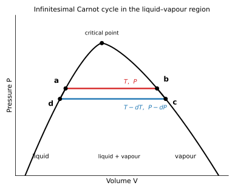
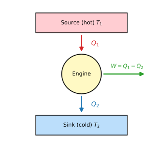
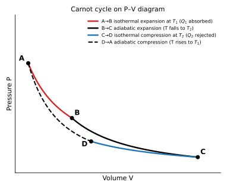
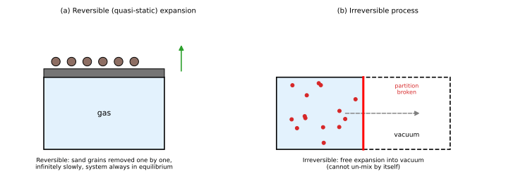
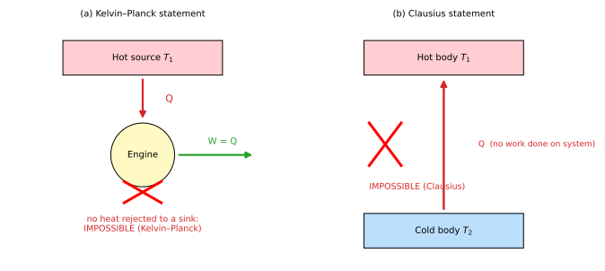
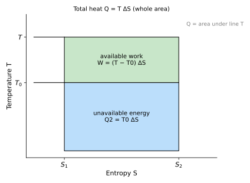
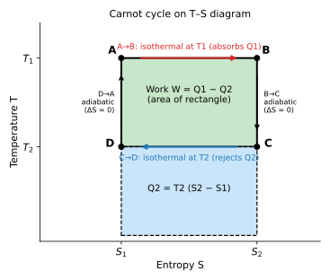
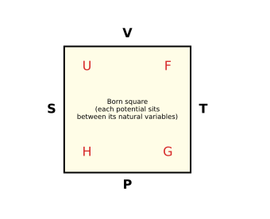
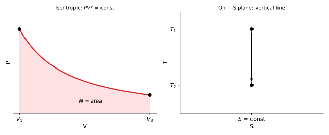

# PHY-103 (Physics-II) — Second Law, Carnot Engine, Entropy & Thermodynamic Relations
### Solved Previous Questions 2015 – 2023 (BUTEX, B.Sc. in Textile Engineering)

> **File:** `phy-103-entropy-2015-2023-ques-solve-v261102-0.md`  
> **Covers:** the part of Chapter 7 dealing with the second law, reversible/irreversible processes, Carnot engine and cycle, entropy, unavailable energy, isentropic process, the Clausius–Clapeyron (latent-heat) equation and Maxwell's thermodynamic relations — every sub-question, in the order of the question bank.  
> **First law, specific heats, isothermal/adiabatic work and the rest of Chapter 7** are in `phy-103-thermodynamics-2015-2023-ques-solve-v261102-0.md`.  
> **Figures:** SVG files linked from `../../assets/`.

**Conventions:** $T$ in kelvin ($T=t^\circ\mathrm C+273$), $1\ \mathrm{cal}=4.2\ \mathrm J$, $1\ \mathrm{hp}=746\ \mathrm W$.

## Contents

| Year | Questions in this file |
|---|---|
| [2016](#y2016) | Q7(a)(b)(c), Q8(a)(b)(c) |
| [2017](#y2017) | Q5(b)(c), Q6(a)(c), Q7(a)(b)(c)(d) |
| [2018](#y2018) | Q7(a)(b)(c), Q8(a)(c) |
| [2020](#y2020) | Q6(a)(b), Q7(a)(b) |
| [2021](#y2021) | Q5(a), Q7(a)(b)(c), Q8(a) |
| [2022](#y2022) | Q5(c), Q6(b), Q7(a)(b)(c) |
| [2023](#y2023) | Q6(b)(c)(d), Q8(a)(c) |
| [Formula summary](#summary) | |

---

## 2016 — Physics-II, Q7

### 7(a). What is entropy?

**Definition.** Entropy $S$ is a **state function** of a system, defined through the heat absorbed in a *reversible* process:

$$dS=\frac{dQ_{rev}}T,\qquad \Delta S=S_B-S_A=\int_A^B\frac{dQ_{rev}}T$$

**Unit:** J K⁻¹. $dQ$ itself is not an exact differential, but $dQ_{rev}/T$ is; $1/T$ is the integrating factor.

**Meaning.**

* *Thermodynamic:* a measure of the energy that is unavailable for work; $\Delta S_{universe}\ge0$ (second law).
* *Statistical:* a measure of disorder, $S=k\ln W$ ($W$ = number of microstates).

**Example.** Melting $1\ \mathrm{kg}$ of ice at $0^\circ\mathrm C$ (L $=3.34\times10^5\ \mathrm{J\,kg^{-1}}$): $\Delta S=\dfrac{mL}T=\dfrac{3.34\times10^5}{273}=1.22\times10^3\ \mathrm{J\,K^{-1}}$ — the disorder increases as ordered ice becomes liquid.

### 7(b). Explain the Clausius–Clapeyron equation.

**Statement.** It relates the change of the equilibrium (saturation) pressure with temperature during a change of state to the latent heat:

$$\frac{dP}{dT}=\frac{L}{T\,(v_2-v_1)}$$

where $L$ is the latent heat of the transition (per unit mass or mole), and $v_1,v_2$ are the specific volumes (per unit mass or mole) of the initial and final phases.

**Derivation (infinitesimal Carnot cycle).** Consider a liquid–vapour system on the $P$–$V$ plane.

1. **$a\to b$** (isothermal, $T$, pressure $P$): liquid boils completely; volume changes from $v_1$ to $v_2$; heat absorbed $Q_1=L$.
2. **$b\to c$** (adiabatic): temperature and pressure fall slightly to $T-dT$, $P-dP$.
3. **$c\to d$** (isothermal, $T-dT$): vapour condenses; heat $Q_2$ rejected.
4. **$d\to a$** (adiabatic): returns to the starting state.

The cycle $abcd$ is a thin parallelogram of width $(v_2-v_1)$ and height $dP$, so the net work is

$$W=dP\,(v_2-v_1)$$

The efficiency of a Carnot cycle between $T$ and $T-dT$ is $\eta=\dfrac{W}{Q_1}=\dfrac{dT}T$. Hence

$$\frac{dP\,(v_2-v_1)}{L}=\frac{dT}T\;\Rightarrow\;\frac{dP}{dT}=\frac L{T\,(v_2-v_1)}\qquad\blacksquare$$

**Applications.**

* *Boiling point and pressure.* For water at $100^\circ\mathrm C$: $L=2.26\times10^6\ \mathrm{J\,kg^{-1}}$, $v_2-v_1=1.67\ \mathrm{m^3\,kg^{-1}}$, so $\dfrac{dP}{dT}=\dfrac{2.26\times10^6}{373\times1.67}\approx3.6\times10^3\ \mathrm{Pa\,K^{-1}}$; raising the pressure by 1 atm raises the boiling point by about $28\ \mathrm K$ (pressure cooker).
* *Melting of ice.* $v_2<v_1$ (water is denser than ice), so $dP/dT<0$: pressure **lowers** the melting point, by $\approx0.0075\ \mathrm K$ per atm (ice skating, regelation).

### 7(c). Find the efficiency of an engine requiring $3\times10^6$ cal of heat per horsepower-hour and compare it with a perfect reversible engine, the source at 100 °C and the sink at 0 °C.

*Given:* heat input per hp-hour $Q_1=3\times10^6\ \mathrm{cal}=3\times10^6\times4.2=1.26\times10^7\ \mathrm J$.
Work output per hp-hour: $W=746\ \mathrm W\times3600\ \mathrm s=2.686\times10^6\ \mathrm J$.

**Efficiency of the actual engine**

$$\eta=\frac{W}{Q_1}=\frac{2.686\times10^6}{1.26\times10^7}=0.213=21.3\%$$

**Perfect reversible (Carnot) engine** between $T_1=373\ \mathrm K$ and $T_2=273\ \mathrm K$:

$$\eta_C=1-\frac{T_2}{T_1}=1-\frac{273}{373}=0.268=26.8\%$$

**Comparison:** $\dfrac{\eta}{\eta_C}=\dfrac{21.3}{26.8}=0.795$.

**Answer:** the engine's efficiency is $\approx21\%$, about $80\%$ of the maximum $26.8\%$ possible between these temperatures.

---

## 2016 — Physics-II, Q8

### 8(a). Write down Carnot's theorem.

**Carnot's theorem.** (i) No heat engine working between two given temperatures can be more efficient than a reversible engine working between the same temperatures. (ii) All reversible engines working between the same two temperatures have the same efficiency, whatever the working substance.

*Proof sketch of (i).* Suppose an engine $I$ were more efficient than a reversible engine $R$. Let $I$ drive $R$ backwards as a refrigerator. The combination would then transfer heat from the cold to the hot reservoir with no net work done on it — a violation of Clausius' statement of the second law. Hence $\eta_I\le\eta_R$. Applying the same argument to two reversible engines in both ways gives $\eta_{R_1}=\eta_{R_2}$.

### 8(b). Derive an expression for the efficiency of a Carnot engine.

A **Carnot engine** is an ideal reversible engine working on the Carnot cycle between a source at $T_1$ and a sink at $T_2$. The working substance (here one mole of an ideal gas) completes four reversible steps:

1. **A→B isothermal expansion at $T_1$:** the gas absorbs heat $Q_1$ from the source.
$$Q_1=W_{AB}=RT_1\ln\frac{V_B}{V_A}$$
2. **B→C adiabatic expansion:** no heat exchange; temperature falls from $T_1$ to $T_2$. $\;T_1V_B^{\gamma-1}=T_2V_C^{\gamma-1}$
3. **C→D isothermal compression at $T_2$:** the gas rejects heat $Q_2$ to the sink.
$$Q_2=RT_2\ln\frac{V_C}{V_D}$$
4. **D→A adiabatic compression:** temperature rises from $T_2$ to $T_1$. $\;T_2V_D^{\gamma-1}=T_1V_A^{\gamma-1}$

Dividing the two adiabatic relations:

$$\left(\frac{V_B}{V_A}\right)^{\gamma-1}=\left(\frac{V_C}{V_D}\right)^{\gamma-1}\;\Rightarrow\;\frac{V_B}{V_A}=\frac{V_C}{V_D}$$

Therefore

$$\frac{Q_1}{Q_2}=\frac{T_1}{T_2}$$

Net work per cycle $W=Q_1-Q_2$ (the area enclosed). Efficiency:

$$\eta=\frac{W}{Q_1}=\frac{Q_1-Q_2}{Q_1}=1-\frac{Q_2}{Q_1}=1-\frac{T_2}{T_1}=\frac{T_1-T_2}{T_1}$$

**Remarks.** $\eta$ depends only on the two temperatures, not on the working substance; $\eta<1$ unless $T_2=0$ (unattainable); raising $T_1$ or lowering $T_2$ increases $\eta$.

### 8(c). A Carnot engine whose source temperature is 400 K takes 200 calories at this temperature and rejects 150 calories to the sink. Calculate the efficiency.

*Given:* $T_1=400\ \mathrm K$, $Q_1=200\ \mathrm{cal}$, $Q_2=150\ \mathrm{cal}$.

$$\eta=1-\frac{Q_2}{Q_1}=1-\frac{150}{200}=0.25=25\%$$

**Answer: $\eta=25\%$.** (Check: $Q_2/Q_1=T_2/T_1\Rightarrow T_2=400\times0.75=300\ \mathrm K$; work $=50\ \mathrm{cal}=210\ \mathrm J$.)

---

## 2017 — Physics-II, Q5

### 5(b). Distinguish between reversible and irreversible processes.

| | Reversible process | Irreversible process |
|---|---|---|
| Definition | Can be reversed so that both system *and surroundings* return exactly to the initial state | Cannot be so reversed |
| Speed | Infinitely slow (quasi-static) | Finite, usually fast |
| Equilibrium | System is always in equilibrium | System passes through non-equilibrium states |
| Dissipation | No friction, viscosity or heat flow across finite $\Delta T$ | Friction, viscosity, finite-$\Delta T$ heat flow, free expansion |
| Entropy of the universe | $\Delta S=0$ | $\Delta S>0$ |
| Work | Maximum work obtained | Less than the maximum |
| Occurrence | Ideal limit only | All natural processes |
| Examples | Slow isothermal expansion, Carnot cycle, ideal slow melting at $0^\circ\mathrm C$ | Free expansion, heat conduction, mixing, friction, combustion |

### 5(c). Find an expression for the efficiency of a Carnot engine.

$\eta=1-\dfrac{T_2}{T_1}=\dfrac{T_1-T_2}{T_1}$ — derivation in [2016 Q8(b)](#e-2016-q8b).

---

## 2017 — Physics-II, Q6

### 6(a). State and explain the second law of thermodynamics. How does it differ from the first law?

**Statements.**

* **Kelvin–Planck:** it is impossible to construct a device operating in a cycle whose sole effect is to take heat from a single reservoir and convert it *completely* into work.
* **Clausius:** it is impossible for heat to flow by itself (without external work) from a colder to a hotter body.
* **Entropy form:** in any process the total entropy of an isolated system never decreases, $\Delta S\ge0$.

**Explanation.** (a) An engine must reject some heat $Q_2$ to a colder sink; the efficiency is always less than $100\%$. (b) A refrigerator needs work input to pump heat from cold to hot. The two statements are equivalent: violating one allows a violation of the other. The second law determines the *direction* of natural processes (a hot cup of tea cools, never spontaneously heats up).

**Difference from the first law**

| First law | Second law |
|---|---|
| Conservation of energy: $Q=\Delta U+W$ | Direction of processes and limits of conversion |
| Says heat and work are equivalent | Says heat cannot be fully converted into work in a cycle |
| Does not forbid heat flowing from cold to hot | Forbids it unless work is supplied |
| Introduces internal energy $U$ | Introduces entropy $S$ |
| Allows $\eta=100\%$ if energy is conserved | Limits $\eta\le1-T_2/T_1<1$ |
| Rules out perpetual motion of the first kind | Rules out perpetual motion of the second kind |

### 6(c). A Carnot engine is operated between reservoirs at 177 °C and 77 °C. If the engine receives 4200 J of heat in each cycle, calculate the heat rejected, the efficiency and the work done.

*Given:* $T_1=177+273=450\ \mathrm K$, $T_2=77+273=350\ \mathrm K$, $Q_1=4200\ \mathrm J$.

$$\eta=1-\frac{T_2}{T_1}=1-\frac{350}{450}=\frac{100}{450}=0.222=22.2\%$$

$$W=\eta Q_1=0.2222\times4200=933\ \mathrm J$$

$$Q_2=Q_1\frac{T_2}{T_1}=4200\times\frac{350}{450}=3267\ \mathrm J\qquad(=Q_1-W)$$

**Answer: $Q_2\approx3.27\times10^3\ \mathrm J$, $\eta\approx22.2\%$, $W\approx933\ \mathrm J$.**

---

## 2017 — Physics-II, Q7

### 7(a). What are entropy and unavailable energy?

**Entropy:** $dS=dQ_{rev}/T$ — see [2016 Q7(a)](#e-2016-q7a).

**Unavailable energy.** When a quantity of heat $Q$ is taken from a source at temperature $T$, even the best (Carnot) engine working with a sink at the lowest available temperature $T_0$ must reject a portion to the sink. That rejected portion cannot be converted into work and is called **unavailable energy**:

$$Q_{unavailable}=T_0\,\Delta S,\qquad W_{available}=Q-T_0\Delta S=(T-T_0)\Delta S$$

On a $T$–$S$ diagram, the total heat is the area under the line $T$ between $S_1$ and $S_2$; the area below $T_0$ is unavailable.

**Relation to entropy.** Every irreversible process produces entropy $\Delta S_{gen}$ and wastes (makes unavailable) energy $T_0\Delta S_{gen}$ — the *degradation* of energy.

**Example.** $Q=1000\ \mathrm J$ from a source at $500\ \mathrm K$, sink at $300\ \mathrm K$: $\Delta S=1000/500=2\ \mathrm{J\,K^{-1}}$; unavailable $=300\times2=600\ \mathrm J$; available work $=400\ \mathrm J$ (the Carnot efficiency $40\%$).

### 7(b). Show that entropy remains constant in a reversible process.

(*Total entropy of system plus surroundings.*)

**1. Carnot cycle.** From [2016 Q8(b)](#e-2016-q8b), $\dfrac{Q_1}{T_1}=\dfrac{Q_2}{T_2}$, i.e. $\displaystyle\oint\frac{dQ_{rev}}T=\frac{Q_1}{T_1}-\frac{Q_2}{T_2}=0$.

**2. Any reversible cycle.** A closed reversible cycle can be covered by a net of small Carnot cycles, adiabatics being traversed twice in opposite directions and cancelling. For each, $\sum dQ/T=0$, so

$$\oint\frac{dQ_{rev}}T=0\qquad(\text{Clausius theorem})$$

Hence $\int_A^B dQ_{rev}/T$ is independent of the path: $S$ is a state function.

**3. Reversible heat transfer.** A body at $T$ gives $Q$ to a system at the same temperature $T$ (infinitesimal difference): $\Delta S_{reservoir}=-\dfrac QT$, $\Delta S_{system}=+\dfrac QT$, so $\Delta S_{total}=0$.

**4. Reversible adiabatic process:** $dQ=0\Rightarrow dS=0$ (isentropic).

So for every reversible process the total entropy is unchanged; for irreversible ones it increases ([2022 Q7(b)](#e-2022-q7b)).

### 7(c). Derive the expression for the Clausius–Clapeyron equation.

$\dfrac{dP}{dT}=\dfrac L{T(v_2-v_1)}$ — [2016 Q7(b)](#e-2016-q7b).

### 7(d). Find the efficiency of an engine requiring $3\times10^6$ cal of heat per horsepower and compare it with a perfect reversible engine (100 °C and 0 °C).

Treating the quantity as per horsepower-hour (as in 2016 Q7(c)): $\eta\approx21.3\%$, Carnot $\eta_C=26.8\%$, ratio $\approx0.80$. See [2016 Q7(c)](#e-2016-q7c).

---

## 2018 — Physics-II, Q7

### 7(a). What is entropy?

See [2016 Q7(a)](#e-2016-q7a): $dS=dQ_{rev}/T$, a state function, measure of disorder.

### 7(b). Explain the latent-heat (Clausius–Clapeyron) equation.

See [2016 Q7(b)](#e-2016-q7b): $\dfrac{dP}{dT}=\dfrac{L}{T(v_2-v_1)}$.

### 7(c). Show that the entropy change is constant in a reversible Carnot cycle.

(i.e. the net entropy change over the cycle is zero.) Use the $T$–$S$ diagram of the Carnot cycle:

* **A→B** isothermal at $T_1$: $\Delta S_{AB}=\dfrac{Q_1}{T_1}$ (entropy rises from $S_1$ to $S_2$).
* **B→C** reversible adiabatic: $dQ=0\Rightarrow\Delta S_{BC}=0$.
* **C→D** isothermal at $T_2$: $\Delta S_{CD}=-\dfrac{Q_2}{T_2}$.
* **D→A** reversible adiabatic: $\Delta S_{DA}=0$.

$$\Delta S_{cycle}=\frac{Q_1}{T_1}-\frac{Q_2}{T_2}=0\quad\text{because}\quad\frac{Q_1}{Q_2}=\frac{T_1}{T_2}$$

The entropy returns to its original value because $S$ is a state function and the cycle is closed. The cycle is a rectangle on the $T$–$S$ plane: area $(T_1-T_2)(S_2-S_1)=Q_1-Q_2=W$.

---

## 2018 — Physics-II, Q8

### 8(a). State and explain the second law of thermodynamics.

See [2017 Q6(a)](#e-2017-q6a) (Kelvin–Planck, Clausius, entropy statements; difference from the first law).

### 8(c). What is a Carnot engine? Show that the Carnot cycle is a reversible process.

**Carnot engine.** An ideal heat engine that works on the reversible Carnot cycle (two isotherms and two adiabatics) between a hot source $T_1$ and a cold sink $T_2$; see [2016 Q8(b)](#e-2016-q8b) for the cycle and $\eta=1-T_2/T_1$.

**Proof that the Carnot cycle is reversible.**

1. Each step is **quasi-static**: the gas is compressed or expanded infinitely slowly, with no friction, so at every instant it is in equilibrium.
2. In the isothermal steps the working substance is at the same temperature as the reservoir (differing by only $dT\to0$); heat flows reversibly and the heat transferred is $T\,dS$.
3. In the adiabatic steps the cylinder walls are perfect insulators; no heat is exchanged.
4. If the cycle is run **backwards** ($A\to D\to C\to B\to A$), each step is undone: the gas absorbs $Q_2$ from the sink, work $W=Q_1-Q_2$ is done *on* it, and it delivers $Q_1$ to the source. The system *and* the reservoirs return to their exact initial states, and nothing else changes. The device then works as a **refrigerator** with the same $Q_1,Q_2,W$.
5. Entropy check: $\Delta S_{universe}=-\dfrac{Q_1}{T_1}+\dfrac{Q_2}{T_2}=0$ (reservoirs) $+\,0$ (working gas, closed cycle) — so the process is reversible.

Hence the Carnot cycle is reversible, and by Carnot's theorem its efficiency is the maximum possible.

---

## 2020 — Physics-II, Q6

### 6(a). Derive the general expression for the establishment of Maxwell's thermodynamic relations.

**Starting point.** For a simple compressible system the first and second laws together give

$$dU=T\,dS-P\,dV\quad(1)$$

Define the thermodynamic potentials $H=U+PV$, $F=U-TS$, $G=H-TS$. Differentiating and using (1):

$$dH=T\,dS+V\,dP\ (2),\qquad dF=-S\,dT-P\,dV\ (3),\qquad dG=-S\,dT+V\,dP\ (4)$$

Each of $U,H,F,G$ is a state function, so $dX=M\,dx+N\,dy$ is an **exact differential**, which requires $\left(\dfrac{\partial M}{\partial y}\right)_x=\left(\dfrac{\partial N}{\partial x}\right)_y$. Applying this to (1)–(4):

$$\begin{aligned}
\left(\frac{\partial T}{\partial V}\right)_S&=-\left(\frac{\partial P}{\partial S}\right)_V &&\text{from }(1)\\
\left(\frac{\partial T}{\partial P}\right)_S&=\left(\frac{\partial V}{\partial S}\right)_P &&\text{from }(2)\\
\left(\frac{\partial S}{\partial V}\right)_T&=\left(\frac{\partial P}{\partial T}\right)_V &&\text{from }(3)\\
\left(\frac{\partial S}{\partial P}\right)_T&=-\left(\frac{\partial V}{\partial T}\right)_P &&\text{from }(4)
\end{aligned}$$

These four are **Maxwell's thermodynamic relations**.

*Mnemonic:* each potential sits between its natural variables ($U$: $S,V$; $H$: $S,P$; $F$: $T,V$; $G$: $T,P$).

### 6(b). Show that the thermodynamic relations given in the question hold.

> **Note:** the two printed relations were lost in the PDF text extraction of the question bank. The two relations that are normally asked with Maxwell's equations — the *energy equation* and the *enthalpy equation* — are proved here, together with the $T\,dS$ equations; all four Maxwell relations are already proved in 6(a).

**(i) Energy equation:** $\left(\dfrac{\partial U}{\partial V}\right)_T=T\left(\dfrac{\partial P}{\partial T}\right)_V-P$

From (1) divide by $dV$ at constant $T$: $\left(\dfrac{\partial U}{\partial V}\right)_T=T\left(\dfrac{\partial S}{\partial V}\right)_T-P$. By the third Maxwell relation $\left(\dfrac{\partial S}{\partial V}\right)_T=\left(\dfrac{\partial P}{\partial T}\right)_V$, which gives the result. ∎  
*Check:* ideal gas, $P=RT/V$: $T\cdot R/V-P=0$ — $U$ is independent of volume (Joule's law).

**(ii) Enthalpy equation:** $\left(\dfrac{\partial H}{\partial P}\right)_T=V-T\left(\dfrac{\partial V}{\partial T}\right)_P$

From (2) at constant $T$: $\left(\dfrac{\partial H}{\partial P}\right)_T=T\left(\dfrac{\partial S}{\partial P}\right)_T+V$, and by the fourth Maxwell relation $\left(\dfrac{\partial S}{\partial P}\right)_T=-\left(\dfrac{\partial V}{\partial T}\right)_P$. ∎

**(iii) The $T\,dS$ equations.** Taking $S=S(T,V)$: $T\,dS=C_V\,dT+T\left(\dfrac{\partial P}{\partial T}\right)_V dV$. Taking $S=S(T,P)$: $T\,dS=C_P\,dT-T\left(\dfrac{\partial V}{\partial T}\right)_P dP$.

**(iv) Difference of specific heats:** equating the two $T\,dS$ expressions gives
$$C_P-C_V=T\left(\frac{\partial P}{\partial T}\right)_V\left(\frac{\partial V}{\partial T}\right)_P$$
For one mole of ideal gas: $T\cdot\dfrac RV\cdot\dfrac RP=\dfrac{R^2T}{PV}=R$, recovering $C_P-C_V=R$.

---

## 2020 — Physics-II, Q7

### 7(a). What is a Carnot engine? Show how the Carnot cycle is a reversible process.

See [2018 Q8(c)](#e-2018-q8c).

### 7(b). Define the efficiency of a Carnot engine. Find the efficiency of a Carnot engine working between the steam point and the ice point.

**Efficiency** = (net work output)/(heat absorbed from the source) $=\dfrac{W}{Q_1}=1-\dfrac{T_2}{T_1}$.

*Steam point* $T_1=373\ \mathrm K$ (100 °C); *ice point* $T_2=273\ \mathrm K$ (0 °C):

$$\eta=1-\frac{273}{373}=\frac{100}{373}=0.268=26.8\%$$

**Answer: $\eta\approx26.8\%$.**

---

## 2021 — Physics-II, Q5

### 5(a). Show that entropy in reversible processes remains the same.

See [2017 Q7(b)](#e-2017-q7b): $\oint dQ_{rev}/T=0$; total entropy (system + surroundings) is unchanged in a reversible process, and $dS=0$ in a reversible adiabatic process.

## 2021 — Physics-II, Q7

### 7(a). What is a Carnot cycle?

A **Carnot cycle** is the ideal reversible cycle of four processes — isothermal expansion at $T_1$ (heat $Q_1$ absorbed), adiabatic expansion ($T_1\to T_2$), isothermal compression at $T_2$ (heat $Q_2$ rejected), adiabatic compression ($T_2\to T_1$) — which converts heat into work with the maximum possible efficiency between two temperatures. See [2016 Q8(b)](#e-2016-q8b) for the diagram.

### 7(b). Show that, in the range of temperatures $T_1$ and $T_2$, the efficiency of a Carnot engine is $\eta=\dfrac{T_1-T_2}{T_1}$.

For the Carnot cycle $Q_1=RT_1\ln\dfrac{V_B}{V_A}$, $Q_2=RT_2\ln\dfrac{V_C}{V_D}$ with $\dfrac{V_B}{V_A}=\dfrac{V_C}{V_D}$ (from the two adiabatics), so $\dfrac{Q_2}{Q_1}=\dfrac{T_2}{T_1}$ and

$$\eta=\frac{Q_1-Q_2}{Q_1}=\frac{T_1-T_2}{T_1}\qquad\blacksquare$$

Full derivation: [2016 Q8(b)](#e-2016-q8b).

### 7(c). Distinguish between the first and second laws of thermodynamics.

See the comparison table in [2017 Q6(a)](#e-2017-q6a).

## 2021 — Physics-II, Q8

### 8(a). State and explain the second law of thermodynamics.

See [2017 Q6(a)](#e-2017-q6a).

---

## 2022 — Physics-II, Q5

### 5(c). What is a Carnot engine? Show that the Carnot cycle is a reversible process.

See [2018 Q8(c)](#e-2018-q8c).

## 2022 — Physics-II, Q6

### 6(b). What is an isentropic process? Derive an expression for work done during an isentropic process.

**Isentropic process.** A process at **constant entropy**: a reversible adiabatic process. Since $dS=dQ_{rev}/T$ and $dQ=0$, $dS=0$. On the $T$–$S$ diagram it is a vertical line; on the $P$–$V$ diagram it follows $PV^\gamma=\text{const}$.

**Work.** Let $PV^\gamma=K$ and the gas expand from $(P_1,V_1)$ to $(P_2,V_2)$:

$$W=\int_{V_1}^{V_2}P\,dV=K\int_{V_1}^{V_2}V^{-\gamma}dV=\frac{K}{1-\gamma}\left[V_2^{1-\gamma}-V_1^{1-\gamma}\right]=\frac{P_2V_2-P_1V_1}{1-\gamma}$$

$$W=\frac{P_1V_1-P_2V_2}{\gamma-1}=\frac{nR\,(T_1-T_2)}{\gamma-1}$$

This equals the decrease in internal energy, $-\Delta U=nC_V(T_1-T_2)$, since $Q=0$.

**Example.** $1\ \mathrm{mol}$ of a diatomic gas ($\gamma=1.4$) cools from $400\ \mathrm K$ to $300\ \mathrm K$ isentropically: $W=\dfrac{8.314\times100}{0.4}=2.08\ \mathrm{kJ}$.

*(6(c), the isothermal expansion of air, is in the thermodynamics file.)*

## 2022 — Physics-II, Q7

### 7(a). What are entropy and unavailable energy?

See [2017 Q7(a)](#e-2017-q7a).

### 7(b). Show that entropy remains constant in an irreversible process.

*The statement as printed is not correct: in an irreversible process the entropy of the system together with its surroundings does **not** remain constant; it **increases**. The entropy stays constant only in a reversible process ([2017 Q7(b)](#e-2017-q7b)). The proof below shows the true result.*

**Clausius inequality.** For an irreversible cycle $\displaystyle\oint\frac{dQ}T<0$. Taking an irreversible path $I$ from $A$ to $B$ and returning by a reversible path $R$:

$$\int_A^{B}\left(\frac{dQ}T\right)_I+\int_B^A\left(\frac{dQ}T\right)_R<0\;\Rightarrow\;S_B-S_A>\int_A^B\left(\frac{dQ}T\right)_I$$

For an isolated system $dQ=0$, so $\Delta S>0$.

**Example 1 – heat conduction.** $Q=1000\ \mathrm J$ flows from a body at $T_1=500\ \mathrm K$ to one at $T_2=300\ \mathrm K$:
$$\Delta S=-\frac Q{T_1}+\frac Q{T_2}=1000\left(\frac1{300}-\frac1{500}\right)=1.33\ \mathrm{J\,K^{-1}}>0$$

**Example 2 – free expansion** of $1\ \mathrm{mol}$ of ideal gas to double its volume ($Q=W=0$, $T$ unchanged). Entropy is a state function, so evaluate it on a reversible isothermal path: $\Delta S=R\ln\dfrac{V_2}{V_1}=8.314\times0.693=5.76\ \mathrm{J\,K^{-1}}>0$, although no heat flowed.

**Conclusion.** $\Delta S_{universe}>0$ for irreversible processes (the *principle of increase of entropy*): energy is degraded ([unavailable energy](#e-2017-q7a)).

### 7(c). Find the efficiency of an engine requiring $3\times10^6$ cal of heat per horsepower and compare it with a perfect reversible engine (100 °C, 0 °C).

$\eta\approx21.3\%$ versus $\eta_C=26.8\%$ (ratio $0.80$) — see [2016 Q7(c)](#e-2016-q7c).

---

## 2023 — Physics-II, Q6

### 6(b). Show that the entropy change is constant in a reversible Carnot cycle.

$\Delta S_{cycle}=\dfrac{Q_1}{T_1}-\dfrac{Q_2}{T_2}=0$ — see [2018 Q7(c)](#e-2018-q7c).

### 6(c). Distinguish between the first and second laws of thermodynamics.

See [2017 Q6(a)](#e-2017-q6a).

### 6(d). A Carnot engine working between 450 K and 350 K takes 1000 cal of heat from the high-temperature reservoir. How much heat does it reject in each cycle? Calculate the efficiency. (1 cal = 4.2 J)

*Given:* $T_1=450\ \mathrm K$, $T_2=350\ \mathrm K$, $Q_1=1000\ \mathrm{cal}=4200\ \mathrm J$.

$$\frac{Q_2}{Q_1}=\frac{T_2}{T_1}\;\Rightarrow\;Q_2=1000\times\frac{350}{450}=777.8\ \mathrm{cal}=3267\ \mathrm J$$

$$\eta=1-\frac{T_2}{T_1}=1-\frac{350}{450}=0.222=22.2\%$$

Work done $W=Q_1-Q_2=222.2\ \mathrm{cal}=933\ \mathrm J$.

**Answer: heat rejected $\approx778\ \mathrm{cal}\ (3.27\ \mathrm{kJ})$; efficiency $22.2\%$.**

## 2023 — Physics-II, Q8

### 8(a). State and explain the second law of thermodynamics.

See [2017 Q6(a)](#e-2017-q6a).

### 8(c). What is a Carnot engine? Show that the Carnot cycle is a reversible process.

See [2018 Q8(c)](#e-2018-q8c).

---

# Formula summary

| Topic | Formula |
|---|---|
| Entropy | $dS=\dfrac{dQ_{rev}}T$; $\Delta S_{melt}=\dfrac{mL}T$; $S=k\ln W$ |
| Carnot efficiency | $\eta=1-\dfrac{Q_2}{Q_1}=1-\dfrac{T_2}{T_1}$ |
| Carnot cycle | $\dfrac{Q_1}{T_1}=\dfrac{Q_2}{T_2}$; $\oint\dfrac{dQ}T=0$ |
| Second law | $\Delta S_{universe}\ge0$ |
| Unavailable energy | $T_0\,\Delta S$ |
| Isentropic work | $W=\dfrac{P_1V_1-P_2V_2}{\gamma-1}$ |
| Clausius–Clapeyron | $\dfrac{dP}{dT}=\dfrac L{T(v_2-v_1)}$ |
| Maxwell relations | $\left(\frac{\partial T}{\partial V}\right)_S=-\left(\frac{\partial P}{\partial S}\right)_V$, $\left(\frac{\partial T}{\partial P}\right)_S=\left(\frac{\partial V}{\partial S}\right)_P$, $\left(\frac{\partial S}{\partial V}\right)_T=\left(\frac{\partial P}{\partial T}\right)_V$, $\left(\frac{\partial S}{\partial P}\right)_T=-\left(\frac{\partial V}{\partial T}\right)_P$ |
| $C_P-C_V$ (general) | $T\left(\frac{\partial P}{\partial T}\right)_V\left(\frac{\partial V}{\partial T}\right)_P$ |
