# PHY-103 (Physics-II) — Entropy and Modern Physics: Solved Previous Questions (2015–2023)

**Course:** Physics-II (AS 107 / PHY-103), BUTEX B.Sc. in Textile Engineering
**Topic group:** Entropy, Thermal Radiation, and Quantum / Modern Physics
**Source:** `physics-ii-chapter-wise-question-bank-2015-2023.md` (chapters 7 (entropy part), 8 and 9)
**Version:** `v261101-1` (revision 1: adds Maxwell relations, thermal radiation and modern physics to the entropy file)

> **How to use this file**
> Every sub-question in this topic group is answered once, in exam style, in the order in which it first appears in the question bank (2015 → 2023) within each part. Where the same question was repeated in other years, all the years are listed under one heading, so nothing is skipped. The [index table](#index-of-questions) tells you which answer to read for any year/question.
>
> * **Part A — Entropy** (Q1–Q9)
> * **Part B — Thermal Radiation** (Q10–Q12)
> * **Part C — Quantum and Modern Physics** (Q13–Q16)
>
> Conventions: $Q_1$ = heat absorbed from source at $T_1$, $Q_2$ = heat rejected to sink at $T_2$, $T$ in kelvin, $S$ in J K⁻¹, $k_B = 1.38\times10^{-23}$ J K⁻¹, $R = 8.314$ J mol⁻¹ K⁻¹, $h=6.626\times10^{-34}$ J s, $c=3\times10^{8}$ m s⁻¹, $e=1.6\times10^{-19}$ C, $\sigma=5.67\times10^{-8}$ W m⁻² K⁻⁴, $J = 4.2$ J cal⁻¹ unless stated.

---

## Index of questions

| # | Question | Appears in | Section |
|---|----------|-----------|---------|
| 1 | What is entropy? | 2016 Q7(a), 2018 Q7(a) | [Q1](#q1-what-is-entropy) |
| 2 | Clausius–Clapeyron (latent-heat) equation | 2016 Q7(b), 2017 Q7(c), 2018 Q7(b) | [Q2](#q2-the-clausiusclapeyron-latent-heat-equation) |
| 3 | Efficiency of an engine using $3\times10^6$ cal per horsepower-hour vs a perfect reversible engine (100 °C / 0 °C) | 2016 Q7(c), 2017 Q7(d), 2022 Q7(c) | [Q3](#q3-efficiency-of-the-3106-cal-engine) |
| 4 | Entropy and unavailable energy | 2017 Q7(a), 2022 Q7(a) | [Q4](#q4-entropy-and-unavailable-energy) |
| 5 | Show that entropy remains constant in a reversible process | 2017 Q7(b), 2021 Q5(a) | [Q5](#q5-entropy-in-a-reversible-process) |
| 6 | Show that the entropy change is constant (zero) in a reversible Carnot cycle | 2018 Q7(c), 2023 Q6(b) | [Q6](#q6-entropy-change-in-a-reversible-carnot-cycle) |
| 7 | Maxwell's thermodynamic relations: general derivation and proof | 2020 Q6(a), 2020 Q6(b) | [Q7](#q7-maxwells-thermodynamic-relations) |
| 8 | What is an isentropic process? Work done in an isentropic process | 2022 Q6(b) | [Q8](#q8-isentropic-process-and-work-done) |
| 9 | Show that entropy remains constant in an irreversible process | 2022 Q7(b) | [Q9](#q9-entropy-in-an-irreversible-process) |
| 10 | Define blackbody, emissive power and absorptive power | 2015 Q8(a), 2017 Q8(a), 2022 Q8(c) | [Q10](#q10-blackbody-emissive-power-and-absorptive-power) |
| 11 | State Stefan-Boltzmann's law and establish its proof | 2015 Q8(b) | [Q11](#q11-stefan-boltzmann-law-and-its-proof) |
| 12 | State and deduce Kirchhoff's law of radiation | 2018 Q5(d) | [Q12](#q12-kirchhoffs-law-of-radiation) |
| 13 | What is the photoelectric effect? What is a photon? Derive Einstein's photoelectric equation | 2015 Q8(c), 2016 Q6(a), 2017 Q8(b), 2020 Q8(b), 2021 Q6(b), 2022 Q8(a) | [Q13](#q13-the-photoelectric-effect-and-einsteins-equation) |
| 14 | What is the Compton effect? Show $\lambda'-\lambda=\lambda_C(1-\cos\phi)$; describe the process | 2017 Q8(c), 2022 Q8(b) | [Q14](#q14-the-compton-effect) |
| 15 | Is the photoelectric effect a consequence of the wave or the particle character of radiation? | 2020 Q8(a) | [Q15](#q15-photoelectric-effect-wave-or-particle-character) |
| 16 | Work function of sodium from the threshold wavelength 6800 Å | 2020 Q8(c), 2021 Q6(c) | [Q16](#q16-work-function-of-sodium) |

> ⚠️ **Heads-up on printed questions**
> 1. **2022 Q7(b)** says entropy "remains constant in an *irreversible* process". That statement is false: entropy of the universe **increases** in an irreversible process. Q9 proves the correct result. Do not write "constant" in the exam.
> 2. **2017 Q7(d) and 2022 Q7(c)** say "per horsepower"; **2016 Q7(c)** says "per horsepower-hour". Heat per horsepower is not an energy unit, so the intended quantity is per **horsepower-hour**. Q3 uses that.
> 3. **2020 Q6(b)** lost its mathematical expressions in the PDF text. Q7 proves all four Maxwell relations, so whichever two the paper showed are covered.
> 4. **2017 Q8(c)** prints the constant as $\lambda_f$; this is the Compton wavelength $\lambda_C=h/m_0c$ (Q14).
> 5. **2021 Q6(c)** gives $h=6.663\times10^{-34}$ J s, while 2020 Q8(c) gives $6.625\times10^{-34}$ J s (the usual value is $6.626\times10^{-34}$). Q16 solves both as printed.

---

# Part A — Entropy

## Q1. What is entropy?

*(2016 Q7(a); 2018 Q7(a))*

### Answer

**Definition (macroscopic).** Entropy $S$ is a thermodynamic **state function** whose change between two equilibrium states $A$ and $B$ is the heat absorbed *reversibly*, divided by the absolute temperature at which it is absorbed:

$$
dS=\frac{\delta Q_{\text{rev}}}{T}, \qquad
\Delta S=S_B-S_A=\int_A^B\frac{\delta Q_{\text{rev}}}{T}
$$

Unit: J K⁻¹ (SI). Dimension: energy / temperature.

**Definition (microscopic, Boltzmann).**

$$
S=k_B\ln W
$$

where $W$ is the number of microstates (ways of arranging the molecules) that correspond to the observed macrostate. More possible arrangements means more disorder and higher entropy.

**Key properties**

1. $S$ depends only on the state of the system, not on the path. $dS$ is an exact differential, although $\delta Q$ is not.
2. $S$ is extensive and additive: $S_{\text{total}}=S_1+S_2+\dots$
3. For a reversible adiabatic process, $dS=0$ (isentropic).
4. For any real (irreversible) process in an isolated system, $\Delta S>0$. Hence $\Delta S_{\text{universe}}\ge 0$, with equality only for reversible processes. This is the entropy form of the second law.
5. On a $T$–$S$ diagram, the area under a reversible path is the heat exchanged: $Q=\int T\,dS$.

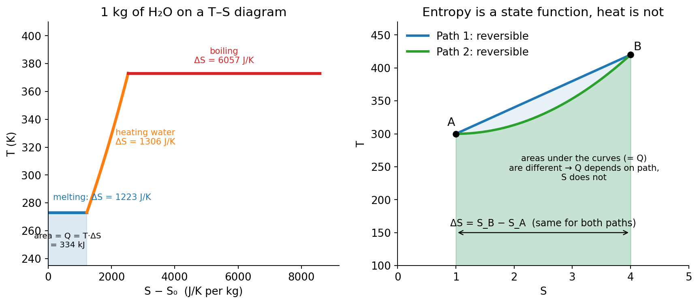

### Ideal-gas formula (useful in numericals)

$$
\Delta S = nC_V\ln\frac{T_2}{T_1}+nR\ln\frac{V_2}{V_1}
$$

### Example 1 — melting ice

Find the entropy change when 1 kg of ice melts at 0 °C (latent heat $L_f=3.34\times10^5$ J kg⁻¹).

Melting is isothermal and (taken reversibly) happens at $T=273.15$ K:

$$
\Delta S=\frac{Q}{T}=\frac{mL_f}{T}=\frac{1\times3.34\times10^{5}}{273.15}\approx 1.22\times10^{3}\ \text{J K}^{-1}
$$

The positive sign shows the system becomes more disordered (ordered crystal → free-flowing liquid).

### Example 2 — free expansion (microscopic view)

When 1 mol of an ideal gas expands freely to *twice* its volume, each molecule has twice as many places to be, so $W$ increases by a factor $2^{N}$:

$$
\Delta S=k_B\ln\frac{W_2}{W_1}=Nk_B\ln2=nR\ln2=8.314\times0.693\approx5.76\ \text{J K}^{-1}
$$

---

## Q2. The Clausius–Clapeyron (latent-heat) equation

*(2016 Q7(b); 2017 Q7(c) — "derive"; 2018 Q7(b) — "explain")*

### Statement

The rate at which the equilibrium (saturation) pressure of a substance changes with temperature during a change of state is

$$
\boxed{\frac{dP}{dT}=\frac{L}{T\,(v_2-v_1)}}
$$

where $L$ is the latent heat per unit mass, $T$ the temperature of the transition, and $v_1$, $v_2$ the specific volumes of the initial and final phases.

### Derivation (using an infinitesimal Carnot cycle)

Take 1 kg of a substance undergoing a change of state, e.g. liquid → vapour. Let $v_1$ = specific volume of the liquid and $v_2$ = specific volume of the vapour at temperature $T$ and saturation pressure $P$.

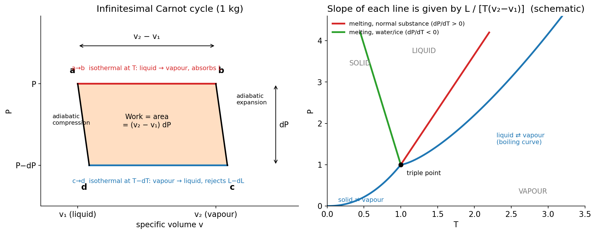

Carry out a Carnot cycle $a\to b\to c\to d\to a$ between $T$ and $T-dT$:

| Step | Process | Heat / work |
|------|---------|-------------|
| $a\to b$ | **Isothermal** at $T$ and constant pressure $P$: 1 kg of liquid is completely vaporised, volume $v_1\to v_2$ | absorbs $Q_1=L$ |
| $b\to c$ | **Adiabatic** expansion; temperature falls to $T-dT$, pressure falls to $P-dP$ | none |
| $c\to d$ | **Isothermal** at $T-dT$: vapour condenses back to liquid | rejects $Q_2=L-dL$ |
| $d\to a$ | **Adiabatic** compression back to $(T,P)$ | none |

**Work done per cycle** is the area of the narrow parallelogram $abcd$. Its width is $(v_2-v_1)$ and its height is $dP$:

$$
W=(v_2-v_1)\,dP
$$

**Efficiency** of the cycle in terms of work and heat input:

$$
\eta=\frac{W}{Q_1}=\frac{(v_2-v_1)\,dP}{L}
$$

Since the cycle is a reversible Carnot cycle between $T$ and $T-dT$:

$$
\eta=\frac{T-(T-dT)}{T}=\frac{dT}{T}
$$

Equating the two expressions for $\eta$:

$$
\frac{(v_2-v_1)\,dP}{L}=\frac{dT}{T}
\;\;\Longrightarrow\;\;
\boxed{\frac{dP}{dT}=\frac{L}{T\,(v_2-v_1)}}
$$

This is the Clausius–Clapeyron (latent-heat) equation. $\blacksquare$

**Link with entropy.** Since $L/T=s_2-s_1$ is the entropy gained per kg during the isothermal change of state, the equation can also be written $\dfrac{dP}{dT}=\dfrac{s_2-s_1}{v_2-v_1}$.

### Consequences (what to say if the question says "explain")

1. **Boiling:** $v_2>v_1$ and $L>0$, so $dP/dT>0$. The boiling point rises with pressure (pressure cookers).
2. **Melting of a normal substance:** the solid is denser, $v_{\text{liquid}}>v_{\text{solid}}$, so $dP/dT>0$. The melting point rises with pressure.
3. **Melting of ice:** water expands on freezing, $v_{\text{water}}<v_{\text{ice}}$, so $dP/dT<0$. The melting point of ice *falls* with increasing pressure (this is why ice skates glide).

### Example 3 — boiling point of water

For water at 100 °C: $L=2.26\times10^{6}$ J kg⁻¹, $T=373.15$ K, $v_2\approx1.673$ m³ kg⁻¹ (steam), $v_1\approx1.04\times10^{-3}$ m³ kg⁻¹ (water).

$$
\frac{dP}{dT}=\frac{2.26\times10^{6}}{373.15\times(1.673-0.001)}\approx3.6\times10^{3}\ \text{Pa K}^{-1}
$$

So the boiling point changes by about 1 K for every 3.6 kPa change in pressure.

### Example 4 — melting of ice under pressure

$L_f=3.34\times10^{5}$ J kg⁻¹, $T=273.15$ K, $v_{\text{water}}=1.000\times10^{-3}$, $v_{\text{ice}}=1.091\times10^{-3}$ m³ kg⁻¹, so $v_2-v_1=-9.1\times10^{-5}$ m³ kg⁻¹:

$$
\frac{dP}{dT}=\frac{3.34\times10^{5}}{273.15\times(-9.1\times10^{-5})}\approx-1.34\times10^{7}\ \text{Pa K}^{-1}\;(\approx-133\ \text{atm K}^{-1})
$$

Equivalently, $dT/dP\approx-0.0075$ K per atm: raising the pressure by 1 atm lowers the melting point of ice by about 0.0075 K.

---

## Q3. Efficiency of the $3\times10^6$ cal engine

*(2016 Q7(c); 2017 Q7(d); 2022 Q7(c))*

**Question.** Find the efficiency of an engine requiring $3\times10^{6}$ cal of heat per horsepower-hour and compare it with that of a perfect reversible engine, the source being at 100 °C and the sink at 0 °C.

### Solution

**Step 1 — Work done per horsepower-hour**

$$
1\ \text{hp}=746\ \text{W}
\;\Rightarrow\;
W=746\ \text{W}\times3600\ \text{s}=2.6856\times10^{6}\ \text{J}
$$

**Step 2 — Heat supplied (in joules)**

$$
Q_1=3\times10^{6}\ \text{cal}\times4.2\ \text{J cal}^{-1}=1.26\times10^{7}\ \text{J}
$$

**Step 3 — Efficiency of the actual engine**

$$
\eta_{\text{actual}}=\frac{W}{Q_1}=\frac{2.6856\times10^{6}}{1.26\times10^{7}}=0.2131\approx\boxed{21.3\%}
$$

**Step 4 — Efficiency of the perfect reversible (Carnot) engine**

$$
T_1=100+273=373\ \text{K},\qquad T_2=0+273=273\ \text{K}
$$

$$
\eta_{\text{rev}}=\frac{T_1-T_2}{T_1}=\frac{100}{373}=0.2681\approx\boxed{26.8\%}
$$

**Step 5 — Comparison**

$$
\frac{\eta_{\text{actual}}}{\eta_{\text{rev}}}=\frac{0.2131}{0.2681}\approx0.795\approx 80\%
$$

The actual engine converts about **21.3 %** of the heat into work. A perfect reversible engine between the same temperatures would convert **26.8 %**, so the actual engine reaches about **80 %** of the maximum possible efficiency. The remaining difference is lost to irreversibilities (friction, heat leakage, finite temperature differences), each of which generates entropy.

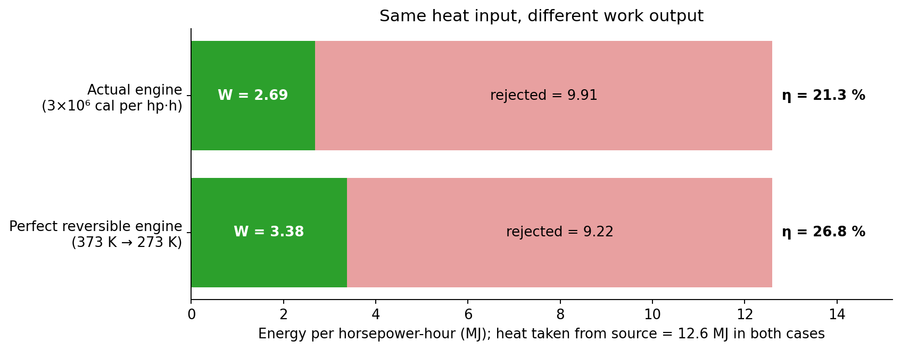

> If $J=4.186$ J cal⁻¹ is used instead of 4.2, the answers become 21.4 % and 26.8 %, with the same ratio of about 0.80. Quote the value of $J$ you use.

---

## Q4. Entropy and unavailable energy

*(2017 Q7(a); 2022 Q7(a))*

### Entropy

See [Q1](#q1-what-is-entropy): $dS=\delta Q_{\text{rev}}/T$ and $S=k_B\ln W$.

### Unavailable energy

Not all heat taken from a source can be converted into work. By the second law, some heat **must** be rejected to the coldest reservoir available (the surroundings at $T_0$). The part of the heat that can never be converted into work is called **unavailable energy**; the rest is **available energy**.

**Derivation.** Let heat $Q$ be drawn from a source at constant temperature $T$, and let the coldest reservoir be at $T_0$. The best possible engine is a Carnot engine:

$$
W_{\max}=Q\left(1-\frac{T_0}{T}\right)\qquad(\text{available energy})
$$

$$
\text{Unavailable energy}=Q-W_{\max}=\frac{QT_0}{T}
$$

The entropy given up by the source is $\Delta S=Q/T$, so

$$
\boxed{\text{Unavailable energy}=T_0\,\Delta S}
$$

On a $T$–$S$ diagram, the heat $Q$ is the area of a rectangle of width $\Delta S$. The part below the line $T=T_0$ is the unavailable energy and the part above it is the available energy.

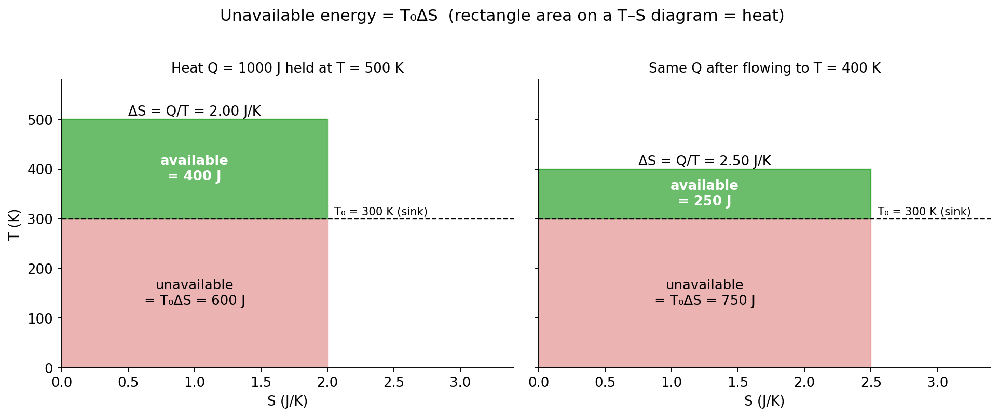

**Link with entropy.** Every irreversible process creates entropy $\Delta S_{\text{univ}}>0$ and thereby makes $T_0\,\Delta S_{\text{univ}}$ of energy unavailable. This is called the **degradation of energy**. Energy is conserved, but its *quality* keeps falling.

### Example 5

$Q=1000$ J is held at $T=500$ K and the surroundings are at $T_0=300$ K.

- $\Delta S=Q/T=1000/500=2.0$ J K⁻¹
- Unavailable energy $=T_0\Delta S=300\times2.0=600$ J
- Available energy $=1000-600=400$ J (check: $1000\,(1-300/500)=400$ J ✓)

Now let the same 1000 J flow by conduction to a body at 400 K:

- Available energy becomes $1000\,(1-300/400)=250$ J
- Energy lost for ever $=400-250=150$ J
- Check: $T_0\,\Delta S_{\text{univ}}=300\times\left(\dfrac{1000}{400}-\dfrac{1000}{500}\right)=300\times0.5=150$ J ✓

---

## Q5. Entropy in a reversible process

*(2017 Q7(b); 2021 Q5(a))*

**Question.** Show that entropy remains constant (the total entropy does not change) in a reversible process.

### Precise statement

For a reversible process:

- the entropy of an **isolated system**, or of **system + surroundings together (the universe)**, stays constant: $\Delta S_{\text{univ}}=0$;
- the entropy of a system that undergoes a **reversible adiabatic** change ($\delta Q=0$) stays constant: $dS=0$ (an *isentropic* process).

When heat flows reversibly into a system, the system's entropy rises by $\delta Q/T$, but the surroundings' entropy falls by exactly the same amount, so the total is unchanged.

### Proof

**Step 1 — Carnot cycle.** For a reversible Carnot engine the efficiency is

$$
\eta=1-\frac{Q_2}{Q_1}=1-\frac{T_2}{T_1}
\;\Longrightarrow\;
\frac{Q_1}{T_1}=\frac{Q_2}{T_2}
\;\Longrightarrow\;
\frac{Q_1}{T_1}-\frac{Q_2}{T_2}=0
$$

(Taking $Q_2$ as heat *given out* gives the sign convention $\sum Q/T=0$ over the cycle.)

**Step 2 — Any reversible cycle.** Draw a family of closely spaced adiabatic curves across an arbitrary reversible cycle. Between each pair of neighbouring adiabatics, replace the true path with two short isotherms joined by the adiabatics. Each strip is then a small Carnot cycle. The extra adiabatic and isothermal paths in the interior are traversed twice in opposite directions and cancel. As the strips become infinitely narrow:

$$
\oint\frac{\delta Q}{T}=\sum\left(\frac{Q_1}{T_1}-\frac{Q_2}{T_2}\right)=0
$$

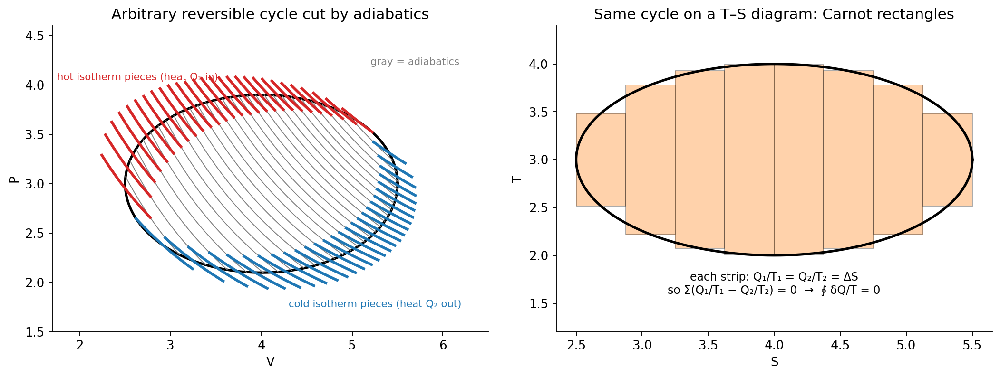

**Step 3 — Entropy is a state function.** Since $\oint\delta Q_{\text{rev}}/T=0$ for every reversible cycle, the integral $\int_A^B\delta Q_{\text{rev}}/T$ is the same along every reversible path from $A$ to $B$. This defines a function of state:

$$
S_B-S_A=\int_A^B\frac{\delta Q_{\text{rev}}}{T}
$$

**Step 4 — Conclusions.**

- Reversible adiabatic: $\delta Q=0\Rightarrow dS=0$, so $S$ is constant.
- Reversible heat transfer $\delta Q$ at temperature $T$ between a system and its surroundings (both at $T$):

$$
dS_{\text{system}}=+\frac{\delta Q}{T},\qquad dS_{\text{surr}}=-\frac{\delta Q}{T}
\;\Longrightarrow\;
dS_{\text{univ}}=0
$$

Hence the entropy of the universe remains constant in a reversible process. $\blacksquare$

### Example 6

1 mol of an ideal gas expands **reversibly and isothermally** at 300 K to twice its volume.

- System: $\Delta S_{\text{sys}}=R\ln2=+5.76$ J K⁻¹ (heat absorbed $Q=RT\ln2=1729$ J)
- Surroundings (the reservoir at 300 K supplying the heat): $\Delta S_{\text{surr}}=-Q/T=-5.76$ J K⁻¹
- Universe: $\Delta S_{\text{univ}}=5.76-5.76=0$ ✓

---

## Q6. Entropy change in a reversible Carnot cycle

*(2018 Q7(c); 2023 Q6(b))*

**Question.** Show that the entropy change is constant (zero) in a reversible Carnot cycle.

### Carnot cycle (working substance: ideal gas)

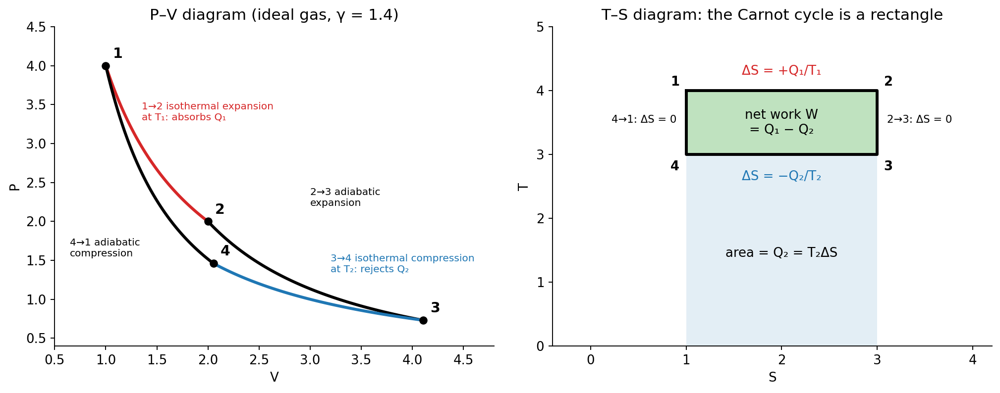

| Step | Process | Entropy change |
|------|---------|----------------|
| $1\to2$ | Isothermal expansion at $T_1$, absorbs $Q_1$ | $\Delta S_{12}=+\dfrac{Q_1}{T_1}$ |
| $2\to3$ | Adiabatic expansion, $T_1\to T_2$, $\delta Q=0$ | $\Delta S_{23}=0$ |
| $3\to4$ | Isothermal compression at $T_2$, rejects $Q_2$ | $\Delta S_{34}=-\dfrac{Q_2}{T_2}$ |
| $4\to1$ | Adiabatic compression, $T_2\to T_1$, $\delta Q=0$ | $\Delta S_{41}=0$ |

**Net entropy change over the cycle**

$$
\Delta S_{\text{cycle}}=\frac{Q_1}{T_1}+0-\frac{Q_2}{T_2}+0=\frac{Q_1}{T_1}-\frac{Q_2}{T_2}
$$

**Show $Q_1/T_1=Q_2/T_2$ for an ideal gas.**

Heat in isothermal steps (1 mol):

$$
Q_1=RT_1\ln\frac{V_2}{V_1},\qquad Q_2=RT_2\ln\frac{V_3}{V_4}
$$

Adiabatic steps ($TV^{\gamma-1}=\text{constant}$):

$$
T_1V_2^{\gamma-1}=T_2V_3^{\gamma-1},\qquad T_1V_1^{\gamma-1}=T_2V_4^{\gamma-1}
$$

Dividing one by the other:

$$
\left(\frac{V_2}{V_1}\right)^{\gamma-1}=\left(\frac{V_3}{V_4}\right)^{\gamma-1}
\;\Longrightarrow\;
\frac{V_2}{V_1}=\frac{V_3}{V_4}
$$

Therefore

$$
\frac{Q_1}{T_1}=R\ln\frac{V_2}{V_1}=R\ln\frac{V_3}{V_4}=\frac{Q_2}{T_2}
$$

and

$$
\boxed{\Delta S_{\text{cycle}}=\oint\frac{\delta Q}{T}=\frac{Q_1}{T_1}-\frac{Q_2}{T_2}=0}
$$

So the entropy of the working substance returns to its initial value after one cycle, as it must for a state function. The $T$–$S$ diagram makes this obvious: the cycle is a closed rectangle, the two vertical sides are adiabatic ($\Delta S=0$), and the entropy gained on the top side equals the entropy lost on the bottom side. $\blacksquare$

**Entropy of the universe.** The source loses $Q_1/T_1$, the sink gains $Q_2/T_2$ (equal), and the engine's entropy is unchanged, so $\Delta S_{\text{univ}}=0$ for the reversible Carnot engine.

### Example 7

A Carnot engine works between 400 K and 300 K and takes $Q_1=1200$ J per cycle.

- $Q_2=Q_1\,T_2/T_1=1200\times300/400=900$ J
- Entropy taken in: $1200/400=3.0$ J K⁻¹; entropy given out: $900/300=3.0$ J K⁻¹
- $\Delta S_{\text{cycle}}=3.0-3.0=0$ ✓
- Work $=1200-900=300$ J; $\eta=300/1200=25\%=1-300/400$ ✓

---

## Q7. Maxwell's thermodynamic relations

*(2020 Q6(a): derive the general expression; 2020 Q6(b): show that the relations hold)*

### Answer

**Mathematical basis.** If $z=z(x,y)$ is a state function, then $dz$ is an exact differential:

$$
dz=M\,dx+N\,dy,\qquad M=\left(\frac{\partial z}{\partial x}\right)_y,\;\;N=\left(\frac{\partial z}{\partial y}\right)_x
$$

Equality of the mixed second derivatives gives the **general condition**

$$
\boxed{\left(\frac{\partial M}{\partial y}\right)_x=\left(\frac{\partial N}{\partial x}\right)_y}
$$

**Thermodynamic starting point.** For a reversible change, the first and second laws give $\delta Q=T\,dS$ and $\delta W=P\,dV$, so

$$
dU=T\,dS-P\,dV
$$

The other three potentials are defined by $H=U+PV$, $F=U-TS$, $G=H-TS$. Differentiating and substituting:

| Potential | Definition | Differential |
|-----------|-----------|--------------|
| Internal energy $U$ | — | $dU=T\,dS-P\,dV$ |
| Enthalpy $H$ | $U+PV$ | $dH=T\,dS+V\,dP$ |
| Helmholtz function $F$ | $U-TS$ | $dF=-S\,dT-P\,dV$ |
| Gibbs function $G$ | $H-TS$ | $dG=-S\,dT+V\,dP$ |

Each of $U,H,F,G$ is a state function, so each differential is exact. Applying the general condition to each:

1. From $dU$ ($x=S,\;y=V,\;M=T,\;N=-P$):
$$\left(\frac{\partial T}{\partial V}\right)_S=-\left(\frac{\partial P}{\partial S}\right)_V$$
2. From $dH$ ($x=S,\;y=P,\;M=T,\;N=V$):
$$\left(\frac{\partial T}{\partial P}\right)_S=\left(\frac{\partial V}{\partial S}\right)_P$$
3. From $dF$ ($x=T,\;y=V,\;M=-S,\;N=-P$):
$$\left(\frac{\partial S}{\partial V}\right)_T=\left(\frac{\partial P}{\partial T}\right)_V$$
4. From $dG$ ($x=T,\;y=P,\;M=-S,\;N=V$):
$$\left(\frac{\partial S}{\partial P}\right)_T=-\left(\frac{\partial V}{\partial T}\right)_P$$

These four are **Maxwell's thermodynamic relations**. They convert quantities involving the hard-to-measure entropy into measurable $P$, $V$, $T$ derivatives. $\blacksquare$

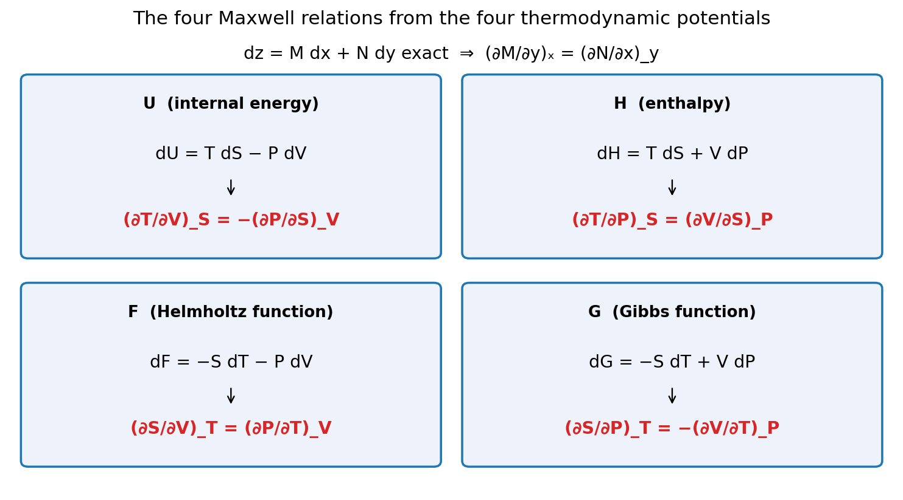

### Check and use (ideal gas, 1 mol, $PV=RT$)

- Relation 3: $\left(\dfrac{\partial P}{\partial T}\right)_V=\dfrac{R}{V}$, so $\left(\dfrac{\partial S}{\partial V}\right)_T=\dfrac RV$, which integrates to $\Delta S=R\ln\dfrac{V_2}{V_1}$ at constant $T$. This agrees with the result in Q1 and Q5.
- Relation 4: $\left(\dfrac{\partial V}{\partial T}\right)_P=\dfrac RP$, so $\left(\dfrac{\partial S}{\partial P}\right)_T=-\dfrac RP$ and $\Delta S=-R\ln\dfrac{P_2}{P_1}$ at constant $T$.
- Energy equation: from $dU=T\,dS-P\,dV$ at constant $T$ and relation 3,
$$\left(\frac{\partial U}{\partial V}\right)_T=T\left(\frac{\partial P}{\partial T}\right)_V-P$$
For an ideal gas this is $T\cdot\dfrac RV-P=0$, which is Joule's law (internal energy depends only on $T$). The same equation is used in Q11 for radiation.

---

## Q8. Isentropic process and work done

*(2022 Q6(b))*

**Question.** What is an isentropic process? Derive an expression for the work done during an isentropic process.

### Definition

An **isentropic process** is one in which the entropy stays constant, $\Delta S=0$. A process that is both **reversible and adiabatic** is isentropic, because $dS=\delta Q_{\text{rev}}/T=0$ when $\delta Q=0$. (Adiabatic alone is not enough: an irreversible adiabatic process increases $S$.)

### Equation of an isentropic process: $PV^\gamma=$ constant

First law with $\delta Q=0$: $0=dU+P\,dV$, with $dU=nC_V\,dT$ for an ideal gas.

From $PV=nRT$: $\;n\,dT=\dfrac{P\,dV+V\,dP}{R}$.

$$
\frac{C_V}{R}\,(P\,dV+V\,dP)+P\,dV=0
\;\Longrightarrow\;
C_V\,V\,dP+(C_V+R)\,P\,dV=0
$$

Using $C_P=C_V+R$ and dividing by $C_V\,PV$:

$$
\frac{dP}{P}+\gamma\,\frac{dV}{V}=0
\;\Longrightarrow\;
PV^{\gamma}=\text{constant}
$$

Equivalent forms: $TV^{\gamma-1}=\text{const}$ and $T^{\gamma}P^{1-\gamma}=\text{const}$. The same result follows from $\Delta S=nC_V\ln\dfrac{T_2}{T_1}+nR\ln\dfrac{V_2}{V_1}=0$.

### Work done

Let the gas expand from $(P_1,V_1,T_1)$ to $(P_2,V_2,T_2)$, with $K=P_1V_1^{\gamma}=P_2V_2^{\gamma}$:

$$
W=\int_{V_1}^{V_2}P\,dV=K\int_{V_1}^{V_2}V^{-\gamma}\,dV
=\frac{K}{1-\gamma}\left[V_2^{\,1-\gamma}-V_1^{\,1-\gamma}\right]
$$

$$
W=\frac{P_2V_2-P_1V_1}{1-\gamma}
$$

$$
\boxed{W=\frac{P_1V_1-P_2V_2}{\gamma-1}=\frac{nR\,(T_1-T_2)}{\gamma-1}}
$$

For an expansion $T_2<T_1$ so $W>0$ (the gas does work at the expense of its internal energy, $W=-\Delta U=nC_V(T_1-T_2)$). For a compression $W<0$.

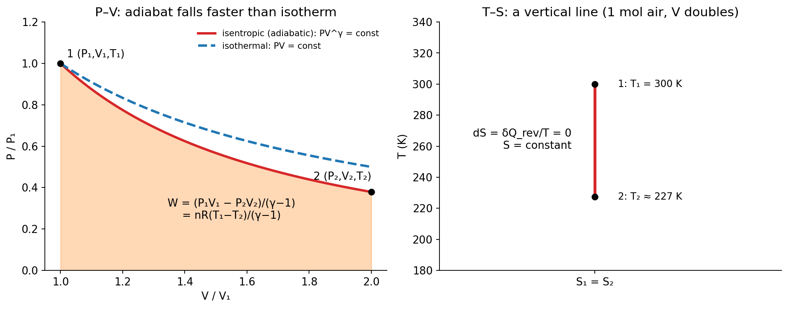

On the $P$–$V$ diagram the adiabat falls more steeply than the isotherm because its slope is $-\gamma P/V$ versus $-P/V$ for the isotherm. On the $T$–$S$ diagram it is a vertical line.

### Example 8

1 mol of air ($\gamma=1.4$) at $T_1=300$ K expands isentropically to twice its volume.

$$
T_2=T_1\left(\frac{V_1}{V_2}\right)^{\gamma-1}=300\times\left(\tfrac12\right)^{0.4}=300\times0.758\approx227\ \text{K}
$$

$$
W=\frac{nR\,(T_1-T_2)}{\gamma-1}=\frac{1\times8.314\times(300-227.4)}{0.4}\approx1.51\times10^{3}\ \text{J}
$$

Entropy change: $\Delta S=0$ ✓.

---

## Q9. Entropy in an irreversible process

*(2022 Q7(b))*

**Question as printed:** "Show that entropy remains constant in an irreversible process."

> ⚠️ **Correct result:** in an irreversible process the entropy of the universe **increases**, $\Delta S_{\text{univ}}>0$. It is only in a *reversible* process that it stays constant (see [Q5](#q5-entropy-in-a-reversible-process)). The answer below proves the correct statement. If the examiner wants "constant", that applies to reversible processes only.

### Proof

**Step 1 — Carnot's theorem.** No engine working between two given temperatures can be more efficient than a reversible one. For an irreversible engine taking $Q_1$ from $T_1$ and rejecting $Q_2$ to $T_2$:

$$
\eta_{\text{irr}}<\eta_{\text{rev}}
\;\Rightarrow\;
1-\frac{Q_2}{Q_1}<1-\frac{T_2}{T_1}
\;\Rightarrow\;
\frac{Q_2}{T_2}>\frac{Q_1}{T_1}
\;\Rightarrow\;
\frac{Q_1}{T_1}-\frac{Q_2}{T_2}<0
$$

**Step 2 — Clausius inequality.** Extending to any cycle that contains an irreversible part:

$$
\oint\frac{\delta Q}{T}<0
$$

**Step 3 — Entropy.** Let the system go from $A$ to $B$ along an **irreversible** path I and return from $B$ to $A$ along a **reversible** path R:

$$
\int_A^B\!\left(\frac{\delta Q}{T}\right)_{\text{I}}+\int_B^A\!\left(\frac{\delta Q}{T}\right)_{\text{R}}<0
$$

The second integral equals $S_A-S_B$, so

$$
\int_A^B\!\left(\frac{\delta Q}{T}\right)_{\text{I}}<S_B-S_A
$$

For an **isolated** system (or the universe), $\delta Q=0$, so the left side is zero:

$$
\boxed{\Delta S=S_B-S_A>0}
$$

Entropy increases in every irreversible process in an isolated system. In general, $\Delta S_{\text{univ}}\ge0$, and the equality holds only for reversible processes. $\blacksquare$

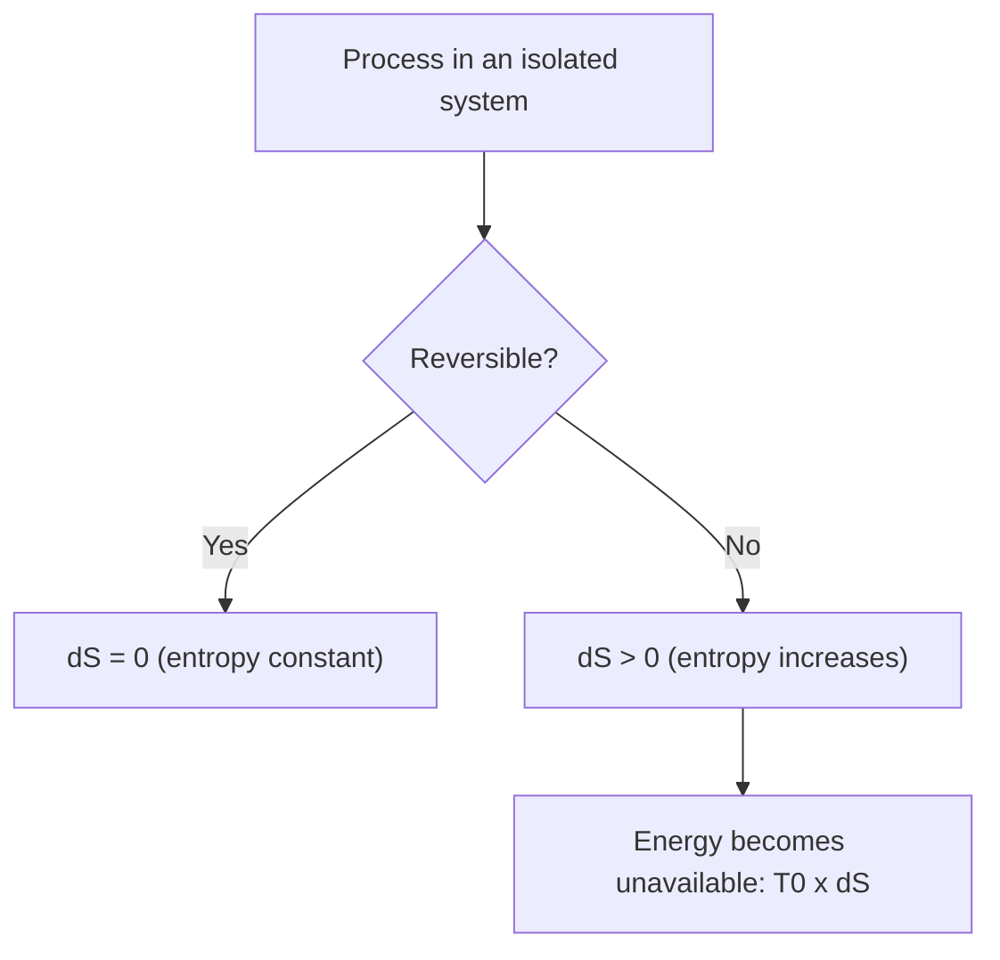

### Example 9 — conduction of heat from hot to cold

$Q=1000$ J flows directly from a body at $T_1=500$ K to a body at $T_2=300$ K (both large, so their temperatures hardly change):

$$
\Delta S_{\text{hot}}=-\frac{1000}{500}=-2.000\ \text{J K}^{-1},\qquad
\Delta S_{\text{cold}}=+\frac{1000}{300}=+3.333\ \text{J K}^{-1}
$$

$$
\Delta S_{\text{univ}}=-2.000+3.333=+1.333\ \text{J K}^{-1}>0
$$

The hot body's entropy falls, but the cold body's rises by more. The reverse flow (cold to hot, by itself) would give $\Delta S_{\text{univ}}<0$, which is why it never happens spontaneously.

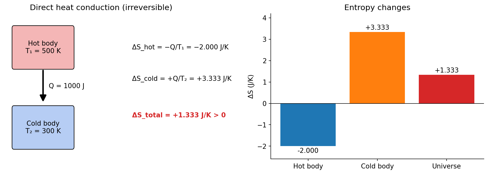

### Example 10 — free expansion

1 mol of an ideal gas expands freely (into a vacuum) to double its volume, with no heat exchanged and no work done. The surroundings do not change, yet the gas entropy rises by $\Delta S=R\ln2=5.76$ J K⁻¹, so $\Delta S_{\text{univ}}=+5.76$ J K⁻¹ $>0$. Because the process is irreversible, its entropy change must be computed along a *reversible* path between the same end states (here a reversible isothermal expansion).

---

# Part B — Thermal Radiation

## Q10. Blackbody, emissive power and absorptive power

*(2015 Q8(a); 2017 Q8(a) — "blackbody radiation, emissive power, absorptive power"; 2022 Q8(c) — "emissive power and absorptive power")*

### Definitions

**Blackbody.** A body that absorbs **all** the radiation of every wavelength falling on it, reflecting and transmitting none. Its absorptive power is exactly 1 at all wavelengths. Lampblack absorbs about 97 % of incident light; a practical blackbody is a closed cavity with a very small hole and a blackened inside (**Ferry's blackbody**): radiation that enters is reflected many times inside and almost never escapes. When heated uniformly, the hole emits **blackbody radiation** (cavity radiation), whose spectrum depends only on the temperature and not on the material of the walls.

**Emissive power ($E$).** The total radiant energy emitted per unit time per unit surface area of a body, over all wavelengths and into the whole hemisphere in front of the surface:

$$
E=\frac{\text{energy emitted}}{\text{area}\times\text{time}}\quad[\text{W m}^{-2}]
$$

The **spectral emissive power** $e_\lambda$ is the emissive power per unit wavelength interval, so $E=\int_0^\infty e_\lambda\,d\lambda$. Emissive power of a body relative to that of a blackbody at the same temperature is its **emissivity** $\varepsilon=E/E_b$.

**Absorptive power ($a$).** The fraction of the incident radiant energy that a surface absorbs:

$$
a=\frac{\text{energy absorbed}}{\text{energy incident}}\quad(\text{dimensionless},\;0\le a\le1)
$$

For wavelength $\lambda$ it is written $a_\lambda$. For a blackbody $a=1$. With reflection coefficient $r$ and transmission coefficient $t$: $a+r+t=1$.

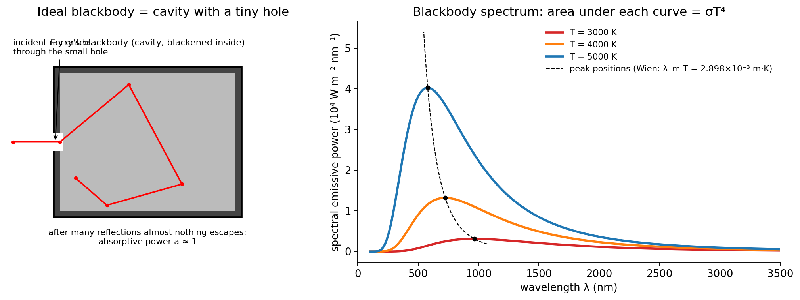

| Quantity | Symbol | Unit | Value for a perfect blackbody |
|----------|--------|------|-------------------------------|
| Emissive power | $E$ | W m⁻² | $E_b=\sigma T^4$ (largest possible at $T$) |
| Absorptive power | $a$ | none | 1 |
| Emissivity | $\varepsilon$ | none | 1 |

**Example 11.** A body absorbs 40 % of the radiation falling on it, so $a=0.4$. By Kirchhoff's law (Q12) its emissivity equals $a$ at the same wavelength, so at 300 K, where $E_b=\sigma T^4=459$ W m⁻², it emits only about $0.4\times459\approx184$ W m⁻².

---

## Q11. Stefan-Boltzmann law and its proof

*(2015 Q8(b): "state Stefan-Boltzmann's law and establish its mechanical proof")*

### Statement

The total energy radiated per unit time per unit area by a perfect blackbody is proportional to the fourth power of its absolute temperature:

$$
\boxed{E=\sigma T^{4}},\qquad \sigma=5.67\times10^{-8}\ \text{W m}^{-2}\text{K}^{-4}
$$

For a body at $T$ in surroundings at $T_0$, the net loss per unit area is $\sigma\left(T^4-T_0^4\right)$ (multiplied by the emissivity for a non-black surface).

### Proof (Boltzmann's thermodynamic derivation using radiation pressure)

The "mechanical" part of the proof is the **radiation pressure**: radiation of energy density $u$ enclosed in a cavity exerts pressure on the walls. For isotropic radiation, only the component of momentum perpendicular to the wall counts, which introduces the factor $\langle\cos^2\theta\rangle=\tfrac13$ (Maxwell):

$$
P=\frac{u}{3}
$$

The energy density $u$ of cavity radiation depends only on $T$, not on the volume.

**Step 1 — Carnot cycle on the radiation.** Fill a cylinder with piston with radiation at $T$. Since $P=u(T)/3$ depends only on $T$, the isotherms on a $P$–$V$ diagram are horizontal lines.

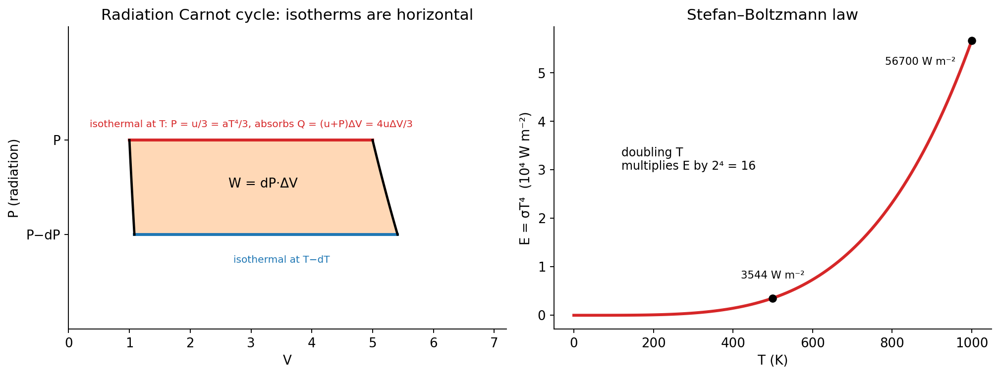

- *Isothermal expansion at $T$:* volume increases by $\Delta V$. The extra volume must be filled with energy $u\,\Delta V$, and the gas also does work $P\,\Delta V$, so the heat absorbed is
$$Q=u\,\Delta V+P\,\Delta V=\frac43\,u\,\Delta V$$
- *Adiabatic expansion* to $T-dT$, pressure $P-dP$.
- *Isothermal compression at $T-dT$,* then adiabatic compression back.

The work done in the cycle is the area of the thin parallelogram:

$$
W=dP\,\Delta V
$$

**Step 2 — Carnot efficiency.**

$$
\frac{W}{Q}=\frac{dT}{T}
\;\Rightarrow\;
\frac{dP\,\Delta V}{\tfrac43u\,\Delta V}=\frac{dT}{T}
$$

With $P=u/3$, $dP=du/3$:

$$
\frac{du/3}{\tfrac43u}=\frac{du}{4u}=\frac{dT}{T}
\;\Rightarrow\;
\frac{du}{u}=4\,\frac{dT}{T}
\;\Rightarrow\;
\boxed{u=aT^{4}}
$$

where $a$ is a constant of integration.

*(Equivalent route using the Maxwell relation from Q7: $u=\left(\dfrac{\partial U}{\partial V}\right)_T=T\left(\dfrac{\partial P}{\partial T}\right)_V-P=\dfrac T3\dfrac{du}{dT}-\dfrac u3$, which gives $T\,du/dT=4u$ and the same result.)*

**Step 3 — From energy density to emissive power.** Radiation inside the cavity is isotropic and travels at speed $c$. The energy passing out through a unit area of a small hole per unit time is

$$
E=\int_{\text{hemisphere}}u\,c\cos\theta\,\frac{d\Omega}{4\pi}=\frac{uc}{4\pi}\cdot\pi=\frac{cu}{4}
$$

Therefore

$$
E=\frac{c}{4}\,aT^{4}=\sigma T^{4},\qquad\sigma=\frac{ac}{4}
$$

This establishes the Stefan-Boltzmann law. $\blacksquare$

### Example 12

1. A blackbody at 1000 K: $E=5.67\times10^{-8}\times(1000)^4=5.67\times10^{4}$ W m⁻².
2. If its temperature is doubled, $E$ becomes $2^4=16$ times larger.
3. A blackened surface at 500 K in surroundings at 300 K loses, per unit area,
$$\sigma\left(500^4-300^4\right)=5.67\times10^{-8}\times\left(6.25\times10^{10}-8.1\times10^{9}\right)\approx3.08\times10^{3}\ \text{W m}^{-2}$$

---

## Q12. Kirchhoff's law of radiation

*(2018 Q5(d): "state and deduce Kirchhoff's law of radiation")*

### Statement

At a given temperature, the ratio of the emissive power to the absorptive power for a given wavelength is the same for all bodies, and equals the emissive power of a perfect blackbody at that temperature and wavelength:

$$
\boxed{\frac{E_\lambda}{a_\lambda}=E_{b\lambda}=f(\lambda,T)}
$$

### Deduction

Place a body $A$ (emissive power $E$, absorptive power $a$) and a perfect blackbody $B$ (emissive power $E_b$, absorptive power 1) inside a closed enclosure whose walls are kept at a uniform temperature $T$. Let $R$ be the radiant energy that falls per unit area per unit time on any surface inside the enclosure (the same for both bodies once the enclosure is in equilibrium).

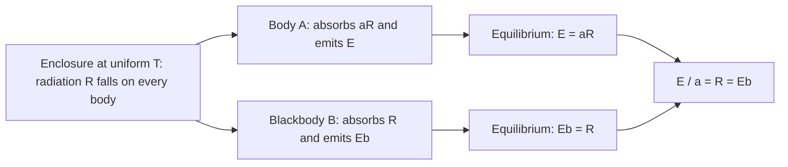

In thermal equilibrium each body stays at temperature $T$, so each must emit exactly as much energy as it absorbs:

$$
\text{Body }A:\;E=aR,\qquad\text{Blackbody }B:\;E_b=1\times R
$$

Dividing,

$$
\frac{E}{a}=R=E_b
$$

The right-hand side does not involve the nature of body $A$, which proves the law for any body. Repeating the argument for each wavelength gives $E_\lambda/a_\lambda=E_{b\lambda}$. $\blacksquare$

### Consequences

1. A good absorber is a good emitter, and a poor absorber (a polished silver surface, $a\approx0.02$) is a poor emitter. This is why a thermos flask is silvered.
2. Since $a\le1$, $E\le E_b$: no body can emit more than a blackbody at the same temperature.
3. A body emits, when hot, the same wavelengths that it absorbs when cold. This explains the dark Fraunhofer lines in the solar spectrum (cooler gases above the Sun's surface absorb the wavelengths they would emit).

**Example 13.** At 300 K the blackbody emissive power is $E_b=\sigma T^4=459$ W m⁻². A surface with $a=0.30$ at that temperature has $E=aE_b=0.30\times459\approx138$ W m⁻².

---

# Part C — Quantum and Modern Physics

## Q13. The photoelectric effect and Einstein's equation

*(2015 Q8(c); 2016 Q6(a); 2017 Q8(b); 2020 Q8(b); 2021 Q6(b) — adds "what is a photon?"; 2022 Q8(a))*

### Photoelectric effect

When light (or ultraviolet radiation) of sufficiently high frequency falls on a metal surface, electrons are emitted from the surface. The emitted electrons are called **photoelectrons**, and the current they carry is the **photocurrent**.

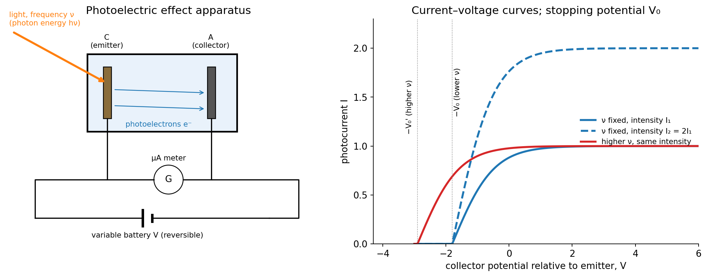

### Experimental laws

1. **Threshold frequency.** For each metal there is a minimum frequency $\nu_0$; below it no emission occurs, however intense the light.
2. **Intensity and current.** For $\nu>\nu_0$, the number of photoelectrons per second (the saturation current) is proportional to the intensity of the light.
3. **Kinetic energy.** The maximum kinetic energy $K_{\max}$ of the photoelectrons is independent of intensity. It increases linearly with the frequency of the light.
4. **No time lag.** Emission is practically instantaneous (less than $10^{-9}$ s), even for very weak light.
5. **Stopping potential.** A retarding potential $V_0$ (stopping potential) just stops the fastest electrons, so $eV_0=K_{\max}$.

### Photon

A **photon** is the quantum of electromagnetic radiation: a packet of energy

$$
E=h\nu=\frac{hc}{\lambda},\qquad p=\frac h\lambda
$$

with zero rest mass and zero charge, moving at the speed of light $c$.

### Einstein's photoelectric equation (derivation)

Einstein's assumptions (1905, extending Planck's quantum hypothesis):

1. Light of frequency $\nu$ travels as photons, each of energy $h\nu$.
2. One photon is absorbed by one electron in an all-or-nothing event.
3. Part of the photon energy is used to free the electron from the metal. The minimum energy needed is the **work function** $\phi=h\nu_0$. The rest appears as kinetic energy of the electron.

Energy conservation for the most loosely bound electron:

$$
h\nu=\phi+K_{\max}
$$

$$
\boxed{h\nu=h\nu_0+\tfrac12m v_{\max}^{2}}
$$

or $K_{\max}=\tfrac12mv_{\max}^2=h(\nu-\nu_0)$. With the stopping potential:

$$
eV_0=h\nu-\phi\;\;\Longrightarrow\;\;V_0=\frac he\,\nu-\frac{\phi}{e}
$$

A graph of $K_{\max}$ (or $eV_0$) against $\nu$ is a straight line with slope $h$, intercept $-\phi$ on the energy axis and intercept $\nu_0$ on the frequency axis. All metals give parallel lines.

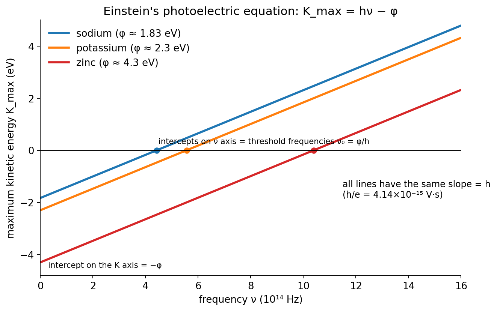

### How the equation explains the laws

| Law | Explanation |
|-----|-------------|
| Threshold frequency | If $h\nu<\phi$ the photon cannot free an electron, so $\nu_0=\phi/h$. |
| Current ∝ intensity | Higher intensity means more photons per second, so more electrons per second. |
| $K_{\max}$ independent of intensity, linear in $\nu$ | Each electron receives energy from one photon only: $K_{\max}=h\nu-\phi$. |
| No time lag | A single photon delivers its energy at once; there is nothing to "accumulate". |

### Example 14

Light of wavelength 3000 Å falls on sodium ($\phi\approx1.83$ eV, from Q16).

$$
E_{\text{photon}}=\frac{hc}{\lambda}=\frac{1240\ \text{eV nm}}{300\ \text{nm}}=4.13\ \text{eV}
$$

$$
K_{\max}=4.13-1.83=2.30\ \text{eV},\qquad V_0=2.30\ \text{V}
$$

$$
v_{\max}=\sqrt{\frac{2K_{\max}}{m}}=\sqrt{\frac{2\times2.30\times1.602\times10^{-19}}{9.11\times10^{-31}}}\approx9.0\times10^{5}\ \text{m s}^{-1}
$$

---

## Q14. The Compton effect

*(2017 Q8(c): show $\lambda'-\lambda=\lambda_C(1-\cos\phi)$; 2022 Q8(b): "what is the Compton effect? Describe the process")*

### The effect

When a beam of high-frequency radiation (X-rays or γ-rays) of wavelength $\lambda$ is scattered by a free (or loosely bound) electron, the scattered radiation contains a wavelength $\lambda'>\lambda$. The increase in wavelength depends only on the scattering angle $\phi$, not on the incident wavelength or the scatterer. Discovered by A. H. Compton (1923), it shows that radiation behaves as particles (photons) carrying momentum.

### Description of the process

An incident photon of energy $h\nu$ and momentum $h/\lambda$ collides with an electron initially at rest. The photon is scattered at angle $\phi$ with reduced energy $h\nu'$ (longer wavelength). The electron recoils at angle $\theta$ with momentum $mv$ and kinetic energy $K=(m-m_0)c^2$. The collision is treated as an elastic collision between two particles, obeying conservation of energy and momentum.

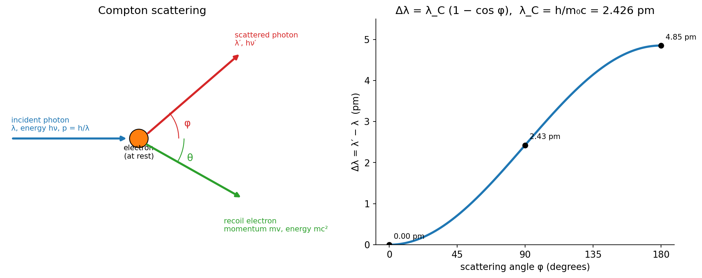

### Derivation

**Conservation of energy** (the electron has rest energy $m_0c^2$ before, and total energy $mc^2$ after):

$$
h\nu+m_0c^2=h\nu'+mc^2\quad\Longrightarrow\quad mc^2=h(\nu-\nu')+m_0c^2\tag{1}
$$

**Conservation of momentum**, along the incident direction ($x$) and perpendicular to it ($y$):

$$
\frac{h\nu}{c}=\frac{h\nu'}{c}\cos\phi+mv\cos\theta\tag{2}
$$

$$
0=\frac{h\nu'}{c}\sin\phi-mv\sin\theta\tag{3}
$$

Rearrange (2) and (3) to isolate the electron terms, multiply by $c$, square and add. This eliminates $\theta$:

$$
(mvc)^2=(h\nu-h\nu'\cos\phi)^2+(h\nu'\sin\phi)^2=h^2\nu^2-2h^2\nu\nu'\cos\phi+h^2\nu'^2\tag{4}
$$

Square (1):

$$
m^2c^4=h^2(\nu-\nu')^2+2m_0c^2h(\nu-\nu')+m_0^2c^4\tag{5}
$$

The relativistic mass relation $m=\dfrac{m_0}{\sqrt{1-v^2/c^2}}$ gives $m^2c^4-m^2v^2c^2=m_0^2c^4$. Subtract (4) from (5):

$$
h^2(\nu-\nu')^2+2m_0c^2h(\nu-\nu')+m_0^2c^4-\left(h^2\nu^2-2h^2\nu\nu'\cos\phi+h^2\nu'^2\right)=m_0^2c^4
$$

The terms $h^2\nu^2$ and $h^2\nu'^2$ cancel, leaving

$$
2m_0c^2h(\nu-\nu')=2h^2\nu\nu'(1-\cos\phi)
$$

$$
m_0c^2\,(\nu-\nu')=h\,\nu\nu'\,(1-\cos\phi)
$$

Divide by $\nu\nu'$ and use $\lambda=c/\nu$, so that $\dfrac1{\nu'}-\dfrac1\nu=\dfrac{\lambda'-\lambda}{c}$:

$$
m_0c^2\cdot\frac{\lambda'-\lambda}{c}=h(1-\cos\phi)
$$

$$
\boxed{\lambda'-\lambda=\frac{h}{m_0c}\,(1-\cos\phi)=\lambda_C\,(1-\cos\phi)}
$$

where $\lambda_C=\dfrac{h}{m_0c}=2.426\times10^{-12}$ m $=0.02426$ Å is the **Compton wavelength** of the electron. $\blacksquare$

### Remarks

- $\phi=0$: $\Delta\lambda=0$ (no shift). $\phi=90^\circ$: $\Delta\lambda=\lambda_C$. $\phi=180^\circ$: $\Delta\lambda=2\lambda_C=4.85$ pm (maximum, back-scattering).
- The shift is noticeable only for X-rays and γ-rays, because $\Delta\lambda/\lambda$ is then comparable to 1. For visible light ($\lambda\sim500$ nm) it is about $10^{-5}$ of $\lambda$ and cannot be seen.
- The scattered spectrum also shows an unshifted line, from photons scattering off tightly bound electrons, where the whole atom recoils and $m_0$ in $\lambda_C$ is effectively the atomic mass.
- Compton scattering cannot be explained by classical wave theory (which predicts no change in wavelength), so it confirms the photon picture and the momentum $p=h/\lambda$.

### Example 15

X-rays of wavelength $\lambda=0.0710$ nm are scattered through $\phi=90^\circ$.

$$
\Delta\lambda=\lambda_C(1-\cos90^\circ)=0.00243\ \text{nm},\qquad\lambda'=0.0710+0.00243=0.0734\ \text{nm}
$$

Kinetic energy given to the electron (using $hc=1240$ eV nm):

$$
K=hc\left(\frac1\lambda-\frac1{\lambda'}\right)=1240\left(\frac1{0.0710}-\frac1{0.07343}\right)\approx5.8\times10^{2}\ \text{eV}
$$

---

## Q15. Photoelectric effect: wave or particle character?

*(2020 Q8(a))*

### Answer

The photoelectric effect is a consequence of the **particle (photon) character** of radiation. It cannot be explained by the wave theory.

| Observation | Wave theory predicts | Experiment shows | Photon (particle) theory |
|-------------|---------------------|------------------|--------------------------|
| Emission delay | A time lag while the electron gathers energy from the spread-out wave (minutes for weak light) | Emission within $10^{-9}$ s | One photon gives its whole energy to one electron at once |
| Effect of intensity on $K_{\max}$ | $K_{\max}$ increases with intensity (larger amplitude, more energy) | $K_{\max}$ independent of intensity | Intensity changes the *number* of photons, not the energy of each |
| Effect of frequency | Emission at any frequency if the light is intense enough | Threshold frequency $\nu_0$; none below it | Each photon carries $h\nu$, which must exceed $\phi$ |
| Effect of frequency on $K_{\max}$ | None expected | $K_{\max}$ increases linearly with $\nu$ | $K_{\max}=h\nu-\phi$ |

Hence the effect shows that light interacts with matter as discrete quanta. (Diffraction and interference, on the other hand, show the wave character; light has this dual nature.)

---

## Q16. Work function of sodium

*(2020 Q8(c): $h=6.625\times10^{-34}$ J s; 2021 Q6(c): $h=6.663\times10^{-34}$ J s, as printed)*

**Given:** threshold wavelength $\lambda_0=6800$ Å $=6.8\times10^{-7}$ m, $c=3\times10^{8}$ m s⁻¹, $1\ \text{eV}=1.6\times10^{-19}$ J.

At the threshold the photon energy equals the work function:

$$
\phi=h\nu_0=\frac{hc}{\lambda_0}
$$

**2020 ($h=6.625\times10^{-34}$ J s):**

$$
\phi=\frac{6.625\times10^{-34}\times3\times10^{8}}{6.8\times10^{-7}}=2.92\times10^{-19}\ \text{J}=\frac{2.92\times10^{-19}}{1.6\times10^{-19}}\approx\boxed{1.83\ \text{eV}}
$$

**2021 ($h=6.663\times10^{-34}$ J s, as printed):**

$$
\phi=\frac{6.663\times10^{-34}\times3\times10^{8}}{6.8\times10^{-7}}=2.94\times10^{-19}\ \text{J}\approx\boxed{1.84\ \text{eV}}
$$

The 2021 value of $h$ looks like a misprint of $6.626\times10^{-34}$ (with which $\phi=1.83$ eV). State which value of $h$ you used.

Threshold frequency: $\nu_0=c/\lambda_0=4.41\times10^{14}$ Hz.

---

## Quick formula sheet

| Quantity | Formula |
|----------|---------|
| Definition | $dS=\dfrac{\delta Q_{\text{rev}}}{T}$; $\;S=k_B\ln W$ |
| Isothermal change of state | $\Delta S=\dfrac{mL}{T}$ |
| Ideal gas | $\Delta S=nC_V\ln\dfrac{T_2}{T_1}+nR\ln\dfrac{V_2}{V_1}$ |
| Heating at constant $c$ | $\Delta S=mc\ln\dfrac{T_2}{T_1}$ |
| Reversible process | $\Delta S_{\text{univ}}=0$; $\;\oint\dfrac{\delta Q}{T}=0$ |
| Irreversible process | $\Delta S_{\text{univ}}>0$; $\;\oint\dfrac{\delta Q}{T}<0$ |
| Carnot cycle | $\dfrac{Q_1}{T_1}=\dfrac{Q_2}{T_2}$; $\;\eta=1-\dfrac{T_2}{T_1}$ |
| Unavailable energy | $T_0\,\Delta S$ |
| Clausius–Clapeyron | $\dfrac{dP}{dT}=\dfrac{L}{T(v_2-v_1)}$ |
| Isentropic ($\gamma$) | $PV^\gamma=\text{const}$; $\;W=\dfrac{P_1V_1-P_2V_2}{\gamma-1}$ |
| Maxwell relations | $\left(\dfrac{\partial S}{\partial V}\right)_T=\left(\dfrac{\partial P}{\partial T}\right)_V$; $\;\left(\dfrac{\partial S}{\partial P}\right)_T=-\left(\dfrac{\partial V}{\partial T}\right)_P$ |
| Stefan-Boltzmann | $E=\sigma T^4$; $\;\sigma=5.67\times10^{-8}$ W m⁻² K⁻⁴ |
| Kirchhoff | $E_\lambda/a_\lambda=E_{b\lambda}$ |
| Photon | $E=h\nu=hc/\lambda$; $\;p=h/\lambda$ |
| Einstein | $h\nu=\phi+K_{\max}$; $\;eV_0=h\nu-\phi$; $\;\phi=h\nu_0$ |
| Compton | $\lambda'-\lambda=\dfrac{h}{m_0c}(1-\cos\phi)$; $\;\lambda_C=2.426$ pm |
