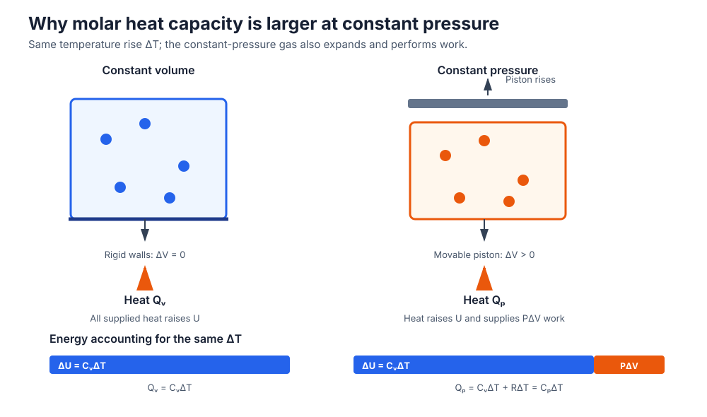
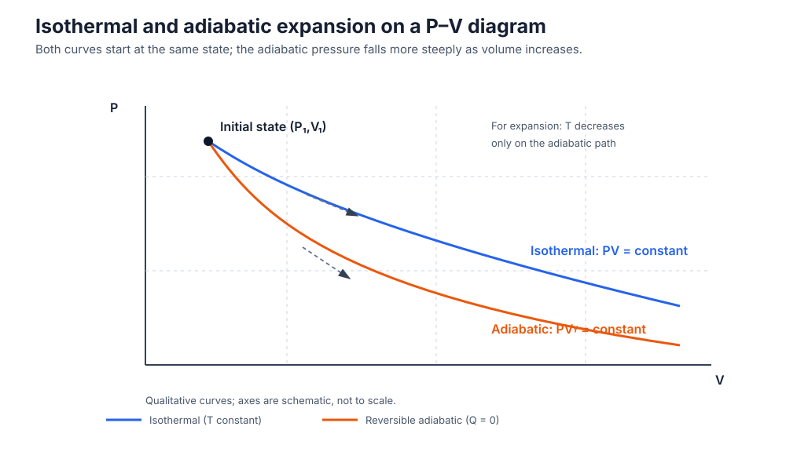
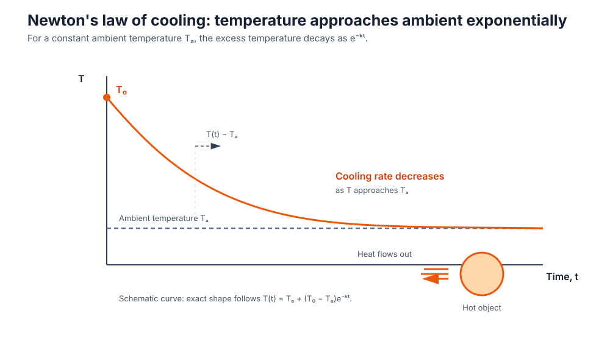
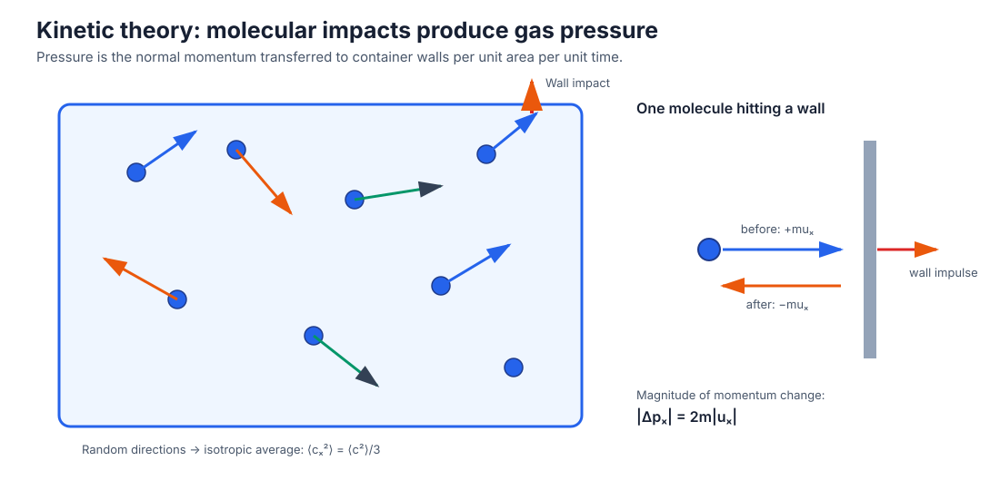
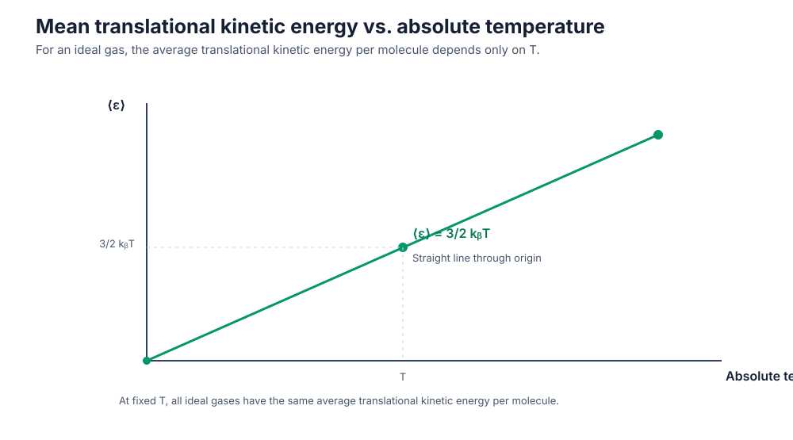

# Kinetic Theory of Gases — Enhanced Exam Revision Guide

> **Scope:** Five original examination questions, full derivations, scientific diagrams, a formula sheet, definitions, common mistakes, and five worked practice questions.
>
> **Notation policy:** `N` is the number of molecules, `ν` is the amount of gas in moles, and `n_N = N/V` is the number density. This prevents the common textbook ambiguity in which `n` is used for both molecules and moles.

## Learning objectives

By the end of this guide, you should be able to:

1. Derive Mayer's relation from the first law and the ideal-gas equation.
2. Derive the reversible adiabatic relations and assess the supplied expression `PV^(γ−1)` without silently changing it.
3. Derive the hard-sphere mean-free-path expression and explain the `√2` correction.
4. State, derive, apply, and qualify Newton's law of cooling.
5. Derive gas pressure from molecular momentum transfer and connect translational kinetic energy to absolute temperature.
6. Select the correct molecular or molar form of an equation and use SI units consistently.

---

# 1. Specific Heat Capacities of an Ideal Gas

## Original question

**Show that**

```math
\boxed{C_p-C_v=R}
```

Derive Mayer's relation from the first law of thermodynamics and the ideal-gas equation. Explain the physical meaning of the specific heat capacities at constant pressure and constant volume.

## Introduction and definitions

A gas absorbs heat to increase its internal energy. When it is allowed to expand, part of the supplied heat is also used to do external work. Therefore, for the same temperature increase, an ideal gas generally requires more heat at constant pressure than at constant volume.

- **Molar heat capacity at constant volume,** `C_v`: heat required to raise the temperature of one mole of gas by one kelvin while its volume is held constant.
- **Molar heat capacity at constant pressure,** `C_p`: heat required to raise the temperature of one mole of gas by one kelvin while its pressure is held constant.
- **Mayer's relation:** for an ideal gas, the difference between the molar heat capacities is the universal gas constant.

For this derivation, `C_p` and `C_v` mean **molar** heat capacities, with SI unit `J mol⁻¹ K⁻¹`.

## Mathematical derivation

### Step 1 — Apply the first law

For a closed system doing only pressure–volume work, using work done **by** the gas as positive,

```math
\delta Q=dU+P\,dV
```

where `δQ` is the heat supplied, `dU` is the change in internal energy, `P` is pressure, and `dV` is the volume change.

For an ideal gas, internal energy depends only on temperature. For one mole,

```math
 dU=C_v\,dT
```

### Step 2 — Heating at constant volume

At constant volume,

```math
 dV=0
```

Substitute this into the first law:

```math
\begin{aligned}
\delta Q_v &= dU+P(0)\\
            &= dU\\
            &= C_v\,dT
\end{aligned}
```

Thus, no external expansion work is done; the heat supplied changes the internal energy.

### Step 3 — Heating at constant pressure

At constant pressure, the first law gives

```math
\begin{aligned}
\delta Q_p &= dU+P\,dV\\
            &= C_v\,dT+P\,dV
\end{aligned}
```

For one mole of an ideal gas,

```math
PV=RT
```

Since `P` is constant, differentiate both sides:

```math
P\,dV=R\,dT
```

Substitute into the heat equation:

```math
\begin{aligned}
\delta Q_p &= C_v\,dT+R\,dT\\
            &= (C_v+R)\,dT
\end{aligned}
```

By the definition of molar heat capacity at constant pressure, `δQ_p = C_p dT`. Therefore,

```math
\begin{aligned}
C_p\,dT &= (C_v+R)\,dT\\
C_p &= C_v+R\\
\boxed{C_p-C_v=R}
\end{aligned}
```

This is **Mayer's relation**.

## Physical explanation

At constant volume, the container cannot expand, so the gas performs no boundary expansion work. The supplied heat increases internal energy.

At constant pressure, the gas expands as it is heated. The supplied heat must both increase internal energy and provide the work `P dV`. Consequently,

```math
Q_p-Q_v=R\,\Delta T
```

for one mole over a temperature interval where the ideal-gas heat capacities are treated as constant. Hence `C_p > C_v` for an ideal gas.



*Figure 1. At constant pressure the piston moves and the gas performs expansion work; at constant volume, `dV = 0`.*

## Final result

```math
\boxed{C_p-C_v=R}
```

## Symbols and SI units

| Symbol | Meaning | SI unit |
|---|---|---|
| `C_p` | Molar heat capacity at constant pressure | `J mol⁻¹ K⁻¹` |
| `C_v` | Molar heat capacity at constant volume | `J mol⁻¹ K⁻¹` |
| `R` | Universal gas constant (`8.314...`) | `J mol⁻¹ K⁻¹` |
| `P` | Pressure | `Pa` |
| `V` | Volume | `m³` |
| `T` | Absolute temperature | `K` |
| `U` | Internal energy | `J` |
| `Q` | Heat transferred to the gas | `J` |

## Examination notes

- State that `C_p` and `C_v` are **molar** heat capacities before writing `C_p-C_v=R`.
- The derivation uses the first law and the one-mole ideal-gas equation `PV=RT`.
- At constant volume, `P dV=0`; at constant pressure, `P dV=R dT` for one mole.
- Do not say that `C_p=C_v`: expansion work makes `C_p` larger.
- If heat capacity is defined **per unit mass** rather than per mole, the corresponding relation is `c_p-c_v=R_s`, where `R_s` is the specific gas constant in `J kg⁻¹ K⁻¹`. For `ν` moles, the total heat-capacity difference is `νR`.
- The simple derivation assumes an ideal gas and pressure–volume work only. For real gases or additional forms of work, the relation need not hold in this simple form.

---

# 2. Adiabatic Relations

## Original question

Derive/show the relations:

```math
PV^\gamma=\text{constant}
```

and

```math
PV^{\gamma-1}
```

The second expression is transcribed exactly as written in the source. Investigate its mathematical and physical validity. Explain whether it represents a standard thermodynamic relation. Compare it with the standard adiabatic relation:

```math
TV^{\gamma-1}=\text{constant}
```

## Introduction and definitions

An **adiabatic process** is a thermodynamic process in which no heat is transferred between the system and its surroundings. For a reversible (quasi-static) adiabatic change of a fixed amount of ideal gas with constant heat capacities, pressure, volume, and temperature are connected by standard power-law relations.

The ratio of molar heat capacities is

```math
\gamma=\frac{C_p}{C_v}
```

For an ideal gas, Mayer's relation gives

```math
R=C_p-C_v
```

Therefore,

```math
\frac{R}{C_v}=\frac{C_p-C_v}{C_v}=\gamma-1
```

## Mathematical derivation

### Step 1 — Start from the first law

For pressure–volume work,

```math
\delta Q=dU+P\,dV
```

For an adiabatic process, `δQ = 0`. For `ν` moles of ideal gas, `dU=νC_v dT`. Thus,

```math
\begin{aligned}
0 &= \nu C_v\,dT+P\,dV\\
\nu C_v\,dT &= -P\,dV
\end{aligned}
```

### Step 2 — Use the ideal-gas equation

For `ν` moles,

```math
PV=\nu RT
```

Rearrange for pressure:

```math
P=\frac{\nu RT}{V}
```

Substitute this into the first-law equation:

```math
\begin{aligned}
\nu C_v\,dT+\frac{\nu RT}{V}\,dV &=0\\
C_v\,dT+R T\frac{dV}{V} &=0
\end{aligned}
```

The factor `ν` cancels because the same fixed amount of gas appears in both terms.

### Step 3 — Separate variables

Divide by `C_v T`:

```math
\frac{dT}{T}+\frac{R}{C_v}\frac{dV}{V}=0
```

Using `R/C_v = γ − 1`,

```math
\frac{dT}{T}+(\gamma-1)\frac{dV}{V}=0
```

### Step 4 — Integrate

Integrate between any two equilibrium states on the reversible adiabatic path:

```math
\begin{aligned}
\int\frac{dT}{T}+(\gamma-1)\int\frac{dV}{V} &=0\\
\ln T+(\gamma-1)\ln V &=\text{constant}\\
\ln\left(TV^{\gamma-1}\right)&=\text{constant}
\end{aligned}
```

Exponentiating gives

```math
\boxed{TV^{\gamma-1}=\text{constant}}
```

This is the temperature–volume form of the reversible adiabatic relation.

### Step 5 — Obtain the pressure–volume form

From the ideal-gas equation,

```math
T=\frac{PV}{\nu R}
```

Substitute this into `TV^(γ−1) = constant`:

```math
\begin{aligned}
\frac{PV}{\nu R}V^{\gamma-1}&=\text{constant}\\
\frac{PV^\gamma}{\nu R}&=\text{constant}
\end{aligned}
```

For a fixed amount of gas, `νR` is constant, so it can be absorbed into the constant of proportionality:

```math
\boxed{PV^\gamma=\text{constant}}
```

## Scientific explanation and comparison

For reversible adiabatic **expansion**, the gas does work without receiving heat. Its internal energy and temperature decrease; the pressure falls more rapidly with increasing volume than it would in an isothermal expansion from the same initial state.

For an isothermal ideal-gas process, `T` is constant and `PV = constant`. For a reversible adiabatic ideal-gas process, `PV^γ = constant` and `TV^(γ−1) = constant`.



*Figure 2. The adiabatic curve is steeper than the isothermal curve at the same initial state. The plot is qualitative.*

### Quick comparison

| Property | Isothermal ideal-gas process | Reversible adiabatic ideal-gas process |
|---|---|---|
| Heat transfer | Generally nonzero | `Q = 0` |
| Temperature | Constant | Changes during expansion/compression |
| P–V equation | `PV = constant` | `PV^γ = constant` |
| T–V equation | `T = constant` | `TV^(γ−1) = constant` |
| Expansion | Pressure decreases | Pressure and temperature decrease |

## Mathematical clarification: the supplied expression `PV^(γ−1)`

**Original expression, preserved exactly:**

```math
PV^{\gamma-1}
```

As written, this is only an algebraic expression. It has no equality sign or stated condition, so by itself it does not assert a conserved quantity or a thermodynamic law.

If the intended claim was

```math
PV^{\gamma-1}=\text{constant}
```

that claim is **not** the standard reversible adiabatic relation for an ideal gas. The established pressure–volume relation is `PV^γ = constant`, while the established temperature–volume relation is `TV^(γ−1) = constant`.

The difference can be demonstrated directly. Along a reversible adiabat, let `PV^γ = K`, where `K` is constant. Then

```math
\begin{aligned}
PV^{\gamma-1}&=\frac{PV^\gamma}{V}\\
              &=\frac{K}{V}
\end{aligned}
```

This varies inversely with volume and is therefore **not constant** as the gas expands or contracts. The likely intended expression is `TV^(γ−1) = constant`, because it is the standard adiabatic temperature–volume relation and differs from the supplied expression by the variable `T` in place of `P`. This is an interpretation of a likely transcription error, not a verified correction to the source.

## Final results

```math
\boxed{PV^\gamma=\text{constant}}
```

```math
\boxed{TV^{\gamma-1}=\text{constant}}
```

The separate source expression remains `PV^(γ−1)` and must not be memorized as an adiabatic invariant.

## Symbols and SI units

| Symbol | Meaning | SI unit |
|---|---|---|
| `P` | Pressure | `Pa` |
| `V` | Volume | `m³` |
| `T` | Absolute temperature | `K` |
| `ν` | Amount of gas | `mol` |
| `R` | Universal gas constant | `J mol⁻¹ K⁻¹` |
| `C_p` | Molar heat capacity at constant pressure | `J mol⁻¹ K⁻¹` |
| `C_v` | Molar heat capacity at constant volume | `J mol⁻¹ K⁻¹` |
| `γ` | Heat-capacity ratio `C_p/C_v` | Dimensionless |

## Examination notes

- State the assumptions: ideal gas, fixed amount of gas, reversible/quasi-static adiabatic path, and constant heat capacities (so `γ` is constant).
- Do not confuse an adiabatic process (`Q = 0`) with an isothermal process (`T = constant`).
- The pressure–volume exponent is `γ`, not `γ−1`.
- The temperature–volume exponent is `γ−1`.
- If the source gives `PV^(γ−1)`, reproduce it when asked to quote the question, then explain the issue separately. Do not silently replace it.
- For irreversible adiabatic changes, the simple equilibrium-state power laws need not describe the path.

---

# 3. Mean Free Path

## Original question

Derive an expression for the mean free path of gas molecules. Explain molecular collision, collision diameter, collision frequency, and number density. Derive the final expression and explain the significance of the factor `√2`.

## Introduction and definitions

Gas molecules move continuously and randomly. A molecule travels some distance before it collides with another molecule. The **mean free path**, `λ`, is the average distance traveled by a molecule between successive collisions.

A useful model treats molecules as identical hard spheres:

- **Collision diameter,** `d`: the center-to-center separation of two molecules when they just touch and collide.
- **Collision cross-section,** `σ`: the effective target area for a collision. For hard spheres, `σ = πd²`.
- **Number density,** `n_N`: number of molecules per unit volume, `n_N = N/V`, measured in `m⁻³`.
- **Collision frequency,** `z`: average number of collisions suffered by one molecule per second, measured in `s⁻¹`.

## Mathematical derivation

### Step 1 — Collision cylinder for a moving molecule

Consider one molecule moving with mean speed `c̄` for a short time `dt`. It travels a distance

```math
\ell=\bar c\,dt
```

In the hard-sphere model, a collision occurs if the center of another molecule lies within a perpendicular distance `d` of the path. The moving molecule therefore sweeps out a collision cylinder of cross-sectional area `πd²` and volume

```math
\Delta V_{\text{swept}}=\pi d^2\bar c\,dt
```

If the other molecules were stationary, the expected number of molecular centers in this volume would be

```math
\Delta N=n_N\pi d^2\bar c\,dt
```

### Step 2 — Correct for the motion of the other molecules

The other molecules are not stationary. They also move, so collisions depend on the **relative speed** of a pair of molecules. For identical molecules in a gas with a Maxwellian velocity distribution, the mean relative speed is `√2` times the mean speed of one molecule. This introduces the factor `√2`:

```math
\Delta N=\sqrt{2}\,n_N\pi d^2\bar c\,dt
```

### Step 3 — Obtain collision frequency

Collision frequency is the number of collisions per molecule per unit time. Therefore,

```math
z=\frac{\Delta N}{dt}=\sqrt{2}\,n_N\pi d^2\bar c
```

### Step 4 — Calculate mean free path

Mean free path is mean distance traveled per unit time divided by the number of collisions per unit time:

```math
\begin{aligned}
\lambda&=\frac{\text{mean distance traveled per second}}{\text{collisions per second}}\\
       &=\frac{\bar c}{z}\\
       &=\frac{\bar c}{\sqrt{2}\,n_N\pi d^2\bar c}\\
       &=\frac{1}{\sqrt{2}\,n_N\pi d^2}
\end{aligned}
```

Since `n_N=N/V`,

```math
\boxed{\lambda=\frac{1}{\sqrt{2}\,\pi d^2 n_N}=\frac{V}{\sqrt{2}\,\pi d^2N}}
```

## Scientific explanation

A larger molecular diameter gives a larger collision cross-section, so collisions become more frequent and the mean free path becomes shorter. A higher number density also increases the number of possible collision partners per unit volume, reducing `λ`.

The factor `√2` accounts for the motion of both members of a colliding pair. If the target molecules were treated as stationary, the simplified estimate would be `1/(πd²n_N)`. In a real gas, both molecules move, and the relative motion increases the collision rate by the `√2` factor for identical Maxwellian molecules.


*Figure 3. Molecular paths are interrupted by collisions. The mean free path is an average over many free-flight segments; `d` is the hard-sphere collision diameter.*

## Final result

```math
\boxed{\lambda=\frac{1}{\sqrt{2}\,\pi d^2 n_N}}
```

or, using total molecule count,

```math
\boxed{\lambda=\frac{V}{\sqrt{2}\,\pi d^2N}}
```

## Symbols and SI units

| Symbol | Meaning | SI unit |
|---|---|---|
| `λ` | Mean free path | `m` |
| `d` | Molecular collision diameter | `m` |
| `σ = πd²` | Collision cross-section | `m²` |
| `n_N = N/V` | Number density | `m⁻³` |
| `N` | Number of molecules | Dimensionless count |
| `V` | Gas volume | `m³` |
| `c̄` | Mean molecular speed | `m s⁻¹` |
| `z` | Collision frequency per molecule | `s⁻¹` |

## Assumptions and limitations

1. Molecules are modeled as identical, rigid hard spheres of diameter `d`.
2. The gas is dilute, so collisions are predominantly binary and the collision-cylinder picture is useful.
3. Molecular motion is random and described by an equilibrium Maxwellian distribution.
4. The formula uses the mean relative speed for identical molecules; it is not a formula for an arbitrary non-equilibrium velocity distribution.
5. Intermolecular forces outside the short collision event are neglected in this simple model.

## Examination notes

- Do not omit `√2` in the standard hard-sphere result.
- Do not confuse **number density** `n_N=N/V` with the **number of moles** `ν`.
- The collision cross-section is `πd²`, not `π(d/2)²`, when `d` is the sum of the two hard-sphere radii (the collision diameter).
- Check the units: `d² n_N` has unit `m² × m⁻³ = m⁻¹`; its reciprocal has unit metres.
- `λ` is an average; individual free paths are not all equal.

---

# 4. Newton's Law of Cooling

## Original question

Explain Newton's law of cooling. Derive its mathematical expression, explain the underlying assumptions, and discuss its limitations and practical applications. Include a temperature-versus-time cooling curve and explain the behavior of the curve.

## Introduction and statement of the law

**Newton's law of cooling** states that, under suitable conditions, the rate at which a body's temperature decreases is proportional to the temperature difference between the body and its surroundings.

For an object hotter than its surroundings,

```math
-\frac{dT}{dt}\propto T-T_a
```

where `T` is the object's temperature and `T_a` is the surrounding (ambient) temperature. The negative sign indicates that the object's temperature falls with time.

## Mathematical derivation

### Step 1 — Write the proportionality

Let `k` be a positive cooling constant. Then

```math
\frac{dT}{dt}=-k(T-T_a)
```

Here `k` has unit `s⁻¹` when time is measured in seconds.

### Step 2 — Separate variables

Move all temperature terms to the left and time terms to the right:

```math
\frac{dT}{T-T_a}=-k\,dt
```

### Step 3 — Integrate

Assume the ambient temperature `T_a` is constant. Integrating,

```math
\begin{aligned}
\int\frac{dT}{T-T_a}&=-k\int dt\\
\ln|T-T_a|&=-kt+C
\end{aligned}
```

### Step 4 — Apply the initial condition

Let `T=T_0` at `t=0`. Then

```math
C=\ln|T_0-T_a|
```

Therefore,

```math
\begin{aligned}
\ln\left|\frac{T-T_a}{T_0-T_a}\right|&=-kt\\
\frac{T-T_a}{T_0-T_a}&=e^{-kt}
\end{aligned}
```

For an object initially hotter than its surroundings, the temperature difference is positive, and the cooling equation becomes

```math
\boxed{T(t)=T_a+(T_0-T_a)e^{-kt}}
```

### Step 5 — Relate `k` to heat-transfer parameters

For a lumped body of mass `m_b` and specific heat capacity `c_b`, its thermal energy change is approximately

```math
m_b c_b\frac{dT}{dt}
```

If heat is lost by convection at a rate `hA(T-T_a)`, an energy balance gives

```math
m_b c_b\frac{dT}{dt}=-hA(T-T_a)
```

Comparing with Newton's cooling equation,

```math
\boxed{k=\frac{hA}{m_b c_b}}
```

where `h` is the convective heat-transfer coefficient and `A` is the exposed surface area. Other heat-transfer mechanisms can be included in an effective heat-transfer coefficient when a linear approximation is appropriate.

## Cooling curve and its interpretation



*Figure 4. The object cools rapidly at first. As its temperature approaches the ambient temperature, the temperature difference and the rate of cooling become smaller.*

The curve has three important features:

1. At `t=0`, the object has temperature `T₀`.
2. The magnitude of the slope is initially largest because `T₀−T_a` is largest.
3. The curve approaches `T_a` asymptotically. In the ideal model it does not reach the ambient temperature in a finite time.

The instantaneous cooling rate is

```math
\frac{dT}{dt}=-k(T-T_a)
```

so the rate decreases in magnitude as the object gets closer to ambient temperature.

## Assumptions

- The object's temperature is approximately uniform throughout its volume (lumped-temperature approximation).
- The surrounding temperature `T_a` remains constant.
- The heat-transfer coefficient, exposed area, mass, and specific heat capacity are approximately constant.
- There is no significant internal heat generation or phase change during cooling.
- The temperature difference is in a range where heat-loss rate is approximately proportional to `T−T_a`.

For a lumped body, a common engineering check is a small Biot number, `Bi = hL_c/k_s` (often `Bi < 0.1`), where `L_c` is characteristic length and `k_s` is the solid's thermal conductivity. This indicates that internal temperature gradients are small compared with the surface-to-fluid temperature difference.

## Limitations

- At large temperature differences, radiative heat loss is strongly nonlinear because it follows a fourth-power temperature difference: `q_rad = εσA(T⁴−T_a⁴)`.
- The law becomes inaccurate if the object develops substantial internal temperature gradients.
- It is not valid with changing ambient temperature unless the model is modified.
- Changing surface conditions, airflow, material properties, or phase changes can invalidate a constant `k` model.
- It is an approximation for a practical cooling situation, not a universal exact law for every heat-transfer process.

## Applications

- Estimating the cooling time of hot liquids, food, and manufactured components.
- Comparing insulation or heat-loss performance under controlled conditions.
- Approximate temperature monitoring in industrial processes.
- Introductory calorimetry and laboratory cooling experiments.

## Final result

```math
\boxed{T(t)=T_a+(T_0-T_a)e^{-kt}}
```

## Symbols and SI units

| Symbol | Meaning | SI unit |
|---|---|---|
| `T` | Object temperature | `K` (temperature differences may be in `K` or `°C`) |
| `T₀` | Initial object temperature | `K` |
| `T_a` | Ambient temperature | `K` |
| `t` | Time | `s` |
| `k` | Cooling constant | `s⁻¹` |
| `m_b` | Object mass | `kg` |
| `c_b` | Specific heat capacity of object | `J kg⁻¹ K⁻¹` |
| `h` | Convective heat-transfer coefficient | `W m⁻² K⁻¹` |
| `A` | Exposed surface area | `m²` |

## Examination notes

- Write the proportionality first, then introduce the negative sign and the positive constant `k`.
- Define `T_a` and state whether it is assumed constant.
- Do not confuse the cooling constant `k` with Boltzmann's constant `k_B`.
- Celsius temperature may be used for a temperature **difference**, but thermodynamic radiation equations and absolute-temperature laws require kelvin.
- State that Newton's law is an approximation with assumptions; do not claim it is exact for every temperature range.

---

# 5. Pressure of an Ideal Gas and Average Kinetic Energy

## Original question

Explain and derive the relations:

```math
P=\frac{1}{3}\frac{mn c^2}{V}
```

and

```math
E_k=\frac{3}{2}nRT
```

Derive the kinetic-theory expression for gas pressure using molecular motion and momentum transfer. Then derive the relationship between the average translational kinetic energy of gas molecules and absolute temperature. Distinguish the number of molecules from the number of moles.

## Notation clarification before deriving

The original expressions use `n` without defining whether it means molecules or moles. To avoid mixing quantities, this guide uses:

- `N` = total number of molecules (a count).
- `ν` = amount of gas in moles.
- `n_N=N/V` = number density (molecules per cubic metre).
- `m` = mass of one molecule.
- `\overline{c^2}` = mean square molecular speed; `c_rms² = \overline{c²}`.

The pressure formula consistent with these definitions is

```math
P=\frac{1}{3}\frac{Nm\overline{c^2}}{V}
```

Equivalently, when number density is used,

```math
P=\frac{1}{3}n_Nm\overline{c^2}
```

The total translational kinetic energy is

```math
E_{k,\text{total}}=\frac{3}{2}\nu RT=\frac{3}{2}Nk_BT
```

Thus, the source's `nRT` form is correct when its `n` means **number of moles**. If `n` means number of molecules, the correct molecular form uses `Nk_B T`, not `NRT`.

## Part A — Derivation of gas pressure

### Step 1 — Consider a cubical container

Take a cube of side length `L` and volume `V=L³`. Consider one molecule of mass `m` moving with velocity component `u_x` perpendicular to one wall.

When it collides elastically with that wall, its perpendicular velocity changes from `+u_x` to `−u_x`. Its momentum change is

```math
\Delta p_x=(-mu_x)-(mu_x)=-2mu_x
```

The wall receives an equal and opposite impulse. The magnitude of momentum transferred to the wall is therefore

```math
|\Delta p_x|=2m|u_x|
```

### Step 2 — Determine the time between successive impacts on the same wall

After rebounding, the molecule must travel to the opposite wall and return. The distance is `2L`, so the time interval is

```math
\Delta t=\frac{2L}{|u_x|}
```

### Step 3 — Find the average force due to one molecule

Average force is momentum transferred per unit time:

```math
\begin{aligned}
F_x&=\frac{2m|u_x|}{2L/|u_x|}\\
   &=\frac{mu_x^2}{L}
\end{aligned}
```

### Step 4 — Add contributions from all molecules

For `N` molecules, with perpendicular velocity components `u_{x1},u_{x2},...,u_{xN}`,

```math
F_x=\frac{m}{L}\sum_{i=1}^{N}u_{xi}^2
```

The wall area is `A=L²`. Pressure is force per unit area:

```math
\begin{aligned}
P&=\frac{F_x}{A}\\
 &=\frac{m}{L^3}\sum_{i=1}^{N}u_{xi}^2\\
 &=\frac{m}{V}\sum_{i=1}^{N}u_{xi}^2
\end{aligned}
```

### Step 5 — Use isotropic random molecular motion

In an equilibrium gas, molecular motion has no preferred direction. Therefore, the average squared velocity components are equal:

```math
\overline{u_x^2}=\overline{u_y^2}=\overline{u_z^2}
```

Since each molecule's speed satisfies `c²=u_x²+u_y²+u_z²`,

```math
\overline{c^2}=3\overline{u_x^2}
```

Thus,

```math
\overline{u_x^2}=\frac{1}{3}\overline{c^2}
```

Substitute into the pressure expression:

```math
\begin{aligned}
P&=\frac{Nm}{V}\overline{u_x^2}\\
 &=\frac{Nm}{3V}\overline{c^2}
\end{aligned}
```

Therefore,

```math
\boxed{P=\frac{1}{3}\frac{Nm\overline{c^2}}{V}=\frac{1}{3}n_Nm c_{\mathrm{rms}}^2}
```



*Figure 5. Gas pressure is caused by repeated molecular impacts and the normal momentum transferred to the container walls.*

## Part B — Derivation of average translational kinetic energy

### Step 1 — Write the total translational kinetic energy

For `N` identical molecules,

```math
E_{k,\text{total}}=\frac{1}{2}m\sum_{i=1}^{N}c_i^2
```

Using the mean square speed,

```math
E_{k,\text{total}}=\frac{1}{2}Nm\overline{c^2}
```

### Step 2 — Use the pressure equation

From Part A,

```math
PV=\frac{1}{3}Nm\overline{c^2}
```

Multiply both sides by `3/2`:

```math
\frac{3}{2}PV=\frac{1}{2}Nm\overline{c^2}
```

The right-hand side is the total translational kinetic energy. Hence,

```math
E_{k,\text{total}}=\frac{3}{2}PV
```

### Step 3 — Apply the ideal-gas equation

For `ν` moles, the ideal-gas equation is

```math
PV=\nu RT
```

Therefore,

```math
\begin{aligned}
E_{k,\text{total}}&=\frac{3}{2}PV\\
                   &=\frac{3}{2}\nu RT
\end{aligned}
```

Since `N=νN_A` and `R=N_Ak_B`, the molecular form is

```math
\boxed{E_{k,\text{total}}=\frac{3}{2}\nu RT=\frac{3}{2}Nk_BT}
```

The average translational kinetic energy **per molecule** is the total divided by `N`:

```math
\begin{aligned}
\langle\varepsilon_{\text{trans}}\rangle
 &=\frac{E_{k,\text{total}}}{N}\\
 &=\frac{3}{2}k_BT
\end{aligned}
```

Thus,

```math
\boxed{\langle\varepsilon_{\text{trans}}\rangle=\frac{3}{2}k_BT}
```



*Figure 6. The average translational kinetic energy per molecule is proportional to absolute temperature and is the same for all ideal gases at the same temperature.*

## Scientific explanation

Absolute temperature is a measure of the average translational kinetic energy of ideal-gas molecules. At a higher temperature, the molecules have a higher mean square speed and transfer more momentum to the container walls, producing a higher pressure if the volume and number of molecules are fixed.

The average translational kinetic energy per molecule is independent of molecular mass at a given temperature. Lighter molecules therefore have a higher characteristic speed than heavier molecules at the same temperature.

The result `3/2 k_B T` refers to **translational** kinetic energy. It does not by itself include rotational or vibrational energy of a molecule.

## Final results

**Pressure:**

```math
\boxed{P=\frac{1}{3}\frac{Nm c_{\mathrm{rms}}^2}{V}=\frac{1}{3}n_Nm c_{\mathrm{rms}}^2}
```

**Total translational kinetic energy:**

```math
\boxed{E_{k,\text{total}}=\frac{3}{2}\nu RT=\frac{3}{2}Nk_BT}
```

**Average translational kinetic energy per molecule:**

```math
\boxed{\langle\varepsilon_{\text{trans}}\rangle=\frac{3}{2}k_BT}
```

## Symbols and SI units

| Symbol | Meaning | SI unit |
|---|---|---|
| `P` | Gas pressure | `Pa` |
| `V` | Gas volume | `m³` |
| `N` | Number of molecules | Dimensionless count |
| `ν` | Number of moles | `mol` |
| `n_N=N/V` | Number density | `m⁻³` |
| `m` | Mass of one molecule | `kg` |
| `u_x` | x-component of molecular velocity | `m s⁻¹` |
| `c` | Molecular speed | `m s⁻¹` |
| `c_rms` | Root-mean-square speed | `m s⁻¹` |
| `E_{k,total}` | Total translational kinetic energy | `J` |
| `k_B` | Boltzmann constant | `J K⁻¹` |
| `R` | Universal gas constant | `J mol⁻¹ K⁻¹` |
| `N_A` | Avogadro constant | `mol⁻¹` |
| `T` | Absolute temperature | `K` |

## Examination notes

- The factor `1/3` comes from isotropic random motion: the mean squared velocity along one axis is one-third of the mean square speed.
- In `P=(1/3)(Nm c_rms²/V)`, `N` is a molecule count. If using number density, write `P=(1/3)n_Nm c_rms²` and do not divide by `V` again.
- In `E_k=(3/2)νRT`, `ν` is the number of moles. For a molecule count, use `E_k=(3/2)Nk_BT`.
- Use kelvin in ideal-gas and kinetic-energy equations.
- Do not confuse mean square speed `\overline{c²}` with the square of mean speed `\bar c²`; generally they are not equal.
- Pressure is normal momentum transfer per unit area per unit time, not simply the force of one molecular collision.
- The average translational kinetic energy relation applies to the three translational degrees of freedom of an ideal-gas molecule.

---

# 6. Consolidated Formula Sheet

| Topic | Formula | Symbol notes and SI units | Validity / condition |
|---|---|---|---|
| Ideal gas | `PV=νRT=Nk_BT` | `P` Pa, `V` m³, `ν` mol, `T` K, `N` molecules | Ideal-gas model |
| Mayer's relation | `C_p−C_v=R` | Molar heat capacities in `J mol⁻¹ K⁻¹` | Ideal gas; molar heat capacities |
| Mass-specific Mayer relation | `c_p−c_v=R_s` | `c_p,c_v` in `J kg⁻¹ K⁻¹`; `R_s` in `J kg⁻¹ K⁻¹` | Ideal gas; per-unit-mass heat capacities |
| Heat-capacity ratio | `γ=C_p/C_v` | Dimensionless | Molar (or consistently mass-specific) capacities |
| Isothermal process | `PV=constant` | `P` Pa, `V` m³ | Fixed amount of ideal gas, `T` constant |
| Reversible adiabatic P–V | `PV^γ=constant` | `γ=C_p/C_v` | Ideal gas, reversible adiabatic path, constant heat capacities |
| Reversible adiabatic T–V | `TV^(γ−1)=constant` | `T` K, `V` m³ | Same conditions as above |
| Mean free path | `λ=1/(√2 πd²n_N)` | `λ,d` m; `n_N` m⁻³ | Dilute hard-sphere gas with Maxwellian velocities |
| Number density | `n_N=N/V` | `N` molecules, `V` m³; `n_N` m⁻³ | Definition |
| Collision cross-section | `σ=πd²` | `σ` m², `d` m | Identical hard-sphere molecules |
| Collision frequency | `z=√2 πd²n_N c̄` | `z` s⁻¹, `c̄` m s⁻¹ | Same hard-sphere equilibrium model |
| Newton cooling differential form | `dT/dt=−k(T−T_a)` | `k` s⁻¹; temperatures K | Constant ambient and approximately constant heat-transfer conditions |
| Newton cooling solution | `T=T_a+(T₀−T_a)e^(−kt)` | `t` s, temperatures K | Constant `k` and `T_a` |
| Lumped convection constant | `k=hA/(m_b c_b)` | `h` W m⁻² K⁻¹, `A` m², `m_b` kg, `c_b` J kg⁻¹ K⁻¹ | Lumped body; convection-dominated linear heat loss |
| Kinetic pressure | `P=(1/3)n_Nm c_rms²` | `m` kg per molecule, `c_rms` m s⁻¹ | Idealized random molecular motion |
| RMS speed | `c_rms=√(\overline{c²})` | m s⁻¹ | Definition |
| Mean translational energy per molecule | `⟨ε_trans⟩=(3/2)k_BT` | `k_B` J K⁻¹, `T` K | Classical ideal gas in thermal equilibrium |
| Total translational energy | `E_k=(3/2)Nk_BT=(3/2)νRT` | `E_k` J | Three translational degrees of freedom |
| Gas pressure–energy connection | `E_k=(3/2)PV` | `E_k` J, `P` Pa, `V` m³ | Ideal-gas kinetic theory |

### Useful constants

| Constant | Symbol | Value (SI) |
|---|---|---|
| Universal gas constant | `R` | `8.314462618... J mol⁻¹ K⁻¹` |
| Boltzmann constant | `k_B` | `1.380649 × 10⁻²³ J K⁻¹` |
| Avogadro constant | `N_A` | `6.02214076 × 10²³ mol⁻¹` |

---

# 7. Important Definitions — Short Exam Answers

1. **Ideal gas:** A hypothetical gas whose molecules have negligible volume and negligible intermolecular forces except during perfectly elastic collisions, and which obeys `PV=νRT` at all states in the idealized model.
2. **Kinetic theory of gases:** A molecular model that explains the macroscopic properties of a gas, such as pressure and temperature, in terms of the random motion and collisions of its molecules.
3. **Mean free path:** The average distance traveled by a gas molecule between two successive molecular collisions.
4. **Collision diameter:** The minimum center-to-center separation of two hard-sphere molecules at contact; it determines the collision cross-section `πd²`.
5. **Collision frequency:** The average number of collisions experienced by one molecule per unit time. Its SI unit is `s⁻¹`.
6. **Specific heat capacity:** The amount of heat required to raise the temperature of unit mass of a substance by one kelvin. Its SI unit is `J kg⁻¹ K⁻¹`. Molar heat capacity is defined per mole and has unit `J mol⁻¹ K⁻¹`.
7. **Adiabatic process:** A thermodynamic process in which no heat is transferred between the system and its surroundings (`Q=0`).
8. **Isothermal process:** A thermodynamic process that occurs at constant temperature (`T=constant`).
9. **Newton's law of cooling:** Under suitable conditions, the rate of cooling of a body is proportional to the temperature difference between the body and its surroundings.
10. **Root-mean-square speed:** The square root of the mean of the squares of molecular speeds, `c_rms=√(\overline{c²})`.
11. **Translational kinetic energy:** The kinetic energy associated with the translational motion of a molecule's center of mass; for a molecule of mass `m` and speed `c`, it is `½mc²`.

---

# 8. Common Examination Mistakes

| Common mistake | Correct approach |
|---|---|
| Writing `C_p−C_v=R` without defining the heat capacities | State that they are molar heat capacities. For mass-specific values, use `c_p−c_v=R_s`. |
| Assuming `C_p=C_v` | At constant pressure, some heat is used for expansion work, so `C_p>C_v` for an ideal gas. |
| Confusing isothermal and adiabatic conditions | Isothermal: `T` constant. Adiabatic: `Q=0`. |
| Writing `PV^(γ−1)=constant` as the adiabatic P–V law | Use `PV^γ=constant`; `TV^(γ−1)=constant` is the T–V form. Discuss the supplied expression separately. |
| Using `γ−1` in the P–V exponent | The P–V exponent is `γ`; the T–V exponent is `γ−1`. |
| Forgetting `√2` in mean free path | For identical hard-sphere molecules in an equilibrium gas, `λ=1/(√2πd²n_N)`. |
| Using `d` as the radius when it is defined as the collision diameter | With collision diameter `d`, use cross-section `πd²`. |
| Confusing molecule count and mole count | Use `N` for molecules, `ν` for moles, and `N=νN_A`. |
| Using `R` with molecule count | Use `Nk_BT` for molecules; use `νRT` for moles. |
| Dividing by volume twice in the pressure equation | Either `P=(1/3)Nm c_rms²/V` or `P=(1/3)n_Nm c_rms²`. |
| Using Celsius in `PV=νRT` or kinetic-energy equations | Convert to absolute temperature in kelvin. Temperature differences may be expressed in kelvin or degrees Celsius because their increments are equal. |
| Confusing `k` in cooling with `k_B` | Use a clear subscript: cooling constant `k`; Boltzmann constant `k_B`. |
| Treating Newton's law of cooling as universally exact | State the assumptions and the limited range in which heat loss is approximately proportional to temperature excess. |
| Using `\bar c²` instead of `\overline{c²}` | Mean square speed and square of mean speed are generally different. |
| Calling total translational energy the energy per molecule | Total: `3/2 Nk_BT`; per molecule: `3/2 k_BT`. |

---

# 9. Additional Examination Practice — With Worked Solutions

Attempt each problem before reading its solution. Use SI units and show the governing equation before substituting numbers.

## Practice Question 1 — Numerical: Mean free path

A gas has a molecular number density of `2.50 × 10²⁵ m⁻³`. The molecular collision diameter is `3.00 × 10⁻¹⁰ m`. Calculate its mean free path using the hard-sphere model.

### Solution

Use

```math
\lambda=\frac{1}{\sqrt{2}\pi d^2 n_N}
```

Substitute the data:

```math
\begin{aligned}
\lambda&=\frac{1}{\sqrt{2}\pi(3.00\times10^{-10})^2(2.50\times10^{25})}\\
&=1.00\times10^{-7}\;\text{m}\quad(3\text{ s.f.})
\end{aligned}
```

**Answer:**

```math
\boxed{\lambda\approx1.00\times10^{-7}\;\text{m}}
```

The result has the correct unit of length because `d²n_N` has unit `m⁻¹`.

## Practice Question 2 — Numerical: Newton's law of cooling

A hot object cools in surroundings maintained at `25 °C`. Its temperature falls from `90 °C` to `60 °C` in 10 minutes. Assuming Newton's law of cooling applies with a constant cooling coefficient, estimate its temperature after a total of 20 minutes.

### Solution

Newton's cooling equation is

```math
T-T_a=(T_0-T_a)e^{-kt}
```

At 10 minutes,

```math
\frac{60-25}{90-25}=e^{-10k}
```

Therefore,

```math
\begin{aligned}
e^{-10k}&=\frac{35}{65}\\
k&=-\frac{1}{10}\ln\left(\frac{35}{65}\right)\\
&=0.0619\;\text{min}^{-1}
\end{aligned}
```

At 20 minutes,

```math
\begin{aligned}
T(20)-25&=(90-25)e^{-20k}\\
&=65\left(e^{-10k}\right)^2\\
&=65\left(\frac{35}{65}\right)^2\\
&=18.85\;\text{°C}
\end{aligned}
```

Hence,

```math
T(20)=25+18.85=43.85\;\text{°C}
```

**Answer:**

```math
\boxed{T(20\;\text{min})\approx43.8\;\text{°C}}
```

The calculation uses Celsius because only temperature differences occur in this Newton-cooling relation; the ambient-referenced differences are identical in kelvin. The derived cooling coefficient is in inverse minutes because time was measured in minutes.

## Practice Question 3 — Derivation: Reversible adiabatic P–V law

Starting from the first law and the ideal-gas equation, derive `PV^γ = constant` for a reversible adiabatic change of an ideal gas.

### Solution

For an adiabatic process, `δQ=0`. For `ν` moles,

```math
\begin{aligned}
0&=dU+P\,dV\\
0&=\nu C_v\,dT+P\,dV
\end{aligned}
```

Use `PV=νRT`, so `P=νRT/V`:

```math
C_v\,dT+RT\frac{dV}{V}=0
```

Divide by `C_vT`, and use `R/C_v=γ−1`:

```math
\frac{dT}{T}+(\gamma-1)\frac{dV}{V}=0
```

Integrate:

```math
\ln T+(\gamma-1)\ln V=\text{constant}
```

Thus,

```math
TV^{\gamma-1}=\text{constant}
```

Substitute `T=PV/(νR)` and absorb the fixed factor `νR` into the constant:

```math
\boxed{PV^\gamma=\text{constant}}
```

## Practice Question 4 — Derivation: Mayer's relation

Show that the molar heat capacities of an ideal gas satisfy `C_p−C_v=R`.

### Solution

The first law for pressure–volume work is

```math
\delta Q=dU+P\,dV
```

For one mole of ideal gas, `dU=C_vdT`. At constant pressure, differentiate `PV=RT` to obtain `P dV=R dT`. Therefore,

```math
\begin{aligned}
\delta Q_p&=C_vdT+P\,dV\\
&=C_vdT+R dT\\
&=(C_v+R)dT
\end{aligned}
```

Since `δQ_p=C_p dT`,

```math
\boxed{C_p-C_v=R}
```

## Practice Question 5 — Conceptual: Why is adiabatic expansion steeper than isothermal expansion?

An ideal gas expands from the same initial state in two different ways: (a) isothermally and (b) reversibly adiabatically. Explain why the adiabatic P–V curve is steeper and state what happens to the temperature in each case.

### Solution

For isothermal expansion,

```math
PV=\text{constant}
```

The temperature remains constant because heat can enter the gas as it performs work.

For reversible adiabatic expansion,

```math
PV^\gamma=\text{constant},\qquad TV^{\gamma-1}=\text{constant}
```

No heat enters the gas. The gas performs work at the expense of its internal energy, so its temperature decreases. Because `γ>1` for an ordinary ideal gas, pressure falls more rapidly with increasing volume on the adiabatic path. Hence the adiabatic curve is steeper than the isothermal curve from the same initial state.

---

# 10. Mathematical Clarifications and Consistency Checks

This section records expressions in the source that require careful interpretation.

## 10.1 Supplied adiabatic expression

- **Original expression:** `PV^(γ−1)`.
- **Issue:** As transcribed, it has no equality or stated relation. If interpreted as `PV^(γ−1)=constant`, it is not the standard reversible adiabatic ideal-gas law.
- **Established P–V relation:** `PV^γ=constant`.
- **Established T–V relation:** `TV^(γ−1)=constant`.
- **Likely intended expression:** `TV^(γ−1)=constant`; this is a plausible transcription correction, not a verified reading of the original source.

## 10.2 Meaning of `n` in the kinetic-theory equations

The source writes `P=(1/3)(mn c²/V)` and `E_k=(3/2)nRT`, but does not define `n` in those expressions.

- In the pressure expression, the numerator requires a **molecule count** when written with `/V`: use `N`, giving `P=(1/3)Nm\overline{c²}/V`.
- In the total-energy expression with `R`, the symbol must mean a **mole count**: use `ν`, giving `E_k=(3/2)νRT`.
- If the energy expression uses a molecule count, use Boltzmann's constant: `E_k=(3/2)Nk_BT`.
- If `n` is number density, pressure is `P=(1/3)n_Nm\overline{c²}` and there is no additional division by volume.

## 10.3 Molar versus mass-specific heat capacities

`C_p−C_v=R` is the molar form. If a source uses the phrase “specific heat capacities” to mean per unit mass, write `c_p−c_v=R_s`. Both forms are dimensionally consistent, but the gas constant must match the basis of the heat capacities.

## 10.4 Dimensional checks

| Expression | Dimensional check | Result |
|---|---|---|
| `C_p−C_v=R` | Both sides: `J mol⁻¹ K⁻¹` | Consistent for molar capacities |
| `λ=1/(√2πd²n_N)` | `1/(m²·m⁻³)=m` | Length |
| `k=hA/(m_bc_b)` | `(W K⁻¹)/(J K⁻¹)=s⁻¹` | Inverse time |
| `P=(1/3)n_Nm c_rms²` | `m⁻³·kg·m²s⁻²=kg m⁻¹s⁻²` | Pa |
| `E_k=(3/2)νRT` | `mol·J mol⁻¹K⁻¹·K=J` | Energy |
| `E_k=(3/2)Nk_BT` | molecule count is dimensionless; `J K⁻¹·K=J` | Energy |

## 10.5 Conditions behind the principal results

- **Mayer's relation:** ideal gas; heat capacities are expressed on the same molar or mass basis.
- **Adiabatic power laws:** ideal gas, reversible/quasi-static process, fixed amount of gas, and constant `γ`.
- **Mean free path formula:** dilute equilibrium hard-sphere gas with identical molecules.
- **Newton's cooling solution:** constant ambient temperature and approximately constant proportionality coefficient.
- **Kinetic pressure and energy:** random isotropic molecular motion and ideal-gas assumptions; the energy relation here is for translational motion.

---

## Final revision checklist

Before the examination, make sure you can reproduce these results without looking:

- [ ] `C_p−C_v=R` and why `C_p>C_v`.
- [ ] `PV^γ=constant` and `TV^(γ−1)=constant` for a reversible adiabat.
- [ ] Why `PV^(γ−1)` is not the standard adiabatic invariant.
- [ ] `λ=1/(√2πd²n_N)` and the origin of `√2`.
- [ ] `T=T_a+(T₀−T_a)e^(−kt)` and the assumptions of Newton's law.
- [ ] `P=(1/3)Nm c_rms²/V` from momentum transfer.
- [ ] `E_k=(3/2)νRT=(3/2)Nk_BT` and `⟨ε⟩=(3/2)k_BT`.
- [ ] Correct use of `N`, `ν`, and `n_N`.

**End of revision guide.**
