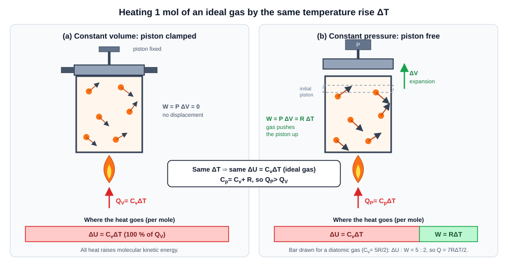
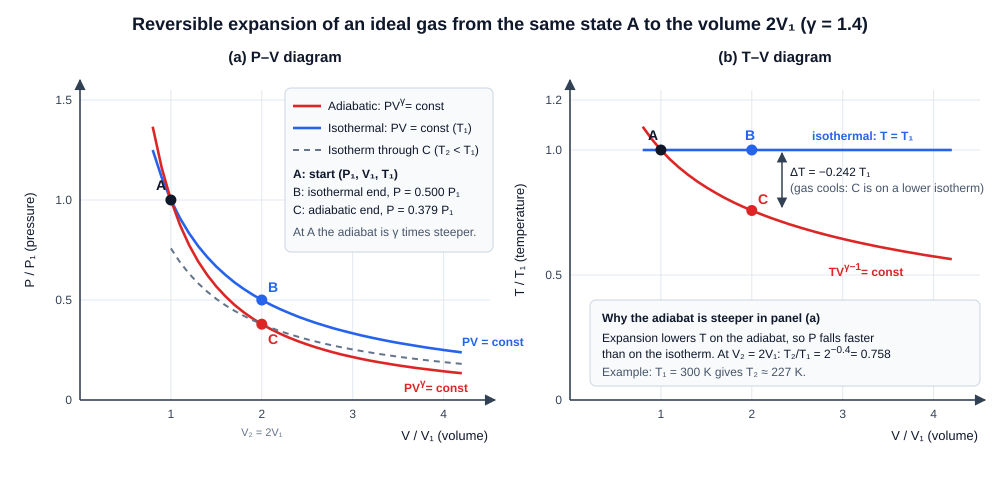
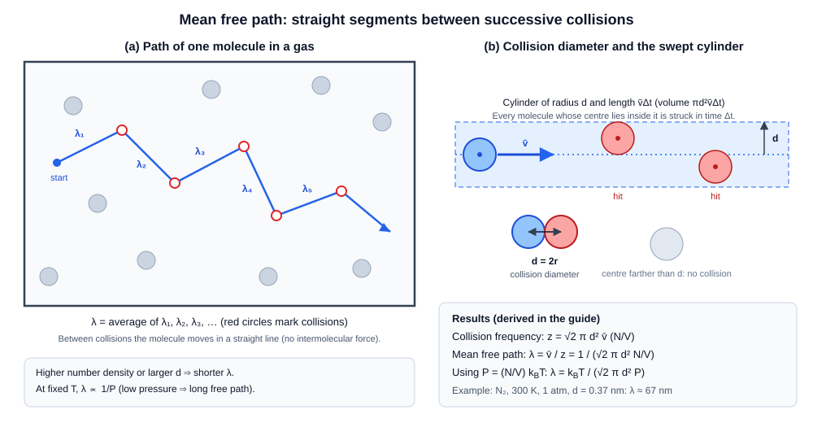
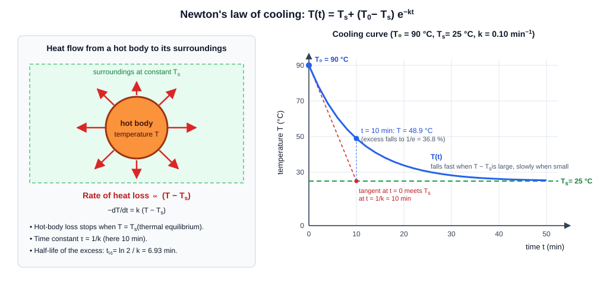
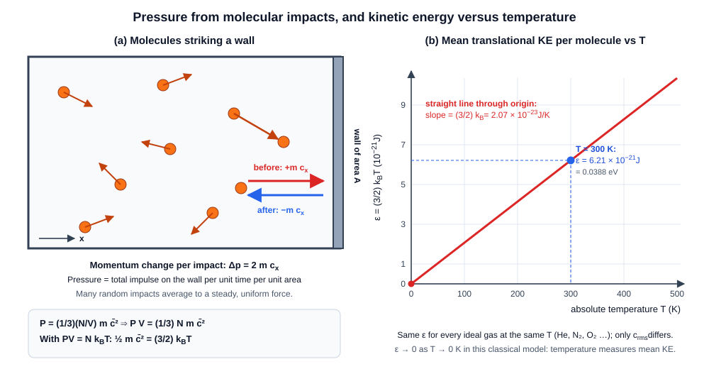

# Kinetic Theory of Gases: Exam Revision Guide

**Course context:** Engineering Physics (Heat and Kinetic Theory)
**Contents:** five solved questions, formula sheet, definitions, common mistakes, practice questions, and a section on mathematical clarifications.

---

## Learning Objectives

After working through this guide you should be able to:

1. Derive Mayer's relation $`C_p-C_v=R`$ from the first law and the ideal-gas equation, and explain what each heat capacity means physically.
2. Derive $`PV^{\gamma}=\text{constant}`$ and $`TV^{\gamma-1}=\text{constant}`$, and explain precisely why the expression $`PV^{\gamma-1}`$ (as transcribed in the question) is **not** a standard adiabatic invariant.
3. Derive the mean free path $`\lambda=\dfrac{1}{\sqrt{2}\,\pi d^{2}\,(N/V)}`$ and explain the $`\sqrt{2}`$ factor.
4. State and derive Newton's law of cooling, sketch the cooling curve, and list its assumptions and limitations.
5. Derive the kinetic-theory pressure $`P=\dfrac{1}{3}\dfrac{N m\overline{c^{2}}}{V}`$ and the energy result $`E_k=\dfrac{3}{2}\nu RT`$, keeping **molecule counts** and **mole counts** strictly separate.

### Notation used throughout

| Quantity | Symbol | SI unit |
|---|---|---|
| Pressure | $`P`$ | Pa |
| Volume | $`V`$ | m³ |
| Absolute temperature | $`T`$ | K |
| Universal gas constant | $`R=8.314\ \text{J mol}^{-1}\text{K}^{-1}`$ | J mol⁻¹ K⁻¹ |
| Boltzmann constant | $`k_B=R/N_A=1.381\times10^{-23}`$ | J K⁻¹ |
| Avogadro constant | $`N_A=6.022\times10^{23}`$ | mol⁻¹ |
| Number of molecules | $`N`$ | dimensionless |
| Number of moles | $`\nu`$ (so $`N=\nu N_A`$) | mol |
| Molecular mass | $`m`$ | kg |
| Molar mass | $`M=N_A m`$ | kg mol⁻¹ |
| Molecular (collision) diameter | $`d`$ | m |
| Number density | $`N/V`$ | m⁻³ |
| Mean-square speed | $`\overline{c^{2}}`$ | m² s⁻² |
| Root-mean-square speed | $`c_{\mathrm{rms}}=\sqrt{\overline{c^{2}}}`$ | m s⁻¹ |
| Ratio of heat capacities | $`\gamma=C_p/C_v`$ | dimensionless |
| Mean free path | $`\lambda`$ | m |

> **Notation note.** The source question uses the letter $`n`$ in two different ways: as a *number of molecules* in $`P=\frac{1}{3}\frac{mnc^{2}}{V}`$ and as a *number of moles* in $`E_k=\frac{3}{2}nRT`$. In this guide the two source expressions are preserved exactly as written, and then rewritten with the unambiguous symbols $`N`$ (molecules) and $`\nu`$ (moles). See Question 5 and the Mathematical Clarifications section.

---

## Question 1: Specific Heat Capacities of an Ideal Gas

**Question.** Show that
```math
C_p-C_v=R
```
Derive Mayer's relation from the first law of thermodynamics and the ideal gas equation. Explain the physical meaning of the specific heat capacities at constant pressure and constant volume.

### Introduction

Heating a gas can be done in different ways, and the amount of heat needed for the same temperature rise depends on the way. For a gas, two heat capacities are therefore defined, one for heating at fixed volume and one at fixed pressure. Mayer's relation connects them.

### Definitions

- **Molar heat capacity at constant volume**, $`C_v`$: heat required to raise the temperature of **one mole** by one kelvin while the **volume is held constant**.
- **Molar heat capacity at constant pressure**, $`C_p`$: heat required to raise the temperature of one mole by one kelvin while the **pressure is held constant**.
- **Specific heat capacity** (per unit mass) is $`c=C/M`$, in J kg⁻¹ K⁻¹. For per-mass quantities Mayer's relation reads $`c_p-c_v=R/M`$.
- **First law of thermodynamics:** the heat supplied to a system equals the increase in its internal energy plus the work done by the system.

### Mathematical Derivation

Consider **one mole** of an ideal gas undergoing a quasi-static (reversible) change.

**Step 1: First law.** For a small change,
```math
dQ = dU + dW, \qquad dW = P\,dV
```
where $`dW=P\,dV`$ is the work done *by* the gas in a quasi-static expansion.

**Step 2: Definition of $`C_v`$.** At constant volume $`dV=0`$, so $`dW=0`$ and $`dQ=dU`$:
```math
C_v=\left(\dfrac{dQ}{dT}\right)_V=\left(\dfrac{\partial U}{\partial T}\right)_V
```

**Step 3: Internal energy of an ideal gas depends on $`T`$ only.** Ideal-gas molecules exert no forces on each other, so the internal energy is the sum of the molecular energies and does not depend on the volume (confirmed by Joule's free-expansion experiment). Hence $`U=U(T)`$ and the partial derivative becomes an ordinary one:
```math
dU = C_v\,dT \qquad\text{for any process of an ideal gas}
```
This step is important: $`dU=C_v\,dT`$ holds even when the volume changes.

**Step 4: Heat at constant pressure.** Put the first law at constant pressure and divide by $`dT`$:
```math
C_p=\left(\dfrac{dQ}{dT}\right)_P=\dfrac{dU}{dT}+P\left(\dfrac{\partial V}{\partial T}\right)_P
```

**Step 5: Use the equation of state.** For one mole, $`PV=RT`$. Differentiating at constant $`P`$:
```math
\begin{aligned}
P\,dV &= R\,dT \\
P\left(\dfrac{\partial V}{\partial T}\right)_P &= R
\end{aligned}
```

**Step 6: Combine.** Substituting Steps 3 and 5 into Step 4:
```math
C_p = C_v + R
```

**For $`\nu`$ moles** the total heat capacities are $`\nu C_p`$ and $`\nu C_v`$, and $`\nu C_p-\nu C_v=\nu R`$.

### Scientific Explanation

- At **constant volume** the gas cannot expand, so it does no work. All heat goes into raising the internal energy (faster molecular motion).
- At **constant pressure** the gas expands as it is heated. It must push back the surroundings, doing work $`P\,\Delta V=R\,\Delta T`$ per mole. The heat supplied has to cover both the internal-energy rise (the same $`C_v\Delta T`$ as before, because $`U`$ depends on $`T`$ only) and this extra work.
- Therefore $`C_p>C_v`$, and the difference is exactly the work done per mole per kelvin: $`R`$.
- $`R`$ is therefore also the **expansion work done by one mole per kelvin** at constant pressure.

Useful consequences (using the equipartition values $`C_v=\frac{f}{2}R`$, where $`f`$ is the number of active degrees of freedom):

| Gas type | $`f`$ | $`C_v`$ | $`C_p`$ | $`\gamma`$ |
|---|---|---|---|---|
| Monatomic (He, Ar) | 3 | $`\tfrac{3}{2}R`$ | $`\tfrac{5}{2}R`$ | $`5/3\approx1.67`$ |
| Diatomic, room temperature (N₂, O₂) | 5 | $`\tfrac{5}{2}R`$ | $`\tfrac{7}{2}R`$ | $`7/5=1.40`$ |

and in general $`C_v=\dfrac{R}{\gamma-1}`$, $`C_p=\dfrac{\gamma R}{\gamma-1}`$ (obtained by combining $`C_p=\gamma C_v`$ with Mayer's relation).

### Visual Explanation



*Figure 1. Same temperature rise $`\Delta T`$ in both cases. At constant volume all heat becomes internal energy; at constant pressure part of the heat is converted into expansion work $`R\Delta T`$. The bar for the constant-pressure case is drawn for a diatomic gas, where $`\Delta U:W=5:2`$.*

### Final Result

```math
\boxed{C_p-C_v=R}
```

### Symbol Definitions

| Symbol | Meaning | SI unit |
|---|---|---|
| $`C_p`$ | Molar heat capacity at constant pressure | J mol⁻¹ K⁻¹ |
| $`C_v`$ | Molar heat capacity at constant volume | J mol⁻¹ K⁻¹ |
| $`R`$ | Universal gas constant | J mol⁻¹ K⁻¹ |
| $`U`$ | Internal energy (per mole) | J mol⁻¹ |
| $`Q`$, $`W`$ | Heat supplied, work done by the gas | J |

### Examination Notes

- **Scoring points:** statement of the first law; the argument that $`U`$ depends on $`T`$ only; $`P\,dV=R\,dT`$ at constant pressure; final relation with units.
- **Assumptions:** ideal gas, quasi-static process, one mole.
- **Common mistake:** writing $`\Delta U=C_p\,\Delta T`$ for a constant-pressure process. For an ideal gas, $`\Delta U=C_v\,\Delta T`$ in **every** process.
- $`C_p-C_v=R`$ is exact for an ideal gas only. For real gases the difference is larger than $`R`$.
- Per-mass form: $`c_p-c_v=R/M`$, **not** $`R`$.

**Worked check.** One mole of a diatomic ideal gas is heated at constant pressure by $`50\ \text{K}`$:
$`Q=C_p\Delta T=\tfrac{7}{2}R\times50=1455\ \text{J}`$; $`\Delta U=C_v\Delta T=1039\ \text{J}`$; $`W=R\Delta T=416\ \text{J}`$. Indeed $`1039+416=1455`$. ✓

---

## Question 2: Adiabatic Relations

**Question.** Derive/show the relations
```math
PV^\gamma=\text{constant}
```
and
```math
PV^{\gamma-1}
```
The second expression is transcribed exactly as written in the source. Investigate the mathematical and physical validity of the second expression, compare it with the standard relation $`TV^{\gamma-1}=\text{constant}`$, and explain any likely transcription error without changing the original question.

### Introduction

In an adiabatic process no heat enters or leaves the gas ($`dQ=0`$). Rapid compression or expansion (sound waves, a bicycle pump, diesel-engine compression) is close to adiabatic because there is no time for heat to flow.

### Definitions

- **Adiabatic process:** a process in which there is no heat exchange with the surroundings, $`dQ=0`$.
- **Isothermal process:** a process at constant temperature, so $`PV=\text{constant}`$ for a fixed amount of an ideal gas (Boyle's law).
- $`\gamma=C_p/C_v`$.

### Mathematical Derivation

Take $`\nu`$ moles of an ideal gas in a **reversible** adiabatic change.

**Step 1: First law with $`dQ=0`$.** Since $`dU=\nu C_v\,dT`$ for an ideal gas (Question 1, Step 3):
```math
0 = \nu C_v\,dT + P\,dV \quad\Longrightarrow\quad \nu C_v\,dT = -P\,dV
```

**Step 2: Differentiate the equation of state $`PV=\nu RT`$.**
```math
P\,dV + V\,dP = \nu R\,dT
```

**Step 3: Eliminate $`dT`$.** From Step 1, $`\nu\,dT=-\dfrac{P\,dV}{C_v}`$. Substituting in Step 2:
```math
\begin{aligned}
P\,dV + V\,dP &= -\dfrac{R}{C_v}\,P\,dV \\
V\,dP &= -\left(1+\dfrac{R}{C_v}\right)P\,dV
\end{aligned}
```

**Step 4: Use Mayer's relation.** $`1+\dfrac{R}{C_v}=\dfrac{C_v+R}{C_v}=\dfrac{C_p}{C_v}=\gamma`$, so
```math
V\,dP = -\gamma\,P\,dV \quad\Longrightarrow\quad \dfrac{dP}{P}=-\gamma\,\dfrac{dV}{V}
```

**Step 5: Integrate** (treating $`\gamma`$ as constant):
```math
\begin{aligned}
\ln P &= -\gamma\ln V + \text{const} \\
\ln P + \gamma\ln V &= \text{const} \\
\ln\!\left(PV^{\gamma}\right) &= \text{const}
\end{aligned}
```
```math
\boxed{PV^{\gamma}=\text{constant}}
```

**Step 6: Equivalent forms.** Substitute $`P=\nu RT/V`$ into $`PV^{\gamma}=\text{const}`$:
```math
\dfrac{\nu RT}{V}\,V^{\gamma}=\text{const}\quad\Longrightarrow\quad
\boxed{TV^{\gamma-1}=\text{constant}}
```
Substitute $`V=\nu RT/P`$ instead:
```math
P\left(\dfrac{\nu RT}{P}\right)^{\gamma}=\text{const}\quad\Longrightarrow\quad
\boxed{T^{\gamma}P^{1-\gamma}=\text{constant}}
```
(The constants on the three right-hand sides are different numbers; they absorb $`\nu R`$.)

**Step 7: Work done in an adiabatic expansion** (useful for numericals). With $`P=K\,V^{-\gamma}`$:
```math
W=\int_{V_1}^{V_2}P\,dV
 = K\,\dfrac{V_2^{\,1-\gamma}-V_1^{\,1-\gamma}}{1-\gamma}
 = \dfrac{P_1V_1-P_2V_2}{\gamma-1}
 = \dfrac{\nu R\,(T_1-T_2)}{\gamma-1}
```

### Investigation of the supplied second expression

The source gives only the expression $`PV^{\gamma-1}`$, with no "$`=\text{constant}`$" and no other statement. It is preserved unchanged here and examined as follows.

**(a) It is incomplete.** An expression without a right-hand side is not a relation. A relation would have to be $`PV^{\gamma-1}=\text{constant}`$ (or some other stated value), and that is what is tested below.

**(b) Test: is $`PV^{\gamma-1}`$ constant in an adiabatic process?** Use the result just proved, $`PV^{\gamma}=K`$:
```math
PV^{\gamma-1}=\dfrac{PV^{\gamma}}{V}=\dfrac{K}{V}
```
This **changes** with $`V`$ (it is inversely proportional to the volume), so it is **not** constant in an adiabatic process. For a doubling of volume, $`PV^{\gamma-1}`$ is halved. This was also checked numerically by integrating the first law step by step for $`\gamma=1.4`$: after $`V\to2V`$ the ratio of final to initial $`PV^{\gamma-1}`$ was $`0.5000`$, while $`PV^{\gamma}`$ and $`TV^{\gamma-1}`$ both stayed at $`1.0000`$.

**(c) It is not constant in any other standard process either.**

- Isothermal: $`PV=\text{const}`$ gives $`PV^{\gamma-1}=\text{const}\times V^{\gamma-2}`$, which varies for $`\gamma\neq2`$.
- Isobaric: $`P`$ is constant, so $`PV^{\gamma-1}\propto V^{\gamma-1}`$ varies.
- Isochoric: $`V`$ is constant, so $`PV^{\gamma-1}\propto P`$ varies.

**(d) It is not a standard thermodynamic relation.** The standard adiabatic invariants are $`PV^{\gamma}`$, $`TV^{\gamma-1}`$ and $`T^{\gamma}P^{1-\gamma}`$. $`PV^{\gamma-1}`$ is not among them.

**(e) What it equals physically.** Using $`P=\nu RT/V`$:
```math
PV^{\gamma-1}=\nu R\,T\,V^{\gamma-2}
```
This is not a conserved quantity of the adiabatic process. In the special case $`\gamma=2`$ (not realised by any ideal gas, since $`\gamma\le5/3`$) it would reduce to $`\nu RT`$, which still varies as the gas cools.

**(f) Dimensional remark.** $`PV^{\gamma}`$ and $`TV^{\gamma-1}`$ have different units (Pa·m$`^{3\gamma}`$ and K·m$`^{3(\gamma-1)}`$ respectively). Dimensional analysis alone cannot rule out $`PV^{\gamma-1}`$, because a non-integer power of volume is allowed in an adiabatic constant, so the exclusion rests on parts (b) and (c) above.

### Comparison with the standard temperature-volume relation, and the likely transcription error

| Property | Supplied: $`PV^{\gamma-1}`$ | Established: $`TV^{\gamma-1}=\text{const}`$ |
|---|---|---|
| Has a right-hand side | No | Yes |
| Constant along a reversible adiabat | **No** (varies as $`1/V`$) | Yes |
| Standard textbook result | No | Yes |
| Derived from | not derivable as an invariant | $`PV^{\gamma}=\text{const}`$ with $`P=\nu RT/V`$ |

**Likely intended expression (interpretation, not a verified correction).** The two expressions differ only in the first symbol: $`P`$ in place of $`T`$. A plausible explanation is a transcription slip from $`TV^{\gamma-1}=\text{constant}`$, whose exponent $`\gamma-1`$ matches exactly. The question itself asks for a comparison with $`TV^{\gamma-1}=\text{constant}`$, which supports this reading. This is an **interpretation**; the original expression is not altered, and the corresponding entry appears in the Mathematical Clarifications section.

### Scientific Explanation

On a P–V diagram the adiabat is steeper than the isotherm through the same point:
```math
\left(\dfrac{dP}{dV}\right)_{\text{isothermal}}=-\dfrac{P}{V},
\qquad
\left(\dfrac{dP}{dV}\right)_{\text{adiabatic}}=-\gamma\dfrac{P}{V}
```
(the first from $`PV=\text{const}`$, the second from Step 4). On expansion the gas does work using its own internal energy, so it **cools**; on the isotherm heat flows in to keep $`T`$ constant. The pressure therefore falls faster on the adiabat.

For $`\gamma=1.4`$ and a doubling of volume: $`T_2/T_1=2^{-0.4}=0.758`$ and $`P_2/P_1=2^{-1.4}=0.379`$ on the adiabat, whereas the isotherm gives $`P_2/P_1=0.500`$.

### Visual Explanation



*Figure 2. Panel (a): adiabat (red) and isotherm (blue) from the same starting point A; the adiabat ends at lower pressure (C) than the isotherm (B). The dashed grey curve is the isotherm through C at the lower temperature $`T_2`$. Panel (b): temperature stays constant on the isotherm but falls along $`TV^{\gamma-1}=\text{const}`$.*

### Final Result

```math
\boxed{PV^{\gamma}=\text{constant}}\qquad
\boxed{TV^{\gamma-1}=\text{constant}}\qquad
\boxed{T^{\gamma}P^{1-\gamma}=\text{constant}}
```
and, for the supplied expression: $`PV^{\gamma-1}`$ is **not** constant in an adiabatic process; it varies as $`1/V`$.

### Symbol Definitions

| Symbol | Meaning | SI unit |
|---|---|---|
| $`P`$, $`V`$, $`T`$ | Pressure, volume, temperature of the gas | Pa, m³, K |
| $`\gamma`$ | $`C_p/C_v`$, adiabatic exponent | none |
| $`\nu`$ | Number of moles | mol |
| $`K`$ | Constant of the adiabat ($`=PV^{\gamma}`$) | Pa m$`^{3\gamma}`$ |
| $`W`$ | Work done by the gas | J |

### Examination Notes

- **Scoring points:** $`dQ=0`$; $`dU=\nu C_v\,dT`$; elimination of $`dT`$; use of $`\gamma=C_p/C_v`$; integration; final relation; the other two forms.
- **Assumptions:** ideal gas, reversible (quasi-static) process, constant $`\gamma`$, no heat exchange.
- **Common mistakes:** using $`PV^{\gamma}=\text{const}`$ for an isothermal process, or $`PV=\text{const}`$ for an adiabatic one; using Celsius for $`T`$; swapping $`T`$ and $`P`$ in $`TV^{\gamma-1}`$.
- For an irreversible (free) expansion into vacuum, $`PV^{\gamma}=\text{const}`$ does **not** apply.

---

## Question 3: Mean Free Path

**Question.** Derive an expression for the mean free path of gas molecules. Explain molecular collision, collision diameter, collision frequency and number density. Derive the final expression and explain the significance of the factor $`\sqrt{2}`$.

### Introduction

Gas molecules move at hundreds of metres per second, yet a smell crosses a room slowly, because each molecule is deflected by collisions after only a tiny distance. The average distance between collisions is the **mean free path**.

### Definitions

- **Molecular collision:** the close approach of two molecules in which they exert strong repulsive forces on each other and change their velocities.
- **Collision (molecular) diameter** $`d`$: the distance between the centres of two molecules at the moment of closest approach. For identical molecules of radius $`r`$, $`d=2r`$.
- **Number density** $`N/V`$: number of molecules per unit volume (m⁻³).
- **Collision frequency** $`z`$: the average number of collisions made by one molecule per second (s⁻¹).
- **Mean free path** $`\lambda`$: the average distance a molecule travels between two successive collisions.

### Mathematical Derivation

**Model.** Molecules are rigid spheres of diameter $`d`$. They move in straight lines between collisions. The distribution of speeds is Maxwellian, with mean speed $`\bar v`$.

**Step 1: Collision cross-section.** Follow one molecule (call it A). A collision with another molecule happens when the **centres** come within a distance $`d`$. It is convenient to treat A as a point and give every other molecule a radius $`d`$. The area presented is
```math
\sigma=\pi d^{2}
```
which is the *collision cross-section*.

**Step 2: Sweep a cylinder.** In time $`\Delta t`$, A moves a distance $`v_{\text{rel}}\Delta t`$ relative to the other molecules and sweeps out a cylinder of cross-section $`\pi d^{2}`$ and length $`v_{\text{rel}}\Delta t`$. Its volume is
```math
V_{\text{cyl}}=\pi d^{2}\,v_{\text{rel}}\,\Delta t
```
Every molecule whose centre lies in this cylinder is struck by A.

**Step 3: Number of collisions in $`\Delta t`$.** Multiply by the number density:
```math
\text{collisions}=\dfrac{N}{V}\,\pi d^{2}\,v_{\text{rel}}\,\Delta t
```
so the **collision frequency** is
```math
z=\pi d^{2}\,v_{\text{rel}}\,\dfrac{N}{V}
```

**Step 4: Relate $`v_{\text{rel}}`$ to $`\bar v`$.** The other molecules are *also moving*. For two molecules with velocities $`\vec v_1`$ and $`\vec v_2`$, the relative velocity is $`\vec v_{\text{rel}}=\vec v_1-\vec v_2`$, and
```math
\begin{aligned}
v_{\text{rel}}^{2} &= v_1^{2}+v_2^{2}-2\,\vec v_1\!\cdot\!\vec v_2 \\
\overline{v_{\text{rel}}^{2}} &= \overline{v_1^{2}}+\overline{v_2^{2}}-2\,\overline{\vec v_1\!\cdot\!\vec v_2}
\end{aligned}
```
The two molecules move independently and in random directions, so $`\overline{\vec v_1\cdot\vec v_2}=0`$, and with $`\overline{v_1^{2}}=\overline{v_2^{2}}=\overline{c^{2}}`$:
```math
\overline{v_{\text{rel}}^{2}}=2\,\overline{c^{2}}
\quad\Longrightarrow\quad
\sqrt{\overline{v_{\text{rel}}^{2}}}=\sqrt{2}\,c_{\mathrm{rms}}
```
For a Maxwell distribution the relative-velocity distribution has the same shape with the spread increased by $`\sqrt{2}`$, so the *mean* relative speed scales in the same way as the rms one:
```math
\bar v_{\text{rel}}=\sqrt{2}\,\bar v
```
(A numerical check with two million random Maxwellian pairs gave $`\bar v_{\text{rel}}/\bar v=1.4142`$.)

**Step 5: Collision frequency.**
```math
z=\sqrt{2}\,\pi d^{2}\,\bar v\,\dfrac{N}{V}
```

**Step 6: Mean free path.** Between collisions the molecule moves for an average time $`1/z`$ at average speed $`\bar v`$, so
```math
\lambda=\dfrac{\bar v}{z}=\dfrac{\bar v}{\sqrt{2}\,\pi d^{2}\,\bar v\,(N/V)}
```
The mean speed cancels:
```math
\boxed{\lambda=\dfrac{1}{\sqrt{2}\,\pi d^{2}\,(N/V)}}
```

**Step 7: In terms of $`P`$ and $`T`$.** From $`PV=Nk_BT`$, $`N/V=P/(k_BT)`$:
```math
\boxed{\lambda=\dfrac{k_BT}{\sqrt{2}\,\pi d^{2}P}}
```

### Significance of the square-root-of-two factor

- If the target molecules were **at rest** (only A moving), then $`v_{\text{rel}}=\bar v`$ and
```math
\lambda_{\text{stationary targets}}=\dfrac{1}{\pi d^{2}\,(N/V)}
```
This was the original Clausius estimate.
- Maxwell showed that the targets **move as well**, which increases the mean relative speed by $`\sqrt{2}`$. Collisions are $`\sqrt{2}`$ times more frequent, and the mean free path is **shorter** by the factor $`\sqrt{2}`$.
- The $`\sqrt{2}`$ is therefore a correction for the motion of the other molecules and comes from $`\overline{v_{\text{rel}}^{2}}=2\overline{c^{2}}`$.

### Scientific Explanation

- $`\lambda\propto 1/(N/V)`$: a denser gas gives more frequent collisions, hence a shorter free path.
- $`\lambda\propto 1/d^{2}`$: bigger molecules present a bigger target.
- At fixed temperature $`\lambda\propto 1/P`$; at fixed pressure $`\lambda\propto T`$; at fixed volume and amount of gas $`\lambda`$ is independent of $`T`$ (the number density does not change).
- $`\lambda`$ does not depend on the mean speed, because $`\bar v`$ cancels between the distance covered and the collision rate.

**Worked example.** Nitrogen at $`T=300\ \text{K}`$, $`P=1.013\times10^{5}\ \text{Pa}`$, $`d=0.37\ \text{nm}`$ (effective value):

- $`N/V=\dfrac{P}{k_BT}=2.45\times10^{25}\ \text{m}^{-3}`$
- $`\bar v=\sqrt{\dfrac{8RT}{\pi M}}=476\ \text{m s}^{-1}`$ with $`M=0.028\ \text{kg mol}^{-1}`$
- $`\lambda=\dfrac{k_BT}{\sqrt{2}\pi d^{2}P}=6.7\times10^{-8}\ \text{m}\approx67\ \text{nm}`$, about 180 molecular diameters
- $`z=\bar v/\lambda=7.1\times10^{9}\ \text{s}^{-1}`$, i.e. about seven billion collisions per second

At $`P=1\ \text{Pa}`$ the same gas has $`\lambda\approx6.8\ \text{mm}`$, and at $`10^{-3}\ \text{Pa}`$ (high vacuum) $`\lambda\approx6.8\ \text{m}`$, longer than a typical chamber.

### Visual Explanation



*Figure 3. Panel (a): a molecule follows straight segments $`\lambda_1,\lambda_2,\dots`$ between collisions; the mean free path is their average. Panel (b): the collision diameter $`d`$ and the cylinder of volume $`\pi d^{2}\bar v\Delta t`$ swept by a molecule; every molecule whose centre lies inside it is hit.*

### Final Result

```math
\boxed{\lambda=\dfrac{1}{\sqrt{2}\,\pi d^{2}\,(N/V)}=\dfrac{k_BT}{\sqrt{2}\,\pi d^{2}P}}
```

### Symbol Definitions

| Symbol | Meaning | SI unit |
|---|---|---|
| $`\lambda`$ | Mean free path | m |
| $`d`$ | Collision (molecular) diameter | m |
| $`N/V`$ | Number density | m⁻³ |
| $`z`$ | Collision frequency | s⁻¹ |
| $`\bar v`$ | Mean molecular speed | m s⁻¹ |
| $`v_{\text{rel}}`$ | Relative speed of two molecules | m s⁻¹ |
| $`\sigma=\pi d^{2}`$ | Collision cross-section | m² |
| $`k_B`$ | Boltzmann constant | J K⁻¹ |

### Examination Notes

- **Scoring points:** definitions of $`d`$, $`z`$, $`\lambda`$; the cylinder argument; justification of $`\bar v_{\text{rel}}=\sqrt{2}\bar v`$; cancellation of $`\bar v`$; final expression.
- **Assumptions:** rigid spheres; only two-body collisions; molecular size much smaller than the spacing ($`d\ll(N/V)^{-1/3}`$; here $`d=0.37`$ nm against a spacing of 3.4 nm); Maxwellian speeds; $`\lambda\gg d`$.
- **Common mistakes:** forgetting $`\sqrt{2}`$; using the radius instead of the diameter ($`d=2r`$); writing $`N/V`$ as moles per volume; substituting a mean free path that is longer than the container (then the container size limits the free path).
- $`d`$ is an *effective* diameter obtained from experiment (for example from viscosity); it is not a sharp physical size.

---

## Question 4: Newton's Law of Cooling

**Question.** Explain Newton's law of cooling. Derive its mathematical expression, explain the underlying assumptions, and discuss its limitations and practical applications. Include a temperature-versus-time cooling curve and explain the behaviour of the curve.

### Introduction

A cup of coffee cools quickly at first and then more and more slowly as it approaches room temperature. Newton's law of cooling describes this behaviour.

### Definitions

- **Newton's law of cooling:** *the rate at which a body loses heat to its surroundings is directly proportional to the difference between the temperature of the body and the temperature of the surroundings, provided this difference is small.*
- $`T(t)`$: body temperature at time $`t`$; $`T_s`$: constant temperature of the surroundings; $`T_0`$: initial temperature of the body.
- **Heat capacity of the body** $`C_b=m_b c_b`$ (J K⁻¹), where $`m_b`$ is its mass and $`c_b`$ its specific heat capacity.
- **Cooling constant** $`k`$ (s⁻¹) and **time constant** $`\tau=1/k`$.

### Mathematical Derivation

**Step 1: Statement of the law.** The rate of heat loss is
```math
\dfrac{dQ}{dt}=-hA\,(T-T_s)
```
where $`h`$ is the heat-transfer coefficient (W m⁻² K⁻¹) and $`A`$ the surface area. The minus sign shows that heat leaves the body when $`T>T_s`$.

**Step 2: Relate heat loss to temperature fall.** For a body of heat capacity $`C_b`$, $`dQ=C_b\,dT`$:
```math
C_b\dfrac{dT}{dt}=-hA\,(T-T_s)
\quad\Longrightarrow\quad
\dfrac{dT}{dt}=-k\,(T-T_s),\qquad k=\dfrac{hA}{C_b}
```

**Step 3: Separate the variables.** Since $`T_s`$ is constant, $`d(T-T_s)=dT`$:
```math
\dfrac{d(T-T_s)}{T-T_s}=-k\,dt
```

**Step 4: Integrate from $`t=0`$ ($`T=T_0`$) to time $`t`$:**
```math
\begin{aligned}
\ln\dfrac{T-T_s}{T_0-T_s}&=-kt \\
T-T_s&=(T_0-T_s)\,e^{-kt}
\end{aligned}
```
```math
\boxed{T(t)=T_s+(T_0-T_s)\,e^{-kt}}
```

**Step 5: Time to reach a given temperature.**
```math
t=\dfrac{1}{k}\ln\dfrac{T_0-T_s}{T-T_s}
```

**Step 6: Useful measures.**
```math
\begin{aligned}
\text{after one time constant } (t=\tau=1/k):&\quad T-T_s=\dfrac{T_0-T_s}{e}\approx0.368\,(T_0-T_s)\\
\text{half-life of the excess:}&\quad t_{1/2}=\dfrac{\ln2}{k}=0.693\,\tau
\end{aligned}
```

### Assumptions

1. The temperature difference $`T-T_s`$ is small (the law is a linear approximation).
2. The surroundings stay at a constant temperature $`T_s`$ (a large reservoir).
3. The body has a uniform temperature at every instant (low internal resistance to heat flow, small Biot number $`\text{Bi}=hL_c/\kappa\ll1`$, where $`L_c`$ is a characteristic length and $`\kappa`$ the thermal conductivity of the body).
4. The coefficient $`h`$ (hence $`k`$) is constant.
5. No change of state (no boiling, freezing or condensation).

### Scientific Explanation

- The curve is a **decaying exponential** whose asymptote is $`T=T_s`$. Heat flow stops at thermal equilibrium.
- The slope at any point is $`-k(T-T_s)`$. At the start the difference is largest, so the body cools fastest; as $`T\to T_s`$ the slope tends to zero, which is why the curve flattens.
- The tangent at $`t=0`$ meets the line $`T=T_s`$ at $`t=\tau=1/k`$ (this is a standard graphical way of reading $`k`$).
- A plot of $`\ln(T-T_s)`$ against $`t`$ is a straight line of slope $`-k`$; this is how $`k`$ is obtained experimentally.
- The same equation, with $`T<T_s`$, describes the **warming** of a cold body towards room temperature.

**Worked example.** A body cools from $`90\,^\circ\text{C}`$ to $`70\,^\circ\text{C}`$ in 5 min in a room at $`25\,^\circ\text{C}`$.

- $`k=\dfrac{1}{5}\ln\dfrac{90-25}{70-25}=\dfrac{1}{5}\ln\dfrac{65}{45}=0.0735\ \text{min}^{-1}`$.
- Time to reach $`40\,^\circ\text{C}`$: $`t=\dfrac{1}{0.0735}\ln\dfrac{65}{15}=19.9\ \text{min}`$.
- Temperature after 10 min: $`T=25+65\,e^{-0.735}=56.2\,^\circ\text{C}`$.

(The curve in Figure 4 uses the round values $`T_0=90\,^\circ\text{C}`$, $`T_s=25\,^\circ\text{C}`$, $`k=0.10\ \text{min}^{-1}`$.)

### Limitations

- At large temperature differences, radiative loss scales as $`T^{4}`$ and natural-convection loss grows faster than linearly, so the law fails. The Stefan–Boltzmann law with a linearisation is derived in Practice Question 4.
- It fails when the body changes phase, when evaporation is important, or when the surroundings are heated or cooled during the experiment.
- It fails for bodies with large internal temperature gradients (large or poorly conducting objects, where $`\text{Bi}\gtrsim0.1`$).
- $`k`$ is not a property of the material alone; it depends on shape, surface, air movement and the surroundings.

### Practical Applications

- **Calorimetry:** correction for heat lost to the surroundings (the "cooling correction" or radiation correction in specific-heat experiments).
- **Forensic science:** a first estimate of the time since death from body temperature (with large uncertainty, because the assumptions hold only approximately).
- **Engineering and food technology:** cooling of engines, electronics and hot liquids; time to reach a safe serving or storage temperature.
- **Thermometry:** the response time of a thermometer follows the same exponential law.

### Visual Explanation



*Figure 4. Left: a hot body loses heat to surroundings at constant $`T_s`$; the rate of loss is proportional to $`T-T_s`$. Right: the cooling curve (blue) approaches the surroundings temperature (green dashed) exponentially; the tangent at $`t=0`$ (red dashed) meets $`T_s`$ at $`t=1/k`$.*

### Final Result

```math
\boxed{\dfrac{dT}{dt}=-k\,(T-T_s)\qquad\Longrightarrow\qquad T(t)=T_s+(T_0-T_s)\,e^{-kt}}
```

### Symbol Definitions

| Symbol | Meaning | SI unit |
|---|---|---|
| $`T`$, $`T_0`$, $`T_s`$ | Body temperature, initial body temperature, surroundings temperature | K (or °C for differences) |
| $`k`$ | Cooling constant $`=hA/C_b`$ | s⁻¹ |
| $`\tau`$ | Time constant $`=1/k`$ | s |
| $`h`$ | Heat-transfer coefficient | W m⁻² K⁻¹ |
| $`A`$ | Surface area | m² |
| $`C_b`$ | Heat capacity of the body | J K⁻¹ |
| $`t`$ | Time | s |

### Examination Notes

- **Scoring points:** statement of the law with the small-difference condition; differential equation; integration; exponential result; labelled curve with asymptote $`T_s`$.
- **Common mistakes:** using $`T`$ instead of $`T-T_s`$ in the exponential; claiming the law is valid for any temperature difference; forgetting that the curve approaches $`T_s`$ and not zero. Only the temperature **difference** is needed, so Celsius may be used here, while absolute temperature is needed in the gas laws.
- Do not say that the body "stops losing heat at $`T_s`$" without noting that there is still exchange at the molecular level; only the **net** flow is zero.

---

## Question 5: Pressure of an Ideal Gas and Average Kinetic Energy

**Question.** Explain and derive
```math
P=\frac{1}{3}\frac{mn c^2}{V}
```
and
```math
E_k=\frac{3}{2}nRT
```
Derive the kinetic-theory expression for gas pressure using molecular motion and momentum transfer, then derive the relationship between the average translational kinetic energy of the molecules and the absolute temperature. Distinguish the number of molecules from the number of moles, define the symbols consistently, and explain the relation between the molecular and molar forms.

### Notation: how the source expressions are read

The two source expressions use the same letter $`n`$ for different things. They are preserved above exactly as written and interpreted as follows (the interpretation follows from the dimensions and from the standard results, and is explained in the Mathematical Clarifications section):

| Source expression | Reading of $`n`$ | Reading of $`c^{2}`$ | Unambiguous form used here |
|---|---|---|---|
| $`P=\dfrac{1}{3}\dfrac{m\,n\,c^{2}}{V}`$ | **number of molecules** in the vessel | mean-square speed $`\overline{c^{2}}`$ | $`P=\dfrac{1}{3}\dfrac{N\,m\,\overline{c^{2}}}{V}`$ |
| $`E_k=\dfrac{3}{2}\,n\,RT`$ | **number of moles** | not present | $`E_k=\dfrac{3}{2}\,\nu\,RT`$ |

If $`n`$ were taken as a **number density** ($`N/V`$) in the first expression, the correct form would be $`P=\frac{1}{3}n\,m\overline{c^{2}}`$ with no $`1/V`$. If $`n`$ were the number of moles in the first expression, the correct form would be $`P=\frac{1}{3}\nu M\overline{c^{2}}/V`$, with the molar mass $`M=N_Am`$.

### Introduction

Kinetic theory explains the macroscopic pressure and temperature of a gas by the motion of its molecules. Pressure comes from molecular impacts on the walls; temperature is a measure of the average translational kinetic energy.

### Definitions

- **Ideal gas (kinetic model):** a gas of identical point-like molecules in random motion, with no intermolecular forces except during (negligible-duration) elastic collisions, and with negligible total molecular volume.
- **Pressure:** the force exerted normally per unit area of the wall, $`P=F/A`$ (Pa).
- **Mean-square speed:** $`\overline{c^{2}}=\dfrac{1}{N}\sum_{i=1}^{N}c_i^{2}`$.
- **Root-mean-square speed:** $`c_{\mathrm{rms}}=\sqrt{\overline{c^{2}}}`$.
- **Translational kinetic energy per molecule:** $`\bar\varepsilon=\dfrac{1}{2}m\overline{c^{2}}`$.

### Assumptions of the kinetic model

1. A very large number $`N`$ of identical molecules, each of mass $`m`$.
2. The molecules are point-like: their size is negligible compared with the distance between them.
3. They move randomly in all directions; no direction is preferred (isotropy).
4. Collisions with the walls are perfectly elastic; between collisions the molecules move in straight lines at constant velocity.
5. No intermolecular forces act except during collisions; gravity is negligible.
6. The gas is in equilibrium: $`\overline{c^{2}}`$ and the number density do not change with time.

### Mathematical Derivation, Part A: Pressure

Consider a cubical vessel of side $`L`$ (volume $`V=L^{3}`$) containing $`N`$ molecules. Choose Cartesian axes along the edges. A molecule $`i`$ has velocity components $`(c_{ix},c_{iy},c_{iz})`$ and
```math
c_i^{2}=c_{ix}^{2}+c_{iy}^{2}+c_{iz}^{2}
```

**Step 1: Momentum change at one wall.** Take the wall perpendicular to the $`x`$-axis. For an elastic collision the $`x`$-component of velocity reverses and the other components are unchanged. The change in momentum of the molecule is
```math
\Delta p_i=(-m c_{ix})-(+m c_{ix})=-2m\,c_{ix}
```
so the momentum **given to the wall** per collision has magnitude $`2mc_{ix}`$.

**Step 2: Collision rate with that wall.** Between two successive hits on the same wall the molecule travels to the opposite wall and back, a distance $`2L`$ along $`x`$, taking time $`2L/c_{ix}`$. (Collisions with the side walls change only $`c_{iy}`$ and $`c_{iz}`$ and do not alter $`c_{ix}`$.) So the number of hits per second is
```math
f_i=\dfrac{c_{ix}}{2L}
```

**Step 3: Force from molecule $`i`$.** By Newton's second law the average force equals momentum transferred per unit time:
```math
F_i=\dfrac{\text{momentum per hit}}{\text{time between hits}}=2m c_{ix}\times\dfrac{c_{ix}}{2L}=\dfrac{m\,c_{ix}^{2}}{L}
```

**Step 4: Total force from all $`N`$ molecules.**
```math
F=\sum_{i=1}^{N}\dfrac{m\,c_{ix}^{2}}{L}=\dfrac{m}{L}\sum_{i=1}^{N}c_{ix}^{2}=\dfrac{m}{L}\,N\,\overline{c_x^{2}}
```
where $`\overline{c_x^{2}}=\dfrac{1}{N}\sum c_{ix}^{2}`$.

**Step 5: Pressure.** The wall has area $`A=L^{2}`$:
```math
P=\dfrac{F}{A}=\dfrac{N\,m\,\overline{c_x^{2}}}{L^{3}}=\dfrac{N\,m\,\overline{c_x^{2}}}{V}
```

**Step 6: Isotropy.** All directions are equivalent, so $`\overline{c_x^{2}}=\overline{c_y^{2}}=\overline{c_z^{2}}`$. Since $`\overline{c^{2}}=\overline{c_x^{2}}+\overline{c_y^{2}}+\overline{c_z^{2}}`$,
```math
\overline{c_x^{2}}=\dfrac{1}{3}\,\overline{c^{2}}
```
(A random-velocity numerical test gave $`\overline{c_x^{2}}/\overline{c^{2}}=0.333`$.)

**Step 7: Result.**
```math
\boxed{P=\dfrac{1}{3}\,\dfrac{N\,m\,\overline{c^{2}}}{V}}
```
which is the source expression $`P=\frac{1}{3}\frac{m\,n\,c^{2}}{V}`$ with $`n\equiv N`$ and $`c^{2}\equiv\overline{c^{2}}`$.

**Equivalent forms.** With the gas density $`\rho=Nm/V`$:
```math
P=\dfrac{1}{3}\rho\,\overline{c^{2}}
\qquad\text{and}\qquad
PV=\dfrac{1}{3}N m\overline{c^{2}}=\dfrac{2}{3}\,N\left(\dfrac{1}{2}m\overline{c^{2}}\right)
```

**Remarks on rigour.**

- Molecule-molecule collisions were ignored. They do not change the result: in equilibrium they only exchange momentum among molecules and leave the distribution, and therefore the average force on the wall, unchanged.
- The cube is only a convenience. The same result holds for a vessel of any shape, because the pressure of a gas in equilibrium is the same on every wall.

### Mathematical Derivation, Part B: Kinetic energy and temperature

**Step 1: Start from the pressure result and the ideal-gas law.**
```math
PV=\dfrac{1}{3}N m\overline{c^{2}}
\qquad\text{and}\qquad
PV=\nu RT
```

**Step 2: Equate the two expressions.**
```math
\dfrac{1}{3}N m\overline{c^{2}}=\nu RT
```

**Step 3: Convert moles to molecules.** $`N=\nu N_A`$, and $`k_B=R/N_A`$. Hence $`\nu R=\nu N_A k_B=Nk_B`$, and
```math
\dfrac{1}{3}N m\overline{c^{2}}=N k_B T
\quad\Longrightarrow\quad
m\overline{c^{2}}=3k_BT
```

**Step 4: Mean translational kinetic energy per molecule.**
```math
\boxed{\bar\varepsilon=\dfrac{1}{2}m\overline{c^{2}}=\dfrac{3}{2}\,k_BT}
```
This depends **only on $`T`$**, not on the mass or kind of gas.

**Step 5: Total translational kinetic energy of the gas.** Multiply by the number of molecules $`N=\nu N_A`$:
```math
E_k=N\bar\varepsilon=\dfrac{3}{2}Nk_BT=\dfrac{3}{2}\,\nu N_A k_B\,T
```
```math
\boxed{E_k=\dfrac{3}{2}\,\nu\,RT}
```
which is the source expression $`E_k=\frac{3}{2}nRT`$ with $`n\equiv\nu`$ (number of **moles**). The link between the two forms is $`Nk_B=\nu R`$.

For **one mole** ($`\nu=1`$): $`E_k=\frac{3}{2}RT`$ per mole. Also, directly from Step 2 above, $`PV=\frac{2}{3}E_k`$.

**Step 6: Root-mean-square speed.**
```math
c_{\mathrm{rms}}=\sqrt{\overline{c^{2}}}=\sqrt{\dfrac{3k_BT}{m}}=\sqrt{\dfrac{3RT}{M}}
```
(The second form uses $`M=N_Am`$ and $`R=N_Ak_B`$.)

### Relation between the molecular and the molar form

| Molecular form | Molar form | Link |
|---|---|---|
| $`PV=Nk_BT`$ | $`PV=\nu RT`$ | $`N=\nu N_A`$, $`R=N_Ak_B`$ |
| $`\bar\varepsilon=\tfrac{3}{2}k_BT`$ (per molecule) | $`\tfrac{3}{2}RT`$ (per mole) | multiply by $`N_A`$ |
| $`E_k=\tfrac{3}{2}Nk_BT`$ | $`E_k=\tfrac{3}{2}\nu RT`$ | $`Nk_B=\nu R`$ |
| $`c_{\mathrm{rms}}=\sqrt{3k_BT/m}`$ | $`c_{\mathrm{rms}}=\sqrt{3RT/M}`$ | $`R/M=k_B/m`$ |

### Scientific Explanation

- Pressure is the **time-averaged** effect of an enormous number of tiny impulses. Each molecule's contribution is a single sharp impulse, but about $`10^{23}`$ molecules strike the walls, so the force appears steady.
- Pressure rises when molecules are more numerous per volume (larger $`N/V`$) or faster (larger $`\overline{c^{2}}`$).
- Temperature is a measure of the **average translational kinetic energy** of the molecules: doubling $`T`$ doubles $`\bar\varepsilon`$, while $`c_{\mathrm{rms}}`$ increases only by $`\sqrt{2}`$.
- At the same temperature, light molecules move faster but carry the same average energy: $`\bar\varepsilon`$ is the same for H₂, N₂ and O₂.

**Worked numbers** at $`T=300\ \text{K}`$:

- $`\bar\varepsilon=\frac{3}{2}k_BT=6.21\times10^{-21}\ \text{J}=0.0388\ \text{eV}`$ for every ideal gas.
- $`c_{\mathrm{rms}}`$: N₂ $`517\ \text{m s}^{-1}`$, O₂ $`484\ \text{m s}^{-1}`$, H₂ $`1927\ \text{m s}^{-1}`$, He $`1367\ \text{m s}^{-1}`$.
- Check of $`P=\frac{1}{3}\rho\overline{c^{2}}`$ for N₂ at $`1.013\times10^{5}\ \text{Pa}`$: $`\rho=1.137\ \text{kg m}^{-3}`$, giving $`\frac{1}{3}\rho\overline{c^{2}}=1.013\times10^{5}\ \text{Pa}`$. ✓
- Per mole: $`\frac{3}{2}RT=3.74\ \text{kJ mol}^{-1}`$.

### Visual Explanation



*Figure 5. Panel (a): molecules with random velocities strike the wall; an elastic hit reverses $`c_x`$ and gives the wall momentum $`2mc_x`$. Panel (b): mean translational kinetic energy per molecule is a straight line through the origin, $`\bar\varepsilon=\frac{3}{2}k_BT`$, with slope $`2.07\times10^{-23}\ \text{J K}^{-1}`$.*

### Final Result

```math
\boxed{P=\dfrac{1}{3}\dfrac{N\,m\,\overline{c^{2}}}{V}}
\qquad
\boxed{\bar\varepsilon=\dfrac{1}{2}m\overline{c^{2}}=\dfrac{3}{2}k_BT}
\qquad
\boxed{E_k=\dfrac{3}{2}\,\nu\,RT=\dfrac{3}{2}Nk_BT}
```

### Symbol Definitions

| Symbol | Meaning | SI unit |
|---|---|---|
| $`P`$ | Gas pressure | Pa |
| $`N`$ | Number of molecules (source "$`n`$" in the pressure formula) | none |
| $`\nu`$ | Number of moles (source "$`n`$" in the energy formula) | mol |
| $`m`$ | Mass of one molecule | kg |
| $`\overline{c^{2}}`$ | Mean-square speed (source "$`c^{2}`$") | m² s⁻² |
| $`V`$ | Volume of the gas | m³ |
| $`\bar\varepsilon`$ | Mean translational kinetic energy per molecule | J |
| $`E_k`$ | Total translational kinetic energy of the gas | J |
| $`k_B`$, $`R`$, $`N_A`$ | Boltzmann constant, gas constant, Avogadro constant | J K⁻¹, J mol⁻¹ K⁻¹, mol⁻¹ |
| $`M`$ | Molar mass $`=N_Am`$ | kg mol⁻¹ |

### Examination Notes

- **Scoring points:** the assumptions; $`\Delta p=2mc_x`$; time between collisions $`2L/c_x`$; force and pressure; isotropy ($`\overline{c_x^{2}}=\overline{c^{2}}/3`$); comparison with $`PV=\nu RT`$; final results with units.
- **Common mistakes:** writing $`E_k=\frac{3}{2}k_BT`$ for the whole gas (it is per molecule); writing $`\frac{3}{2}RT`$ for one molecule (it is per mole); treating $`N`$ and $`\nu`$ as the same quantity; using $`c`$ for the mean speed when $`c^{2}`$ means the mean of the **squares**; using Celsius for $`T`$.
- $`\bar\varepsilon=\frac{3}{2}k_BT`$ is the **translational** part only. Rotation and vibration add further energy $`\frac{1}{2}k_BT`$ per active degree of freedom, giving $`U=\frac{f}{2}\nu RT`$.
- For a monatomic gas the translational energy is the whole internal energy: $`U=\frac{3}{2}\nu RT`$.
- $`\bar v=\sqrt{8k_BT/(\pi m)}`$ (mean speed) and $`c_{\mathrm{rms}}=\sqrt{3k_BT/m}`$ differ; their ratio is $`\bar v/c_{\mathrm{rms}}=\sqrt{8/(3\pi)}=0.921`$.

---

## Consolidated Formula Sheet

| Formula | Symbols | SI unit | Valid when |
|---|---|---|---|
| $`PV=\nu RT=Nk_BT`$ | $`\nu`$ moles, $`N`$ molecules | $`PV`$ in J | ideal gas |
| $`N=\nu N_A`$, $`R=N_Ak_B`$, $`M=N_Am`$ | see notation table | mixed | always |
| $`C_p-C_v=R`$ | molar heat capacities | J mol⁻¹ K⁻¹ | ideal gas |
| $`c_p-c_v=R/M`$ | per-mass specific heats | J kg⁻¹ K⁻¹ | ideal gas |
| $`\gamma=C_p/C_v`$ | adiabatic exponent | none | ideal gas |
| $`C_v=\dfrac{R}{\gamma-1}`$, $`C_p=\dfrac{\gamma R}{\gamma-1}`$ | | J mol⁻¹ K⁻¹ | ideal gas |
| $`\gamma=5/3`$ (monatomic), $`7/5`$ (diatomic, room $`T`$) | | none | equipartition, vibrations frozen |
| $`dU=\nu C_v\,dT`$ | internal-energy change | J | ideal gas, any process |
| $`dQ=dU+P\,dV`$ | first law | J | quasi-static |
| $`PV^{\gamma}=\text{const}`$ | adiabat | Pa m$`^{3\gamma}`$ | reversible adiabatic, ideal gas |
| $`TV^{\gamma-1}=\text{const}`$ | adiabat | K m$`^{3(\gamma-1)}`$ | reversible adiabatic, ideal gas |
| $`T^{\gamma}P^{1-\gamma}=\text{const}`$ | adiabat | | reversible adiabatic, ideal gas |
| $`W_{\text{ad}}=\dfrac{P_1V_1-P_2V_2}{\gamma-1}`$ | work done by gas | J | reversible adiabatic |
| $`W_{\text{iso}}=\nu RT\ln\dfrac{V_2}{V_1}`$ | work done by gas | J | reversible isothermal |
| $`PV^{\gamma-1}`$ (as supplied) | **not** an invariant; $`=K/V`$ on an adiabat | | see Mathematical Clarifications |
| $`\lambda=\dfrac{1}{\sqrt{2}\pi d^{2}(N/V)}`$ | mean free path | m | rigid-sphere model, $`\lambda\gg d`$ |
| $`\lambda=\dfrac{k_BT}{\sqrt{2}\pi d^{2}P}`$ | mean free path | m | same |
| $`z=\sqrt{2}\pi d^{2}\bar v(N/V)`$, $`\lambda=\bar v/z`$ | collision frequency | s⁻¹ | same |
| $`\bar v_{\text{rel}}=\sqrt{2}\,\bar v`$ | mean relative speed | m s⁻¹ | Maxwellian gas |
| $`\dfrac{dT}{dt}=-k(T-T_s)`$ | cooling rate | K s⁻¹ | small $`T-T_s`$, constant $`T_s`$, uniform body |
| $`T=T_s+(T_0-T_s)e^{-kt}`$ | cooling curve | K | same |
| $`k=hA/C_b`$, $`\tau=1/k`$, $`t_{1/2}=\ln2/k`$ | cooling constants | s⁻¹, s, s | same |
| $`P=\dfrac{1}{3}\dfrac{Nm\overline{c^{2}}}{V}=\dfrac{1}{3}\rho\overline{c^{2}}`$ | $`\rho=Nm/V`$ | Pa | ideal gas, elastic walls, isotropic |
| $`\bar\varepsilon=\tfrac{1}{2}m\overline{c^{2}}=\tfrac{3}{2}k_BT`$ | per molecule | J | ideal gas, translational |
| $`E_k=\tfrac{3}{2}\nu RT=\tfrac{3}{2}Nk_BT`$ | total translational KE | J | ideal gas |
| $`PV=\tfrac{2}{3}E_k`$ | | J | ideal gas |
| $`c_{\mathrm{rms}}=\sqrt{3RT/M}=\sqrt{3k_BT/m}`$ | | m s⁻¹ | ideal gas |
| $`\bar v=\sqrt{8RT/(\pi M)}`$ | mean speed | m s⁻¹ | Maxwellian gas |

---

## Important Definitions

- **Ideal gas:** a gas whose molecules are point-like, exert no forces on each other except in elastic collisions, and which obeys $`PV=\nu RT`$ at all pressures and temperatures.
- **Kinetic theory of gases:** the theory that explains the macroscopic properties of a gas (pressure, temperature, specific heats, diffusion) in terms of the random motion and collisions of its molecules.
- **Mean free path:** the average distance travelled by a molecule between two successive collisions.
- **Collision diameter:** the distance between the centres of two molecules at the instant of closest approach.
- **Collision frequency:** the average number of collisions per second experienced by a molecule.
- **Specific heat capacity:** the heat required to raise the temperature of unit mass of a substance by one kelvin (molar heat capacity: per mole).
- **Adiabatic process:** a process in which no heat is exchanged between the system and its surroundings ($`dQ=0`$).
- **Isothermal process:** a process taking place at constant temperature ($`dT=0`$).
- **Newton's law of cooling:** the rate of loss of heat of a body is proportional to the excess of its temperature over that of its surroundings, for small temperature differences.
- **Root-mean-square speed:** the square root of the mean of the squares of the molecular speeds, $`c_{\mathrm{rms}}=\sqrt{\overline{c^{2}}}`$.
- **Translational kinetic energy:** the kinetic energy $`\frac{1}{2}mc^{2}`$ associated with the motion of a molecule's centre of mass through space (excluding rotation and vibration).

---

## Common Examination Mistakes

| Mistake | Correction |
|---|---|
| Confusing $`C_p`$ with $`C_v`$; using $`\Delta U=C_p\Delta T`$ | $`\Delta U=C_v\Delta T`$ for every ideal-gas process; $`Q=C_p\Delta T`$ only at constant $`P`$ |
| Writing $`C_p-C_v=R`$ for per-mass specific heats | Use $`c_p-c_v=R/M`$ |
| Using $`PV^{\gamma}=\text{const}`$ for an isothermal process, or $`PV=\text{const}`$ for an adiabatic one | Isothermal: $`PV=\text{const}`$; adiabatic: $`PV^{\gamma}=\text{const}`$ |
| Treating $`PV^{\gamma-1}`$ as an adiabatic invariant | The invariant is $`TV^{\gamma-1}`$; $`PV^{\gamma-1}=K/V`$ varies |
| Using $`\gamma<1`$, or $`\gamma=C_v/C_p`$ | $`\gamma=C_p/C_v>1`$ |
| Forgetting $`\sqrt{2}`$ in the mean free path | $`\lambda=1/(\sqrt{2}\pi d^{2}N/V)`$; without $`\sqrt{2}`$ you assume stationary targets |
| Using the molecular radius for $`d`$ | $`d`$ is the diameter, $`d=2r`$ |
| Mixing the number of molecules and the number of moles | $`N=\nu N_A`$; $`Nk_B=\nu R`$ |
| Using Celsius temperatures in gas formulas | Use kelvin in $`PV=\nu RT`$, $`\bar\varepsilon=\frac{3}{2}k_BT`$, $`c_{\mathrm{rms}}`$, adiabatic relations |
| Treating Newton's law of cooling as universal | It needs small $`T-T_s`$, constant $`T_s`$, uniform body, no phase change |
| Using $`T`$ instead of $`T-T_s`$ in the cooling exponential | $`T-T_s=(T_0-T_s)e^{-kt}`$ |
| Writing $`E_k=\frac{3}{2}k_BT`$ for the whole gas, or $`\frac{3}{2}RT`$ for one molecule | Per molecule $`\frac{3}{2}k_BT`$; per mole $`\frac{3}{2}RT`$; whole gas $`\frac{3}{2}\nu RT`$ |
| Writing $`c^{2}`$ for the square of the mean speed | In kinetic theory it is the mean of the squares, $`\overline{c^{2}}`$ |

---

## Practice Questions

**Q1 (numerical).** One mole of a diatomic ideal gas ($`\gamma=1.40`$) is heated at constant pressure from $`300\ \text{K}`$ to $`350\ \text{K}`$. Find the heat supplied, the increase in internal energy and the work done by the gas. Use $`R=8.314\ \text{J mol}^{-1}\text{K}^{-1}`$.

**Q2 (numerical).** Air ($`\gamma=1.40`$) at $`300\ \text{K}`$ and $`1.00\times10^{5}\ \text{Pa}`$ is compressed reversibly and adiabatically to one tenth of its volume. Find the final temperature and pressure, and the work done **on** one mole of the gas.

**Q3 (derivation).** Starting from $`PV^{\gamma}=\text{constant}`$, show that (a) $`T^{\gamma}P^{1-\gamma}=\text{constant}`$ and (b) the work done by the gas in a reversible adiabatic expansion from $`(P_1,V_1)`$ to $`(P_2,V_2)`$ is $`W=\dfrac{P_1V_1-P_2V_2}{\gamma-1}`$.

**Q4 (derivation).** Starting from the Stefan–Boltzmann law for the net radiative loss $`\varepsilon\sigma A(T^{4}-T_s^{4})`$, show that for a small excess $`\Delta=T-T_s`$ the loss reduces to Newton's form, and find the radiative heat-transfer coefficient. Estimate the error of the linear form for $`T_s=300\ \text{K}`$ and $`\Delta=10\ \text{K}`$ and $`50\ \text{K}`$.

**Q5 (conceptual).** The temperature of a fixed mass of gas in a rigid sealed vessel is doubled (from $`T`$ to $`2T`$). State and justify what happens to (a) $`c_{\mathrm{rms}}`$, (b) the collision frequency, (c) the mean free path. How would (c) change if the gas were instead heated at constant pressure?

### Worked Solutions

**Solution to Q1.** At constant pressure, with $`C_v=\frac{5}{2}R`$ and $`C_p=\frac{7}{2}R`$ (diatomic, $`\gamma=7/5`$):
```math
\begin{aligned}
Q &= C_p\,\Delta T=\tfrac{7}{2}(8.314)(50)=1455\ \text{J}\\
\Delta U &= C_v\,\Delta T=\tfrac{5}{2}(8.314)(50)=1039\ \text{J}\\
W &= R\,\Delta T=(8.314)(50)=416\ \text{J}
\end{aligned}
```
Check with the first law: $`\Delta U+W=1039+416=1455\ \text{J}=Q`$. ✓ About $`28.6\ \%`$ of the heat ($`=R/C_p=2/7`$) becomes work.

**Solution to Q2.** Compression ratio $`V_1/V_2=10`$. Using $`TV^{\gamma-1}=\text{const}`$:
```math
T_2=T_1\left(\dfrac{V_1}{V_2}\right)^{\gamma-1}=300\times10^{0.4}=300\times2.512=754\ \text{K}
```
Using $`PV^{\gamma}=\text{const}`$:
```math
P_2=P_1\left(\dfrac{V_1}{V_2}\right)^{\gamma}=1.00\times10^{5}\times10^{1.4}=2.51\times10^{6}\ \text{Pa}
```
(Consistency check with the ideal-gas law: $`P_2/P_1=(T_2/T_1)(V_1/V_2)=2.512\times10=25.1`$. ✓)

Work done on one mole equals the increase in internal energy ($`Q=0`$), with $`C_v=\frac{R}{\gamma-1}=20.79\ \text{J mol}^{-1}\text{K}^{-1}`$:
```math
W_{\text{on}}=C_v\,(T_2-T_1)=20.79\times(753.6-300)=9.43\times10^{3}\ \text{J}
```

**Solution to Q3.**
(a) From $`PV=\nu RT`$, $`V=\nu RT/P`$. Then
```math
\begin{aligned}
PV^{\gamma}&=P\left(\dfrac{\nu RT}{P}\right)^{\gamma}=(\nu R)^{\gamma}\,T^{\gamma}P^{1-\gamma}
\end{aligned}
```
and since $`PV^{\gamma}`$ and $`(\nu R)^{\gamma}`$ are constants, $`T^{\gamma}P^{1-\gamma}=\text{constant}`$.

(b) Write $`P=K\,V^{-\gamma}`$ with $`K=P_1V_1^{\gamma}=P_2V_2^{\gamma}`$:
```math
\begin{aligned}
W&=\int_{V_1}^{V_2}K\,V^{-\gamma}\,dV
=K\,\dfrac{V_2^{\,1-\gamma}-V_1^{\,1-\gamma}}{1-\gamma}\\
&=\dfrac{P_2V_2-P_1V_1}{1-\gamma}
=\dfrac{P_1V_1-P_2V_2}{\gamma-1}
\end{aligned}
```
using $`K V_2^{\,1-\gamma}=P_2V_2`$ and $`K V_1^{\,1-\gamma}=P_1V_1`$.

**Solution to Q4.** Factorise:
```math
T^{4}-T_s^{4}=(T-T_s)(T+T_s)(T^{2}+T_s^{2})
```
With $`T=T_s+\Delta`$ and $`\Delta\ll T_s`$: $`(T+T_s)\approx2T_s`$ and $`(T^{2}+T_s^{2})\approx2T_s^{2}`$, so
```math
\varepsilon\sigma A\,(T^{4}-T_s^{4})\approx4\varepsilon\sigma A\,T_s^{3}\,\Delta
=h_{\text{rad}}A\,(T-T_s),\qquad h_{\text{rad}}=4\varepsilon\sigma T_s^{3}
```
which is Newton's form with $`h_{\text{rad}}`$ constant. At $`T_s=300\ \text{K}`$, $`h_{\text{rad}}=4\varepsilon(5.67\times10^{-8})(300)^{3}=6.1\,\varepsilon\ \text{W m}^{-2}\text{K}^{-1}`$.

Error of the linear form (compare $`4T_s^{3}\Delta`$ with $`T^{4}-T_s^{4}`$):

- $`\Delta=10\ \text{K}`$: exact $`310^{4}-300^{4}=1.135\times10^{9}`$; linear $`1.080\times10^{9}`$; the linear form is about $`5\ \%`$ too small.
- $`\Delta=50\ \text{K}`$: exact $`350^{4}-300^{4}=6.906\times10^{9}`$; linear $`5.400\times10^{9}`$; the linear form is about $`22\ \%`$ too small.

So the law is a good approximation only for small temperature differences.

**Solution to Q5.** The vessel is rigid and sealed, so $`V`$ and $`N`$ are fixed.

(a) $`c_{\mathrm{rms}}=\sqrt{3k_BT/m}\propto\sqrt{T}`$, so $`c_{\mathrm{rms}}`$ increases by a factor $`\sqrt{2}=1.41`$ (not 2). The mean kinetic energy $`\bar\varepsilon\propto T`$ does double.

(b) $`z=\sqrt{2}\pi d^{2}\bar v(N/V)`$ and $`\bar v\propto\sqrt{T}`$ with $`N/V`$ fixed, so $`z`$ also increases by $`\sqrt{2}`$.

(c) $`\lambda=1/(\sqrt{2}\pi d^{2}N/V)`$ contains no temperature, and $`N/V`$ is unchanged, so $`\lambda`$ is **unchanged**. The molecules move faster, but the distance between collisions is set only by the density and size of the molecules. (The pressure doubles, $`P\propto T`$ at fixed $`V`$.)

At constant pressure, $`\lambda=k_BT/(\sqrt{2}\pi d^{2}P)\propto T`$, so doubling $`T`$ **doubles** $`\lambda`$ (the gas expands to twice the volume and the number density halves).

---

## Mathematical Clarifications

**1. The supplied expression $`PV^{\gamma-1}`$ (Question 2).**

- **Original expression:** $`PV^{\gamma-1}`$, exactly as transcribed (no right-hand side given).
- **Established result:** the standard reversible-adiabatic invariants for an ideal gas are $`PV^{\gamma}=\text{const}`$, $`TV^{\gamma-1}=\text{const}`$ and $`T^{\gamma}P^{1-\gamma}=\text{const}`$. Along an adiabat $`PV^{\gamma-1}=K/V`$ and therefore **varies**; it was also found numerically to halve when the volume doubles ($`\gamma=1.4`$).
- **Reason for the discrepancy:** the expression is incomplete (no "$`=\text{constant}`$") and, even if "$`=\text{constant}`$" is added, it is false for an adiabatic process and for every other standard process.
- **Likely intended expression (interpretation, not a verified correction):** $`TV^{\gamma-1}=\text{constant}`$, with $`P`$ written in place of $`T`$ by mistake. The question also instructs a comparison with $`TV^{\gamma-1}=\text{constant}`$, which is consistent with this reading. It cannot be confirmed without the original source.

**2. The symbol $`n`$ in Question 5.**

- **Original expressions:** $`P=\frac{1}{3}\frac{mnc^{2}}{V}`$ and $`E_k=\frac{3}{2}nRT`$.
- **Established results:** $`P=\frac{1}{3}\frac{Nm\overline{c^{2}}}{V}`$ ($`N`$ molecules) and $`E_k=\frac{3}{2}\nu RT`$ ($`\nu`$ moles).
- **Reason:** the same letter $`n`$ is used for the number of molecules in the first formula and for the number of moles in the second. Both are correct only under those readings. If $`n`$ meant moles in the pressure formula, the formula would be off by the factor $`N_A`$ (it would need $`M`$ in place of $`m`$); if $`n`$ meant molecules in the energy formula, the correct result would be $`\frac{3}{2}nk_BT`$.
- **Likely intended reading (interpretation):** $`n=N`$ in the first, $`n=\nu`$ in the second. The original forms are preserved and mapped to the unambiguous symbols in Question 5.

**3. The symbol $`c^{2}`$ in Question 5.**

- **Original:** $`c^{2}`$.
- **Established:** in kinetic theory the quantity is the **mean-square** speed, $`\overline{c^{2}}`$. The square of the *mean* speed, $`\bar c^{2}`$, is different: $`\bar v^{2}/\overline{c^{2}}=8/(3\pi)=0.849`$.
- **Interpretation:** $`c^{2}`$ in the source stands for $`\overline{c^{2}}`$ (equal to $`c_{\mathrm{rms}}^{2}`$).

**4. "Specific heat capacities" in Question 1.**

- **Original:** the question says "specific heat capacities" and states $`C_p-C_v=R`$.
- **Established:** $`C_p-C_v=R`$ holds for **molar** heat capacities (J mol⁻¹ K⁻¹). For specific heats per unit mass, $`c_p-c_v=R/M`$.
- **Interpretation:** "specific heat capacities" in the source is used loosely for the molar quantities, because the stated equation has the molar form.

**5. Effective molecular diameter (Question 3).**

- The value $`d=0.37\ \text{nm}`$ for N₂ used in the worked example is an *effective* diameter, so the numerical values of $`\lambda`$ and $`z`$ are estimates, accurate to roughly 10 % or so, rather than exact figures. The formulas themselves are exact within the rigid-sphere model.

**6. Validity of the cooling law (Question 4).**

- Newton's law is an approximation. The exact heat loss is not proportional to $`T-T_s`$ (see Practice Q4), so the exponential cooling curve is accurate only for small temperature differences.

**Quality-control checks carried out.**

- The adiabatic relations were verified by numerically integrating $`\nu C_v\,dT=-P\,dV`$ for $`\gamma=1.4`$ (relative error below $`10^{-6}`$).
- $`\bar v_{\text{rel}}=\sqrt{2}\bar v`$, $`\overline{c_x^{2}}=\overline{c^{2}}/3`$ and $`\bar v/c_{\mathrm{rms}}=0.921`$ were checked with a two-million-sample random simulation.
- All worked numbers (Questions 1–5 and the practice solutions) were recomputed with a script; the curves in Figures 2 and 4 and the line in Figure 5 were drawn from the same formulas.
