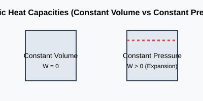
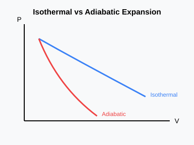
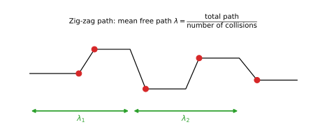
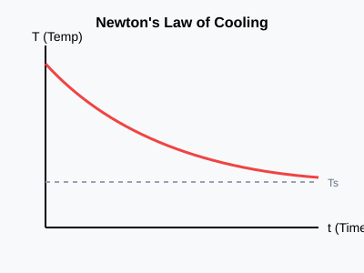
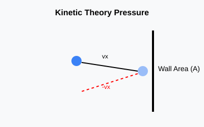

# Kinetic Theory of Gases: Exam Revision Guide

## Q1. Specific Heat Capacities of an Ideal Gas
**Question:** Show that $C_p - C_v = R$. Derive Mayer's relation.
**Derivation:**
From the first law of thermodynamics: $dQ = dU + dW$.
For 1 mole of an ideal gas at constant volume: $C_v = \frac{dU}{dT} \implies dU = C_v dT$.
At constant pressure: $dQ = C_p dT$ and $dW = P dV$.
Thus, $C_p dT = C_v dT + P dV$.
From the ideal gas law ($PV = RT$), differentiating at constant pressure gives $P dV = R dT$.
Substitute: $C_p dT = C_v dT + R dT \implies \boxed{C_p - C_v = R}$

## Q2. Adiabatic Relations
**Question:** Derive $PV^\gamma = \text{constant}$ and analyze $PV^{\gamma-1}$.
**Derivation:**
For an adiabatic process: $dQ = 0 \implies dU + P dV = 0$.
$C_v dT + P dV = 0$.
Differentiate $PV = RT$: $P dV + V dP = R dT = (C_p - C_v) dT$.
Substitute $dT$: $V dP + \gamma P dV = 0$ (using $\gamma = C_p / C_v$).
Integrating gives: $\boxed{PV^\gamma = \text{constant}}$

**Note on $PV^{\gamma-1}$:** As evaluated, this expression is mathematically invalid as a standard adiabatic constant. It likely contains a transcription error for the established relation $TV^{\gamma-1} = \text{constant}$.

## Q3. Mean Free Path
**Question:** Derive an expression for the mean free path of gas molecules.
**Derivation:**
Mean free path ($\lambda$) is the average distance traveled between collisions.
Assuming one moving molecule with diameter $d$ and speed $v$, the collision cylinder swept in time $t$ is $V_c = \pi d^2 v t$.
Number of collisions = $V_c \times n$ (where $n = N/V$).
$\lambda = \frac{v t}{\pi d^2 v t n} = \frac{1}{\pi d^2 n}$.
Accounting for the Maxwell-Boltzmann relative velocity distribution introduces a factor of $\sqrt{2}$:
$\boxed{\lambda = \frac{1}{\sqrt{2} \pi d^2 n}}$

## Q4. Newton's Law of Cooling
**Question:** Explain and derive Newton's law of cooling.
**Derivation:**
Rate of heat loss is proportional to temperature difference: $\frac{dQ}{dt} = -k(T - T_s)$.
Since $dQ = mc dT$, $\frac{dT}{dt} = -K(T - T_s)$.
Integrating gives: $\ln(T - T_s) = -Kt + C \implies \boxed{T = T_s + (T_0 - T_s)e^{-Kt}}$

## Q5. Pressure of an Ideal Gas and Average Kinetic Energy
**Derivation for Pressure:**
Momentum change per collision of a molecule of mass $m$: $\Delta p = 2m v_x$.
Time between collisions: $\Delta t = 2L / v_x$.
Force: $F = \frac{\Delta p}{\Delta t} = \frac{m v_x^2}{L}$.
Total pressure $P = \frac{F}{A} = \frac{N m \overline{v^2}}{3 V} = \frac{1}{3} \frac{mn c_{rms}^2}{V}$.
$\boxed{P = \frac{1}{3} \rho c^2}$

**Derivation for Kinetic Energy:**
$PV = \frac{1}{3} N m c^2 = \frac{2}{3} N \left(\frac{1}{2} m c^2\right) = \frac{2}{3} E_k$.
Since $PV = nRT$, we get $E_k = \frac{3}{2} nRT$.
