# PHY-103 · Magnetism (Magnetic Effects of Current): Solved Previous Questions, 2015–2023

> **Compiled by:** sigkill0x00  
> **Course:** Physics-II (AS 107 / PHY-103), BUTEX, B.Sc. in Textile Engineering  
> **Chapter:** 4. Magnetic Effects of Current (from the chapter-wise question bank, 2015–2023)  
> **Version:** v261101-0 · Every sub-question of the chapter is answered **in the order of the question bank**.

**How to read this file**

- Each question carries its year and number, the original wording, and an exam-style answer.
- Figures are stored in [`../../assets/`](../../assets/) and linked from there.
- Where the same question was asked in several years, the **full answer is written once** (at its first appearance) and each repeat gets a **condensed model answer** with a link back to the full version. Nothing is skipped.
- Numerical answers show data → formula → substitution → result with units.
- **Assumption note (2018 Q2(c)):** the loop is taken as a single turn (N = 1), since no number of turns is given.

---

## Question index

| # | Year · Question | Topic | Jump |
|---|---|---|---|
| 1 | 2015 · Q2(a)(ii) | Define torque | [go](#q2015-2aii) |
| 2 | 2015 · Q3(a) | Force on a moving charge; Faraday's and Lenz's laws | [go](#q2015-3a) |
| 3 | 2015 · Q3(b) | Magnetic induction; torque on a current loop | [go](#q2015-3b) |
| 4 | 2015 · Q3(c) | Define henry; force on a wire (numerical) | [go](#q2015-3c) |
| 5 | 2015 · Q4(b) | Hysteresis and the hysteresis curve | [go](#q2015-4b) |
| 6 | 2016 · Q2(b) | Torque; torque on a current loop | [go](#q2016-2b) |
| 7 | 2016 · Q2(c)(i) | Define magnetic induction | [go](#q2016-2ci) |
| 8 | 2016 · Q4(a) | Magnetic materials and their classification | [go](#q2016-4a) |
| 9 | 2016 · Q4(c) | Hall effect | [go](#q2016-4c) |
| 10 | 2017 · Q3(a)(i) | Define magnetic induction | [go](#q2017-3ai) |
| 11 | 2017 · Q3(b) | Torque on a current loop | [go](#q2017-3b) |
| 12 | 2017 · Q4(a) | Magnetic induction; force on a moving charge (derivation) | [go](#q2017-4a) |
| 13 | 2018 · Q2(a) | Hall effect; Hall voltage | [go](#q2018-2a) |
| 14 | 2018 · Q2(c) | Self-induction; torque on a loop (numerical) | [go](#q2018-2c) |
| 15 | 2019 · Q2 | Dia-, para- and ferromagnetic materials | [go](#q2019-2) |
| 16 | 2020 · Q3(a) | Hall effect; Hall voltage | [go](#q2020-3a) |
| 17 | 2021 · Q2(c) | Self-inductance of a coil (numerical) | [go](#q2021-2c) |
| 18 | 2021 · Q4(a) | Hysteresis and the hysteresis curve | [go](#q2021-4a) |
| 19 | 2023 · Q2(a) | Hall effect; Hall voltage | [go](#q2023-2a) |
| 20 | 2023 · Q2(b) | Torque on a current loop | [go](#q2023-2b) |
| 21 | 2023 · Q2(c) | Force on a conductor (numerical) | [go](#q2023-2c) |
| 22 | 2023 · Q3(b) | Hysteresis and the hysteresis curve | [go](#q2023-3b) |

---

## 2015 · Q2(a)(ii): Define torque.

**Answer.** Torque (moment of a force) is the **turning effect of a force about an axis or pivot**. It equals the force multiplied by the perpendicular distance of its line of action from the axis:

$$\vec{\tau}=\vec r\times\vec F,\qquad \tau = rF\sin\theta = F\,d$$

where $r$ is the position vector of the point of application from the pivot, $\theta$ is the angle between $\vec r$ and $\vec F$, and $d=r\sin\theta$ is the **lever arm**.

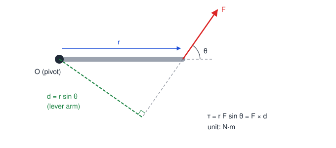

- **Unit:** newton-metre (N·m). **Dimensions:** $[ML^2T^{-2}]$.
- **Direction:** along the axis of rotation, given by the right-hand rule.
- **In magnetism:** a current loop in a magnetic field experiences the torque $\vec\tau=\vec m\times\vec B$ (derived in [2015 Q3(b)](#q2015-3b)).

**Example.** A force of 20 N acts at the end of a 0.5 m spanner, at 90° to it. $\tau = 0.5\times20\times\sin90^\circ = 10\ \text{N·m}$. If the same force acts at 30° to the spanner, $\tau=0.5\times20\times\sin30^\circ=5\ \text{N·m}$.

---

## 2015 · Q3(a): Write the equation for magnetic force on a moving charge in a magnetic field. Explain Faraday's law and Lenz's law.

### Part 1: Magnetic force on a moving charge

A charge $q$ moving with velocity $\vec v$ in a magnetic field $\vec B$ experiences the force

$$\boxed{\vec F = q\,(\vec v\times\vec B)}\qquad\Rightarrow\qquad F = qvB\sin\theta$$

where $\theta$ is the angle between $\vec v$ and $\vec B$.

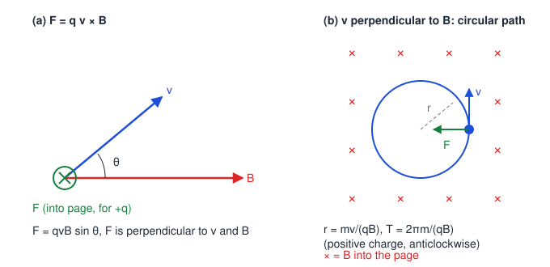

**Properties**

1. $\vec F\perp\vec v$ and $\vec F\perp\vec B$ (direction from the right-hand screw rule, or Fleming's left-hand rule for the force on a positive charge).
2. If $\theta=0^\circ$ or $180^\circ$ (charge moves along the field), $F=0$.
3. If $\theta=90^\circ$, $F=qvB$ is the maximum.
4. $\vec F\cdot\vec v=0$, so the force **does no work**. It changes the direction of the velocity, not the speed.
5. When $\vec v\perp\vec B$ the charge moves on a circle of radius $r=\dfrac{mv}{qB}$ and period $T=\dfrac{2\pi m}{qB}$ (independent of speed).
6. If an electric field is also present, the total (Lorentz) force is $\vec F=q(\vec E+\vec v\times\vec B)$.

**Example.** An electron ($m=9.11\times10^{-31}$ kg, $e=1.6\times10^{-19}$ C) enters a field $B=0.01$ T perpendicular to it with $v=10^{6}$ m/s.

$$r=\frac{mv}{eB}=\frac{9.11\times10^{-31}\times10^{6}}{1.6\times10^{-19}\times0.01}\approx5.7\times10^{-4}\ \text{m}=0.57\ \text{mm}$$

### Part 2: Faraday's law of electromagnetic induction

Magnetic flux through a coil: $\Phi=BA\cos\theta$ (unit weber, Wb).

- **First law.** Whenever the magnetic flux linked with a circuit changes, an emf is induced in it. The emf lasts only as long as the flux is changing.
- **Second law.** The magnitude of the induced emf is equal to the rate of change of flux linkage.

$$\varepsilon = -N\frac{d\Phi}{dt}$$

The flux can be changed by changing $B$, the area $A$, or the angle $\theta$ (for example by moving a magnet, or rotating the coil).

### Part 3: Lenz's law

> The direction of the induced emf (and current) is such that it **opposes the change in flux** that produces it.

This is the meaning of the **minus sign** in Faraday's law. In the figure below, the approaching N pole is repelled by the N face the coil develops, and the receding N pole is attracted by the S face it develops. In both cases the induced current resists the motion that created it.

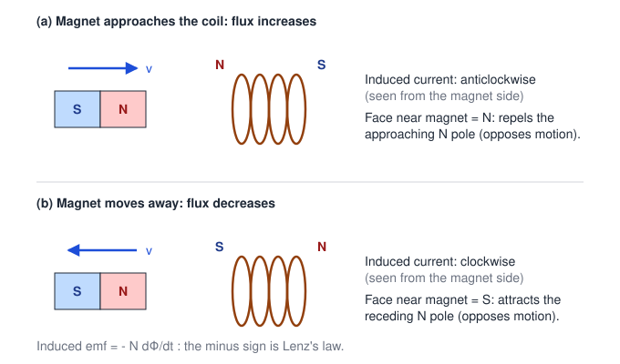

**Example.** A coil of 100 turns has its flux changed from 0.05 Wb to 0.01 Wb in 0.2 s.

$$|\varepsilon| = N\frac{|\Delta\Phi|}{\Delta t}=100\times\frac{0.05-0.01}{0.2}=20\ \text{V}$$

---

## 2015 · Q3(b): Define magnetic induction. Derive an expression for the torque on a current-carrying loop.

### Magnetic induction (magnetic flux density)

The **magnetic induction $B$** at a point is the force acting on a unit charge moving with unit velocity **perpendicular** to the field at that point:

$$B=\frac{F}{qv\sin\theta}\;\Big|_{\theta=90^\circ}=\frac{F}{qv}$$

Equivalently, it is the force per unit **current element** ($Il=1$ A·m) placed perpendicular to the field: $B=\dfrac{F}{Il}$.

- **Unit:** tesla (T) $=\text{N A}^{-1}\text{m}^{-1}=\text{Wb m}^{-2}$. $1\ \text{T}=10^{4}$ gauss.
- It is a vector quantity.
- **1 tesla** is the field in which a charge of 1 C moving at 1 m/s perpendicular to it feels a force of 1 N.

### Torque on a current-carrying loop in a uniform field

**Set-up.** A rectangular coil with sides $a$ (two sides parallel to the axis) and $b$ (two sides perpendicular to the axis), $N$ turns and area $A=ab$, carries current $I$. It is free to rotate about the axis through its centre and lies in a uniform field $\vec B$. Let $\theta$ be the angle between the **normal** $\hat n$ to the loop and $\vec B$.

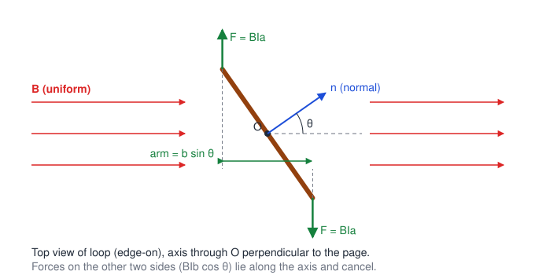

**Step 1: forces on the sides of length $b$.** These sides make an angle $(90^\circ-\theta)$ with $\vec B$, so each feels a force $BIb\cos\theta$. The two forces are equal, opposite, and act along the **same line (the axis)**. They cancel completely and give **no torque**.

**Step 2: forces on the sides of length $a$.** These sides are perpendicular to $\vec B$, so each feels

$$F=BIa\sin90^\circ=BIa$$

These forces are equal and opposite but act along **different lines**, so they form a **couple**. The perpendicular distance between them is $b\sin\theta$.

**Step 3: torque of the couple.**

$$\tau=F\times(b\sin\theta)=(BIa)(b\sin\theta)=BI\,(ab)\sin\theta$$

$$\boxed{\tau = IAB\sin\theta}\quad\text{(single turn)}\qquad\boxed{\tau = NIAB\sin\theta}\quad(N\text{ turns})$$

In vector form, with magnetic moment $\vec m=NIA\,\hat n$:

$$\vec\tau=\vec m\times\vec B$$

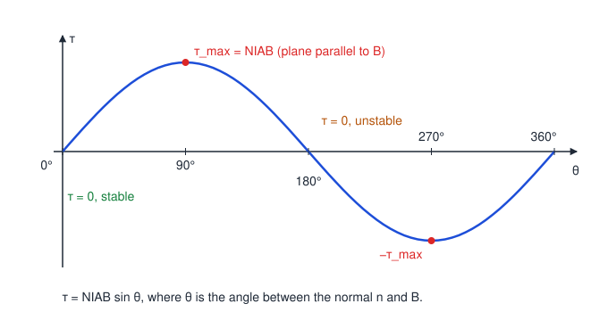

**Discussion**

- $\tau$ is **maximum** ($NIAB$) when $\theta=90^\circ$, i.e. the plane of the coil is **parallel** to $\vec B$.
- $\tau=0$ when $\theta=0^\circ$ (plane perpendicular to $\vec B$, stable equilibrium) and when $\theta=180^\circ$ (unstable equilibrium).
- If $\alpha$ is the angle between the **plane** of the coil and $\vec B$, then $\tau=NIAB\cos\alpha$.
- The net force on the loop is zero; only a torque acts.
- **Application:** moving-coil galvanometer and DC motor.

**Example.** A coil of 50 turns, area $2\times10^{-3}\ \text{m}^2$, carries 2 A in a field of 0.5 T, with its normal at 30° to the field.

$$\tau=NIAB\sin\theta=50\times2\times2\times10^{-3}\times0.5\times\sin30^\circ=0.05\ \text{N·m}$$

---

## 2015 · Q3(c): Define henry. A wire of length 10 cm carrying a current of 10000 mA experiences a force of 5 N when placed at 30° to a uniform magnetic field. Find the magnetic field.

### Definition of henry

The **henry (H)** is the SI unit of inductance. A coil has an inductance of **1 henry** if an emf of **1 volt** is induced in it when the current through it changes at the rate of **1 ampere per second** (equivalently, a current of 1 A produces a flux linkage of 1 weber-turn).

$$1\ \text{H}=1\ \frac{\text{V·s}}{\text{A}}=1\ \frac{\text{Wb}}{\text{A}}=1\ \Omega\,\text{s}$$

### Numerical

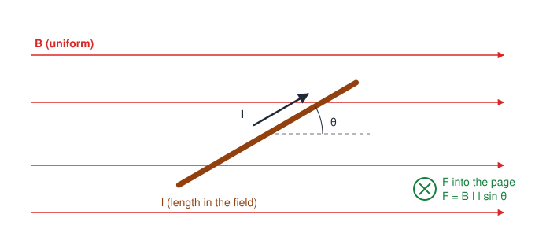

**Given:** $l=10\ \text{cm}=0.1\ \text{m}$, $I=10000\ \text{mA}=10\ \text{A}$, $F=5\ \text{N}$, $\theta=30^\circ$.

**Formula:** $F=BIl\sin\theta$

$$B=\frac{F}{Il\sin\theta}=\frac{5}{10\times0.1\times\sin30^\circ}=\frac{5}{10\times0.1\times0.5}=\frac{5}{0.5}$$

$$\boxed{B=10\ \text{T}}$$

---

## 2015 · Q4(b): What is hysteresis? State and explain the hysteresis curve of a magnetic material.

### Definition

**Hysteresis** is the **lagging of the magnetic induction $B$ behind the magnetising field $H$** when a ferromagnetic material is taken through a complete cycle of magnetisation and demagnetisation. The word means "to lag behind".

### The B–H (hysteresis) curve

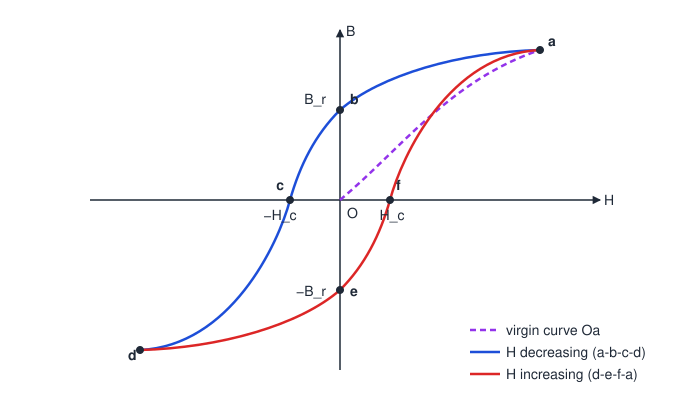

Start with an unmagnetised specimen (B = 0, H = 0) and increase $H$ slowly by increasing the current in the magnetising coil.

| Stage | What happens |
|---|---|
| **O → a** (virgin curve) | $B$ rises with $H$ as domains align with the field, first by domain-wall motion and then by rotation. At **a** nearly all domains are aligned: **saturation** ($B_s$). Increasing $H$ further gives almost no more $B$. |
| **a → b** | $H$ is reduced to zero. $B$ does **not** fall to zero. It stays at $Ob=B_r$, the **retentivity** (residual magnetism). |
| **b → c** | $H$ is **reversed**. $B$ falls and becomes zero at $H=-H_c$. $Oc=H_c$ is the **coercivity** (coercive force), the reverse field needed to wipe out the residual magnetism. |
| **c → d** | Reverse $H$ is increased further. The material is magnetised in the opposite direction up to saturation at **d**. |
| **d → e → f → a** | $H$ is brought back to zero (point e, $B=-B_r$), reversed again (point f, $H=+H_c$ at $B=0$), and increased to the original saturation at **a**. |

The closed curve **abcdefa** is the **hysteresis loop**. After the first cycle the specimen follows the loop on every cycle.

**Key terms**

- **Retentivity ($B_r$):** value of $B$ remaining when $H$ is reduced to zero after saturation.
- **Coercivity ($H_c$):** reverse field required to reduce the residual $B$ to zero.
- **Saturation ($B_s$):** maximum $B$ reachable, when all domains are aligned.

### Energy loss

For unit volume, the work done in changing $B$ by $dB$ is $dW=H\,dB$. Over one full cycle

$$W=\oint H\,dB=\text{area of the B–H loop}\quad(\text{J m}^{-3}\text{ per cycle})$$

This energy is spent in turning the domains against internal friction and appears as **heat** in the specimen. For a core of volume $V$ at frequency $f$,

$$P_h=(\text{loop area})\times V\times f$$

**Soft and hard materials**

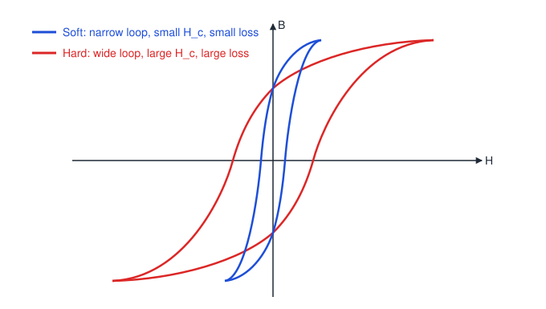

| Property | Soft magnetic material (soft iron, silicon steel) | Hard magnetic material (steel, alnico) |
|---|---|---|
| Loop | Narrow, tall | Wide |
| Coercivity $H_c$ | Small | Large |
| Hysteresis loss | Small | Large |
| Use | Transformer cores, motors, electromagnets | Permanent magnets |

**Example.** A transformer core of volume 0.01 m³ has a loop area of 400 J m⁻³ per cycle (illustrative value) at 50 Hz.
Energy per cycle $=400\times0.01=4$ J, so $P_h=4\times50=200$ W lost as heat. This is why transformer cores use soft, narrow-loop material.

---

## 2016 · Q2(b): What is torque? Derive an expression for the torque on a current-carrying loop.

**Torque.** The turning effect of a force about an axis: $\vec\tau=\vec r\times\vec F$, $\ \tau=rF\sin\theta=F\,d$ (unit N·m). See the full definition with figure in [2015 Q2(a)(ii)](#q2015-2aii).

**Torque on a current loop** (condensed model answer; full derivation in [2015 Q3(b)](#q2015-3b)).

1. Take a rectangular loop of sides $a$ and $b$ ($A=ab$), $N$ turns, current $I$, in a uniform field $\vec B$. Let $\theta$ be the angle between the loop's normal $\hat n$ and $\vec B$.
2. Sides of length $b$: force $BIb\cos\theta$ each, equal, opposite and **collinear** (along the axis), so they cancel and give no torque.
3. Sides of length $a$ (perpendicular to $\vec B$): force $F=BIa$ each, equal and opposite but not collinear. They form a **couple** with arm $b\sin\theta$.
4. Torque of the couple:

$$\tau=F\times b\sin\theta=BIa\cdot b\sin\theta\;\Rightarrow\;\boxed{\tau=NIAB\sin\theta}$$

5. In vector form $\vec\tau=\vec m\times\vec B$ with $\vec m=NIA\,\hat n$. The torque is maximum ($NIAB$) when the plane of the coil is parallel to $\vec B$ and zero when the plane is perpendicular to $\vec B$.

---

## 2016 · Q2(c)(i): Define magnetic induction.

**Answer.** The **magnetic induction (magnetic flux density) $B$** at a point is the **force experienced per unit charge moving with unit velocity perpendicular to the field** at that point:

$$B=\frac{F}{qv}\quad(\vec v\perp\vec B)\qquad\text{or, in general}\qquad B=\frac{F}{qv\sin\theta}$$

It can also be defined as the force per unit current element placed perpendicular to the field, $B=F/(Il)$.

- **Unit:** tesla (T) $=\text{N A}^{-1}\text{m}^{-1}=\text{Wb m}^{-2}$ ($1\ \text{T}=10^4$ gauss).
- It is a **vector**; its direction at a point is the direction of the field there.

**Example.** A charge of 2 C moving at 3 m/s perpendicular to a field experiences 12 N, so $B=\dfrac{12}{2\times3}=2\ \text{T}$.

---

## 2016 · Q4(a): State magnetic materials. Write down the classification of magnetic materials.

### Magnetic materials

**Magnetic materials** are substances that are attracted or repelled by a magnet, or that become magnetised when placed in an external magnetic field. Their behaviour comes from the **magnetic moments of atoms**, which arise from the orbital motion and spin of electrons.

Useful quantities: magnetisation $M$ (magnetic moment per unit volume), susceptibility $\chi=\dfrac{M}{H}$, and relative permeability $\mu_r=1+\chi$, with $B=\mu_0(H+M)=\mu_0\mu_rH$.

### Classification

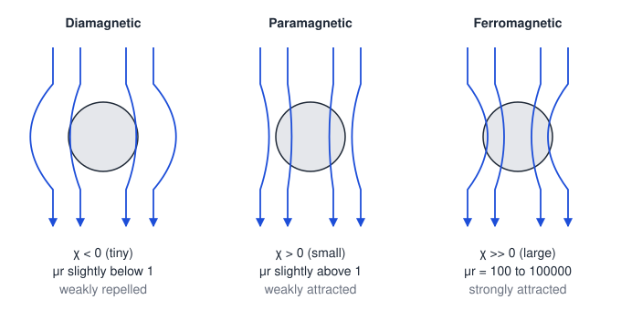

**1. Diamagnetic materials**

- Atoms have **no permanent magnetic moment**. The field induces a small moment **opposite** to it (Lenz's law).
- $\chi$ is small and **negative**, $\mu_r$ slightly less than 1. Weakly **repelled**, so the specimen tends to move from a strong field to a weak field.
- Independent of temperature. **Examples:** bismuth, copper, gold, silver, water, quartz. A superconductor is a perfect diamagnet ($\chi=-1$).

**2. Paramagnetic materials**

- Atoms have **permanent magnetic moments**, randomly oriented. The field partly aligns them.
- $\chi$ is small and **positive** ($\sim10^{-5}$ to $10^{-3}$), $\mu_r$ slightly more than 1. Weakly **attracted**, so the specimen moves from a weak field to a strong field.
- Follows **Curie's law** $\chi=C/T$. **Examples:** aluminium, platinum, sodium, manganese, oxygen.

**3. Ferromagnetic materials**

- Atomic moments are grouped into **domains** in which all moments are parallel (spontaneous magnetisation).
- $\chi$ is very large and positive, $\mu_r\sim10^{2}$ to $10^{5}$. **Strongly attracted**, show **hysteresis** and saturation.
- Above the **Curie temperature $T_c$** the domains break up and the material becomes paramagnetic (Curie–Weiss law $\chi=C/(T-T_c)$). $T_c$: iron about 770 °C, nickel about 358 °C, cobalt about 1115 °C.
- **Examples:** iron, cobalt, nickel, alnico, gadolinium.

**Other classes (brief):** *antiferromagnetic* (neighbouring moments antiparallel, net moment about zero, e.g. MnO) and *ferrimagnetic* (antiparallel but unequal moments, e.g. ferrites such as Fe₃O₄, used in high-frequency cores).

**Example.** Aluminium: $\chi=2.2\times10^{-5}$, so $\mu_r=1.000022$. Bismuth: $\chi\approx-1.7\times10^{-4}$, so $\mu_r\approx0.99983$. Iron: $\mu_r$ of order $10^{3}$ to $10^{5}$.

---

## 2016 · Q4(c): What is Hall effect?

**Definition.** When a **current-carrying conductor or semiconductor is placed in a magnetic field perpendicular to the current**, a small potential difference develops across the faces that are **perpendicular to both the current and the field**. This is the **Hall effect** (E. H. Hall, 1879), and the voltage is the **Hall voltage $V_H$**.

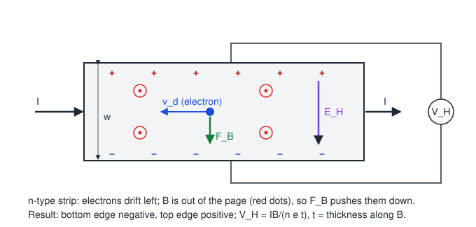

**Explanation.**

1. The carriers drifting along the strip feel the magnetic force $\vec F_B=q\vec v_d\times\vec B$, which pushes them to one side face.
2. Charge piles up on that face, leaving the opposite face with the opposite charge. A transverse **Hall field $E_H$** builds up.
3. In the steady state the electric force balances the magnetic force, so carriers move straight again and a steady $V_H$ is measured across the width.

**Result:**

$$V_H=\frac{IB}{nqt}\qquad R_H=\frac{1}{nq}$$

($n$ = carrier density, $q$ = carrier charge, $t$ = thickness along $B$.) The full derivation is in [2018 Q2(a)](#q2018-2a).

**Uses:** finding whether carriers are electrons or holes (sign of $V_H$), finding carrier density and mobility, measuring magnetic fields (Hall probe, gaussmeter), and Hall sensors for position, speed and current.

**Example.** A copper strip ($n=8.5\times10^{28}\ \text{m}^{-3}$), $t=0.1$ mm, $I=10$ A, $B=1$ T:

$$V_H=\frac{10\times1}{8.5\times10^{28}\times1.6\times10^{-19}\times10^{-4}}\approx7.4\ \mu\text{V}$$

---

## 2017 · Q3(a)(i): Define magnetic induction.

**Answer.** The magnetic induction $B$ at a point is the **force acting on a unit charge moving with unit velocity perpendicular to the magnetic field** at that point, $B=\dfrac{F}{qv}$ (for $\theta=90^\circ$). Equivalently it is the force per unit length per unit current for a conductor perpendicular to the field, $B=\dfrac{F}{Il}$.

- **Unit:** tesla, $1\ \text{T}=1\ \text{N A}^{-1}\text{m}^{-1}=1\ \text{Wb m}^{-2}$. It is a vector quantity.
- Full statement with an example: [2016 Q2(c)(i)](#q2016-2ci).

---

## 2017 · Q3(b): Derive an expression for the torque on a current-carrying loop.

(Condensed model answer. The complete derivation with the explanation of every step is in [2015 Q3(b)](#q2015-3b).)

**Given:** loop of sides $a$ and $b$, area $A=ab$, $N$ turns, current $I$, uniform field $\vec B$, normal at angle $\theta$ to $\vec B$.

- **Sides of length $b$:** $F=BIb\cos\theta$, equal, opposite, **collinear**, so net force and torque from them are zero.
- **Sides of length $a$:** $F=BIa\sin90^\circ=BIa$, equal and opposite, separated by $b\sin\theta$ (a **couple**).

$$\tau=(BIa)(b\sin\theta)=BI(ab)\sin\theta$$

$$\boxed{\tau=NIAB\sin\theta=mB\sin\theta}\qquad(\vec\tau=\vec m\times\vec B,\ m=NIA)$$

- Maximum $NIAB$ when the plane of the coil is parallel to $\vec B$ ($\theta=90^\circ$). Zero when the plane is perpendicular to $\vec B$ ($\theta=0^\circ$).
- The torque tends to turn the loop until its normal lines up with $\vec B$ (this is the working principle of the moving-coil galvanometer).

---

## 2017 · Q4(a): Define magnetic induction and derive an equation for the magnetic force on a moving charge in a magnetic field.

### Definition

The **magnetic induction** $B$ is the force on a unit charge moving with unit velocity perpendicular to the field, $B=\dfrac{F}{qv}$. Unit: tesla (T).

### Derivation of $F=qvB\sin\theta$

Start from the experimental result for a straight current-carrying conductor of length $l$ in a field $\vec B$:

$$F=BIl\sin\theta\qquad(\theta=\text{angle between the current direction and }\vec B)$$

Let the conductor have cross-section $A$ and $n$ free charge carriers (each of charge $q$) per unit volume, all drifting with velocity $v$ along the conductor.

1. Current: $I=nqAv$.
2. Number of carriers in length $l$: $N=nAl$.
3. Substitute $I$ in the force on the conductor:

$$F=B\,(nqAv)\,l\sin\theta=(nAl)\,qvB\sin\theta=N\,qvB\sin\theta$$

4. The force on **one** carrier is the total force divided by $N$:

$$\boxed{F=qvB\sin\theta}\qquad\boxed{\vec F=q\,(\vec v\times\vec B)}$$

**Direction.** $\vec F$ is perpendicular to the plane containing $\vec v$ and $\vec B$ (right-hand screw rule, or Fleming's left-hand rule for a positive charge; reversed for a negative charge). It does no work because $\vec F\perp\vec v$.

**Special cases.** $\theta=0^\circ$ gives $F=0$. $\theta=90^\circ$ gives $F_{max}=qvB$ and circular motion of radius $r=mv/(qB)$.

**Example.** A proton ($q=1.6\times10^{-19}$ C) moves at $2\times10^{6}$ m/s at 30° to a field of 0.5 T:

$$F=qvB\sin\theta=1.6\times10^{-19}\times2\times10^{6}\times0.5\times0.5=8\times10^{-14}\ \text{N}$$

---

## 2018 · Q2(a): What is the Hall effect? Deduce the equation of Hall voltage.

### Hall effect

When a **current-carrying conductor (or semiconductor) is placed in a magnetic field perpendicular to the current**, a transverse potential difference, the **Hall voltage $V_H$**, appears across the faces perpendicular to both the current and the field.

### Derivation of the Hall voltage

**Set-up.** A strip of width $w$ and thickness $t$ carries current $I$ along its length. The field $\vec B$ is perpendicular to the broad face (along $t$). Let $n$ be the number of carriers per unit volume, each of charge $e$, and $v_d$ their drift velocity. (The figure shows an n-type strip, with electrons drifting opposite to the conventional current.)

**Step 1: drift velocity.** The cross-section is $wt$, so

$$I=n\,e\,v_d\,(wt)\quad\Rightarrow\quad v_d=\frac{I}{n e w t}$$

**Step 2: magnetic force.** Since $\vec v_d\perp\vec B$, each carrier feels

$$F_B=e\,v_dB$$

which pushes carriers towards one side face. Charge accumulates there and the opposite face acquires the opposite charge.

**Step 3: Hall field.** The separated charges set up a transverse electric field $E_H$ (the **Hall field**). It exerts an opposing force $F_E=eE_H$ on each carrier.

**Step 4: equilibrium.** Accumulation stops when the two forces balance:

$$eE_H=e\,v_dB\quad\Rightarrow\quad E_H=v_dB$$

**Step 5: Hall voltage.** The field acts across the width $w$:

$$V_H=E_Hw=v_dBw=\frac{I}{newt}\,Bw$$

$$\boxed{V_H=\frac{IB}{n e t}}$$

### Hall coefficient

Using current density $J=I/(wt)=nev_d$,

$$R_H=\frac{E_H}{JB}=\frac{V_H\,t}{IB}=\frac{1}{ne}\qquad\Longrightarrow\qquad V_H=R_H\frac{IB}{t}$$

- The **sign of $R_H$** (equivalently the polarity of $V_H$) tells whether the carriers are electrons (n-type) or holes (p-type).
- From a measurement of $V_H$: carrier density $n=\dfrac{IB}{etV_H}$, and mobility $\mu=|R_H|\,\sigma$.

**Example.** A metal strip of thickness 0.1 mm carries 20 A in a field of 1.5 T and gives $V_H=32\ \mu\text{V}$. Find $n$.

$$n=\frac{IB}{e\,t\,V_H}=\frac{20\times1.5}{1.6\times10^{-19}\times10^{-4}\times32\times10^{-6}}\approx5.9\times10^{28}\ \text{m}^{-3}$$

---

## 2018 · Q2(c): Define self-induction. A current-carrying loop of length 2.5 cm and width 1 cm carries a current of 4 A. It is placed parallel to a uniform magnetic field of 2 T. Calculate the torque of the loop.

### Self-induction

**Self-induction** is the property of a coil by which it **opposes any change of the current flowing through it**. When the current changes, the flux linked with the coil changes, so an emf is induced **in the same coil**, and by Lenz's law it opposes the change (a **back emf**).

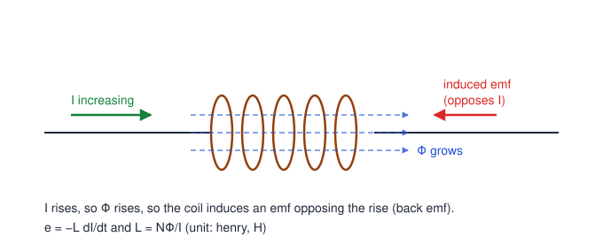

$$\varepsilon=-L\frac{dI}{dt},\qquad L=\frac{N\Phi}{I}$$

$L$ is the **self-inductance** (unit: henry). For a long solenoid $L=\dfrac{\mu_0\mu_rN^2A}{l}$, so it depends on the number of turns, area, length and core material.

**Example.** A coil with $L=0.08$ H has its current reduced from 2 A to 0 in 0.01 s: $|\varepsilon|=L\dfrac{\Delta I}{\Delta t}=0.08\times\dfrac{2}{0.01}=16$ V.

### Numerical: torque on the loop

**Given:** $l=2.5\ \text{cm}=2.5\times10^{-2}\ \text{m}$, $w=1\ \text{cm}=1\times10^{-2}\ \text{m}$, $I=4\ \text{A}$, $B=2\ \text{T}$, plane of the loop **parallel** to $\vec B$, taken as a single turn ($N=1$).

**Area:** $A=l\,w=2.5\times10^{-2}\times1\times10^{-2}=2.5\times10^{-4}\ \text{m}^2$

**Angle:** if the plane of the loop is parallel to $\vec B$, its **normal is perpendicular to $\vec B$**, so $\theta=90^\circ$ and $\sin\theta=1$.

$$\tau=NIAB\sin\theta=1\times4\times2.5\times10^{-4}\times2\times1$$

$$\boxed{\tau=2\times10^{-3}\ \text{N·m}}$$

This is the **maximum** torque the loop can experience. (For the loop plane perpendicular to the field the torque would be zero.)

---

## 2019 · Q2: Distinguish between diamagnetic, paramagnetic, and ferromagnetic materials.

| Property | Diamagnetic | Paramagnetic | Ferromagnetic |
|---|---|---|---|
| Atomic magnetic moment | No permanent moment; a small opposing moment is induced | Permanent moments, randomly oriented | Permanent moments, aligned in **domains** |
| Susceptibility $\chi$ | Small, **negative** | Small, **positive** | Very large, positive |
| Relative permeability $\mu_r$ | Slightly less than 1 | Slightly more than 1 | Much greater than 1 ($10^2$ to $10^5$) |
| Behaviour in a magnetic field | Weakly **repelled** (moves towards the weaker field) | Weakly **attracted** (moves towards the stronger field) | Strongly **attracted** |
| Field lines | Slightly expelled from the material | Slightly concentrated | Strongly concentrated |
| Magnetisation $M$ relative to $H$ | Opposite to $H$ | Along $H$, weak | Along $H$, very strong |
| Effect of temperature | Independent | $\chi\propto1/T$ (Curie's law) | Becomes paramagnetic above the Curie temperature |
| Hysteresis | None | None | Shows hysteresis loop |
| Examples | Bismuth, copper, gold, water | Aluminium, platinum, sodium | Iron, cobalt, nickel |

---

## 2020 · Q3(a): What is Hall effect? Deduce the equation of Hall voltage.

(Condensed model answer. The same question was asked in 2018 and is derived step by step in [2018 Q2(a)](#q2018-2a).)

**Hall effect.** A current-carrying conductor in a magnetic field perpendicular to the current develops a transverse potential difference (the Hall voltage) across the faces perpendicular to both $I$ and $B$.

**Derivation.** Strip of width $w$, thickness $t$, carrier density $n$, charge $e$, drift speed $v_d$.

1. $I=nev_d(wt)\ \Rightarrow\ v_d=\dfrac{I}{newt}$
2. Magnetic force on a carrier: $F_B=ev_dB$ (pushes carriers to one face).
3. The accumulated charge produces the Hall field $E_H$, giving a force $F_E=eE_H$ in the opposite direction.
4. At equilibrium $eE_H=ev_dB\ \Rightarrow\ E_H=v_dB$.
5. $V_H=E_Hw=v_dBw$, hence

$$\boxed{V_H=\frac{IB}{net}},\qquad R_H=\frac{1}{ne}=\frac{V_Ht}{IB}$$

The sign of $V_H$ shows whether the charge carriers are electrons or holes.

---

## 2021 · Q2(c): Calculate the self-inductance of a coil of 400 turns when a 2 A current creates $4\times10^{-4}$ Wb of flux.

**Given:** $N=400$, $I=2\ \text{A}$, $\Phi=4\times10^{-4}\ \text{Wb}$ (flux through each turn).

**Formula:** flux linkage $N\Phi=LI$, so $L=\dfrac{N\Phi}{I}$.

$$L=\frac{400\times4\times10^{-4}}{2}=\frac{0.16}{2}$$

$$\boxed{L=0.08\ \text{H}=80\ \text{mH}}$$

**Check:** with $L=0.08$ H, a current changing at 100 A/s would induce $0.08\times100=8$ V, a sensible value.

---

## 2021 · Q4(a): What is hysteresis? State and explain the hysteresis curve of a magnetic material.

(Condensed model answer. Full stage-by-stage explanation and the soft/hard comparison are in [2015 Q4(b)](#q2015-4b).)

**Hysteresis.** The **lagging of the magnetic induction $B$ behind the magnetising field $H$** when a ferromagnetic material is taken through a complete cycle of magnetisation.

**Explanation of the curve**

- **Oa (virgin curve):** $B$ rises as domains align, reaching saturation $B_s$ at **a**.
- **ab:** $H$ is reduced to zero but $B$ stays at $Ob=B_r$, the **retentivity** (residual magnetism).
- **bc:** reverse $H$ is applied. $B$ becomes zero at $H=-H_c$, where $Oc=H_c$ is the **coercivity**.
- **cd:** further reverse $H$ saturates the material in the opposite direction.
- **d e f a:** the reverse half of the loop is traced as $H$ goes back to $+H_{max}$ (with $-B_r$ at e and $+H_c$ at f).

**Energy loss.** Work per unit volume per cycle $=\oint H\,dB=$ the **area of the loop** (J m⁻³ per cycle), dissipated as heat. Soft iron (narrow loop) suits transformer cores; steel (wide loop, large $B_r$ and $H_c$) suits permanent magnets.

---

## 2023 · Q2(a): What is Hall effect? Deduce the equation of Hall voltage.

(Condensed model answer. Full version with the Hall coefficient and a numerical example: [2018 Q2(a)](#q2018-2a).)

**Hall effect.** When a current-carrying conductor is placed in a transverse magnetic field, a potential difference (Hall voltage) appears across the faces perpendicular to both $\vec I$ and $\vec B$.

**Derivation.**

1. Drift velocity: $v_d=\dfrac{I}{newt}$ (strip of width $w$, thickness $t$).
2. Magnetic force on a carrier: $F_B=ev_dB$, which drives carriers to one face.
3. Charge separation creates $E_H$, with electric force $eE_H$ opposing $F_B$.
4. In the steady state $eE_H=ev_dB$, so $E_H=v_dB$.
5. $V_H=E_Hw=v_dBw$:

$$\boxed{V_H=\frac{IB}{net}}\qquad R_H=\frac{1}{ne}$$

---

## 2023 · Q2(b): Derive an expression for the torque on a current-carrying loop.

(Condensed model answer. The complete derivation is in [2015 Q3(b)](#q2015-3b).)

1. Rectangular loop, sides $a$ and $b$, area $A=ab$, $N$ turns, current $I$, uniform field $\vec B$; $\theta$ = angle between the normal $\hat n$ and $\vec B$.
2. Forces on the two sides of length $b$: $BIb\cos\theta$ each, equal, opposite and along the same line, so they cancel (no torque).
3. Forces on the two sides of length $a$: $F=BIa$ each, equal and opposite, forming a couple whose arm is $b\sin\theta$.
4. Torque:

$$\tau=F\times b\sin\theta=BIab\sin\theta\;\Rightarrow\;\boxed{\tau=NIAB\sin\theta}\qquad(\vec\tau=\vec m\times\vec B,\ \vec m=NIA\,\hat n)$$

5. $\tau_{max}=NIAB$ at $\theta=90^\circ$ (plane parallel to $\vec B$); $\tau=0$ at $\theta=0^\circ$.

---

## 2023 · Q2(c): A conductor of length 0.5 m is situated at an angle of 30° with a uniform magnetic field of 1.5 T. If 10 A current flows through the conductor, calculate the magnetic force acting on it.

**Given:** $l=0.5\ \text{m}$, $\theta=30^\circ$, $B=1.5\ \text{T}$, $I=10\ \text{A}$.

**Formula:** $F=BIl\sin\theta$

$$F=1.5\times10\times0.5\times\sin30^\circ=7.5\times0.5$$

$$\boxed{F=3.75\ \text{N}}$$

The force is perpendicular to the plane containing the conductor and the field (Fleming's left-hand rule).

---

## 2023 · Q3(b): What is hysteresis? State and explain the hysteresis curve of a magnetic material.

(Condensed model answer. The detailed version is in [2015 Q4(b)](#q2015-4b).)

**Hysteresis** is the lag of $B$ behind $H$ when a ferromagnetic material goes through a magnetising cycle.

| Portion | Meaning |
|---|---|
| Oa | Virgin curve: $B$ grows with $H$ up to saturation at a |
| a → b | $H\to0$: $B$ remains $=B_r$ (**retentivity**) |
| b → c | Reverse $H$: $B=0$ when $H=-H_c$ (**coercivity**) |
| c → d | Further reverse $H$: opposite saturation |
| d → e → f → a | Return half of the loop ($-B_r$ at e, $+H_c$ at f) |

- **Area of the loop** = energy lost per unit volume per cycle (as heat).
- **Soft materials** (soft iron): narrow loop, small $H_c$, low loss, for transformers and motors.
- **Hard materials** (steel): wide loop, large $H_c$ and $B_r$, for permanent magnets.

---

## Answers to the numerical questions at a glance

| Question | Result |
|---|---|
| 2015 Q3(c): field on a 0.1 m wire, 10 A, 5 N, 30° | $B=10\ \text{T}$ |
| 2018 Q2(c): loop 2.5 cm × 1 cm, 4 A, 2 T, plane parallel to $\vec B$ | $\tau=2\times10^{-3}\ \text{N·m}$ |
| 2021 Q2(c): 400 turns, 2 A, $4\times10^{-4}$ Wb | $L=0.08\ \text{H}$ |
| 2023 Q2(c): 0.5 m, 30°, 1.5 T, 10 A | $F=3.75\ \text{N}$ |

## Quick-recall formulas

| Quantity | Formula |
|---|---|
| Force on a moving charge | $\vec F=q\,\vec v\times\vec B,\quad F=qvB\sin\theta$ |
| Radius, period (circular motion) | $r=\dfrac{mv}{qB},\quad T=\dfrac{2\pi m}{qB}$ |
| Force on a conductor | $F=BIl\sin\theta$ |
| Torque on a coil | $\tau=NIAB\sin\theta=mB\sin\theta,\quad m=NIA$ |
| Hall voltage, Hall coefficient | $V_H=\dfrac{IB}{net},\quad R_H=\dfrac{1}{ne}$ |
| Faraday's law | $\varepsilon=-N\dfrac{d\Phi}{dt}$ |
| Self-inductance | $L=\dfrac{N\Phi}{I},\quad\varepsilon=-L\dfrac{dI}{dt}$ |
| Hysteresis loss per cycle | $W=\oint H\,dB$ (area of the B–H loop) |
| Susceptibility, permeability | $\chi=\dfrac{M}{H},\quad\mu_r=1+\chi$ |

---

*Compiled by sigkill0x00 · PHY-103 · Magnetism · v261101-0*
