# PHY-103 (Physics-II) — Magnetism, Electromagnetic Induction & AC
### Solved Previous Questions 2015 – 2023 (BUTEX, B.Sc. in Textile Engineering)

> **File:** `phy-103-magnetism-2015-2023-ques-solve-v261102-0.md`  
> **Source bank:** *Physics-II Previous Questions — Chapter-wise Question Bank (2015–2023)*  
> **Covers:** Chapter 4 (Magnetic Effects of Current) and Chapter 5 (Electromagnetic Induction, Inductance and AC), every sub-question, in the order of the question bank.  
> **Figures:** SVG files linked from `../../assets/`.

**How to read an answer:** theory questions follow *Definition → Figure → Derivation → Result / Example*; numericals follow *Given → Formula → Calculation → Answer*. When the same question repeats in another year, it is answered in full the first time and the later entry points back to it with a short summary.

**Constants used:** $\mu_0=4\pi\times10^{-7}\ \mathrm{H\,m^{-1}}$, $e=1.6\times10^{-19}\ \mathrm C$, $m_e=9.11\times10^{-31}\ \mathrm{kg}$.

## Contents

| Chapter | Topics |
|---|---|
| [4. Magnetic Effects of Current](#ch4) | Torque, magnetic induction, force on a moving charge, torque on a loop, Hall effect, classification of magnetic materials, hysteresis |
| [5. EMI, Inductance and AC](#ch5) | Faraday's laws, Lenz's law, mutual and self induction, choke coil, LR circuit, RC circuit, series RLC resonance |
| [Formula summary](#summary) | One-page revision list |

---

# 4. Magnetic Effects of Current

## 2015 — Physics-II, Q2

### 2(a)(ii). Define torque.

**Definition.** Torque (moment of a force) is the turning effect of a force about an axis. It equals the product of the force and the perpendicular distance of its line of action from the axis:

$$\vec\tau=\vec r\times\vec F,\qquad \tau=rF\sin\theta$$

where $\vec r$ is the position vector of the point of application measured from the axis and $\theta$ is the angle between $\vec r$ and $\vec F$. **SI unit:** newton-metre (N·m). It is an axial vector (direction given by the right-hand rule).

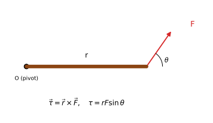

**Example.** A spanner of length $0.20\ \mathrm m$ is pulled at right angles with $F=50\ \mathrm N$:
$\tau=rF\sin90^\circ=0.20\times50=10\ \mathrm{N\,m}$.

**Magnetic case.** A current loop of magnetic moment $\vec m$ in a field $\vec B$ experiences $\vec\tau=\vec m\times\vec B$ (derived in [3(b)](#c4-2015-q3b)).

---

## 2015 — Physics-II, Q3

### 3(a). Write the equation for magnetic force on a moving charge in a magnetic field. Explain Faraday's law and Lenz's law.

**Magnetic force on a moving charge (Lorentz magnetic force)**

$$\vec F=q\,(\vec v\times\vec B),\qquad F=qvB\sin\theta$$

Here $q$ is the charge, $\vec v$ its velocity, $\vec B$ the magnetic induction and $\theta$ the angle between $\vec v$ and $\vec B$.

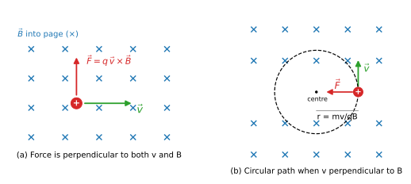

* The force is **perpendicular to both $\vec v$ and $\vec B$**, so it does no work and changes only the direction of the velocity, not the speed.
* If $\vec v\parallel\vec B$ ($\theta=0$): $F=0$ and the charge moves straight.
* If $\vec v\perp\vec B$ ($\theta=90^\circ$): $F=qvB$ is the centripetal force, so the charge moves in a circle:

$$qvB=\frac{mv^2}{r}\;\Rightarrow\; r=\frac{mv}{qB},\qquad T=\frac{2\pi m}{qB}$$

* In the presence of an electric field too, the total force is $\vec F=q(\vec E+\vec v\times\vec B)$.

**Example.** An electron with $v=2\times10^{6}\ \mathrm{m\,s^{-1}}$ enters $B=0.01\ \mathrm T$ at right angles:
$r=\dfrac{mv}{eB}=\dfrac{9.11\times10^{-31}\times2\times10^{6}}{1.6\times10^{-19}\times0.01}=1.14\times10^{-3}\ \mathrm m\approx1.1\ \mathrm{mm}$.

**Faraday's law and Lenz's law (summary).**

* **Faraday:** an emf is induced in a circuit whenever the magnetic flux linked with it changes, and its magnitude equals the rate of change of flux linkage: $\varepsilon=-N\dfrac{d\Phi}{dt}$.
* **Lenz:** the direction of the induced emf/current is such that it opposes the change that produces it (the minus sign above).

Full statements, experiment, derivation and examples: see [Chapter 5, 2015 Q3(a)](#c5-2015-q3a) and [Q4(a)](#c5-2015-q4a), [Q4(c)](#c5-2015-q4c).

### 3(b). Define magnetic induction. Derive an expression for the torque on a current-carrying loop.

**Magnetic induction (magnetic flux density) $\vec B$.** It is the vector quantity that measures the strength of a magnetic field, defined through the force on a moving charge:

$$B=\frac{F}{qv\sin\theta}\qquad\text{or, for a conductor,}\qquad B=\frac{F}{Il\sin\theta}$$

**Unit:** tesla, $1\ \mathrm T=1\ \mathrm{N\,A^{-1}\,m^{-1}}=1\ \mathrm{Wb\,m^{-2}}$. One tesla is the field that exerts a force of 1 N on a 1 m conductor carrying 1 A perpendicular to the field. Equivalently, $B=\Phi/A$ is the number of flux lines crossing unit area normal to the field.

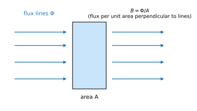

**Torque on a rectangular current loop in a uniform field.**

Take a rectangular loop of sides $a$ and $b$ carrying current $I$, pivoted so it can rotate about an axis through its centre and perpendicular to $\vec B$. Let the normal $\hat n$ of the loop (given by the right-hand rule on the current direction) make angle $\theta$ with $\vec B$.

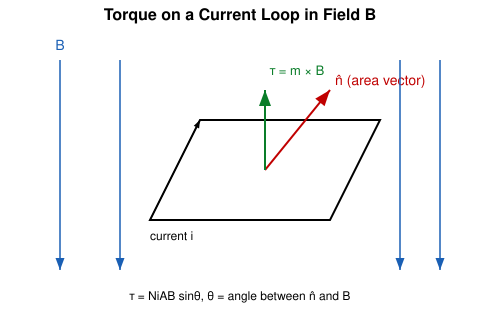

1. **Sides of length $b$** (the sides lying in the plane of the figure): the force on each is $F'=BIb\cos\theta$, directed **parallel to the axis of rotation**. The two forces are equal, opposite and collinear (both act along the axis), so they cancel and produce **no torque** (they only stretch the loop).
2. **Sides of length $a$** (perpendicular to $\vec B$): each experiences force
$$F=BIa\sin90^\circ=BIa,$$
equal and opposite in direction, but along different lines. They form a **couple**.
3. Perpendicular distance between the two lines of action: $b\sin\theta$.

$$\tau=F\times(b\sin\theta)=BIa\,b\sin\theta=BIA\sin\theta,\qquad A=ab$$

For a coil of $N$ turns, and with magnetic moment $m=NIA$:

$$\tau=NIAB\sin\theta\qquad\Longleftrightarrow\qquad \vec\tau=\vec m\times\vec B$$

**Discussion.**

* $\theta=90^\circ$ (plane of loop **parallel** to $\vec B$): $\tau_{max}=NIAB$.
* $\theta=0^\circ$ (plane perpendicular to $\vec B$): $\tau=0$, stable equilibrium.
* The result holds for a loop of any shape (area $A$), since any loop is a sum of small rectangles.
* **Application:** moving-coil galvanometer and DC motor.

### 3(c). Define Henry. A wire of length 10 cm carrying a current of 10 000 mA experiences a force of 5 N at an angle of 30° with a uniform magnetic field. Find the magnetic field.

**Henry (unit of inductance).** One henry is the inductance of a coil in which an emf of 1 volt is induced when the current through it changes at the rate of 1 ampere per second:

$$1\ \mathrm H=1\ \mathrm{V\,s\,A^{-1}}=1\ \mathrm{Wb\,A^{-1}}$$

**Numerical.**

*Given:* $l=10\ \mathrm{cm}=0.10\ \mathrm m$, $I=10\,000\ \mathrm{mA}=10\ \mathrm A$, $F=5\ \mathrm N$, $\theta=30^\circ$.

*Formula:* $F=BIl\sin\theta\Rightarrow B=\dfrac{F}{Il\sin\theta}$

$$B=\frac{5}{10\times0.10\times\sin30^\circ}=\frac{5}{10\times0.10\times0.5}=\frac{5}{0.5}=10\ \mathrm T$$

**Answer: $B=10\ \mathrm T$.**

---

## 2015 — Physics-II, Q4

### 4(b). What is hysteresis? State and explain the hysteresis curve of a magnetic material.

**Hysteresis.** When a ferromagnetic material is taken through a cycle of magnetisation, the flux density $B$ **lags behind** the magnetising field $H$. The word means "to lag behind". The $B$–$H$ graph for a full cycle is a closed loop, the **hysteresis loop**.

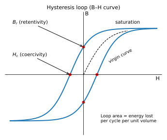

**Explanation of the curve** (starting from an unmagnetised specimen):

1. **Virgin (initial) curve:** as $H$ increases from zero, $B$ rises (domain walls move, domains rotate) and reaches **saturation** — all domains aligned.
2. **Retentivity (remanence) $B_r$:** when $H$ is reduced to zero, $B$ does **not** fall to zero; it falls only to $B_r$. The material retains magnetism.
3. **Coercivity $H_c$:** to bring $B$ to zero, a reverse field $H_c$ must be applied. $H_c$ is the **coercive force**.
4. Increasing the reverse field further drives the material to saturation in the opposite direction. Cycling $H$ back gives the symmetric lower half, completing the loop.

**Energy loss.** In each cycle, work per unit volume $\oint H\,dB$ is dissipated as heat; it equals the **area of the loop** (J m⁻³ per cycle). Hysteresis loss is therefore $P_h\propto f\times\text{loop area}$.

| Property | Soft iron | Steel |
|---|---|---|
| Loop | Narrow, small area | Wide, large area |
| Retentivity | High but easily lost | High |
| Coercivity | Low | High |
| Hysteresis loss | Small | Large |
| Use | Transformer cores, electromagnets, dynamo | Permanent magnets |

---

## 2016 — Physics-II, Q2

### 2(b). What is torque? Derive an expression for torque on a current-carrying loop.

* **Torque** = turning effect of force: $\vec\tau=\vec r\times\vec F$ (see [2015 Q2(a)(ii)](#c4-2015-q2a2)).
* **Torque on a current-carrying loop:** a loop of area $A$, $N$ turns, current $I$, whose normal makes angle $\theta$ with $\vec B$, feels equal and opposite forces $F=BIa$ on its two sides $a$ perpendicular to $\vec B$, separated by perpendicular distance $b\sin\theta$. Hence

$$\tau=BIa\cdot b\sin\theta=NIAB\sin\theta=mB\sin\theta\quad\Longrightarrow\quad\vec\tau=\vec m\times\vec B$$

Complete derivation with figure: [2015 Q3(b)](#c4-2015-q3b).

### 2(c)(i). Define magnetic induction.

Magnetic induction $B$ is the force per unit "current element" (or per unit moving charge) perpendicular to the field: $B=\dfrac{F}{Il\sin\theta}=\dfrac{F}{qv\sin\theta}$; unit tesla ($\mathrm{N\,A^{-1}\,m^{-1}}=\mathrm{Wb\,m^{-2}}$). See [2015 Q3(b)](#c4-2015-q3b).

---

## 2016 — Physics-II, Q4

### 4(a). State magnetic materials. Write down the classification of magnetic materials.

**Magnetic materials** are substances that become magnetised, i.e. acquire a magnetic moment, when placed in an external magnetic field. Their response is measured by the **magnetisation** $M$ (magnetic moment per unit volume), the **susceptibility** $\chi=M/H$ and the relative permeability $\mu_r=1+\chi$.

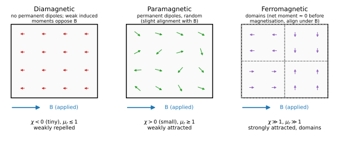

**Classification**

| | Diamagnetic | Paramagnetic | Ferromagnetic |
|---|---|---|---|
| Atomic dipoles | No permanent dipoles; weak induced dipoles opposite to $B$ | Permanent dipoles, randomly oriented | Permanent dipoles in **domains**, spontaneously aligned |
| Susceptibility $\chi$ | Small, negative ($\sim-10^{-5}$) | Small, positive ($\sim10^{-5}$–$10^{-3}$) | Large, positive ($\mu_r\sim10^{2}$–$10^{5}$) |
| In a non-uniform field | Weakly repelled | Weakly attracted | Strongly attracted |
| Temperature dependence | Independent of $T$ | $\chi=C/T$ (Curie law) | Becomes paramagnetic above Curie temperature $T_c$ |
| Examples | Bi, Cu, Ag, Au, water, N₂ | Al, Pt, Na, Mn, O₂ | Fe, Co, Ni, Gd, alnico |

Two further types: **antiferromagnetic** (neighbouring moments antiparallel, net zero, e.g. MnO) and **ferrimagnetic** (unequal antiparallel moments, net non-zero, e.g. ferrites).

### 4(c). What is Hall effect?

**Hall effect.** When a current-carrying conductor (or semiconductor) is placed in a magnetic field **perpendicular** to the current, a potential difference — the **Hall voltage** $V_H$ — appears across the conductor in the direction **perpendicular to both** the current and the field.

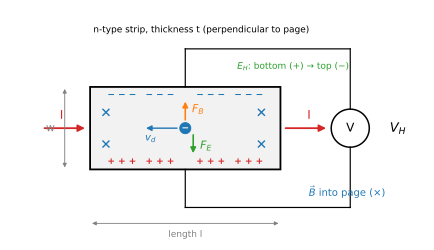

Result: $V_H=\dfrac{BI}{net}$, Hall coefficient $R_H=\dfrac{1}{ne}$. Full derivation: [2018 Q2(a)](#c4-2018-q2a).

---

## 2017 — Physics-II, Q3

### 3(a)(i). Define magnetic induction.

See [2015 Q3(b)](#c4-2015-q3b): $B=\dfrac{F}{Il\sin\theta}$, unit tesla ($1\ \mathrm T=1\ \mathrm{Wb\,m^{-2}}$).

### 3(b). Derive an expression for torque on a current-carrying loop.

Short form: $\tau=F\times\text{arm}=BIa\times b\sin\theta=NIAB\sin\theta$, i.e. $\vec\tau=\vec m\times\vec B$. Full derivation and figure in [2015 Q3(b)](#c4-2015-q3b).

---

## 2017 — Physics-II, Q4

### 4(a). Define magnetic induction and derive an equation for magnetic force on a moving charge in a magnetic field.

**Magnetic induction:** see [2015 Q3(b)](#c4-2015-q3b).

**Derivation.** A straight conductor of length $l$ and cross-section $A$ carries current $I$ in a field $B$ making angle $\theta$ with the conductor. Experiment gives the force on the conductor

$$F=BIl\sin\theta.$$

Let $n$ be the number of free charge carriers per unit volume, each of charge $q$ and drift velocity $v$. The current is $I=nqAv$. Substituting,

$$F=B\,(nqAv)\,l\sin\theta=(nAl)\,qvB\sin\theta.$$

The number of carriers in the length $l$ is $N=nAl$. The force on **one** carrier is therefore

$$F_q=\frac{F}{N}=qvB\sin\theta\qquad\Longrightarrow\qquad\vec F=q(\vec v\times\vec B)$$

direction: perpendicular to both $\vec v$ and $\vec B$ (right-hand screw rule from $\vec v$ to $\vec B$ for a positive charge; opposite for a negative charge). See the figure in [2015 Q3(a)](#c4-2015-q3a).

---

## 2018 — Physics-II, Q2

### 2(a). What is the Hall effect? Deduce the equation of Hall voltage.

**Hall effect.** Described in [2016 Q4(c)](#c4-2016-q4c).

**Derivation.** Consider a rectangular strip of width $w$ (along $y$), thickness $t$ (along $z$), carrying current $I$ along $x$ in a field $\vec B$ along $z$. Let the carriers be electrons (charge $-e$), $n$ per unit volume, drifting with velocity $v_d$ opposite to the current.

1. The magnetic force on each electron, $F_B=ev_dB$, pushes electrons towards one face (the top face in the figure). That face becomes negative, the opposite face positive.
2. This charge separation creates a transverse electric field $E_H$ (the **Hall field**) which exerts a force $F_E=eE_H$ opposing $F_B$.
3. Steady state is reached when the two forces balance:
$$eE_H=ev_dB\quad\Rightarrow\quad E_H=v_dB$$
4. Hall voltage across the width $w$:
$$V_H=E_Hw=v_dBw$$
5. The current is $I=n e v_d\,(wt)$, so $v_d=\dfrac{I}{newt}$. Hence

$$V_H=\frac{BI}{net}=R_H\frac{BI}{t},\qquad R_H=\frac1{ne}$$

**Uses.** (i) The sign of $V_H$ tells whether carriers are electrons (n-type) or holes (p-type). (ii) $n=\dfrac{BI}{eV_Ht}$ gives the carrier density. (iii) Measurement of $B$ (Hall probe/gaussmeter). (iv) Mobility $\mu=|R_H|\sigma$.

**Example.** A silicon strip $t=0.5\ \mathrm{mm}$, $I=10\ \mathrm{mA}$, $B=0.2\ \mathrm T$ gives $V_H=2\ \mathrm{mV}$; then $n=\dfrac{BI}{eV_Ht}=\dfrac{0.2\times10^{-2}}{1.6\times10^{-19}\times2\times10^{-3}\times0.5\times10^{-3}}\approx1.25\times10^{22}\ \mathrm{m^{-3}}$.

### 2(c). Define self-induction. A current-carrying loop of length 2.5 cm and width 1 cm carries a current of 4 A. It is placed parallel to a uniform magnetic field of 2 T. Calculate the torque of the loop.

**Self-induction.** The property of a coil by which it opposes any change of current through itself. When the current changes, the flux linked with the coil changes and an emf is induced in the **same** coil:

$$\varepsilon=-L\frac{dI}{dt},\qquad L=\frac{N\Phi}{I}$$

$L$ is the **self-inductance** (unit henry).

**Numerical.**

*Given:* $a=2.5\ \mathrm{cm}$, $b=1\ \mathrm{cm}$, so $A=2.5\times10^{-2}\times1\times10^{-2}=2.5\times10^{-4}\ \mathrm{m^2}$; $I=4\ \mathrm A$; $B=2\ \mathrm T$.
The loop lies **parallel** to the field, so its normal is perpendicular to $\vec B$: $\theta=90^\circ$ and the torque is maximum.

$$\tau=NIAB\sin\theta=1\times4\times2.5\times10^{-4}\times2\times\sin90^\circ=2\times10^{-3}\ \mathrm{N\,m}$$

**Answer: $\tau=2\times10^{-3}\ \mathrm{N\,m}$.**

---

## 2019 — Physics-II, Q2

### 2. Distinguish between diamagnetic, paramagnetic and ferromagnetic materials.

| Basis | Diamagnetic | Paramagnetic | Ferromagnetic |
|---|---|---|---|
| Cause | Induced dipoles (orbital motion changes) opposing $B$ | Alignment of existing permanent atomic dipoles | Parallel alignment of dipoles inside domains (exchange interaction) |
| Susceptibility $\chi$ | Negative, $\sim-10^{-5}$ | Positive, small | Positive, very large |
| Relative permeability | slightly $<1$ | slightly $>1$ | $\gg1$ |
| Behaviour in field | Weakly repelled from stronger field region | Weakly attracted | Strongly attracted |
| A freely suspended rod in a field | Sets **perpendicular** to field | Sets **parallel** to field | Sets parallel, strongly |
| Field lines | Slightly expelled | Slightly concentrated | Strongly concentrated |
| Temperature | $\chi$ independent of $T$ | $\chi=C/T$ | Becomes paramagnetic above $T_c$ (Fe 1043 K, Ni ≈ 627 K, Co ≈ 1388 K) |
| Hysteresis | None | None | Yes |
| Examples | Bi, Cu, Au, water | Al, Pt, O₂ | Fe, Co, Ni |

(See the figure under [2016 Q4(a)](#c4-2016-q4a).)

---

## 2020 — Physics-II, Q3

### 3(a). What is Hall effect? Deduce the equation of Hall voltage.

Answered in full in [2016 Q4(c)](#c4-2016-q4c) and [2018 Q2(a)](#c4-2018-q2a): $V_H=\dfrac{BI}{net}$, $R_H=\dfrac1{ne}$.

---

## 2021 — Physics-II, Q2

### 2(c). Calculate the self-inductance of a coil of 400 turns when a 2 A current creates $4\times10^{-4}$ Wb of flux.

*Given:* $N=400$, $I=2\ \mathrm A$, flux through each turn $\Phi=4\times10^{-4}\ \mathrm{Wb}$.

*Formula:* $L=\dfrac{N\Phi}{I}$

$$L=\frac{400\times4\times10^{-4}}{2}=\frac{0.16}{2}=0.08\ \mathrm H$$

**Answer: $L=0.08\ \mathrm H=80\ \mathrm{mH}$.**

(The same question appears again in Chapter 5 as 2016 Q3(c) and 2021 Q2(c).)

---

## 2021 — Physics-II, Q4

### 4(a). What is hysteresis? State and explain the hysteresis curve of a magnetic material.

Answered in full in [2015 Q4(b)](#c4-2015-q4b) (definition, loop, retentivity $B_r$, coercivity $H_c$, loop area = energy loss, soft iron vs steel).

---

## 2023 — Physics-II, Q2

### 2(a). What is Hall effect? Deduce the equation of Hall voltage.

See [2018 Q2(a)](#c4-2018-q2a): $V_H=BI/(net)$.

### 2(b). Derive an expression for torque on a current-carrying loop.

See [2015 Q3(b)](#c4-2015-q3b): $\tau=NIAB\sin\theta$.

### 2(c). A conductor of length 0.5 m is situated at an angle of 30° with a uniform magnetic field of 1.5 T. If 10 A current flows through the conductor, calculate the magnetic force acting on it.

*Given:* $l=0.5\ \mathrm m$, $\theta=30^\circ$, $B=1.5\ \mathrm T$, $I=10\ \mathrm A$.

$$F=BIl\sin\theta=1.5\times10\times0.5\times\sin30^\circ=1.5\times10\times0.5\times0.5=3.75\ \mathrm N$$

**Answer: $F=3.75\ \mathrm N$** (perpendicular to both the conductor and the field).

## 2023 — Physics-II, Q3

### 3(b). What is hysteresis? State and explain the hysteresis curve of a magnetic material.

See [2015 Q4(b)](#c4-2015-q4b).

---

# 5. Electromagnetic Induction, Inductance and AC

## 2015 — Physics-II, Q2

### 2(a)(i). Define choke coil.

**Choke coil.** A choke coil is an inductor of **large inductance and very small resistance**, usually a copper coil wound on a laminated soft-iron core, used to **reduce (choke) an alternating current without appreciable loss of power**.

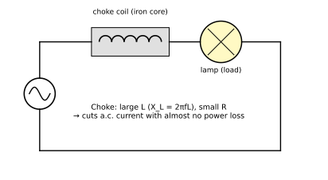

**Principle.** The opposition of an inductor to a.c. is the inductive reactance $X_L=\omega L=2\pi fL$, which is *wattless*: the average power in an ideal inductor is $P=E_{rms}I_{rms}\cos\phi\approx0$ since $\phi\approx90^\circ$. A series resistor would reduce the current equally but would waste power as $I^2R$ heat.

**Example.** $L=1\ \mathrm H$, $R=5\ \Omega$, $f=50\ \mathrm{Hz}$: $X_L=2\pi\times50\times1=314\ \Omega$, $Z=\sqrt{R^2+X_L^2}\approx314.04\ \Omega$, power factor $\cos\phi=R/Z=0.016$ — almost no power is consumed. **Uses:** tube-light ballast, radio-frequency chokes, dimmers.

---

## 2015 — Physics-II, Q3

### 3(a). Explain Faraday's law and Lenz's law.

(The magnetic-force part of this question is in [Chapter 4](#c4-2015-q3a).)

**Faraday's experiment.** A coil is connected to a galvanometer. When a bar magnet is moved towards or away from the coil, or the coil is moved, the galvanometer deflects. No deflection occurs when there is no relative motion.

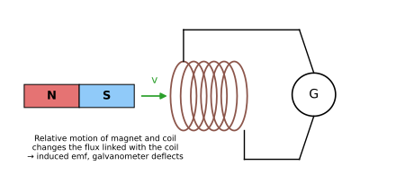

**Faraday's laws** — see the statements in [Q4(a)](#c5-2015-q4a) below:

1. Whenever the magnetic flux linked with a circuit changes, an emf is induced in it; it lasts only while the flux is changing.
2. The magnitude of the induced emf is equal to the rate of change of magnetic flux linkage: $\;\varepsilon=-N\dfrac{d\Phi}{dt}$.

**Lenz's law.** The direction of the induced current is always such that it **opposes the cause that produces it**. This is the meaning of the minus sign in Faraday's law. Explanation and proof of energy conservation: [Q4(c)](#c5-2015-q4c).

### 3(b). Derive an expression involving a current-carrying loop and magnetic induction.

This is the torque on a current-carrying loop: $\tau=NIAB\sin\theta$. Complete derivation: [Chapter 4, 2015 Q3(b)](#c4-2015-q3b).

---

## 2015 — Physics-II, Q4

### 4(a). State and explain Faraday's laws of electromagnetic induction.

**Magnetic flux.** $\Phi=\vec B\cdot\vec A=BA\cos\theta$ (unit weber, $1\ \mathrm{Wb}=1\ \mathrm{T\,m^2}$).

**First law.** Whenever the magnetic flux linked with a closed circuit changes, an emf is induced in the circuit; the emf (and the current if the circuit is closed) lasts only as long as the flux is changing.

**Second law.** The magnitude of the induced emf is directly proportional to the rate of change of magnetic flux linkage:

$$\varepsilon=-\frac{d(N\Phi)}{dt}=-N\frac{d\Phi}{dt}$$

(volt, with $\Phi$ in weber and $t$ in second). The negative sign expresses Lenz's law.

**Ways to change the flux** ($\Phi=BA\cos\theta$): (i) change $B$ (move magnet, change current in a nearby coil); (ii) change the area $A$ (sliding rod); (iii) change the orientation $\theta$ (rotating coil → a.c. generator).

**Example.** A coil of $N=100$ turns and area $0.01\ \mathrm{m^2}$ is held perpendicular to a field which grows uniformly from 0 to $0.5\ \mathrm T$ in $0.1\ \mathrm s$:
$$|\varepsilon|=N\frac{\Delta\Phi}{\Delta t}=100\times\frac{0.5\times0.01}{0.1}=5\ \mathrm V.$$

**Motional emf.** A rod of length $l$ moving with speed $v$ perpendicular to $B$ sweeps area $l v\,dt$ in time $dt$, so $\varepsilon=Blv$.

### 4(c). State Lenz's law. Show that the law obeys the principle of conservation of energy.

**Lenz's law.** The direction of an induced emf (or current) is such that its magnetic effect **opposes the change of flux** that produces it.

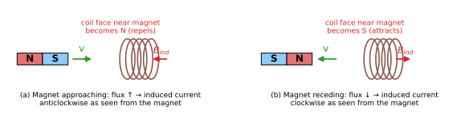

* Magnet's N-pole approaching a coil → flux through the coil increases → induced current makes the near face **N** (repels the magnet).
* Magnet receding → flux decreases → induced current makes the near face **S** (attracts the magnet, resisting its removal).

**Proof of conservation of energy.**

*Qualitative argument.* Suppose the opposite were true: on approaching the coil the N-pole induced a **S** pole (attractive). The magnet would be pulled in and speed up, increasing the flux change, producing a bigger current, hence an even stronger pull — the kinetic energy and the electrical energy would both increase with **no work done by us**. That creates energy from nothing and violates conservation of energy. Hence the induced effect must oppose the motion, and work has to be done against it; this mechanical work reappears as electrical energy (heat $I^2R$ in the coil).

*Quantitative check.* A rod of length $l$ slides with speed $v$ on rails in a perpendicular field $B$; the circuit resistance is $R$.

$$\varepsilon=Blv,\qquad I=\frac{Blv}{R}$$

The magnetic force on the rod is $F=BIl=\dfrac{B^2l^2v}{R}$ and, by Lenz's law, it opposes the motion. To keep the speed constant an external force $F$ must act, supplying mechanical power

$$P_{mech}=Fv=\frac{B^2l^2v^2}{R}.$$

The electrical power dissipated in the circuit is

$$P_{elec}=I^2R=\frac{B^2l^2v^2}{R}=P_{mech}.$$

Therefore mechanical work done = electrical energy produced: **energy is conserved.** If the force had aided the motion, $P_{elec}$ would be supplied for free — impossible. ∎

---

## 2016 — Physics-II, Q2

### 2(a). Write down Faraday's laws of electromagnetic induction.

1. **First law:** an emf is induced in a circuit whenever the flux linked with it changes.
2. **Second law:** the induced emf equals the (negative) rate of change of flux linkage, $\varepsilon=-N\,d\Phi/dt$.

Detailed explanation, ways of changing flux and example: [2015 Q4(a)](#c5-2015-q4a).

### 2(c)(ii). Define mutual induction.

**Mutual induction.** The phenomenon in which a change of current in one coil (primary) induces an emf in a neighbouring coil (secondary) because the changing flux of the first links with the second.

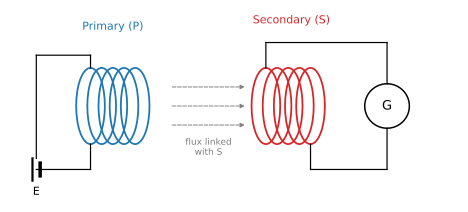

$$\varepsilon_2=-M\frac{dI_1}{dt},\qquad M=\frac{N_2\Phi_{21}}{I_1}$$

$M$ is the **mutual inductance** (unit henry). $1\ \mathrm H$ = emf of 1 V induced in the secondary when the primary current changes at 1 A s⁻¹. It depends on the geometry, the number of turns, the separation and the medium (core).

**Example.** $M=0.5\ \mathrm H$ and $I_1$ changes by $2\ \mathrm A$ in $0.1\ \mathrm s$: $|\varepsilon_2|=0.5\times\dfrac{2}{0.1}=10\ \mathrm V$. **Use:** transformers.

### 2(c)(iii). Define self-induction.

**Self-induction.** The property of a coil to oppose a change of current through itself; the changing current changes the flux linked with the coil itself and induces an emf in it (back emf):

$$\varepsilon=-L\frac{dI}{dt},\qquad L=\frac{N\Phi}{I}\;(\text{solenoid: }L=\mu_0\mu_r\frac{N^2A}{l})$$

**Example.** $L=2\ \mathrm H$; current falls from $3\ \mathrm A$ to $0$ in $0.05\ \mathrm s$: $|\varepsilon|=2\times\dfrac{3}{0.05}=120\ \mathrm V$ — this is why sparks appear at a switch.

---

## 2016 — Physics-II, Q3

### 3(c). Calculate the self-inductance of a coil of 400 turns when a 2 A current creates $4\times10^{-4}$ Wb of flux.

$L=\dfrac{N\Phi}{I}=\dfrac{400\times4\times10^{-4}}{2}=0.08\ \mathrm H$. **Answer: 0.08 H (80 mH).** (Worked in [Ch. 4, 2021 Q2(c)](#c4-2021-q2c).)

---

## 2016 — Physics-II, Q4

### 4(b). Describe an LR circuit and plot the growth and decay of current with time.

**LR circuit.** An inductor $L$ in series with a resistor $R$, a battery $E$ and a two-way switch $S$.

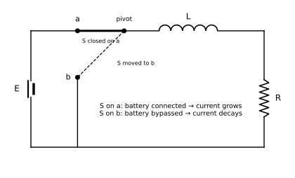

**Growth of current** ($S$ on $a$). At any instant the battery emf equals the sum of the potential drop across $R$ and the back emf in $L$:

$$E=iR+L\frac{di}{dt}\;\Rightarrow\;\frac{di}{E-iR}=\frac{dt}{L}$$

Integrating from $i=0$ at $t=0$:

$$-\frac1R\ln\!\left(\frac{E-iR}{E}\right)=\frac tL\;\Rightarrow\;i=\frac ER\left(1-e^{-Rt/L}\right)=I_0\left(1-e^{-t/\tau}\right)$$

where $I_0=E/R$ and **time constant** $\tau=L/R$ (the time in which the current rises to $63.2\%$ of its final value).

**Decay of current** ($S$ moved to $b$, battery removed; current $I_0$ at $t=0$):

$$L\frac{di}{dt}+iR=0\;\Rightarrow\;\frac{di}{i}=-\frac RL\,dt\;\Rightarrow\;i=I_0\,e^{-Rt/L}=I_0\,e^{-t/\tau}$$

The current falls to $36.8\%$ of $I_0$ in one time constant.

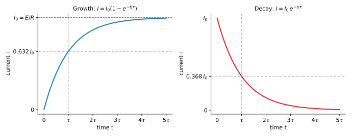

**Note.** Larger $L$ (or smaller $R$) means a longer $\tau$ and slower growth/decay. After $5\tau$ the current is within $1\%$ of its final value. **Example:** $L=2\ \mathrm H$, $R=10\ \Omega$: $\tau=0.2\ \mathrm s$.

---

## 2017 — Physics-II, Q3

### 3(c). Write down Faraday's law of electromagnetic induction.

An emf is induced in a circuit whenever the magnetic flux linked with it changes; its magnitude equals the rate of change of flux linkage: $\varepsilon=-N\,d\Phi/dt$. See [2015 Q4(a)](#c5-2015-q4a).

---

## 2017 — Physics-II, Q4

### 4(b). What is time constant? Discuss the charging process of an RC circuit.

**Time constant.** The characteristic time of an exponential process. For an RC circuit $\tau=RC$: the time in which the charge on a charging capacitor reaches $(1-1/e)=63.2\%$ of its final value, or the charge on a discharging capacitor falls to $1/e=36.8\%$ of its initial value. (For an LR circuit $\tau=L/R$.) Unit: second.

**Charging.** A capacitor $C$ (initially uncharged) is connected through resistor $R$ to battery $E$ by closing switch $S$.

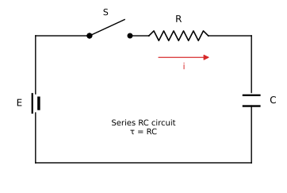

At any instant let the charge be $q$ and the current $i=dq/dt$. Kirchhoff's voltage law:

$$E=iR+\frac qC=R\frac{dq}{dt}+\frac qC\;\Rightarrow\;\frac{dq}{CE-q}=\frac{dt}{RC}$$

Integrating from $q=0$ at $t=0$:

$$-\ln\!\left(\frac{CE-q}{CE}\right)=\frac t{RC}\;\Rightarrow\;q=CE\left(1-e^{-t/RC}\right)=q_0\left(1-e^{-t/RC}\right)$$

with $q_0=CE$. Hence

$$i=\frac{dq}{dt}=\frac ER\,e^{-t/RC},\qquad V_C=\frac qC=E\left(1-e^{-t/RC}\right),\qquad V_R=E\,e^{-t/RC}$$

At $t=0$ the capacitor behaves like a short circuit ($i=E/R$); as $t\to\infty$ it acts as an open circuit ($i\to0$, $q\to CE$). For **discharging**, $q=q_0e^{-t/RC}$.

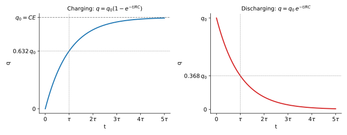

**Example.** $R=1\ \mathrm{M\Omega}$, $C=2\ \mu\mathrm F$: $\tau=RC=10^6\times2\times10^{-6}=2\ \mathrm s$; the capacitor reaches 63.2 % of $E$ in 2 s.

### 4(c). State Lenz's law. Show that the law obeys the principle of conservation of energy.

Answered in full in [2015 Q4(c)](#c5-2015-q4c): the induced current opposes the change of flux; had it aided the change, energy would be created from nothing. Quantitatively, for a sliding rod $P_{mech}=Fv=B^2l^2v^2/R=I^2R=P_{elec}$.

---

## 2018 — Physics-II, Q2

### 2(b). Show that Lenz's law follows the law of conservation of energy.

See [2015 Q4(c)](#c5-2015-q4c) (qualitative argument and the sliding-rod calculation $Fv=I^2R$).

---

## 2018 — Physics-II, Q4

### 4(a). Define the time constant of an RC circuit. Derive an equation for the charge of an RC circuit when the capacitor is charging.

$\tau=RC$ and $q=q_0\left(1-e^{-t/RC}\right)$, $q_0=CE$. Full derivation: [2017 Q4(b)](#c5-2017-q4b).

### 4(b). What is resonance? Deduce the equation of resonant frequency of an RLC circuit.

**Resonance.** A series LCR circuit driven by an a.c. source of variable frequency shows **resonance** when the frequency of the source equals the natural frequency of the circuit; the inductive and capacitive reactances become equal and cancel, the impedance is a minimum (equal to $R$) and the current amplitude is a maximum.

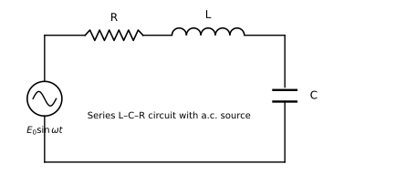

**Derivation.** Let $E=E_0\sin\omega t$ be applied to $R$, $L$ and $C$ in series. The current lags/leads the emf by the phase angle $\phi$, and the amplitudes obey

$$E_0=I_0Z,\qquad Z=\sqrt{R^2+\left(X_L-X_C\right)^2}=\sqrt{R^2+\left(\omega L-\frac1{\omega C}\right)^2}$$

The current amplitude $I_0=E_0/Z$ is maximum when $Z$ is minimum, i.e. when the bracket vanishes:

$$\omega_0L-\frac1{\omega_0C}=0\;\Rightarrow\;\omega_0^2=\frac1{LC}\;\Rightarrow\;\omega_0=\frac1{\sqrt{LC}},\qquad f_0=\frac1{2\pi\sqrt{LC}}$$

At resonance: $Z=R$, $I_{0,max}=E_0/R$, $\phi=0$ (current in phase with the emf), power factor $\cos\phi=1$, and voltage across $L$ and $C$ may greatly exceed $E_0$. The sharpness of resonance is measured by the quality factor $Q=\dfrac{\omega_0L}{R}=\dfrac1R\sqrt{\dfrac LC}$.

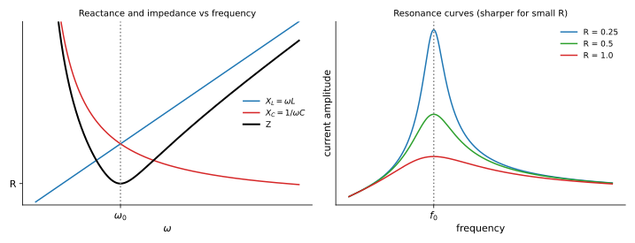

Smaller $R$ gives a taller, narrower peak. **Applications:** tuning of radio/TV receivers, band-pass filters.

### 4(c). An RLC circuit has an inductor of 50 µH, a capacitor of $5\times10^{-4}\ \mu$F and a resistor of 100 Ω. Find the frequency of the circuit.

*Given:* $L=50\ \mu\mathrm H=5\times10^{-5}\ \mathrm H$; $C=5\times10^{-4}\ \mu\mathrm F=5\times10^{-4}\times10^{-6}=5\times10^{-10}\ \mathrm F$; $R=100\ \Omega$.

*Formula:* $f_0=\dfrac1{2\pi\sqrt{LC}}$

$$LC=5\times10^{-5}\times5\times10^{-10}=2.5\times10^{-14}\;\Rightarrow\;\sqrt{LC}=1.581\times10^{-7}\ \mathrm s$$

$$f_0=\frac1{2\pi\times1.581\times10^{-7}}=\frac1{9.935\times10^{-7}}=1.007\times10^{6}\ \mathrm{Hz}$$

**Answer: $f_0\approx1.0\times10^{6}\ \mathrm{Hz}\approx1\ \mathrm{MHz}$.** (The resistance does not affect the resonant frequency; it only affects the peak height. The quality factor is $Q=\frac1R\sqrt{L/C}=\frac1{100}\sqrt{10^5}\approx3.2$.)

---

## 2020 — Physics-II, Q2

### 2(a). State Lenz's law of electromagnetic induction. Show that Lenz's law follows the law of conservation of energy.

See [2015 Q4(c)](#c5-2015-q4c).

### 2(b). Show that in an LR circuit, current increases exponentially.

Applying Kirchhoff's law, $E=iR+L\,di/dt$. Separating variables and integrating with $i(0)=0$:

$$\int_0^i\frac{di}{E-iR}=\int_0^t\frac{dt}{L}\;\Rightarrow\;\ln\frac{E}{E-iR}=\frac{Rt}{L}\;\Rightarrow\;i=\frac ER\left(1-e^{-Rt/L}\right)$$

Since $e^{-Rt/L}$ decreases exponentially with $t$, the current increases **exponentially** from $0$ toward the steady value $E/R$ (initial slope $di/dt=E/L$). It reaches $63.2\%$ of $E/R$ after $\tau=L/R$. Details and graph: [2016 Q4(b)](#c5-2016-q4b).

### 2(c). In an LR circuit with a source, the current reaches one-third of its maximum value within 5 seconds. Find the time constant of the circuit.

*Given:* $i=\dfrac13I_0$ at $t=5\ \mathrm s$ (growth).

$$\frac{i}{I_0}=1-e^{-t/\tau}=\frac13\;\Rightarrow\;e^{-t/\tau}=\frac23\;\Rightarrow\;\frac t\tau=\ln\frac32=0.4055$$

$$\tau=\frac{5}{0.4055}=12.33\ \mathrm s$$

**Answer: $\tau=L/R\approx12.3\ \mathrm s$.**

## 2020 — Physics-II, Q3

### 3(b). Describe an LR circuit and plot the growth and decay of current with time.

Answered in full, with circuit and curves, in [2016 Q4(b)](#c5-2016-q4b): growth $i=I_0(1-e^{-t/\tau})$, decay $i=I_0e^{-t/\tau}$, $\tau=L/R$.

---

## 2021 — Physics-II, Q2

### 2(a). Explain Faraday's law and Lenz's law.

See [2015 Q3(a)](#c5-2015-q3a) and [Q4(a)](#c5-2015-q4a): $\varepsilon=-N\,d\Phi/dt$; the induced current opposes the change of flux.

### 2(b). Show that Lenz's law obeys the principle of conservation of energy.

See [2015 Q4(c)](#c5-2015-q4c).

### 2(c). Calculate the self-inductance of a coil of 400 turns when a 2 A current creates $4\times10^{-4}$ Wb of flux.

$L=\dfrac{N\Phi}{I}=\dfrac{400\times4\times10^{-4}}{2}=0.08\ \mathrm H$. **Answer: 0.08 H.**

---

## 2021 — Physics-II, Q4

### 4(b). Draw the curves for growth and decay of current in an LR circuit and explain the diagram.

*Left (growth):* on closing the switch the current rises from zero with initial slope $E/L$; it reaches $0.632I_0$ at $t=\tau$, $0.865I_0$ at $2\tau$, $0.95I_0$ at $3\tau$ and effectively $I_0=E/R$ after about $5\tau$. The inductor's back emf delays the rise.  
*Right (decay):* when the battery is removed, the energy stored in the inductor ($\tfrac12LI_0^2$) drives the current, which falls exponentially: $0.368I_0$ at $\tau$, $0.135I_0$ at $2\tau$, $0.05I_0$ at $3\tau$. See [2016 Q4(b)](#c5-2016-q4b) for the derivation.

### 4(c). An LR circuit has an inductance of 50 H and a resistance of 30 Ω. It is connected to a 100 V battery. How long will it take for the current to reach one-half of its final value?

*Given:* $L=50\ \mathrm H$, $R=30\ \Omega$, $E=100\ \mathrm V$; final current $I_0=E/R=3.33\ \mathrm A$.

$$\tau=\frac LR=\frac{50}{30}=1.667\ \mathrm s$$

$$i=\frac{I_0}2\;\Rightarrow\;1-e^{-t/\tau}=\frac12\;\Rightarrow\;e^{-t/\tau}=\frac12\;\Rightarrow\;t=\tau\ln2=1.667\times0.693=1.155\ \mathrm s$$

**Answer: $t\approx1.16\ \mathrm s$** (when $i=1.67\ \mathrm A$).

---

## 2023 — Physics-II, Q3

### 3(a). State and explain Faraday's law of electromagnetic induction.

See [2015 Q4(a)](#c5-2015-q4a): flux change induces emf; $\varepsilon=-N\,d\Phi/dt$; first law, second law, example $5\ \mathrm V$.

### 3(c). State Lenz's law. Explain how Lenz's law indicates the direction of induced current.

**Statement.** The induced current flows in the direction that opposes the change in magnetic flux that causes it.

**Rule for the direction (four steps).**

1. Find the direction of the **original** flux through the loop.
2. Decide whether this flux is **increasing or decreasing**.
3. The induced current produces its own field $B_{ind}$: **opposite** to the original field if flux is *increasing*, **in the same direction** if flux is *decreasing*.
4. Use the right-hand grip rule to find the current direction that gives $B_{ind}$.

**Worked illustration.** The N-pole of a magnet approaches a coil → flux through the coil (directed away from the magnet) increases → $B_{ind}$ points towards the magnet → the face of the coil nearest the magnet becomes N → the current is **anticlockwise** as seen from the magnet. When the magnet is withdrawn, the flux decreases → $B_{ind}$ is in the same direction as the original → the near face becomes S → **clockwise** current. The coil thus always resists the magnet's motion.

---

## 2023 — Physics-II, Q4

### 4(a). Define the time constant of an RC circuit. Derive an equation for the charge of an RC circuit when the capacitor is charging.

$\tau=RC$; $q=q_0\left(1-e^{-t/RC}\right)$ with $q_0=CE$. Derivation and curves: [2017 Q4(b)](#c5-2017-q4b).

### 4(b). What is resonance? Deduce the equation of resonant frequency of an RLC circuit.

$f_0=\dfrac1{2\pi\sqrt{LC}}$ (at $X_L=X_C$, $Z=R$, current maximum). Derivation and resonance curve: [2018 Q4(b)](#c5-2018-q4b).

### 4(c). An RLC circuit has an inductor of 50 µH, a capacitor of $5\times10^{-4}\ \mu$F and a resistor of 100 Ω. Find the frequency of the circuit.

$f_0=\dfrac1{2\pi\sqrt{5\times10^{-5}\times5\times10^{-10}}}=1.007\times10^{6}\ \mathrm{Hz}\approx1\ \mathrm{MHz}$ (full calculation under [2018 Q4(c)](#c5-2018-q4b)).

---

# Formula summary

| Topic | Formula |
|---|---|
| Force on moving charge | $\vec F=q\vec v\times\vec B$; $r=mv/qB$ |
| Force on a conductor | $F=BIl\sin\theta$ |
| Torque on a loop | $\tau=NIAB\sin\theta=mB\sin\theta$ |
| Hall voltage | $V_H=\dfrac{BI}{net}$, $R_H=\dfrac1{ne}$ |
| Faraday's law | $\varepsilon=-N\dfrac{d\Phi}{dt}$ |
| Motional emf | $\varepsilon=Blv$ |
| Self / mutual inductance | $L=\dfrac{N\Phi}{I}$, $\varepsilon=-L\dfrac{dI}{dt}$; $\varepsilon_2=-M\dfrac{dI_1}{dt}$ |
| LR circuit | $i=I_0(1-e^{-t/\tau})$, $i=I_0e^{-t/\tau}$, $\tau=L/R$ |
| RC circuit | $q=q_0(1-e^{-t/\tau})$, $q=q_0e^{-t/\tau}$, $\tau=RC$ |
| Series LCR | $Z=\sqrt{R^2+(\omega L-1/\omega C)^2}$, $f_0=\dfrac1{2\pi\sqrt{LC}}$, $Q=\dfrac{\omega_0L}R$ |
