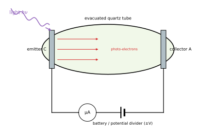
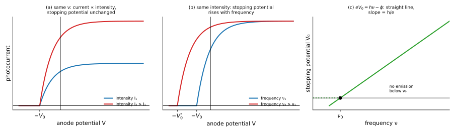
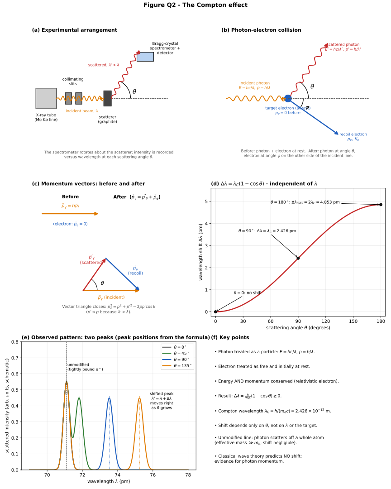

# PHY-103 (Physics-II) — Quantum and Modern Physics
### Solved Previous Questions 2015 – 2023 (BUTEX, B.Sc. in Textile Engineering)

> **File:** `phy-103-modern-physics-2015-2023-ques-solve-v261102-0.md`  
> **Covers:** Chapter 9 (Quantum and Modern Physics) — photoelectric effect, Einstein's equation, photon, Compton effect — every sub-question, in the order of the question bank.  
> **Thermal-radiation questions** (black body, Stefan–Boltzmann law, Kirchhoff's law; Chapter 8 of the bank) are answered in `phy-103-thermodynamics-2015-2023-ques-solve-v261102-0.md`.  
> **Figures:** SVG files linked from `../../assets/`.

**Constants:** $h=6.625\times10^{-34}\ \mathrm{J\,s}$ (as in the 2020 paper), $c=3\times10^8\ \mathrm{m\,s^{-1}}$, $e=1.6\times10^{-19}\ \mathrm C$, $1\ \mathrm{eV}=1.6\times10^{-19}\ \mathrm J$, $m_0=9.11\times10^{-31}\ \mathrm{kg}$.

## Contents

| Year | Questions |
|---|---|
| [2015](#y2015) | Q8(c) |
| [2016](#y2016) | Q6(a) |
| [2017](#y2017) | Q8(b), Q8(c) |
| [2020](#y2020) | Q8(a), Q8(b), Q8(c) |
| [2021](#y2021) | Q6(b), Q6(c) |
| [2022](#y2022) | Q8(a), Q8(b) |

---

## 2015 — Physics-II, Q8

### 8(c). What is photoelectric effect? Derive Einstein's photoelectric equation.

**Photoelectric effect.** The emission of electrons from the surface of a metal when light (or other electromagnetic radiation) of sufficiently high frequency falls on it. The emitted electrons are called **photoelectrons**.

**Experimental facts**

1. For each metal there is a **threshold frequency $\nu_0$** (threshold wavelength $\lambda_0$); below it no electrons are emitted however intense the light.
2. For $\nu>\nu_0$ emission is **instantaneous** (delay $<10^{-9}\ \mathrm s$), even for very dim light.
3. The photocurrent (number of photoelectrons per second) is **proportional to the intensity** of the light.
4. The maximum kinetic energy of the photoelectrons **depends on the frequency**, increases linearly with it, and is **independent of the intensity**.
5. A retarding potential $V_0$ (the **stopping potential**) just stops the fastest electrons: $\tfrac12mv_{max}^2=eV_0$.

**Failure of the wave theory.** Classical wave theory predicts that energy depends on intensity, that any frequency should work if the light is intense enough, and that a dim light needs a time lag to accumulate energy; all three disagree with experiment.

**Einstein's theory (1905).** 

1. Light consists of discrete packets of energy, **photons**, each of energy $E=h\nu$ ($h$ = Planck's constant).
2. One photon interacts with **one** electron and transfers all its energy to it in a single event.
3. Part of this energy, the **work function $\phi$** (minimum energy needed to remove an electron from the metal; $\phi=h\nu_0$), is spent in escaping; the rest appears as kinetic energy.

**Energy balance (Einstein's photoelectric equation):**

$$h\nu=\phi+\tfrac12mv_{max}^2\qquad\text{or}\qquad\tfrac12mv_{max}^2=h(\nu-\nu_0)$$

Since $\tfrac12mv_{max}^2=eV_0$:

$$V_0=\frac he\,(\nu-\nu_0)$$

**Explanation of the facts.**

* No emission if $\nu<\nu_0$: the photon energy $h\nu<\phi$.
* Instantaneous emission: single photon–electron interaction.
* Current $\propto$ intensity: intensity $=$ number of photons per second; more photons eject more electrons.
* $K_{max}$ depends on $\nu$ only: $K_{max}=h\nu-\phi$.
* The graph of $V_0$ against $\nu$ is a straight line with slope $h/e$ and intercept at $\nu_0$ (Millikan's verification).

**Example.** Light of wavelength $400\ \mathrm{nm}$ falls on a metal with $\phi=2.0\ \mathrm{eV}$: $E=\dfrac{hc}\lambda=\dfrac{1240}{400}=3.1\ \mathrm{eV}$, so $K_{max}=1.1\ \mathrm{eV}$ and $V_0=1.1\ \mathrm V$.

---

## 2016 — Physics-II, Q6

### 6(a). What is photoelectric effect? Derive an expression for Einstein's photoelectric equation.

See [2015 Q8(c)](#m-2015-q8c): $h\nu=\phi+\tfrac12mv_{max}^2$, i.e. $eV_0=h(\nu-\nu_0)$.

---

## 2017 — Physics-II, Q8

### 8(b). What is photoelectric effect? Derive Einstein's photoelectric effect equation.

See [2015 Q8(c)](#m-2015-q8c).

### 8(c). What is the Compton effect? Show that $\lambda'-\lambda=\lambda_C(1-\cos\phi)$.

(The printed symbol $\lambda_f$ is the Compton wavelength $\lambda_C=h/m_0c$.)

**Compton effect.** When a monochromatic X-ray (or $\gamma$-ray) beam is scattered by a light, loosely bound electron, the scattered radiation contains, besides the original wavelength $\lambda$, a longer wavelength $\lambda'$. The increase $\Delta\lambda=\lambda'-\lambda$ depends only on the scattering angle $\phi$, not on $\lambda$ or on the scatterer. It confirms the particle (photon) nature of radiation: the photon behaves like a particle with energy $h\nu$ and momentum $h/\lambda$ undergoing an elastic collision with an electron.

**Derivation.** A photon of energy $h\nu$ and momentum $h\nu/c$ strikes a free electron at rest (rest mass $m_0$). After the collision the photon has $h\nu'$ at angle $\phi$ and the electron recoils with velocity $v$ (mass $m=m_0/\sqrt{1-v^2/c^2}$) at angle $\theta$.

*Conservation of energy:*
$$h\nu+m_0c^2=h\nu'+mc^2\quad(1)$$

*Conservation of momentum:*
$$\text{along incident direction: }\frac{h\nu}c=\frac{h\nu'}c\cos\phi+mv\cos\theta\quad(2)$$
$$\text{perpendicular: }0=\frac{h\nu'}c\sin\phi-mv\sin\theta\quad(3)$$

Eliminate $\theta$: from (2) and (3) (multiply by $c$ and square-add)
$$m^2v^2c^2=(h\nu-h\nu'\cos\phi)^2+(h\nu'\sin\phi)^2=h^2\nu^2-2h^2\nu\nu'\cos\phi+h^2\nu'^2\quad(4)$$

From (1): $mc^2=h(\nu-\nu')+m_0c^2$; squaring,
$$m^2c^4=h^2(\nu-\nu')^2+2m_0c^2h(\nu-\nu')+m_0^2c^4\quad(5)$$

The relativistic mass satisfies $m^2c^4-m^2v^2c^2=m_0^2c^4$. Subtract (4) from (5):
$$h^2(\nu-\nu')^2+2m_0c^2h(\nu-\nu')+m_0^2c^4-\left[h^2\nu^2-2h^2\nu\nu'\cos\phi+h^2\nu'^2\right]=m_0^2c^4$$

Expanding and cancelling:
$$-2h^2\nu\nu'+2h^2\nu\nu'\cos\phi+2m_0c^2h(\nu-\nu')=0\;\Rightarrow\;m_0c^2(\nu-\nu')=h\nu\nu'(1-\cos\phi)$$

Divide by $\nu\nu'$ and use $c/\nu=\lambda$:
$$m_0c^2\left(\frac1{\nu'}-\frac1\nu\right)=h(1-\cos\phi)\;\Rightarrow\;m_0c\,(\lambda'-\lambda)=h(1-\cos\phi)$$

$$\lambda'-\lambda=\frac h{m_0c}\,(1-\cos\phi)=\lambda_C(1-\cos\phi)\qquad\blacksquare$$

**Compton wavelength:** $\lambda_C=\dfrac h{m_0c}=\dfrac{6.63\times10^{-34}}{9.11\times10^{-31}\times3\times10^8}=2.43\times10^{-12}\ \mathrm m$.

**Discussion.** $\Delta\lambda=0$ at $\phi=0$; $\Delta\lambda=\lambda_C$ at $90^\circ$; maximum $2\lambda_C=4.86\ \mathrm{pm}$ at $180^\circ$ (back-scattering). The shift is noticeable only for X-rays/$\gamma$-rays (small $\lambda$). **Example:** Mo K$\alpha$ X-rays ($0.0709\ \mathrm{nm}$) scattered at $90^\circ$ give $\lambda'=0.0709+0.00243=0.0733\ \mathrm{nm}$.

---

## 2020 — Physics-II, Q8

### 8(a). Is the photoelectric effect a consequence of the wave character or the particle character of radiation? Explain briefly.

It is a consequence of the **particle (photon) character**. The wave theory cannot account for the observations:

| Observation | Wave theory predicts | Photon theory explains |
|---|---|---|
| Threshold frequency $\nu_0$ | Any frequency should work if intense enough | A photon must have $h\nu\ge\phi$ |
| $K_{max}$ independent of intensity, increases with $\nu$ | $K_{max}$ should increase with intensity | $K_{max}=h\nu-\phi$ |
| Instantaneous emission | Time lag to build up energy | One photon gives all its energy at once |
| Current $\propto$ intensity | Yes | Intensity $\propto$ number of photons |

Hence the photoelectric effect demonstrates that light is absorbed in quanta $h\nu$ (while interference and diffraction show its wave character: the *dual nature* of light). See graphs in [2015 Q8(c)](#m-2015-q8c).

### 8(b). Explain the photoelectric effect and establish Einstein's photoelectric equation.

See [2015 Q8(c)](#m-2015-q8c).

### 8(c). Calculate the work function of sodium, in electron volts, given that the threshold wavelength is 6800 Å and $h=6.625\times10^{-34}$ J s.

*Given:* $\lambda_0=6800\ \text{\AA}=6.8\times10^{-7}\ \mathrm m$, $h=6.625\times10^{-34}\ \mathrm{J\,s}$, $c=3\times10^8\ \mathrm{m\,s^{-1}}$.

*Formula:* $\phi=h\nu_0=\dfrac{hc}{\lambda_0}$

$$\phi=\frac{6.625\times10^{-34}\times3\times10^8}{6.8\times10^{-7}}=2.923\times10^{-19}\ \mathrm J=\frac{2.923\times10^{-19}}{1.6\times10^{-19}}\ \mathrm{eV}=1.83\ \mathrm{eV}$$

**Answer: $\phi\approx1.83\ \mathrm{eV}$.**

---

## 2021 — Physics-II, Q6

### 6(b). What is a photon? Derive Einstein's photoelectric effect equation.

**Photon.** The quantum (packet) of electromagnetic radiation. Properties:

* Energy $E=h\nu=\dfrac{hc}\lambda$; momentum $p=\dfrac E c=\dfrac h\lambda$.
* Rest mass zero; speed $c$ in vacuum; electrically neutral.
* Not deflected by electric or magnetic fields; can be absorbed or created in interactions.
* Intensity of light $=$ (number of photons per unit area per second) $\times h\nu$.

The derivation of Einstein's equation $h\nu=\phi+\tfrac12mv_{max}^2$ is in [2015 Q8(c)](#m-2015-q8c).

### 6(c). Calculate the work function of sodium in electron volts where the threshold wavelength is 6800 Å and Planck's constant is $6.663\times10^{-34}$ J s.

*Given (as printed):* $h=6.663\times10^{-34}\ \mathrm{J\,s}$ (the accepted value is $6.626\times10^{-34}$), $\lambda_0=6.8\times10^{-7}\ \mathrm m$.

$$\phi=\frac{hc}{\lambda_0}=\frac{6.663\times10^{-34}\times3\times10^8}{6.8\times10^{-7}}=2.94\times10^{-19}\ \mathrm J=\frac{2.94\times10^{-19}}{1.6\times10^{-19}}=1.84\ \mathrm{eV}$$

**Answer: $\phi\approx1.84\ \mathrm{eV}$.**

---

## 2022 — Physics-II, Q8

### 8(a). What is photoelectric effect? Derive Einstein's photoelectric equation.

See [2015 Q8(c)](#m-2015-q8c).

### 8(b). What is Compton effect? Describe the process.

**Compton effect.** The increase in wavelength of X-rays (or $\gamma$-rays) when they are scattered by free or loosely bound electrons.

**The process (photon–electron collision).**

1. A photon of energy $h\nu=hc/\lambda$ and momentum $h/\lambda$ strikes an electron at rest.
2. It transfers part of its energy and momentum to the electron, which recoils with kinetic energy $K=h\nu-h\nu'$.
3. The photon is scattered through an angle $\phi$ with reduced energy $h\nu'$, i.e. a longer wavelength $\lambda'$.
4. Energy and momentum are both conserved (an elastic collision between two particles).

**Result:** $\lambda'-\lambda=\dfrac h{m_0c}(1-\cos\phi)$ (derivation in [2017 Q8(c)](#m-2017-q8c)); the shift depends only on $\phi$; $\lambda_C=2.43\ \mathrm{pm}$.

**Observations:** at each angle two lines appear — the *modified* line ($\lambda'$, scattering from nearly free electrons) and the *unmodified* line ($\lambda$, scattering from tightly bound electrons for which the effective mass is that of the whole atom, so $\Delta\lambda\approx0$). **Significance:** the classical (Thomson) wave theory predicts no change in wavelength; Compton scattering is direct proof that photons carry momentum $h/\lambda$.

---

# Formula summary

| Topic | Formula |
|---|---|
| Photon | $E=h\nu=hc/\lambda$, $p=h/\lambda$ |
| Einstein's equation | $h\nu=\phi+\tfrac12mv_{max}^2$, $\phi=h\nu_0=hc/\lambda_0$ |
| Stopping potential | $eV_0=h(\nu-\nu_0)$; slope of $V_0$–$\nu$ graph $=h/e$ |
| Compton shift | $\Delta\lambda=\dfrac h{m_0c}(1-\cos\phi)$, $\lambda_C=2.43\times10^{-12}\ \mathrm m$ |
| Useful | $hc=1240\ \mathrm{eV\,nm}$ |
