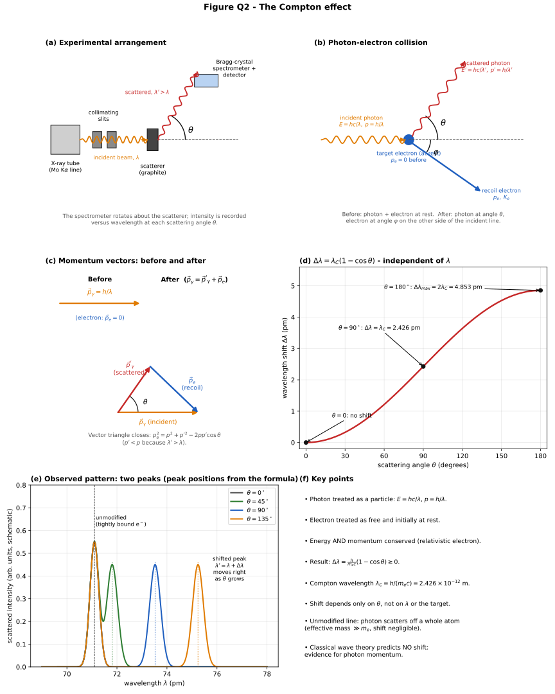
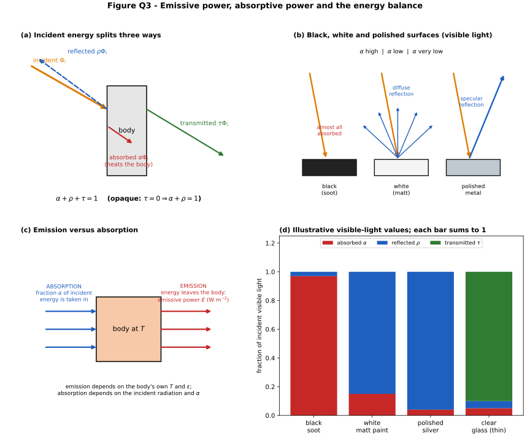
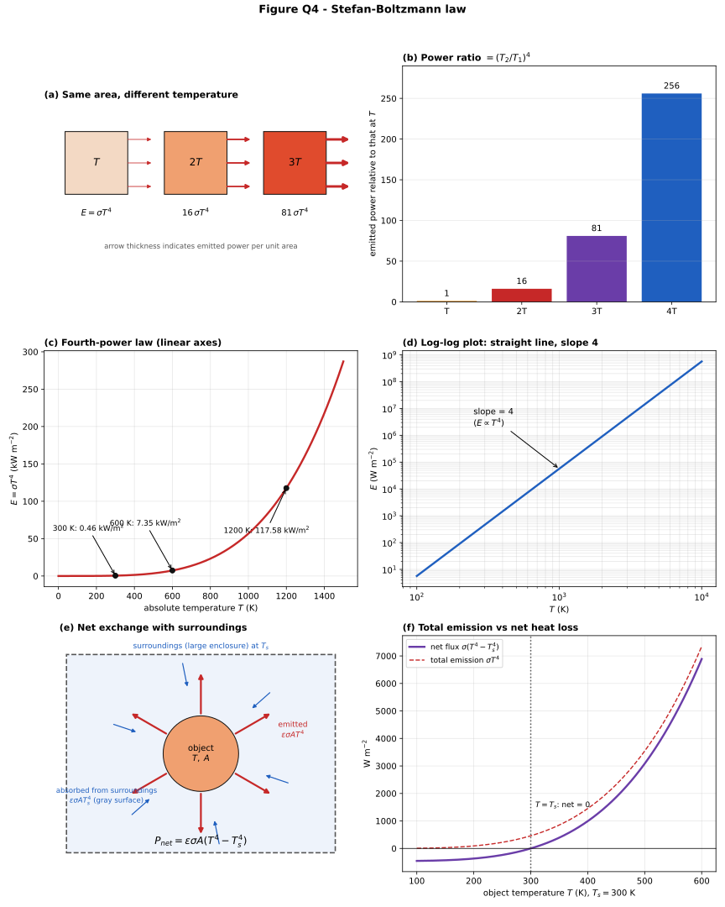
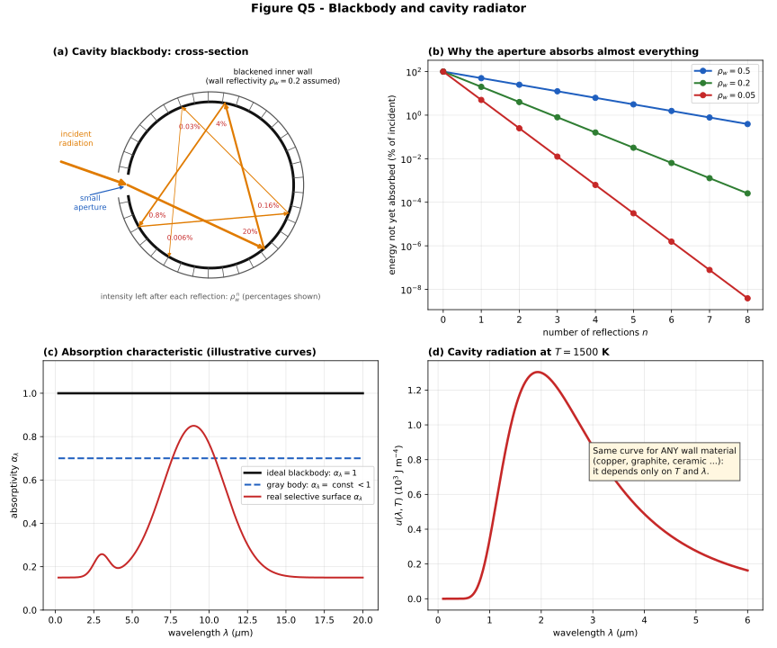
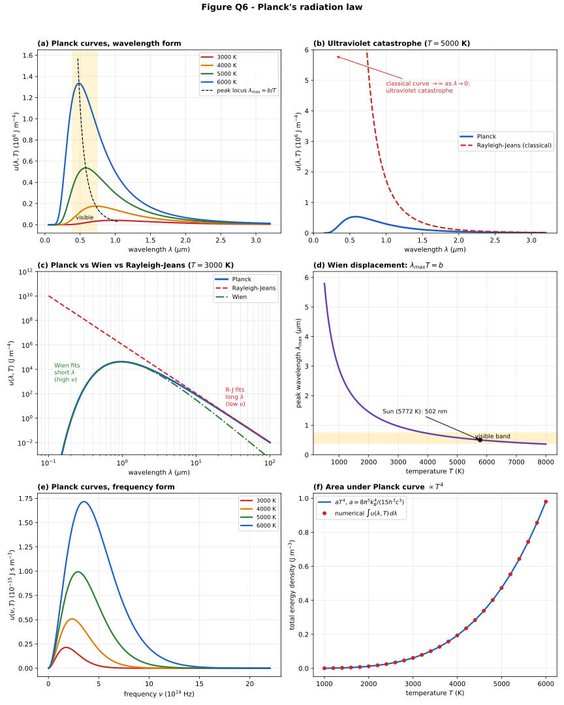
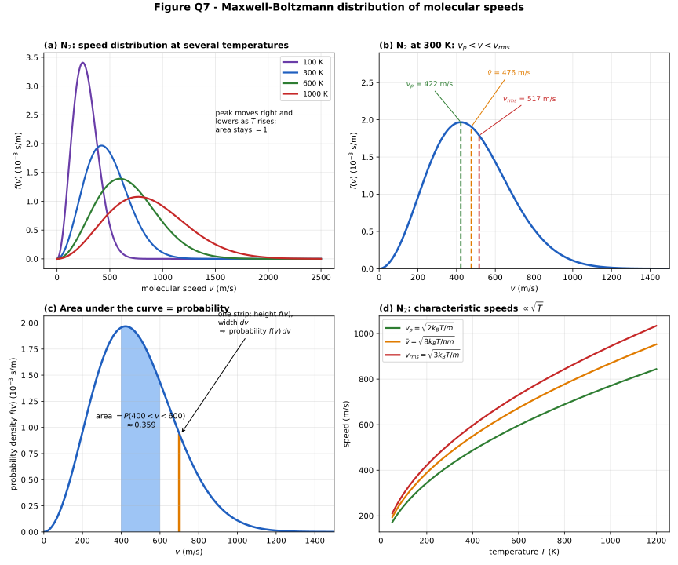
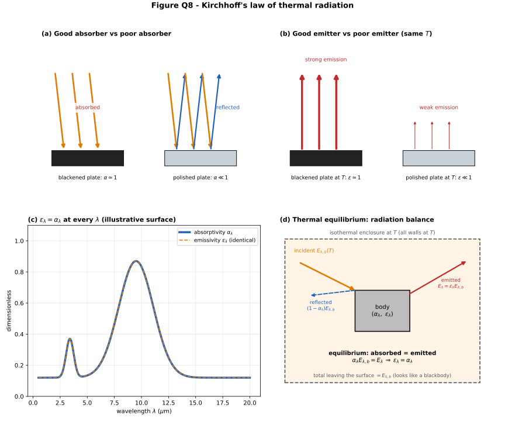

# Modern Physics: Comprehensive Exam Revision Guide

> **Audience:** undergraduate engineering students preparing for a written university examination.
> **Scope:** photoelectric effect, Compton effect, emissive and absorptive power, Stefan–Boltzmann law, blackbody, Planck's radiation law, Maxwell's distribution law, Kirchhoff's law of thermal radiation.
> **Conventions:** SI units throughout; $`h`$ Planck constant, $`c`$ speed of light, $`k_B`$ Boltzmann constant, $`\nu`$ frequency (Hz, not angular), $`\lambda`$ wavelength, $`T`$ absolute temperature (kelvin).

## Table of Contents

1. [Learning Objectives](#learning-objectives)
2. [Q1. Photoelectric Effect](#q1-photoelectric-effect)
3. [Q2. Compton Effect](#q2-compton-effect)
4. [Q3. Emissive Power and Absorptive Power](#q3-emissive-power-and-absorptive-power)
5. [Q4. Stefan–Boltzmann Law](#q4-stefanboltzmann-law)
6. [Q5. Blackbody](#q5-blackbody)
7. [Q6. Planck's Radiation Law](#q6-plancks-radiation-law)
8. [Q7. Maxwell's Distribution Law](#q7-maxwells-distribution-law)
9. [Q8. Kirchhoff's Law of Thermal Radiation](#q8-kirchhoffs-law-of-thermal-radiation)
10. [Consolidated Formula Sheet](#consolidated-formula-sheet)
11. [Important Definitions](#important-definitions)
12. [Physical Constants](#physical-constants)
13. [Comparison Tables](#comparison-tables)
14. [Common Examination Mistakes](#common-examination-mistakes)
15. [Additional Practice Questions with Worked Solutions](#additional-practice-questions-with-worked-solutions)
16. [Scientific Clarifications](#scientific-clarifications)
17. [References](#references)

---

## Learning Objectives

After working through this guide you should be able to:

- State and explain the photoelectric effect and derive Einstein's equation, including the stopping-potential relation.
- Derive the Compton shift from relativistic energy and momentum conservation.
- Define emissive power, absorptive power, reflectivity and transmissivity, and apply $`\alpha+\rho+\tau=1`$.
- State the Stefan–Boltzmann law, distinguish total emission from net radiative loss, and handle emissivity.
- Describe an ideal blackbody and the cavity radiator.
- Derive Planck's law (frequency and wavelength forms), its two classical limits, Wien's displacement law and the Stefan–Boltzmann law.
- Derive the Maxwell–Boltzmann speed distribution and the three characteristic speeds.
- State Kirchhoff's law with its conditions and explain why a good absorber is a good emitter.

> **Figures.** Each question has one multi-panel SVG in `../../assets/`. The graphs are computed from the stated equations (not hand-drawn), with the parameters given in the captions.

---

## Q1. Photoelectric Effect

**Original Question:** *What is the photoelectric effect? Derive Einstein's photoelectric equation.*

### 1. Introduction

When light of suitable frequency falls on a metal surface, electrons are ejected. Hertz observed the effect in 1887; its features contradicted classical wave theory, and Einstein (1905) explained it by treating light as quanta (photons).

### 2. Definition

> **Photoelectric effect:** the emission of electrons from a material surface when electromagnetic radiation of sufficiently high frequency is incident on it. The emitted electrons are called **photoelectrons**.

### 3. Experimental Arrangement and Working Principle

A photoelectric cell is an evacuated tube with a quartz window (quartz transmits ultraviolet). It contains an **emitter** (photocathode, a clean metal plate) and a **collector** (anode). A variable supply with reversible polarity and a micro-ammeter are connected externally.


*Caption: Figure Q1, panels (a)–(f). Panel (c) uses an illustrative metal with $`\phi=2.28`$ eV; the slope is exactly $`h/e`$.*

**Working.** Monochromatic light falls on the emitter. Photoelectrons reach the collector and the ammeter registers a photocurrent $`I`$. Making the collector positive collects more electrons until **saturation** (all emitted electrons collected). Reversing the polarity repels electrons; the current falls and becomes zero at the **stopping potential** $`V_s`$.

### 4. Experimental Observations (Laws of Photoelectric Emission)

1. **Threshold frequency:** for every metal there is a minimum frequency $`\nu_0`$; below it no emission occurs, however intense the light.
2. **Instantaneous emission:** emission begins essentially at once (delay below about $`10^{-9}`$ s) even at very low intensity.
3. **Saturation current $`\propto`$ intensity** (for $`\nu>\nu_0`$): the number of photoelectrons per second is proportional to the light intensity.
4. **$`K_{\max}`$ independent of intensity:** the maximum kinetic energy (equivalently $`V_s`$) does not change when intensity changes.
5. **$`K_{\max}`$ increases linearly with frequency** and is zero at $`\nu_0`$.

**Why classical wave theory fails.** A wave would transfer energy continuously: (i) $`K_{\max}`$ should grow with intensity; (ii) emission should occur at any frequency given enough intensity; (iii) a measurable delay is expected while the electron accumulates energy. All three contradict observation.

### 5. Theory: Photons, Work Function, Threshold Frequency

- **Photon theory (Einstein, 1905):** light of frequency $`\nu`$ consists of quanta each of energy
```math
E=h\nu
```
  A photon is absorbed entirely by one electron in an all-or-nothing event; an electron does not accumulate energy from many photons.
- **Work function $`\phi`$:** the minimum energy needed to remove an electron from the metal surface (from the least tightly bound electrons).
- **Threshold frequency $`\nu_0`$:** the frequency whose photon energy equals the work function:
```math
h\nu_0=\phi\quad\Longrightarrow\quad \nu_0=\frac{\phi}{h},\qquad \lambda_0=\frac{hc}{\phi}
```

### 6. Mathematical Derivation of Einstein's Equation

**Step 1 (energy of the photon).** One photon carries $`h\nu`$.

**Step 2 (absorption).** It is absorbed by a single electron, which gains $`h\nu`$.

**Step 3 (energy conservation).** Part of this energy pays for escape from the metal; the remainder appears as kinetic energy:
```math
h\nu=\phi+K
```
**Step 4 (maximum kinetic energy).** An electron at the top of the occupied levels loses the least energy before leaving, so it emerges with the largest kinetic energy $`K_{\max}`$. Electrons from deeper levels lose additional energy and emerge slower. Hence
```math
\boxed{\,h\nu=\phi+K_{\max}\,}
```
**Step 5 (use of threshold).** At $`\nu=\nu_0`$ the electron just escapes with $`K_{\max}=0`$, so $`\phi=h\nu_0`$:
```math
h\nu=h\nu_0+\tfrac{1}{2}m v_{\max}^{2}
```
which is the non-relativistic form ($`K_{\max}=\tfrac12 m v_{\max}^2`$ valid when $`K_{\max}\ll m_ec^2=511`$ keV; here $`m`$ is the electron mass $`m_e`$).

**Step 6 (rearranging).**
```math
\boxed{\,K_{\max}=h(\nu-\nu_0)\,}
```
**Step 7 (stopping potential).** A retarding potential $`V_s`$ stops even the fastest electron when the work done against the field equals $`K_{\max}`$:
```math
eV_s=K_{\max}
```
```math
\boxed{\,K_{\max}=h(\nu-\nu_0)=eV_s\,}
```
**Step 8 (straight-line law).**
```math
V_s=\frac{h}{e}\,\nu-\frac{\phi}{e}
```
So a plot of $`V_s`$ against $`\nu`$ is a straight line with **slope $`h/e`$** (the same for all metals), $`\nu`$-intercept $`\nu_0`$, and $`V_s`$-intercept $`-\phi/e`$ (Figure Q1c). Millikan's measurements confirmed this and gave $`h`$.

### 7. Scientific Explanation

- Intensity = number of photons per second, so more intensity means more photoelectrons (law 3) but each electron still receives one photon's energy (law 4).
- Raising $`\nu`$ raises the energy per photon, so $`K_{\max}`$ rises linearly (law 5).
- If $`h\nu<\phi`$, no single photon can free an electron: threshold (law 1).
- Single-photon absorption explains the absence of delay (law 2).

### 8. Visual Explanation

See Figure Q1. Panel (a): apparatus. Panel (b): the photon lifts an electron from the Fermi level; $`\phi`$ is the gap to the vacuum level and $`K_{\max}`$ the surplus. Panels (c)–(f): stopping potential line, intensity effect (curves scale in saturation current only, same $`V_s`$) and frequency effect (different $`V_s`$, same saturation current at equal intensity in this idealised picture).

### 9. Final Results

```math
\boxed{h\nu=\phi+K_{\max}}\qquad
\boxed{h\nu=h\nu_0+\tfrac12 m v_{\max}^2}\qquad
\boxed{K_{\max}=h(\nu-\nu_0)=eV_s}
```

### 10. Symbol Definitions

| Symbol | Meaning | SI unit |
|---|---|---|
| $`h`$ | Planck constant, $`6.626\,070\,15\times10^{-34}`$ | J s |
| $`\nu`$ | frequency of incident light | Hz |
| $`\nu_0`$ | threshold frequency | Hz |
| $`\phi`$ | work function ($`=h\nu_0`$) | J (often quoted in eV) |
| $`K_{\max}`$ | maximum kinetic energy of photoelectrons | J |
| $`m`$ ($`=m_e`$) | electron mass, $`9.109\times10^{-31}`$ | kg |
| $`v_{\max}`$ | maximum photoelectron speed | m s$`^{-1}`$ |
| $`e`$ | elementary charge, $`1.602\,176\,634\times10^{-19}`$ | C |
| $`V_s`$ | stopping potential | V |
| $`\lambda_0`$ | threshold (cut-off) wavelength | m |

Useful conversion: $`1\ \text{eV}=1.602\,176\,634\times10^{-19}`$ J and $`hc=1239.84`$ eV nm.

### 11. Applications

Photocells and light meters, automatic doors and burglar alarms, solar cells (internal photoelectric effect), photomultiplier tubes, image sensors, and photoelectron spectroscopy.

### 12. Examination Notes

- **Intensity is not frequency:** intensity changes the *number* of electrons, frequency changes their *energy*.
- Work function is a property of the metal; photon energy is a property of the light.
- $`V_s`$–$`\nu`$ slope is $`h/e`$ for every metal; only the intercepts differ.
- Not every electron has $`K_{\max}`$; it is the *maximum*.
- Convert eV to J before using $`\tfrac12 mv^2`$.
- The effect needs a single photon; multi-photon absorption appears only at extreme laser intensities.

---

## Q2. Compton Effect

**Original Question:** *What is the Compton effect? Describe the process.*

### 1. Introduction

In 1923 A. H. Compton observed that X-rays scattered by a light-element target (graphite) contain radiation of **longer wavelength** than the incident beam, with the shift depending on the scattering angle. Classical wave theory (Thomson scattering) predicts scattered light of the *same* wavelength.

### 2. Definition

> **Compton effect:** the increase in wavelength (decrease in photon energy) of high-energy electromagnetic radiation (X-rays or $`\gamma`$-rays) when it is scattered by a free or loosely bound electron. The photon transfers part of its energy and momentum to the electron.

### 3. Theory

The photon is treated as a particle with
```math
E=h\nu=\frac{hc}{\lambda},\qquad p=\frac{E}{c}=\frac{h}{\lambda}
```
The target electron is treated as **free and at rest** (valid because the X-ray photon energy, tens of keV, far exceeds the binding energy of outer electrons). Because the electron may recoil at a speed comparable to $`c`$, its energy and momentum must be **relativistic**:
```math
E_e^{2}=p_e^{2}c^{2}+m_e^{2}c^{4}
```
### 4. Experimental Arrangement and Observation



*Caption: Figure Q2. Panel (d) plots $`\Delta\lambda=\lambda_C(1-\cos\theta)`$; panel (e) places the shifted peaks using the same formula (peak shapes are schematic).*

Monochromatic X-rays (Compton used the molybdenum K$`\alpha`$ line, about 71 pm) pass through slits onto a graphite scatterer. A rotating Bragg-crystal spectrometer and detector measure the intensity of the scattered X-rays versus wavelength at various angles $`\theta`$.

**Observations.**
1. At every angle other than $`0^\circ`$ the scattered radiation shows **two peaks**: one at the original wavelength $`\lambda`$ and one at a longer wavelength $`\lambda'`$.
2. The shift $`\Delta\lambda=\lambda'-\lambda`$ increases with $`\theta`$.
3. $`\Delta\lambda`$ is the same for all target materials and for all incident wavelengths.
4. The unmodified peak comes from scattering off tightly bound electrons, where the *whole atom* recoils (effective mass thousands of times $`m_e`$), making the shift negligible.

### 5. Mathematical Derivation of the Compton Shift

**Set-up.** Before: photon $`(\lambda)`$ along $`+x`$, electron at rest. After: photon $`(\lambda')`$ at angle $`\theta`$ above the $`x`$-axis; electron with momentum $`p_e`$ at angle $`\varphi`$ below it.

**Step 1 (momentum conservation).**
```math
\begin{aligned}
x:\quad & \frac{h}{\lambda}=\frac{h}{\lambda'}\cos\theta+p_e\cos\varphi\\
y:\quad & 0=\frac{h}{\lambda'}\sin\theta-p_e\sin\varphi
\end{aligned}
```
**Step 2 (eliminate $`\varphi`$).** Move the photon terms, square and add:
```math
p_e^{2}=\left(\frac{h}{\lambda}-\frac{h}{\lambda'}\cos\theta\right)^{2}+\left(\frac{h}{\lambda'}\sin\theta\right)^{2}
=\frac{h^{2}}{\lambda^{2}}-\frac{2h^{2}\cos\theta}{\lambda\lambda'}+\frac{h^{2}}{\lambda'^{2}}
```
(using $`\cos^2\theta+\sin^2\theta=1`$).

**Step 3 (energy conservation).**
```math
\frac{hc}{\lambda}+m_ec^{2}=\frac{hc}{\lambda'}+E_e
```
so the electron's total energy is
```math
E_e=\frac{hc}{\lambda}-\frac{hc}{\lambda'}+m_ec^{2}
```
**Step 4 (use the relativistic relation $`E_e^2=p_e^2c^2+m_e^2c^4`$).** Square Step 3 and substitute $`p_e^2`$ from Step 2:
```math
\left[hc\left(\frac1\lambda-\frac1{\lambda'}\right)+m_ec^{2}\right]^{2}
=c^{2}h^{2}\left(\frac1{\lambda^{2}}-\frac{2\cos\theta}{\lambda\lambda'}+\frac1{\lambda'^{2}}\right)+m_e^{2}c^{4}
```
**Step 5 (expand and cancel).** The left side expands to
$`h^2c^2\left(\frac1{\lambda^2}-\frac2{\lambda\lambda'}+\frac1{\lambda'^2}\right)+2m_ec^3h\left(\frac1\lambda-\frac1{\lambda'}\right)+m_e^2c^4`$. The terms $`h^2c^2/\lambda^2`$, $`h^2c^2/\lambda'^2`$ and $`m_e^2c^4`$ cancel on both sides, leaving
```math
-\frac{2h^{2}c^{2}}{\lambda\lambda'}+2m_ec^{3}h\,\frac{\lambda'-\lambda}{\lambda\lambda'}=-\frac{2h^{2}c^{2}\cos\theta}{\lambda\lambda'}
```
**Step 6 (solve).** Multiply by $`\lambda\lambda'/(2hc^2)`$:
```math
-h+m_ec\,(\lambda'-\lambda)=-h\cos\theta
```
```math
\boxed{\,\Delta\lambda=\lambda'-\lambda=\frac{h}{m_ec}\,(1-\cos\theta)\,}
```
**Compton wavelength.**
```math
\boxed{\,\lambda_C=\frac{h}{m_ec}=2.426\times10^{-12}\ \text{m}\,}
```
so $`\Delta\lambda=\lambda_C(1-\cos\theta)=2\lambda_C\sin^2(\theta/2)`$.

**Electron kinetic energy** (from Step 3): $`K_e=E_e-m_ec^2=hc\left(\dfrac1\lambda-\dfrac1{\lambda'}\right)`$.

### 6. Scientific Explanation and Significance

- $`\theta=0^\circ`$: $`\Delta\lambda=0`$. $`\theta=90^\circ`$: $`\Delta\lambda=\lambda_C`$. $`\theta=180^\circ`$ (back-scatter): maximum shift $`2\lambda_C=4.85`$ pm.
- $`\Delta\lambda\ge0`$ always: the photon can only lose energy to a stationary electron.
- The shift is independent of $`\lambda`$, so it is a *fractional* change that matters. For X-rays ($`\lambda\approx71`$ pm) the shift at $`90^\circ`$ is about 3.4 % and easily detected. For visible light ($`\lambda\approx500`$ nm) it is about $`5\times10^{-6}`$ of $`\lambda`$ and unobservable.
- **Evidence for the particle nature of radiation:** the result follows only if a photon carries momentum $`h/\lambda`$ and obeys conservation laws in a two-body collision. Wave theory cannot give a shift independent of $`\lambda`$ and dependent on $`\theta`$.

### 7. Visual Explanation

Figure Q2: (a) apparatus, (b) incident photon, scattered photon (angle $`\theta`$) and recoil electron (angle $`\varphi`$); (c) the momentum vector triangle closes, with $`p'<p`$; (d) $`\Delta\lambda`$ versus $`\theta`$ rises from 0 to $`2\lambda_C`$; (e) shifted peak moves right with angle.

### 8. Final Result

```math
\boxed{\Delta\lambda=\frac{h}{m_ec}(1-\cos\theta)}\qquad\boxed{\lambda_C=\frac{h}{m_ec}}
```

### 9. Symbol Definitions

| Symbol | Meaning | SI unit |
|---|---|---|
| $`\lambda,\ \lambda'`$ | wavelength before and after scattering | m |
| $`\Delta\lambda`$ | Compton shift | m |
| $`\theta`$ | photon scattering angle (from incident direction) | rad or degree |
| $`\varphi`$ | electron recoil angle | rad or degree |
| $`h`$ | Planck constant | J s |
| $`m_e`$ | electron rest mass | kg |
| $`c`$ | speed of light | m s$`^{-1}`$ |
| $`p,\ p'`$ | photon momentum before/after, $`h/\lambda`$, $`h/\lambda'`$ | kg m s$`^{-1}`$ |
| $`p_e,\ E_e,\ K_e`$ | electron momentum, total energy, kinetic energy after | kg m s$`^{-1}`$, J, J |
| $`\lambda_C`$ | Compton wavelength | m |

### 10. Applications

Compton scattering is the main interaction of medium-energy $`\gamma`$-rays with tissue (medical imaging, radiotherapy dosimetry), underlies Compton telescopes in $`\gamma`$-ray astronomy, Compton cameras, and radiation-shielding calculations.

### 11. Examination Notes

- **Do not omit electron recoil.** If the electron is ignored (momentum not conserved) the shift disappears.
- $`\theta`$ is the angle between the **scattered photon and the incident direction**, not the angle of the electron.
- Use the relativistic electron energy; the non-relativistic form gives a different (wrong) result in general.
- Assumption: electron initially free and at rest.
- $`\lambda_C`$ is a *length scale*, not the shift at every angle (shift equals $`\lambda_C`$ only at $`90^\circ`$).
- Compare with the photoelectric effect: in the photoelectric effect the photon is *absorbed completely*; in Compton scattering a photon *survives* with lower energy.

---

## Q3. Emissive Power and Absorptive Power

**Original Question:** *Define emissive power and absorptive power.*

### 1. Introduction

Every body above absolute zero emits thermal radiation, and every body exposed to radiation absorbs part of it. Two quantities describe these processes: **emissive power** (how strongly a surface emits) and **absorptive power** (how strongly it absorbs).

### 2. Definitions

> **Total emissive power $`E`$** (hemispherical total emissive power, or radiant exitance): the total radiant energy emitted per unit time per unit area of the surface, over all wavelengths and into the whole hemisphere above it. Unit: W m$`^{-2}`$.

> **Spectral emissive power $`E_\lambda`$:** the energy emitted per unit time, per unit area, **per unit wavelength interval** at wavelength $`\lambda`$. Unit: W m$`^{-3}`$ (commonly W m$`^{-2}`$ $`\mu`$m$`^{-1}`$).

```math
E=\int_0^{\infty}E_\lambda\,d\lambda
```
> **Absorptive power (absorptivity) $`\alpha`$:** the fraction of the radiant energy incident on a surface that is absorbed by it. Dimensionless, $`0\le\alpha\le1`$. The **spectral absorptivity** $`\alpha_\lambda`$ is the same fraction at wavelength $`\lambda`$.

*Note on terminology.* Older textbooks sometimes write "emissive power $`e_\lambda`$" for the spectral quantity and call the total quantity "total emissive power". Always check which one a question means. Some books use "emissivity" for the ratio $`E/E_b`$ (below), not for $`E`$ itself.

### 3. Total versus Spectral Emissive Power

| Aspect | Total emissive power $`E`$ | Spectral emissive power $`E_\lambda`$ |
|---|---|---|
| Wavelengths | summed over all | at one wavelength (per unit interval) |
| Unit | W m$`^{-2}`$ | W m$`^{-3}`$ |
| Relation | $`E=\int E_\lambda\,d\lambda`$ | $`E_\lambda=dE/d\lambda`$ |

### 4. Reflectivity, Transmissivity and the Energy Balance



*Caption: Figure Q3. Panel (d) shows illustrative visible-light fractions; each bar sums to 1.*

Radiation of power $`\Phi_i`$ falling on a body is partly absorbed, partly reflected and partly transmitted:

- **absorptivity** $`\alpha=\Phi_{\text{abs}}/\Phi_i`$
- **reflectivity** $`\rho=\Phi_{\text{ref}}/\Phi_i`$
- **transmissivity** $`\tau=\Phi_{\text{trans}}/\Phi_i`$

By conservation of energy,
```math
\boxed{\,\alpha+\rho+\tau=1\,}
```
For an **opaque** body nothing is transmitted ($`\tau=0`$):
```math
\boxed{\,\alpha+\rho=1\,}
```
**Conditions.** (i) $`\alpha,\rho,\tau`$ must refer to the *same* incident radiation (same wavelength, direction and polarization). The relation holds exactly at each wavelength, $`\alpha_\lambda+\rho_\lambda+\tau_\lambda=1`$. (ii) For total (all-wavelength) quantities, the values depend on the spectrum of the incident radiation. (iii) A body may be opaque at one wavelength and transparent at another (glass: transparent to visible light, nearly opaque in the far infrared).

### 5. Emission versus Absorption

- **Emission** depends on the body's own temperature and surface; it occurs even with no incident radiation.
- **Absorption** depends on the incident radiation and the surface; it occurs even when the body is cold.
- Emission lowers the body's energy; absorption raises it.

### 6. Examples: Black, White and Polished Surfaces

| Surface | Visible-light behaviour | Consequence |
|---|---|---|
| Lamp-black (soot) | $`\alpha\approx0.95`$–$`0.99`$, small $`\rho`$ | strong absorber, strong emitter |
| White matt paint | high $`\rho`$ in the visible, but high emissivity in the far infrared | looks bright in sunlight yet radiates heat well |
| Polished metal (silver) | $`\rho`$ high, $`\alpha`$ very small | poor absorber, poor emitter (thermos flask, emergency blankets) |

(The values in Figure Q3d are illustrative, not measured data.)

### 7. Relationship between Emission and Absorption

At thermal equilibrium a good absorber at a given wavelength is also a good emitter at that wavelength. Quantitatively (Kirchhoff, Q8): $`E_\lambda/\alpha_\lambda=E_{\lambda,b}(T)`$, where $`E_{\lambda,b}`$ is the blackbody value. The ratio $`\varepsilon_\lambda=E_\lambda/E_{\lambda,b}`$ is the **emissivity**.

### 8. Symbol Definitions

| Symbol | Meaning | SI unit |
|---|---|---|
| $`E`$ | total emissive power | W m$`^{-2}`$ |
| $`E_\lambda`$ | spectral emissive power | W m$`^{-3}`$ |
| $`E_b,\ E_{\lambda,b}`$ | blackbody total / spectral emissive power | W m$`^{-2}`$, W m$`^{-3}`$ |
| $`\alpha`$ | absorptivity | dimensionless |
| $`\rho`$ | reflectivity | dimensionless |
| $`\tau`$ | transmissivity | dimensionless |
| $`\varepsilon`$ | emissivity, $`E/E_b`$ | dimensionless |
| $`\Phi_i`$ | incident radiant power | W |

### 9. Applications

Selecting paints, coatings and insulation (solar collectors use black absorbers; spacecraft and roofs use white or reflective finishes), thermal-imaging camera calibration, design of radiators, ovens and cookware.

### 10. Examination Notes

- Do not confuse $`\alpha`$ (absorption) with $`\varepsilon`$ (emission): they are equal only under Kirchhoff's conditions.
- $`\alpha+\rho+\tau=1`$ is an energy balance; it does **not** say anything about emission.
- Emissive power has units W m$`^{-2}`$; absorptivity is dimensionless.
- State whether $`\alpha`$ is total or spectral.

---

## Q4. Stefan–Boltzmann Law

**Original Question:** *State and explain Stefan–Boltzmann's law.*

### 1. Introduction

Stefan (1879) found experimentally that the total radiation from a hot body rises roughly as $`T^4`$; Boltzmann (1884) derived the law for a blackbody from thermodynamics and radiation pressure.

### 2. Statement

> **Stefan–Boltzmann law:** the total energy radiated per unit time per unit surface area of a **blackbody** (the total emissive power) is directly proportional to the **fourth power of its absolute temperature**.

```math
\boxed{\,E=\sigma T^{4}\,}\qquad\text{and for area }A:\qquad \boxed{\,P=\sigma A T^{4}\,}
```
with the Stefan–Boltzmann constant
```math
\sigma=\frac{2\pi^{5}k_B^{4}}{15\,h^{3}c^{2}}=5.670\,374\,419\times10^{-8}\ \text{W m}^{-2}\,\text{K}^{-4}
```
### 3. Explanation

Doubling the absolute temperature multiplies the emitted power by $`2^4=16`$; tripling it by 81 (Figure Q4a, b). The radiation depends on the *absolute* (kelvin) temperature because it is tied to thermal energy $`k_BT`$. As $`T`$ rises, the spectrum also shifts to shorter wavelength (Wien, Q6), so the total grows faster than linearly.



*Caption: Figure Q4. Curves computed from $`E=\sigma T^4`$ and $`\sigma(T^4-T_s^4)`$ with $`T_s=300`$ K.*

### 4. Derivation Sketch (Boltzmann's Argument)

For isotropic cavity radiation of energy density $`u`$ the radiation pressure is $`p=u/3`$ and $`U=uV`$. The thermodynamic identity $`\left(\partial U/\partial V\right)_T=T\left(\partial p/\partial T\right)_V-p`$ gives
```math
u=\frac{T}{3}\frac{du}{dT}-\frac{u}{3}\ \Longrightarrow\ 4u=T\frac{du}{dT}\ \Longrightarrow\ u=aT^{4}
```
The flux through a surface from isotropic radiation is
```math
E_b=\int_0^{2\pi}\!\!\int_0^{\pi/2}\frac{uc}{4\pi}\cos\theta\sin\theta\,d\theta\,d\phi=\frac{c\,u}{4}
```
so $`E_b=\tfrac{ac}{4}T^4=\sigma T^4`$. The value of $`a`$ (hence $`\sigma`$) follows from Planck's law (Q6).

### 5. Real Surfaces and Emissivity

A real surface emits less than a blackbody. With emissivity $`\varepsilon`$ ($`0\le\varepsilon\le1`$):
```math
E=\varepsilon\,\sigma T^{4},\qquad P=\varepsilon\,\sigma A T^{4}
```
**Assumptions:** $`\varepsilon`$ is the **total** hemispherical emissivity at temperature $`T`$; if $`\varepsilon`$ depends strongly on wavelength, $`\varepsilon=\int\varepsilon_\lambda E_{\lambda,b}d\lambda/E_b`$ must be evaluated (it also depends on $`T`$). A **gray body** has $`\varepsilon`$ independent of $`\lambda`$.

### 6. Total Emission versus Net Heat Loss

A body at $`T`$ in surroundings at $`T_s`$ also *absorbs* radiation from them. The **net** power lost is the difference:
```math
\boxed{\,P_{\text{net}}=\sigma A\left(T^{4}-T_s^{4}\right)\,}
```
for a blackbody. For a gray surface (small object in a large enclosure at uniform $`T_s`$, surroundings acting as a blackbody, $`\alpha=\varepsilon`$ by Kirchhoff's law):
```math
P_{\text{net}}=\varepsilon\,\sigma A\left(T^{4}-T_s^{4}\right)
```
When $`T=T_s`$, $`P_{\text{net}}=0`$ although the body is still emitting $`\varepsilon\sigma AT^4`$ (equilibrium, not silence). If $`T<T_s`$, $`P_{\text{net}}<0`$: the body gains energy.

### 7. Numerical Illustration of the Fourth-Power Dependence

For a blackbody:

| $`T`$ (K) | $`E=\sigma T^4`$ (W m$`^{-2}`$) | Ratio to 300 K |
|---|---|---|
| 300 | 459.3 | 1 |
| 600 | 7348.8 | 16 |
| 1200 | 117 580.9 | 256 |

Net loss for a $`1\ \text{m}^2`$ blackbody at 600 K in 300 K surroundings: $`\sigma(600^4-300^4)=\sigma(1.296\times10^{11}-8.1\times10^{9})=6889.5`$ W m$`^{-2}`$, i.e. $`6.89`$ kW. Note it is *not* $`\sigma(600-300)^4`$.

### 8. Final Result

```math
\boxed{E=\sigma T^{4}}\qquad\boxed{P=\sigma AT^{4}}\qquad\boxed{P_{\text{net}}=\sigma A(T^{4}-T_s^{4})}
```

### 9. Symbol Definitions

| Symbol | Meaning | SI unit |
|---|---|---|
| $`E`$ | blackbody total emissive power | W m$`^{-2}`$ |
| $`P`$ | radiated power | W |
| $`\sigma`$ | Stefan–Boltzmann constant | W m$`^{-2}`$ K$`^{-4}`$ |
| $`T`$ | absolute temperature of the body | K |
| $`T_s`$ | absolute temperature of surroundings | K |
| $`A`$ | emitting surface area | m$`^2`$ |
| $`\varepsilon`$ | emissivity | dimensionless |

### 10. Applications

Estimating stellar luminosity ($`L=4\pi R^2\sigma T_{\text{eff}}^4`$; for the Sun, with $`R=6.957\times10^8`$ m and $`T_{\text{eff}}=5772`$ K, $`L\approx3.83\times10^{26}`$ W), incandescent lamps, furnace and boiler design, radiative cooling of satellites, infrared thermometry, climate (Earth's energy balance).

### 11. Examination Notes

- **Always use kelvin.** $`27^\circ`$C $`\to`$ 300 K, not 27.
- Total emission $`\ne`$ net heat loss. Use $`T^4-T_s^4`$ for net exchange, never $`(T-T_s)^4`$.
- The pure law $`E=\sigma T^4`$ is for a blackbody; real bodies need $`\varepsilon`$.
- Net-loss formula assumes a gray surface in a large enclosure.

---

## Q5. Blackbody

**Original Question:** *Define a blackbody and explain its characteristics.*

### 1. Introduction

To study thermal radiation one needs a reference: a body whose radiation depends only on temperature. This idealisation is the blackbody (Kirchhoff, 1860).

### 2. Definition

> **Blackbody:** an ideal body that absorbs **all** electromagnetic radiation falling on it at every wavelength and from every direction. It reflects and transmits nothing.

For a blackbody: $`\alpha=1,\ \rho=0,\ \tau=0`$. It is also the best possible emitter: $`\varepsilon=1`$.

### 3. Characteristics

1. **Perfect absorber:** $`\alpha_\lambda=1`$ for all $`\lambda`$, all angles.
2. **Perfect emitter:** at a given $`T`$ and $`\lambda`$ no surface emits more.
3. **Diffuse emitter:** radiates the same in all directions (Lambert's cosine law for intensity).
4. **Universal spectrum:** blackbody radiation depends only on $`T`$ and $`\lambda`$, given by Planck's law.
5. **Total emission** $`E=\sigma T^4`$ (Stefan–Boltzmann).
6. **Peak wavelength** $`\lambda_{\max}=b/T`$ (Wien), with $`b=2.898\times10^{-3}`$ m K.
7. **Dependence on temperature and wavelength:** the spectrum is a smooth single-peaked curve; raising $`T`$ increases the emission at *every* wavelength and shifts the peak to shorter wavelength (Figure Q6a).

### 4. Practical Construction: Cavity Radiator



*Caption: Figure Q5. Panel (a) traces a ray by the law of reflection in a circular cross-section (wall reflectivity $`\rho_w=0.2`$ assumed). Panel (d) uses the Planck formula at 1500 K.*

A hollow enclosure with blackened inner walls and a **small aperture**.

**Why the hole behaves as a blackbody.** Radiation entering through the hole strikes the inner wall and is partly absorbed; the reflected part strikes elsewhere and is again partly absorbed. After $`n`$ reflections only $`\rho_w^{\,n}`$ of the energy remains. Even with $`\rho_w=0.5`$ the fraction left after 10 reflections is about $`10^{-3}`$. The chance of the radiation leaving through the tiny hole is small, so the **effective absorptivity $`\approx1`$**.

**Emission.** If the cavity walls are held at uniform temperature $`T`$ the radiation inside is in thermal equilibrium; the small fraction escaping through the hole has the blackbody spectrum for $`T`$ (the aperture must be small so it does not disturb the equilibrium).

### 5. Why the Spectrum Depends on Temperature, Not Material

In an isothermal cavity at equilibrium, the radiation field is fixed by thermodynamics. Suppose two cavities at the same $`T`$ with different wall materials contained different spectra. Joining them with a filter that passes only one wavelength band would let energy flow spontaneously between bodies at the same temperature, violating the second law. Hence the spectrum must be the same function of $`\lambda`$ and $`T`$ for all wall materials (Kirchhoff's argument, see Q8).

### 6. Ideal Blackbody versus Real Objects

| Property | Ideal blackbody | Real object |
|---|---|---|
| $`\alpha_\lambda`$ | 1 at all $`\lambda`$ | $`<1`$, usually varies with $`\lambda`$ |
| $`\varepsilon`$ | 1 | $`<1`$ |
| Spectrum | universal Planck curve | modified by $`\varepsilon_\lambda`$ |
| Existence | idealisation; cavity approximates it | e.g. soot (about 0.95–0.99), stars approximate closely |

### 7. Examples and Applications

Stars (the Sun is approximately a blackbody of about 5772 K effective temperature), the cosmic microwave background (blackbody of $`T=2.7255`$ K), furnace interiors, calibration sources for pyrometers and infrared cameras, and radiometry standards.

### 8. Symbol Definitions

| Symbol | Meaning | SI unit |
|---|---|---|
| $`\alpha,\ \rho,\ \tau`$ | absorptivity, reflectivity, transmissivity | dimensionless |
| $`\rho_w`$ | wall reflectivity of cavity | dimensionless |
| $`n`$ | number of reflections | dimensionless |
| $`\lambda_{\max}`$ | wavelength of peak emission | m |
| $`b`$ | Wien displacement constant | m K |

### 9. Examination Notes

- A blackbody is *black only if it is cold*; at high $`T`$ it glows (a red-hot furnace hole is a blackbody).
- The aperture must be small compared with the cavity; the walls must be at **uniform temperature**.
- "Blackbody" refers to absorptivity, not colour.
- Do not say that the spectrum depends on the material; it depends only on $`T`$.

---

## Q6. Planck's Radiation Law

**Original Question:** *State, explain, and derive Planck's radiation law.*

### 1. Introduction

By 1900 measured blackbody spectra were known: a single-peaked curve whose peak moves to shorter wavelength as $`T`$ rises. Classical physics could not reproduce the whole curve. Planck's quantum hypothesis (1900) did.

### 2. Statement

> **Planck's radiation law:** the energy density of thermal radiation in an enclosure in equilibrium at temperature $`T`$ is distributed over frequency (or wavelength) as given below. It arises because the energy exchanged between radiation of frequency $`\nu`$ and matter occurs only in integer multiples of $`h\nu`$.

**Quantum hypothesis:**
```math
E_n=nh\nu,\qquad n=0,1,2,\dots
```
**Frequency form** (spectral energy density per unit volume per unit **frequency**, $`u_\nu`$ in J m$`^{-3}`$ Hz$`^{-1}`$):
```math
\boxed{\,u(\nu,T)=\frac{8\pi h\nu^{3}}{c^{3}}\;\frac{1}{e^{h\nu/(k_BT)}-1}\,}
```
**Wavelength form** (per unit volume per unit **wavelength**, $`u_\lambda`$ in J m$`^{-4}`$):
```math
\boxed{\,u(\lambda,T)=\frac{8\pi hc}{\lambda^{5}}\;\frac{1}{e^{hc/(\lambda k_BT)}-1}\,}
```


*Caption: Figure Q6. All curves are computed from the boxed formulas above. In (f) the points are numerical integrals of $`u(\lambda,T)`$ and the line is $`aT^4`$.*

### 3. Classical Failure and the Ultraviolet Catastrophe

**Step 1: number of standing-wave modes.** Take a cubic cavity of side $`L`$ with perfectly reflecting walls. Allowed modes have $`\nu=\dfrac{c}{2L}\sqrt{n_x^2+n_y^2+n_z^2}`$ with positive integers $`n_x,n_y,n_z`$. In $`n`$-space, the number of modes with index between $`n`$ and $`n+dn`$ is (one octant, two polarizations):
```math
dN=2\cdot\frac18\cdot4\pi n^{2}\,dn=\pi n^{2}\,dn,\qquad n=\frac{2L\nu}{c}
```
```math
dN=\pi\left(\frac{2L}{c}\right)^{3}\nu^{2}\,d\nu=\frac{8\pi L^{3}\nu^{2}}{c^{3}}\,d\nu
```
Per unit volume:
```math
g(\nu)\,d\nu=\frac{8\pi\nu^{2}}{c^{3}}\,d\nu
```
**Step 2: classical energy per mode.** The equipartition theorem gives each mode (an oscillator with kinetic and potential energy) an average $`\langle E\rangle=k_BT`$, so
```math
u(\nu,T)=\frac{8\pi\nu^{2}}{c^{3}}k_BT\qquad(\text{Rayleigh–Jeans})
```
**Ultraviolet catastrophe.** Integrating over all $`\nu`$,
$`\int_0^\infty u\,d\nu\to\infty`$: a cavity would hold infinite energy, with most of it at short wavelength. This disagrees with experiment (Figure Q6b). It is a failure of classical equipartition, not of the cavity mode counting.

### 4. Planck's Derivation (Undergraduate Level)

**Step 3: quantised energies.** Planck assumed that a mode (oscillator) of frequency $`\nu`$ can have only $`E_n=nh\nu`$.

**Step 4: Boltzmann weights.** In equilibrium the probability of energy $`E_n`$ is proportional to $`e^{-E_n/k_BT}`$. Let $`x=h\nu/k_BT`$:
```math
\langle E\rangle=\frac{\sum_{n=0}^{\infty}nh\nu\,e^{-nx}}{\sum_{n=0}^{\infty}e^{-nx}}
```
**Step 5: sum the series.** With $`\sum e^{-nx}=\dfrac{1}{1-e^{-x}}`$ and $`\sum ne^{-nx}=\dfrac{e^{-x}}{(1-e^{-x})^2}`$:
```math
\langle E\rangle=h\nu\,\frac{e^{-x}}{1-e^{-x}}=\frac{h\nu}{e^{h\nu/k_BT}-1}
```
**Step 6: multiply by the mode density.**
```math
u(\nu,T)=g(\nu)\langle E\rangle=\frac{8\pi\nu^{2}}{c^{3}}\cdot\frac{h\nu}{e^{h\nu/k_BT}-1}=\frac{8\pi h\nu^{3}}{c^{3}}\frac{1}{e^{h\nu/k_BT}-1}
```
**Step 7: convert to the wavelength form.** Energy in a band is the same whether labelled by $`\nu`$ or $`\lambda`$: $`u(\lambda)\,|d\lambda|=u(\nu)\,|d\nu|`$. With $`\nu=c/\lambda`$ and $`|d\nu|=\dfrac{c}{\lambda^2}\,d\lambda`$:
```math
u(\lambda,T)=u(\nu,T)\,\frac{c}{\lambda^{2}}=\frac{8\pi h}{\lambda^{3}}\cdot\frac{c}{\lambda^{2}}\frac{1}{e^{hc/\lambda k_BT}-1}=\frac{8\pi hc}{\lambda^{5}}\frac{1}{e^{hc/\lambda k_BT}-1}
```
*Remark.* Planck's 1900 derivation used an entropy argument for oscillators in the walls; the version above (mode counting plus quantised mode energy) is the standard textbook presentation. The modern quantum mean energy includes a zero-point term $`\tfrac12h\nu`$, which does not contribute to the thermal radiation and is omitted.

### 5. Spectral Energy Density per Frequency versus per Wavelength

- $`u(\nu,T)`$ is energy per volume **per unit frequency** (J s m$`^{-3}`$); $`u(\lambda,T)`$ is energy per volume **per unit wavelength** (J m$`^{-4}`$).
- They differ in power ($`\nu^3`$ versus $`\lambda^{-5}`$) because of the Jacobian $`|d\nu/d\lambda|=c/\lambda^2`$: $`\nu^3\to\lambda^{-3}`$, times $`\lambda^{-2}`$ gives $`\lambda^{-5}`$.
- The **peaks differ**: $`\lambda_{\max}\ne c/\nu_{\max}`$ (Figure Q6a vs Q6e). The numerical constants are $`\lambda_{\max}T=2.898\times10^{-3}`$ m K and $`\nu_{\max}/T=5.879\times10^{10}`$ Hz K$`^{-1}`$.

**Quantities not to confuse** ($`B`$ is spectral radiance, $`E`$ spectral emissive power):

| Quantity | Symbol | Formula | SI unit |
|---|---|---|---|
| Spectral energy density per frequency | $`u(\nu,T)`$ | $`\dfrac{8\pi h\nu^3}{c^3}\dfrac{1}{e^{h\nu/k_BT}-1}`$ | J m$`^{-3}`$ Hz$`^{-1}`$ |
| Spectral energy density per wavelength | $`u(\lambda,T)`$ | $`\dfrac{8\pi hc}{\lambda^5}\dfrac{1}{e^{hc/\lambda k_BT}-1}`$ | J m$`^{-4}`$ |
| Spectral radiance per wavelength | $`B_\lambda`$ | $`\dfrac{2hc^2}{\lambda^5}\dfrac{1}{e^{hc/\lambda k_BT}-1}=\dfrac{c}{4\pi}u(\lambda,T)`$ | W m$`^{-2}`$ sr$`^{-1}`$ m$`^{-1}`$ |
| Spectral emissive power (exitance) | $`E_{\lambda,b}`$ | $`\pi B_\lambda=\dfrac{2\pi hc^2}{\lambda^5}\dfrac{1}{e^{hc/\lambda k_BT}-1}=\dfrac{c}{4}u(\lambda,T)`$ | W m$`^{-3}`$ |

### 6. Limiting Cases

**Low frequency / long wavelength** ($`h\nu\ll k_BT`$, so $`e^x-1\approx x`$): $`\langle E\rangle\to k_BT`$, giving the **Rayleigh–Jeans law**
```math
u(\nu,T)\approx\frac{8\pi\nu^{2}k_BT}{c^{3}},\qquad u(\lambda,T)\approx\frac{8\pi k_BT}{\lambda^{4}}
```
This is the classical result: Planck's law reduces to it where quantum steps $`h\nu`$ are small compared with $`k_BT`$.

**High frequency / short wavelength** ($`h\nu\gg k_BT`$, so $`e^x-1\approx e^x`$): **Wien's radiation law**
```math
u(\nu,T)\approx\frac{8\pi h\nu^{3}}{c^{3}}e^{-h\nu/k_BT},\qquad u(\lambda,T)\approx\frac{8\pi hc}{\lambda^{5}}e^{-hc/\lambda k_BT}
```
The exponential cut-off removes the ultraviolet catastrophe (Figure Q6c).

### 7. Wien's Displacement Law

Maximise $`u(\lambda,T)`$ with respect to $`\lambda`$. Let $`y=hc/(\lambda k_BT)`$. Then $`u\propto\lambda^{-5}/(e^y-1)`$ and $`d u/d\lambda=0`$ gives
```math
5\left(1-e^{-y}\right)=y\quad\Longrightarrow\quad y=4.965\,114\ldots
```
```math
\boxed{\,\lambda_{\max}T=\frac{hc}{4.965\,114\,k_B}=b=2.897\,772\times10^{-3}\ \text{m K}\,}
```
As $`T`$ increases, $`\lambda_{\max}`$ decreases in proportion: an iron bar glows dull red, then orange, then white-hot; the Sun peaks near 502 nm (Figure Q6a, d).

### 8. Stefan–Boltzmann Law from Planck's Law

Integrate the frequency form over all $`\nu`$ with $`x=h\nu/k_BT`$:
```math
\frac{U}{V}=\int_0^\infty u(\nu,T)\,d\nu=\frac{8\pi h}{c^{3}}\left(\frac{k_BT}{h}\right)^{4}\int_0^\infty\frac{x^{3}}{e^{x}-1}dx
```
The integral is $`\Gamma(4)\zeta(4)=6\cdot\dfrac{\pi^4}{90}=\dfrac{\pi^4}{15}`$ (expand $`1/(e^x-1)=\sum_{n\ge1}e^{-nx}`$ and use $`\int_0^\infty x^3e^{-nx}dx=6/n^4`$). Hence
```math
\frac{U}{V}=\frac{8\pi^{5}k_B^{4}}{15h^{3}c^{3}}T^{4}=aT^{4},\qquad a=7.566\times10^{-16}\ \text{J m}^{-3}\text{K}^{-4}
```
and the emissive power $`E_b=\dfrac c4\dfrac UV`$ gives
```math
\boxed{\,E_b=\sigma T^4,\qquad \sigma=\frac{2\pi^{5}k_B^{4}}{15h^{3}c^{2}}=5.670\,374\times10^{-8}\ \text{W m}^{-2}\text{K}^{-4}\,}
```
Integrating $`u(\lambda,T)`$ over all $`\lambda`$ gives the same result (Figure Q6f).

### 9. Physical Significance

- $`h`$ sets the scale of energy quantisation; this was the birth of quantum theory.
- $`\dfrac{8\pi\nu^2}{c^3}`$ counts available modes; $`\dfrac{h\nu}{e^{h\nu/k_BT}-1}`$ is the mean energy per mode (a Bose–Einstein factor for photons).
- High-frequency modes are "frozen out" because $`h\nu\gg k_BT`$ makes them rarely excited.

### 10. Symbol Definitions

| Symbol | Meaning | SI unit |
|---|---|---|
| $`u(\nu,T)`$ | spectral energy density per unit frequency | J m$`^{-3}`$ Hz$`^{-1}`$ |
| $`u(\lambda,T)`$ | spectral energy density per unit wavelength | J m$`^{-4}`$ |
| $`h`$, $`c`$, $`k_B`$ | Planck constant, speed of light, Boltzmann constant | J s, m s$`^{-1}`$, J K$`^{-1}`$ |
| $`\nu`$, $`\lambda`$ | frequency, wavelength ($`\nu\lambda=c`$) | Hz, m |
| $`T`$ | absolute temperature | K |
| $`n`$ | quantum number | dimensionless |
| $`b`$ | Wien displacement constant | m K |
| $`a`$ | radiation constant | J m$`^{-3}`$ K$`^{-4}`$ |

### 11. Applications

Pyrometry and thermal cameras, stellar temperature measurement, cosmology (CMB), design of lamps and heaters, remote sensing of Earth temperature.

### 12. Examination Notes

- **Do not mix** spectral energy density, spectral radiance and spectral emissive power (see table above).
- Use the wavelength form with $`\lambda`$ and the frequency form with $`\nu`$; never insert $`\lambda`$ into the $`\nu`$ form.
- The ultraviolet catastrophe is a divergence of the *classical prediction*, not a measured phenomenon.
- Rayleigh–Jeans is the **low**-frequency limit; Wien's law is the **high**-frequency limit.
- $`\lambda_{\max}\ne c/\nu_{\max}`$.

---

## Q7. Maxwell's Distribution Law

**Original Question:** *State and explain Maxwell's distribution law.*

### 0. Interpretation of the Question

In standard physics, **Maxwell's distribution law** means the **Maxwell–Boltzmann distribution of molecular speeds in an ideal gas**. The question appears under Modern Physics next to thermal-radiation topics, which is a possible syllabus ambiguity: some courses place classical statistical distributions in this unit (as the classical limit contrasted with Bose–Einstein and Fermi–Dirac statistics), others in kinetic theory. Maxwell did **not** formulate a radiation law; the radiation distribution is Planck's (Q6). This guide therefore answers the standard Maxwell–Boltzmann speed distribution. Confirm with your instructor's syllabus. See also *Scientific Clarifications*.

### 1. Introduction and Physical Meaning

Molecules in a gas move randomly with different speeds, constantly changing in collisions. At a given $`T`$, however, the *fraction* of molecules in each speed range is fixed. Maxwell (1860) obtained this distribution; Boltzmann later generalised it to all energies.

### 2. Statement

> **Maxwell's distribution law:** for an ideal gas of identical molecules of mass $`m`$ in thermal equilibrium at absolute temperature $`T`$, the probability that a molecule has speed between $`v`$ and $`v+dv`$ is $`f(v)\,dv`$, where
```math
\boxed{\,f(v)=4\pi\left(\frac{m}{2\pi k_BT}\right)^{3/2}v^{2}\,e^{-mv^{2}/(2k_BT)}\,}
```


*Caption: Figure Q7 for N$`_2`$ ($`m=28.0134`$ u). Curves are computed from $`f(v)`$ above.*

### 3. Assumptions

1. The gas is ideal: negligible molecular size and intermolecular forces (apart from brief elastic collisions); classical mechanics applies.
2. The gas is in equilibrium; there is no bulk motion.
3. **Isotropy:** no direction is preferred.
4. **Independence:** the probability distribution of $`v_x`$ is independent of $`v_y`$ and $`v_z`$.
5. Molecules are identical; there are very many of them.

### 4. Derivation (Maxwell's Argument)

**Step 1 (velocity components).** Let $`g(v_x)\,dv_x`$ be the probability that the $`x`$-component lies in $`dv_x`$, and similarly for $`y`$, $`z`$. By independence the joint probability density is $`g(v_x)g(v_y)g(v_z)`$. By isotropy it depends only on $`v^2=v_x^2+v_y^2+v_z^2`$:
```math
g(v_x)\,g(v_y)\,g(v_z)=\varphi(v^{2})
```
**Step 2 (solve functional equation).** Take logarithms and differentiate with respect to $`v_x`$:
```math
\frac{1}{v_x}\frac{g'(v_x)}{g(v_x)}=2\frac{\varphi'}{\varphi}
```
The right side is symmetric in $`x,y,z`$, so each side equals the same constant, written $`-2\beta`$. Then $`g'/g=-2\beta v_x`$ and
```math
g(v_x)=A\,e^{-\beta v_x^{2}}
```
**Step 3 (normalise).** $`\int_{-\infty}^{\infty}g\,dv_x=A\sqrt{\pi/\beta}=1\Rightarrow A=\sqrt{\beta/\pi}`$.

**Step 4 (find $`\beta`$ from temperature).** Equipartition (or kinetic theory) gives $`\tfrac12m\langle v_x^2\rangle=\tfrac12k_BT`$. Since $`\langle v_x^2\rangle=\int v_x^2g\,dv_x=\dfrac1{2\beta}`$, we get $`\beta=\dfrac{m}{2k_BT}`$:
```math
g(v_x)=\sqrt{\frac{m}{2\pi k_BT}}\;e^{-mv_x^{2}/(2k_BT)}
```
**Step 5 (change to speed).** The number of velocity vectors with speed in $`[v,v+dv]`$ occupies a spherical shell of volume $`4\pi v^2\,dv`$ in velocity space:
```math
f(v)\,dv=g(v_x)g(v_y)g(v_z)\,4\pi v^{2}dv=4\pi\left(\frac{m}{2\pi k_BT}\right)^{3/2}v^{2}e^{-mv^{2}/(2k_BT)}dv
```
The factor $`v^2`$ (more phase space at high $`v`$) competes with the exponential (Boltzmann factor), giving the single peak.

### 5. Characteristic Speeds

Let $`a=\dfrac{m}{2k_BT}`$ and use $`\int_0^\infty v^{3}e^{-av^2}dv=\dfrac{1}{2a^2}`$, $`\int_0^\infty v^{4}e^{-av^2}dv=\dfrac{3\sqrt\pi}{8a^{5/2}}`$.

**Most probable speed** (maximum of $`f`$): $`\dfrac{d}{dv}\left(v^2e^{-av^2}\right)=0\Rightarrow 2v-2av^3=0`$:
```math
\boxed{v_p=\sqrt{\frac{2k_BT}{m}}}
```
**Average speed:**
```math
\bar v=\int_0^\infty vf\,dv=4\pi\left(\frac a\pi\right)^{3/2}\frac{1}{2a^{2}}=\frac{2}{\sqrt{\pi a}}\ \Rightarrow\ \boxed{\bar v=\sqrt{\frac{8k_BT}{\pi m}}}
```
**RMS speed:**
```math
\langle v^{2}\rangle=4\pi\left(\frac a\pi\right)^{3/2}\frac{3\sqrt\pi}{8a^{5/2}}=\frac{3}{2a}=\frac{3k_BT}{m}\ \Rightarrow\ \boxed{v_{\text{rms}}=\sqrt{\frac{3k_BT}{m}}}
```
**Ordering:**
```math
v_p:\bar v:v_{\text{rms}}=1:\frac{2}{\sqrt\pi}:\sqrt{\frac32}=1:1.128:1.225\ \Rightarrow\ \boxed{v_p<\bar v<v_{\text{rms}}}
```
The tail toward high speeds pulls the mean above the peak, and squaring weights the tail more still.

### 6. Temperature Dependence and Interpretation of the Curve

- All three speeds scale as $`\sqrt{T/m}`$ (Figure Q7d). Raising $`T`$ shifts the peak right, lowers and broadens it; the **area stays 1** (Figure Q7a).
- Peak height $`f(v_p)=\dfrac{4}{\sqrt\pi\,e\,v_p}`$ falls as $`1/\sqrt T`$.
- The curve starts at zero ($`f\propto v^2`$ at low $`v`$), is asymmetric with a long exponential tail; a few molecules move at several times $`v_{\text{rms}}`$.
- Lighter molecules (smaller $`m`$) are faster at the same $`T`$ (the reason light gases escape from atmospheres).

### 7. Probability Density versus Probability

$`f(v)`$ is a **probability density** (unit s m$`^{-1}`$), not a probability. The probability of a speed *exactly* $`v`$ is zero. The probability in a finite interval is the **area** under the curve:
```math
P(v_1<v<v_2)=\int_{v_1}^{v_2}f(v)\,dv,\qquad\int_0^\infty f(v)\,dv=1
```
and the expected number of molecules is $`N\,P`$. For N$`_2`$ at 300 K the fraction between 400 and 600 m/s is about 0.359 (Figure Q7c).

### 8. Final Results

```math
\boxed{f(v)=4\pi\left(\tfrac{m}{2\pi k_BT}\right)^{3/2}v^{2}e^{-mv^{2}/(2k_BT)}}\quad
\boxed{v_p=\sqrt{\tfrac{2k_BT}{m}}}\quad
\boxed{\bar v=\sqrt{\tfrac{8k_BT}{\pi m}}}\quad
\boxed{v_{\text{rms}}=\sqrt{\tfrac{3k_BT}{m}}}
```

### 9. Symbol Definitions

| Symbol | Meaning | SI unit |
|---|---|---|
| $`f(v)`$ | probability density in speed | s m$`^{-1}`$ |
| $`v`$ | molecular speed | m s$`^{-1}`$ |
| $`m`$ | mass of one molecule | kg |
| $`k_B`$ | Boltzmann constant | J K$`^{-1}`$ |
| $`T`$ | absolute temperature | K |
| $`v_p,\ \bar v,\ v_{\text{rms}}`$ | most probable, average, rms speed | m s$`^{-1}`$ |
| $`N`$ | number of molecules | dimensionless |

(With molar quantities, $`m/k_B\to M/R`$, with $`M`$ in kg mol$`^{-1}`$.)

### 10. Applications

Reaction rates and activation energy (fraction of molecules above a threshold), gas effusion and isotope separation, atmospheric escape, vacuum technology, Doppler broadening of spectral lines.

### 11. Examination Notes

- **Do not confuse with Planck's distribution:** Maxwell–Boltzmann describes *molecular speeds*; Planck describes *photon energy distribution*. Different physical quantities and formulae.
- $`f(v)`$ is a density; multiply by $`dv`$ or integrate for a probability.
- Use kelvin and kg (e.g. $`m=M/N_A`$).
- Remember $`v_p<\bar v<v_{\text{rms}}`$ and the numerical factors $`\sqrt2,\sqrt{8/\pi},\sqrt3`$.

---

## Q8. Kirchhoff's Law of Thermal Radiation

**Original Question:** *"Radiation of Kirchhoff's law."*

*(Reproduced as supplied. It is interpreted as **Kirchhoff's law of thermal radiation**; see Scientific Clarifications.)*

### 1. Introduction

Kirchhoff (1859–60) connected the ability of a body to emit radiation with its ability to absorb it. This law justified the blackbody concept and led to Planck's law.

### 2. Statement

> **Kirchhoff's law of thermal radiation:** for a body in thermal equilibrium at temperature $`T`$, the ratio of its spectral emissive power to its spectral absorptivity at any wavelength is the same for all bodies and equals the spectral emissive power of a blackbody at that temperature and wavelength.

```math
\boxed{\,\frac{E_\lambda}{a_\lambda}=E_{\lambda,b}(\lambda,T)\,}
```
Equivalently, the spectral emissivity $`\varepsilon_\lambda=E_\lambda/E_{\lambda,b}`$ equals the spectral absorptivity:
```math
\boxed{\,\varepsilon_\lambda=\alpha_\lambda\,}\qquad(a_\lambda\text{ and }\alpha_\lambda\text{ are the same quantity})
```
**Notation.** $`E_\lambda`$: spectral emissive power of the body; $`a_\lambda\equiv\alpha_\lambda`$: spectral absorptivity; $`E_{\lambda,b}`$: blackbody spectral emissive power (universal function of $`\lambda`$ and $`T`$, Planck's law); $`\varepsilon_\lambda`$: spectral emissivity.

### 3. Theory and Derivation



*Caption: Figure Q8. Panel (c) is an illustrative surface (not measured data) showing the equality $`\varepsilon_\lambda=\alpha_\lambda`$.*

**Thought experiment.** Place a body in a large enclosure whose walls are all at temperature $`T`$ (isothermal cavity). After equilibrium, the radiation falling on any surface has the blackbody spectrum: spectral flux $`E_{\lambda,b}(T)`$ per unit area.

**Step 1 (absorbed).** The body absorbs $`\alpha_\lambda E_{\lambda,b}`$ per unit area per unit wavelength.

**Step 2 (emitted).** It emits $`E_\lambda`$.

**Step 3 (equilibrium).** The body's temperature stays at $`T`$, and, wavelength by wavelength (otherwise a filter between the body and the enclosure would transfer heat spontaneously between bodies at the same $`T`$, violating the second law), absorption equals emission:
```math
\alpha_\lambda E_{\lambda,b}=E_\lambda\quad\Longrightarrow\quad\frac{E_\lambda}{\alpha_\lambda}=E_{\lambda,b}
```
**Step 4 (emissivity).** Dividing by $`E_{\lambda,b}`$: $`\varepsilon_\lambda=E_\lambda/E_{\lambda,b}=\alpha_\lambda`$. Since $`\alpha_\lambda\le1`$ we also get $`\varepsilon_\lambda\le1`$: no surface emits more than a blackbody at the same $`T`$.

For a blackbody $`\alpha_\lambda=1`$, so $`E_\lambda=E_{\lambda,b}`$.

### 4. Scientific Explanation

**Why a good absorber is a good emitter.** A surface that readily takes in radiation at $`\lambda`$ (large $`\alpha_\lambda`$) must, in equilibrium, send out radiation at $`\lambda`$ at the same relative rate; otherwise it would heat up in the enclosure. A polished metal reflects most light ($`\alpha`$ small) and therefore emits weakly. Hence a hot blackened cup radiates heat away faster than an identical polished one, which is why polished surfaces are used to reduce radiative heat loss.

**Blackbody versus real body.** Real emission is $`E_\lambda=\varepsilon_\lambda E_{\lambda,b}`$; the shape of the spectrum is modulated by $`\varepsilon_\lambda`$ (Figure Q8c).

### 5. Spectral Form versus Total (Broadband) Form

The equality $`\varepsilon_\lambda=\alpha_\lambda`$ holds **wavelength by wavelength** (and for a given direction and polarization). Total quantities are weighted averages:
```math
\varepsilon=\frac{\int_0^\infty\varepsilon_\lambda E_{\lambda,b}(T)\,d\lambda}{\sigma T^{4}},\qquad
\alpha=\frac{\int_0^\infty\alpha_\lambda\,G_\lambda\,d\lambda}{\int_0^\infty G_\lambda\,d\lambda}
```
with $`G_\lambda`$ the spectrum of the incident radiation. The total $`\varepsilon`$ is weighted by the body's own blackbody spectrum; the total $`\alpha`$ by the *incident* spectrum. They are equal only if the incident spectrum is that of a blackbody at the body's temperature, or if the surface is gray ($`\varepsilon_\lambda=\alpha_\lambda`$ constant). A surface that is white in sunlight (small solar absorptivity) can still have a high infrared emissivity: that is why white roof coatings stay cool.

### 6. Conditions and Limitations

- Valid for **thermal radiation** from a body in thermal (thermodynamic) equilibrium.
- Does **not** apply to luminescence, fluorescence, lasers or LEDs, whose emission is powered by non-thermal processes.
- Do not apply the wavelength-dependent law to arbitrary broadband numbers (for example, solar absorptivity versus room-temperature emissivity).
- A perfect blackbody is an idealisation; an enclosure at uniform temperature realises the same radiation field.

### 7. Applications

Infrared thermography (emissivity corrections), solar collectors (selective surfaces: high $`\alpha`$ in the solar band, low $`\varepsilon`$ in the infrared), spacecraft thermal coatings, cookware and radiators, justification of the cavity blackbody (Q5).

### 8. Symbol Definitions

| Symbol | Meaning | SI unit |
|---|---|---|
| $`E_\lambda`$ | spectral emissive power of the body | W m$`^{-3}`$ |
| $`E_{\lambda,b}`$ | blackbody spectral emissive power | W m$`^{-3}`$ |
| $`\alpha_\lambda\ (a_\lambda)`$ | spectral absorptivity | dimensionless |
| $`\varepsilon_\lambda`$ | spectral emissivity | dimensionless |
| $`\varepsilon,\ \alpha`$ | total emissivity, total absorptivity | dimensionless |
| $`G_\lambda`$ | spectral irradiation (incident) | W m$`^{-3}`$ |
| $`T`$ | absolute temperature | K |

### 9. Final Result

```math
\boxed{\frac{E_\lambda}{a_\lambda}=E_{\lambda,b}}\qquad\boxed{\varepsilon_\lambda=\alpha_\lambda}
```

### 10. Examination Notes

- Do not mix $`\varepsilon`$ and $`\alpha`$; equal only spectrally (or for gray bodies / equal spectra).
- State the equilibrium condition explicitly.
- A good absorber is a good emitter *at the same wavelength*.
- Kirchhoff's law is a statement about *ratios*; $`E_{\lambda,b}`$ is universal.

---

## Consolidated Formula Sheet

### Photoelectric effect

| Formula | Symbols (SI unit) | Conditions |
|---|---|---|
| $`E=h\nu`$ | photon energy (J), $`h`$ (J s), $`\nu`$ (Hz) | single photon |
| $`h\nu=\phi+K_{\max}`$ | $`\phi`$ work function (J), $`K_{\max}`$ (J) | $`\nu\ge\nu_0`$ |
| $`\phi=h\nu_0,\ \lambda_0=hc/\phi`$ | $`\nu_0`$ (Hz), $`\lambda_0`$ (m) | threshold |
| $`K_{\max}=\tfrac12mv_{\max}^2`$ | $`m`$ (kg), $`v_{\max}`$ (m s$`^{-1}`$) | non-relativistic, $`K\ll511`$ keV |
| $`K_{\max}=h(\nu-\nu_0)=eV_s`$ | $`e`$ (C), $`V_s`$ (V) | retarding potential |
| $`V_s=(h/e)\nu-\phi/e`$ | slope $`h/e`$ (V s) | linear in $`\nu`$ |

### Compton effect

| Formula | Symbols (SI unit) | Conditions |
|---|---|---|
| $`p=h/\lambda`$ | photon momentum (kg m s$`^{-1}`$) | photon |
| $`\Delta\lambda=\dfrac{h}{m_ec}(1-\cos\theta)`$ | $`\Delta\lambda`$ (m), $`\theta`$ (rad) | free electron initially at rest |
| $`\lambda_C=h/(m_ec)=2.426\times10^{-12}`$ m | Compton wavelength (m) | constant |
| $`K_e=hc\left(\dfrac1\lambda-\dfrac1{\lambda'}\right)`$ | electron kinetic energy (J) | energy conservation |
| $`\Delta\lambda_{\max}=2\lambda_C`$ | m | $`\theta=180^\circ`$ |

### Emissive and absorptive power

| Formula | Symbols (SI unit) | Conditions |
|---|---|---|
| $`E=\int_0^\infty E_\lambda\,d\lambda`$ | $`E`$ (W m$`^{-2}`$), $`E_\lambda`$ (W m$`^{-3}`$) | hemispherical |
| $`\alpha+\rho+\tau=1`$ | dimensionless | same incident radiation |
| $`\alpha+\rho=1`$ | dimensionless | opaque body |
| $`\varepsilon=E/E_b`$ | dimensionless | same $`T`$ |

### Stefan–Boltzmann law

| Formula | Symbols (SI unit) | Conditions |
|---|---|---|
| $`E=\sigma T^4`$ | $`\sigma`$ (W m$`^{-2}`$ K$`^{-4}`$), $`T`$ (K) | blackbody |
| $`P=\sigma AT^4`$ | $`P`$ (W), $`A`$ (m$`^2`$) | blackbody |
| $`P=\varepsilon\sigma AT^4`$ | $`\varepsilon`$ | real surface, total emissivity |
| $`P_{\text{net}}=\varepsilon\sigma A(T^4-T_s^4)`$ | $`T_s`$ (K) | gray surface in large enclosure ($`\varepsilon=1`$ for blackbody) |
| $`\sigma=\dfrac{2\pi^5k_B^4}{15h^3c^2}`$ | | derived from Planck |

### Blackbody radiation

| Formula | Symbols (SI unit) | Conditions |
|---|---|---|
| $`\alpha=1,\ \rho=\tau=0`$ | | ideal blackbody |
| $`\rho_w^{\,n}`$ | fraction left after $`n`$ reflections | cavity model |
| $`\lambda_{\max}T=b=2.898\times10^{-3}`$ m K | $`b`$ (m K) | wavelength form of Planck |
| $`\nu_{\max}=2.821\,k_BT/h`$ | Hz | frequency form of Planck |

### Planck's radiation law

| Formula | Symbols (SI unit) | Conditions |
|---|---|---|
| $`E_n=nh\nu`$ | J | oscillator/mode energy |
| $`u(\nu,T)=\dfrac{8\pi h\nu^3}{c^3}\dfrac{1}{e^{h\nu/k_BT}-1}`$ | $`u`$ (J m$`^{-3}`$ Hz$`^{-1}`$) | equilibrium cavity radiation |
| $`u(\lambda,T)=\dfrac{8\pi hc}{\lambda^5}\dfrac{1}{e^{hc/\lambda k_BT}-1}`$ | $`u`$ (J m$`^{-4}`$) | per unit wavelength |
| $`u(\nu,T)\approx\dfrac{8\pi\nu^2k_BT}{c^3}`$ | | $`h\nu\ll k_BT`$ (Rayleigh–Jeans) |
| $`u(\nu,T)\approx\dfrac{8\pi h\nu^3}{c^3}e^{-h\nu/k_BT}`$ | | $`h\nu\gg k_BT`$ (Wien) |
| $`E_{\lambda,b}=\dfrac c4u(\lambda,T)`$ | W m$`^{-3}`$ | isotropic radiation |
| $`U/V=aT^4`$, $`a=\dfrac{8\pi^5k_B^4}{15h^3c^3}`$ | J m$`^{-3}`$ K$`^{-4}`$ | integrate Planck |

### Maxwell–Boltzmann distribution

| Formula | Symbols (SI unit) | Conditions |
|---|---|---|
| $`f(v)=4\pi\left(\dfrac{m}{2\pi k_BT}\right)^{3/2}v^2e^{-mv^2/2k_BT}`$ | s m$`^{-1}`$ | ideal gas in equilibrium |
| $`v_p=\sqrt{2k_BT/m}`$ | m s$`^{-1}`$ | mode of $`f(v)`$ |
| $`\bar v=\sqrt{8k_BT/\pi m}`$ | m s$`^{-1}`$ | mean |
| $`v_{\text{rms}}=\sqrt{3k_BT/m}`$ | m s$`^{-1}`$ | root of mean square |
| $`P=\int_{v_1}^{v_2}f\,dv`$ | dimensionless | finite interval |

### Kirchhoff's law

| Formula | Symbols (SI unit) | Conditions |
|---|---|---|
| $`E_\lambda/a_\lambda=E_{\lambda,b}`$ | W m$`^{-3}`$ | thermal equilibrium, same $`\lambda`$ |
| $`\varepsilon_\lambda=\alpha_\lambda`$ | dimensionless | spectral (and directional) form |
| $`\varepsilon=\alpha`$ | dimensionless | gray body, or incident spectrum = blackbody at $`T`$ |

---

## Important Definitions

- **Photoelectric effect:** emission of electrons from a surface when radiation of frequency above a threshold falls on it.
- **Photon:** quantum of electromagnetic radiation with energy $`E=h\nu`$ and momentum $`p=h/\lambda`$.
- **Work function:** minimum energy needed to remove an electron from a metal surface.
- **Threshold frequency:** minimum frequency for photoelectric emission from a given metal, $`\nu_0=\phi/h`$.
- **Stopping potential:** retarding potential that just reduces the photocurrent to zero, $`eV_s=K_{\max}`$.
- **Compton effect:** increase in wavelength of X-rays or $`\gamma`$-rays scattered by electrons, depending on scattering angle.
- **Compton wavelength:** $`\lambda_C=h/(m_ec)=2.426\times10^{-12}`$ m.
- **Emissive power:** radiant energy emitted per unit time per unit area of a surface (W m$`^{-2}`$); spectral version per unit wavelength.
- **Absorptive power (absorptivity):** fraction of incident radiant energy absorbed by a surface.
- **Emissivity:** ratio of the emissive power of a surface to that of a blackbody at the same temperature (and wavelength, if spectral).
- **Blackbody:** ideal body that absorbs all incident radiation at all wavelengths and directions.
- **Blackbody radiation:** thermal radiation emitted by a blackbody, a universal function of $`T`$ and $`\lambda`$.
- **Stefan–Boltzmann law:** the total emissive power of a blackbody is proportional to $`T^4`$.
- **Planck's quantum hypothesis:** energy of an oscillator of frequency $`\nu`$ is restricted to integer multiples of $`h\nu`$.
- **Ultraviolet catastrophe:** divergence of the classical (Rayleigh–Jeans) energy density at high frequency, giving infinite total energy.
- **Spectral energy density:** energy per unit volume per unit frequency (or wavelength) interval.
- **Most probable speed:** speed at which the Maxwell–Boltzmann distribution peaks, $`\sqrt{2k_BT/m}`$.
- **Average speed:** mean of speeds, $`\sqrt{8k_BT/\pi m}`$.
- **RMS speed:** square root of mean squared speed, $`\sqrt{3k_BT/m}`$.
- **Kirchhoff's law of thermal radiation:** at thermal equilibrium the ratio of spectral emissive power to spectral absorptivity is the same for all bodies and equals the blackbody spectral emissive power; equivalently $`\varepsilon_\lambda=\alpha_\lambda`$.

---

## Physical Constants

CODATA 2022 recommended values (NIST); $`h`$, $`c`$, $`k_B`$, $`e`$ are exact by SI definition.

| Constant | Symbol | Value | SI unit |
|---|---|---|---|
| Planck constant | $`h`$ | $`6.626\,070\,15\times10^{-34}`$ | J s |
| Reduced Planck constant | $`\hbar`$ | $`1.054\,571\,817\times10^{-34}`$ | J s |
| Speed of light in vacuum | $`c`$ | $`299\,792\,458`$ | m s$`^{-1}`$ |
| Boltzmann constant | $`k_B`$ | $`1.380\,649\times10^{-23}`$ | J K$`^{-1}`$ |
| Electron rest mass | $`m_e`$ | $`9.109\,383\,7139\times10^{-31}`$ | kg |
| Elementary charge | $`e`$ | $`1.602\,176\,634\times10^{-19}`$ | C |
| Stefan–Boltzmann constant | $`\sigma`$ | $`5.670\,374\,419\times10^{-8}`$ | W m$`^{-2}`$ K$`^{-4}`$ |
| Wien displacement constant | $`b`$ | $`2.897\,771\,955\times10^{-3}`$ | m K |
| Product $`hc`$ | $`hc`$ | $`1.986\,445\,857\times10^{-25}`$ ($`=1239.842`$ eV nm) | J m |
| Ratio $`h/e`$ | $`h/e`$ | $`4.135\,667\,697\times10^{-15}`$ | V s |
| Compton wavelength (electron) | $`\lambda_C`$ | $`2.426\,310\,235\times10^{-12}`$ (from $`h/m_ec`$) | m |
| Electron rest energy | $`m_ec^2`$ | $`0.510\,999`$ | MeV |
| Radiation constant | $`a`$ | $`7.565\,733\times10^{-16}`$ (from $`4\sigma/c`$) | J m$`^{-3}`$ K$`^{-4}`$ |
| Electron volt | eV | $`1.602\,176\,634\times10^{-19}`$ | J |

---

## Comparison Tables

### 1. Photoelectric effect versus Compton effect

| Feature | Photoelectric effect | Compton effect |
|---|---|---|
| Interaction | photon **absorbed** by bound electron | photon **scattered** by (quasi-)free electron |
| Photon fate | disappears | survives with lower energy, longer $`\lambda`$ |
| Typical radiation | visible/UV (eV) | X-ray/$`\gamma`$ (keV and above) |
| Conserved | energy (momentum taken by metal lattice) | energy **and** momentum of photon-electron pair |
| Key result | $`h\nu=\phi+K_{\max}`$ | $`\Delta\lambda=\lambda_C(1-\cos\theta)`$ |
| Dependence | threshold frequency | scattering angle |
| Evidence for | photon energy $`h\nu`$ | photon momentum $`h/\lambda`$ |

### 2. Blackbody versus real body

| Feature | Blackbody | Real body |
|---|---|---|
| $`\alpha_\lambda`$ | 1 | $`<1`$ |
| $`\varepsilon_\lambda`$ | 1 | $`<1`$ |
| Emission | maximum at every $`\lambda`$ | $`E_\lambda=\varepsilon_\lambda E_{\lambda,b}`$ |
| Total emission | $`\sigma T^4`$ | $`\varepsilon\sigma T^4`$ |
| Spectrum | Planck curve | modified, may have bands |

### 3. Emissive power versus absorptive power

| Feature | Emissive power | Absorptive power |
|---|---|---|
| Describes | energy leaving the surface | fraction of incident energy absorbed |
| Unit | W m$`^{-2}`$ (spectral: W m$`^{-3}`$) | dimensionless |
| Depends on | body's $`T`$ and surface | surface and incident radiation |
| Equality | $`E_\lambda=\alpha_\lambda E_{\lambda,b}`$ in equilibrium (Kirchhoff) | |

### 4. Planck versus Rayleigh–Jeans versus Wien

| Feature | Planck | Rayleigh–Jeans | Wien |
|---|---|---|---|
| $`u(\nu,T)`$ | $`\dfrac{8\pi h\nu^3}{c^3}\dfrac{1}{e^{h\nu/k_BT}-1}`$ | $`\dfrac{8\pi\nu^2k_BT}{c^3}`$ | $`\dfrac{8\pi h\nu^3}{c^3}e^{-h\nu/k_BT}`$ |
| Valid for | all $`\nu`$ | $`h\nu\ll k_BT`$ | $`h\nu\gg k_BT`$ |
| Basis | quantised energies | classical equipartition | empirical/early theory |
| High-$`\nu`$ behaviour | falls exponentially | diverges (UV catastrophe) | falls exponentially |
| Low-$`\nu`$ behaviour | $`\propto\nu^2`$ | $`\propto\nu^2`$ | too small (fails) |

### 5. Most probable speed versus average speed versus RMS speed

| Feature | $`v_p`$ | $`\bar v`$ | $`v_{\text{rms}}`$ |
|---|---|---|---|
| Formula | $`\sqrt{2k_BT/m}`$ | $`\sqrt{8k_BT/\pi m}`$ | $`\sqrt{3k_BT/m}`$ |
| Ratio to $`v_p`$ | 1 | 1.128 | 1.225 |
| Meaning | peak of $`f(v)`$ | $`\int vf\,dv`$ | $`\sqrt{\int v^2f\,dv}`$ |
| N$`_2`$, 300 K (m/s) | 422 | 476 | 517 |

---

## Common Examination Mistakes

1. **Intensity versus frequency (photoelectric):** more intensity gives more electrons, not faster ones; only frequency changes $`K_{\max}`$.
2. **Work function versus photon energy:** $`\phi`$ is a property of the metal; $`h\nu`$ of the light; $`K_{\max}=h\nu-\phi`$.
3. **Omitting electron recoil** in the Compton derivation (momentum not conserved), or using a non-relativistic electron.
4. **Wrong scattering angle:** $`\theta`$ is the photon's deflection from the incident direction, not the electron's angle.
5. **Mixing emissivity and absorptivity:** equal only spectrally at equilibrium (or for gray bodies).
6. **Using Celsius** in the Stefan–Boltzmann law or Wien's law.
7. Writing net loss as $`\sigma A(T-T_s)^4`$ instead of $`\sigma A(T^4-T_s^4)`$.
8. **Confusing spectral energy density with spectral radiance** (a factor $`c/4\pi`$) or with spectral emissive power ($`c/4`$).
9. **Mixing wavelength and frequency forms** of Planck's law; they have different powers and different peak positions.
10. **Misreading the ultraviolet catastrophe:** it is the classical prediction diverging, not a feature of real spectra.
11. **Confusing the Maxwell–Boltzmann molecular distribution** with blackbody radiation.
12. **Misusing Kirchhoff's law** outside thermal equilibrium (lasers, LEDs, fluorescence) or applying the spectral law to broadband averages.
13. **Forgetting the ideal-blackbody conditions:** uniform wall temperature, small aperture, equilibrium.
14. Treating $`f(v)`$ as a probability instead of a density.

---

## Additional Practice Questions with Worked Solutions

### Numerical problems

**N1. (Photoelectric)** Light of wavelength 400 nm falls on sodium ($`\phi=2.28`$ eV). Find (a) the maximum kinetic energy, (b) the stopping potential, (c) the maximum speed, (d) the threshold wavelength.

*Solution.* $`hc=1239.84`$ eV nm.
(a) $`E=hc/\lambda=1239.84/400=3.0996`$ eV. $`K_{\max}=E-\phi=3.0996-2.28=0.820`$ eV $`=0.820\times1.602\times10^{-19}=1.313\times10^{-19}`$ J.
(b) $`V_s=K_{\max}/e=0.820`$ V.
(c) $`v_{\max}=\sqrt{2K_{\max}/m_e}=\sqrt{2(1.313\times10^{-19})/9.109\times10^{-31}}=5.37\times10^{5}`$ m s$`^{-1}`$ (non-relativistic is justified; $`K\ll511`$ keV).
(d) $`\lambda_0=hc/\phi=1239.84/2.28=544`$ nm ($`\nu_0=5.51\times10^{14}`$ Hz).

**N2. (Compton)** X-rays of wavelength 71.1 pm are scattered through $`90^\circ`$. Find (a) the wavelength shift, (b) $`\lambda'`$, (c) the electron's kinetic energy, (d) the same quantities for $`180^\circ`$.

*Solution.* $`\lambda_C=2.426`$ pm.
(a) $`\Delta\lambda=\lambda_C(1-\cos90^\circ)=2.426`$ pm (3.4 % of $`\lambda`$).
(b) $`\lambda'=71.1+2.426=73.53`$ pm.
(c) $`K_e=hc\left(\dfrac1\lambda-\dfrac1{\lambda'}\right)=1239.84\ \text{eV nm}\left(\dfrac1{0.0711}-\dfrac1{0.07353}\right)\text{nm}^{-1}=575`$ eV.
(d) $`\theta=180^\circ`$: $`\Delta\lambda=2\lambda_C=4.853`$ pm, $`\lambda'=75.95`$ pm, $`K_e=1114`$ eV $`(\approx1.11\ \text{keV})`$.

**N3. (Stefan–Boltzmann)** A gray surface of area $`0.50\ \text{m}^2`$ and emissivity $`0.80`$ is at $`127^\circ`$C in large surroundings at $`27^\circ`$C. Find the net radiative power lost.

*Solution.* $`T=400`$ K, $`T_s=300`$ K. $`T^4-T_s^4=2.56\times10^{10}-8.1\times10^{9}=1.75\times10^{10}`$ K$`^4`$.
$`P_{\text{net}}=\varepsilon\sigma A(T^4-T_s^4)=0.80(5.670\times10^{-8})(0.50)(1.75\times10^{10})=397`$ W.

**N4. (Wien's law)** Find $`\lambda_{\max}`$ for (a) human skin at 310 K, (b) the Sun with $`T=5772`$ K. In which spectral region is each?

*Solution.* $`\lambda_{\max}=b/T`$ with $`b=2.898\times10^{-3}`$ m K.
(a) $`2.898\times10^{-3}/310=9.35\ \mu\text{m}`$: far infrared (which is why thermal cameras work at about 8–14 $`\mu`$m).
(b) $`2.898\times10^{-3}/5772=502`$ nm: in the visible (green).

**N5. (Maxwell–Boltzmann)** Find $`v_p`$, $`\bar v`$ and $`v_{\text{rms}}`$ for O$`_2`$ ($`m=5.313\times10^{-26}`$ kg) at 300 K.

*Solution.* $`k_BT=4.142\times10^{-21}`$ J.
$`v_p=\sqrt{2k_BT/m}=\sqrt{2(4.142\times10^{-21})/5.313\times10^{-26}}=395`$ m s$`^{-1}`$.
$`\bar v=\sqrt{8k_BT/\pi m}=446`$ m s$`^{-1}`$; $`v_{\text{rms}}=\sqrt{3k_BT/m}=484`$ m s$`^{-1}`$.
Check ratios: $`446/395=1.13`$, $`484/395=1.22`$ (matches $`1.128`$ and $`1.225`$).

### Derivation and theory questions

**D1.** Show that the peak of $`u(\nu,T)`$ occurs at $`h\nu_{\max}=2.821\,k_BT`$ and hence that $`\lambda_{\max}\ne c/\nu_{\max}`$.

*Solution.* With $`x=h\nu/k_BT`$, $`u\propto x^3/(e^x-1)`$. Setting the derivative to zero: $`3x^2(e^x-1)-x^3e^x=0\Rightarrow3(1-e^{-x})=x`$, whose root is $`x=2.8214`$. So $`\nu_{\max}=2.821\,k_BT/h`$ and $`c/\nu_{\max}=hc/(2.821\,k_BT)`$. From Q6, $`\lambda_{\max}=hc/(4.965\,k_BT)`$, so $`c/\nu_{\max}=(4.965/2.821)\lambda_{\max}=1.76\,\lambda_{\max}`$. The two peaks differ because $`u(\nu)`$ and $`u(\lambda)`$ are densities per different variables, related by the Jacobian $`c/\lambda^2`$.

**D2.** Show that the maximum kinetic energy transferred to the electron in Compton scattering of a photon of energy $`E=hc/\lambda`$ is $`K_{\max}=E\,\dfrac{2\lambda_C}{\lambda+2\lambda_C}`$.

*Solution.* Back-scatter ($`\theta=180^\circ`$) gives $`\lambda'=\lambda+2\lambda_C`$. Then
$`K_e=hc\left(\dfrac1\lambda-\dfrac1{\lambda+2\lambda_C}\right)=\dfrac{hc}{\lambda}\cdot\dfrac{2\lambda_C}{\lambda+2\lambda_C}=E\dfrac{2\lambda_C}{\lambda+2\lambda_C}`$. Check with N2: $`E=17.44`$ keV, factor $`4.853/75.95=0.0639`$, so $`K_{\max}=1.11`$ keV.

**D3.** Derive the Maxwell–Boltzmann distribution of kinetic energy, $`f(E)=\dfrac{2}{\sqrt\pi}(k_BT)^{-3/2}\sqrt E\,e^{-E/k_BT}`$, from $`f(v)`$.

*Solution.* Use $`E=\tfrac12mv^2`$, $`dE=mv\,dv`$ and $`f(E)\,dE=f(v)\,dv`$, so $`f(E)=f(v)/(mv)`$. Then
$`f(E)=4\pi\left(\dfrac{m}{2\pi k_BT}\right)^{3/2}\dfrac{v}{m}e^{-E/k_BT}`$ with $`v=\sqrt{2E/m}`$:
$`f(E)=4\pi\dfrac{m^{3/2}}{(2\pi k_BT)^{3/2}}\dfrac{\sqrt{2E}}{m^{3/2}}e^{-E/k_BT}=\dfrac{4\pi\sqrt2}{(2\pi)^{3/2}}(k_BT)^{-3/2}\sqrt E\,e^{-E/k_BT}=\dfrac{2}{\sqrt\pi}(k_BT)^{-3/2}\sqrt E\,e^{-E/k_BT}`$.
The mass drops out: the energy distribution depends only on $`T`$.

### Conceptual questions

**C1.** Why can we not see objects at room temperature glowing in a dark room?

*Solution.* By Wien's law, $`\lambda_{\max}=2.898\times10^{-3}/300\approx9.7\ \mu\text{m}`$: the radiation is far infrared, outside the eye's 380–750 nm sensitivity. The visible tail of Planck's curve at 300 K is far too weak (the exponential factor $`e^{-hc/\lambda k_BT}`$ is about $`e^{-80}`$ at 600 nm and 300 K, so well below any visible emission).

**C2.** Why does increasing the intensity of light not increase the maximum kinetic energy of photoelectrons?

*Solution.* Each electron absorbs a single photon, so its energy depends on the photon energy $`h\nu`$ only. Higher intensity means more photons per second, hence more electrons, not more energy per electron. Therefore $`K_{\max}=h\nu-\phi`$ is independent of intensity.

**C3.** A cup of hot tea is placed in either a polished silver cup or a blackened cup. Which loses heat by radiation faster and why?

*Solution.* The blackened cup. By Kirchhoff's law $`\varepsilon_\lambda=\alpha_\lambda`$, a surface with high absorptivity (black) has high emissivity, so it radiates strongly; polished silver reflects most radiation (low $`\alpha`$), so it has low emissivity and radiates weakly. The effect is for radiation only; conduction and convection are separate.

---

## Scientific Clarifications

**1. Maxwell's distribution law (Q7).**
- *Original wording:* "State and explain Maxwell's distribution law."
- *Intended interpretation:* the Maxwell–Boltzmann distribution of molecular speeds in an ideal gas.
- *Correct terminology:* Maxwell–Boltzmann speed distribution (Maxwell, 1860; generalised to energies by Boltzmann).
- *Ambiguity:* the question sits in a Modern Physics list with radiation topics. Possible explanations are that the syllabus groups classical statistics with quantum statistics, or that the unit is mislabelled. Maxwell did not formulate a radiation law; the radiation spectrum is Planck's law. This guide did not substitute a different law. Confirm with your syllabus or instructor.
- *Equation:* $`f(v)=4\pi\left(\dfrac{m}{2\pi k_BT}\right)^{3/2}v^2e^{-mv^2/2k_BT}`$.

**2. "Radiation of Kirchhoff's law" (Q8).**
- *Original wording:* "Radiation of Kirchhoff's law."
- *Intended interpretation:* Kirchhoff's law of thermal radiation.
- *Correct terminology:* Kirchhoff's law of thermal radiation (not Kirchhoff's circuit laws).
- *Ambiguity:* the transcription is grammatically incomplete; "Kirchhoff's laws" also names circuit laws.
- *Equation:* $`E_\lambda/a_\lambda=E_{\lambda,b}`$, $`\varepsilon_\lambda=\alpha_\lambda`$.

**3. Emissive power versus emissivity (Q3).**
- *Original wording:* "emissive power and absorptive power."
- *Interpretation:* emissive power $`E`$ (W m$`^{-2}`$) and absorptivity $`\alpha`$ (dimensionless).
- *Terminology:* "emissivity" $`\varepsilon=E/E_b`$ is a ratio; some older books call the spectral emissive power "emissive power" and use "emissive power" for emissivity. State which meaning you use.
- *Equation:* $`E=\int E_\lambda\,d\lambda`$, $`\alpha+\rho+\tau=1`$.

**4. Planck's law conventions (Q6).**
- *Wording:* "Planck's radiation law" has several forms in textbooks (energy density, radiance, exitance; per frequency or per wavelength).
- *Interpretation:* the question's own formulas are energy densities, $`u(\nu,T)`$ and $`u(\lambda,T)`$.
- *Equation:* $`B_\lambda=\dfrac{c}{4\pi}u(\lambda,T)`$, $`E_{\lambda,b}=\dfrac c4u(\lambda,T)`$.
- *Further note:* $`E_n=nh\nu`$ is Planck's original statement; modern quantum mechanics has $`E_n=(n+\tfrac12)h\nu`$, and the zero-point term does not change the thermal radiation spectrum.

**5. Frequency versus angular frequency (Q1, Q6).** In this guide $`\nu`$ is frequency in Hz and $`h`$ is used; with angular frequency $`\omega=2\pi\nu`$ one writes $`E=\hbar\omega`$ with $`\hbar=h/2\pi`$.

---

## References

Links were retrieved while preparing this guide; each is listed with what it supports.

1. NIST, *CODATA Recommended Values of the Fundamental Physical Constants: 2022* (wallet card): <https://www.physics.nist.gov/cuu/pdf/wallet_2022.pdf>. Supports $`h`$, $`c`$, $`k_B`$, $`e`$, $`m_e`$, $`\hbar`$, $`\sigma`$.
2. NIST, CODATA 2022 extended table: <https://www.physics.nist.gov/cuu/pdf/wall_2022.pdf>. Supports $`\sigma`$, Wien displacement constant $`b=2.897\,771\,955\times10^{-3}`$ m K, radiation constants.
3. P. J. Mohr, D. B. Newell, B. N. Taylor, E. Tiesinga, *CODATA Recommended Values of the Fundamental Physical Constants: 2022*, Rev. Mod. Phys. **97**, 025002 (2025): <https://arxiv.org/abs/2409.03787>.
4. OpenStax, *University Physics Volume 3*, Chapter 6 (blackbody radiation, photoelectric effect, Compton effect): <https://openstax.org/books/university-physics-volume-3/pages/6-summary>.
5. OpenStax, *University Physics Volume 2*, Section 2.4, *Distribution of Molecular Speeds* (Maxwell–Boltzmann distribution and characteristic speeds): <https://openstax.org/books/university-physics-volume-2/pages/2-4-distribution-of-molecular-speeds>.
6. Kirchhoff's law of thermal radiation (secondary encyclopedic overview, used only to cross-check the statement of the law and its equilibrium condition): <https://en.wikipedia.org/wiki/Kirchhoff%27s_law_of_thermal_radiation>. Historical primary sources it cites (G. Kirchhoff, 1860; M. Planck, *The Theory of Heat Radiation*) are not linked here.

**Verification notes.**
- Constants and the Wien constant were checked against the NIST sources above, and recomputed from $`h`$, $`c`$, $`k_B`$ (e.g. $`\sigma=2\pi^5k_B^4/15h^3c^2`$).
- The Compton, Planck, Stefan–Boltzmann, Wien and Maxwell–Boltzmann derivations were worked out independently, and key numbers (Wien roots, $`\pi^4/15`$ integral, example values) were evaluated numerically.
- Every plotted curve is computed from the formulas in the text. Schematic panels (apparatus, collision geometry, spectra peak shapes, selective-surface curves, visible-light fractions) are illustrative and are labelled so in their captions.
- Not checked against a linked source: the CMB temperature (2.7255 K), the Mo K$`\alpha`$ wavelength (about 71 pm), the Sun's nominal $`T_{\text{eff}}`$ and radius, and typical emissivity values. Treat these as standard but verify before quoting in coursework.
- Your own syllabus for Q7 could not be seen; see Scientific Clarifications.
