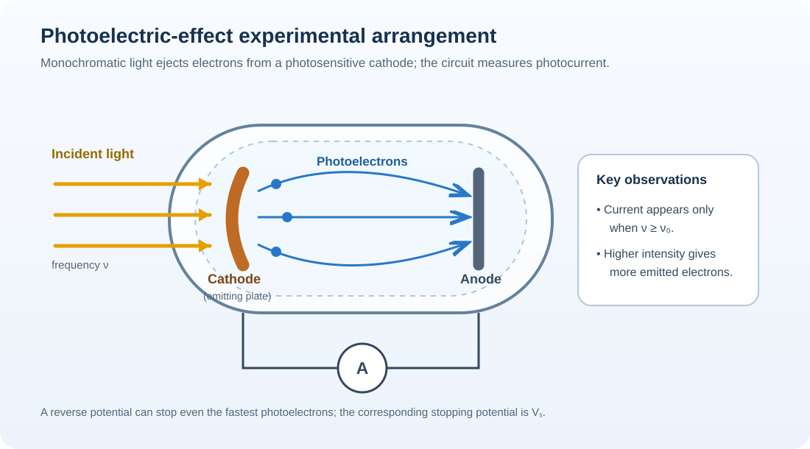
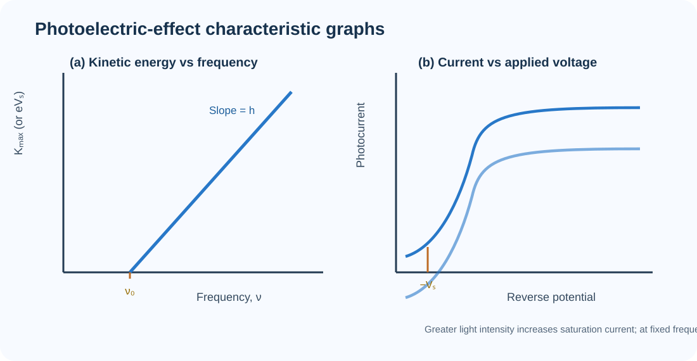
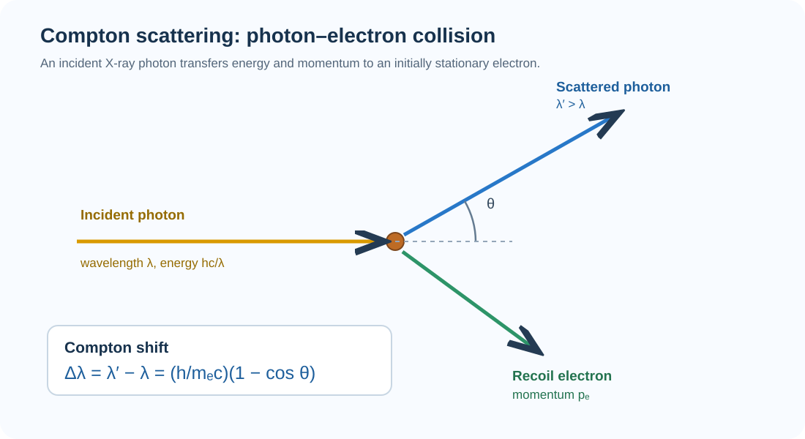
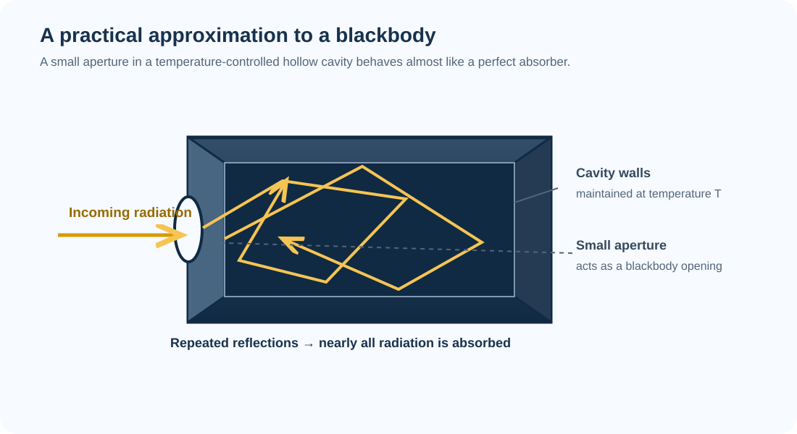
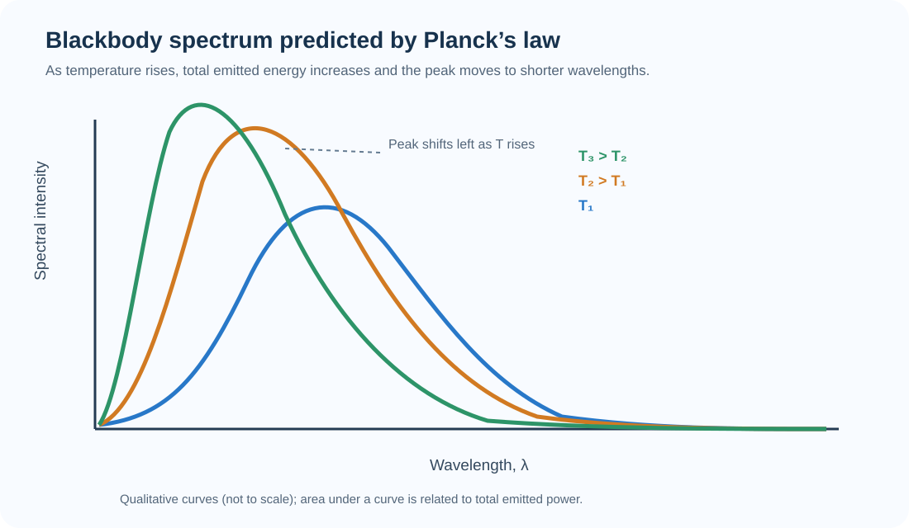
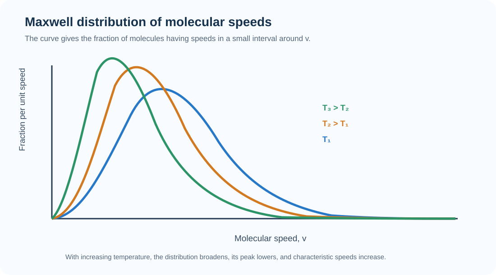
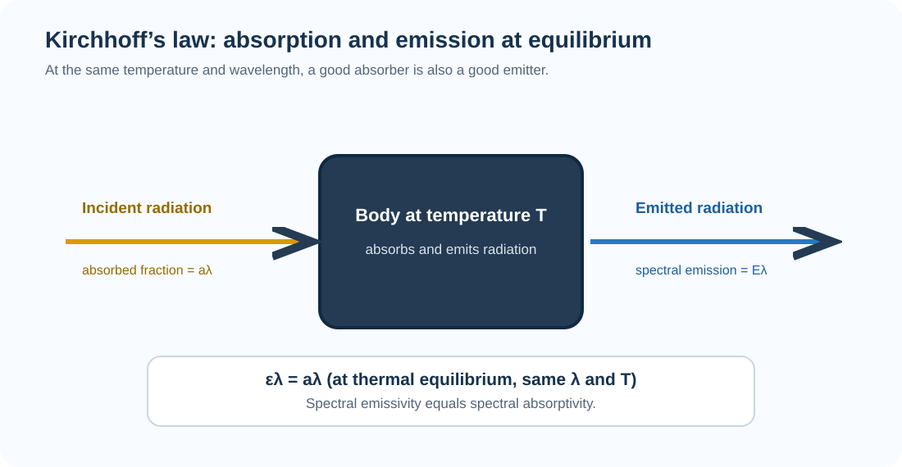

# PHY-1030 — Modern Physics
## Exam-style answers with labelled visuals and derivations

**Question order follows the Modern Physics section on page 3 of the supplied PHY Suggestion — RTEC file.** The answers below expand the listed prompts into standard exam-ready responses.

### Symbols used
- $h$: Planck constant; $c$: speed of light; $e$: magnitude of electron charge.
- $k_B$: Boltzmann constant; $T$: absolute temperature; $m_e$: electron rest mass.
- $\nu$: frequency; $\lambda$: wavelength; $\sigma$: Stefan–Boltzmann constant.

---

# 1. What is the photoelectric effect? Derive Einstein's photoelectric equation.

### Definition
The **photoelectric effect** is the phenomenon in which electrons are emitted from the surface of a metal when electromagnetic radiation of sufficiently high frequency falls on it. The emitted electrons are called **photoelectrons**.

### Main experimental observations
1. For every metal there is a minimum frequency called the **threshold frequency** $\nu_0$. Below this frequency, no photoelectrons are emitted, however intense the light may be.
2. For $\nu\ge\nu_0$, the photoelectric current (number of emitted electrons per second) increases with light intensity.
3. The maximum kinetic energy of photoelectrons depends on the frequency of light, not on its intensity.
4. Emission begins practically without measurable time delay when the frequency is above threshold.
5. For a given frequency, a sufficiently large reverse potential stops the photocurrent. This is the **stopping potential** $V_s$.

### Einstein's explanation and derivation
Einstein assumed that light energy is carried in packets called **photons**. The energy of one photon is

$$
E_\gamma=h\nu.
$$

One photon transfers its energy to one electron. A part of the photon energy is used to liberate the electron from the metal surface. This minimum required energy is the **work function** $\phi$. The remaining energy becomes the kinetic energy of the emitted electron. By conservation of energy,

$$
\boxed{h\nu=\phi+K_{\max}}.
$$

For the fastest photoelectron, $K_{\max}=\tfrac12 m_e v_{\max}^2$. Therefore,

$$
\boxed{h\nu=\phi+\frac12m_ev_{\max}^{2}} \qquad (1)
$$

At the threshold frequency, the emitted electron has zero maximum kinetic energy. Hence,

$$
\phi=h\nu_0.
$$

Substituting this in (1),

$$
\boxed{K_{\max}=h(\nu-\nu_0)}.
$$

If $V_s$ is the stopping potential, the electric work needed to stop the fastest electron is $eV_s$; thus $K_{\max}=eV_s$. Einstein's photoelectric equation can therefore also be written as

$$
\boxed{h\nu=\phi+eV_s},\qquad
\boxed{eV_s=h\nu-\phi=h(\nu-\nu_0)}.
$$

The threshold wavelength is $\lambda_0=c/\nu_0$, so $\phi=hc/\lambda_0$.

### Graphical representation

The graph of $K_{\max}$ against frequency is a straight line of slope $h$ that cuts the frequency axis at $\nu_0$. Increasing intensity raises the saturation current, whereas increasing frequency raises the maximum kinetic energy.

### Conclusion / significance
Einstein's equation explains the threshold frequency, the immediate emission, and the linear relation between maximum kinetic energy and frequency. It also supports the particle (photon) nature of light.

---

# 2. What is the Compton effect? Describe the process.

### Definition
The **Compton effect** is the increase in wavelength (decrease in frequency and energy) of an X-ray or gamma-ray photon when it is scattered by a free or loosely bound electron. The scattered photon transfers part of its energy and momentum to the electron, which recoils.

### Diagram of the process

Let an incident photon have wavelength $\lambda$ and energy $hc/\lambda$. It strikes an electron initially at rest. After collision, the photon is scattered through angle $\theta$ with wavelength $\lambda'$, while the electron recoils with momentum $p_e$.

### Derivation of Compton wavelength shift
By conservation of energy,

$$
\frac{hc}{\lambda}+m_ec^2
=\frac{hc}{\lambda'}+\sqrt{p_e^2c^2+m_e^2c^4}. \tag{1}
$$

By conservation of momentum, resolving along and perpendicular to the incident direction,

$$
\frac{h}{\lambda}=\frac{h}{\lambda'}\cos\theta+p_e\cos\varphi, \tag{2}
$$

$$
0=\frac{h}{\lambda'}\sin\theta-p_e\sin\varphi. \tag{3}
$$

Squaring (2) and (3), then adding, eliminates the recoil angle $\phi$:

$$
p_e^2=\left(\frac{h}{\lambda}\right)^2
+\left(\frac{h}{\lambda'}\right)^2
-\frac{2h^2}{\lambda\lambda'}\cos\theta. \tag{4}
$$

Substitute (4) into the energy relation (1), square and simplify. The result is

$$
\boxed{\lambda'-\lambda=\frac{h}{m_ec}(1-\cos\theta)}.
$$

This is the **Compton shift equation**. The quantity

$$
\lambda_C=\frac{h}{m_ec}\approx 2.426\times10^{-12}\;\text{m}
$$

is the Compton wavelength of the electron. Therefore, $\Delta\lambda=\lambda_C(1-\cos\theta)$.

### Important results
- At $\theta=0^\circ$, $\Delta\lambda=0$: there is no wavelength shift in forward scattering.
- At $\theta=90^\circ$, $\Delta\lambda=\lambda_C$.
- At $\theta=180^\circ$, the shift is maximum: $\Delta\lambda_{\max}=2\lambda_C$.
- The shift depends on the scattering angle and electron mass, not on the incident wavelength.

### Conclusion
The Compton effect provides strong evidence for the particle nature of electromagnetic radiation and demonstrates that photons possess both energy $h\nu$ and momentum $h/\lambda$.

---

# 3. Define emissive power and absorptive power.

### (a) Emissive power
The **emissive power** of a surface is the radiant energy emitted by unit area of the surface per unit time over all wavelengths.

$$
\boxed{E=\frac{dQ}{dA\,dt}}
$$

Its SI unit is $\mathrm{W\,m^{-2}}$. The **spectral emissive power** $E_\lambda$ is the energy emitted per unit area per unit time per unit wavelength interval around $\lambda$:

$$
E_\lambda=\frac{dE}{d\lambda}.
$$

### (b) Absorptive power (absorptivity)
The **absorptive power** or **absorptivity** of a body is the fraction of the incident radiant energy absorbed by the body.

$$
\boxed{a=\frac{\text{energy absorbed}}{\text{energy incident}}}
$$

For spectral radiation,

$$
a_\lambda=\frac{\text{incident energy absorbed in the wavelength interval}}{\text{incident energy in that interval}}.
$$

Absorptivity is dimensionless and lies between $0$ and $1$. A perfect absorber has $a=1$, while a perfect reflector has $a=0$ for the radiation considered.

### Difference

| Emissive power | Absorptive power |
|---|---|
| Measures radiation emitted by a surface. | Measures the fraction of incident radiation absorbed. |
| Has SI unit $\mathrm{W\,m^{-2}}$ (for total emissive power). | Has no unit; it is a ratio. |
| Depends on the surface and its temperature. | Depends on the surface and the wavelength/conditions of incident radiation. |

---

# 4. State the Stefan–Boltzmann equation/law.

### Statement
The **Stefan–Boltzmann law** states that the total radiant energy emitted per unit area per unit time by a perfect blackbody is directly proportional to the fourth power of its absolute temperature.

$$
E\propto T^4
$$

Therefore,

$$
\boxed{E=\sigma T^4}
$$

where $\sigma$ is the Stefan–Boltzmann constant:

$$
\boxed{\sigma=5.670374419\times10^{-8}\;\text{W m}^{-2}\text{K}^{-4}}.
$$

For a blackbody of area $A$, the total power radiated is

$$
\boxed{P=\sigma AT^4}.
$$

For a real surface with emissivity $\varepsilon$ ($0\le\varepsilon\le1$), approximately

$$
P=\varepsilon\sigma AT^4.
$$

If the surface at temperature $T$ exchanges radiation with large surroundings at temperature $T_s$, the net rate of radiative heat loss is

$$
\boxed{P_{\mathrm{net}}=\varepsilon\sigma A(T^4-T_s^4)}
$$

under the usual grey-surface approximation. Temperatures must be in kelvin.

### Important points
1. The law concerns **absolute temperature**, not Celsius temperature.
2. Doubling the absolute temperature increases blackbody emissive power by $2^4=16$ times.
3. A perfect blackbody has emissivity $\varepsilon=1$ and emits the maximum possible radiation at a given temperature.

---

# 5. What is a blackbody?

### Definition
A **blackbody** is an ideal body that absorbs all radiation incident on it, whatever the wavelength or direction. It neither reflects nor transmits the incident radiation. Its absorptivity and emissivity are both unity:

$$
\boxed{a_\lambda=\varepsilon_\lambda=1}.
$$

A blackbody is also the most effective possible emitter at a specified temperature.

### Practical realization: cavity radiator
A hollow enclosure with darkened internal walls and a very small aperture behaves approximately as a blackbody. Radiation entering the aperture undergoes repeated reflections inside the cavity and is almost completely absorbed. Radiation emerging from the aperture has the characteristic spectrum of the cavity temperature.

### Properties of a blackbody
1. It is a perfect absorber: absorptivity $a=1$.
2. It is a perfect emitter: emissivity $\varepsilon=1$.
3. Its radiation spectrum depends only on its absolute temperature, not on the material from which the ideal blackbody is made.
4. At a fixed temperature, no real body emits more radiation at every wavelength than a blackbody.
5. A blackbody does not have to look black when hot; it can glow red, yellow, or white as its temperature rises.

---

# 6. State and explain Planck's radiation law.

### Statement
**Planck's radiation law** gives the spectral distribution of electromagnetic radiation emitted by a blackbody in thermal equilibrium at absolute temperature $T$. It correctly describes the intensity of blackbody radiation at all wavelengths.

### Planck's law in wavelength form
The spectral radiance per unit wavelength per unit solid angle is

$$
\boxed{B_\lambda(T)=\frac{2hc^2}{\lambda^5}
\frac{1}{\exp\!\left(\frac{hc}{\lambda k_BT}\right)-1}}
$$

where $h$ is Planck's constant, $c$ is the speed of light, $k_B$ is Boltzmann's constant, and $\lambda$ is the wavelength.

Equivalently, the blackbody spectral energy density per unit wavelength is

$$
\boxed{u_\lambda(T)=\frac{8\pi hc}{\lambda^5}
\frac{1}{\exp\!\left(\frac{hc}{\lambda k_BT}\right)-1}}.
$$

### Frequency form
The spectral energy density per unit frequency is

$$
\boxed{u_\nu(T)=\frac{8\pi h\nu^3}{c^3}
\frac{1}{\exp\!\left(\frac{h\nu}{k_BT}\right)-1}}.
$$

### Basic explanation / origin of the law
Planck proposed that the energy of an oscillator in the cavity is quantized and can have only discrete values:

$$
E_n=nh\nu,\qquad n=0,1,2,\ldots
$$

The mean energy of an oscillator of frequency $\nu$ at temperature $T$ is

$$
\overline{E}=\frac{h\nu}{\exp(h\nu/k_BT)-1}.
$$

The number of electromagnetic modes per unit volume per unit frequency interval is $8\pi\nu^2/c^3$. Multiplying the mode density by the mean energy gives

$$
u_\nu=\frac{8\pi\nu^2}{c^3}\,\overline{E}
=\frac{8\pi h\nu^3}{c^3[\exp(h\nu/k_BT)-1]},
$$

which is Planck's frequency law.

### Blackbody spectral curves

As $T$ increases, the total area under the spectrum increases and the wavelength of maximum emission decreases. The latter behavior is summarized by Wien's displacement law, $\lambda_{\max}T=b$, where $b\approx 2.898\times10^{-3}\ \mathrm{m\,K}$.

### Significance
- It explained the observed blackbody spectrum.
- It removed the ultraviolet catastrophe predicted by classical Rayleigh–Jeans theory.
- It introduced the idea of energy quantization, which became a foundation of quantum physics.

---

# 7. Explain Maxwell's distribution law.

> **Syllabus note:** Maxwell's distribution of molecular speeds is conventionally taught in the kinetic theory of gases. It appears under the Modern Physics heading in the supplied question list, so it is answered here in that position without changing the source order.

### Statement
The **Maxwell distribution law** states that, in a gas at thermal equilibrium, molecules do not all move with the same speed. Their speeds are distributed according to a definite probability distribution that depends on the gas temperature and molecular mass.

### Mathematical expression
The fraction of molecules having speeds between $v$ and $v+dv$ is

$$
\boxed{f(v)\,dv=4\pi\left(\frac{m}{2\pi k_BT}\right)^{3/2}
 v^2\exp\!\left(-\frac{mv^2}{2k_BT}\right)dv}
$$

where $m$ is the mass of one molecule. Thus, the number of molecules in this speed interval is

$$
dN=Nf(v)\,dv.
$$

The distribution is normalized:

$$
\int_0^\infty f(v)\,dv=1.
$$

### Characteristic molecular speeds
From the Maxwell distribution, three useful speeds are obtained:

**Most probable speed** (speed at the peak of the curve):

$$
\boxed{v_{mp}=\sqrt{\frac{2k_BT}{m}}}
$$

**Mean speed** (average speed):

$$
\boxed{\bar v=\sqrt{\frac{8k_BT}{\pi m}}}
$$

**Root-mean-square speed:**

$$
\boxed{v_{rms}=\sqrt{\frac{3k_BT}{m}}}
$$

Their order is

$$
\boxed{v_{mp}<\bar v<v_{rms}}.
$$

For molar mass $M$, replace $k_B/m$ by $R/M$ in these expressions.

### Distribution curve

At a higher temperature, the curve becomes broader and flatter, and its peak shifts toward higher speed. The area under each curve remains unity because it represents the total fraction of molecules.

### Importance
The law explains why gas molecules have a range of speeds and provides the basis for calculating average molecular speeds, collision rates, and other properties of gases.

---

# 8. State Kirchhoff's law of radiation.

### Statement
**Kirchhoff's law of thermal radiation** states that, for a body in thermal equilibrium, at a given temperature and wavelength, the ratio of its spectral emissive power to its spectral absorptivity is the same for all bodies and is equal to the spectral emissive power of a perfect blackbody at that temperature.

$$
\boxed{\frac{E_\lambda}{a_\lambda}=E_{\lambda,b}(T)}
$$

Equivalently, the spectral emissivity of a body equals its spectral absorptivity at the same wavelength and temperature:

$$
\boxed{\varepsilon_\lambda=a_\lambda}.
$$

### Explanation
A body in thermal equilibrium absorbs and emits radiation. If, at a particular wavelength, one surface absorbed more energy than it emitted compared with another surface at the same temperature, a net energy transfer would occur and thermal equilibrium would be disturbed. At equilibrium, the ratio of emission to absorption must therefore be universal for all materials at that wavelength and temperature. This universal value is the blackbody spectral emissive power.

### Consequences
1. A good absorber of radiation is also a good emitter at the same wavelength and temperature.
2. A poor absorber is a poor emitter under the same conditions.
3. A perfect blackbody has $a_\lambda=\varepsilon_\lambda=1$.
4. The law is spectral: it applies wavelength by wavelength. It should not be interpreted as saying that total emissivity always equals total absorptivity under arbitrary, non-equilibrium conditions.

---

# Quick revision sheet

| No. | Topic | Must-remember result |
|---:|---|---|
| 1 | Photoelectric effect | $h\nu=\phi+K_{\max}=\phi+eV_s$; $K_{\max}=h(\nu-\nu_0)$ |
| 2 | Compton effect | $\Delta\lambda=\dfrac{h}{m_e c}(1-\cos\theta)$ |
| 3 | Emissive / absorptive power | $E=\dfrac{dQ}{dA\,dt}$; $a=\dfrac{\text{absorbed}}{\text{incident}}$ |
| 4 | Stefan–Boltzmann law | $E=\sigma T^4$; $P_{\mathrm{net}}=\varepsilon\sigma A(T^4-T_s^4)$ |
| 5 | Blackbody | Ideal absorber and emitter; $a=\varepsilon=1$ |
| 6 | Planck law | $B_\lambda=\dfrac{2hc^2/\lambda^5}{\exp\!\left(hc/\lambda k_B T\right)-1}$ |
| 7 | Maxwell distribution | $f(v)=4\pi\left(\dfrac{m}{2\pi k_B T}\right)^{3/2}v^2\exp\!\left(-\dfrac{mv^2}{2k_B T}\right)$ |
| 8 | Kirchhoff law | $\varepsilon_\lambda=a_\lambda$; $E_\lambda/a_\lambda=E_{\lambda,b}(T)$ |

## Common exam mistakes to avoid
- Do not say that increasing light intensity increases the maximum kinetic energy in the photoelectric effect. It increases photocurrent; frequency controls $K_{\max}$.
- In the Compton equation, use the **scattering angle** $\theta$ of the photon: $1-\cos\theta$.
- Use kelvin in the Stefan–Boltzmann law.
- Do not confuse Planck's radiation law with Maxwell's molecular-speed distribution.
- Kirchhoff's law is wavelength-specific and assumes thermal equilibrium.

---

**Source basis:** The eight question prompts and their order are taken from the supplied *PHY Suggestion — RTEC*, page 3, “Modern Physics.” Detailed explanations, standard derivations, and diagrams are added to make the listed prompts answerable in examination form.
