# PHY-103 · Thermodynamics — Previous Questions 2015–2023 (Solved)

> **Course:** PHY-103 (Physics-II) · B.Sc. in Textile Engineering, BUTEX  
> **Source:** *Physics-II chapter-wise question bank 2015–2023*, Chapter 7 — **Thermodynamics**  
> **Coverage:** all **65** thermodynamics sub-questions — the 57 of Chapter 7 plus 8 thermodynamic questions that the bank lists under Chapter 6 (marked ➕) — answered **in bank order** (2015 → 2023)  
> **Version:** `v261101-0` · 2026-11-01

---

## How to read this file

- Every question has its own anchor, so you can jump from the [index](#index-of-questions) straight to it.
- **Full answer** = complete exam-style solution with derivation, diagram and example. **Short-form answer** = a self-contained version (key statements, steps, final result) for a question that was asked again in a later year, with a link to the full answer.
- Diagrams are PNG files stored in `../../assets/` (all named `phy-103-thermo-NN-*.png`); flow charts are Mermaid blocks written directly in the Markdown.
- Sign convention used throughout: **$Q>0$** when heat is *absorbed* by the system, **$W>0$** when work is done *by* the system.
- Constants used (unless a question gives its own): $R=8.314\ \mathrm{J\,mol^{-1}K^{-1}}$, $1\ \mathrm{cal}=4.2\ \mathrm J$ (the value printed in the 2023 paper), $1\ \mathrm{atm}=1.013\times10^{5}\ \mathrm{Pa}$, $1\ \mathrm{hp}=746\ \mathrm W$, $T(\mathrm K)=t(^\circ\mathrm C)+273$.

> [!IMPORTANT]
> A few questions in the bank are worded loosely or lost text in the PDF extraction. They are **answered, not skipped**, and each one is flagged where it appears and again in [Notes on ambiguous questions](#notes-on-ambiguous-questions): **2020 Q6(b)** (printed identities lost), **2022 Q7(b)** (says "constant in an *irreversible* process"), **2022 Q5(b) / 2023 Q5(a)** ("higher" instead of "steeper"), and the "per horsepower" wording in **2017 Q7(d) / 2022 Q7(c)**.

## Index of questions

| Year | Q | Question | Tag |
|---|---|---|---|
| 2015 | [5(a)](#q2015-5a) | What is heat? Effects of heat | ➕ from Ch. 6 |
| 2015 | [6(b)](#q2015-6b) | Prove PV^γ = constant | ➕ from Ch. 6 |
| 2015 | [7(a)](#q2015-7a) | First law of thermodynamics |  |
| 2015 | [7(b)](#q2015-7b) | Specific heat; difference of the two specific heats |  |
| 2015 | [7(c)](#q2015-7c) | Numerical: mechanical equivalent of heat J |  |
| 2016 | [5(a)](#q2016-5a) | Define temperature; van der Waals equation | ➕ from Ch. 6 |
| 2016 | [6(b)](#q2016-6b) | All the laws of thermodynamics |  |
| 2016 | [7(a)](#q2016-7a) | What is entropy? | 🏷️ entropy |
| 2016 | [7(b)](#q2016-7b) | Clausius–Clapeyron equation |  |
| 2016 | [7(c)](#q2016-7c) | Numerical: engine vs reversible engine (hp-hour) |  |
| 2016 | [8(a)](#q2016-8a) | Carnot's theorem |  |
| 2016 | [8(b)](#q2016-8b) | Efficiency of a Carnot engine |  |
| 2016 | [8(c)](#q2016-8c) | Numerical: Carnot engine, 200 cal in / 150 cal out |  |
| 2017 | [5(a)](#q2017-5a) | Internal energy and thermodynamic functions |  |
| 2017 | [5(b)](#q2017-5b) | Reversible vs irreversible processes |  |
| 2017 | [5(c)](#q2017-5c) | Efficiency of a Carnot engine |  |
| 2017 | [6(a)](#q2017-6a) | Second law; difference from first law |  |
| 2017 | [6(b)](#q2017-6b) | Isothermal process and its work |  |
| 2017 | [6(c)](#q2017-6c) | Numerical: Carnot engine 177 °C / 77 °C |  |
| 2017 | [7(a)](#q2017-7a) | Entropy and unavailable energy | 🏷️ entropy |
| 2017 | [7(b)](#q2017-7b) | Entropy constant in a reversible process | 🏷️ entropy |
| 2017 | [7(c)](#q2017-7c) | Derive Clausius–Clapeyron equation |  |
| 2017 | [7(d)](#q2017-7d) | Numerical: engine vs reversible engine (hp) |  |
| 2018 | [3(a)](#q2018-3a) | Define heat and temperature | ➕ from Ch. 6 |
| 2018 | [5(c)](#q2018-5c) | Adiabatic curve steeper than isothermal |  |
| 2018 | [7(a)](#q2018-7a) | What is entropy? | 🏷️ entropy |
| 2018 | [7(b)](#q2018-7b) | Latent-heat (Clausius–Clapeyron) equation |  |
| 2018 | [7(c)](#q2018-7c) | Entropy change in a reversible Carnot cycle | 🏷️ entropy |
| 2018 | [8(a)](#q2018-8a) | Second law of thermodynamics |  |
| 2018 | [8(b)](#q2018-8b) | Specific heat capacity; CP − CV = R |  |
| 2018 | [8(c)](#q2018-8c) | Carnot engine; Carnot cycle is reversible |  |
| 2019 | [4(a)](#q2019-4a) | Heat vs temperature | ➕ from Ch. 6 |
| 2019 | [4(b)](#q2019-4b) | Cp − Cv = characteristic gas constant |  |
| 2020 | [5(c)](#q2020-5c) | Molar specific heat; relation of CP and CV | ➕ from Ch. 6 |
| 2020 | [6(a)](#q2020-6a) | Maxwell's thermodynamic relations (general) |  |
| 2020 | [6(b)](#q2020-6b) | Show the given Maxwell-type relations |  |
| 2020 | [7(a)](#q2020-7a) | Carnot engine; reversibility of Carnot cycle |  |
| 2020 | [7(b)](#q2020-7b) | Carnot efficiency; steam point to ice point |  |
| 2021 | [5(a)](#q2021-5a) | Entropy constant in reversible processes | 🏷️ entropy |
| 2021 | [5(b)](#q2021-5b) | Isothermal process and its work |  |
| 2021 | [7(a)](#q2021-7a) | What is a Carnot cycle? |  |
| 2021 | [7(b)](#q2021-7b) | Show η = (T1 − T2)/T1 |  |
| 2021 | [7(c)](#q2021-7c) | First vs second law |  |
| 2021 | [7(d)](#q2021-7d) | What is specific heat? | ➕ from Ch. 6 |
| 2021 | [8(a)](#q2021-8a) | Second law of thermodynamics |  |
| 2021 | [8(c)](#q2021-8c) | Numerical: adiabatic expansion of dry air from 15 °C |  |
| 2022 | [5(a)](#q2022-5a) | Zeroth law; first law is energy conservation |  |
| 2022 | [5(b)](#q2022-5b) | Adiabatic curve vs isothermal curve |  |
| 2022 | [5(c)](#q2022-5c) | Carnot engine; reversibility of Carnot cycle |  |
| 2022 | [6(a)](#q2022-6a) | Molar specific heat; relation of CP and CV | ➕ from Ch. 6 |
| 2022 | [6(b)](#q2022-6b) | Isentropic process and its work |  |
| 2022 | [6(c)](#q2022-6c) | Numerical: isothermal expansion of 0.1 m³ air |  |
| 2022 | [7(a)](#q2022-7a) | Entropy and unavailable energy | 🏷️ entropy |
| 2022 | [7(b)](#q2022-7b) | Entropy in an irreversible process (see note) | 🏷️ entropy |
| 2022 | [7(c)](#q2022-7c) | Numerical: engine vs reversible engine (hp) |  |
| 2023 | [5(a)](#q2023-5a) | Adiabatic curve vs isothermal curve |  |
| 2023 | [5(b)](#q2023-5b) | Prove PV^γ = constant |  |
| 2023 | [5(c)](#q2023-5c) | Numerical: bursting motor tyre |  |
| 2023 | [6(a)](#q2023-6a) | Relation between the two specific heats |  |
| 2023 | [6(b)](#q2023-6b) | Entropy change in a reversible Carnot cycle | 🏷️ entropy |
| 2023 | [6(c)](#q2023-6c) | First vs second law |  |
| 2023 | [6(d)](#q2023-6d) | Numerical: Carnot engine 450 K / 350 K |  |
| 2023 | [8(a)](#q2023-8a) | Second law of thermodynamics |  |
| 2023 | [8(b)](#q2023-8b) | Specific heat capacity; CP − CV = R |  |
| 2023 | [8(c)](#q2023-8c) | Carnot engine; Carnot cycle is reversible |  |

**Tags.** 🏷️ *entropy* marks the questions that belong to the entropy topic; they are answered here (in order) so the file is complete and can be moved to an entropy file unchanged. ➕ marks thermodynamics questions that sit in the *Kinetic Theory and Thermal Physics* chapter of the bank.

---

## 0 · Quick toolkit (read this first)

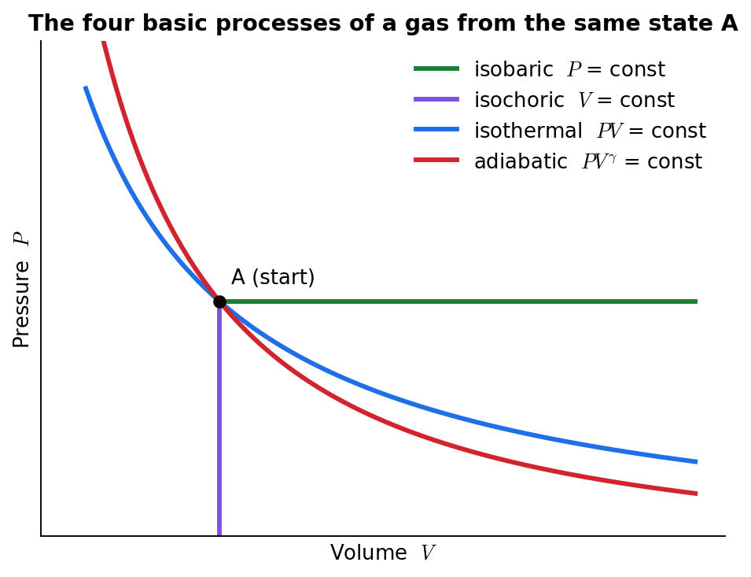
*Fig. 1 — Isobaric, isochoric, isothermal and adiabatic paths drawn from the same starting state A.*

| Process | Condition | $\Delta U$ | $W$ (by gas) | $Q$ |
|---|---|---|---|---|
| Isochoric | $V$ = const | $nC_V\Delta T$ | $0$ | $nC_V\Delta T$ |
| Isobaric | $P$ = const | $nC_V\Delta T$ | $P\,\Delta V$ | $nC_P\Delta T$ |
| Isothermal | $T$ = const | $0$ | $nRT\ln\dfrac{V_2}{V_1}$ | $=W$ |
| Adiabatic (reversible) | $Q=0$, $PV^{\gamma}$ = const | $nC_V\Delta T$ | $\dfrac{P_1V_1-P_2V_2}{\gamma-1}$ | $0$ |

$$C_P-C_V=R,\qquad \gamma=\frac{C_P}{C_V},\qquad \eta_{\text{Carnot}}=1-\frac{T_2}{T_1},\qquad dS=\frac{dQ_{\text{rev}}}{T}$$

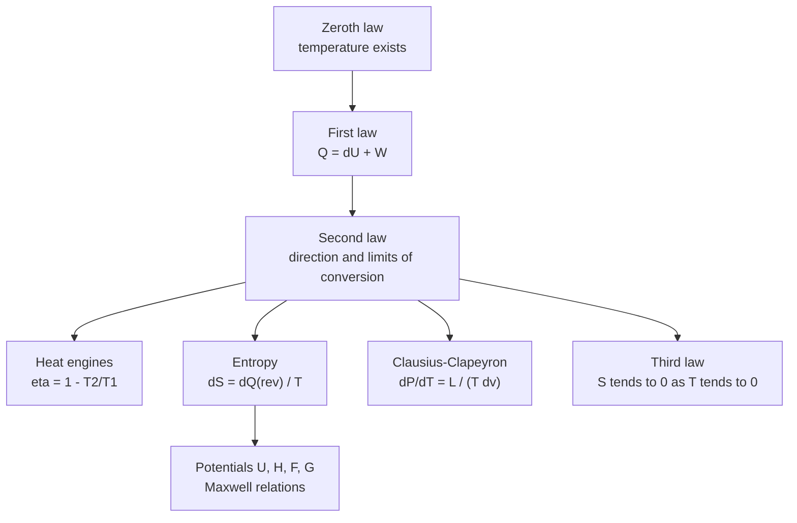
*Map of how the topics of this chapter connect.*

---

# Solutions (in question-bank order)

## 2015 — Physics-II, Q5

### 2015 · Q5(a) — What is heat? State the effects of heat

*➕ from Ch. 6*

**Ans.**

**Heat** is the form of energy that **flows from a body at higher temperature to one at lower temperature** because of the temperature difference. It is energy *in transit*: a body does not "contain" heat; it contains internal energy, and heat is the part of that energy transferred across a boundary. Microscopically it is energy transferred through random molecular motion.

- SI unit: **joule (J)**; also calorie, $1\ \mathrm{cal}=4.2\ \mathrm J$ (accepted value $4.186\ \mathrm J$).
- Measured by calorimetry, using $Q=mc\,\Delta T$.

**Effects of heat**

| Effect | Relation | Example |
|---|---|---|
| 1. Rise of temperature | $Q=mc\,\Delta T$ | $1\ \mathrm{kg}$ water, $20\to80^\circ\mathrm C$: $Q=1\times4186\times60=251\ \mathrm{kJ}$ |
| 2. Change of state (at constant $T$) | $Q=mL$ | Melting $1\ \mathrm{kg}$ ice needs $3.34\times10^{5}\ \mathrm J$; boiling $1\ \mathrm{kg}$ water needs $2.26\times10^{6}\ \mathrm J$ |
| 3. Thermal expansion | $\Delta L=\alpha L\,\Delta T$ (solids) | Gaps left in railway tracks |
| 4. Chemical effects | Reaction rates rise with $T$ | Cooking, burning |
| 5. Electrical effects | Resistance changes; thermo-e.m.f. | Platinum resistance thermometer, thermocouple |
| 6. Radiation | Hot bodies emit light and infrared | Red-hot iron, filament lamp |
| 7. Work | Part of the heat becomes work | Steam and petrol engines |

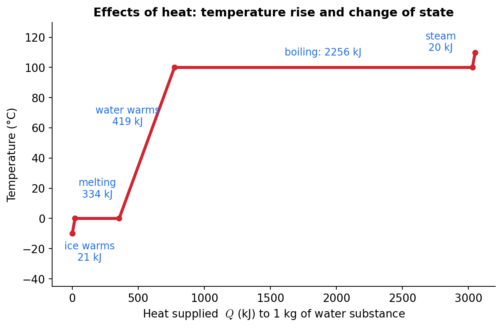
*Fig. 2 — Heat can raise the temperature (sloping parts) or change the state (flat parts at $0^\circ\mathrm C$ and $100^\circ\mathrm C$).*

---

## 2015 — Physics-II, Q6

### 2015 · Q6(b) — Prove $PV^{\gamma}=$ constant

*➕ from Ch. 6*

➕ *Added from the Kinetic Theory & Thermal Physics chapter (thermodynamic content).*

**Ans.** (Compact proof; the same question with the equivalent forms and an example is answered in full in [2023 Q5(b)](#q2023-5b).)

For one mole of ideal gas in a **reversible adiabatic** change, $dQ=0$, so $dU+P\,dV=0$, i.e. $C_V\,dT+P\,dV=0$.

1. With $P=\dfrac{RT}{V}$: $\;\dfrac{dT}{T}+\dfrac{R}{C_V}\dfrac{dV}{V}=0$.
2. $C_P-C_V=R\Rightarrow\dfrac{R}{C_V}=\gamma-1$, so $\;\dfrac{dT}{T}+(\gamma-1)\dfrac{dV}{V}=0$.
3. Integrate: $\ln T+(\gamma-1)\ln V=$ const $\Rightarrow TV^{\gamma-1}=$ const.
4. Put $T=\dfrac{PV}{R}$: $\;\boxed{PV^{\gamma}=\text{constant}}$

---

## 2015 — Physics-II, Q7

### 2015 · Q7(a) — State and explain the first law of thermodynamics

**Ans.**

**Statement.** When heat $Q$ is supplied to a system, part of it increases the internal energy of the system by $\Delta U$ and the remainder is spent as external work $W$ done by the system:

$$\boxed{Q=\Delta U+W}\qquad\text{(differential form: } dQ=dU+P\,dV\text{)}$$

**Explanation.**

1. It is the **law of conservation of energy** for processes involving heat: energy is never created or destroyed, only converted between heat, work and internal energy.
2. $U$ is a **state function** (depends only on the state, not on how it was reached); $Q$ and $W$ are **path functions**. Only the combination $Q-W$ is path-independent.
3. In heat units the work term is converted with Joule's equivalent: $Q=\Delta U+\dfrac{W}{J}$, where $J=4.2\ \mathrm{J\,cal^{-1}}$.
4. It forbids a **perpetual-motion machine of the first kind** (work with no energy supply): for a complete cycle $\Delta U=0$, so $W=Q_{\text{net}}$.

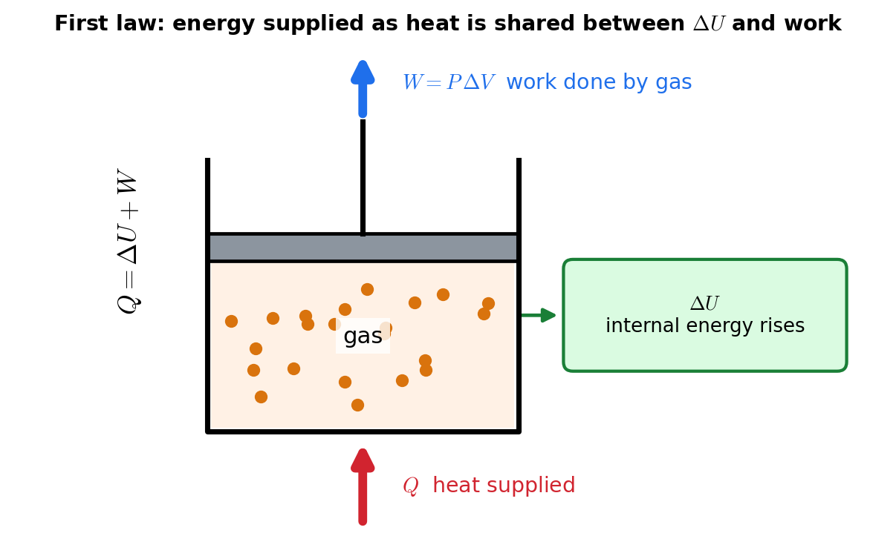
*Fig. 3 — Heat supplied to a gas in a cylinder is shared between $\Delta U$ and the work done lifting the piston.*

**Special cases**

| Process | Condition | Result of first law |
|---|---|---|
| Isochoric | $dV=0$ | $W=0,\ Q=\Delta U$ |
| Isobaric | $P$ = const | $Q=\Delta U+P\Delta V$ |
| Isothermal (ideal gas) | $\Delta T=0\Rightarrow\Delta U=0$ | $Q=W$ |
| Adiabatic | $Q=0$ | $W=-\Delta U$ |
| Cyclic | $\Delta U=0$ | $Q_{\text{net}}=W_{\text{net}}$ |

**Examples**

- A gas absorbs $800\ \mathrm J$ and does $300\ \mathrm J$ of work: $\Delta U=800-300=500\ \mathrm J$ (its temperature rises).
- Pumping a bicycle tyre quickly: almost no heat escapes ($Q\approx0$) and work is done *on* the gas ($W<0$), so $\Delta U=-W>0$ and the pump becomes warm.

**Limitation.** The first law only balances energy; it does not say in which *direction* a process can occur. That is the job of the [second law](#q2017-6a).

---

### 2015 · Q7(b) — What is specific heat? Derive an expression for the difference between the two specific heats

**Ans.**

**Specific heat** $c$ of a substance is the quantity of heat required to raise the temperature of **unit mass** by **one degree**:

$$c=\frac{1}{m}\frac{dQ}{dT}\qquad(\mathrm{cal\,g^{-1}\,^\circ C^{-1}}\ \text{or}\ \mathrm{J\,kg^{-1}K^{-1}})$$

For a gas the value depends on how the gas is heated, so there are two principal specific heats:

- $c_v$ — heating at **constant volume**;
- $c_p$ — heating at **constant pressure**; always $c_p>c_v$.

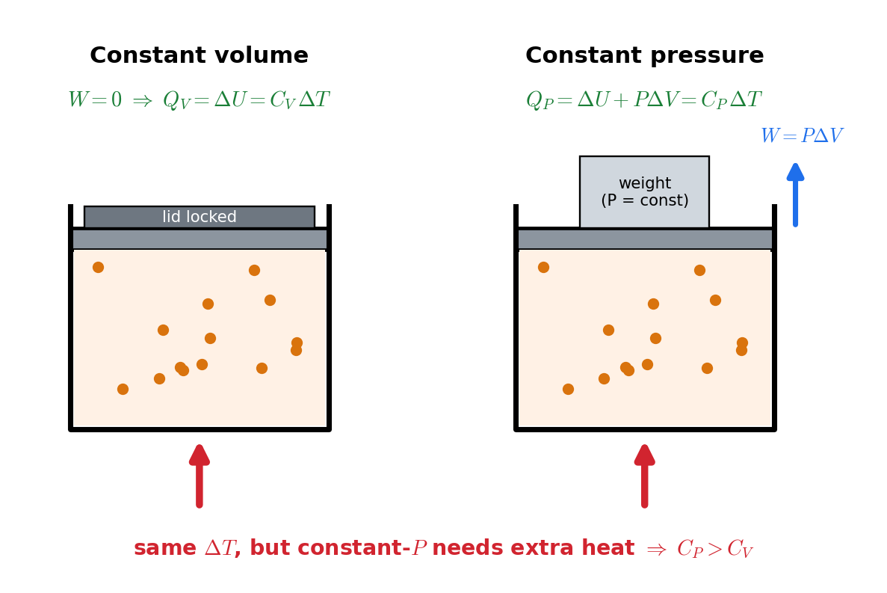
*Fig. 4 — At constant volume all the heat raises $U$; at constant pressure the gas also does work $P\Delta V$ against the atmosphere, so more heat is needed for the same $\Delta T$.*

**Derivation** (1 g of an ideal gas; $r=R/M$ is the characteristic gas constant per gram; work in mechanical units).

*Constant volume:* $dV=0\Rightarrow dW=0$, so the heat for a rise $dT$ is $dQ=dU$:

$$c_v\,dT=dU\qquad(\text{for an ideal gas }U\text{ depends on }T\text{ only, so this holds for every process})$$

*Constant pressure:* $dQ=dU+P\,dV$, therefore

$$c_p\,dT=c_v\,dT+P\,dV$$

From $PV=rT$ at constant $P$: $P\,dV=r\,dT$. Hence $c_p\,dT=c_v\,dT+r\,dT$, i.e.

$$\boxed{c_p-c_v=r}\quad\text{(mechanical units)}\qquad\Longrightarrow\qquad \boxed{c_p-c_v=\frac{r}{J}}\quad\text{(heat units)}$$

For one mole this becomes $C_P-C_V=R$ (derived again in [2018 Q8(b)](#q2018-8b)).

> **General result (any substance).** $C_P-C_V=T\left(\dfrac{\partial P}{\partial T}\right)_V\left(\dfrac{\partial V}{\partial T}\right)_P$. For an ideal gas, $\left(\dfrac{\partial P}{\partial T}\right)_V=\dfrac{nR}{V}$ and $\left(\dfrac{\partial V}{\partial T}\right)_P=\dfrac{nR}{P}$, which give $T\dfrac{n^2R^2}{PV}=nR$ ✓. (Its proof uses the Maxwell relation of [2020 Q6](#q2020-6a).)

**Why $c_p>c_v$ (physical reason).** At constant pressure the gas expands and must do external work; the extra heat $r/J$ per gram pays for this work.

---

### 2015 · Q7(c) — Calculate $J$ from $c_p=0.22$, $c_v=0.16\ \mathrm{cal\,g^{-1}\,^\circ C^{-1}}$ and air density $1.3\ \mathrm{g\,L^{-1}}$ at STP

**Given:** $c_p=0.22$, $c_v=0.16\ \mathrm{cal\,g^{-1}\,^\circ C^{-1}}$; $\rho_0=1.3\ \mathrm{g\,L^{-1}}$ at $0^\circ\mathrm C$, $P=76\ \mathrm{cm\ Hg}$.

**Idea.** For 1 g of gas, $c_p-c_v$ (in cal) is the heat equivalent of the work $P\,\Delta V$ done when 1 g is heated by $1^\circ\mathrm C$ at constant pressure. So $J=\dfrac{P\,\Delta V}{c_p-c_v}$.

**Solution.**

1. Heat equivalent of the work: $c_p-c_v=0.22-0.16=0.06\ \mathrm{cal\,g^{-1}\,^\circ C^{-1}}$.
2. Volume of 1 g at STP: $V_0=\dfrac{1}{1.3}\ \mathrm L=0.7692\ \mathrm L=769.2\ \mathrm{cm^3}$.
3. Expansion for $1^\circ\mathrm C$ at constant pressure (Charles's law): $\Delta V=\dfrac{V_0}{273}=\dfrac{769.2}{273}=2.818\ \mathrm{cm^3}$.
4. Pressure: $P=1.013\times10^{6}\ \mathrm{dyne\,cm^{-2}}$ (76 cm Hg).
5. Work done: $W=P\,\Delta V=1.013\times10^{6}\times2.818=2.855\times10^{6}\ \mathrm{erg}$.

$$J=\frac{W}{c_p-c_v}=\frac{2.855\times10^{6}}{0.06}\approx\boxed{4.76\times10^{7}\ \mathrm{erg\,cal^{-1}}=4.76\ \mathrm{J\,cal^{-1}}}$$

**Cross-check (SI):** $r=\dfrac{P}{\rho T}=\dfrac{1.013\times10^{5}}{1.3\times273}=285\ \mathrm{J\,kg^{-1}K^{-1}}$, and $\dfrac{r}{c_p-c_v}=\dfrac{285}{60}=4.75\ \mathrm{J\,cal^{-1}}$ ✓.

> [!NOTE]
> The accepted value is $4.186\ \mathrm{J\,cal^{-1}}$. The answer here is a little higher only because the data given ($0.22$, $0.16$) are rounded to two figures; the *method* is what the exam rewards.

---

## 2016 — Physics-II, Q5

### 2016 · Q5(a) — Define temperature and write van der Waals' equation

*➕ from Ch. 6*

➕ *Added from the Kinetic Theory & Thermal Physics chapter. The deduction of critical constants (5(b), 5(c)) belongs to the kinetic-theory topic and is not repeated here.*

**Ans.**

**Temperature** is the degree of hotness or coldness of a body; it is the property that decides the **direction of heat flow** — heat flows from the body of higher temperature to the one of lower temperature, and two bodies in thermal equilibrium have the same temperature (zeroth law, Fig. 5).

- Microscopic meaning: the absolute temperature is proportional to the mean translational kinetic energy of a molecule, $\tfrac12m\overline{c^2}=\tfrac32k_BT$. Example: at $300\ \mathrm K$, $\tfrac32k_BT=6.21\times10^{-21}\ \mathrm J\ (0.0388\ \mathrm{eV})$.
- Scales: Celsius ($0^\circ$ ice point, $100^\circ$ steam point), Kelvin $T=t+273$ (absolute zero at $0\ \mathrm K$), Fahrenheit $F=\tfrac95t+32$.

**van der Waals' equation** (real gas). For one mole:

$$\boxed{\left(P+\frac{a}{V^{2}}\right)(V-b)=RT}\qquad\text{for }n\text{ moles: }\left(P+\frac{an^{2}}{V^{2}}\right)(V-nb)=nRT$$

$a/V^{2}$ corrects the pressure for the **attraction between molecules**; $b$ corrects the volume for the **finite size of the molecules**. For $a=b=0$ it reduces to $PV=RT$.

---

## 2016 — Physics-II, Q6

### 2016 · Q6(b) — Explain all the laws of thermodynamics

**Ans.** There are four laws.

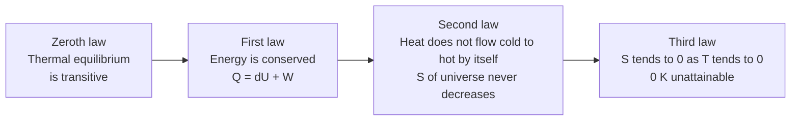

**1. Zeroth law.** *If body A is in thermal equilibrium with body C, and body B is in thermal equilibrium with C, then A and B are in thermal equilibrium with each other.* It justifies the concept of **temperature** and the use of a thermometer (C).

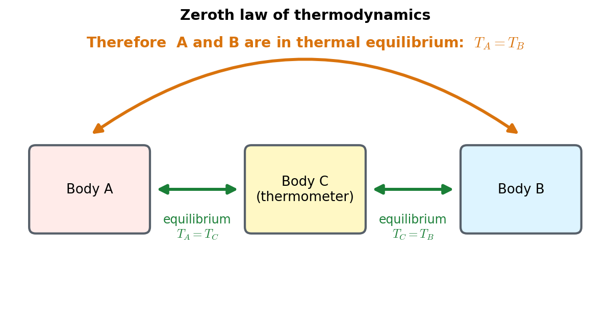
*Fig. 5 — Zeroth law: $T_A=T_C$ and $T_C=T_B\ \Rightarrow\ T_A=T_B$.*

**2. First law.** $Q=\Delta U+W$ — conservation of energy; it defines **internal energy** (details: [2015 Q7(a)](#q2015-7a)).

**3. Second law.** Two equivalent statements:

- **Kelvin–Planck:** it is impossible to construct a cyclic engine that takes heat from a single reservoir and converts it *completely* into work.
- **Clausius:** heat cannot flow from a colder body to a hotter body *by itself* (without external work).

In terms of entropy: for any process, $\Delta S_{\text{universe}}\ge0$. It fixes the **direction** of natural processes and the maximum efficiency $\eta=1-T_2/T_1$ ([details](#q2017-6a)).

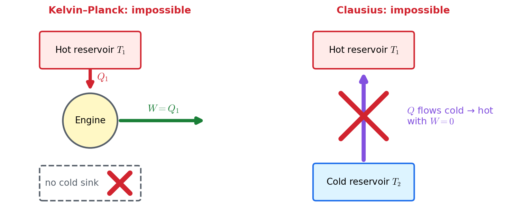
*Fig. 6 — Left: a 100 %-efficient engine; right: a "free" refrigerator. Both are impossible.*

**4. Third law (Nernst–Planck).** As $T\to0$ the entropy of a perfect crystalline substance tends to zero; consequently the absolute zero cannot be reached in a finite number of steps, and heat capacities vanish at $0\ \mathrm K$.

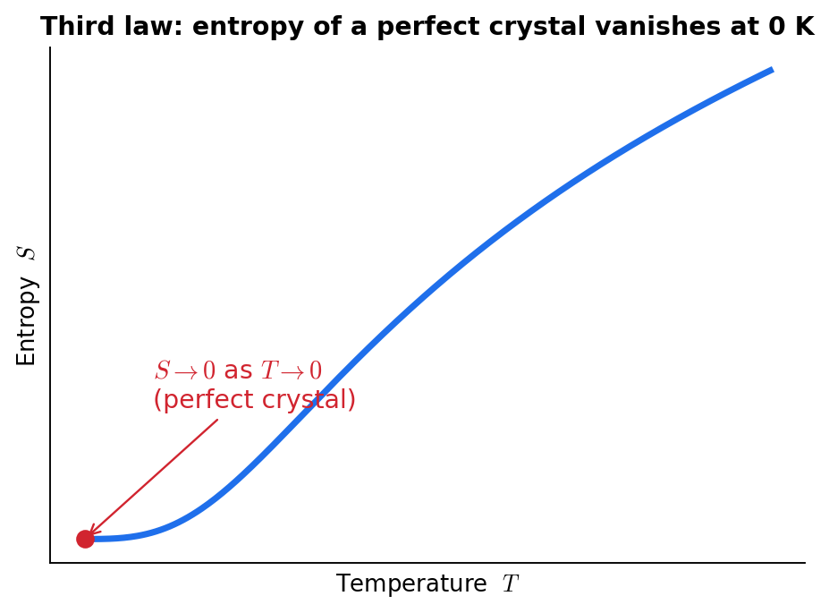
*Fig. 7 — Entropy of a perfect crystal falls to zero as $T\to0$.*

| Law | One-line content | Everyday example |
|---|---|---|
| Zeroth | Equal temperature ⇔ equilibrium (transitive) | A clinical thermometer settles at body temperature |
| First | $Q=\Delta U+W$ | Heated gas lifts a piston |
| Second | Natural heat flow is hot → cold; no 100 % engine | A fridge needs electrical work |
| Third | $S\to0$ as $T\to0$ | $0\ \mathrm K$ can be approached but never reached |

---

## 2016 — Physics-II, Q7

### 2016 · Q7(a) — What is entropy?

*🏷️ entropy*

**Ans.**

**Entropy $S$** is a **state function** of a system whose change in a reversible process is the heat absorbed divided by the absolute temperature at which it is absorbed:

$$\boxed{dS=\frac{dQ_{\text{rev}}}{T}}\qquad\Delta S=S_2-S_1=\int_1^2\frac{dQ_{\text{rev}}}{T}\qquad(\text{unit: J K}^{-1})$$

**Meaning and properties**

1. *Measure of disorder:* statistically $S=k_B\ln W$, where $W$ is the number of microscopic arrangements (microstates) of the system.
2. *State function:* $\Delta S$ depends only on the end states; $\oint dS=0$.
3. *Reversible adiabatic process:* $dQ=0\Rightarrow\Delta S=0$ (isentropic).
4. *Second law:* entropy of an isolated system (or of the universe) never decreases: $\Delta S\ge0$, with equality only for reversible processes.
5. *Unavailable energy:* an increase of entropy means energy is degraded into a less useful form ([2017 Q7(a)](#q2017-7a)).

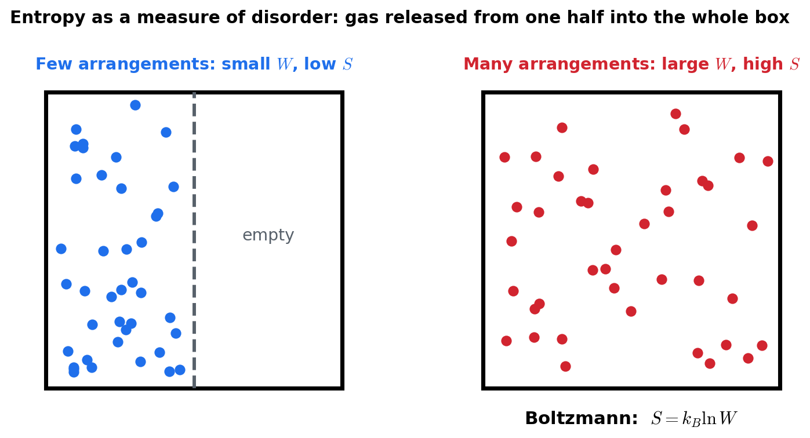
*Fig. 8 — A gas released into the whole box has far more arrangements ($W$) than when confined to one half: entropy increases.*

**Examples**

- Melting $1\ \mathrm{kg}$ of ice at $0^\circ\mathrm C$ (reversible, at constant $T$): $\Delta S=\dfrac{mL}{T}=\dfrac{1\times3.34\times10^{5}}{273.15}\approx1.22\times10^{3}\ \mathrm{J\,K^{-1}}$.
- Isothermal doubling of the volume of 1 mol of an ideal gas: $\Delta S=R\ln2=8.314\times0.693=5.76\ \mathrm{J\,K^{-1}}$.

---

### 2016 · Q7(b) — Explain the Clausius–Clapeyron equation

**Ans.**

The **Clausius–Clapeyron (latent-heat) equation** gives the rate at which the equilibrium pressure of a phase change (boiling, melting, sublimation) varies with temperature:

$$\boxed{\frac{dP}{dT}=\frac{L}{T\,(v_2-v_1)}}$$

where $L$ is the latent heat per unit mass, $v_1$ and $v_2$ the specific volumes of the initial and final phases, and $T$ the absolute temperature of the change.

**Derivation (using a small Carnot cycle).** Take $1\ \mathrm{kg}$ of liquid in equilibrium with its vapour at temperature $T$ and pressure $P$.

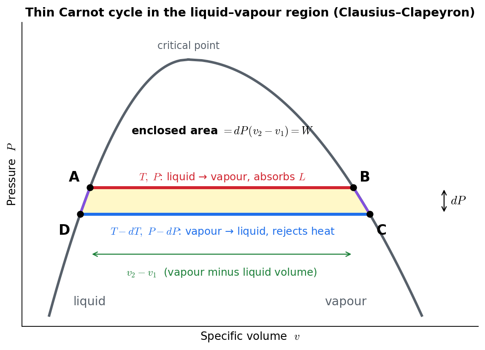
*Fig. 9 — The shaded cycle ABCD between the isotherms $T$ and $T-dT$. Its area is $dP\,(v_2-v_1)$.*

1. **A → B** (isothermal, $T$, $P$): the liquid vaporises, absorbing $Q_1=L$; volume rises from $v_1$ to $v_2$.
2. **B → C** (adiabatic): temperature and pressure fall slightly to $T-dT$, $P-dP$.
3. **C → D** (isothermal, $T-dT$): vapour condenses, rejecting $Q_2$.
4. **D → A** (adiabatic): back to the initial state.

*Work done* = area of the thin parallelogram: $W=dP\,(v_2-v_1)$.

*Carnot efficiency* of this cycle between $T$ and $T-dT$: $\eta=\dfrac{W}{Q_1}=\dfrac{dT}{T}$.

$$\frac{dP\,(v_2-v_1)}{L}=\frac{dT}{T}\;\;\Longrightarrow\;\;\frac{dP}{dT}=\frac{L}{T\,(v_2-v_1)}\ \blacksquare$$

**Meaning and applications**

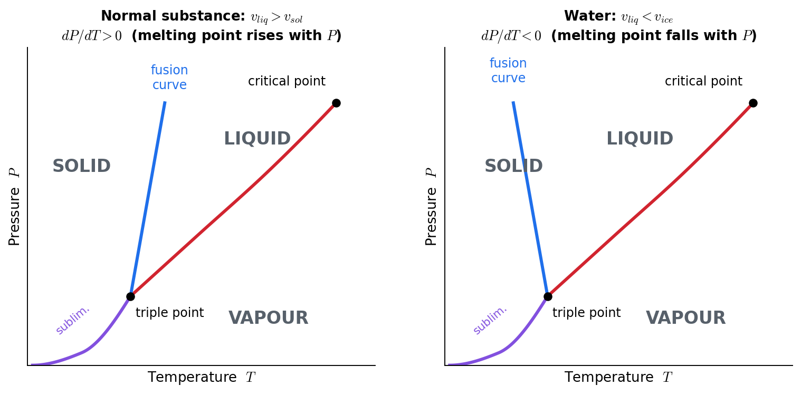
*Fig. 10 — Sign of $dP/dT$ for the fusion curve: positive for normal substances, negative for water.*

- **Boiling:** $v_2>v_1$, $L>0$, so $dP/dT>0$ — boiling point rises with pressure (pressure cooker) and falls at altitude. For water at $100^\circ\mathrm C$: $\dfrac{dP}{dT}=\dfrac{2.26\times10^{6}}{373\times1.67}\approx3.6\ \mathrm{kPa\,K^{-1}}$.
- **Melting of ice:** $v_{\text{water}}<v_{\text{ice}}$, so $dP/dT<0$ — the melting point falls with pressure: $\dfrac{dT}{dP}=\dfrac{T(v_w-v_i)}{L_f}\approx-0.0075\ \mathrm{K\,atm^{-1}}$ (the basis of regelation and ice-skating).
- **Vapour approximation** (neglect $v_1$, treat vapour as ideal gas): $\dfrac{d\ln P}{dT}=\dfrac{L_{\text{molar}}}{RT^2}$, a form widely used for vapour-pressure data.

---

### 2016 · Q7(c) — Efficiency of an engine requiring $3\times10^{6}$ cal per horsepower-hour; compare with a perfect reversible engine (source $100^\circ\mathrm C$, sink $0^\circ\mathrm C$)

**Given:** heat supplied per hp·h $=3\times10^{6}\ \mathrm{cal}$; $T_1=373\ \mathrm K$, $T_2=273\ \mathrm K$; $J=4.2\ \mathrm{J\,cal^{-1}}$.

**Solution.**

1. Useful work per hp·h: $W=746\ \mathrm W\times3600\ \mathrm s=2.686\times10^{6}\ \mathrm J$.
2. Heat supplied: $Q_1=3\times10^{6}\times4.2=1.26\times10^{7}\ \mathrm J$.
3. Efficiency of the engine:

$$\eta=\frac{W}{Q_1}=\frac{2.686\times10^{6}}{1.26\times10^{7}}=0.213=\boxed{21.3\ \%}$$

4. Perfect reversible (Carnot) engine between the same temperatures:

$$\eta_{\text{rev}}=\frac{T_1-T_2}{T_1}=\frac{373-273}{373}=0.268=\boxed{26.8\ \%}$$

5. Comparison: $\dfrac{\eta}{\eta_{\text{rev}}}=\dfrac{0.213}{0.268}=0.795\approx\boxed{80\ \%}$.

The actual engine is about **80 %** as efficient as the best possible engine working between these temperatures. (With $J=4.18$ the engine's efficiency is $21.4\ \%$; the conclusion is unchanged.)

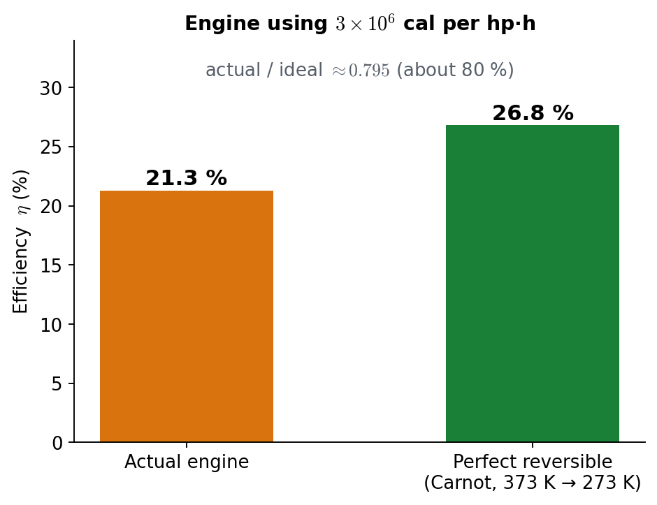
*Fig. 11 — Actual engine ($21.3\ \%$) against the reversible limit ($26.8\ \%$).*

---

## 2016 — Physics-II, Q8

### 2016 · Q8(a) — Write down Carnot's theorem

**Ans.** **Carnot's theorem:**

1. *No heat engine working between two given temperatures can be more efficient than a reversible engine working between the same two temperatures.*
2. *All reversible engines working between the same two temperatures have the same efficiency, whatever the working substance:*

$$\eta_{\text{rev}}=1-\frac{T_2}{T_1}\ \ge\ \eta_{\text{any other}}$$

**Proof sketch (by contradiction with the second law).** Let an irreversible engine $I$ and a reversible engine $R$ work between $T_1$ and $T_2$ and deliver the same work $W$. Suppose $\eta_I>\eta_R$. Then $I$ draws less heat: $Q_1<Q_1'$.

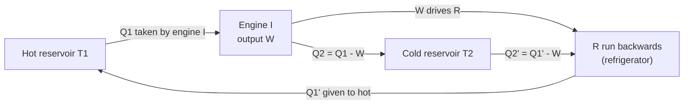

Run $R$ backwards as a refrigerator driven by the work of $I$. Net effect: the cold reservoir loses $Q_2'-Q_2=Q_1'-Q_1>0$ and the hot reservoir gains the same amount, with **no work supplied** — a violation of the Clausius statement. Hence $\eta_I\le\eta_R$.

---

### 2016 · Q8(b) — Derive an expression for the efficiency of a Carnot engine

**Ans.**

A **Carnot engine** uses an ideal gas as working substance in a reversible cycle of two isotherms and two adiabatics, between a source at $T_1$ and a sink at $T_2$ ($T_1>T_2$).

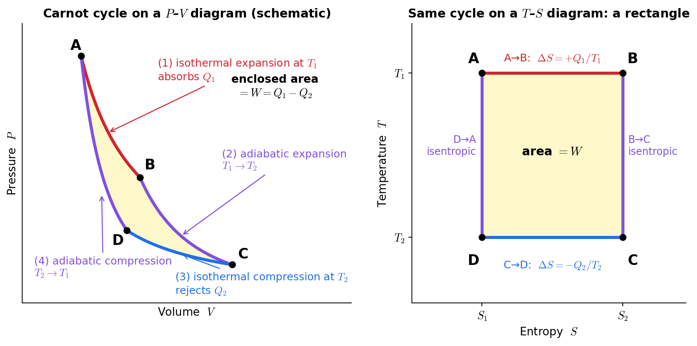
*Fig. 12 — Carnot cycle ABCDA. Left: $P$–$V$ diagram (curvature exaggerated); right: the same cycle on a $T$–$S$ diagram is a rectangle.*

Consider 1 mole of ideal gas, volumes $V_A,V_B,V_C,V_D$ at points A, B, C, D.

**Step 1 — A → B, isothermal expansion at $T_1$.** $\Delta U=0$, so the heat absorbed equals the work done:

$$Q_1=RT_1\ln\frac{V_B}{V_A}$$

**Step 2 — B → C, adiabatic expansion** ($T_1\to T_2$): $\;T_1V_B^{\gamma-1}=T_2V_C^{\gamma-1}$ …(i)

**Step 3 — C → D, isothermal compression at $T_2$.** Heat rejected to the sink:

$$Q_2=RT_2\ln\frac{V_C}{V_D}$$

**Step 4 — D → A, adiabatic compression** ($T_2\to T_1$): $\;T_2V_D^{\gamma-1}=T_1V_A^{\gamma-1}$ …(ii)

Dividing (i) by (ii):

$$\left(\frac{V_B}{V_D}\right)^{\gamma-1}=\left(\frac{V_C}{V_A}\right)^{\gamma-1}\;\Rightarrow\;\frac{V_B}{V_A}=\frac{V_C}{V_D}$$

Therefore

$$\frac{Q_2}{Q_1}=\frac{T_2}{T_1}\qquad\Longrightarrow\qquad \eta=\frac{W}{Q_1}=\frac{Q_1-Q_2}{Q_1}=1-\frac{Q_2}{Q_1}$$

$$\boxed{\eta=1-\frac{T_2}{T_1}=\frac{T_1-T_2}{T_1}}$$

The net work per cycle is $W=R\,(T_1-T_2)\ln\dfrac{V_B}{V_A}$ (the enclosed area).

**Conclusions.** (i) $\eta$ depends only on $T_1$ and $T_2$, not on the working substance. (ii) $\eta<1$ always, because $T_2>0$ ($\eta=1$ would need a sink at $0\ \mathrm K$). (iii) $\eta$ rises when $T_1$ is raised or $T_2$ is lowered; $\eta=0$ if $T_1=T_2$.

---

### 2016 · Q8(c) — A Carnot engine (source $400\ \mathrm K$) takes $200$ cal and rejects $150$ cal. Find its efficiency

**Given:** $T_1=400\ \mathrm K$, $Q_1=200\ \mathrm{cal}$, $Q_2=150\ \mathrm{cal}$.

$$\eta=\frac{Q_1-Q_2}{Q_1}=\frac{200-150}{200}=0.25=\boxed{25\ \%}$$

**Check with temperatures.** For a Carnot engine $\dfrac{Q_2}{Q_1}=\dfrac{T_2}{T_1}\Rightarrow T_2=400\times\dfrac{150}{200}=300\ \mathrm K$, and $\eta=1-\dfrac{300}{400}=25\ \%$ ✓.

Work per cycle: $W=50\ \mathrm{cal}=210\ \mathrm J$.

---

## 2017 — Physics-II, Q5

### 2017 · Q5(a) — What are internal energy and thermodynamic functions?

**Ans.**

**Internal energy ($U$).** The total energy stored in a system by virtue of the random motion (kinetic energy) and the mutual interactions (potential energy) of its molecules; it excludes the bulk motion and position of the system as a whole.

- It is a **state function**: it has a definite value for each equilibrium state, so $\Delta U=U_2-U_1$ is independent of the path and $\oint dU=0$.
- Its change is defined through the first law: $dU=dQ-dW$.
- For an **ideal gas** it depends on temperature alone: $U=\dfrac{f}{2}nRT$ ($f=3$ for monatomic, $5$ for diatomic gas). Example: $1\ \mathrm{mol}$ of a monatomic gas at $300\ \mathrm K$ has $U=\tfrac32(8.314)(300)\approx3.74\ \mathrm{kJ}$.

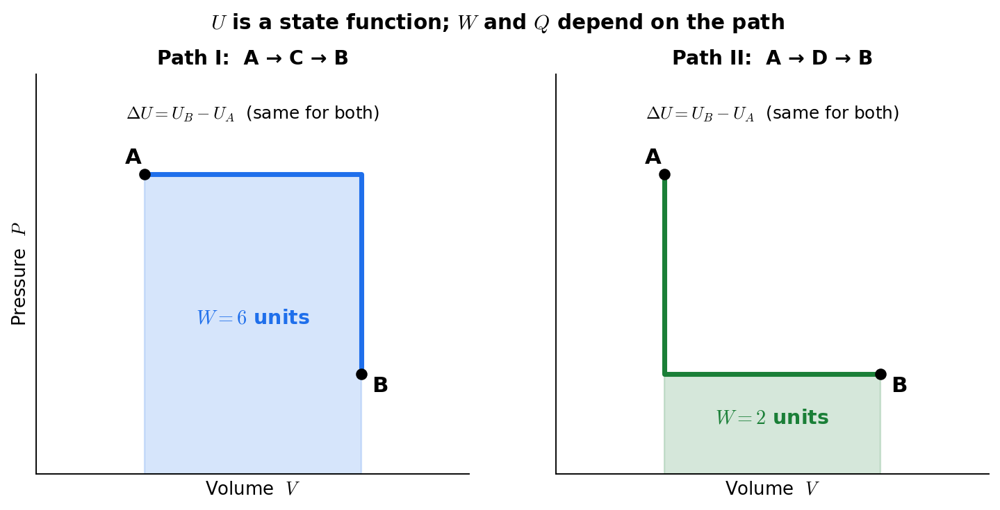
*Fig. 13 — Going from A to B by two different paths gives the same $\Delta U$ but different $W$ (and hence different $Q$).*

**Thermodynamic functions (state functions / potentials).** Quantities fixed entirely by the state of the system:

| Function | Definition | Differential (reversible) | Natural variables |
|---|---|---|---|
| Internal energy $U$ | — | $dU=T\,dS-P\,dV$ | $S,\,V$ |
| Enthalpy $H$ | $U+PV$ | $dH=T\,dS+V\,dP$ | $S,\,P$ |
| Helmholtz function $F$ | $U-TS$ | $dF=-S\,dT-P\,dV$ | $T,\,V$ |
| Gibbs function $G$ | $H-TS$ | $dG=-S\,dT+V\,dP$ | $T,\,P$ |
| Entropy $S$ | $\int dQ_{\text{rev}}/T$ | $dS=dQ_{\text{rev}}/T$ | — |

All of them are **exact differentials**, which is what leads to the Maxwell relations ([2020 Q6](#q2020-6a)). Heat $Q$ and work $W$ are *not* thermodynamic functions.

---

### 2017 · Q5(b) — Distinguish between reversible and irreversible processes

**Ans.**

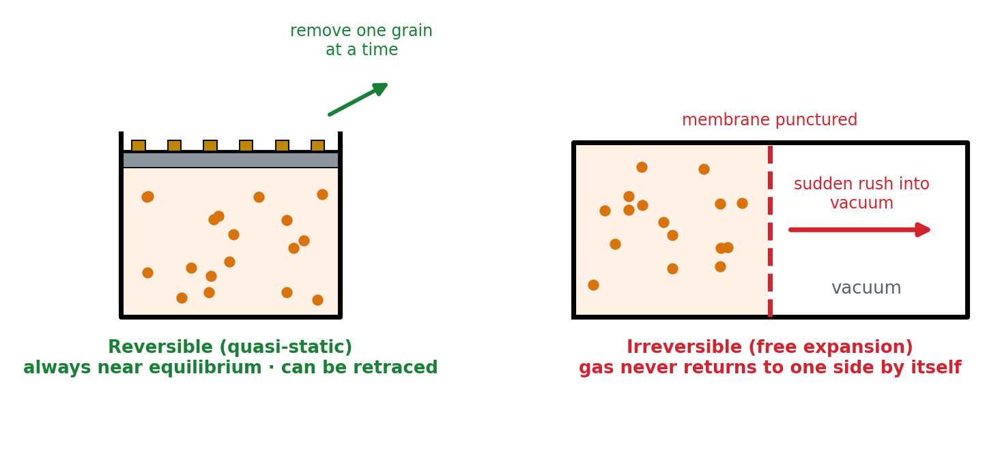
*Fig. 14 — Left: removing sand grains one by one keeps the gas almost in equilibrium at every instant (reversible). Right: free expansion into vacuum cannot be undone by itself (irreversible).*

| Basis | Reversible process | Irreversible process |
|---|---|---|
| Speed | Infinitely slow (quasi-static) | Finite speed, sudden |
| State of system | Always in equilibrium with surroundings | Passes through non-equilibrium states |
| Dissipation | No friction, viscosity, turbulence or resistance | Dissipative effects present |
| Retracing | Can be retraced exactly; system **and** surroundings are restored | Cannot be reversed without leaving a net change somewhere |
| Heat transfer | Only across an infinitesimal temperature difference | Across a finite temperature difference |
| Entropy | $\Delta S_{\text{universe}}=0$ | $\Delta S_{\text{universe}}>0$ |
| Work | Maximum work obtained / minimum work needed | Less work obtained / more work needed |
| Occurrence | An idealisation | All natural (real) processes |
| Examples | Slow isothermal expansion; Carnot cycle; melting of ice at $0^\circ\mathrm C$ with an infinitesimal $\Delta T$ | Free expansion; heat conduction hot → cold; diffusion and mixing; Joule heating; friction |

---

### 2017 · Q5(c) — Find an expression for the efficiency of a Carnot engine

**Short-form answer** (full derivation with diagram: [2016 Q8(b)](#q2016-8b)).

For a Carnot cycle (isotherm at $T_1$ → adiabatic → isotherm at $T_2$ → adiabatic) with one mole of ideal gas:

- Heat absorbed at $T_1$ (A→B): $Q_1=RT_1\ln\dfrac{V_B}{V_A}$
- Heat rejected at $T_2$ (C→D): $Q_2=RT_2\ln\dfrac{V_C}{V_D}$
- The two adiabatics, $T_1V_B^{\gamma-1}=T_2V_C^{\gamma-1}$ and $T_1V_A^{\gamma-1}=T_2V_D^{\gamma-1}$, give $\dfrac{V_B}{V_A}=\dfrac{V_C}{V_D}$.

Hence $\dfrac{Q_2}{Q_1}=\dfrac{T_2}{T_1}$ and

$$\boxed{\eta=\frac{Q_1-Q_2}{Q_1}=1-\frac{T_2}{T_1}=\frac{T_1-T_2}{T_1}}$$

---

## 2017 — Physics-II, Q6

### 2017 · Q6(a) — State and explain the second law of thermodynamics. How does it differ from the first law?

**Ans.**

**Statements**

- **Kelvin–Planck:** it is impossible to design a device operating in a cycle that absorbs heat from a single reservoir and converts it entirely into work, leaving no other effect.
- **Clausius:** it is impossible for heat to flow from a colder body to a hotter body *by itself*, without any external work.
- **Entropy form:** the entropy of an isolated system never decreases, $\Delta S\ge0$.

**Explanation**

1. Every engine must **reject some heat** to a colder sink; its efficiency is limited: $\eta\le1-\dfrac{T_2}{T_1}<1$.
2. A refrigerator needs **work input** to move heat from cold to hot.
3. The law gives the **direction** of spontaneous change (hot → cold, ordered → disordered).

*Fig. 15 — The two forbidden devices: a perfect engine (Kelvin–Planck) and a perfect refrigerator (Clausius).*

**The two statements are equivalent.** If the Clausius statement failed (heat $Q$ flowing cold → hot unaided), an ordinary engine could take $Q_1$ from the hot body, reject $Q$ to the cold body, and the cold body would be restored by the unaided flow — net effect: heat $Q_1-Q$ is turned completely into work, violating Kelvin–Planck. Conversely, a perfect engine driving an ordinary refrigerator would move heat from cold to hot with no net work, violating Clausius.

**Difference from the first law**

| First law | Second law |
|---|---|
| Conservation of energy: $Q=\Delta U+W$ | Direction of processes and conversion limits |
| Says heat and work are equivalent forms of energy | Says heat cannot be fully converted into work in a cycle |
| Does not forbid a 100 %-efficient engine | Forbids it ($\eta<1$) |
| Does not tell whether a process can occur | Tells which processes can occur spontaneously |
| Introduces internal energy $U$ | Introduces entropy $S$ |
| Violation → perpetual motion of the **first** kind | Violation → perpetual motion of the **second** kind |

---

### 2017 · Q6(b) — What is an isothermal process? Derive the work done during an isothermal process

**Ans.**

An **isothermal process** is one in which the temperature of the system stays constant. It is carried out slowly with the gas in good thermal contact with a heat reservoir. For an ideal gas $PV=nRT=$ const (Boyle's law) and, since $U$ depends only on $T$, $\Delta U=0$; so by the first law $Q=W$.

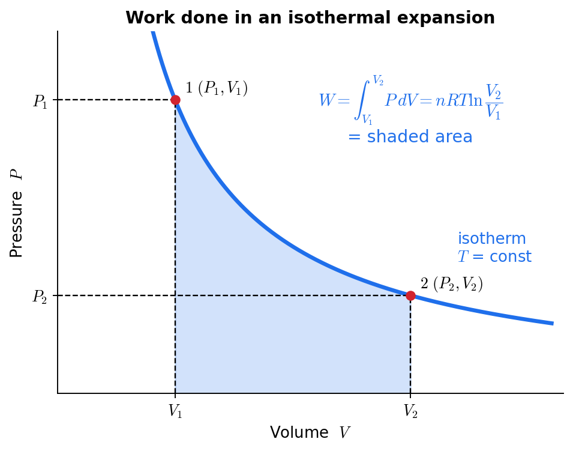
*Fig. 16 — The work equals the shaded area under the isotherm between $V_1$ and $V_2$.*

**Derivation.** For a small expansion $dV$, $dW=P\,dV$ with $P=\dfrac{nRT}{V}$:

$$W=\int_{V_1}^{V_2}P\,dV=nRT\int_{V_1}^{V_2}\frac{dV}{V}$$

$$\boxed{W=nRT\ln\frac{V_2}{V_1}=nRT\ln\frac{P_1}{P_2}=P_1V_1\ln\frac{V_2}{V_1}}$$

- Expansion ($V_2>V_1$): $W>0$, the gas absorbs an equal amount of heat from the reservoir.
- Compression ($V_2<V_1$): $W<0$, the gas gives out heat.

**Example.** $1\ \mathrm{mol}$ of gas at $300\ \mathrm K$ doubles its volume isothermally: $W=8.314\times300\times\ln2\approx1.73\times10^{3}\ \mathrm J$, and the gas absorbs the same $1.73\ \mathrm{kJ}$.

---

### 2017 · Q6(c) — Carnot engine between $177^\circ\mathrm C$ and $77^\circ\mathrm C$ receives $4200\ \mathrm J$ per cycle. Find heat rejected, efficiency and work done

**Given:** $T_1=177+273=450\ \mathrm K$, $T_2=77+273=350\ \mathrm K$, $Q_1=4200\ \mathrm J$.

**(i) Efficiency**

$$\eta=1-\frac{T_2}{T_1}=1-\frac{350}{450}=\frac{100}{450}=0.222=\boxed{22.2\ \%}$$

**(ii) Work done per cycle**

$$W=\eta\,Q_1=0.2222\times4200=\boxed{933.3\ \mathrm J}$$

**(iii) Heat rejected to the sink**

$$Q_2=Q_1-W=4200-933.3=\boxed{3266.7\ \mathrm J}$$

**Check:** $Q_2=Q_1\dfrac{T_2}{T_1}=4200\times\dfrac{350}{450}=3266.7\ \mathrm J$ ✓.

---

## 2017 — Physics-II, Q7

### 2017 · Q7(a) — What are entropy and unavailable energy?

*🏷️ entropy*

**Ans.**

**Entropy.** A state function with $dS=\dfrac{dQ_{\text{rev}}}{T}$ ($\mathrm{J\,K^{-1}}$); it measures the disorder of a system and never decreases for an isolated system (details: [2016 Q7(a)](#q2016-7a)).

**Unavailable energy.** The part of the heat taken from a source that **cannot be converted into work** because it must be rejected to the sink.

Suppose heat $Q_1$ is taken at $T_1$ and the coldest available sink is at $T_0$. The maximum work (Carnot) is

$$W_{\max}=Q_1\left(1-\frac{T_0}{T_1}\right)$$

and the unavailable energy is

$$\boxed{Q_{\text{unavail}}=Q_1\frac{T_0}{T_1}=T_0\,\Delta S},\qquad \Delta S=\frac{Q_1}{T_1}$$

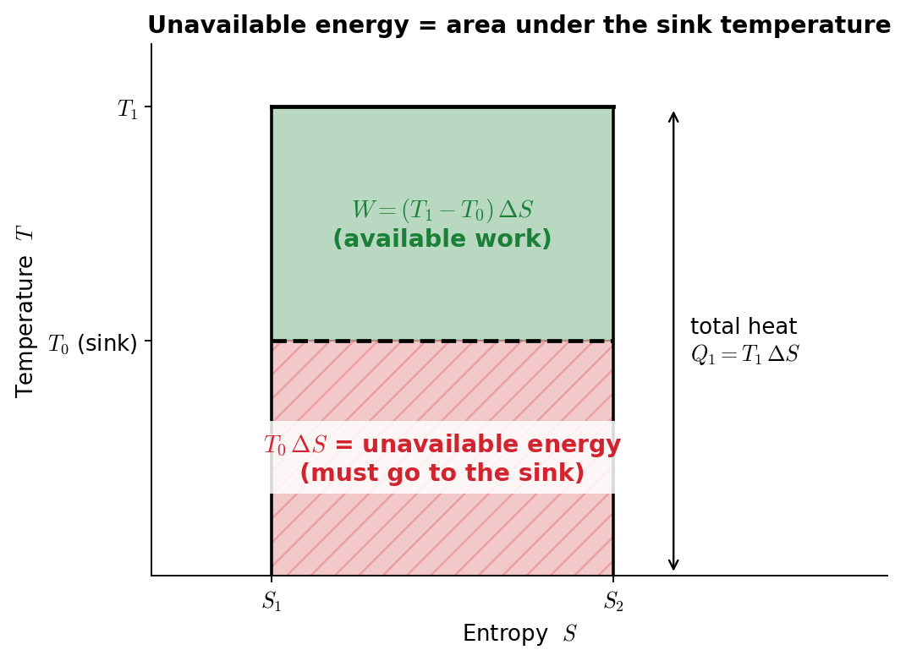
*Fig. 17 — On a $T$–$S$ diagram, the area above $T_0$ is the available work; the area below $T_0$ is the unavailable energy $T_0\Delta S$.*

**Link with entropy.** Every increase of entropy $\Delta S_{\text{univ}}$ in an irreversible process wastes work capacity equal to $T_0\,\Delta S_{\text{univ}}$ (the "degradation of energy").

**Example.** $1000\ \mathrm J$ from a $600\ \mathrm K$ source, sink at $300\ \mathrm K$: $\Delta S=\dfrac{1000}{600}=1.667\ \mathrm{J\,K^{-1}}$; unavailable $=300\times1.667=500\ \mathrm J$, available work $=500\ \mathrm J$. If the heat first leaks irreversibly into a $400\ \mathrm K$ body, the available work drops to $1000\left(1-\tfrac{300}{400}\right)=250\ \mathrm J$; the loss of $250\ \mathrm J$ equals $T_0\Delta S_{\text{univ}}=300\left(\tfrac{1000}{400}-\tfrac{1000}{600}\right)=250\ \mathrm J$ ✓.

---

### 2017 · Q7(b) — Show that entropy remains constant in a reversible process

*🏷️ entropy*

**Ans.**

**Step 1 — $\oint dQ/T=0$ for a reversible cycle.** For a Carnot cycle $\dfrac{Q_1}{T_1}=\dfrac{Q_2}{T_2}$, i.e. $\dfrac{Q_1}{T_1}-\dfrac{Q_2}{T_2}=0$ (heat absorbed counted positive, rejected negative). Any reversible cycle can be replaced by a very large number of thin Carnot cycles (zig-zag of isotherms and adiabatics); the internal parts cancel, so for the whole cycle

$$\oint\frac{dQ_{\text{rev}}}{T}=0$$

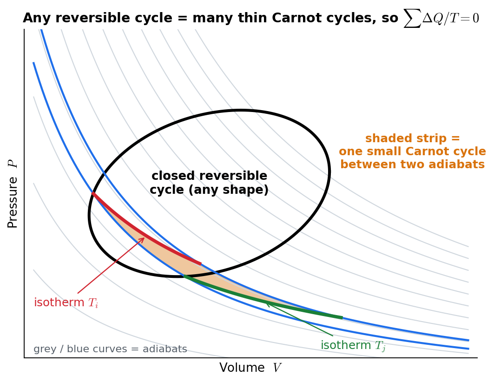
*Fig. 18 — A thin Carnot strip between two adiabats; summing many strips reproduces any closed reversible cycle.*

**Step 2 — entropy is a state function.** Since $\oint dQ_{\text{rev}}/T=0$, the integral $\int_1^2 dQ_{\text{rev}}/T$ is the same for every reversible path between states 1 and 2, so $dS=dQ_{\text{rev}}/T$ is an exact differential.

**Step 3 — consequences for a reversible process**

- *Reversible adiabatic process:* $dQ=0\Rightarrow dS=0$, i.e. $S$ = constant (isentropic).
- *Universe (system + surroundings):* a reversible heat transfer $dQ$ at temperature $T$ takes $dQ$ from the surroundings and gives it to the system at the same $T$:

$$dS_{\text{sys}}=\frac{dQ}{T},\quad dS_{\text{surr}}=-\frac{dQ}{T}\;\Rightarrow\;\Delta S_{\text{universe}}=0\ \blacksquare$$

---

### 2017 · Q7(c) — Derive the Clausius–Clapeyron equation

**Short-form answer** (full explanation, applications and figures: [2016 Q7(b)](#q2016-7b)).

Take unit mass of liquid in equilibrium with its vapour at $(T,P)$ and carry it round a thin Carnot cycle between $(T,P)$ and $(T-dT,\,P-dP)$ (Fig. 9):

1. Isothermal vaporisation at $T$: heat absorbed $Q_1=L$, volume $v_1\to v_2$.
2. Adiabatic fall to $T-dT$; isothermal condensation at $T-dT$; adiabatic return.
3. Net work = enclosed area $=dP\,(v_2-v_1)$.
4. Carnot efficiency: $\dfrac{W}{Q_1}=\dfrac{dT}{T}$ ⟹ $\dfrac{dP\,(v_2-v_1)}{L}=\dfrac{dT}{T}$.

$$\boxed{\frac{dP}{dT}=\frac{L}{T\,(v_2-v_1)}}$$

---

### 2017 · Q7(d) — Efficiency of an engine requiring $3\times10^{6}$ cal per horsepower; comparison with a perfect reversible engine ($100^\circ\mathrm C$, $0^\circ\mathrm C$)

> [!NOTE]
> The printed "per horsepower" is read as **per horsepower-hour** (heat per unit *work*), as in the 2016 version of this question. Power alone cannot be compared with heat.

**Short-form answer** (full working and figure: [2016 Q7(c)](#q2016-7c)).

- Work per hp·h: $746\times3600=2.686\times10^{6}\ \mathrm J$.
- Heat supplied: $3\times10^{6}\ \mathrm{cal}\times4.2=1.26\times10^{7}\ \mathrm J$.
- $\eta=\dfrac{2.686\times10^{6}}{1.26\times10^{7}}=\boxed{21.3\ \%}$
- $\eta_{\text{rev}}=\dfrac{373-273}{373}=\boxed{26.8\ \%}$
- Ratio $\eta/\eta_{\text{rev}}=0.795\approx80\ \%$: the engine achieves about four-fifths of the ideal efficiency.

---

## 2018 — Physics-II, Q3

### 2018 · Q3(a) — Define heat and temperature

*➕ from Ch. 6*

➕ *Added from the Kinetic Theory & Thermal Physics chapter.*

**Ans.**

- **Heat** is the energy transferred between two bodies (or a body and its surroundings) solely because of a temperature difference; it flows from hot to cold. Unit: joule ($1\ \mathrm{cal}=4.2\ \mathrm J$). Quantity: $Q=mc\,\Delta T$ for a temperature change, $Q=mL$ for a change of state. (More: [2015 Q5(a)](#q2015-5a).)
- **Temperature** is the degree of hotness of a body; it determines the direction of heat flow and is proportional to the mean translational kinetic energy of the molecules, $\tfrac32k_BT$. Unit: kelvin (K) or degree Celsius, $T=t+273$. (More: [2016 Q5(a)](#q2016-5a).)

---

## 2018 — Physics-II, Q5

### 2018 · Q5(c) — Show that the adiabatic curves are steeper than isothermal curves

**Ans.**

Compare the slopes of the two curves on a $P$–$V$ diagram **at the same point** (same $P$ and $V$).

**Isothermal curve** ($PV=$ const): differentiate, $P\,dV+V\,dP=0$:

$$\left(\frac{dP}{dV}\right)_{\text{iso}}=-\frac{P}{V}$$

**Adiabatic curve** ($PV^{\gamma}=$ const): differentiate, $V^{\gamma}dP+\gamma PV^{\gamma-1}dV=0$:

$$\left(\frac{dP}{dV}\right)_{\text{adi}}=-\gamma\,\frac{P}{V}$$

Dividing,

$$\boxed{\frac{\text{slope}_{\text{adi}}}{\text{slope}_{\text{iso}}}=\gamma>1}$$

because $\gamma=C_P/C_V>1$ for every gas. Hence the adiabatic curve is **$\gamma$ times steeper** than the isothermal curve through the same point.

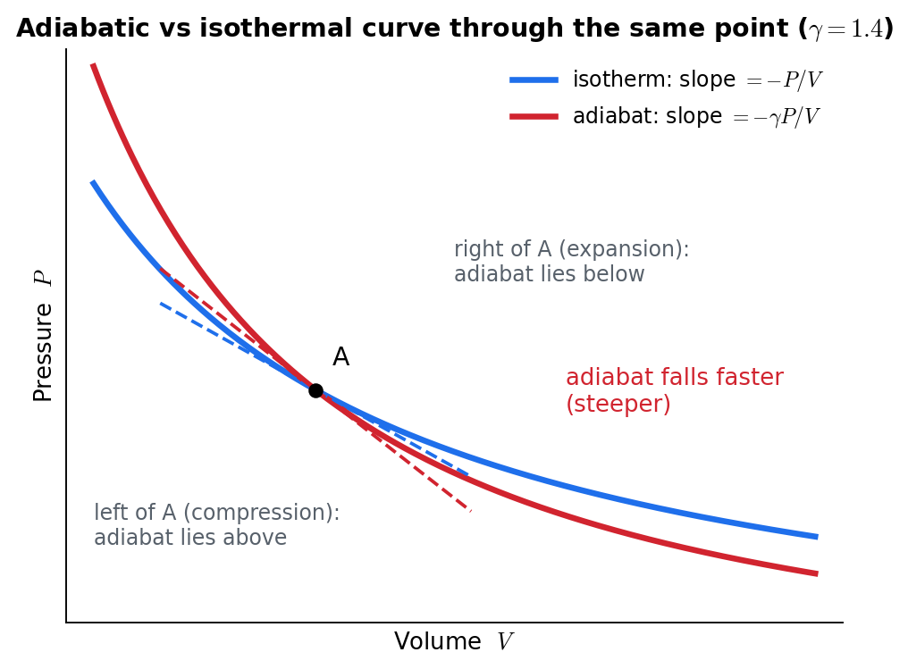
*Fig. 19 — Through point A the adiabat (red, slope $-\gamma P/V$) falls faster than the isotherm (blue, slope $-P/V$).*

**Physical reason.** In an isothermal expansion, heat flows in and keeps $T$ constant, so $P$ falls only because $V$ increases. In an adiabatic expansion no heat enters; the gas does work at the expense of its own internal energy, so it also **cools** and $P$ falls faster. In compression the reverse happens: the adiabatic pressure rises faster.

---

## 2018 — Physics-II, Q7

### 2018 · Q7(a) — What is entropy?

*🏷️ entropy*

**Short-form answer** (full answer with figure: [2016 Q7(a)](#q2016-7a)).

Entropy $S$ is a **state function** defined by

$$dS=\frac{dQ_{\text{rev}}}{T},\qquad \Delta S=\int_1^2\frac{dQ_{\text{rev}}}{T}\quad(\mathrm{J\,K^{-1}})$$

It is a measure of the **disorder** of a system ($S=k_B\ln W$). For a reversible adiabatic process $\Delta S=0$; for any real (irreversible) process in an isolated system $\Delta S>0$. Example: melting $1\ \mathrm{kg}$ of ice at $0^\circ\mathrm C$ gives $\Delta S=\dfrac{L}{T}=\dfrac{3.34\times10^{5}}{273.15}\approx1.22\ \mathrm{kJ\,K^{-1}}$.

---

### 2018 · Q7(b) — Explain the latent-heat (Clausius–Clapeyron) equation

**Short-form answer** (full derivation, figures and applications: [2016 Q7(b)](#q2016-7b)).

**Statement.** The rate of change of the equilibrium pressure with temperature during a change of phase is

$$\boxed{\frac{dP}{dT}=\frac{L}{T\,(v_2-v_1)}}$$

**Derivation in brief.** A thin Carnot cycle between $(T,P)$ and $(T-dT,P-dP)$ in the liquid–vapour region absorbs $L$ at $T$ and does work $dP\,(v_2-v_1)$; equating the efficiency $\dfrac{dP\,(v_2-v_1)}{L}$ with the Carnot value $\dfrac{dT}{T}$ gives the result.

**Uses.**

| Change of phase | $v_2-v_1$ | $dP/dT$ | Consequence |
|---|---|---|---|
| Liquid → vapour | large, positive | positive | Boiling point rises with pressure (pressure cooker) |
| Ice → water | negative | negative | Melting point falls with pressure (ice skating, regelation) |

Numerically, $\left(\dfrac{dT}{dP}\right)_{\text{ice}}\approx-0.0075\ \mathrm{K\,atm^{-1}}$ and $\left(\dfrac{dP}{dT}\right)_{\text{water, }100^\circ\mathrm C}\approx3.6\ \mathrm{kPa\,K^{-1}}$.

---

### 2018 · Q7(c) — Show that the entropy change is constant (zero) in a reversible Carnot cycle

*🏷️ entropy*

**Ans.**

Go round the Carnot cycle ABCDA (Fig. 12) and add up $\Delta S=\int dQ/T$ for each stroke:

| Stroke | Process | $\Delta S$ |
|---|---|---|
| A → B | Isothermal at $T_1$, absorbs $Q_1$ | $+\dfrac{Q_1}{T_1}$ |
| B → C | Adiabatic, $dQ=0$ | $0$ |
| C → D | Isothermal at $T_2$, rejects $Q_2$ | $-\dfrac{Q_2}{T_2}$ |
| D → A | Adiabatic, $dQ=0$ | $0$ |

$$\Delta S_{\text{cycle}}=\frac{Q_1}{T_1}-\frac{Q_2}{T_2}$$

For the Carnot cycle $\dfrac{Q_1}{T_1}=\dfrac{Q_2}{T_2}$ (proved in [2016 Q8(b)](#q2016-8b)), therefore

$$\boxed{\Delta S_{\text{cycle}}=\oint\frac{dQ}{T}=0}$$

On the $T$–$S$ diagram the cycle is a **closed rectangle**: the working substance returns to its starting entropy $S_1$ (the lateral sides are isentropic). Also, entropy lost by the source ($-Q_1/T_1$) equals that gained by the sink ($+Q_2/T_2$), so the entropy of the universe is unchanged.

---

## 2018 — Physics-II, Q8

### 2018 · Q8(a) — State and explain the second law of thermodynamics

**Short-form answer** (full answer with the equivalence proof and the table of differences from the first law: [2017 Q6(a)](#q2017-6a)).

- **Kelvin–Planck:** no cyclic device can take heat from one reservoir and convert it *entirely* into work.
- **Clausius:** heat cannot pass from a colder to a hotter body by itself.
- **Entropy form:** $\Delta S_{\text{universe}}\ge0$.

*Explanation:* every engine must reject heat to a cold sink, so $\eta\le1-T_2/T_1<1$; every refrigerator needs work input; and natural processes (heat conduction, free expansion, mixing) run only in one direction. The second law is therefore the law of **direction**, whereas the first law is only the law of **energy balance**.

*Fig. 20 — A 100 %-efficient engine and a "free" refrigerator are both impossible.*

---

### 2018 · Q8(b) — What is specific heat capacity? For one mole of an ideal gas show that $C_P-C_V=R$

**Ans.**

**Specific heat capacity.** The heat needed to raise the temperature of unit mass of a substance by $1\ \mathrm K$: $c=\dfrac{1}{m}\dfrac{dQ}{dT}$ ($\mathrm{J\,kg^{-1}K^{-1}}$). The **molar heat capacity** $C=Mc$ refers to one mole ($\mathrm{J\,mol^{-1}K^{-1}}$). For a gas there are two:

- $C_V$ at constant volume; $\;C_P$ at constant pressure.

**Proof of $C_P-C_V=R$ (1 mole of an ideal gas).**

*(a) Heating at constant volume.* No work is done ($dV=0$), so $dQ=dU$:

$$C_V=\left(\frac{dQ}{dT}\right)_V=\frac{dU}{dT}\;\Rightarrow\;dU=C_V\,dT$$

Because the internal energy of an ideal gas depends on $T$ only (Joule's law), $dU=C_V\,dT$ holds for **any** process of the gas.

*(b) Heating at constant pressure.* By the first law, $dQ=dU+P\,dV=C_V\,dT+P\,dV$, so

$$C_P=\left(\frac{dQ}{dT}\right)_P=C_V+P\left(\frac{dV}{dT}\right)_P$$

*(c) Use the gas law.* For one mole $PV=RT$; at constant $P$, $P\,dV=R\,dT$, i.e. $P\left(\dfrac{dV}{dT}\right)_P=R$. Therefore

$$\boxed{C_P-C_V=R}$$

**Consequences.** With $\gamma=\dfrac{C_P}{C_V}$:

$$C_V=\frac{R}{\gamma-1},\qquad C_P=\frac{\gamma R}{\gamma-1}$$

| Gas type | $C_V$ | $C_P$ | $\gamma$ |
|---|---|---|---|
| Monatomic (He) | $\tfrac32R=12.47$ | $\tfrac52R=20.79$ | $1.67$ |
| Diatomic (air, $\mathrm{N_2}$) | $\tfrac52R=20.79$ | $\tfrac72R=29.10$ | $1.40$ |

(values in $\mathrm{J\,mol^{-1}K^{-1}}$)

---

### 2018 · Q8(c) — What is a Carnot engine? Show that the Carnot cycle is a reversible process

**Ans.**

**Carnot engine.** An ideal heat engine that works on the **Carnot cycle** between two reservoirs at fixed temperatures $T_1$ (source) and $T_2$ (sink), using an ideal gas in a perfectly insulated cylinder with a frictionless piston. The cycle consists of **four reversible strokes**: isothermal expansion, adiabatic expansion, isothermal compression, adiabatic compression (Fig. 12). Its efficiency $1-T_2/T_1$ is the maximum possible.

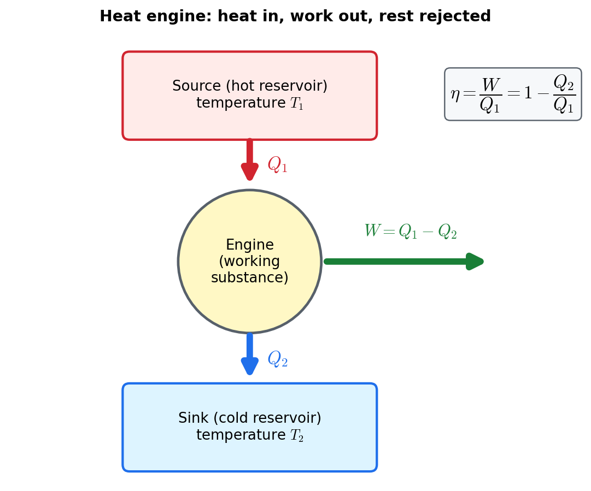
*Fig. 21 — Heat engine: $Q_1$ taken from the source, work $W=Q_1-Q_2$ delivered, $Q_2$ rejected to the sink.*

**Proof that the cycle is reversible.** A process is reversible if it can be retraced exactly, restoring both system and surroundings. The Carnot cycle satisfies the conditions:

1. **Quasi-static strokes.** Every stroke is carried out infinitely slowly, so the gas is always in equilibrium; there is no friction (frictionless piston), no turbulence and no dissipation.
2. **Isothermal strokes exchange heat only at equal temperature.** During A→B the gas is at $T_1$ and touches the source at $T_1$ (no finite temperature difference); during C→D both are at $T_2$. So heat flow itself is reversible.
3. **Adiabatic strokes exchange no heat** ($Q=0$) because the cylinder is insulated.

**Run it backwards** (A→D→C→B→A): the gas takes $Q_2$ from the sink at $T_2$, work $W$ is done *on* the gas, and $Q_1=Q_2+W$ is delivered to the source at $T_1$ — the same magnitudes $Q_1$, $Q_2$, $W$ with signs reversed. Source, sink and gas all return to their original states: the cycle is **reversible** (it becomes a Carnot refrigerator).

**Entropy check.** $\Delta S_{\text{universe}}=-\dfrac{Q_1}{T_1}+\dfrac{Q_2}{T_2}+0=0$, as required for a reversible cycle.

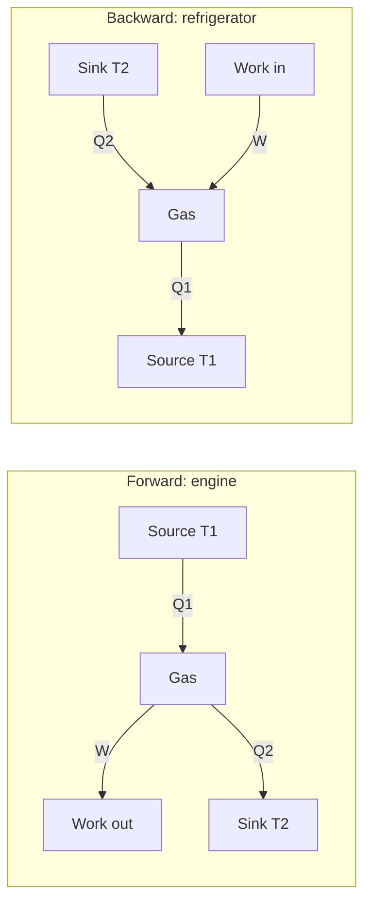

---

## 2019 — Physics-II, Q4

### 2019 · Q4(a) — Differentiate between heat and temperature

*➕ from Ch. 6*

➕ *Added from the Kinetic Theory & Thermal Physics chapter.*

**Ans.**

| Basis | Heat | Temperature |
|---|---|---|
| Nature | Energy in transit (a form of energy) | Degree of hotness; a state property |
| Cause / role | Flows because of a temperature difference | Decides the direction of heat flow |
| Microscopic meaning | Total energy transferred by molecular motion | Mean kinetic energy per molecule, $\tfrac32k_BT$ |
| Depends on mass? | Yes ($Q=mc\Delta T$) | No (an intensive quantity) |
| Unit | joule, calorie | kelvin, °C, °F |
| Instrument | Calorimeter | Thermometer |
| Additive? | Yes, heats of parts add | No: two cups at $50^\circ\mathrm C$ together are still $50^\circ\mathrm C$ |

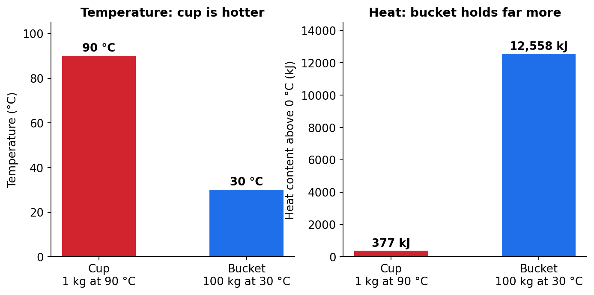
*Fig. 22 — A cup of water at $90^\circ\mathrm C$ is hotter than a bucket at $30^\circ\mathrm C$, yet the bucket holds about 33 times more heat ($12\,558$ kJ against $376.7$ kJ above $0^\circ\mathrm C$).*

---

### 2019 · Q4(b) — Show that the difference between $c_p$ and $c_v$ of a gas equals the characteristic gas constant of the gas

**Ans.**

The **characteristic gas constant** $r$ is the gas constant *per unit mass*: $PV=mrT$, with $r=\dfrac{R}{M}$ ($M$ = molar mass). Take $1$ unit mass of gas, so $PV=rT$.

1. **Constant volume.** $dW=0$, so the heat to raise the temperature by $dT$ is $dQ=dU$:
$$c_v\,dT=dU$$
2. **Constant pressure.** The gas expands and does work $P\,dV$:
$$c_p\,dT=dU+P\,dV=c_v\,dT+P\,dV$$
3. **Gas law at constant $P$:** $P\,dV=r\,dT$. Substituting,
$$c_p\,dT=c_v\,dT+r\,dT$$

$$\boxed{c_p-c_v=r}\qquad\left(\text{in heat units: }c_p-c_v=\frac{r}{J}\right)$$

So the difference of the two specific heats is exactly the characteristic gas constant (the work done by unit mass in expanding through $1\ \mathrm K$ at constant pressure). Multiplying by $M$ gives $C_P-C_V=R$.

**Example.** Air has $r=\dfrac{8.314}{0.029}=287\ \mathrm{J\,kg^{-1}K^{-1}}$; with $c_v=718\ \mathrm{J\,kg^{-1}K^{-1}}$, $c_p=718+287=1005\ \mathrm{J\,kg^{-1}K^{-1}}$ and $\gamma=\dfrac{1005}{718}=1.40$ ✓.

---

## 2020 — Physics-II, Q5

### 2020 · Q5(c) — Define molar specific heat. Find the relation between $C_P$ and $C_V$

*➕ from Ch. 6*

➕ *Added from the Kinetic Theory & Thermal Physics chapter (thermodynamic content).*

**Ans.**

**Molar specific heat** (molar heat capacity) $C$ is the heat required to raise the temperature of **one mole** of a substance by $1\ \mathrm K$:

$$C=\frac{1}{n}\frac{dQ}{dT}=Mc\qquad(\mathrm{J\,mol^{-1}K^{-1}})$$

For a gas: $C_V$ at constant volume, $C_P$ at constant pressure.

**Relation.** For one mole of ideal gas:

1. Constant $V$: $dQ=dU$, so $C_V\,dT=dU$ (true for any process because $U=U(T)$).
2. Constant $P$: $C_P\,dT=dU+P\,dV=C_V\,dT+P\,dV$.
3. $PV=RT\Rightarrow P\,dV=R\,dT$ at constant $P$.

$$\boxed{C_P-C_V=R}$$

so $C_P>C_V$ because extra heat is needed for expansion work; with $\gamma=C_P/C_V$, $C_V=\dfrac{R}{\gamma-1}$ and $C_P=\dfrac{\gamma R}{\gamma-1}$. (Full version with table: [2018 Q8(b)](#q2018-8b).)

---

## 2020 — Physics-II, Q6

### 2020 · Q6(a) — Derive the general expression for the establishment of Maxwell's thermodynamic relations

**Ans.**

**Starting point.** Combining the first and second laws for a reversible process on a simple system ($dQ=T\,dS$, $dW=P\,dV$):

$$dU=T\,dS-P\,dV$$

**Mathematical key (exact differentials).** If $Z$ is a state function of two variables, $dZ=M\,dx+N\,dy$ with $M=\left(\dfrac{\partial Z}{\partial x}\right)_y$ and $N=\left(\dfrac{\partial Z}{\partial y}\right)_x$. Since the order of partial differentiation does not matter, $\dfrac{\partial^2Z}{\partial y\,\partial x}=\dfrac{\partial^2Z}{\partial x\,\partial y}$, so

$$\boxed{\left(\frac{\partial M}{\partial y}\right)_x=\left(\frac{\partial N}{\partial x}\right)_y}$$

**Other potentials.** From $H=U+PV$, $F=U-TS$, $G=H-TS$ and $dU=T\,dS-P\,dV$:

$$dH=T\,dS+V\,dP,\qquad dF=-S\,dT-P\,dV,\qquad dG=-S\,dT+V\,dP$$

**Apply the condition to each** (all four are exact differentials):

| Potential | $M\,dx+N\,dy$ | Maxwell relation |
|---|---|---|
| $dU=T\,dS-P\,dV$ | $x=S,\ y=V$ | $\left(\dfrac{\partial T}{\partial V}\right)_S=-\left(\dfrac{\partial P}{\partial S}\right)_V$ |
| $dH=T\,dS+V\,dP$ | $x=S,\ y=P$ | $\left(\dfrac{\partial T}{\partial P}\right)_S=\left(\dfrac{\partial V}{\partial S}\right)_P$ |
| $dF=-S\,dT-P\,dV$ | $x=T,\ y=V$ | $\left(\dfrac{\partial S}{\partial V}\right)_T=\left(\dfrac{\partial P}{\partial T}\right)_V$ |
| $dG=-S\,dT+V\,dP$ | $x=T,\ y=P$ | $\left(\dfrac{\partial S}{\partial P}\right)_T=-\left(\dfrac{\partial V}{\partial T}\right)_P$ |

These four are **Maxwell's thermodynamic relations**. They link quantities that are hard to measure (entropy changes) to ones that are easy ($P,V,T$).

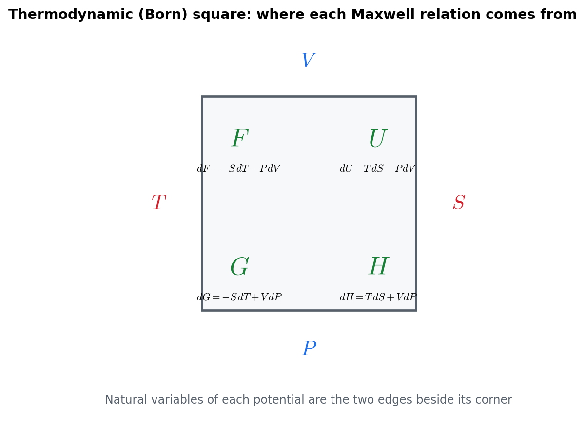
*Fig. 23 — Memory aid (Born square): each potential sits between the two variables that are its natural variables.*

---

### 2020 · Q6(b) — Show that the given thermodynamic relations hold (symbols with their usual meanings)

> [!WARNING]
> The two expressions printed in the paper were **lost in the PDF text extraction** and cannot be recovered with confidence; the bank only records that they are two Maxwell-type identities. Instead of guessing, **all four Maxwell relations** (which cover any such pair) are proved below, and each is **verified with an explicit ideal gas** so that the demonstration is complete whichever two were printed. Please compare with your paper's question and use the matching ones.

**Part 1 — general proof.** Each relation was proved from the exactness of $dU$, $dH$, $dF$, $dG$ in [2020 Q6(a)](#q2020-6a).

**Part 2 — explicit verification for one mole of ideal gas** ($PV=RT$, $\gamma=C_P/C_V$, $S=C_V\ln T+R\ln V+\text{const}=C_P\ln T-R\ln P+\text{const}$).

1. $\left(\dfrac{\partial S}{\partial V}\right)_T=\left(\dfrac{\partial P}{\partial T}\right)_V$: LHS $=\dfrac{R}{V}$; $P=\dfrac{RT}{V}\Rightarrow\left(\dfrac{\partial P}{\partial T}\right)_V=\dfrac{R}{V}$ ✓
2. $\left(\dfrac{\partial S}{\partial P}\right)_T=-\left(\dfrac{\partial V}{\partial T}\right)_P$: LHS $=-\dfrac{R}{P}$; $V=\dfrac{RT}{P}\Rightarrow\left(\dfrac{\partial V}{\partial T}\right)_P=\dfrac{R}{P}$, so RHS $=-\dfrac{R}{P}$ ✓
3. $\left(\dfrac{\partial T}{\partial V}\right)_S=-\left(\dfrac{\partial P}{\partial S}\right)_V$: along an isentrope $TV^{\gamma-1}=$ const, so LHS $=-(\gamma-1)\dfrac{T}{V}$. At constant $V$, $S=C_V\ln T+$ const $\Rightarrow\left(\dfrac{\partial T}{\partial S}\right)_V=\dfrac{T}{C_V}$, hence $\left(\dfrac{\partial P}{\partial S}\right)_V=\dfrac{R}{V}\cdot\dfrac{T}{C_V}=(\gamma-1)\dfrac{T}{V}$ (as $R/C_V=\gamma-1$); RHS $=-(\gamma-1)\dfrac{T}{V}$ ✓
4. $\left(\dfrac{\partial T}{\partial P}\right)_S=\left(\dfrac{\partial V}{\partial S}\right)_P$: along an isentrope $T=kP^{(\gamma-1)/\gamma}$, so LHS $=\dfrac{\gamma-1}{\gamma}\dfrac{T}{P}$. At constant $P$, $\left(\dfrac{\partial T}{\partial S}\right)_P=\dfrac{T}{C_P}$, hence $\left(\dfrac{\partial V}{\partial S}\right)_P=\dfrac{R}{P}\cdot\dfrac{T}{C_P}=\dfrac{\gamma-1}{\gamma}\dfrac{T}{P}$ (as $R/C_P=\dfrac{\gamma-1}{\gamma}$) ✓

**Part 3 — two standard consequences** (useful if the printed identities are of this type). Using relations 1 and 2 with $\left(\dfrac{\partial S}{\partial T}\right)_V=\dfrac{C_V}{T}$ and $\left(\dfrac{\partial S}{\partial T}\right)_P=\dfrac{C_P}{T}$:

$$T\,dS=C_V\,dT+T\left(\frac{\partial P}{\partial T}\right)_V dV,\qquad T\,dS=C_P\,dT-T\left(\frac{\partial V}{\partial T}\right)_P dP$$

and, from $dU=T\,dS-P\,dV$, the energy equation $\left(\dfrac{\partial U}{\partial V}\right)_T=T\left(\dfrac{\partial P}{\partial T}\right)_V-P$ (which gives $U$ independent of $V$ for an ideal gas).

---

## 2020 — Physics-II, Q7

### 2020 · Q7(a) — What is a Carnot engine? Show how the Carnot cycle is a reversible process

**Short-form answer** (full answer with figure and the forward/backward diagram: [2018 Q8(c)](#q2018-8c)).

**Carnot engine:** an ideal engine whose working substance (ideal gas) undergoes the **Carnot cycle** — isothermal expansion at $T_1$, adiabatic expansion, isothermal compression at $T_2$, adiabatic compression — between a source $T_1$ and a sink $T_2$.

**Why the cycle is reversible**

1. Every stroke is quasi-static with no friction or dissipation.
2. Heat is exchanged only during the isothermal strokes and only between bodies at the **same** temperature (gas at $T_1$ with the source, gas at $T_2$ with the sink), so there is no irreversible heat flow.
3. The adiabatic strokes exchange no heat.

Run backwards, the gas absorbs the same $Q_2$ at $T_2$, receives the same work $W$ and delivers the same $Q_1$ at $T_1$ — everything is restored. Also $\Delta S_{\text{universe}}=-\dfrac{Q_1}{T_1}+\dfrac{Q_2}{T_2}=0$.

---

### 2020 · Q7(b) — Define the efficiency of a Carnot engine. Find the efficiency between the steam point and the ice point

**Ans.**

**Efficiency** of an engine is the fraction of the heat taken from the source that is converted into useful work:

$$\eta=\frac{\text{work output}}{\text{heat input}}=\frac{W}{Q_1}=\frac{Q_1-Q_2}{Q_1}=1-\frac{Q_2}{Q_1}$$

For a Carnot engine $\dfrac{Q_2}{Q_1}=\dfrac{T_2}{T_1}$, so $\eta=1-\dfrac{T_2}{T_1}$ (derived in [2016 Q8(b)](#q2016-8b)).

**Numerical.** Source = steam point $=100^\circ\mathrm C=373\ \mathrm K$; sink = ice point $=0^\circ\mathrm C=273\ \mathrm K$.

$$\eta=1-\frac{273}{373}=\frac{100}{373}=0.268=\boxed{26.8\ \%}$$

Even a perfect engine between boiling and freezing water converts only about **27 %** of the heat into work.

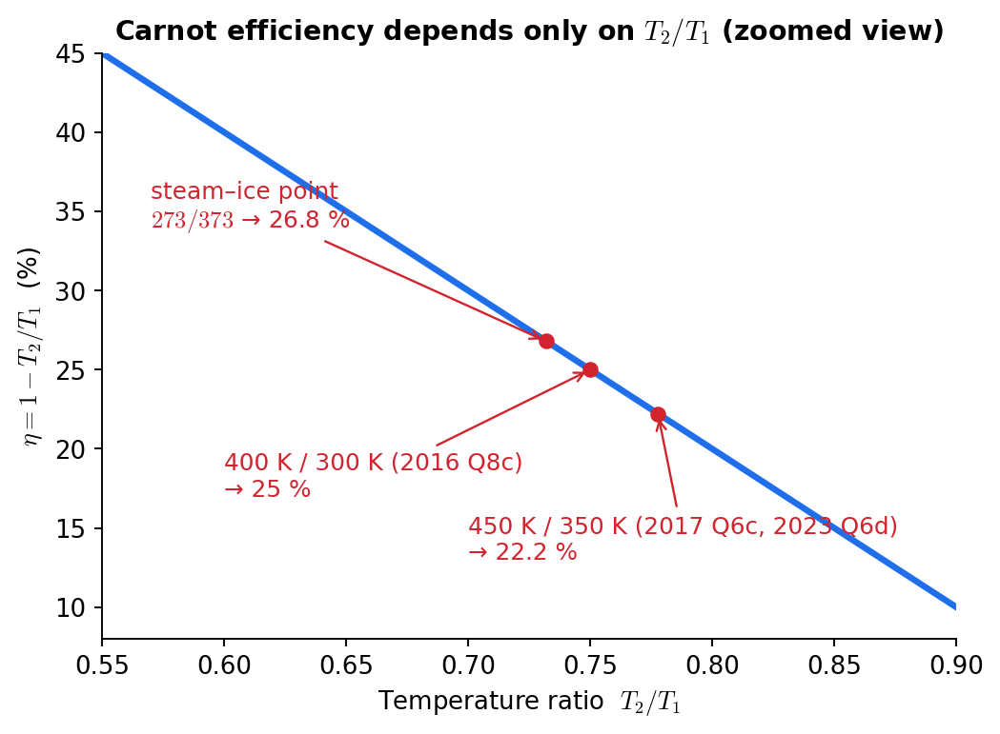
*Fig. 24 — $\eta$ against $T_2/T_1$, with the Carnot problems of this chapter marked.*

---

## 2021 — Physics-II, Q5

### 2021 · Q5(a) — Show that entropy in reversible processes remains the same

*🏷️ entropy*

**Short-form answer** (full proof with the Carnot-strip figure: [2017 Q7(b)](#q2017-7b)).

1. For a reversible Carnot cycle, $\dfrac{Q_1}{T_1}=\dfrac{Q_2}{T_2}$, i.e. $\oint\dfrac{dQ}{T}=0$.
2. Any reversible cycle is a sum of many thin Carnot cycles, so $\oint\dfrac{dQ_{\text{rev}}}{T}=0$ for every reversible cycle. Hence $dS=\dfrac{dQ_{\text{rev}}}{T}$ is an exact differential: $S$ is a state function.
3. **Reversible adiabatic process:** $dQ=0\Rightarrow\Delta S=0$ (entropy is constant — *isentropic*).
4. **Whole universe:** a reversible heat transfer $dQ$ at temperature $T$ gives $dS_{\text{sys}}=+\dfrac{dQ}{T}$ and $dS_{\text{surr}}=-\dfrac{dQ}{T}$, so $\boxed{\Delta S_{\text{universe}}=0}$.

---

### 2021 · Q5(b) — What is an isothermal process? Derive an expression for the work done during an isothermal process

**Short-form answer** (full answer with figure and example: [2017 Q6(b)](#q2017-6b)).

An **isothermal process** takes place at constant temperature (slow change with the gas in contact with a heat reservoir). For an ideal gas $PV=nRT=$ const and $\Delta U=0$, so $Q=W$.

$$W=\int_{V_1}^{V_2}P\,dV=nRT\int_{V_1}^{V_2}\frac{dV}{V}\;\Longrightarrow\;\boxed{W=nRT\ln\frac{V_2}{V_1}=nRT\ln\frac{P_1}{P_2}}$$

Positive for expansion (heat absorbed), negative for compression (heat rejected). Example: $1\ \mathrm{mol}$ at $300\ \mathrm K$ doubling its volume does $W=8.314\times300\times\ln2\approx1.73\ \mathrm{kJ}$.

---

## 2021 — Physics-II, Q7

### 2021 · Q7(a) — What is a Carnot cycle?

**Ans.**

The **Carnot cycle** is the reversible cycle of four processes — two isothermal and two adiabatic — performed by a working substance (ideal gas) between two heat reservoirs at temperatures $T_1>T_2$. It gives the maximum possible efficiency for any engine working between those temperatures.

| Stroke | Process | Heat | Result |
|---|---|---|---|
| A → B | Isothermal expansion at $T_1$ | absorbs $Q_1=RT_1\ln\dfrac{V_B}{V_A}$ | gas does work |
| B → C | Adiabatic expansion ($T_1\to T_2$) | $0$ | gas cools |
| C → D | Isothermal compression at $T_2$ | rejects $Q_2=RT_2\ln\dfrac{V_C}{V_D}$ | work done on gas |
| D → A | Adiabatic compression ($T_2\to T_1$) | $0$ | gas warms |

*Fig. 25 — Carnot cycle on $P$–$V$ and $T$–$S$ diagrams; the enclosed area is the net work $W=Q_1-Q_2$.*

Net work $W=Q_1-Q_2$ (area enclosed); $\Delta U=0$ over the cycle; efficiency $\eta=1-\dfrac{T_2}{T_1}$.

---

### 2021 · Q7(b) — Show that, in the temperature range $T_1$ and $T_2$, the efficiency of a Carnot engine is $\eta=\dfrac{T_1-T_2}{T_1}$

**Short-form answer** (full derivation: [2016 Q8(b)](#q2016-8b)).

Let one mole of ideal gas go round ABCD (Fig. 25), with $T_1>T_2$:

1. A→B isothermal at $T_1$: $Q_1=RT_1\ln\dfrac{V_B}{V_A}$.
2. B→C adiabatic: $T_1V_B^{\gamma-1}=T_2V_C^{\gamma-1}$.
3. C→D isothermal at $T_2$: $Q_2=RT_2\ln\dfrac{V_C}{V_D}$.
4. D→A adiabatic: $T_2V_D^{\gamma-1}=T_1V_A^{\gamma-1}$.

Dividing step 2 by step 4 gives $\dfrac{V_B}{V_A}=\dfrac{V_C}{V_D}$, so $\dfrac{Q_2}{Q_1}=\dfrac{T_2}{T_1}$ and

$$\eta=\frac{Q_1-Q_2}{Q_1}=1-\frac{T_2}{T_1}=\boxed{\frac{T_1-T_2}{T_1}}\ \blacksquare$$

---

### 2021 · Q7(c) — Distinguish between the first and second laws of thermodynamics

**Ans.**

| Basis | First law | Second law |
|---|---|---|
| Principle | Conservation of energy | Direction of natural processes; limit on heat → work conversion |
| Statement | $Q=\Delta U+W$ | Kelvin–Planck / Clausius; $\Delta S_{\text{univ}}\ge0$ |
| Quantity defined | Internal energy $U$ | Entropy $S$ (and absolute temperature scale) |
| Heat ⇄ work | They are equivalent; $W=JQ$ | Work converts fully to heat, but heat cannot convert fully to work |
| 100 %-efficient engine | Not forbidden | Forbidden: $\eta<1$ |
| Spontaneous heat flow cold → hot | Not forbidden (energy still conserved) | Forbidden |
| Reversibility | Does not distinguish reversible from irreversible | Distinguishes them ($\Delta S=0$ vs $>0$) |
| Violation | Perpetual motion of the first kind | Perpetual motion of the second kind |
| Example | Energy conserved when a gas expands and lifts a piston | A cup of hot tea cools by itself; it never re-heats by itself |

**In one line:** the first law says the books of energy must balance; the second law says which transactions are allowed.

---

### 2021 · Q7(d) — What is specific heat?

*➕ from Ch. 6*

**Ans.**

**Specific heat** $c$ of a substance is the quantity of heat required to raise the temperature of **unit mass** of it by **one degree**:

$$c=\frac{Q}{m\,\Delta T}\qquad\left(\mathrm{J\,kg^{-1}K^{-1}}\ \text{or}\ \mathrm{cal\,g^{-1}\,^\circ C^{-1}}\right)$$

The product $mc$ is the **heat capacity** of a body ($\mathrm{J\,K^{-1}}$). Water has the unusually high value $c=4186\ \mathrm{J\,kg^{-1}K^{-1}}$ ($1\ \mathrm{cal\,g^{-1}\,^\circ C^{-1}}$).

| Substance | $c\ (\mathrm{J\,kg^{-1}K^{-1}})$ |
|---|---|
| Water | $4186$ |
| Ice | $\approx2100$ |
| Aluminium | $\approx900$ |
| Copper | $\approx385$ |

A gas has two specific heats, $c_v$ and $c_p$, with $c_p-c_v=r/J$ ([2015 Q7(b)](#q2015-7b)).

**Example.** Heating $2\ \mathrm{kg}$ of water from $20^\circ\mathrm C$ to $70^\circ\mathrm C$: $Q=2\times4186\times50=4.19\times10^{5}\ \mathrm J$.

---

## 2021 — Physics-II, Q8

### 2021 · Q8(a) — State and explain the second law of thermodynamics

**Short-form answer** (full answer: [2017 Q6(a)](#q2017-6a); figure: Fig. 15).

- **Kelvin–Planck:** no cyclic engine can convert heat from a single reservoir *completely* into work.
- **Clausius:** heat does not flow from cold to hot *of itself*.
- **Entropy form:** $\Delta S_{\text{universe}}\ge0$.

Explanation: some heat $Q_2$ must always be rejected to a colder sink, so $\eta=1-\dfrac{Q_2}{Q_1}\le1-\dfrac{T_2}{T_1}<1$; a refrigerator needs work. The two statements are equivalent — a violation of one implies a violation of the other (see the proof in 2017 Q6(a)).

---

### 2021 · Q8(c) — Dry air at $15^\circ\mathrm C$ is expanded adiabatically to double its volume. Find the temperature ($\gamma=1.40$)

**Given:** $T_1=15+273=288\ \mathrm K$, $V_2=2V_1$, $\gamma=1.40$.

**Formula** (adiabatic, ideal gas): $T_1V_1^{\gamma-1}=T_2V_2^{\gamma-1}$.

$$T_2=T_1\left(\frac{V_1}{V_2}\right)^{\gamma-1}=288\times\left(\frac12\right)^{0.40}=288\times0.7579$$

$$\boxed{T_2\approx218\ \mathrm K\approx-55^\circ\mathrm C}$$

The gas cools by about $70\ \mathrm K$ because it does work at the expense of its internal energy.

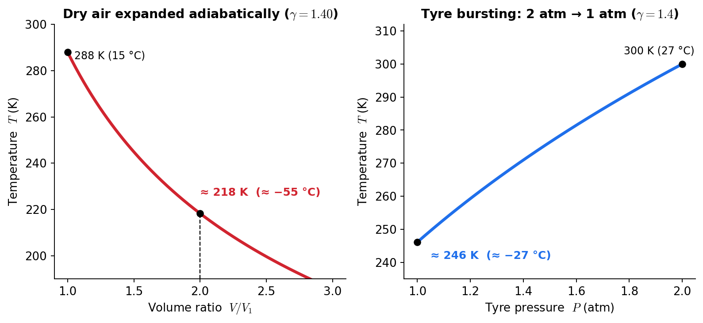
*Fig. 26 — Left: this question (air, volume doubled). Right: the bursting-tyre problem of [2023 Q5(c)](#q2023-5c).*

---

## 2022 — Physics-II, Q5

### 2022 · Q5(a) — What is the zeroth law of thermodynamics? Show that the first law is the law of conservation of energy

**Ans.**

**Zeroth law.** *If two bodies A and B are each in thermal equilibrium with a third body C, then A and B are in thermal equilibrium with each other.* Thermal equilibrium means equal temperature, so this law lets us define temperature and measure it with a thermometer (C). (See Fig. 5.)

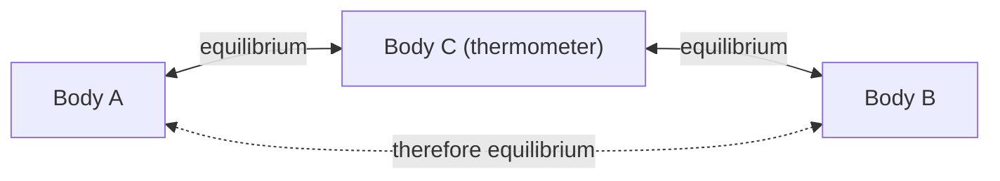

**First law as conservation of energy.**

1. Consider a closed system receiving heat $Q$ from the surroundings and doing work $W$ on them. Energy that enters minus energy that leaves must equal the **change of stored (internal) energy**:

$$\underbrace{Q}_{\text{energy in as heat}}-\underbrace{W}_{\text{energy out as work}}=\Delta U\;\;\Longrightarrow\;\;Q=\Delta U+W$$

2. *Isolated system* ($Q=0,\ W=0$): $\Delta U=0$ — the total energy is constant.
3. *Complete cycle* ($\Delta U=0$): $W=Q_{\text{net}}$ — work can be obtained only at the cost of an equal amount of heat; creating energy from nothing (perpetual motion of the first kind) is impossible.
4. *Joule's experiment:* a fixed amount of mechanical work always produces a fixed quantity of heat, $W/Q=J=4.2\ \mathrm{J\,cal^{-1}}$ — heat is a form of energy, so it is included in the energy account.

The first law is therefore the **conservation-of-energy principle extended to include heat**. ∎

---

### 2022 · Q5(b) — Show that the adiabatic curves are higher than isothermal curves

> [!NOTE]
> "Higher" is taken to mean **steeper**: at any point where an adiabatic and an isothermal curve intersect, the adiabatic one has the larger slope. (For a *compression* from that point the adiabatic curve indeed lies **above** the isothermal; for an *expansion* it lies below.)

**Short-form answer** (full explanation: [2018 Q5(c)](#q2018-5c); figure: Fig. 19).

- Isothermal: $PV=$ const ⟹ $\left(\dfrac{dP}{dV}\right)_T=-\dfrac{P}{V}$.
- Adiabatic: $PV^{\gamma}=$ const ⟹ $\left(\dfrac{dP}{dV}\right)_S=-\gamma\dfrac{P}{V}$.

$$\boxed{\frac{(dP/dV)_{\text{adi}}}{(dP/dV)_{\text{iso}}}=\gamma>1}$$

So through any point the adiabatic curve is $\gamma$ times steeper. Compressing from a given state, $P$ rises faster along the adiabatic (the gas also heats up), which is why the adiabatic curve lies higher on the compression side.

*Fig. 27 — Adiabatic (red) and isothermal (blue) curves through the same point.*

---

### 2022 · Q5(c) — What is a Carnot engine? Show that the Carnot cycle is a reversible process

**Short-form answer** (full answer with the forward/backward diagram: [2018 Q8(c)](#q2018-8c)).

**Carnot engine** — an ideal engine whose gas goes through the Carnot cycle: isothermal expansion at $T_1$, adiabatic expansion, isothermal compression at $T_2$, adiabatic compression.

**Reversible because:** (i) each stroke is quasi-static with no friction; (ii) heat is exchanged only isothermally with a reservoir at the *same* temperature as the gas, so there is no finite-$\Delta T$ heat flow; (iii) the adiabatic strokes exchange no heat. Run backwards it takes $Q_2$ from the sink, uses work $W$, and gives $Q_1$ to the source — the same quantities with opposite signs, restoring everything. $\Delta S_{\text{universe}}=-\dfrac{Q_1}{T_1}+\dfrac{Q_2}{T_2}=0$.

---

## 2022 — Physics-II, Q6

### 2022 · Q6(a) — Define molar specific heat. Find the relation between $C_P$ and $C_V$

*➕ from Ch. 6*

➕ *Added from the Kinetic Theory & Thermal Physics chapter (thermodynamic content).*

**Short-form answer** (same question as [2020 Q5(c)](#q2020-5c); full table of values: [2018 Q8(b)](#q2018-8b)).

**Molar specific heat:** heat needed to raise $1$ mole by $1\ \mathrm K$, $C=\dfrac1n\dfrac{dQ}{dT}$ ($\mathrm{J\,mol^{-1}K^{-1}}$).

For $1$ mole of ideal gas: $C_V\,dT=dU$; $C_P\,dT=C_V\,dT+P\,dV$; $PV=RT\Rightarrow P\,dV=R\,dT$ at constant $P$. Hence

$$\boxed{C_P-C_V=R}\qquad\left(\gamma=\frac{C_P}{C_V},\ \ C_V=\frac{R}{\gamma-1}\right)$$

Example: monatomic gas $C_V=\tfrac32R=12.47$, $C_P=\tfrac52R=20.79\ \mathrm{J\,mol^{-1}K^{-1}}$, $\gamma=1.67$.

---

### 2022 · Q6(b) — What is an isentropic process? Derive an expression for the work done during an isentropic process

**Ans.**

An **isentropic process** is a process in which the entropy of the system remains constant, $\Delta S=0$. A **reversible adiabatic** process is isentropic ($dQ_{\text{rev}}=0\Rightarrow dS=0$). On a $T$–$S$ diagram it is a vertical line.

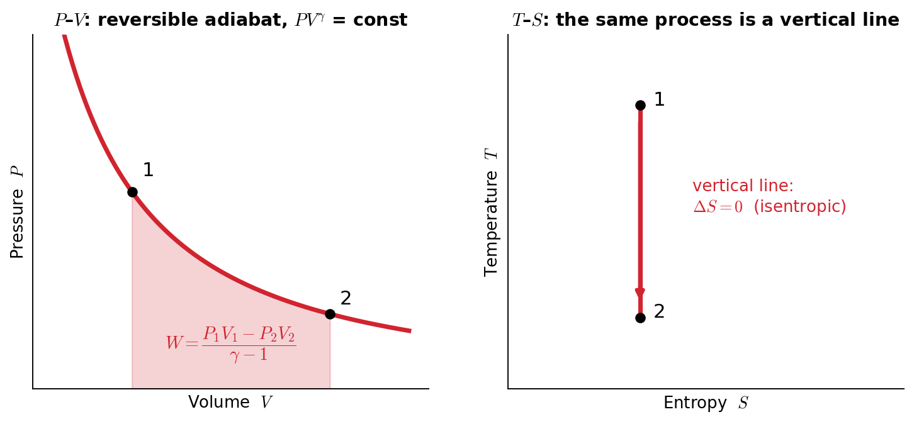
*Fig. 28 — The same isentropic expansion 1 → 2 on a $P$–$V$ diagram (curve; work = shaded area) and on a $T$–$S$ diagram (vertical line).*

**Equation of the path.** For an ideal gas, $dQ=0$ gives $nC_V\,dT=-P\,dV$; with $P=\dfrac{nRT}{V}$ this becomes $\dfrac{dT}{T}+(\gamma-1)\dfrac{dV}{V}=0$, so $TV^{\gamma-1}=$ const, i.e. $PV^{\gamma}=K$ (proved fully in [2023 Q5(b)](#q2023-5b)).

**Work done.** With $P=KV^{-\gamma}$:

$$W=\int_{V_1}^{V_2}P\,dV=K\int_{V_1}^{V_2}V^{-\gamma}dV=\frac{K}{1-\gamma}\left(V_2^{1-\gamma}-V_1^{1-\gamma}\right)$$

Using $K=P_1V_1^{\gamma}=P_2V_2^{\gamma}$:

$$\boxed{W=\frac{P_1V_1-P_2V_2}{\gamma-1}=\frac{nR\,(T_1-T_2)}{\gamma-1}}$$

**Check with the first law.** $Q=0\Rightarrow W=-\Delta U=nC_V(T_1-T_2)=\dfrac{nR\,(T_1-T_2)}{\gamma-1}$ ✓ (since $C_V=\dfrac{R}{\gamma-1}$).

**Example.** One mole of air ($\gamma=1.4$) expands isentropically from $300\ \mathrm K$ to $250\ \mathrm K$: $W=\dfrac{8.314\times50}{0.4}\approx1.04\ \mathrm{kJ}$.

---

### 2022 · Q6(c) — $0.1\ \mathrm{m^3}$ of air at $1.5\ \mathrm{bar}$ expands isothermally to $0.5\ \mathrm{m^3}$. Find the final pressure and the heat supplied

**Given:** $V_1=0.1\ \mathrm{m^3}$, $P_1=1.5\ \mathrm{bar}=1.5\times10^{5}\ \mathrm{Pa}$, $V_2=0.5\ \mathrm{m^3}$, $T$ = const.

**(i) Final pressure** (Boyle's law, $P_1V_1=P_2V_2$):

$$P_2=P_1\frac{V_1}{V_2}=1.5\times\frac{0.1}{0.5}=\boxed{0.3\ \mathrm{bar}}$$

**(ii) Heat supplied.** For an isothermal process $\Delta U=0$, so $Q=W$:

$$Q=W=P_1V_1\ln\frac{V_2}{V_1}=(1.5\times10^{5})(0.1)\ln5=15\,000\times1.6094$$

$$\boxed{Q\approx2.41\times10^{4}\ \mathrm J\approx24.1\ \mathrm{kJ}}$$

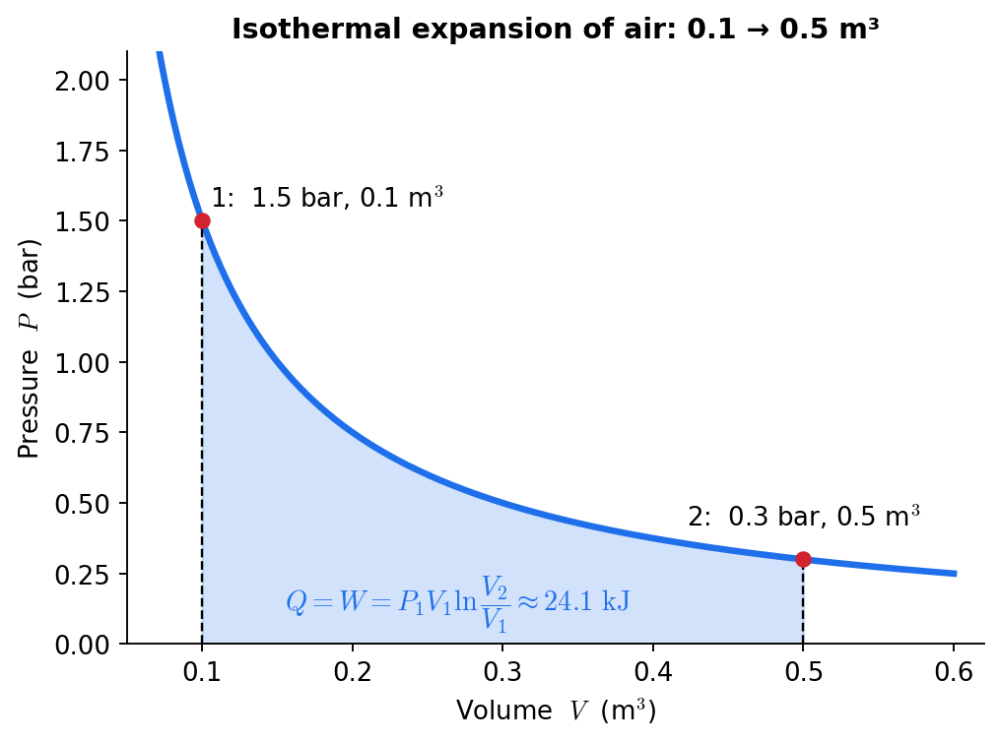
*Fig. 29 — The shaded area under the isotherm from $0.1$ to $0.5\ \mathrm{m^3}$ is the heat absorbed.*

---

## 2022 — Physics-II, Q7

### 2022 · Q7(a) — What are entropy and unavailable energy?

*🏷️ entropy*

**Short-form answer** (full answer with figure and numerical example: [2017 Q7(a)](#q2017-7a)).

- **Entropy:** state function, $dS=\dfrac{dQ_{\text{rev}}}{T}$ ($\mathrm{J\,K^{-1}}$); a measure of disorder, $S=k_B\ln W$; unchanged in reversible processes, increasing in irreversible ones.
- **Unavailable energy:** the part of the heat drawn from a source at $T_1$ that cannot be turned into work because it must be rejected to the sink at $T_0$:

$$Q_{\text{unavail}}=Q_1\frac{T_0}{T_1}=T_0\,\Delta S,\qquad W_{\max}=Q_1\left(1-\frac{T_0}{T_1}\right)$$

Every irreversible process that increases the entropy of the universe by $\Delta S_{\text{univ}}$ destroys work capacity $T_0\,\Delta S_{\text{univ}}$.

*Fig. 30 — Hatched area $=T_0\Delta S$: energy that is unavailable for work.*

---

### 2022 · Q7(b) — "Show that entropy remains constant in an irreversible process"

*🏷️ entropy*

> [!WARNING]
> **The statement as printed is physically incorrect.** In an **irreversible** process the entropy of the system plus surroundings **increases**; it stays constant only in a **reversible** process (that version is answered in [2017 Q7(b)](#q2017-7b) and [2021 Q5(a)](#q2021-5a)). The answer below proves the correct result — $\Delta S_{\text{universe}}>0$ for an irreversible process — so you can write the right statement whichever way your examiner meant the question.

**Ans.**

**1. Irreversible engines are less efficient than reversible ones** (Carnot's theorem): $1-\dfrac{Q_2}{Q_1}<1-\dfrac{T_2}{T_1}$, so $\dfrac{Q_2}{Q_1}>\dfrac{T_2}{T_1}$, i.e.

$$\frac{Q_1}{T_1}-\frac{Q_2}{T_2}<0\;\;\Longrightarrow\;\;\oint\frac{dQ}{T}<0\quad(\text{Clausius inequality})$$

**2. Entropy change.** Let a system go from state 1 to state 2 by an **irreversible** path and return from 2 to 1 by a **reversible** path. The cycle is irreversible, so

$$\int_1^2\left(\frac{dQ}{T}\right)_{\text{irr}}+\int_2^1\frac{dQ_{\text{rev}}}{T}<0\;\;\Longrightarrow\;\;S_2-S_1>\int_1^2\left(\frac{dQ}{T}\right)_{\text{irr}}$$

For an **isolated system** $dQ=0$, therefore

$$\boxed{\Delta S>0}\quad\text{(entropy increases in an irreversible process)}$$

**3. Worked example — heat conduction** (Fig. 31). $1000\ \mathrm J$ flows from a body at $500\ \mathrm K$ to one at $300\ \mathrm K$:

$$\Delta S_{\text{hot}}=-\frac{1000}{500}=-2.00,\quad\Delta S_{\text{cold}}=+\frac{1000}{300}=+3.33,\quad\Delta S_{\text{universe}}=+1.33\ \mathrm{J\,K^{-1}}>0$$

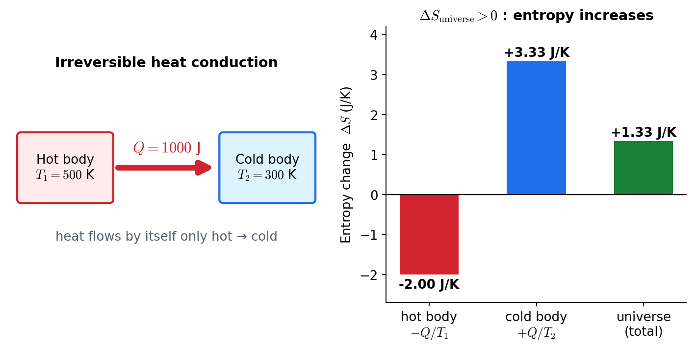
*Fig. 31 — The cold body gains more entropy than the hot body loses.*

**Summary:** $\Delta S_{\text{universe}}=0$ (reversible) and $>0$ (irreversible); it can never be negative.

---

### 2022 · Q7(c) — Efficiency of an engine requiring $3\times10^{6}$ cal per horsepower; comparison with a perfect reversible engine ($100^\circ\mathrm C$, $0^\circ\mathrm C$)

> [!NOTE]
> As in 2016 and 2017, "per horsepower" is read as **per horsepower-hour**.

**Short-form answer** (full working and figure: [2016 Q7(c)](#q2016-7c); same data as [2017 Q7(d)](#q2017-7d)).

$$\eta=\frac{746\times3600}{3\times10^{6}\times4.2}=\frac{2.686\times10^{6}}{1.26\times10^{7}}=\boxed{21.3\ \%},\qquad \eta_{\text{rev}}=\frac{373-273}{373}=\boxed{26.8\ \%}$$

The engine realises $\dfrac{0.213}{0.268}\approx0.80$, i.e. about **80 %** of the maximum possible efficiency.

---

## 2023 — Physics-II, Q5

### 2023 · Q5(a) — Show that the adiabatic curves are higher than isothermal curves

> [!NOTE]
> "Higher" is read as **steeper** (see the note in [2022 Q5(b)](#q2022-5b)).

**Short-form answer** (full answer: [2018 Q5(c)](#q2018-5c); figure: Fig. 19).

Through any point $(P,V)$:

$$\left(\frac{dP}{dV}\right)_{\text{iso}}=-\frac{P}{V},\qquad\left(\frac{dP}{dV}\right)_{\text{adi}}=-\gamma\frac{P}{V}\;\;\Longrightarrow\;\;\frac{\text{slope}_{\text{adi}}}{\text{slope}_{\text{iso}}}=\gamma>1$$

The adiabatic curve is steeper (and, on the compression side of the common point, lies above the isotherm), because along it the gas also changes temperature: it cools on expansion and warms on compression, while the isotherm keeps $T$ fixed.

---

### 2023 · Q5(b) — Prove that $PV^{\gamma}=$ constant

**Ans.**

**Conditions.** One mole of an ideal gas undergoes a **reversible adiabatic** change ($dQ=0$).

1. First law with $dQ=0$:
$$0=dU+P\,dV\;\Rightarrow\;C_V\,dT+P\,dV=0$$
2. Eliminate $P$ with $P=\dfrac{RT}{V}$:
$$C_V\,dT+\frac{RT}{V}\,dV=0\;\Rightarrow\;\frac{dT}{T}+\frac{R}{C_V}\frac{dV}{V}=0$$
3. Since $C_P-C_V=R$, $\;\dfrac{R}{C_V}=\dfrac{C_P}{C_V}-1=\gamma-1$:
$$\frac{dT}{T}+(\gamma-1)\frac{dV}{V}=0$$
4. Integrate:
$$\ln T+(\gamma-1)\ln V=\text{const}\;\Rightarrow\;\boxed{TV^{\gamma-1}=\text{constant}}$$
5. Replace $T=\dfrac{PV}{R}$ ($R$ is constant):
$$\frac{PV}{R}\,V^{\gamma-1}=\text{const}\;\Longrightarrow\;\boxed{PV^{\gamma}=\text{constant}}\ \blacksquare$$

**Equivalent forms.** Substituting $V=\dfrac{RT}{P}$: $\;T^{\gamma}P^{1-\gamma}=$ const, i.e. $\dfrac{T}{P^{(\gamma-1)/\gamma}}=$ const.

*Fig. 32 — The reversible adiabat $PV^{\gamma}=$ const (left) is a vertical line on the $T$–$S$ diagram (right).*

**Example.** Air ($\gamma=1.4$) compressed adiabatically to $\tfrac18$ of its volume: $P_2=P_1\,8^{1.4}\approx18.4\,P_1$ and $T_2=T_1\,8^{0.4}\approx2.30\,T_1$ — the working principle of a diesel engine.

---

### 2023 · Q5(c) — A motor tyre at $27^\circ\mathrm C$ is pumped to a pressure of $2$ atm and bursts suddenly. Find the final temperature ($\gamma=1.4$)

**Given:** $T_1=27+273=300\ \mathrm K$, $P_1=2\ \mathrm{atm}$, burst to atmospheric pressure $P_2=1\ \mathrm{atm}$, $\gamma=1.4$.

**Model.** The burst is so sudden that no heat flows in or out: the expansion is **adiabatic**, so $T^{\gamma}P^{1-\gamma}=$ const:

$$T_2=T_1\left(\frac{P_2}{P_1}\right)^{\frac{\gamma-1}{\gamma}}=300\times\left(\frac12\right)^{\frac{0.4}{1.4}}=300\times(0.5)^{0.2857}=300\times0.8203$$

$$\boxed{T_2\approx246\ \mathrm K\approx-27^\circ\mathrm C}$$

The air cools by about $54\ \mathrm K$ (a mist often forms at the burst). See Fig. 26 (right panel).

> [!NOTE]
> "2 atmospheric pressures" is taken as the **absolute** pressure (so the air expands from $2$ to $1$ atm). If it meant gauge pressure (3 atm absolute), the same formula would give $T_2=300\,(1/3)^{0.2857}\approx219\ \mathrm K$.

---

## 2023 — Physics-II, Q6

### 2023 · Q6(a) — Establish the relation between the two specific heats of a gas

**Short-form answer** (full derivation: [2018 Q8(b)](#q2018-8b) for 1 mole; [2019 Q4(b)](#q2019-4b) per unit mass; figure: Fig. 4).

For one mole of an ideal gas:

1. Constant volume: $dQ=dU\Rightarrow C_V\,dT=dU$ (and $dU=C_V\,dT$ for any process, since $U$ depends only on $T$).
2. Constant pressure: $C_P\,dT=dU+P\,dV=C_V\,dT+P\,dV$.
3. $PV=RT$ at constant $P$ gives $P\,dV=R\,dT$.

$$\boxed{C_P-C_V=R}\qquad\left(\text{per unit mass: }c_p-c_v=\frac{r}{J}\right),\qquad \gamma=\frac{C_P}{C_V}>1,\ \ C_V=\frac{R}{\gamma-1}$$

---

### 2023 · Q6(b) — Show that the entropy change is constant in a reversible Carnot cycle

*🏷️ entropy*

**Short-form answer** (full table of strokes: [2018 Q7(c)](#q2018-7c); figure: Fig. 12).

Over the cycle ABCDA: A→B isothermal absorbs $Q_1$ at $T_1$, $\Delta S=+\dfrac{Q_1}{T_1}$; B→C and D→A are adiabatic, $\Delta S=0$; C→D isothermal rejects $Q_2$ at $T_2$, $\Delta S=-\dfrac{Q_2}{T_2}$.

$$\Delta S_{\text{cycle}}=\frac{Q_1}{T_1}-\frac{Q_2}{T_2}=0\quad\text{because}\quad\frac{Q_1}{T_1}=\frac{Q_2}{T_2}$$

On the $T$–$S$ diagram the cycle is a closed rectangle; the entropy of the working substance returns to its initial value and the entropy of the universe is unchanged: $\boxed{\oint dS=0}$.

---

### 2023 · Q6(c) — Distinguish between the first and second laws of thermodynamics

**Short-form answer** (full table: [2021 Q7(c)](#q2021-7c)).

| First law | Second law |
|---|---|
| Conservation of energy, $Q=\Delta U+W$ | Direction of processes; limit on converting heat to work |
| Defines internal energy $U$ | Defines entropy $S$ ($\Delta S_{\text{univ}}\ge0$) |
| Allows a 100 %-efficient engine and cold → hot heat flow (energy would still balance) | Forbids both: $\eta<1$; heat flows hot → cold by itself |
| Cannot tell reversible from irreversible | Distinguishes them |
| Violation: perpetual motion of the 1st kind | Violation: perpetual motion of the 2nd kind |

---

### 2023 · Q6(d) — Carnot engine between $450\ \mathrm K$ and $350\ \mathrm K$ takes $1000$ cal. Find the heat rejected per cycle and the efficiency ($1\ \mathrm{cal}=4.2\ \mathrm J$)

**Given:** $T_1=450\ \mathrm K$, $T_2=350\ \mathrm K$, $Q_1=1000\ \mathrm{cal}=4200\ \mathrm J$.

**Heat rejected.** For a Carnot engine $\dfrac{Q_2}{Q_1}=\dfrac{T_2}{T_1}$:

$$Q_2=1000\times\frac{350}{450}=777.8\ \mathrm{cal}=\boxed{3.27\times10^{3}\ \mathrm J\ (3266.7\ \mathrm J)}$$

**Efficiency**

$$\eta=1-\frac{T_2}{T_1}=1-\frac{350}{450}=0.222=\boxed{22.2\ \%}$$

**Work per cycle:** $W=Q_1-Q_2=222.2\ \mathrm{cal}=933.3\ \mathrm J$ (same data as [2017 Q6(c)](#q2017-6c)).

---

## 2023 — Physics-II, Q8

### 2023 · Q8(a) — State and explain the second law of thermodynamics

**Short-form answer** (full answer: [2017 Q6(a)](#q2017-6a); figure: Fig. 15).

- **Kelvin–Planck:** it is impossible for a cyclic device to absorb heat from one reservoir and convert it *entirely* into work.
- **Clausius:** heat cannot flow from a cold body to a hot body without external work.
- **Entropy form:** $\Delta S_{\text{universe}}\ge0$.

*Explanation:* every engine must reject heat to a colder sink, so $\eta\le1-\dfrac{T_2}{T_1}<1$; a refrigerator needs work; natural processes (conduction, mixing, free expansion) run one way only. The two statements are logically equivalent.

---

### 2023 · Q8(b) — What is specific heat capacity? For one mole of an ideal gas show that $C_P-C_V=R$

**Short-form answer** (full answer with the table of $C_V,C_P,\gamma$: [2018 Q8(b)](#q2018-8b)).

**Specific heat capacity:** heat needed to raise the temperature of unit mass by $1\ \mathrm K$, $c=\dfrac{1}{m}\dfrac{dQ}{dT}$; molar heat capacity $C=Mc$. A gas has $C_V$ (constant volume) and $C_P$ (constant pressure).

**Proof (one mole):**

- Constant $V$: $dQ=dU$, so $C_V\,dT=dU$ (valid for any process of an ideal gas).
- Constant $P$: $C_P\,dT=dU+P\,dV=C_V\,dT+P\,dV$.
- $PV=RT\Rightarrow P\,dV=R\,dT$ at constant $P$.

$$\Longrightarrow\boxed{C_P-C_V=R}$$

---

### 2023 · Q8(c) — What is a Carnot engine? Show that the Carnot cycle is a reversible process

**Short-form answer** (full answer with figures and the forward/backward diagram: [2018 Q8(c)](#q2018-8c)).

**Carnot engine:** an ideal engine using an ideal gas in a cycle of two isothermal and two adiabatic reversible strokes between a source $T_1$ and a sink $T_2$; efficiency $1-T_2/T_1$ (Fig. 12).

**Reversible because:**

1. each stroke is quasi-static and frictionless;
2. heat is exchanged only during the isotherms and only with a reservoir at the *same* temperature as the gas (no finite temperature difference);
3. the adiabatic strokes exchange no heat.

Reversed (A→D→C→B→A) the engine takes $Q_2$ from the sink, absorbs work $W$ and delivers $Q_1$ to the source — identical magnitudes, opposite directions — so source, sink and gas are all restored; $\Delta S_{\text{universe}}=0$.

---

## Extra practice problems (answers hidden)

Click a problem's arrow to reveal the worked answer.

<b>P1.</b> Two moles of an ideal gas at 300 K expand isothermally from 5 L to 20 L. Find the work done and the heat absorbed.

$W=nRT\ln\dfrac{V_2}{V_1}=2\times8.314\times300\times\ln4=4988\times1.386\approx6.92\ \mathrm{kJ}$; since $\Delta U=0$, $Q=W\approx6.92\ \mathrm{kJ}$.

<b>P2.</b> A Carnot engine with sink at 27 °C has 40 % efficiency. By how much must the source temperature be raised to make it 50 % efficient?

$0.4=1-\dfrac{300}{T_1}\Rightarrow T_1=500\ \mathrm K$. $0.5=1-\dfrac{300}{T_1'}\Rightarrow T_1'=600\ \mathrm K$. Raise by $\boxed{100\ \mathrm K}$.

<b>P3.</b> Air at 300 K is compressed adiabatically to one-eighth of its volume ($\gamma=1.4$). Find the final temperature and the pressure ratio.

$T_2=300\times8^{0.4}=300\times2.297\approx689\ \mathrm K\ (416^\circ\mathrm C)$; $\dfrac{P_2}{P_1}=8^{1.4}\approx18.4$. (This heating is what ignites the fuel in a diesel engine.)

<b>P4.</b> Nitrogen has $M=28\ \mathrm{g\,mol^{-1}}$. Find $c_p-c_v$ in $\mathrm{J\,kg^{-1}K^{-1}}$ and in $\mathrm{cal\,g^{-1}\,^\circ C^{-1}}$.

$c_p-c_v=r=\dfrac{R}{M}=\dfrac{8.314}{0.028}=297\ \mathrm{J\,kg^{-1}K^{-1}}$; in heat units $\dfrac{r}{J}=\dfrac{297}{4.2\times1000}\approx0.071\ \mathrm{cal\,g^{-1}\,^\circ C^{-1}}$.

<b>P5.</b> Find the entropy change when 2 kg of ice melts at 0 °C ($L=3.34\times10^{5}\ \mathrm{J\,kg^{-1}}$).

$\Delta S=\dfrac{mL}{T}=\dfrac{2\times3.34\times10^{5}}{273.15}\approx2.45\times10^{3}\ \mathrm{J\,K^{-1}}$.

<b>P6.</b> Find the entropy change of 1 kg of water heated reversibly from 20 °C to 80 °C ($c=4186\ \mathrm{J\,kg^{-1}K^{-1}}$).

$\Delta S=mc\ln\dfrac{T_2}{T_1}=4186\ln\dfrac{353.15}{293.15}\approx4186\times0.1862\approx7.79\times10^{2}\ \mathrm{J\,K^{-1}}$.

<b>P7.</b> Using the Clausius–Clapeyron equation, estimate the pressure increase needed to lower the melting point of ice by 1 K ($L=3.34\times10^{5}\ \mathrm{J\,kg^{-1}}$, $v_{\text{water}}-v_{\text{ice}}=-9.1\times10^{-5}\ \mathrm{m^3\,kg^{-1}}$).

$\left|\dfrac{dP}{dT}\right|=\dfrac{L}{T\,|\Delta v|}=\dfrac{3.34\times10^{5}}{273.15\times9.1\times10^{-5}}=1.34\times10^{7}\ \mathrm{Pa\,K^{-1}}\approx133\ \mathrm{atm\,K^{-1}}$. About **133 atm** lowers the melting point by 1 K.

<b>P8.</b> One mole of an ideal gas expands freely into vacuum to double its volume. Find $\Delta S$ of the gas and say whether the process is reversible.

Entropy is a state function, so use a reversible isothermal path between the same end states: $\Delta S=R\ln2=5.76\ \mathrm{J\,K^{-1}}>0$. The surroundings do not change ($Q=0$), so $\Delta S_{\text{universe}}>0$: the process is **irreversible**.

<b>P9.</b> A Carnot engine works between 800 K and 400 K and takes 2000 J per cycle at 5 cycles per second. Find $W$, $Q_2$ and the power.

$\eta=1-\dfrac{400}{800}=0.5$; $W=1000\ \mathrm J$; $Q_2=1000\ \mathrm J$; power $=5\times1000=5\ \mathrm{kW}$.

<b>P10.</b> Two moles of a monatomic ideal gas ($\gamma=5/3$) expand adiabatically from 400 K to 300 K. Find the work done by the gas.

$W=-\Delta U=nC_V(T_1-T_2)=2\times\tfrac32(8.314)(100)\approx2.49\ \mathrm{kJ}$.

<b>P11.</b> An engine absorbs 500 J at 500 K and rejects 400 J at 300 K. Is it possible? Is it reversible?

$\eta=\dfrac{100}{500}=20\ \%$, below the Carnot limit $1-\dfrac{300}{500}=40\ \%$, so it is **possible**. $\Delta S_{\text{univ}}=\dfrac{400}{300}-\dfrac{500}{500}=+0.33\ \mathrm{J\,K^{-1}}>0$, so it is **irreversible**.

<b>P12.</b> An inventor claims an engine between 500 K and 300 K with 50 % efficiency. Comment.

The Carnot limit is $1-\dfrac{300}{500}=40\ \%$. A 50 % claim exceeds it, so it violates the second law and is **impossible**.

<b>P13.</b> Air at 20 °C and 1 atm is compressed adiabatically to 5 atm ($\gamma=1.4$). Find the final temperature.

$T_2=T_1\left(\dfrac{P_2}{P_1}\right)^{\frac{\gamma-1}{\gamma}}=293\times5^{0.2857}\approx464\ \mathrm K\ (191^\circ\mathrm C)$.

<b>P14.</b> How much heat converts 0.5 kg of ice at −10 °C into water at 20 °C? ($c_{\text{ice}}=2100$, $L=3.34\times10^{5}$, $c_{\text{water}}=4186$, SI units)

$Q=0.5(2100)(10)+0.5(3.34\times10^{5})+0.5(4186)(20)=10\,500+167\,000+41\,860\approx2.19\times10^{5}\ \mathrm J$.

---

## Quick revision sheet

| Topic | Key formula |
|---|---|
| First law | $Q=\Delta U+W$, $dQ=dU+P\,dV$ |
| Specific heats | $C_P-C_V=R$; $c_p-c_v=r/J$; $\gamma=C_P/C_V$ |
| Isothermal work | $W=nRT\ln\dfrac{V_2}{V_1}$ |
| Adiabatic | $PV^{\gamma}=$ const, $TV^{\gamma-1}=$ const, $W=\dfrac{P_1V_1-P_2V_2}{\gamma-1}$ |
| Adiabatic vs isothermal slope | $\gamma$ times steeper |
| Carnot efficiency | $\eta=1-\dfrac{T_2}{T_1}$, $\dfrac{Q_2}{Q_1}=\dfrac{T_2}{T_1}$ |
| Entropy | $dS=\dfrac{dQ_{\text{rev}}}{T}$; $\Delta S_{\text{univ}}\ge0$ |
| Unavailable energy | $T_0\,\Delta S$ |
| Clausius–Clapeyron | $\dfrac{dP}{dT}=\dfrac{L}{T(v_2-v_1)}$ |
| Maxwell relations | $\left(\dfrac{\partial S}{\partial V}\right)_T=\left(\dfrac{\partial P}{\partial T}\right)_V$, $\left(\dfrac{\partial S}{\partial P}\right)_T=-\left(\dfrac{\partial V}{\partial T}\right)_P$, $\left(\dfrac{\partial T}{\partial V}\right)_S=-\left(\dfrac{\partial P}{\partial S}\right)_V$, $\left(\dfrac{\partial T}{\partial P}\right)_S=\left(\dfrac{\partial V}{\partial S}\right)_P$ |

---

## Notes on ambiguous questions

1. **2020 Q6(b):** the two printed identities were lost in the PDF extraction. All four Maxwell relations are proved and verified for an ideal gas instead.
2. **2022 Q7(b):** the text says entropy is constant in an *irreversible* process, which is physically wrong. The answer proves $\Delta S_{\text{universe}}>0$ and points to the *reversible* version (2017 Q7(b)).
3. **2022 Q5(b) and 2023 Q5(a):** "higher" is read as "steeper".
4. **2016 Q7(c), 2017 Q7(d), 2022 Q7(c):** "per horsepower" is read as "per horsepower-hour".
5. **2023 Q5(c):** "2 atmospheric pressures" is taken as absolute pressure; the gauge-pressure variant is given as a note.
6. **2015 Q7(c):** the data are rounded, so $J\approx4.76\ \mathrm{J\,cal^{-1}}$ rather than $4.186$.
7. **2016 Q5(a):** only the "define temperature" and "write van der Waals' equation" parts are answered here; the critical-constant deductions (5(b), 5(c)) belong to the kinetic-theory topic.

---

## References

1. M. W. Zemansky and R. H. Dittman, *Heat and Thermodynamics*, McGraw-Hill.
2. F. W. Sears and G. L. Salinger, *Thermodynamics, Kinetic Theory, and Statistical Thermodynamics*, Addison-Wesley.
3. D. Halliday, R. Resnick and J. Walker, *Fundamentals of Physics*, Wiley.
4. H. D. Young and R. A. Freedman, *University Physics*, Pearson.
5. Brij Lal and N. Subrahmanyam, *Heat and Thermodynamics*, S. Chand.
6. H. B. Callen, *Thermodynamics and an Introduction to Thermostatistics*, Wiley.

*Question source: Physics-II previous questions 2015–2023, BUTEX. All figures in `../../assets/` were generated for this note.*
