# PHY-103 (Physics-II) — Kinetic Theory, Thermal Physics, Thermodynamics & Thermal Radiation
### Solved Previous Questions 2015 – 2023 (BUTEX, B.Sc. in Textile Engineering)

> **File:** `phy-103-thermodynamics-2015-2023-ques-solve-v261102-0.md`  
> **Covers:** Chapter 6 (Kinetic Theory of Gases and Thermal Physics, incl. thermometry), the *first-law / processes / specific-heat* part of Chapter 7, and Chapter 8 (Thermal Radiation).  
> **Second law, Carnot engine, entropy, Clausius–Clapeyron, Maxwell relations** are in the companion file `phy-103-entropy-2015-2023-ques-solve-v261102-0.md`.  
> **Figures:** SVG files linked from `../../assets/`.

**Constants:** $k=1.38\times10^{-23}\ \mathrm{J\,K^{-1}}$, $R=8.314\ \mathrm{J\,mol^{-1}K^{-1}}$, $1\ \mathrm{cal}=4.2\ \mathrm J$ (as given in the 2023 paper), $\sigma_{SB}=5.67\times10^{-8}\ \mathrm{W\,m^{-2}K^{-4}}$.

## Where is each Chapter-7 question?

| Question | File |
|---|---|
| 2015 Q7(a),(b),(c); 2016 Q6(b); 2017 Q5(a), Q6(b); 2018 Q5(c), Q8(b); 2019 Q4(b); 2021 Q5(b), Q8(c); 2022 Q5(a),(b), Q6(c); 2023 Q5(a),(b),(c), Q6(a), Q8(b) | **this file** (Chapter 7 section) |
| 2016 Q7, Q8; 2017 Q5(b),(c), Q6(a),(c), Q7; 2018 Q7, Q8(a),(c); 2020 Q6, Q7; 2021 Q5(a), Q7, Q8(a); 2022 Q5(c), Q6(b), Q7; 2023 Q6(b),(c),(d), Q8(a),(c) | entropy file |

## Contents

1. [Chapter 6 — Kinetic theory and thermal physics](#ch6)
2. [6.1 Temperature measurement](#ch61)
3. [Chapter 7 — Thermodynamics (first law, specific heats, processes)](#ch7)
4. [Chapter 8 — Thermal radiation](#ch8)
5. [Formula summary](#summary)

---

# 6. Kinetic Theory of Gases and Thermal Physics

## 2015 — Physics-II, Q5

### 5(a). What is heat? State the effects of heat.

**Heat** is the form of energy that is **transferred between bodies (or between a system and its surroundings) because of a temperature difference**. It flows spontaneously from the hotter to the colder body. It is energy *in transit*, not something stored. Units: joule (J); calorie, $1\ \mathrm{cal}=4.186\ \mathrm J$.

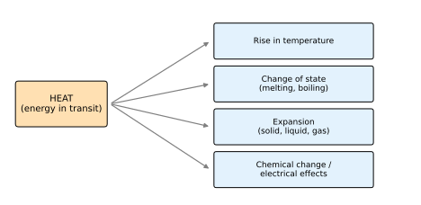

**Effects of heat**

1. **Rise in temperature:** $Q=mc\,\Delta T$.
2. **Change of state** at constant temperature: $Q=mL$ (fusion, vaporisation).
3. **Expansion** of solids, liquids and gases.
4. **Chemical changes** (decomposition, combustion, rate of reaction increases).
5. **Electrical and other effects:** thermoelectric emf, change in resistance, thermionic emission; light emission by hot bodies.

**Example.** Heating $2\ \mathrm{kg}$ of water by $10^\circ\mathrm C$: $Q=2000\times1\times10=20\,000\ \mathrm{cal}=83.7\ \mathrm{kJ}$. Melting $1\ \mathrm{kg}$ of ice at $0^\circ\mathrm C$ needs $3.34\times10^5\ \mathrm J$ with no temperature change.

---

## 2015 — Physics-II, Q6

### 6(a). Define degree of freedom. State and explain Newton's law of cooling.

**Degree of freedom.** The number of independent coordinates (independent ways of moving) required to completely specify the position and orientation of a molecule; equivalently, the number of independent ways in which a molecule can store energy.

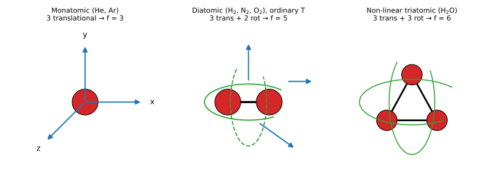

| Molecule | Translational | Rotational | Total $f$ (ordinary $T$) | $\gamma=1+2/f$ |
|---|---|---|---|---|
| Monatomic (He, Ar) | 3 | 0 | 3 | 1.67 |
| Diatomic (H₂, N₂, O₂) | 3 | 2 | 5 (vibration frozen) | 1.40 |
| Non-linear triatomic (H₂O) | 3 | 3 | 6 | 1.33 |

*Law of equipartition:* each degree of freedom carries average energy $\tfrac12kT$ per molecule ($\tfrac12RT$ per mole).

**Newton's law of cooling.** The rate of loss of heat of a body is directly proportional to the excess of its temperature over that of the surroundings, provided the excess is small.

$$-\frac{dQ}{dt}\propto(T-T_s)\;\Rightarrow\;\frac{dT}{dt}=-k\,(T-T_s)$$

Integrating from $T_0$ at $t=0$:

$$\ln\frac{T-T_s}{T_0-T_s}=-kt\;\Rightarrow\;T=T_s+(T_0-T_s)\,e^{-kt}$$

where $k=hA/(mc)$. The temperature falls exponentially towards $T_s$; a plot of $\ln(T-T_s)$ against $t$ is a straight line of slope $-k$.

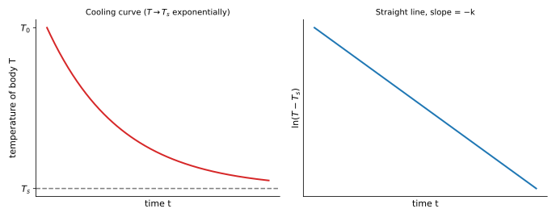

**Conditions:** small temperature excess (about $\lesssim30\ \mathrm K$), constant surroundings, steady air flow (forced convection).

**Example.** Tea cools from $90^\circ\mathrm C$ to $80^\circ\mathrm C$ in $2\ \mathrm{min}$ in a room at $30^\circ\mathrm C$. Then $\dfrac{50}{60}=e^{-2k}\Rightarrow k=0.0912\ \mathrm{min^{-1}}$, and the time to reach $60^\circ\mathrm C$ is $t=\dfrac{\ln(60/30)}{k}=\dfrac{0.693}{0.0912}\approx7.6\ \mathrm{min}$.

### 6(b). Prove $PV^{\gamma}=\text{constant}$.

For a **reversible adiabatic** change of an ideal gas, $dQ=0$. By the first law,

$$dU+P\,dV=0,\qquad dU=nC_V\,dT\;\Rightarrow\;nC_V\,dT+P\,dV=0\quad(1)$$

From $PV=nRT$: $P\,dV+V\,dP=nR\,dT\Rightarrow dT=\dfrac{P\,dV+V\,dP}{nR}$. Substituting in (1):

$$\frac{C_V}{R}\,(P\,dV+V\,dP)+P\,dV=0\;\Rightarrow\;C_V\,V\,dP+(C_V+R)\,P\,dV=0$$

Using $C_P=C_V+R$ and dividing by $C_V\,PV$:

$$\frac{dP}{P}+\gamma\frac{dV}{V}=0,\qquad\gamma=\frac{C_P}{C_V}$$

Integrating: $\ln P+\gamma\ln V=\text{const}$, hence

$$PV^{\gamma}=\text{constant}$$

Using $PV=nRT$ also: $TV^{\gamma-1}=\text{const}$ and $T^{\gamma}P^{1-\gamma}=\text{const}$.

**Example.** Air ($\gamma=1.4$) compressed adiabatically to half its volume: $P_2/P_1=2^{1.4}=2.64$ (an isothermal change would give only 2).

### 6(c). Define mean free path. Deduce an expression for it.

**Mean free path $\lambda$:** the average distance a gas molecule travels between two successive collisions.

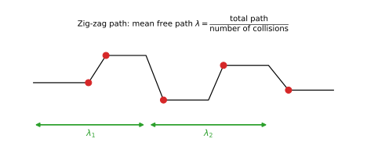

**Derivation.** Let molecules be spheres of diameter $\sigma$, number density $n$, mean speed $\bar v$.

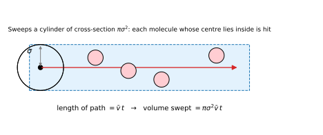

1. Suppose one molecule moves while all others are at rest. In time $t$ it travels $\bar vt$ and collides with every molecule whose centre lies within distance $\sigma$ of its path, i.e. inside a cylinder of cross-section $\pi\sigma^2$ and length $\bar vt$.
2. Number of collisions in time $t$: $N_c=\pi\sigma^2\bar v\,t\,n$.
3. Mean free path: $\lambda=\dfrac{\text{distance travelled}}{\text{collisions}}=\dfrac{\bar vt}{\pi\sigma^2\bar vtn}=\dfrac1{\pi\sigma^2n}$.
4. Allowing for the motion of all molecules, the relevant speed is the **mean relative speed** $\sqrt2\,\bar v$, so the collision rate increases by $\sqrt2$:

$$\lambda=\frac1{\sqrt2\,\pi\sigma^2n}$$

Since $P=nkT$, this is also $\lambda=\dfrac{kT}{\sqrt2\,\pi\sigma^2P}$: $\lambda$ increases with temperature, decreases with pressure and with molecular size.

**Example.** For air at NTP, $n\approx2.7\times10^{25}\ \mathrm{m^{-3}}$ and $\sigma\approx3.7\times10^{-10}\ \mathrm m$, giving $\lambda\approx7\times10^{-8}\ \mathrm m$ (about 200 molecular diameters).

### 6(d). The mean free path of gas molecules is $2.4\times10^{-6}$ cm and the molecular diameter is $2\times10^{-8}$ cm. Calculate the number of molecules per cm³.

*Given:* $\lambda=2.4\times10^{-6}\ \mathrm{cm}$, $\sigma=2\times10^{-8}\ \mathrm{cm}$.

*Formula:* $\lambda=\dfrac1{\sqrt2\pi\sigma^2n}\Rightarrow n=\dfrac1{\sqrt2\pi\sigma^2\lambda}$

$$n=\frac1{1.414\times3.1416\times(2\times10^{-8})^2\times2.4\times10^{-6}}=\frac1{4.443\times4\times10^{-16}\times2.4\times10^{-6}}=\frac1{4.265\times10^{-21}}$$

**Answer: $n\approx2.34\times10^{20}\ \text{molecules per cm}^3$.**

---

## 2015 — Physics-II, Q7

### 7(b). What is specific heat? Derive an expression for the difference between two specific heats.

**Specific heat.** The heat needed to raise the temperature of unit mass of a substance by one degree: $c=\dfrac{Q}{m\Delta T}$ (J kg⁻¹ K⁻¹). The **molar specific heat** (heat capacity per mole) is $C=\dfrac Q{n\Delta T}$. A gas has no single value because its pressure and volume may change on heating, so there are two: $C_V$ (constant volume) and $C_P$ (constant pressure).

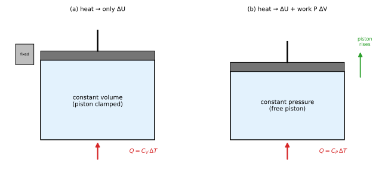

**Derivation of $C_P-C_V$ (one mole of ideal gas).** First law: $dQ=dU+P\,dV$.

* *Constant volume:* $dV=0$, so $dQ=dU$ and $C_V=\left(\dfrac{dQ}{dT}\right)_V=\dfrac{dU}{dT}$. For an ideal gas $U$ depends only on $T$ (Joule's law), so $dU=C_V\,dT$ in **every** process.
* *Constant pressure:* $C_P=\left(\dfrac{dQ}{dT}\right)_P=C_V+P\left(\dfrac{dV}{dT}\right)_P$.
* From $PV=RT$ at constant $P$: $P\,dV=R\,dT$, so $P\left(\dfrac{dV}{dT}\right)_P=R$.

$$C_P-C_V=R$$

*Physical meaning:* at constant pressure the heat must also supply the work $P\,dV=R\,dT$ done in expansion, so $C_P>C_V$. Also $C_V=\dfrac R{\gamma-1}$, $C_P=\dfrac{\gamma R}{\gamma-1}$. Per unit mass: $c_P-c_V=r=R/M$ (in mechanical units).

---

## 2016 — Physics-II, Q3

### 3(a). State Newton's law of cooling.

The rate of cooling of a body is proportional to the excess of its temperature over the surroundings (small excess): $\dfrac{dT}{dt}=-k(T-T_s)$. See [2015 Q6(a)](#t-2015-q6a).

### 3(b). Deduce the relation between pressure and kinetic energy of a gas: $P=\dfrac23\dfrac EV$.

**Postulates used:** the gas has a very large number $N$ of identical molecules (mass $m$) in random motion; molecules are point-like; collisions with walls and each other are perfectly elastic; no intermolecular forces except during collision; negligible gravity.

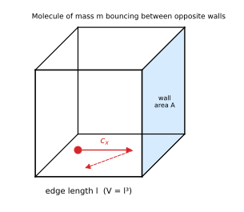

Take a cube of edge $l$ ($V=l^3$). A molecule has velocity components $(c_x,c_y,c_z)$, $c^2=c_x^2+c_y^2+c_z^2$.

1. Momentum change on striking a wall perpendicular to $x$: $m c_x-(-mc_x)=2mc_x$.
2. Time between successive hits on the same wall: $2l/c_x$.
3. Force by this molecule on the wall: $\dfrac{2mc_x}{2l/c_x}=\dfrac{mc_x^2}{l}$.
4. Total force by all molecules: $F=\dfrac{m}{l}\left(c_{1x}^2+c_{2x}^2+\dots\right)=\dfrac{mN\overline{c_x^2}}{l}$.
5. For random motion $\overline{c_x^2}=\overline{c_y^2}=\overline{c_z^2}=\tfrac13\overline{c^2}$, so $F=\dfrac{mN\overline{c^2}}{3l}$.
6. Pressure $P=\dfrac F{l^2}=\dfrac{mN\overline{c^2}}{3l^3}=\dfrac{mN\overline{c^2}}{3V}$.

Total translational kinetic energy $E=\tfrac12mN\overline{c^2}$, hence

$$PV=\tfrac13mN\overline{c^2}=\tfrac23E\;\Rightarrow\;P=\frac23\frac EV$$

(Also $P=\tfrac13\rho\overline{c^2}$ with $\rho=mN/V$ — see 2019 Q6; and with $PV=nRT$: mean KE per molecule $=\tfrac32kT$.)

---

## 2016 — Physics-II, Q5

### 5(a). Define temperature and write van der Waals' equation.

**Temperature** is the physical quantity that determines the direction of heat flow between bodies in contact: heat flows from higher to lower temperature, and no net flow means the same temperature (thermal equilibrium; the zeroth law). Microscopically it is a measure of the average translational kinetic energy of the molecules: $\bar\epsilon=\tfrac32kT$.

**van der Waals' equation** for one mole of a real gas:

$$\left(P+\frac a{V^2}\right)(V-b)=RT$$

For $n$ moles: $\left(P+\dfrac{n^2a}{V^2}\right)(V-nb)=nRT$. The term $a/V^2$ corrects for intermolecular attraction (internal pressure) and $b$ for the finite size of molecules (excluded volume) — details in [2020 Q7(c)](#t-2020-q7c).

### 5(b). Deduce the critical constants $V_c=3b$, $P_c=\dfrac a{27b^2}$, $T_c=\dfrac{8a}{27Rb}$.

Write $P=\dfrac{RT}{V-b}-\dfrac a{V^2}$. At the **critical point** the isotherm has a point of inflection with a horizontal tangent:

$$\left(\frac{\partial P}{\partial V}\right)_T=-\frac{RT}{(V-b)^2}+\frac{2a}{V^3}=0\quad(1)\qquad\left(\frac{\partial^2P}{\partial V^2}\right)_T=\frac{2RT}{(V-b)^3}-\frac{6a}{V^4}=0\quad(2)$$

From (1): $\dfrac{RT}{(V-b)^2}=\dfrac{2a}{V^3}$; from (2): $\dfrac{RT}{(V-b)^3}=\dfrac{3a}{V^4}$. Dividing,

$$V-b=\frac{2a/V^3}{3a/V^4}=\frac{2V}3\;\Rightarrow\;V_c=3b$$
Substituting $V=3b$ in (1): $RT=\dfrac{2a(V-b)^2}{V^3}=\dfrac{2a(2b)^2}{27b^3}=\dfrac{8a}{27b}$, so

$$T_c=\frac{8a}{27Rb}$$

and from the equation of state

$$P_c=\frac{RT_c}{V_c-b}-\frac a{V_c^2}=\frac{8a/27b}{2b}-\frac a{9b^2}=\frac{4a}{27b^2}-\frac{3a}{27b^2}=\frac a{27b^2}$$

**Result:** $V_c=3b,\;P_c=\dfrac a{27b^2},\;T_c=\dfrac{8a}{27Rb}$ (and $\dfrac{P_cV_c}{RT_c}=\dfrac38$).

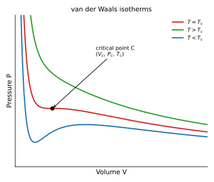

### 5(c). Prove that $T_c=\dfrac8{27}T_B$, where $T_B$ is the Boyle temperature.

The **Boyle temperature** is the temperature at which a real gas obeys Boyle's law over a wide range of low pressure, i.e. $\left[\dfrac{\partial(PV)}{\partial P}\right]_{T,P\to0}=0$.

From the van der Waals equation, $P=\dfrac{RT}{V-b}-\dfrac a{V^2}$, so

$$PV=RT\left(1-\frac bV\right)^{-1}-\frac aV\approx RT+\frac1V\left(RTb-a\right)+\dots\qquad(b\ll V)$$

The correction term vanishes (the gas behaves ideally) when $RT_Bb-a=0$:

$$T_B=\frac a{Rb}$$

Therefore

$$T_c=\frac{8a}{27Rb}=\frac8{27}\cdot\frac a{Rb}=\frac8{27}T_B\qquad\blacksquare$$

---

## 2016 — Physics-II, Q6

### 6(c). For CO₂, if $a=0.00874$ and $b=0.0023$ in the stated units, calculate $T_c$.

The units are not printed in the question bank. The values $a=0.00874,\ b=0.0023$ are the classical **Amagat-unit** constants for CO₂ (pressure in atmospheres, volume in units of the volume of the gas at 0 °C and 1 atm). In these units $PV=RT$ with $P=1,\ V=1,\ T=273$, so $R=\dfrac1{273}=0.003663$.

$$T_c=\frac{8a}{27Rb}=\frac{8\times0.00874}{27\times0.003663\times0.0023}=\frac{0.06992}{2.275\times10^{-4}}\approx307\ \mathrm K$$

**Answer: $T_c\approx307\ \mathrm K$ ($\approx34^\circ\mathrm C$)**; the experimental value is $304.2\ \mathrm K$ ($31^\circ\mathrm C$).

---

## 2017 — Physics-II, Q5

### 5(a). What are internal energy and thermodynamic functions?

**Internal energy $U$.** The total energy of a system stored inside it: the sum of the kinetic energies (translation, rotation, vibration) and the potential energies of interaction of all its molecules. It is a **state function**: $\Delta U$ depends only on the initial and final states, not the path. For an ideal gas $U=\dfrac f2nRT$ (a function of $T$ alone), so $\Delta U=nC_V\Delta T$ for any process. First-law link: $\Delta U=Q-W$.

**Thermodynamic functions (potentials).** State functions from which equilibrium properties follow:

| Function | Definition | Differential | Natural variables |
|---|---|---|---|
| Internal energy | $U$ | $dU=T\,dS-P\,dV$ | $S,V$ |
| Enthalpy | $H=U+PV$ | $dH=T\,dS+V\,dP$ | $S,P$ |
| Helmholtz free energy | $F=U-TS$ | $dF=-S\,dT-P\,dV$ | $T,V$ |
| Gibbs free energy | $G=H-TS$ | $dG=-S\,dT+V\,dP$ | $T,P$ |

Because each $dX$ is an exact differential, the Maxwell relations follow (derived in the entropy file, 2020 Q6).

---

## 2018 — Physics-II, Q3

### 3(a). Define heat and temperature.

* **Heat:** energy transferred between bodies because of a temperature difference ([2015 Q5(a)](#t-2015-q5a)); unit joule.
* **Temperature:** the degree of hotness of a body, which decides the direction of heat flow; proportional to the mean translational kinetic energy of the molecules ($\tfrac32kT$ per molecule); unit kelvin.

### 3(b). Show that the pressure of a perfect gas is related to the kinetic energy of the gas molecules in a unit volume.

From [2016 Q3(b)](#t-2016-q3b): $PV=\tfrac23E$. Dividing by $V$, with $E/V=E_V$ the translational kinetic energy per unit volume ($E_V=\tfrac12nm\overline{c^2}$, $n=N/V$):

$$P=\frac23E_V=\frac13nm\overline{c^2}$$

### 3(c). State Newton's law of cooling.

The rate of fall of temperature of a body is proportional to its excess temperature over the surroundings: $dT/dt=-k(T-T_s)$. See [2015 Q6(a)](#t-2015-q6a).

---

## 2018 — Physics-II, Q5

### 5(a). What is degree of freedom? State van der Waals' equation.

See [2015 Q6(a)](#t-2015-q6a) (degrees of freedom: 3, 5, 6 for mono-, di-, tri-atomic) and [2016 Q5(a)](#t-2016-q5a): $\left(P+\dfrac a{V^2}\right)(V-b)=RT$.

### 5(b). Deduce the values of the van der Waals constants.

Using the critical constants of [2016 Q5(b)](#t-2016-q5b), solve for $a$ and $b$ in terms of the measurable $P_c,T_c$ (or $V_c$):

$$\frac{P_c}{T_c}=\frac{a/27b^2}{8a/27Rb}=\frac R{8b}\;\Rightarrow\;b=\frac{RT_c}{8P_c}=\frac{V_c}3$$

$$P_c=\frac a{27b^2}\;\Rightarrow\;a=27b^2P_c=27P_c\frac{R^2T_c^2}{64P_c^2}=\frac{27R^2T_c^2}{64P_c}=3P_cV_c^2$$

**Result:** $a=\dfrac{27R^2T_c^2}{64P_c}$, $\;b=\dfrac{RT_c}{8P_c}$.

### 5(c). Show that the adiabatic curves are steeper than isothermal curves.

For an ideal gas:

* **Isothermal:** $PV=\text{const}\Rightarrow P\,dV+V\,dP=0\Rightarrow\left(\dfrac{dP}{dV}\right)_T=-\dfrac PV$.
* **Adiabatic:** $PV^\gamma=\text{const}\Rightarrow V^\gamma dP+\gamma PV^{\gamma-1}dV=0\Rightarrow\left(\dfrac{dP}{dV}\right)_S=-\gamma\dfrac PV$.

At the same state $(P,V)$:

$$\frac{\text{slope (adiabatic)}}{\text{slope (isothermal)}}=\gamma>1$$

so the adiabatic curve falls more steeply. Physically, in an adiabatic expansion the gas does work at the expense of its internal energy, so the temperature also drops and the pressure falls more than in an isothermal expansion.

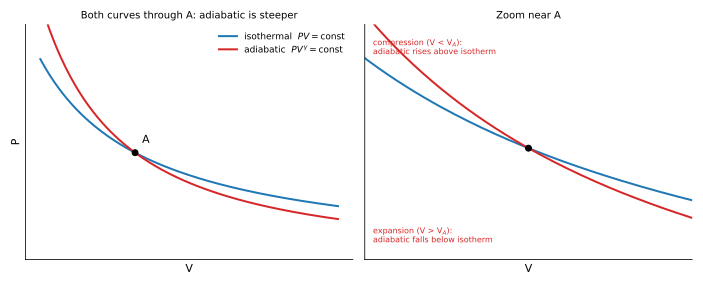

**Example.** For air at $P=1\ \mathrm{atm}$, $V=22.4\ \mathrm L$: isothermal slope $=-1/22.4$, adiabatic slope $=-1.4/22.4$ atm L⁻¹.

*Remark on wording:* the 2022 and 2023 papers say "adiabatic curves are **higher** than isothermal curves". The correct statement is the above (larger slope magnitude, factor $\gamma$): starting from a common point, the adiabatic curve lies **above** the isotherm on the compression side and **below** it on the expansion side.

*(5(d) Kirchhoff's law of radiation is answered in Chapter 8 below.)*

---

## 2018 — Physics-II, Q6

### 6(a). Define degree of freedom. Describe the fundamental postulates of gas molecules.

**Degree of freedom:** see [2015 Q6(a)](#t-2015-q6a).

**Postulates of the kinetic theory of gases**

1. A gas consists of a very large number of identical, tiny molecules; the volume of the molecules is negligible compared with the volume of the container.
2. The molecules are in continuous, random motion in all directions with all speeds.
3. Collisions between molecules and with the walls are perfectly **elastic**; the time of a collision is negligible compared with the time between collisions.
4. There are no intermolecular forces of attraction or repulsion except during collisions; therefore molecules move in straight lines between collisions.
5. Gravity is negligible; the molecular distribution is uniform and isotropic.
6. The average kinetic energy of the molecules is proportional to the absolute temperature.

### 6(b). What is mean free path? Derive an expression for the mean free path.

Mean free path is the average distance between successive collisions; $\lambda=\dfrac1{\sqrt2\pi\sigma^2n}$. Complete derivation with figures: [2015 Q6(c)](#t-2015-q6c).

### 6(c). The mean free path of a nitrogen molecule at 0 °C and 1 atm is $0.8\times10^{-7}$ m and its number density is $2.7\times10^{19}$ molecules/cm³. What is the molecular diameter?

*Given:* $\lambda=0.8\times10^{-7}\ \mathrm m$; $n=2.7\times10^{19}\ \mathrm{cm^{-3}}=2.7\times10^{25}\ \mathrm{m^{-3}}$.

*Formula:* $\lambda=\dfrac1{\sqrt2\pi\sigma^2n}\Rightarrow\sigma=\left[\dfrac1{\sqrt2\pi n\lambda}\right]^{1/2}$

$$\sigma^2=\frac1{4.443\times2.7\times10^{25}\times0.8\times10^{-7}}=\frac1{9.597\times10^{18}}=1.042\times10^{-19}\ \mathrm{m^2}$$

$$\sigma=3.23\times10^{-10}\ \mathrm m$$

**Answer: molecular diameter $\sigma\approx3.2\times10^{-10}\ \mathrm m=3.2\ \text{\AA}$.**

---

## 2019 — Physics-II, Q4

### 4(a). Differentiate between heat and temperature.

| Heat | Temperature |
|---|---|
| Energy in transit due to a temperature difference | Degree of hotness / coldness |
| Extensive: depends on mass ($Q=mc\Delta T$) | Intensive: independent of mass |
| Measured by a calorimeter | Measured by a thermometer |
| Unit: joule, calorie | Unit: kelvin, °C, °F |
| Determines *how much* energy is transferred | Determines the *direction* of flow |
| Total molecular energy | Average molecular kinetic energy |

*Example:* a bucket of water at 50 °C holds more heat than a cup at 50 °C, but both have the same temperature.

### 4(b). Show that the difference between $c_P$ and $c_V$ of a gas equals the characteristic gas constant.

For **unit mass** of an ideal gas, $PV=rT$ where $r=R/M$ is the characteristic (specific) gas constant. At constant volume, $dQ=c_V\,dT=dU$; at constant pressure, $dQ=c_P\,dT=dU+P\,dV$. Since $U$ depends on $T$ only, $dU=c_V\,dT$ in both cases, so

$$c_P\,dT=c_V\,dT+P\,dV\;\Rightarrow\;c_P-c_V=P\left(\frac{dV}{dT}\right)_P=r\qquad(\text{from }P\,dV=r\,dT)$$

(in heat units divide by $J$: $c_P-c_V=r/J$). Multiplying by the molar mass gives $C_P-C_V=R$ ([2015 Q7(b)](#t-2015-q7b)).

---

## 2019 — Physics-II, Q5

### 5(a). Define mean free path and degrees of freedom.

* **Mean free path:** average distance travelled by a molecule between two successive collisions, $\lambda=\dfrac1{\sqrt2\pi\sigma^2n}$ ([2015 Q6(c)](#t-2015-q6c)).
* **Degrees of freedom:** number of independent coordinates needed to specify the configuration of a molecule: 3 (monatomic), 5 (diatomic), 6 (non-linear triatomic) ([2015 Q6(a)](#t-2015-q6a)).

### 5(b). Calculate the average kinetic energy of a molecule of a gas at a temperature of 300 K.

*Formula:* $\bar\epsilon=\tfrac32kT$ (translational).

$$\bar\epsilon=\frac32\times1.38\times10^{-23}\times300=6.21\times10^{-21}\ \mathrm J=\frac{6.21\times10^{-21}}{1.6\times10^{-19}}\ \mathrm{eV}=0.039\ \mathrm{eV}$$

**Answer: $6.2\times10^{-21}\ \mathrm J\ (\approx0.039\ \mathrm{eV})$.**

---

## 2019 — Physics-II, Q6

### 6. Prove that the pressure exerted by a perfect gas is $P=\tfrac13\rho\overline{c^2}$.

From [2016 Q3(b)](#t-2016-q3b): $PV=\tfrac13mN\overline{c^2}$. Since the density is $\rho=\dfrac{mN}V$,

$$P=\frac13\frac{mN}V\overline{c^2}=\frac13\rho\,\overline{c^2}\qquad\blacksquare$$

Here $\overline{c^2}$ is the mean square speed and $c_{rms}=\sqrt{\overline{c^2}}=\sqrt{3P/\rho}$.

---

## 2020 — Physics-II, Q4

### 4(a). What are the critical constants of a gas? Calculate their values in terms of the van der Waals constants.

**Critical constants.**

* **Critical temperature $T_c$:** the highest temperature at which a gas can be liquefied by pressure alone; above $T_c$ no pressure liquefies it.
* **Critical pressure $P_c$:** the pressure needed to liquefy the gas at $T_c$.
* **Critical volume $V_c$:** the volume of one mole of the gas at $T_c$ and $P_c$.

(See the isotherms in [2016 Q5(b)](#t-2016-q5b), where the critical point is the inflection of the $T=T_c$ isotherm.)

**Values in terms of $a,b$:** from the derivation in [2016 Q5(b)](#t-2016-q5b),

$$V_c=3b,\qquad P_c=\frac a{27b^2},\qquad T_c=\frac{8a}{27Rb}$$

### 4(b). Describe the principle of a platinum resistance thermometer. Discuss its advantages and disadvantages.

**Principle.** The electrical resistance of pure platinum increases regularly with temperature:

$$R_t=R_0\left(1+\alpha t+\beta t^2\right)$$

The resistance is measured with a Callendar–Griffiths bridge (a Wheatstone-bridge arrangement) and the temperature on the platinum scale is

$$t_p=\frac{R_t-R_0}{R_{100}-R_0}\times100$$

**Construction.** A fine platinum wire is wound non-inductively on a mica (or silica) frame and enclosed in a glass/quartz tube. Thick leads connect it to the bridge; an identical pair of *dummy (compensating) leads* in the opposite arm cancels the resistance of the leads.

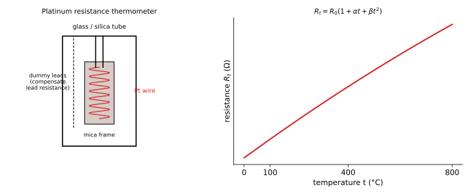

| Advantages | Disadvantages |
|---|---|
| Very wide range ($-200$ to $1200^\circ\mathrm C$) | Large size/heat capacity: slow response, unsuitable for small or rapidly changing temperatures |
| High accuracy and sensitivity (about $10^{-3}\ \mathrm K$) | Needs bridge, power supply and calibration; not direct reading |
| Platinum is chemically inert, high melting point, easy to purify; reproducible | Self-heating by the measuring current can cause error |
| Good for measuring small temperature differences | Expensive; reads the *average* temperature of the coil, not a point |

### 4(c). The resistances of a platinum resistance thermometer are 2.585 Ω and 3.510 Ω at 0 °C and 100 °C. In a hot bath the resistance is 9.098 Ω. Calculate the temperature of the bath on the gas scale. Assume $\delta=1.5$ for platinum.

*Given:* $R_0=2.585\ \Omega$, $R_{100}=3.510\ \Omega$, $R_t=9.098\ \Omega$, $\delta=1.5$.

**Step 1 – platinum-scale temperature**

$$t_p=\frac{9.098-2.585}{3.510-2.585}\times100=\frac{6.513}{0.925}\times100=704.1^\circ\mathrm C$$

**Step 2 – Callendar's relation to the gas scale**

$$t-t_p=\delta\left(\frac t{100}\right)\left(\frac t{100}-1\right)$$

Put $x=t/100$: $\;100x-704.1=1.5x(x-1)\;\Rightarrow\;1.5x^2-101.5x+704.1=0$

$$x=\frac{101.5-\sqrt{101.5^2-4(1.5)(704.1)}}{2(1.5)}=\frac{101.5-\sqrt{6077.6}}{3}=\frac{101.5-77.96}{3}=7.85$$

(the other root, $x\approx60$, is unphysical).

**Answer: $t\approx785^\circ\mathrm C$ on the gas scale** ($t_p=704.1^\circ\mathrm C$ on the platinum scale).

---

## 2020 — Physics-II, Q5

### 5(a). What is mean free path? Derive an expression for the mean free path.

See [2015 Q6(c)](#t-2015-q6c): $\lambda=\dfrac1{\sqrt2\pi\sigma^2n}$.

### 5(b). State and explain Newton's law of cooling.

See [2015 Q6(a)](#t-2015-q6a): $T=T_s+(T_0-T_s)e^{-kt}$.

### 5(c). Define molar specific heat. Find the relation between $C_P$ and $C_V$.

**Molar specific heat:** the heat required to raise the temperature of **one mole** of a substance by one kelvin, $C=\dfrac1n\dfrac{dQ}{dT}$ (J mol⁻¹ K⁻¹). For a gas: $C_V$ (constant volume) and $C_P$ (constant pressure). **Relation:** $C_P-C_V=R$ — derived in [2015 Q7(b)](#t-2015-q7b).

## 2020 — Physics-II, Q7

### 7(c). Discuss the corrections of van der Waals' equation of state.

The ideal-gas equation $PV=RT$ is corrected for two molecular effects.

**1. Volume correction ($b$).** Molecules are not points; each has a finite diameter $\sigma$, so the space available for free movement is less than $V$. The centres of two molecules cannot come closer than $\sigma$, giving an excluded volume $\tfrac43\pi\sigma^3$ per pair, i.e. $\tfrac23\pi\sigma^3$ per molecule:

$$b=N_A\cdot\frac23\pi\sigma^3=4N_A\left(\frac43\pi\frac{\sigma^3}8\right)=4\times(\text{actual volume of the molecules in one mole})$$

The free volume is $(V-b)$.

**2. Pressure correction ($a/V^2$).** A molecule inside the gas is attracted equally in all directions; a molecule near the wall is pulled **inward** by the net force of the molecules behind it. This weakens its impact on the wall, so the measured pressure $P$ is **less** than the pressure $P_{ideal}$ the gas would exert without attraction. The inward pull on a molecule is proportional to the number density $n\propto1/V$, and the number of molecules reaching the wall per unit time is also proportional to $n$, so the decrease is proportional to $n^2\propto1/V^2$:

$$P_{ideal}=P+\frac a{V^2}$$

Substituting into the ideal-gas law, $P_{ideal}(V-b)=RT$:

$$\left(P+\frac a{V^2}\right)(V-b)=RT$$

The correction is large at high pressure/low temperature; at low pressure $V\gg b$ and $a/V^2\ll P$, and the equation reduces to $PV=RT$.

---

## 2021 — Physics-II

### Q5(c). Calculate the average kinetic energy of a molecule of a gas at 300 K.

$\bar\epsilon=\tfrac32kT=\tfrac32\times1.38\times10^{-23}\times300=6.21\times10^{-21}\ \mathrm J$ ($\approx0.039\ \mathrm{eV}$).

### Q6(a). Explain Newton's law of cooling.

See [2015 Q6(a)](#t-2015-q6a): $\dfrac{dT}{dt}=-k(T-T_s)\Rightarrow T=T_s+(T_0-T_s)e^{-kt}$.

### Q7(d). What is specific heat?

The heat required to raise the temperature of unit mass of a substance by one kelvin: $c=\dfrac Q{m\Delta T}$ (J kg⁻¹ K⁻¹). For water $c=4186\ \mathrm{J\,kg^{-1}K^{-1}}$ (1 cal g⁻¹ °C⁻¹). For gases there are two: $c_V$ and $c_P$, with $c_P>c_V$ ([2015 Q7(b)](#t-2015-q7b)).

---

## 2022 — Physics-II, Q4

### 4(a). Show that the work done is directly proportional to the kinetic energy of the theory of gases.

*Interpretation:* from the kinetic theory, $PV=\tfrac23E$, where $E$ is the total translational kinetic energy ([2016 Q3(b)](#t-2016-q3b)). The work done by the gas is proportional to $E$:

* *Small expansion at constant pressure:* $W=P\,\Delta V=\dfrac23\dfrac EV\Delta V\;\propto\;E$.
* *Isothermal expansion of $n$ moles* ($E=\tfrac32nRT$): $W=nRT\ln\dfrac{V_2}{V_1}=\dfrac23E\ln\dfrac{V_2}{V_1}\;\propto\;E$.

So for a given volume change the work is directly proportional to the molecular kinetic energy; a hotter gas does more work.

### 4(b). What is mean free path? Derive an expression for mean free path.

See [2015 Q6(c)](#t-2015-q6c).

### 4(c). What is degree of freedom? State and explain Newton's law of cooling with a graph.

See [2015 Q6(a)](#t-2015-q6a) (including the cooling graph).

## 2022 — Physics-II, Q6

### 6(a). Define molar specific heat. Find the relation between $C_P$ and $C_V$.

See 2020 Q5(c) above and [2015 Q7(b)](#t-2015-q7b): $C_P-C_V=R$.

---

## 2023 — Physics-II, Q7

### 7(a). Define degrees of freedom. Describe the fundamental postulates of gas molecules.

See [2018 Q6(a)](#t-2018-q6a).

### 7(b). What is mean free path? Derive an expression for mean free path.

See [2015 Q6(c)](#t-2015-q6c).

### 7(c). The mean free path of nitrogen at 0 °C, 1 atm is $0.8\times10^{-7}$ m, number density $2.7\times10^{19}$ cm⁻³. Molecular diameter?

$\sigma=\left[\dfrac1{\sqrt2\pi n\lambda}\right]^{1/2}=3.23\times10^{-10}\ \mathrm m\approx3.2\ \text{\AA}$ (worked in [2018 Q6(c)](#t-2018-q6b)).

---

## 6.1 Temperature Measurement and Thermometry

### 2015 — Physics-II, Q5

### 5(b). What is a resistance thermometer? State and explain the construction and working principle of a platinum resistance thermometer.

A **resistance thermometer** determines temperature from the change of electrical resistance of a metal wire (platinum, nickel, copper) with temperature. The **platinum resistance thermometer** (Callendar–Griffiths) is the standard type.

* **Construction:** pure platinum wire wound bifilar on a mica cross-frame inside a glass/silica tube; leads of copper/gold; a second pair of dummy leads of the same resistance in the opposite bridge arm.
* **Working principle:** $R_t=R_0(1+\alpha t+\beta t^2)$; $R_0,R_{100}$ are found at the ice and steam points; the bridge balance gives $R_t$; $t_p=100\dfrac{R_t-R_0}{R_{100}-R_0}$, corrected to the gas scale by $t-t_p=\delta\left(\dfrac t{100}\right)\left(\dfrac t{100}-1\right)$.

Figure, advantages and disadvantages: [2020 Q4(b)](#t-2020-q4b).

### 5(c). State the advantages of a constant-volume hydrogen gas thermometer.

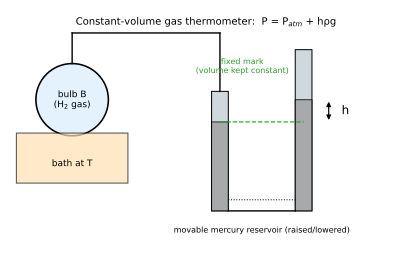

The bulb of hydrogen is connected by a capillary to a mercury manometer; the mercury level in the open limb is adjusted so that the level in the closed limb stays at a fixed mark (constant volume). Temperature follows from the pressure: $T=273.16\dfrac{P_T}{P_{tr}}$.

**Advantages**

1. Hydrogen behaves almost like an ideal gas over a wide range, so its readings agree closely with the absolute (ideal-gas) scale.
2. Wide range of use ($-200^\circ\mathrm C$ to about $500^\circ\mathrm C$).
3. High sensitivity: a large pressure change per degree, and pressure can be measured very accurately.
4. Small heat capacity and high thermal conductivity: quick thermal equilibrium.
5. The constant-volume form is more convenient and accurate than the constant-pressure form; the correction for the expansion of the bulb is small.
6. Hydrogen does not react with the (glass, silica or platinum-alloy) bulb at moderate temperatures.

### 5(d). The resistances of a platinum resistance thermometer at 0 °C and 100 °C are 4 Ω and 10 Ω. In a boiler it shows 16 Ω. Calculate the actual temperature of the boiler ($\delta=1.5$).

$$t_p=\frac{16-4}{10-4}\times100=200^\circ\mathrm C$$

Callendar's relation with $x=t/100$: $\;t-t_p=\delta\,x(x-1)\;\Rightarrow\;100x-200=1.5x(x-1)$

$$1.5x^2-101.5x+200=0\;\Rightarrow\;x=\frac{101.5-\sqrt{10302.25-1200}}{3}=\frac{101.5-95.41}{3}=2.031$$

**Answer: $t\approx203^\circ\mathrm C$** (platinum scale $200^\circ\mathrm C$).

---

# 7. Thermodynamics (first law, specific heats, processes)

*(Second law, Carnot engine, entropy: see the entropy file.)*

## 2015 — Physics-II, Q7

### 7(a). State and explain the first law of thermodynamics.

**Statement.** Heat supplied to a system is equal to the sum of the increase in its internal energy and the work done by the system. It is the law of conservation of energy applied to thermal processes.

$$Q=\Delta U+W\qquad\text{or}\qquad dQ=dU+P\,dV$$

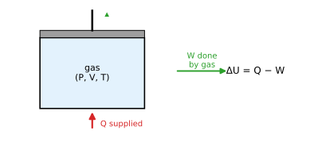

**Sign convention:** $Q>0$ heat absorbed by the system; $W>0$ work done *by* the system; $\Delta U>0$ internal energy increases.

**Explanation.** $U$ is a state function while $Q$ and $W$ depend on the path; only $Q-W$ is path independent. In a cyclic process $\Delta U=0$, so $Q=W$ (net heat absorbed equals net work done).

**Applications to ideal-gas processes**

| Process | Condition | $\Delta U$ | $W$ | $Q$ |
|---|---|---|---|---|
| Isochoric | $V$ const | $nC_V\Delta T$ | $0$ | $nC_V\Delta T$ |
| Isobaric | $P$ const | $nC_V\Delta T$ | $P\Delta V=nR\Delta T$ | $nC_P\Delta T$ |
| Isothermal | $T$ const | $0$ | $nRT\ln(V_2/V_1)$ | $=W$ |
| Adiabatic | $Q=0$ | $nC_V\Delta T$ | $-\Delta U=\dfrac{nR(T_1-T_2)}{\gamma-1}$ | $0$ |

**Example.** 500 J of heat is given to a gas, and the gas does 200 J of work: $\Delta U=500-200=300\ \mathrm J$.

### 7(b). What is specific heat? Derive an expression for the difference between the two specific heats.

See [2015 Q7(b)](#t-2015-q7b) in Chapter 6: $C_P-C_V=R$.

### 7(c). The specific heat of air at constant pressure is 0.22 cal g⁻¹ °C⁻¹ and at constant volume 0.16 cal g⁻¹ °C⁻¹. If the density of air at STP is 1.3 g L⁻¹, calculate $J$, the mechanical equivalent of heat.

*Given:* $c_P=0.22$, $c_V=0.16\ \mathrm{cal\,g^{-1}\,{}^\circ C^{-1}}$; $\rho=1.3\ \mathrm{g\,L^{-1}}$ at $T=273\ \mathrm K$, $P=1.013\times10^5\ \mathrm{Pa}$.

**Step 1 – gas constant for 1 g of air.** Volume of 1 g: $v=\dfrac1{1.3}\ \mathrm L=0.769\ \mathrm L=7.69\times10^{-4}\ \mathrm{m^3}$.

$$r=\frac{Pv}T=\frac{1.013\times10^5\times7.69\times10^{-4}}{273}=0.2854\ \mathrm{J\,g^{-1}K^{-1}}$$

**Step 2 – use** $c_P-c_V=\dfrac rJ$ (heat units):

$$J=\frac r{c_P-c_V}=\frac{0.2854}{0.22-0.16}=\frac{0.2854}{0.06}=4.76\ \mathrm{J\,cal^{-1}}$$

**Answer: $J\approx4.76\ \mathrm{J\,cal^{-1}}$ ($4.76\times10^7\ \mathrm{erg\,cal^{-1}}$).** The accepted value is $4.186$; the difference arises from the rounded specific-heat data given in the question.

---

## 2016 — Physics-II, Q6

### 6(b). Explain all the laws of thermodynamics.

**Zeroth law.** If two systems are each in thermal equilibrium with a third, they are in thermal equilibrium with each other. It defines **temperature** and makes thermometers possible.

**First law.** Energy is conserved: $dQ=dU+dW$. It introduces the internal energy $U$ and rules out a perpetual-motion machine of the first kind (work with no energy input). See [Q7(a)](#t7-2015-q7a).

**Second law.** Heat cannot flow by itself from a colder to a hotter body (Clausius); it is impossible to convert heat from a single reservoir completely into work in a cycle (Kelvin–Planck); equivalently, the entropy of an isolated system never decreases, $\Delta S\ge0$. It gives the direction of natural processes and the limit $\eta\le1-T_2/T_1$ of any engine. (Full treatment in the entropy file.)

**Third law.** The entropy of a perfect crystalline substance approaches zero as $T\to0$ (Nernst), and absolute zero cannot be reached in a finite number of steps. It fixes the absolute scale of entropy and gives $C\to0$ as $T\to0$.

| Law | Concept introduced |
|---|---|
| Zeroth | Temperature |
| First | Internal energy, conservation |
| Second | Entropy, direction of processes |
| Third | Absolute zero, absolute entropy |

---

## 2017 — Physics-II, Q5

### 5(a). What are internal energy and thermodynamic functions?

See [2017 Q5(a)](#t-2017-q5a) in Chapter 6: $U$ (state function; $\Delta U=nC_V\Delta T$ for ideal gas) and the four potentials $U,H,F,G$ with $dU=T\,dS-P\,dV$, etc.

## 2017 — Physics-II, Q6

### 6(b). What is an isothermal process? Derive an equation for work done during an isothermal process.

**Isothermal process.** A process in which the temperature of the system remains constant ($\Delta T=0$): the system is in perfect thermal contact with a reservoir and the change is slow. For an ideal gas $PV=\text{const}$ (Boyle's law) and $\Delta U=0$, so $Q=W$.

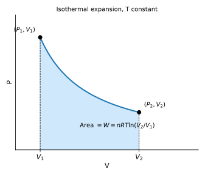

**Work.** For $n$ moles expanding quasi-statically from $V_1$ to $V_2$ at temperature $T$, with $P=\dfrac{nRT}V$:

$$W=\int_{V_1}^{V_2}P\,dV=nRT\int_{V_1}^{V_2}\frac{dV}V=nRT\ln\frac{V_2}{V_1}=nRT\ln\frac{P_1}{P_2}=P_1V_1\ln\frac{V_2}{V_1}$$

The work equals the shaded area under the $P$–$V$ curve; the same amount of heat is absorbed from the reservoir.

**Example.** One mole of an ideal gas at $300\ \mathrm K$ doubles its volume isothermally: $W=RT\ln2=8.314\times300\times0.693=1.73\times10^3\ \mathrm J$.

---

## 2018 — Physics-II, Q5

### 5(c). Show that the adiabatic curves are steeper than isothermal curves.

See [2018 Q5(c)](#t-2018-q5c) in Chapter 6: slopes $-\gamma P/V$ (adiabatic) and $-P/V$ (isothermal); ratio $\gamma>1$.

## 2018 — Physics-II, Q8

### 8(b). What is specific heat capacity? For one mole of an ideal gas, show that $C_P-C_V=R$.

Specific heat capacity: heat per unit mass (or per mole, for molar heat capacity) per unit temperature rise. Proof: [2015 Q7(b)](#t-2015-q7b).

---

## 2019 — Physics-II, Q4

### 4(b). Show that $c_P-c_V$ equals the characteristic gas constant.

See [2019 Q4(b)](#t-2019-q4b): $c_P-c_V=r$ (or $r/J$ in heat units).

---

## 2021 — Physics-II, Q5

### 5(b). What is an isothermal process? Derive an expression for work done during an isothermal process.

See [2017 Q6(b)](#t7-2017-q6b): $W=nRT\ln(V_2/V_1)$.

## 2021 — Physics-II, Q8

### 8(c). A certain amount of dry air at 15 °C is expanded adiabatically to double its volume. What will be the temperature? ($\gamma=1.40$)

*Given:* $T_1=15+273=288\ \mathrm K$, $V_2=2V_1$, $\gamma=1.40$.

*Formula:* $T_1V_1^{\gamma-1}=T_2V_2^{\gamma-1}\Rightarrow T_2=T_1\left(\dfrac{V_1}{V_2}\right)^{\gamma-1}$

$$T_2=288\times\left(\tfrac12\right)^{0.4}=288\times0.7579=218.3\ \mathrm K$$

**Answer: $T_2\approx218\ \mathrm K\approx-55^\circ\mathrm C$** (a fall of about $70\ \mathrm K$).

---

## 2022 — Physics-II, Q5

### 5(a). What is the zeroth law of thermodynamics? Show that the first law of thermodynamics is the law of conservation of energy.

**Zeroth law:** if bodies A and B are each in thermal equilibrium with C, then A and B are in thermal equilibrium with each other; it justifies the concept of temperature.

**First law as conservation of energy.** Heat $Q$ supplied to a system is partly stored as internal energy and partly leaves as work done on the surroundings:

$$Q=\Delta U+W\;\Longleftrightarrow\;\Delta U=Q-W$$

For an **isolated system** $Q=0$ and $W=0$, so $\Delta U=0$: the total energy remains constant. Energy is neither created nor destroyed but changes form; the first law states exactly this, with heat treated as an energy form. In a complete cycle $\Delta U=0$ and $W=Q$: an engine cannot do more work than the heat it receives.

### 5(b). Show that the adiabatic curves are higher than isothermal curves.

See [2018 Q5(c)](#t-2018-q5c) and the remark there: the adiabatic slope is $\gamma$ times the isothermal slope, so the adiabatic curve is the steeper (more rapidly changing) one; relative to the isotherm it lies above on the compression side and below on the expansion side.

## 2022 — Physics-II, Q6

### 6(c). 0.1 m³ of air at a pressure of 1.5 bar is expanded isothermally to 0.5 m³. Calculate the final pressure of the gas and the heat supplied during the process.

*Given:* $V_1=0.1\ \mathrm{m^3}$, $P_1=1.5\ \mathrm{bar}=1.5\times10^5\ \mathrm{Pa}$, $V_2=0.5\ \mathrm{m^3}$, $T$ const.

**Final pressure** (Boyle's law): $P_2=\dfrac{P_1V_1}{V_2}=\dfrac{1.5\times0.1}{0.5}=0.3\ \mathrm{bar}$.

**Heat supplied.** For an isothermal ideal-gas process $\Delta U=0$, so $Q=W$:

$$Q=P_1V_1\ln\frac{V_2}{V_1}=1.5\times10^5\times0.1\times\ln5=15\,000\times1.609=2.41\times10^4\ \mathrm J$$

**Answer: $P_2=0.3\ \mathrm{bar}$; $Q=W\approx24.1\ \mathrm{kJ}$.**

---

## 2023 — Physics-II, Q5

### 5(a). Show that the adiabatic curves are higher than isothermal curves.

Same as 2022 Q5(b) — see [2018 Q5(c)](#t-2018-q5c): slope ratio $=\gamma>1$.

### 5(b). Prove that $PV^\gamma=\text{constant}$.

See [2015 Q6(b)](#t-2015-q6b).

### 5(c). A motor tyre at 27 °C is pumped until its pressure is 2 atmospheres, when the tyre bursts suddenly. Calculate the final temperature. ($\gamma=1.4$)

The bursting is so quick that no heat is exchanged: an **adiabatic expansion** of the air from $P_1=2\ \mathrm{atm}$ down to atmospheric pressure $P_2=1\ \mathrm{atm}$.

*Given:* $T_1=27+273=300\ \mathrm K$, $\gamma=1.4$.

*Formula:* $T^\gamma P^{1-\gamma}=\text{const}\Rightarrow T_2=T_1\left(\dfrac{P_2}{P_1}\right)^{(\gamma-1)/\gamma}$

$$T_2=300\times\left(\tfrac12\right)^{0.4/1.4}=300\times(0.5)^{0.2857}=300\times0.8203=246\ \mathrm K$$

**Answer: $T_2\approx246\ \mathrm K\approx-27^\circ\mathrm C$.** (Assumption: the final pressure is 1 atm.)

## 2023 — Physics-II, Q6

### 6(a). Establish the relation between the two specific heats of a gas.

$C_P-C_V=R$ — see [2015 Q7(b)](#t-2015-q7b).

## 2023 — Physics-II, Q8

### 8(b). What is specific heat capacity? For one mole of an ideal gas, show that $C_P-C_V=R$.

See [2015 Q7(b)](#t-2015-q7b).

---

# 8. Thermal Radiation

## 2015 — Physics-II, Q8

### 8(a). Define blackbody, emissive power and absorptive power.

* **Blackbody.** A body that **absorbs all the radiation** of every wavelength incident on it (absorptive power $=1$); at a given temperature it also emits the maximum possible radiation (the ideal radiator). Practical realisation: Ferry's blackbody, a hollow blackened cavity with a small hole.
* **Emissive power $E$** (total). Energy emitted per unit area of a surface per unit time (all wavelengths), $E=\dfrac Q{At}$ (W m⁻²). The **spectral** emissive power $e_\lambda$ is the energy per unit area per unit time per unit wavelength interval at $\lambda$. Relative to a blackbody, *emissivity* $\varepsilon=E/E_b$.
* **Absorptive power $a$.** The fraction of the incident radiant energy absorbed by the surface: $a=\dfrac{\text{energy absorbed}}{\text{energy incident}}$ ($0\le a\le1$; dimensionless; $a_\lambda$ for a given wavelength).

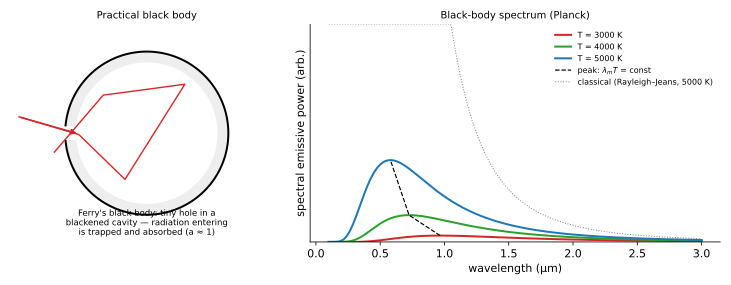

### 8(b). State Stefan–Boltzmann's law and establish its mechanical proof.

**Law.** The total energy radiated per unit area per unit time by a perfectly black body is proportional to the fourth power of its absolute temperature:

$$E=\sigma T^4,\qquad\sigma=5.67\times10^{-8}\ \mathrm{W\,m^{-2}K^{-4}}$$

For a body of emissivity $\varepsilon$ in surroundings at $T_0$: net rate $=\varepsilon\sigma A\,(T^4-T_0^4)$.

**Proof (Boltzmann; thermodynamics + radiation pressure).** Consider radiation of energy density $u(T)$ (depending on temperature alone) in an enclosure of volume $V$ with perfectly reflecting walls (cylinder with piston).

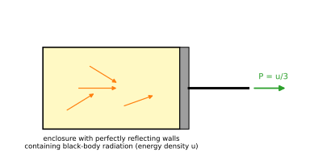

1. *Radiation pressure.* From electromagnetic theory (or by treating the radiation as a photon gas with momentum $=$ energy$/c$), isotropic radiation exerts the pressure
$$P=\frac u3$$
2. *Total energy:* $U=uV$.
3. *Thermodynamic energy equation* (derived from a Maxwell relation, see the entropy file): $\left(\dfrac{\partial U}{\partial V}\right)_T=T\left(\dfrac{\partial P}{\partial T}\right)_V-P$.
4. Substituting: $u=\dfrac T3\dfrac{du}{dT}-\dfrac u3\;\Rightarrow\;\dfrac43u=\dfrac T3\dfrac{du}{dT}\;\Rightarrow\;\dfrac{du}u=4\dfrac{dT}T$.
5. Integrating: $u=aT^4$ ($a$ a constant).
6. *From density to flux.* Isotropic radiation streaming out through a small hole carries energy per unit area per unit time $E=\dfrac14cu$ (the average of $c\cos\theta$ over a hemisphere), so

$$E=\frac{ca}4T^4=\sigma T^4\qquad\blacksquare$$

**Example.** Surface of the Sun, $T=5800\ \mathrm K$: $E=5.67\times10^{-8}\times5800^4=6.4\times10^7\ \mathrm{W\,m^{-2}}$.

## 2017 — Physics-II, Q8

### 8(a). Define: (1) blackbody radiation, (2) emissive power, (3) absorptive power.

(1) **Blackbody radiation** is the radiation emitted by a perfect blackbody; its spectrum depends only on temperature (Planck's curve in the figure of [8(a) above](#t8-2015-q8a)). (2) and (3): see [2015 Q8(a)](#t8-2015-q8a).

## 2018 — Physics-II, Q5

### 5(d). State and deduce Kirchhoff's law of radiation.

**Statement.** At a given temperature, the ratio of the emissive power to the absorptive power for radiation of a given wavelength is the **same for all bodies** and equals the emissive power of a perfect blackbody at that temperature and wavelength:

$$\frac{E_1}{a_1}=\frac{E_2}{a_2}=\dots=E_B\;(\lambda,T)$$

**Deduction.** Place an ordinary body $A$ (emissive power $E_A$, absorptive power $a_A$) and a blackbody $B$ (emissive power $E_B$, $a_B=1$) in an enclosure kept at a uniform temperature $T$, long enough for thermal equilibrium.

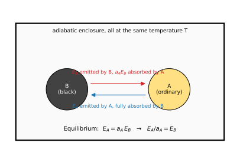

* The radiation filling the enclosure is blackbody radiation. The energy incident on unit area of $A$ per second is $E_B$.
* $A$ absorbs $a_AE_B$ per unit area per second and emits $E_A$.
* In equilibrium its temperature is steady, so emitted $=$ absorbed:

$$E_A=a_AE_B\;\Rightarrow\;\frac{E_A}{a_A}=E_B\qquad\blacksquare$$

**Consequences.** A good absorber is a good emitter and a poor absorber is a poor emitter (polished silver radiates little); a blackbody has the highest emissive power; a heated object that looks dark when cold glows brightest when hot; the dark Fraunhofer lines in the solar spectrum appear because cooler gases in the Sun's atmosphere absorb the wavelengths they would emit.

## 2022 — Physics-II, Q8

### 8(c). Define emissive power and absorptive power.

See [2015 Q8(a)](#t8-2015-q8a): $E=Q/(At)$ in W m⁻²; $a=$ fraction of incident radiation absorbed.

---

# Formula summary

| Topic | Formula |
|---|---|
| Mean KE per molecule | $\tfrac32kT$; per degree of freedom $\tfrac12kT$ |
| Pressure (kinetic theory) | $P=\tfrac13\rho\overline{c^2}=\tfrac23\dfrac EV$ |
| Mean free path | $\lambda=\dfrac1{\sqrt2\pi\sigma^2n}=\dfrac{kT}{\sqrt2\pi\sigma^2P}$ |
| Newton's cooling | $T=T_s+(T_0-T_s)e^{-kt}$ |
| van der Waals | $\left(P+\dfrac a{V^2}\right)(V-b)=RT$; $V_c=3b$, $P_c=\dfrac a{27b^2}$, $T_c=\dfrac{8a}{27Rb}$, $T_B=\dfrac a{Rb}$ |
| Resistance thermometer | $t_p=100\dfrac{R_t-R_0}{R_{100}-R_0}$, $t-t_p=\delta\dfrac t{100}\left(\dfrac t{100}-1\right)$ |
| First law | $Q=\Delta U+W$ |
| Specific heats | $C_P-C_V=R$, $\gamma=C_P/C_V$ |
| Isothermal work | $W=nRT\ln(V_2/V_1)$ |
| Adiabatic | $PV^\gamma$, $TV^{\gamma-1}$ const; $W=\dfrac{P_1V_1-P_2V_2}{\gamma-1}$ |
| Stefan–Boltzmann | $E=\sigma T^4$ |
| Kirchhoff | $E/a=E_B$ |
