# PHY-103 Physics-II: Thermodynamics, Solved Questions 2015-2023

Exam-revision notes for BUTEX Fabric Engineering, Part B (Thermodynamics section only).

| Item | Detail |
| --- | --- |
| Course | PHY-103, Physics-II |
| Topic | Thermodynamics (Part B) |
| Years covered | 2016, 2017, 2018, 2020, 2021, 2022, 2023 |
| Questions solved | 35 (list in the table of contents) |
| Version | v261103-0 |
| Diagrams | `../../assets/phy-103-thermodynamics-<slug>.svg` |

> [!NOTE]
> Repeated questions are solved in full at their first appearance only. Every later appearance quotes the question and links to the full answer. Year-specific numericals are kept in full.

## Table of contents

- [Year by topic matrix](#year-by-topic-matrix)
- [Formula and units sheet](#formula-and-units-sheet)
- Paper 2016
  - [5(b) Van der Waals critical constants](#ans-to-the-question-no-5b-2016)
  - [5(c) Tc = (8/27) T0](#ans-to-the-question-no-5c-2016)
  - [6(b) All thermodynamic laws](#ans-to-the-question-no-6b-2016)
  - [6(c) Tc of CO2](#ans-to-the-question-no-6c-2016)
- Paper 2017
  - [5(a) Internal energy, thermodynamic function](#ans-to-the-question-no-5a-2017)
  - [5(b) Reversible and irreversible](#ans-to-the-question-no-5b-2017)
  - [5(c) Carnot efficiency](#ans-to-the-question-no-5c-2017)
  - [6(a) Second law, difference from first law](#ans-to-the-question-no-6a-2017)
  - [6(c) Carnot numerical, 177 C and 77 C](#ans-to-the-question-no-6c-2017)
- Paper 2018
  - [8(a) Second law](#ans-to-the-question-no-8a-2018)
  - [8(b) Specific heat, Cp - Cv = R](#ans-to-the-question-no-8b-2018)
  - [8(c) Carnot engine is reversible](#ans-to-the-question-no-8c-2018)
- Paper 2020
  - [6(a) Maxwell relations, general expression](#ans-to-the-question-no-6a-2020)
  - [6(b) TdS results](#ans-to-the-question-no-6b-2020)
  - [7(a) Carnot engine is reversible](#ans-to-the-question-no-7a-2020)
  - [7(b) Efficiency, steam point and ice point](#ans-to-the-question-no-7b-2020)
- Paper 2021
  - [7(a) Carnot cycle](#ans-to-the-question-no-7a-2021)
  - [7(b) Efficiency formula](#ans-to-the-question-no-7b-2021)
  - [7(c) First law versus second law](#ans-to-the-question-no-7c-2021)
  - [7(d) Specific heat](#ans-to-the-question-no-7d-2021)
  - [8(a) Second law](#ans-to-the-question-no-8a-2021)
  - [8(c) Dry air adiabatic expansion](#ans-to-the-question-no-8c-2021)
- Paper 2022
  - [5(a) Zeroth law, first law as energy conservation](#ans-to-the-question-no-5a-2022)
  - [5(c) Carnot engine is reversible](#ans-to-the-question-no-5c-2022)
  - [6(a) Molar specific heat, Cp and Cv](#ans-to-the-question-no-6a-2022)
  - [6(b) Isentropic process and work](#ans-to-the-question-no-6b-2022)
  - [6(c) Isothermal expansion of air](#ans-to-the-question-no-6c-2022)
- Paper 2023
  - [5(b) Prove PV^gamma = constant](#ans-to-the-question-no-5b-2023)
  - [5(c) Tyre burst](#ans-to-the-question-no-5c-2023)
  - [6(a) Relation between the specific heats](#ans-to-the-question-no-6a-2023)
  - [6(c) First law versus second law](#ans-to-the-question-no-6c-2023)
  - [6(d) Carnot numerical, 450 K and 350 K](#ans-to-the-question-no-6d-2023)
  - [8(a) Second law](#ans-to-the-question-no-8a-2023)
  - [8(b) Specific heat, Cp - Cv = R](#ans-to-the-question-no-8b-2023)
  - [8(c) Carnot engine is reversible](#ans-to-the-question-no-8c-2023)
- [Concept map](#concept-map)
- [One-page cheat sheet](#one-page-cheat-sheet)
- [Glossary](#glossary)
- [Practice problems](#practice-problems)

## Year by topic matrix

Numbers are question numbers. Count is the number of questions in scope. Q6(a) of 2017 is counted in both the second-law row and the first-versus-second row.

| Topic | 2016 | 2017 | 2018 | 2020 | 2021 | 2022 | 2023 | Count |
| --- | --- | --- | --- | --- | --- | --- | --- | --- |
| Carnot engine, efficiency, numericals | - | 5(c), 6(c) | - | 7(b) | 7(a), 7(b) | - | 6(d) | 6 |
| Carnot cycle is reversible (proof) | - | - | 8(c) | 7(a) | - | 5(c) | 8(c) | 4 |
| Second law statement | 6(b) in part | 6(a) | 8(a) | - | 8(a) | - | 8(a) | 4 |
| First law versus second law | - | 6(a) | - | - | 7(c) | - | 6(c) | 3 |
| Specific heats, Cp - Cv = R | - | - | 8(b) | - | 7(d) | 6(a) | 6(a), 8(b) | 5 |
| Adiabatic and isothermal processes, numericals | - | - | - | - | 8(c) | 6(b), 6(c) | 5(b), 5(c) | 5 |
| Zeroth, first and third laws | 6(b) | - | - | - | - | 5(a) | - | 2 |
| Van der Waals critical constants, Boyle temperature | 5(b), 5(c), 6(c) | - | - | - | - | - | - | 3 |
| Maxwell relations | - | - | - | 6(a), 6(b) | - | - | - | 2 |
| State function, internal energy | - | 5(a) | - | - | - | - | - | 1 |
| Reversible and irreversible | - | 5(b) | - | - | - | - | - | 1 |

**Priority:** the Carnot family (10 questions) comes first, then specific heats (5), adiabatic and isothermal numericals (5) and the second-law statement (4). Prepare these four blocks completely before anything else.

## Formula and units sheet

| Quantity | Symbol | SI unit | Dimension |
| --- | --- | --- | --- |
| Internal energy | $U$ | joule, $\mathrm{J}$ | $\mathrm{M\,L^{2}\,T^{-2}}$ |
| Heat | $Q$ | joule, $\mathrm{J}$ | $\mathrm{M\,L^{2}\,T^{-2}}$ |
| Work | $W$ | joule, $\mathrm{J}$ | $\mathrm{M\,L^{2}\,T^{-2}}$ |
| Molar heat capacity at constant pressure | $C_p$ | $\mathrm{J\,mol^{-1}\,K^{-1}}$ | $\mathrm{M\,L^{2}\,T^{-2}\,N^{-1}\,\Theta^{-1}}$ |
| Molar heat capacity at constant volume | $C_v$ | $\mathrm{J\,mol^{-1}\,K^{-1}}$ | $\mathrm{M\,L^{2}\,T^{-2}\,N^{-1}\,\Theta^{-1}}$ |
| Specific heat capacity | $c$ | $\mathrm{J\,kg^{-1}\,K^{-1}}$ | $\mathrm{L^{2}\,T^{-2}\,\Theta^{-1}}$ |
| Heat capacity ratio | $\gamma = C_p/C_v$ | none | dimensionless |
| Efficiency | $\eta$ | none | dimensionless |
| Absolute temperature | $T$ | kelvin, $\mathrm{K}$ | $\Theta$ |
| Pressure | $P$ | pascal, $\mathrm{Pa}$ | $\mathrm{M\,L^{-1}\,T^{-2}}$ |
| Volume | $V$ | cubic metre, $\mathrm{m^{3}}$ | $\mathrm{L^{3}}$ |
| Entropy | $S$ | $\mathrm{J\,K^{-1}}$ | $\mathrm{M\,L^{2}\,T^{-2}\,\Theta^{-1}}$ |
| Gas constant | $R$ | $\mathrm{J\,mol^{-1}\,K^{-1}}$ | $\mathrm{M\,L^{2}\,T^{-2}\,N^{-1}\,\Theta^{-1}}$ |

Useful values: $R = 8.314\,\mathrm{J\,mol^{-1}\,K^{-1}}$, $1\,\mathrm{atm} = 1.013\times10^{5}\,\mathrm{Pa}$, $1\,\mathrm{bar} = 10^{5}\,\mathrm{Pa}$, $1\,\mathrm{cal} = 4.2\,\mathrm{J}$ (as given in the paper), $T(\mathrm{K}) = t(^\circ\mathrm{C}) + 273$.

## Paper 2016

> **Q.** Deduce $V_c = 3b$, $P_c = a/(27b^2)$, $T_c = 8a/(27bR)$.
>
> Asked in: 2016 Q5(b)

#### Ans. to the question no. 5(b), 2016

> [!NOTE]
> This is the van der Waals critical-constant problem. It is listed under the Thermodynamics section of the paper.

**Statement.** For one mole of a van der Waals gas, $\left(P+\dfrac{a}{V^2}\right)(V-b)=RT$. At the critical point the critical isotherm has a horizontal point of inflection, so $\left(\dfrac{\partial P}{\partial V}\right)_T=0$ and $\left(\dfrac{\partial^2 P}{\partial V^2}\right)_T=0$.

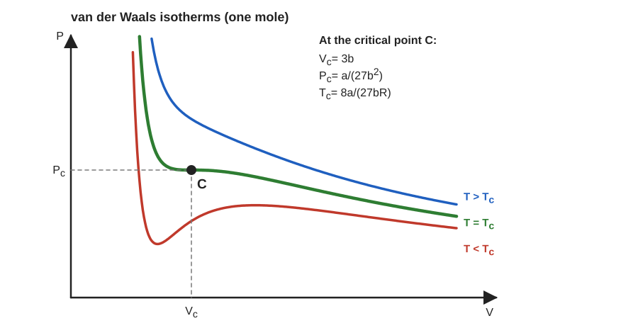

**Derivation** ($a$, $b$ are the van der Waals constants, $R$ the gas constant):

1. Solve for pressure:

   $$
   P=\frac{RT}{V-b}-\frac{a}{V^2}
   $$

2. First condition, $\left(\partial P/\partial V\right)_T=0$:

   $$
   -\frac{RT}{(V-b)^2}+\frac{2a}{V^3}=0 \quad\Rightarrow\quad \frac{RT}{(V-b)^2}=\frac{2a}{V^3}
   $$

3. Second condition, $\left(\partial^2 P/\partial V^2\right)_T=0$:

   $$
   \frac{2RT}{(V-b)^3}-\frac{6a}{V^4}=0 \quad\Rightarrow\quad \frac{RT}{(V-b)^3}=\frac{3a}{V^4}
   $$

4. Divide step 2 by step 3:

   $$
   V-b=\frac{2V}{3}\quad\Rightarrow\quad V_c=3b
   $$

5. Put $V_c$ into step 2:

   $$
   RT_c=\frac{2a(V_c-b)^2}{V_c^3}=\frac{2a(2b)^2}{27b^3}=\frac{8a}{27b}\quad\Rightarrow\quad T_c=\frac{8a}{27bR}
   $$

6. Put $V_c$ and $T_c$ into step 1:

   $$
   P_c=\frac{8a/27b}{2b}-\frac{a}{9b^2}=\frac{4a}{27b^2}-\frac{3a}{27b^2}=\frac{a}{27b^2}
   $$

> [!IMPORTANT]
>
> $$
> V_c=3b,\qquad P_c=\frac{a}{27b^2},\qquad T_c=\frac{8a}{27bR}
> $$

**Worked example.** Carbon dioxide has $a\approx0.364\,\mathrm{Pa\,m^6\,mol^{-2}}$ and $b\approx4.27\times10^{-5}\,\mathrm{m^3\,mol^{-1}}$.

$$
P_c=\frac{0.364}{27\,(4.27\times10^{-5})^2}\approx7.39\times10^{6}\,\mathrm{Pa},\qquad T_c=\frac{8\,(0.364)}{27\,(4.27\times10^{-5})(8.314)}\approx304\,\mathrm{K}
$$

A CO2 fire-extinguisher cylinder holds liquid CO2 at room temperature. On a day hotter than about 304 K (31 °C) no liquid can exist at any pressure.

Extra: critical coefficient and reduced equation

Combine the three results:

$$
\frac{P_cV_c}{RT_c}=\frac{(a/27b^2)(3b)}{8a/27b}=\frac{3}{8}
$$

Real gases give about $0.27$ for CO2, so the van der Waals model is only approximate. With $\pi=P/P_c$, $\phi=V/V_c$, $\tau=T/T_c$ the equation becomes the law of corresponding states:

$$
\left(\pi+\frac{3}{\phi^2}\right)(3\phi-1)=8\tau
$$

> [!TIP]
> Differentiate with respect to $V$ at constant $T$, not constant $P$. Write both conditions before dividing. Do not forget to substitute $V_c$ back to find $P_c$.

---

> **Q.** Prove $T_c=\dfrac{8}{27}T_0$.
>
> Asked in: 2016 Q5(c)

#### Ans. to the question no. 5(c), 2016

**Statement.** $T_0$ is the Boyle temperature, the temperature at which a real gas obeys Boyle's law at low pressure: $\left(\dfrac{\partial (PV)}{\partial P}\right)_T\to0$ as $P\to0$. For a van der Waals gas $T_0=\dfrac{a}{bR}$.

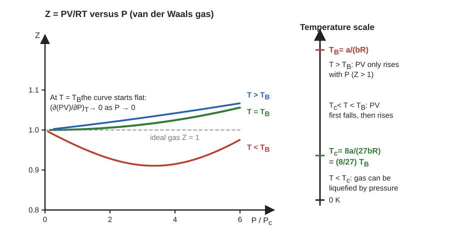

**Derivation:**

1. Multiply the van der Waals pressure by $V$ and expand for large $V$ (small $b/V$):

   $$
   PV=\frac{RTV}{V-b}-\frac{a}{V}\approx RT+\frac{RTb-a}{V}
   $$

2. At low pressure $1/V\approx P/RT$, so

   $$
   PV\approx RT+\left(b-\frac{a}{RT}\right)P
   $$

3. Boyle's law holds when the coefficient of $P$ vanishes:

   $$
   b-\frac{a}{RT_0}=0\quad\Rightarrow\quad T_0=\frac{a}{bR}
   $$

4. Divide the critical temperature (from 2016 Q5(b)) by $T_0$:

   $$
   \frac{T_c}{T_0}=\frac{8a/(27bR)}{a/(bR)}=\frac{8}{27}
   $$

> [!IMPORTANT]
>
> $$
> T_c=\frac{8}{27}\,T_0\qquad\text{or}\qquad T_0=\frac{27}{8}T_c\approx3.4\,T_c
> $$

**Worked example.** For CO2 the van der Waals constants give $T_0=a/(bR)=0.364/(4.27\times10^{-5}\times8.314)\approx1.03\times10^{3}\,\mathrm{K}$, so $T_c=\tfrac{8}{27}\times1025\approx304\,\mathrm{K}$, matching the value above.

Extra: what the two temperatures mean

Below $T_c$ pressure alone can liquefy the gas. Between $T_c$ and $T_0$ the product $PV$ first falls and then rises with pressure. Above $T_0$ it only rises. The ratio $T_0/T_c=27/8$ is a van der Waals prediction, not an exact law.

> [!TIP]
> Say clearly that $T_0$ is the Boyle temperature and that you keep only the first-order term in $P$. The question is a two-line division once $T_0$ is derived.

---

> **Q.** Explain all the thermodynamic laws.
>
> Asked in: 2016 Q6(b)

#### Ans. to the question no. 6(b), 2016

**Zeroth law.** If system A and system B are each in thermal equilibrium with a third system C, then A and B are in thermal equilibrium with each other. This defines temperature: bodies in equilibrium have equal temperature.

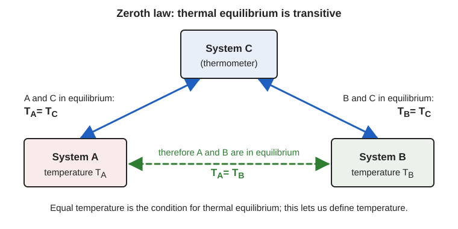

**First law.** Energy is conserved. Heat $Q$ supplied to a system equals the increase in internal energy $\Delta U$ plus the work $W$ done by the system:

$$
Q=\Delta U+W,\qquad dQ=dU+P\,dV
$$

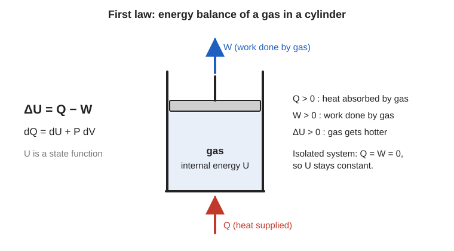

**Second law.** Kelvin-Planck: no cyclic engine can convert heat from a single reservoir completely into work. Clausius: heat cannot flow from a colder to a hotter body by itself. In terms of entropy, $\Delta S_{\text{universe}}\ge0$.

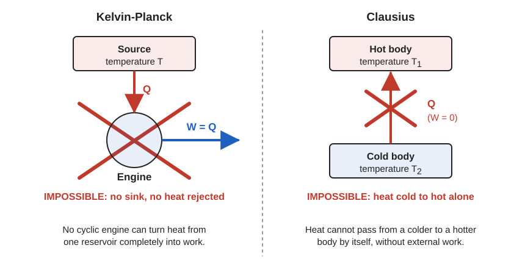

**Third law (Nernst).** The entropy of a perfect crystal tends to zero as $T\to0$, and absolute zero cannot be reached in a finite number of steps.

> [!IMPORTANT]
> Zeroth: temperature exists. First: $Q=\Delta U+W$. Second: heat engines need a sink; $\Delta S_{\text{universe}}\ge0$. Third: $S\to0$ as $T\to0$; $0\,\mathrm{K}$ is unattainable.

**Worked example.** A cup of coffee at 90 °C in a 25 °C room:

- Zeroth: a thermometer placed in the coffee reads the coffee's temperature once it reaches equilibrium with it.
- First: heating $0.2\,\mathrm{kg}$ of water from 20 °C to 100 °C needs $Q=0.2\times4186\times80\approx6.7\times10^{4}\,\mathrm{J}$.
- Second: the coffee cools by passing heat to the room. The reverse never happens by itself.
- Third: laboratory dilution refrigerators reach millikelvin temperatures but never $0\,\mathrm{K}$.

Extra: the laws as impossibility statements

First law: a perpetual-motion machine of the first kind (work without energy input) is impossible. Second law: a perpetual-motion machine of the second kind (an engine with $\eta=1$) is impossible. Third law: cooling to $0\,\mathrm{K}$ is impossible. The heat capacities also tend to zero as $T\to0$.

> [!TIP]
> Write the four laws in this order, each with its equation or symbolic statement. Do not mix the Kelvin-Planck and Clausius statements: give both under the second law.

---

> **Q.** For CO2, with unit pressure = standard barometric pressure and unit volume = volume at NTP, $a=0.00874$ and $b=0.0023$. Calculate $T_c$.
>
> Asked in: 2016 Q6(c)

#### Ans. to the question no. 6(c), 2016

**Given.** $a=0.00874$, $b=0.0023$ (dimensionless in the stated units), $P_0=1$ (unit of pressure), $V_0=1$ (unit of volume), $T_0=273\,\mathrm{K}$ (NTP).

**Formula.** $T_c=\dfrac{8a}{27bR}$ with $R=\dfrac{P_0V_0}{T_0}$ for one mole at NTP.

**Substitution.**

1. In these units $R=\dfrac{1\times1}{273}=\dfrac{1}{273}$.
2. Then

   $$
   T_c=\frac{8\times0.00874\times273}{27\times0.0023}=\frac{19.088}{0.0621}\approx307.4\,\mathrm{K}
   $$

> [!IMPORTANT]
> $T_c\approx307.4\,\mathrm{K}\approx34.4\,^\circ\mathrm{C}$. The measured critical temperature of CO2 is about $304\,\mathrm{K}$, so the van der Waals model is close but not exact.

**Worked example.** At 25 °C (298 K) CO2 is below $T_c$ and can be liquefied by pressure alone, as in a CO2 extinguisher cylinder. At 40 °C (313 K) it is above $T_c$ and stays a gas however hard it is compressed.

Extra: why R is 1/273

At NTP one mole occupies the unit volume at unit pressure and $273\,\mathrm{K}$, so $PV=RT$ gives $R=1/273$ in this system of units. $a$ and $b$ are then pure numbers.

> [!TIP]
> Do not use $R=8.314$ here. The constants are given in special units, so $R$ must be $P_0V_0/T_0$. Convert the final answer to °C only if asked.

## Paper 2017

> **Q.** What are internal energy and thermodynamical function?
>
> Asked in: 2017 Q5(a)

#### Ans. to the question no. 5(a), 2017

**Internal energy.** The internal energy $U$ of a system is the sum of the kinetic and potential energies of its molecules. It depends only on the state of the system. For an ideal gas it depends on temperature alone: $U=nC_vT$ for $n$ moles.

**Thermodynamical (state) function.** A quantity whose value depends only on the present state of the system, not on the path used to reach it. Its differential is exact, so $\oint dZ=0$ over any cycle.

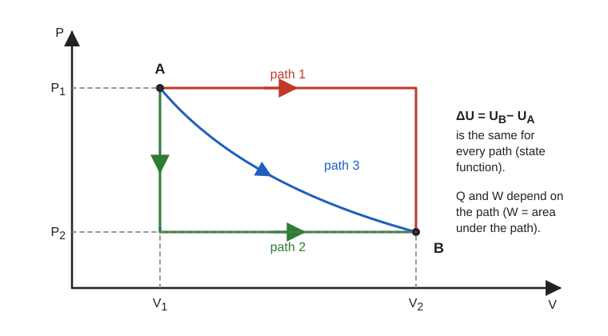

**The standard functions** ($P$, $V$, $T$, $S$ pressure, volume, temperature, entropy):

1. Internal energy: $dU=T\,dS-P\,dV$
2. Enthalpy: $H=U+PV$, so $dH=T\,dS+V\,dP$
3. Helmholtz function: $F=U-TS$, so $dF=-S\,dT-P\,dV$
4. Gibbs function: $G=H-TS$, so $dG=-S\,dT+V\,dP$
5. Entropy: $dS=\dfrac{\delta Q_{\text{rev}}}{T}$

> [!IMPORTANT]
> $U$, $H$, $F$, $G$, $S$ are state functions. $Q$ and $W$ are not: they depend on the path.

**Worked example.** Raise $1\,\mathrm{kg}$ of water from 20 °C to 80 °C. $\Delta U\approx mc\Delta T=1\times4186\times60\approx2.5\times10^{5}\,\mathrm{J}$. The result is the same whether a stove supplies heat or a paddle wheel (Joule's experiment) supplies work.

Extra: test for a state function

If $dZ=M\,dx+N\,dy$ is exact then $\left(\dfrac{\partial M}{\partial y}\right)_x=\left(\dfrac{\partial N}{\partial x}\right)_y$. Applying this to $dU$, $dH$, $dF$, $dG$ gives the Maxwell relations (see 2020 Q6(a)). $\delta Q$ and $\delta W$ fail the test, which is why they carry $\delta$ and not $d$.

> [!TIP]
> State the contrast clearly: state function versus path function. Name all five (U, H, F, G, S) and define each in one line.

---

> **Q.** Distinguish between reversible and irreversible processes.
>
> Asked in: 2017 Q5(b)

#### Ans. to the question no. 5(b), 2017

**Definitions.** A reversible process is one that can be reversed so that the system and the surroundings both return exactly to their initial states. An irreversible process cannot.

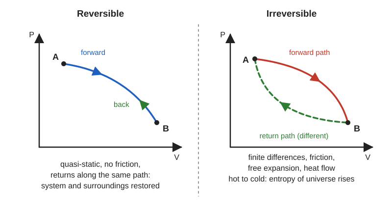

| Point | Reversible | Irreversible |
| --- | --- | --- |
| Speed | Quasi-static, infinitely slow | Finite speed, sudden |
| States | Equilibrium at every stage | Non-equilibrium stages |
| Dissipation | No friction or turbulence | Friction, viscosity, heat flow over finite $\Delta T$ |
| Path | Can retrace the same path | Returns by a different path |
| Entropy of universe | $\Delta S=0$ | $\Delta S\gt0$ |
| Occurrence | Ideal limit only | All natural processes |
| Examples | Carnot cycle, slow isothermal expansion | Free expansion, mixing, heat conduction, friction |

> [!IMPORTANT]
> Reversible: $\Delta S_{\text{universe}}=0$. Irreversible: $\Delta S_{\text{universe}}\gt0$.

**Worked example.** A cup of tea at 80 °C (353 K) loses $1000\,\mathrm{J}$ to a 25 °C (298 K) room:

$$
\Delta S_{\text{universe}}=\frac{1000}{298}-\frac{1000}{353}\approx+0.52\,\mathrm{J\,K^{-1}}\gt0
$$

The positive value shows the process is irreversible.

Extra: free expansion

When one mole of an ideal gas expands freely into a vacuum to twice its volume, $Q=W=0$ and $T$ is unchanged. The entropy of the gas rises by $R\ln2\approx5.76\,\mathrm{J\,K^{-1}}$ and the surroundings do not change, so $\Delta S_{\text{universe}}\gt0$. The gas will never return to one half of the vessel by itself.

> [!TIP]
> Give at least one table row on entropy and one example for each type. Mention that reversible processes are idealisations.

---

> **Q.** Find an expression for the efficiency of a Carnot engine.
>
> Asked in: 2017 Q5(c); the efficiency formula is also asked in 2020 Q7(b) and 2021 Q7(b)

#### Ans. to the question no. 5(c), 2017

**Statement.** A Carnot engine works on a reversible cycle of two isothermal and two adiabatic steps between a source at $T_1$ and a sink at $T_2$. Its efficiency is $\eta=W/Q_1$, the ratio of work done to heat absorbed.

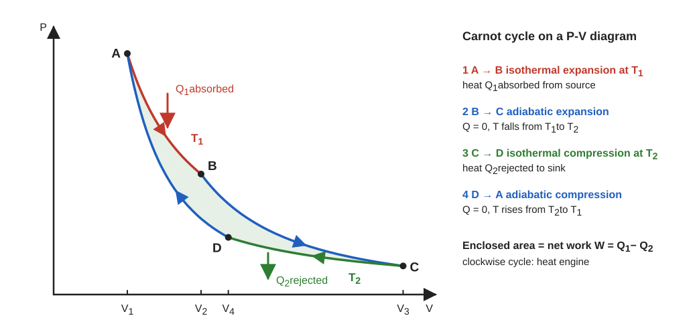

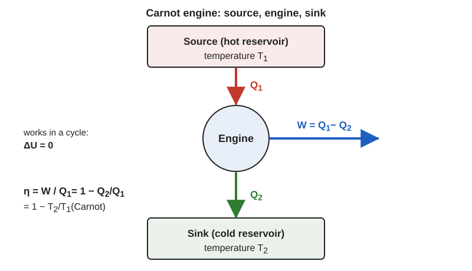

**Derivation** (one mole of ideal gas, $\gamma=C_p/C_v$; states A, B, C, D with volumes $V_1,V_2,V_3,V_4$):

1. A to B, isothermal expansion at $T_1$ ($\Delta U=0$): heat absorbed

   $$
   Q_1=RT_1\ln\frac{V_2}{V_1}
   $$

2. B to C, adiabatic expansion:

   $$
   T_1V_2^{\gamma-1}=T_2V_3^{\gamma-1}
   $$

3. C to D, isothermal compression at $T_2$: heat rejected

   $$
   Q_2=RT_2\ln\frac{V_3}{V_4}
   $$

4. D to A, adiabatic compression:

   $$
   T_2V_4^{\gamma-1}=T_1V_1^{\gamma-1}
   $$

5. Divide step 2 by step 4:

   $$
   \frac{V_2}{V_1}=\frac{V_3}{V_4}
   $$

6. Hence the logarithms are equal and

   $$
   \frac{Q_1}{Q_2}=\frac{T_1}{T_2}
   $$

7. Efficiency:

   $$
   \eta=\frac{W}{Q_1}=\frac{Q_1-Q_2}{Q_1}=1-\frac{T_2}{T_1}
   $$

> [!IMPORTANT]
>
> $$
> \eta=1-\frac{Q_2}{Q_1}=\frac{T_1-T_2}{T_1}
> $$
>
> The efficiency depends only on the two temperatures, never on the working substance.

**Worked example.** A steam power plant with steam at 540 °C (813 K) and a condenser at 30 °C (303 K) has the ideal limit

$$
\eta_{\max}=1-\frac{303}{813}\approx62.7\%
$$

Real plants reach about 40 %, because real processes are irreversible.

Extra: Carnot theorem and the effect of the sink

Carnot's theorem: no engine working between two given temperatures is more efficient than a reversible engine, and all reversible engines between them have the same efficiency. The plot shows $\eta$ rising as $T_2$ falls, reaching 1 only at $T_2=0$, which the third law forbids.

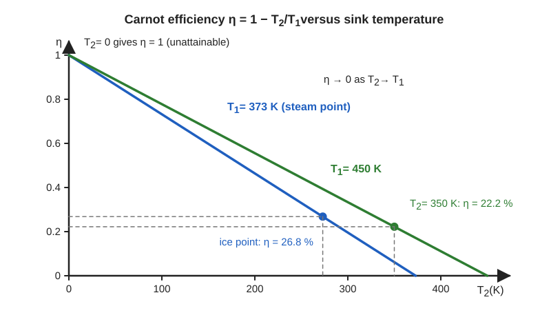

> [!TIP]
> Use kelvin in $T_2/T_1$. Always write $\eta\lt1$. Do not forget the step that shows $V_2/V_1=V_3/V_4$: it is where the marks are.

---

> **Q.** State and explain the second law of thermodynamics. How does it differ from the first law?
>
> Asked in: 2017 Q6(a), 2018 Q8(a), 2021 Q8(a), 2023 Q8(a); the "difference from the first law" part is also asked in 2021 Q7(c) and 2023 Q6(c)

#### Ans. to the question no. 6(a), 2017

**Statements.**

- Kelvin-Planck: it is impossible to construct a cyclic engine that takes heat from a single reservoir and converts it completely into work.
- Clausius: heat cannot pass from a colder body to a hotter body by itself, without external work.
- Entropy form: for any process $\Delta S_{\text{universe}}\ge0$.

**Explanation.**

1. A heat engine must reject some heat $Q_2$ to a colder sink, so $\eta\lt1$.
2. A refrigerator needs work $W$ to move heat from cold to hot.
3. Natural processes have a direction (hot to cold, order to disorder). The first law does not forbid the reverse, the second law does.

**Difference from the first law.**

| Point | First law | Second law |
| --- | --- | --- |
| Concerns | Conservation of energy | Direction of processes and conversion of heat to work |
| Equation | $Q=\Delta U+W$ | $\Delta S_{\text{universe}}\ge0$, $\eta\lt1$ |
| Allows | Any process that conserves energy | Only processes that satisfy the entropy rule |
| Heat to work | Equivalent, nothing forbidden | Complete conversion in a cycle is impossible |
| Defines | Internal energy $U$ | Entropy $S$ and absolute temperature scale |

> [!IMPORTANT]
> First law: energy is conserved. Second law: the direction of change is fixed; no engine has $\eta=1$.

**Worked example.** A kitchen refrigerator keeps its inside at 4 °C (277 K) in a 25 °C (298 K) room. The best possible coefficient of performance is

$$
\mathrm{COP}_{\max}=\frac{T_2}{T_1-T_2}=\frac{277}{298-277}\approx13.2
$$

Heat is moved from cold to hot only because the compressor does work.

Extra: Kelvin-Planck and Clausius are equivalent

Suppose a Clausius violator moves $Q_2$ from cold to hot with no work. Run a Carnot engine between the same reservoirs that takes $Q_1$ from hot, rejects $Q_2$ to cold and does $W=Q_1-Q_2$. The cold body is unchanged, and the hot body has lost $Q_1-Q_2$, all turned into work. That violates Kelvin-Planck.

Conversely, suppose a Kelvin-Planck violator turns heat $Q$ from one reservoir wholly into work $W=Q$. Use $W$ to drive a refrigerator that takes $Q_2$ from the cold body and delivers $Q_2+W$ to the hot body. The net effect is heat moved from cold to hot with no net work, violating Clausius.

> [!TIP]
> Give both statements. Always add the "difference" table if the question asks for it. Do not say that the second law "contradicts" the first.

---

> **Q.** A Carnot engine works between 177 °C and 77 °C and receives $4200\,\mathrm{J}$ per cycle. Find the heat rejected, the efficiency and the work done.
>
> Asked in: 2017 Q6(c). The same problem appears in 2023 Q6(d), given in cal instead of J.

#### Ans. to the question no. 6(c), 2017

**Given.** $t_1=177\,^\circ\mathrm{C}$, $t_2=77\,^\circ\mathrm{C}$, $Q_1=4200\,\mathrm{J}$.

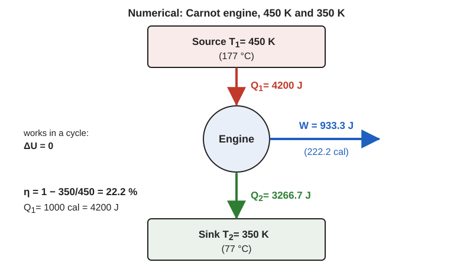

**Formula.** $\eta=1-\dfrac{T_2}{T_1}$, $\dfrac{Q_2}{Q_1}=\dfrac{T_2}{T_1}$, $W=Q_1-Q_2$.

**Substitution.**

1. $T_1=177+273=450\,\mathrm{K}$ and $T_2=77+273=350\,\mathrm{K}$.
2. $\eta=1-\dfrac{350}{450}=0.2222$
3. $Q_2=4200\times\dfrac{350}{450}=3266.7\,\mathrm{J}$
4. $W=4200-3266.7=933.3\,\mathrm{J}$

> [!IMPORTANT]
> Heat rejected $Q_2\approx3266.7\,\mathrm{J}$, efficiency $\eta\approx22.2\,\%$, work done $W\approx933.3\,\mathrm{J}$.

**Worked example.** The numbers describe a small engine fed by steam at 177 °C. Each cycle it turns about 22 % of the heat into work and dumps the other 78 % into a 77 °C sink, which could be used for hot water.

Extra: check with the work formula

$W=\eta Q_1=0.2222\times4200=933.3\,\mathrm{J}$, matching $Q_1-Q_2$. The two checks agree, so the arithmetic is consistent.

> [!TIP]
> Convert °C to K before dividing. Check that $Q_2\lt Q_1$ and that $W+Q_2=Q_1$.

## Paper 2018

> **Q.** State and explain the second law of thermodynamics.
>
> Asked in: 2017 Q6(a), 2018 Q8(a), 2021 Q8(a), 2023 Q8(a)

#### Ans. to the question no. 8(a), 2018

Same as [2017 Q6(a)](#ans-to-the-question-no-6a-2017).

---

> **Q.** What is specific heat capacity? For one mole of an ideal gas show $C_p-C_v=R$.
>
> Asked in: 2018 Q8(b), 2023 Q8(b). Related: 2021 Q7(d), 2022 Q6(a), 2023 Q6(a)

#### Ans. to the question no. 8(b), 2018

**Definitions.** The specific heat capacity $c$ of a substance is the heat needed to raise the temperature of unit mass by one kelvin: $c=\dfrac{1}{m}\dfrac{dQ}{dT}$, unit $\mathrm{J\,kg^{-1}\,K^{-1}}$. The molar heat capacity is $C=\dfrac{1}{n}\dfrac{dQ}{dT}$, unit $\mathrm{J\,mol^{-1}\,K^{-1}}$. A gas has two: $C_v$ at constant volume and $C_p$ at constant pressure.

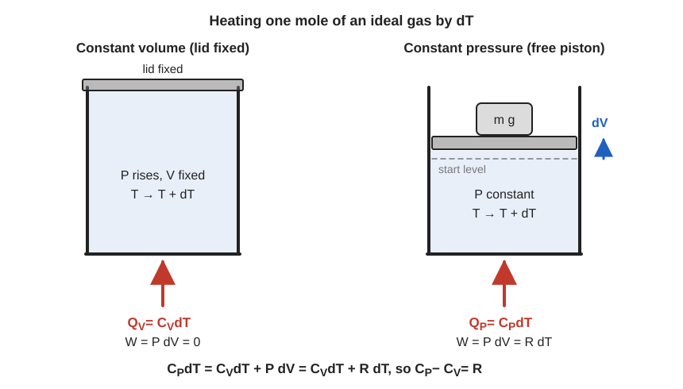

**Derivation** (one mole of ideal gas, $PV=RT$):

1. First law for a small change: $dQ=dU+P\,dV$.
2. At constant volume $dV=0$, so

   $$
   C_v=\left(\frac{dQ}{dT}\right)_V=\left(\frac{dU}{dT}\right)_V
   $$

3. For an ideal gas $U$ depends on $T$ only (Joule's law), so $dU=C_v\,dT$ in every process.
4. At constant pressure

   $$
   C_p=\left(\frac{dQ}{dT}\right)_P=C_v+P\left(\frac{dV}{dT}\right)_P
   $$

5. From $PV=RT$ at constant $P$: $P\,(dV/dT)_P=R$. Therefore

   $$
   C_p=C_v+R
   $$

> [!IMPORTANT]
>
> $$
> C_p-C_v=R
> $$
>
> The excess $R$ is the work done by one mole expanding against constant pressure when heated by $1\,\mathrm{K}$.

**Worked example.** Heat one mole of air by $10\,\mathrm{K}$. In a rigid closed bottle ($C_v\approx20.8\,\mathrm{J\,mol^{-1}\,K^{-1}}$) it takes $208\,\mathrm{J}$. In a cylinder with a free piston ($C_p\approx29.1\,\mathrm{J\,mol^{-1}\,K^{-1}}$) it takes $291\,\mathrm{J}$. The extra $83\,\mathrm{J}$ is the expansion work.

Extra: Mayer's relation and gamma

With $\gamma=C_p/C_v$ and $C_p-C_v=R$:

$$
C_v=\frac{R}{\gamma-1},\qquad C_p=\frac{\gamma R}{\gamma-1}
$$

For a monatomic gas $\gamma=5/3$; for a diatomic gas $\gamma=7/5=1.4$. Always $C_p\gt C_v$.

> [!TIP]
> Say that $dU=C_v\,dT$ holds for every process of an ideal gas. Many students write it only for constant volume and lose the step.

---

> **Q.** What is a Carnot engine? Show that the Carnot cycle is a reversible process.
>
> Asked in: 2018 Q8(c), 2020 Q7(a), 2022 Q5(c), 2023 Q8(c)

#### Ans. to the question no. 8(c), 2018

**Carnot engine.** An ideal heat engine that works on the Carnot cycle between a source at $T_1$ and a sink at $T_2$. The cycle has four steps: isothermal expansion, adiabatic expansion, isothermal compression, adiabatic compression (full details in [2017 Q5(c)](#ans-to-the-question-no-5c-2017)).

**To show the cycle is reversible:**

1. Every step is quasi-static, so the gas is in equilibrium at each stage.
2. In the isothermal steps the gas and the reservoir differ in temperature by only an infinitesimal amount, so heat flows reversibly and a tiny change would reverse the direction.
3. The adiabatic steps are done with perfect insulation, so no heat enters or leaves.
4. There is no friction or other dissipation.
5. Run backwards, the cycle retraces every state: $A\to D\to C\to B\to A$. Heat $Q_2$ is absorbed at $T_2$, heat $Q_1$ is rejected at $T_1$ and work $W$ is done on the gas.

   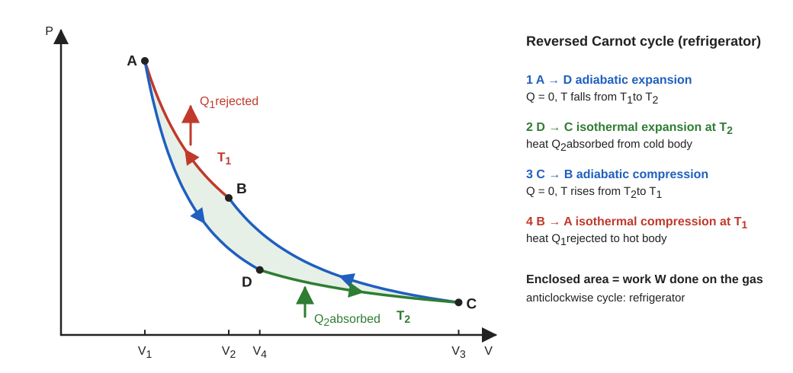

6. Entropy check:

   $$
   \Delta S_{\text{universe}}=-\frac{Q_1}{T_1}+\frac{Q_2}{T_2}=0
   $$

   because $Q_1/Q_2=T_1/T_2$.

> [!IMPORTANT]
> The Carnot cycle is reversible: every step is quasi-static and free of dissipation, reversing it retraces every state, and $\Delta S_{\text{universe}}=0$.

**Worked example.** Run backwards, the Carnot engine is an ideal refrigerator. To remove $Q_2=1000\,\mathrm{J}$ from a freezer at $-18\,^\circ\mathrm{C}$ (255 K) and release heat into a kitchen at $27\,^\circ\mathrm{C}$ (300 K):

$$
W=Q_2\frac{T_1-T_2}{T_2}=1000\times\frac{45}{255}\approx176.5\,\mathrm{J}
$$

Extra: why real engines are irreversible

A real engine needs a finite temperature difference to move heat quickly, and it has friction and turbulence. Each adds entropy, so its efficiency is below the Carnot value $1-T_2/T_1$. This is the content of Carnot's theorem.

> [!TIP]
> Give all three reasons (quasi-static, no dissipation, infinitesimal temperature difference) and add the retracing argument. Quote the entropy check if you have time.

## Paper 2020

> **Q.** Derive the general expression for the establishment of the Maxwell thermodynamic relations.
>
> Asked in: 2020 Q6(a)

#### Ans. to the question no. 6(a), 2020

**Statement.** If $dZ=M\,dx+N\,dy$ is an exact differential of a state function $Z(x,y)$, then

$$
\left(\frac{\partial M}{\partial y}\right)_x=\left(\frac{\partial N}{\partial x}\right)_y
$$

Applying this to the four thermodynamic potentials gives the four Maxwell relations.

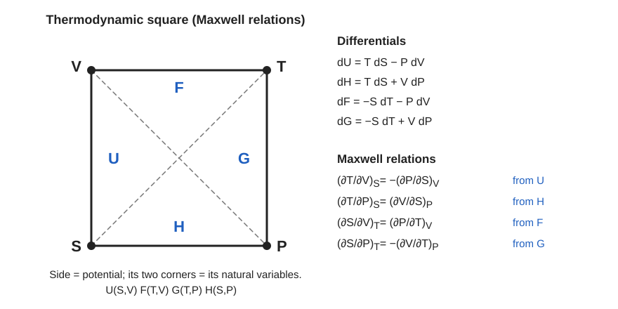

**Derivation** ($S$ entropy, $T$ temperature, $P$ pressure, $V$ volume):

1. Exactness: since $M=(\partial Z/\partial x)_y$ and $N=(\partial Z/\partial y)_x$, the equality of mixed second derivatives gives the condition above.
2. First and second laws for a reversible change: $dU=T\,dS-P\,dV$.
3. Define $H=U+PV$, $F=U-TS$, $G=H-TS$. Then

   $$
   dH=T\,dS+V\,dP,\qquad dF=-S\,dT-P\,dV,\qquad dG=-S\,dT+V\,dP
   $$

4. Apply the exactness condition to each:

   From $dU$:

   $$
   \left(\frac{\partial T}{\partial V}\right)_S=-\left(\frac{\partial P}{\partial S}\right)_V
   $$

   From $dH$:

   $$
   \left(\frac{\partial T}{\partial P}\right)_S=\left(\frac{\partial V}{\partial S}\right)_P
   $$

   From $dF$:

   $$
   \left(\frac{\partial S}{\partial V}\right)_T=\left(\frac{\partial P}{\partial T}\right)_V
   $$

   From $dG$:

   $$
   \left(\frac{\partial S}{\partial P}\right)_T=-\left(\frac{\partial V}{\partial T}\right)_P
   $$

> [!IMPORTANT]
> The four Maxwell relations follow from the exactness of $dU$, $dH$, $dF$ and $dG$, through $\left(\partial M/\partial y\right)_x=\left(\partial N/\partial x\right)_y$.

**Worked example.** One mole of an ideal gas expands isothermally from $1\,\mathrm{L}$ to $2\,\mathrm{L}$. Use the $dF$ relation with $\left(\partial P/\partial T\right)_V=R/V$:

$$
\Delta S=\int_{V_1}^{V_2}\frac{R}{V}\,dV=R\ln2=8.314\times0.693\approx5.76\,\mathrm{J\,K^{-1}}
$$

Entropy changes were obtained from easily measured $P$, $V$, $T$ data.

Extra: memory aid

On the thermodynamic square each side is a potential, its two corners are its natural variables, and each differential pairs a variable with its diagonal conjugate. $T$ pairs with $S$ and $P$ pairs with $V$.

> [!TIP]
> Define the exactness condition first, then write all four differentials and derive all four relations. Check signs: two relations carry a minus sign (from $dU$ and $dG$).

---

> **Q.** Show that (i) $\left(\dfrac{\partial Q}{\partial V}\right)_T=T\left(\dfrac{\partial P}{\partial T}\right)_V$ and (ii) $\left(\dfrac{\partial T}{\partial V}\right)_S=-T\left(\dfrac{\partial P}{\partial Q}\right)_V$.
>
> Asked in: 2020 Q6(b)

#### Ans. to the question no. 6(b), 2020

> [!NOTE]
> Here $Q$ means heat, with $\delta Q=T\,dS$ for a reversible change. The results are therefore the $T\,dS$ equation and the Maxwell relations.

**Statement.** Using $\delta Q=T\,dS$ and the Maxwell relations from 2020 Q6(a), show (i) and (ii), and that (ii) is the same as $\left(\partial T/\partial V\right)_S=-\left(\partial P/\partial S\right)_V$.

**Derivation:**

1. For part (i), at constant $T$:

   $$
   \left(\frac{\partial Q}{\partial V}\right)_T=T\left(\frac{\partial S}{\partial V}\right)_T
   $$

2. Use the $dF$ relation $\left(\partial S/\partial V\right)_T=\left(\partial P/\partial T\right)_V$:

   $$
   \left(\frac{\partial Q}{\partial V}\right)_T=T\left(\frac{\partial P}{\partial T}\right)_V
   $$

3. For part (ii), at constant $V$ we have $dQ=T\,dS$, so $\left(\partial P/\partial Q\right)_V=\dfrac{1}{T}\left(\partial P/\partial S\right)_V$. Hence

   $$
   -T\left(\frac{\partial P}{\partial Q}\right)_V=-\left(\frac{\partial P}{\partial S}\right)_V
   $$

4. The $dU$ relation gives

   $$
   \left(\frac{\partial T}{\partial V}\right)_S=-\left(\frac{\partial P}{\partial S}\right)_V=-T\left(\frac{\partial P}{\partial Q}\right)_V
   $$

> [!IMPORTANT]
> (i) $\left(\dfrac{\partial Q}{\partial V}\right)_T=T\left(\dfrac{\partial P}{\partial T}\right)_V$
>
> (ii) $\left(\dfrac{\partial T}{\partial V}\right)_S=-\left(\dfrac{\partial P}{\partial S}\right)_V=-T\left(\dfrac{\partial P}{\partial Q}\right)_V$

**Worked example.** One mole of ideal gas at $300\,\mathrm{K}$ and $V=24.9\,\mathrm{L}$ has $P\approx1.0\times10^{5}\,\mathrm{Pa}$. Part (i) gives $\left(\partial Q/\partial V\right)_T=T\,R/V=P\approx1.0\times10^{5}\,\mathrm{J\,m^{-3}}$. Expanding by $1\,\mathrm{mL}$ isothermally therefore absorbs about $0.1\,\mathrm{J}$, equal to the work $P\,dV$, as it must since $\Delta U=0$.

Extra: the energy equation

From $dU=T\,dS-P\,dV$ and the $dF$ relation:

$$
\left(\frac{\partial U}{\partial V}\right)_T=T\left(\frac{\partial P}{\partial T}\right)_V-P
$$

This is zero for an ideal gas (Joule's law) and equals $a/V^2$ for a van der Waals gas, since $T\,(\partial P/\partial T)_V=RT/(V-b)=P+a/V^2$.

> [!TIP]
> State that $Q$ is heat with $\delta Q=T\,dS$. Without this note the notation $\left(\partial P/\partial Q\right)_V$ looks meaningless to the examiner.

---

> **Q.** What is a Carnot engine? Show that the Carnot cycle is a reversible process.
>
> Asked in: 2018 Q8(c), 2020 Q7(a), 2022 Q5(c), 2023 Q8(c)

#### Ans. to the question no. 7(a), 2020

Same as [2018 Q8(c)](#ans-to-the-question-no-8c-2018).

---

> **Q.** Define the efficiency of a Carnot engine. Find the efficiency of a Carnot engine working between the steam point and the ice point.
>
> Asked in: 2020 Q7(b)

#### Ans. to the question no. 7(b), 2020

**Definition.** The efficiency of an engine is the fraction of the heat absorbed that is converted to work: $\eta=W/Q_1=1-Q_2/Q_1$. For a Carnot engine $\eta=1-T_2/T_1$ (derived in [2017 Q5(c)](#ans-to-the-question-no-5c-2017)).

**Given.** Steam point $T_1=100+273=373\,\mathrm{K}$, ice point $T_2=0+273=273\,\mathrm{K}$.

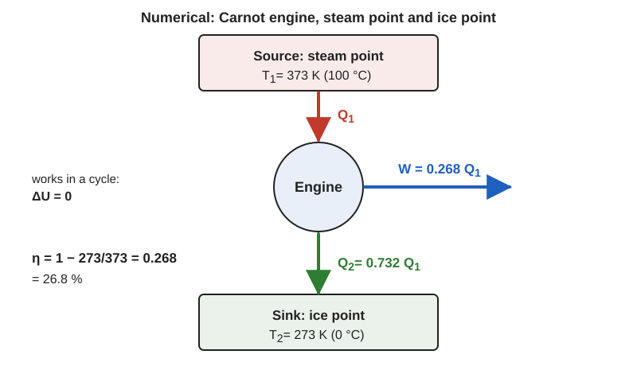

**Formula.** $\eta=1-\dfrac{T_2}{T_1}$

**Substitution.**

$$
\eta=1-\frac{273}{373}=0.268
$$

> [!IMPORTANT]
> $\eta\approx26.8\,\%$. The engine converts about 27 % of the heat absorbed into work.

**Worked example.** An engine using steam at $100\,^\circ\mathrm{C}$ and exhausting to melting ice can turn at most $0.268\times1000=268\,\mathrm{J}$ of every $1000\,\mathrm{J}$ of heat into work and must reject $732\,\mathrm{J}$.

Extra: raising the efficiency

Differentiate $\eta=1-T_2/T_1$: $\partial\eta/\partial T_1=T_2/T_1^2$ and $\partial\eta/\partial T_2=-1/T_1$. The ratio of the sizes of the two effects is $T_1/T_2\gt1$, so lowering the sink temperature by one kelvin raises $\eta$ more than raising the source temperature by one kelvin.

> [!TIP]
> Never use °C in the ratio. Quote the answer as a fraction and as a percentage.

## Paper 2021

> **Q.** What is the Carnot cycle?
>
> Asked in: 2021 Q7(a)

#### Ans. to the question no. 7(a), 2021

Same as the first part of [2018 Q8(c)](#ans-to-the-question-no-8c-2018). The four steps and the P-V diagram are in [2017 Q5(c)](#ans-to-the-question-no-5c-2017).

---

> **Q.** Show that between $T_1$ and $T_2$ the efficiency is $\eta=\dfrac{T_1-T_2}{T_1}$.
>
> Asked in: 2017 Q5(c), 2021 Q7(b)

#### Ans. to the question no. 7(b), 2021

> [!NOTE]
> The paper prints this expression incorrectly. The correct form is $\eta=(T_1-T_2)/T_1$ with $T_1\gt T_2$, as written in the question above.

Same as [2017 Q5(c)](#ans-to-the-question-no-5c-2017).

---

> **Q.** Distinguish between the first and the second law of thermodynamics.
>
> Asked in: 2017 Q6(a), 2021 Q7(c), 2023 Q6(c)

#### Ans. to the question no. 7(c), 2021

Same as the "Difference from the first law" table in [2017 Q6(a)](#ans-to-the-question-no-6a-2017).

---

> **Q.** What is specific heat?
>
> Asked in: 2018 Q8(b), 2021 Q7(d)

#### Ans. to the question no. 7(d), 2021

Same as the definitions in [2018 Q8(b)](#ans-to-the-question-no-8b-2018).

---

> **Q.** State and explain the second law of thermodynamics.
>
> Asked in: 2017 Q6(a), 2018 Q8(a), 2021 Q8(a), 2023 Q8(a)

#### Ans. to the question no. 8(a), 2021

Same as [2017 Q6(a)](#ans-to-the-question-no-6a-2017).

---

> **Q.** Dry air at 15 °C is expanded adiabatically to double its volume. Find the temperature ($\gamma=1.40$).
>
> Asked in: 2021 Q8(c)

#### Ans. to the question no. 8(c), 2021

**Given.** $t_1=15\,^\circ\mathrm{C}$, so $T_1=15+273=288\,\mathrm{K}$; $V_2=2V_1$; $\gamma=1.40$.

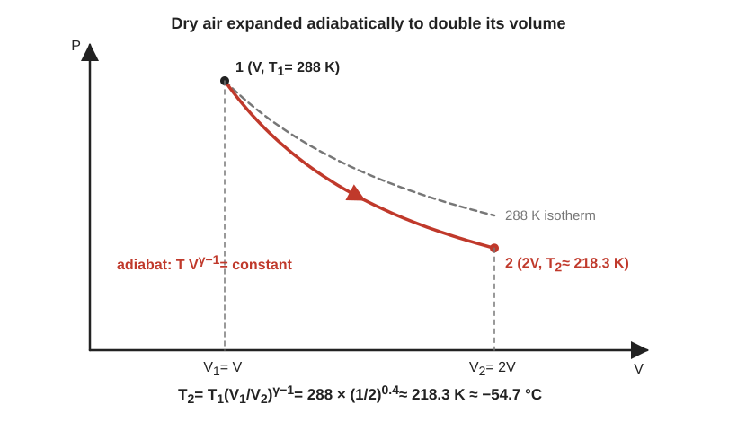

**Formula.** For an adiabatic process $TV^{\gamma-1}=\text{constant}$, so

$$
T_2=T_1\left(\frac{V_1}{V_2}\right)^{\gamma-1}
$$

**Substitution.**

$$
T_2=288\times\left(\frac{1}{2}\right)^{0.4}=\frac{288}{1.3195}\approx218.3\,\mathrm{K}
$$

> [!IMPORTANT]
> $T_2\approx218.3\,\mathrm{K}\approx-54.7\,^\circ\mathrm{C}$. The air cools by about $70\,\mathrm{K}$.

**Worked example.** A parcel of rising air expands as the pressure around it falls, with almost no heat exchange. This adiabatic cooling is how clouds form: once the parcel cools to its dew point, water vapour condenses into droplets.

Extra: the same result from pressure

Since $V_2=2V_1$, the pressure becomes $P_2=P_1\,2^{-1.4}=0.379\,P_1$. Check with $T_2=T_1(P_2/P_1)^{(\gamma-1)/\gamma}=288\times0.379^{0.2857}\approx218\,\mathrm{K}$. The two forms agree.

> [!TIP]
> Use $\gamma-1=0.4$ as the exponent for volume. Use kelvin throughout and convert back to °C only at the end.

## Paper 2022

> **Q.** What is the zeroth law of thermodynamics? Show that the first law is the law of conservation of energy.
>
> Asked in: 2022 Q5(a)

#### Ans. to the question no. 5(a), 2022

**Zeroth law.** Same as the zeroth-law paragraph in [2016 Q6(b)](#ans-to-the-question-no-6b-2016): if A and B are each in thermal equilibrium with C, they are in equilibrium with each other.

**First law as conservation of energy.**

**Derivation** ($Q$ heat absorbed, $W$ work done by the system, $U$ internal energy):

1. Energy can be neither created nor destroyed. Heat $Q$ given to a system can only increase its internal energy or be used to do work.
2. Therefore

   $$
   Q=\Delta U+W\qquad\text{or}\qquad dQ=dU+P\,dV
   $$

3. Isolated system: $Q=0$ and $W=0$, so $\Delta U=0$ and $U$ is constant.
4. Complete cycle: $\Delta U=0$, so $W=Q$. An engine cannot give out more work than the heat it takes in, so a perpetual-motion machine of the first kind is impossible.
5. Joule's experiment: the same work done adiabatically on a system always produces the same change in $U$, so $U$ is a state function.

> [!IMPORTANT]
> $Q=\Delta U+W$ is the statement of conservation of energy applied to heat, internal energy and work.

**Worked example.** An electric kettle of $1.5\,\mathrm{kW}$ heats $1.0\,\mathrm{kg}$ of water from 20 °C to 100 °C. $Q=1.0\times4186\times80\approx3.35\times10^{5}\,\mathrm{J}$ and the ideal time is $t=Q/P=3.35\times10^{5}/1500\approx223\,\mathrm{s}$, about $3.7\,\mathrm{min}$. All the electrical energy goes into $\Delta U$ of the water (the work term is negligible).

Extra: sign convention

Heat absorbed by the system is positive, work done by the system is positive. Some books write $\Delta U=Q+W_{\text{on}}$ with work done on the system. Both are the same law; state the convention you use.

> [!TIP]
> Do not stop at "$Q=\Delta U+W$". Say in words that energy is conserved and show the isolated-system and cyclic limits.

---

> **Q.** What is a Carnot engine? Show that the Carnot cycle is a reversible process.
>
> Asked in: 2018 Q8(c), 2020 Q7(a), 2022 Q5(c), 2023 Q8(c)

#### Ans. to the question no. 5(c), 2022

Same as [2018 Q8(c)](#ans-to-the-question-no-8c-2018).

---

> **Q.** Define molar specific heat. Find the relation between $C_p$ and $C_v$.
>
> Asked in: 2022 Q6(a). The relation is also asked in 2018 Q8(b), 2023 Q6(a), 2023 Q8(b)

#### Ans. to the question no. 6(a), 2022

**Definition.** The molar specific heat (molar heat capacity) is the heat needed to raise the temperature of one mole of a substance by one kelvin: $C=\dfrac{1}{n}\dfrac{dQ}{dT}$, unit $\mathrm{J\,mol^{-1}\,K^{-1}}$. For gases it is $C_v$ at constant volume and $C_p$ at constant pressure.

**Relation.** $C_p-C_v=R$. The full derivation is in [2018 Q8(b)](#ans-to-the-question-no-8b-2018).

---

> **Q.** What is an isentropic process? Derive the work done in an isentropic process.
>
> Asked in: 2022 Q6(b)

#### Ans. to the question no. 6(b), 2022

**Definition.** An isentropic process is a reversible adiabatic process. Since $dS=\delta Q_{\text{rev}}/T=0$, the entropy stays constant. For an ideal gas it obeys $PV^\gamma=\text{constant}$ (proved in [2023 Q5(b)](#ans-to-the-question-no-5b-2023)).

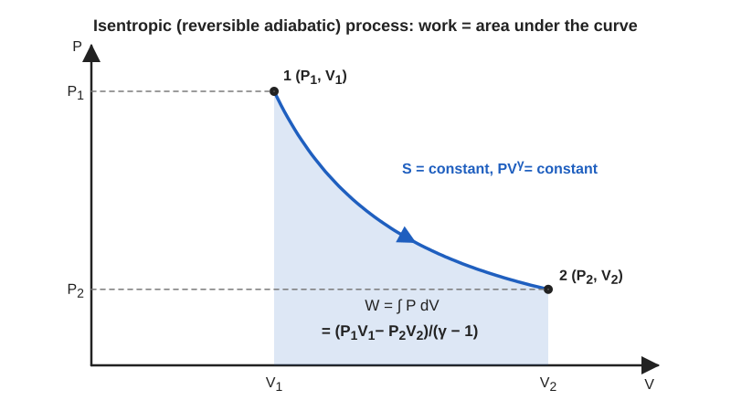

**Derivation** (gas goes from $(P_1,V_1)$ to $(P_2,V_2)$; $\gamma=C_p/C_v$; $K$ is the constant):

1. Write $P=KV^{-\gamma}$ with $K=P_1V_1^\gamma=P_2V_2^\gamma$.
2. Work done by the gas:

   $$
   W=\int_{V_1}^{V_2}P\,dV=K\int_{V_1}^{V_2}V^{-\gamma}\,dV=K\,\frac{V_2^{1-\gamma}-V_1^{1-\gamma}}{1-\gamma}
   $$

3. Since $KV_2^{1-\gamma}=P_2V_2$ and $KV_1^{1-\gamma}=P_1V_1$:

   $$
   W=\frac{P_2V_2-P_1V_1}{1-\gamma}
   $$

> [!IMPORTANT]
>
> $$
> W=\frac{P_1V_1-P_2V_2}{\gamma-1}=\frac{nR\,(T_1-T_2)}{\gamma-1}
> $$

**Worked example.** In a diesel engine, air at $300\,\mathrm{K}$ is compressed isentropically with a compression ratio of 16. $T_2=300\times16^{0.4}\approx909\,\mathrm{K}$ (about $636\,^\circ\mathrm{C}$), which is high enough to ignite the injected fuel without a spark. The work done per mole is

$$
W=\frac{8.314\,(300-909)}{0.4}\approx-1.27\times10^{4}\,\mathrm{J}
$$

The negative sign means work is done on the gas.

Extra: derivation from the first law

For $dQ=0$ the first law gives $dW=-dU=-nC_v\,dT$. Integrating,

$$
W=nC_v(T_1-T_2)=\frac{nR(T_1-T_2)}{\gamma-1}
$$

using $C_v=R/(\gamma-1)$. It agrees with the integral above because $P_1V_1=nRT_1$ and $P_2V_2=nRT_2$.

> [!TIP]
> Remember the sign: $W\gt0$ in expansion ($T_2\lt T_1$) and $W\lt0$ in compression. Note that the work is the area under the $PV^\gamma$ curve, which is steeper than the isotherm.

---

> **Q.** $0.1\,\mathrm{m^3}$ of air at $1.5\,\mathrm{bar}$ expands isothermally to $0.5\,\mathrm{m^3}$. Find the final pressure and the heat supplied.
>
> Asked in: 2022 Q6(c)

#### Ans. to the question no. 6(c), 2022

**Given.** $V_1=0.1\,\mathrm{m^3}$, $P_1=1.5\,\mathrm{bar}=1.5\times10^{5}\,\mathrm{Pa}$, $V_2=0.5\,\mathrm{m^3}$, temperature constant.

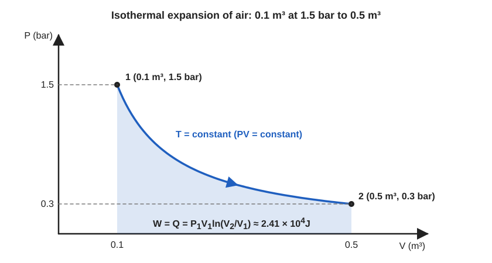

**Formula.** Boyle's law $P_1V_1=P_2V_2$. For an isothermal change of an ideal gas $\Delta U=0$, so $Q=W=P_1V_1\ln\dfrac{V_2}{V_1}$.

**Substitution.**

1. $P_2=\dfrac{P_1V_1}{V_2}=\dfrac{1.5\times0.1}{0.5}=0.3\,\mathrm{bar}=3\times10^{4}\,\mathrm{Pa}$
2. $Q=1.5\times10^{5}\times0.1\times\ln5=1.5\times10^{4}\times1.609\approx2.41\times10^{4}\,\mathrm{J}$

> [!IMPORTANT]
> Final pressure $P_2=0.3\,\mathrm{bar}=3\times10^{4}\,\mathrm{Pa}$. Heat supplied $Q=W\approx2.41\times10^{4}\,\mathrm{J}$ (about $24\,\mathrm{kJ}$).

**Worked example.** A $0.1\,\mathrm{m^3}$ air receiver, as used to run workshop tools, releases its gas slowly into a larger $0.5\,\mathrm{m^3}$ cylinder through a piston that does external work. If the temperature is held constant, the air absorbs $24\,\mathrm{kJ}$ from its surroundings, which is the energy the piston delivers.

Extra: comparison with the adiabatic case

If the same expansion were adiabatic with $\gamma=1.4$, the final pressure would be $P_2=1.5\times5^{-1.4}\approx0.16\,\mathrm{bar}$, lower than the isothermal $0.3\,\mathrm{bar}$, and no heat would be supplied (see the isothermal-adiabatic comparison in [2023 Q5(b)](#ans-to-the-question-no-5b-2023)).

> [!TIP]
> Convert bar to pascal before computing joules. The $\ln$ is natural log, $\ln5=1.609$. Heat supplied equals work because $\Delta U=0$.

## Paper 2023

> **Q.** Prove $PV^\gamma=\text{constant}$.
>
> Asked in: 2023 Q5(b)

#### Ans. to the question no. 5(b), 2023

**Statement.** For a reversible adiabatic change of an ideal gas, $PV^\gamma=\text{constant}$, where $\gamma=C_p/C_v$.

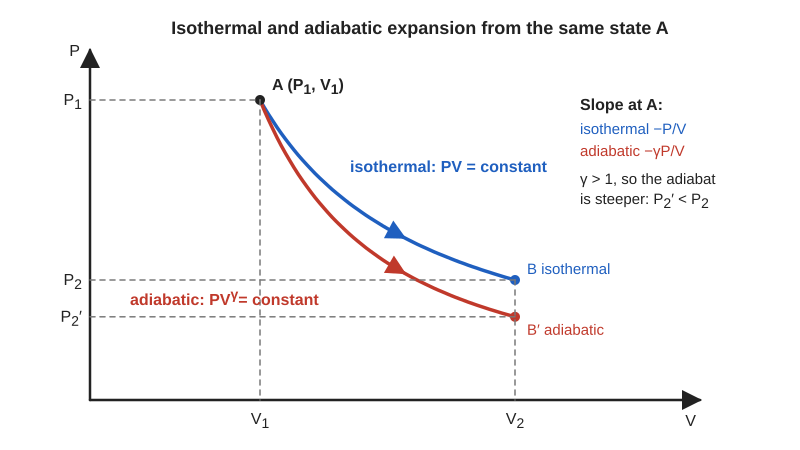

**Derivation** (one mole; $dQ=0$):

1. First law with $dQ=0$:

   $$
   0=C_v\,dT+P\,dV\quad\Rightarrow\quad C_v\,dT=-P\,dV
   $$

2. Differentiate $PV=RT$:

   $$
   P\,dV+V\,dP=R\,dT
   $$

3. Eliminate $dT$ using step 1, $dT=-P\,dV/C_v$:

   $$
   P\,dV+V\,dP=-\frac{R}{C_v}P\,dV
   $$

4. Rearrange and use $C_v+R=C_p$:

   $$
   V\,dP+\frac{C_v+R}{C_v}P\,dV=0\quad\Rightarrow\quad V\,dP+\gamma P\,dV=0
   $$

5. Divide by $PV$ and integrate:

   $$
   \frac{dP}{P}+\gamma\frac{dV}{V}=0\quad\Rightarrow\quad \ln P+\gamma\ln V=\text{constant}
   $$

> [!IMPORTANT]
>
> $$
> PV^{\gamma}=\text{constant},\qquad TV^{\gamma-1}=\text{constant},\qquad T^{\gamma}P^{1-\gamma}=\text{constant}
> $$

**Worked example.** A bicycle pump compresses $1\,\mathrm{atm}$ of air at $300\,\mathrm{K}$ to one quarter of its volume so quickly that no heat escapes. Then $P_2=1\times4^{1.4}\approx6.96\,\mathrm{atm}$ and $T_2=300\times4^{0.4}\approx522\,\mathrm{K}$. This is the idealised limit. The real pump loses heat to its walls and warms up much less, but the barrel still becomes noticeably warm.

Extra: slope of an adiabat compared with an isotherm

Isotherm $PV=\text{const}$: $\left(\dfrac{dP}{dV}\right)_T=-\dfrac{P}{V}$. Adiabat: $\left(\dfrac{dP}{dV}\right)_S=-\gamma\dfrac{P}{V}$. Because $\gamma\gt1$ the adiabat is steeper, as the diagram shows. Gas expanding adiabatically ends at a lower pressure than an isothermal expansion to the same volume.

> [!TIP]
> Show that $dT$ is eliminated, state $C_p=C_v+R$ and finish with the integration. The proof requires an ideal gas and a reversible (quasi-static) process.

---

> **Q.** A motor tyre at 27 °C is pumped until its pressure is 2 atmospheres, then bursts suddenly. Find the final temperature ($\gamma=1.4$).
>
> Asked in: 2023 Q5(c)

#### Ans. to the question no. 5(c), 2023

> [!NOTE]
> Assumption: the burst is a sudden adiabatic expansion from 2 atm down to 1 atm (atmospheric pressure), and 2 atm is the absolute pressure.

**Given.** $T_1=27+273=300\,\mathrm{K}$, $P_1=2\,\mathrm{atm}$, $P_2=1\,\mathrm{atm}$, $\gamma=1.4$.

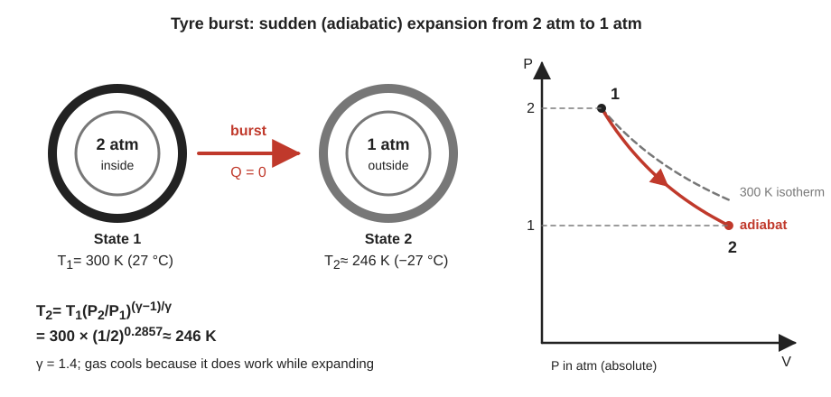

**Formula.** For an adiabatic change $T^\gamma P^{1-\gamma}=\text{constant}$, so

$$
T_2=T_1\left(\frac{P_2}{P_1}\right)^{\frac{\gamma-1}{\gamma}}
$$

**Substitution.**

$$
T_2=300\times\left(\frac{1}{2}\right)^{0.2857}=300\times0.8203\approx246\,\mathrm{K}
$$

> [!IMPORTANT]
> $T_2\approx246\,\mathrm{K}\approx-27\,^\circ\mathrm{C}$.

**Worked example.** The cooling is why the air that escapes from a burst tyre or a released gas cylinder feels cold, and why a cylinder valve can frost over when gas leaves quickly.

Extra: volume ratio

$V_2/V_1=(P_1/P_2)^{1/\gamma}=2^{0.714}\approx1.64$. The gas expands to about 1.64 times its volume, and $T_2V_2^{\gamma-1}=T_1V_1^{\gamma-1}$ gives the same $246\,\mathrm{K}$.

> [!TIP]
> The exponent is $(\gamma-1)/\gamma=0.2857$ for pressure, but $\gamma-1=0.4$ for volume. Do not mix them up.

---

> **Q.** Establish the relation between the two specific heats of a gas.
>
> Asked in: 2018 Q8(b), 2022 Q6(a), 2023 Q6(a), 2023 Q8(b)

#### Ans. to the question no. 6(a), 2023

Same as [2018 Q8(b)](#ans-to-the-question-no-8b-2018).

---

> **Q.** Distinguish between the first and the second law of thermodynamics.
>
> Asked in: 2017 Q6(a), 2021 Q7(c), 2023 Q6(c)

#### Ans. to the question no. 6(c), 2023

Same as the "Difference from the first law" table in [2017 Q6(a)](#ans-to-the-question-no-6a-2017).

---

> **Q.** A Carnot engine working between 450 K and 350 K takes 1000 cal from the source. Find the heat rejected and the efficiency (1 cal = 4.2 J).
>
> Asked in: 2023 Q6(d)

#### Ans. to the question no. 6(d), 2023

> [!NOTE]
> This is the same problem as [2017 Q6(c)](#ans-to-the-question-no-6c-2017), given in calories instead of joules and in kelvin instead of °C. The numbers are repeated here in full.

**Given.** $T_1=450\,\mathrm{K}$, $T_2=350\,\mathrm{K}$, $Q_1=1000\,\mathrm{cal}=1000\times4.2=4200\,\mathrm{J}$.

**Formula.** $\eta=1-\dfrac{T_2}{T_1}$, $Q_2=Q_1\dfrac{T_2}{T_1}$, $W=Q_1-Q_2$.

**Substitution.**

1. $\eta=1-\dfrac{350}{450}=0.2222$
2. $Q_2=1000\times\dfrac{350}{450}=777.8\,\mathrm{cal}=3266.7\,\mathrm{J}$
3. $W=1000-777.8=222.2\,\mathrm{cal}=933.3\,\mathrm{J}$

> [!IMPORTANT]
> Heat rejected $Q_2\approx777.8\,\mathrm{cal}\ (\approx3266.7\,\mathrm{J})$, efficiency $\eta\approx22.2\,\%$, work done $W\approx222.2\,\mathrm{cal}\ (\approx933.3\,\mathrm{J})$.

**Worked example.** A small engine taking $1000\,\mathrm{cal}$ per cycle from a $450\,\mathrm{K}$ boiler turns $222\,\mathrm{cal}$ into mechanical work and sends $778\,\mathrm{cal}$ to a $350\,\mathrm{K}$ exhaust, the same figures as the 2017 problem in other units.

Extra: unit consistency

Efficiency is dimensionless, so it is the same in J and cal. Only $Q_2$ and $W$ change units. The conversion factor $4.2\,\mathrm{J\,cal^{-1}}$ appears once, at the start.

> [!TIP]
> Say that the paper asks for both $Q_2$ and $\eta$, and also give $W$ for completeness. Quote the answers in the units the question uses (cal).

---

> **Q.** State and explain the second law of thermodynamics.
>
> Asked in: 2017 Q6(a), 2018 Q8(a), 2021 Q8(a), 2023 Q8(a)

#### Ans. to the question no. 8(a), 2023

Same as [2017 Q6(a)](#ans-to-the-question-no-6a-2017).

---

> **Q.** What is specific heat capacity? For one mole of an ideal gas show $C_p-C_v=R$.
>
> Asked in: 2018 Q8(b), 2023 Q8(b)

#### Ans. to the question no. 8(b), 2023

Same as [2018 Q8(b)](#ans-to-the-question-no-8b-2018).

---

> **Q.** What is a Carnot engine? Show that the Carnot cycle is a reversible process.
>
> Asked in: 2018 Q8(c), 2020 Q7(a), 2022 Q5(c), 2023 Q8(c)

#### Ans. to the question no. 8(c), 2023

Same as [2018 Q8(c)](#ans-to-the-question-no-8c-2018).

## Concept map

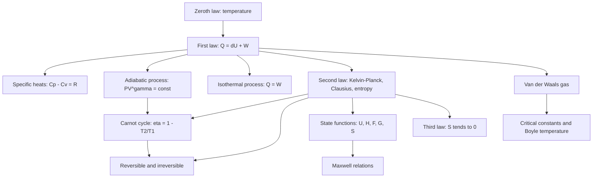

## One-page cheat sheet

**Laws.** Zeroth: equal temperature is transitive. First: $Q=\Delta U+W$. Second: $\eta\lt1$, $\Delta S_{\text{universe}}\ge0$. Third: $S\to0$ as $T\to0$.

**Ideal gas.** $PV=nRT$, $U=nC_vT$, $C_p-C_v=R$, $\gamma=C_p/C_v$, $C_v=\dfrac{R}{\gamma-1}$, $C_p=\dfrac{\gamma R}{\gamma-1}$.

**Isothermal.** $PV=\text{const}$, $\Delta U=0$, $Q=W=nRT\ln\dfrac{V_2}{V_1}=P_1V_1\ln\dfrac{V_2}{V_1}$.

**Adiabatic.** $PV^\gamma=\text{const}$, $TV^{\gamma-1}=\text{const}$, $T^\gamma P^{1-\gamma}=\text{const}$, $W=\dfrac{P_1V_1-P_2V_2}{\gamma-1}=\dfrac{nR(T_1-T_2)}{\gamma-1}$.

**Carnot.** $\eta=1-\dfrac{T_2}{T_1}=1-\dfrac{Q_2}{Q_1}$, $\dfrac{Q_1}{Q_2}=\dfrac{T_1}{T_2}$, $W=Q_1-Q_2$.

**Potentials.** $dU=T\,dS-P\,dV$, $dH=T\,dS+V\,dP$, $dF=-S\,dT-P\,dV$, $dG=-S\,dT+V\,dP$.

**Maxwell.**

$$
\left(\frac{\partial T}{\partial V}\right)_S=-\left(\frac{\partial P}{\partial S}\right)_V,\quad
\left(\frac{\partial T}{\partial P}\right)_S=\left(\frac{\partial V}{\partial S}\right)_P
$$

$$
\left(\frac{\partial S}{\partial V}\right)_T=\left(\frac{\partial P}{\partial T}\right)_V,\quad
\left(\frac{\partial S}{\partial P}\right)_T=-\left(\frac{\partial V}{\partial T}\right)_P
$$

**Van der Waals.** $\left(P+\dfrac{a}{V^2}\right)(V-b)=RT$, $V_c=3b$, $P_c=\dfrac{a}{27b^2}$, $T_c=\dfrac{8a}{27bR}$, $\dfrac{P_cV_c}{RT_c}=\dfrac{3}{8}$, $T_0=\dfrac{a}{bR}$, $T_c=\dfrac{8}{27}T_0$.

**Numerical answers to remember.** CO2 $T_c\approx307.4\,\mathrm{K}$ (2016). $22.2\,\%$, $3266.7\,\mathrm{J}$, $933.3\,\mathrm{J}$ (2017, 2023). $26.8\,\%$ (2020). $218.3\,\mathrm{K}$ (2021). $0.3\,\mathrm{bar}$, $2.41\times10^{4}\,\mathrm{J}$ (2022). $246\,\mathrm{K}$ (2023).

## Glossary

| Term | Meaning |
| --- | --- |
| Adiabatic | A process with no heat exchange, $Q=0$ |
| Carnot cycle | Reversible cycle of two isothermals and two adiabatics |
| Critical point | The point on the P-V diagram where liquid and gas become identical |
| Enthalpy | $H=U+PV$ |
| Entropy | State function with $dS=\delta Q_{\text{rev}}/T$ |
| Heat capacity | Heat needed to raise the temperature by one kelvin |
| Internal energy | Total kinetic and potential energy of the molecules |
| Isentropic | Reversible adiabatic, entropy constant |
| Isothermal | Constant temperature |
| Quasi-static | Infinitely slow, system always in equilibrium |
| Reversible | Can be undone, leaving system and surroundings unchanged |
| State function | Quantity that depends only on the state, not the path |
| Thermal equilibrium | No net heat flow between bodies in contact |

## Practice problems

These four problems are new and are not from the exam list.

1. A Carnot engine has an efficiency of $40\,\%$ and its sink is at $27\,^\circ\mathrm{C}$. Find the source temperature.
2. One mole of air ($\gamma=1.4$) at $300\,\mathrm{K}$ and $1\,\mathrm{atm}$ is compressed adiabatically to one eighth of its volume. Find the final temperature and pressure, and the work done on the gas.
3. Helium has $a=0.00346\,\mathrm{Pa\,m^6\,mol^{-2}}$ and $b=2.38\times10^{-5}\,\mathrm{m^3\,mol^{-1}}$. Find $V_c$, $P_c$ and $T_c$ using the van der Waals equation.
4. Using a Maxwell relation, find the entropy change when one mole of an ideal gas at $300\,\mathrm{K}$ is compressed isothermally from $1\,\mathrm{atm}$ to $10\,\mathrm{atm}$.

Answers

1. $T_1=\dfrac{T_2}{1-\eta}=\dfrac{300}{0.6}=500\,\mathrm{K}$ ($227\,^\circ\mathrm{C}$).
2. $T_2=300\times8^{0.4}\approx689\,\mathrm{K}$; $P_2=1\times8^{1.4}\approx18.4\,\mathrm{atm}$; work done on the gas $=\dfrac{nR(T_2-T_1)}{\gamma-1}=\dfrac{8.314\times389}{0.4}\approx8.09\times10^{3}\,\mathrm{J}$.
3. $V_c=3b\approx7.1\times10^{-5}\,\mathrm{m^3\,mol^{-1}}$; $P_c=\dfrac{a}{27b^2}\approx2.26\times10^{5}\,\mathrm{Pa}$; $T_c=\dfrac{8a}{27bR}\approx5.2\,\mathrm{K}$.
4. $\left(\dfrac{\partial S}{\partial P}\right)_T=-\left(\dfrac{\partial V}{\partial T}\right)_P=-\dfrac{R}{P}$, so $\Delta S=-R\ln10\approx-19.1\,\mathrm{J\,K^{-1}}$. The gas loses entropy; the surroundings gain at least as much.

