# WPE-101 Polymer: Exam Questions Solved

> **Course:** WPE-101 (Polymer) | **Scope:** Section 1 (set not marked) and Section 2, SET-B | **Style:** definition → explanation → example → diagram.
> Math uses GitHub syntax: inline $`...`$ and fenced `math` blocks. Every diagram is a separate SVG in `../../assets/`.

## Table of contents

- [Section 1 (set not marked)](#section-1-set-not-marked)
  - [Q1. Discuss the following pairs with examples](#q1-discuss-the-following-pairs-with-examples)
    - [1.1 Monomer and repeating unit](#11-monomer-and-repeating-unit)
    - [1.2 Oligomer and degree of polymerisation (DP)](#12-oligomer-and-degree-of-polymerisation-dp)
    - [1.3 Retarder and inhibitor](#13-retarder-and-inhibitor)
    - [1.4 Network and graft copolymer](#14-network-and-graft-copolymer)
    - [1.5 Biological and non-biological polymer](#15-biological-and-non-biological-polymer)
    - [1.6 Homopolymer and copolymer](#16-homopolymer-and-copolymer)
    - [1.7 Organic and inorganic polymer](#17-organic-and-inorganic-polymer)
    - [1.8 Thermoplastic and thermosetting polymer](#18-thermoplastic-and-thermosetting-polymer)
  - [Q2. Free radical polymerisation OR ionic polymerisation](#q2-free-radical-polymerisation-or-ionic-polymerisation)
    - [2.1 Free radical polymerisation](#21-free-radical-polymerisation)
    - [2.2 Ionic polymerisation: cationic](#22-ionic-polymerisation-cationic)
    - [2.3 Ionic polymerisation: anionic](#23-ionic-polymerisation-anionic)
    - [2.4 Comparison](#24-comparison)
- [Section 2: SET-B (5 marks each)](#section-2-set-b-5-marks-each)
  - [Q1 (SET-B)](#q1-set-b)
    - [Q1(i) Practical significance of polymer molecular weight](#q1i-practical-significance-of-polymer-molecular-weight)
    - [Q1(ii) Techniques of polymerisation; suspension and emulsion](#q1ii-techniques-of-polymerisation-suspension-and-emulsion)
    - [Q1(iii) Monodispersity, polydispersity and degree of polydispersity](#q1iii-monodispersity-polydispersity-and-degree-of-polydispersity)
    - [Q1(iv) Physical and chemical degradation of polymers](#q1iv-physical-and-chemical-degradation-of-polymers)
    - [Q1(v-a) Proof of the weight-average molar mass formula](#q1v-a-proof-of-the-weight-average-molar-mass-formula)
    - [Q1(v-b) Four photostabilizers and four antioxidants (name and structure)](#q1v-b-four-photostabilizers-and-four-antioxidants-name-and-structure)
  - [Q2 (SET-B)](#q2-set-b)
    - [Q2(i) Relation between Tg and Tm](#q2i-relation-between-tg-and-tm)
    - [Q2(ii) Diagrams of amorphous, crystalline and semi-crystalline polymers](#q2ii-diagrams-of-amorphous-crystalline-and-semi-crystalline-polymers)
    - [Q2(iii) Difference between crystalline and amorphous polymer](#q2iii-difference-between-crystalline-and-amorphous-polymer)
    - [Q2(iv) Tg and Tm values of polymers](#q2iv-tg-and-tm-values-of-polymers)
    - [Q2(v) Importance of Tg and factors that influence it](#q2v-importance-of-tg-and-factors-that-influence-it)
- [Extra: one-page quick-revision summary](#extra-one-page-quick-revision-summary)
- [Extra: mnemonics and memory tips](#extra-mnemonics-and-memory-tips)
- [Extra: common exam mistakes](#extra-common-exam-mistakes)
- [Extra: 10 likely follow-up viva questions](#extra-10-likely-follow-up-viva-questions)
- [Extra: one-glance comparison cheat sheet](#extra-one-glance-comparison-cheat-sheet)

## Section 1 (set not marked)

### Q1. Discuss the following pairs with examples

> **Note:** the stem says "five pairs" but lists **eight** pairs, so all eight are answered below.

#### 1.1 Monomer and repeating unit

> **Monomer:** a small molecule (with at least two reactive sites or a C=C bond) that can join to others to form a polymer.
> **Repeating unit (mer):** the smallest structural unit that repeats along the chain; the polymer is built by repeating it $`n`$ times.

- In **addition polymers** the mer has the same atoms as the monomer (ethylene → $`-[CH_2-CH_2]_n-`$).
- In **condensation polymers** the mer contains the residues of the monomers minus the small molecule lost (nylon-6,6 mer comes from **two** monomers and loses water).
- Example: styrene → polystyrene (PS), used for packaging, CD cases and foam cups.

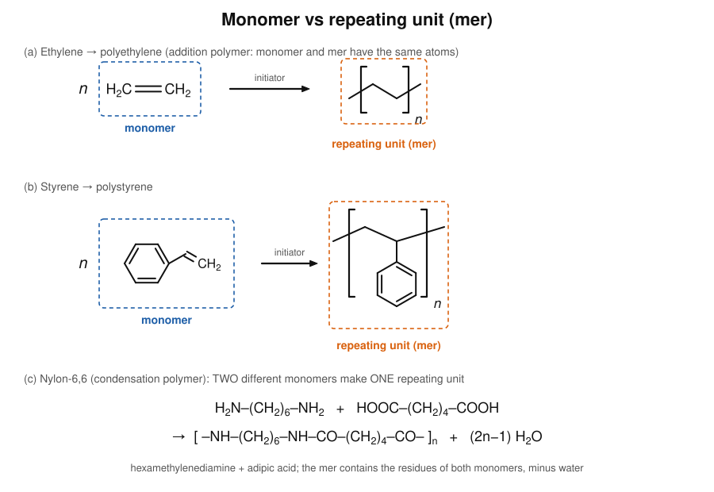

| Property | Monomer | Repeating unit (mer) |
|---|---|---|
| Nature | Real, stable molecule | Fragment inside the chain (not isolable) |
| Bonding | Has C=C or two functional groups | Saturated in addition polymers; amide/ester links in condensation polymers |
| Example (PE) | $`CH_2=CH_2`$ | $`-CH_2-CH_2-`$ |
| Example (nylon-6,6) | Hexamethylenediamine and adipic acid | $`-NH(CH_2)_6NH-CO(CH_2)_4CO-`$ |
| Count in chain | $`n`$ molecules used | Repeated $`n`$ times |

#### 1.2 Oligomer and degree of polymerisation (DP)

> **Oligomer:** a low-molar-mass polymer of only a few repeating units (DP ≈ 2 to about 20) whose properties change when one unit is added or removed.
> **Degree of polymerisation (DP, $`\bar{X}_n`$):** the average number of repeating units per chain.

```math
\bar{X}_n = \frac{\bar{M}_n}{M_0}
```

where $`M_0`$ is the molar mass of the repeating unit. Example: polyethylene with $`\bar{M}_n = 28\,000`$ and $`M_0 = 28`$ gives $`\bar{X}_n = 1000`$.

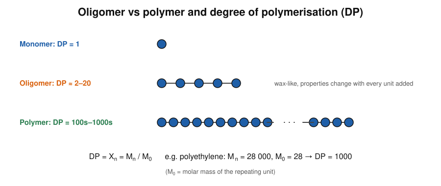

| Feature | Oligomer | Polymer |
|---|---|---|
| DP | ≈ 2 to 20 | ≥ about 100 to 10 000 |
| Molar mass | Up to about $`10^3`$ g/mol | $`10^4`$ to $`10^6`$ g/mol |
| Properties | Change with every unit added; waxy, oily or brittle | Largely independent of exact DP; tough, strong |
| Example | Paraffin wax, low-M polystyrene resins | HDPE, PVC, nylon-6,6 |

#### 1.3 Retarder and inhibitor

> **Inhibitor:** a substance that reacts with every initiating radical and **stops** polymerisation completely until it is used up (induction period).
> **Retarder:** a less efficient scavenger that **slows** the rate from the start, with no induction period.

- Both work by trapping radicals into stable or unreactive species (for example, hydroquinone with traces of $`O_2`$ gives quinone and phenoxy radicals).
- Inhibitors: hydroquinone, p-benzoquinone, DPPH, TEMPO (monomers are stored with 10 to 100 ppm of inhibitor). Retarders: nitrobenzene, some phenols.

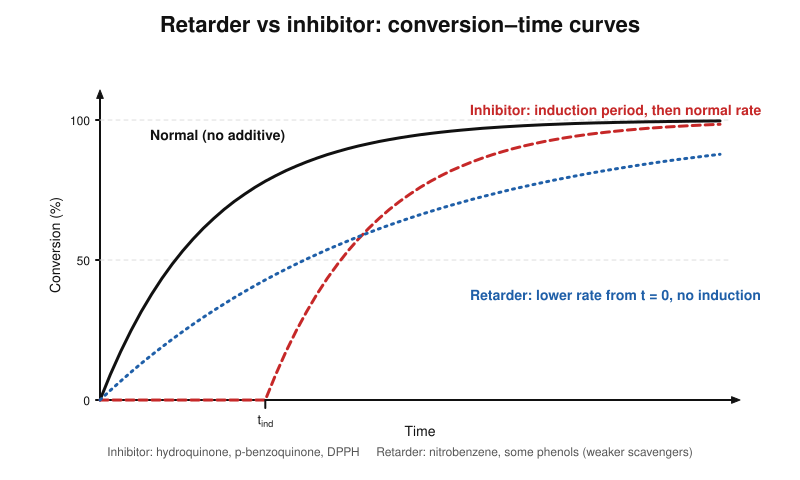

| Feature | Inhibitor | Retarder |
|---|---|---|
| Effect | Stops polymerisation | Reduces rate |
| Induction period | Yes (time $`t_{ind}`$) | No |
| After additive is used up | Normal rate returns | Rate stays lower throughout |
| Efficiency toward radicals | Very high (scavenges every radical) | Low (scavenges part of them) |
| Example | Hydroquinone, benzoquinone | Nitrobenzene |
| Use | Stabilise monomer in storage | Control a runaway reaction |

#### 1.4 Network and graft copolymer

> **Graft copolymer:** a branched copolymer in which chains of monomer B are attached as side chains to a backbone of monomer A.
> **Network copolymer:** a copolymer (or polymer) whose chains are joined by covalent cross-links into a three-dimensional structure.

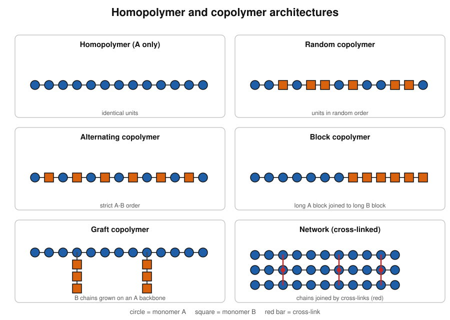

| Feature | Graft copolymer | Network copolymer |
|---|---|---|
| Structure | Backbone A with B branches | Chains linked in 3-D by cross-links |
| Solubility | Soluble in suitable solvent | Insoluble, swells only |
| Melting | Softens, can be melted | Does not melt (thermoset) |
| Example | HIPS (polybutadiene-g-polystyrene), ABS | Vulcanised rubber, Bakelite, epoxy |
| Purpose | Combine properties (toughness + rigidity) | Rigidity, heat and solvent resistance |

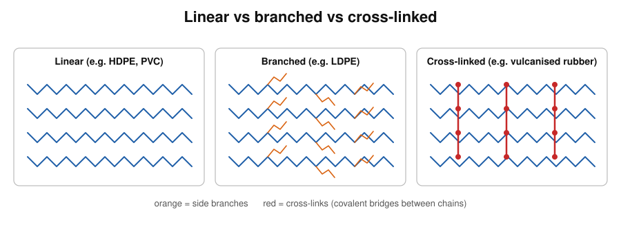

#### 1.5 Biological and non-biological polymer

> **Biological polymer (biopolymer):** a polymer made by living organisms.
> **Non-biological polymer:** a polymer made by humans from small molecules in a factory (synthetic).

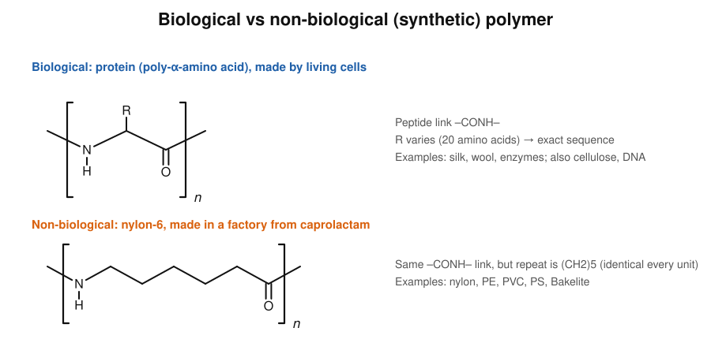

| Feature | Biological | Non-biological (synthetic) |
|---|---|---|
| Origin | Cells, enzymes | Chemical plant |
| Sequence | Exact (proteins, DNA) | Repeating, statistical |
| Biodegradable | Usually | Usually not (PLA is an exception) |
| Examples | Cellulose, starch, proteins, silk, DNA, natural rubber | Nylon, PE, PVC, PS, Bakelite |

#### 1.6 Homopolymer and copolymer

> **Homopolymer:** formed from one kind of monomer. **Copolymer:** formed from two or more different monomers.

- Homopolymer examples: PE, PS, PVC. Copolymer examples: SBR (styrene + butadiene), SAN, ABS, EVA.
- Copolymers are classified as random, alternating, block and graft (see the architectures figure above).

| Feature | Homopolymer | Copolymer |
|---|---|---|
| Monomers | One | Two or more |
| Repeat unit | One type | Two or more types (sequence matters) |
| Tuning properties | Limited | Wide (Tg, toughness, solubility tuned by composition) |
| Example | Polystyrene | SBR tyre rubber, ABS |

#### 1.7 Organic and inorganic polymer

> **Organic polymer:** main chain made of carbon atoms (and possibly O, N, S). **Inorganic polymer:** main chain contains **no carbon** (for example Si–O, P=N, S–S).

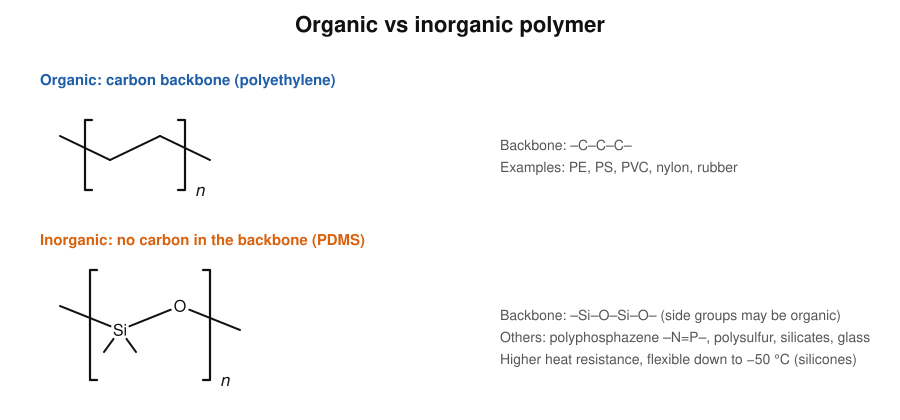

| Feature | Organic | Inorganic |
|---|---|---|
| Backbone | –C–C– | –Si–O–, –P=N–, –S–S– |
| Heat/chemical resistance | Moderate | High (silicones to about 200 °C or more) |
| Flexibility at low T | Varies | Excellent for siloxanes (low Tg) |
| Examples | PE, nylon, rubber | Silicone (PDMS), polyphosphazene, polysulfur, glass, silicates |

#### 1.8 Thermoplastic and thermosetting polymer

> **Thermoplastic:** linear or branched polymer that softens on heating and hardens on cooling, repeatedly.
> **Thermosetting polymer:** polymer that cures by heat or catalyst into a cross-linked network and **cannot** be re-melted.

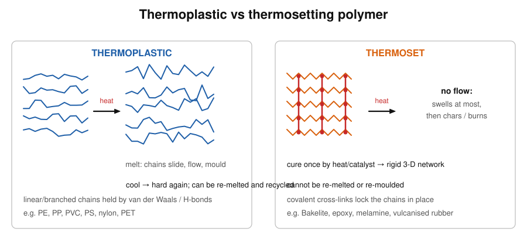

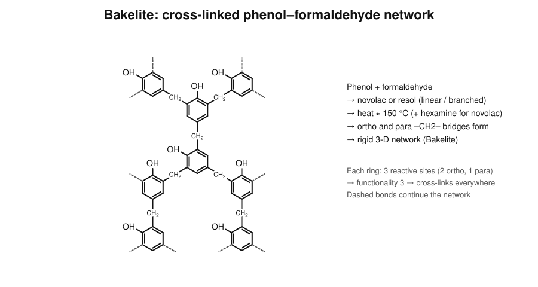

| Feature | Thermoplastic | Thermosetting |
|---|---|---|
| Structure | Linear / branched | Cross-linked 3-D network |
| On heating | Softens, melts | Chars, decomposes |
| Moulding | Repeated; recyclable | Once (curing is irreversible) |
| Solubility | Soluble in suitable solvents | Insoluble, swells only |
| Mechanical | Tough, flexible | Hard, rigid, brittle |
| Examples | PE, PP, PVC, PS, nylon, PET | Bakelite, epoxy, melamine, urea-formaldehyde, vulcanised rubber |

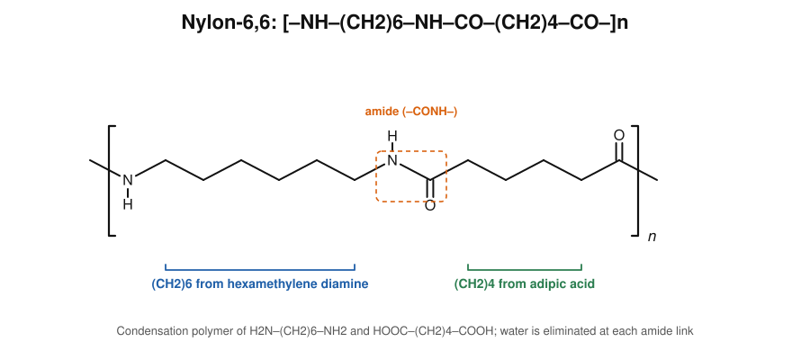

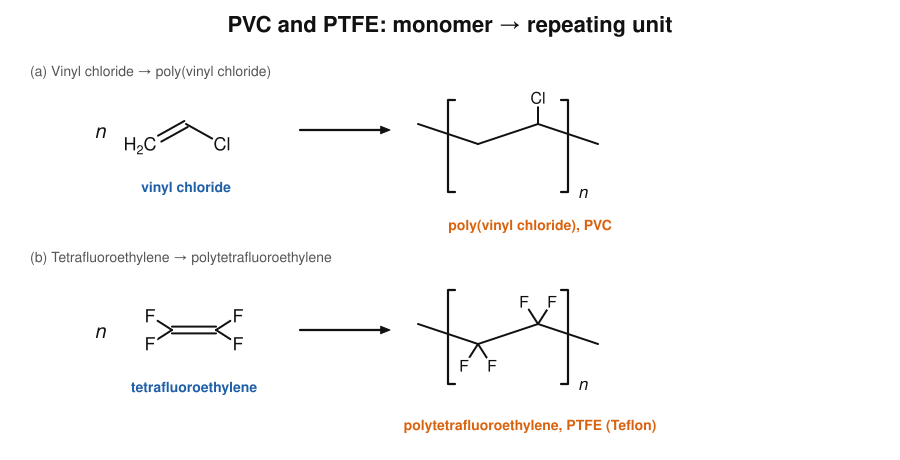

---

### Q2. Free radical polymerisation OR ionic polymerisation

> **Note:** a choice question; **both** are answered (free radical in full; ionic as cationic, anionic and a comparison).

#### 2.1 Free radical polymerisation

> **Definition:** a chain-growth polymerisation in which the active centre is a **free radical**; a vinyl monomer $`CH_2=CHX`$ adds to a growing radical chain end.

**Initiators:** benzoyl peroxide (70 to 90 °C), AIBN (60 to 70 °C), persulfate (aqueous), redox pairs (lower T), photoinitiators.

**Steps (see mechanism figure):**

1. **Initiation** (two stages): initiator decomposes ($`I \rightarrow 2R^\bullet`$, rate constant $`k_d`$, efficiency $`f`$), then $`R^\bullet`$ adds to a monomer.
2. **Propagation:** the radical end adds monomer, usually head-to-tail, at about $`10^3`$ to $`10^4`$ additions per second; the chain grows to high mass in a fraction of a second.
3. **Termination:** two radicals meet by **combination** (one chain, $`\bar{X}_n = 2\nu`$) or **disproportionation** (hydrogen transfer, two chains, $`\bar{X}_n = \nu`$).
4. **Chain transfer** (to monomer, solvent, polymer) lowers chain length and can create branches (LDPE).

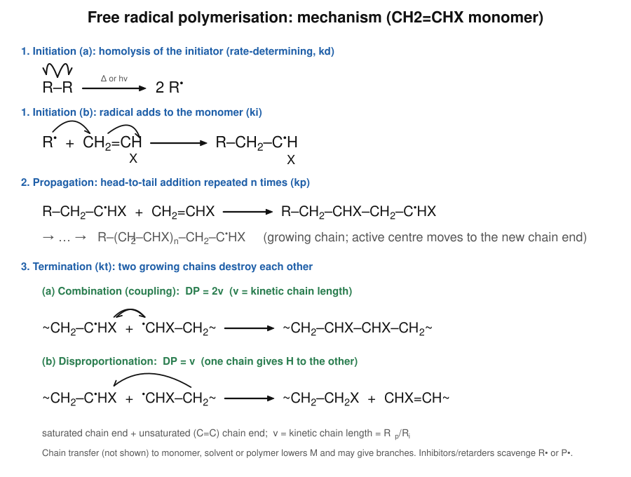

**Kinetics (steady-state assumption: $`R_i = R_t`$):**

```math
R_i = 2 f k_d [I], \qquad R_t = 2 k_t [M^\bullet]^2 \;\Rightarrow\; [M^\bullet] = \left(\frac{f k_d [I]}{k_t}\right)^{1/2}
```

```math
R_p = k_p [M][M^\bullet] = k_p [M] \left(\frac{f k_d [I]}{k_t}\right)^{1/2}, \qquad \nu = \frac{R_p}{R_i} = \frac{k_p [M]}{2 (f k_d k_t [I])^{1/2}}
```

So the rate varies as $`[I]^{1/2}`$ and chain length as $`[I]^{-1/2}`$: more initiator gives faster but shorter chains.

**Features:** high-M polymer forms from the start; monomer is consumed slowly; PDI about 1.5 to 2; little stereo control (atactic); very sensitive to $`O_2`$ and inhibitors; tolerant of water (so emulsion/suspension work).

**Examples and uses:** LDPE (high pressure), PS, PVC, PMMA, PVAc, PAN, PTFE.

#### 2.2 Ionic polymerisation: cationic

> **Definition:** chain-growth polymerisation whose active centre is a **carbocation** with a counter-anion (ion pair).

- **Monomers:** with electron-releasing groups that stabilise the cation: isobutylene, alkyl vinyl ethers, styrene, α-methylstyrene, N-vinylcarbazole.
- **Initiators:** Lewis acid + co-catalyst ($`BF_3/H_2O`$, $`AlCl_3/HCl`$, $`TiCl_4`$) or protic acids.
- **Conditions:** low temperature (−80 to −100 °C), non-nucleophilic solvents such as $`CH_2Cl_2`$ or $`CH_3Cl`$; rate is very fast.
- **Termination:** no bimolecular termination (like charges repel); ends by chain transfer (β-H loss to counter-ion or monomer) or ion-pair collapse.
- **Example:** butyl rubber (isobutylene + about 2 % isoprene, $`AlCl_3`$, −100 °C); polyisobutylene; poly(vinyl ethers).

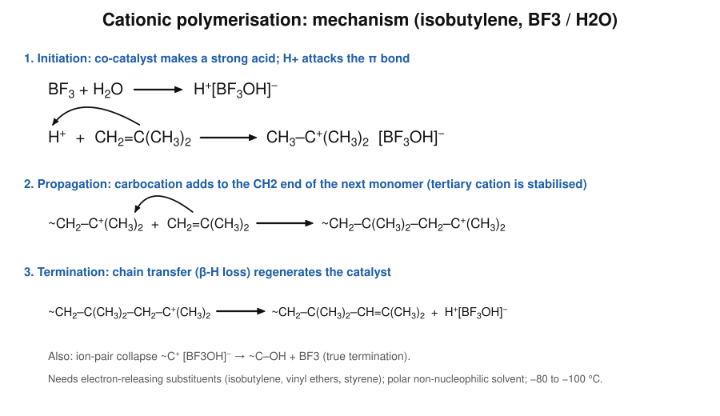

#### 2.3 Ionic polymerisation: anionic

> **Definition:** chain-growth polymerisation whose active centre is a **carbanion** with a metal counter-ion.

- **Monomers:** with electron-withdrawing or conjugating groups: styrene, butadiene, isoprene, methyl methacrylate, acrylonitrile (ethylene oxide by ring opening).
- **Initiators:** n-butyllithium, Grignard reagents, NaNH₂, sodium naphthalide (electron transfer).
- **Conditions:** dry, oxygen-free, aprotic solvent (THF, hexane), often 0 to −78 °C.
- **No termination:** the chains are **living**; they stay active until a terminating agent (water, CO₂, alcohol) is added.

```math
\bar{X}_n = \frac{[M]_0}{[I]_0}\, p \qquad (p = \text{fractional conversion}), \qquad \text{PDI} \approx 1 + \frac{1}{\bar{X}_n}
```

- Narrow PDI (about 1.05 to 1.1) and **block copolymers** (add a second monomer): SBS thermoplastic rubber, solution SBR.

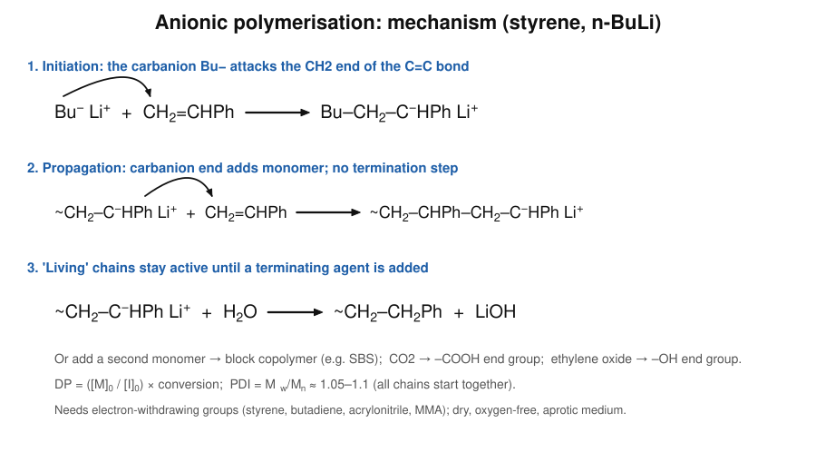

#### 2.4 Comparison

| Feature | Free radical | Cationic | Anionic |
|---|---|---|---|
| Active centre | Radical $`\bullet`$ | Carbocation $`+`$ | Carbanion $`-`$ |
| Monomers | Most vinyl monomers | Electron-donating (isobutylene, vinyl ethers) | Electron-withdrawing (styrene, MMA, acrylonitrile) |
| Initiator | Peroxide, AIBN, persulfate | Lewis acid + co-catalyst | n-BuLi, Na/naphthalene |
| Temperature | 50 to 100 °C (LDPE higher) | −80 to −100 °C | 0 to −78 °C |
| Solvent effect | Small | Strong (polarity) | Strong (polarity, counter-ion) |
| Termination | Combination or disproportionation | Transfer, ion-pair collapse | None (living) |
| Mass control | Poor, PDI 1.5 to 2 | Moderate | Excellent, PDI about 1.05 |
| Water tolerance | Tolerant | Poisoned | Poisoned |
| Examples | LDPE, PS, PVC, PMMA | Butyl rubber, polyisobutylene | SBS, solution SBR, polybutadiene |

---

## Section 2: SET-B (5 marks each)

### Q1 (SET-B)

#### Q1(i) Practical significance of polymer molecular weight

> **Answer:** molecular weight (molar mass) decides almost every useful property of a polymer: strength, melt viscosity (processing), thermal transitions, solubility and the end use.

| Property or aspect | Effect of increasing molar mass | Practical consequence |
|---|---|---|
| Mechanical strength | Tensile, impact and toughness rise, then level off above a threshold (about DP 100 to 200) | Below the threshold the material is weak and brittle (oligomer waxes) |
| Melt viscosity | $`\eta_0 \propto \bar{M}_w^{3.4}`$ above a critical mass | High M is hard to process; injection moulding needs lower M, fibres/films need higher |
| Tg and Tm | Tg rises then plateaus | Flory-Fox: $`T_g = T_{g,\infty} - K/\bar{M}_n`$ |
| Solubility | Falls | Used to fractionate polymers by precipitation |
| Chemical and stress-crack resistance | Rises | Pipes need high-M HDPE |
| Fibre or film forming | Needs sufficiently high M (nylon about $`10^4`$) | Good fibres, ultra-high-M gives gel-spun fibres |
| Quality control | $`\bar{M}_w/\bar{M}_n`$ fingerprints a grade | Batch consistency |

- Typical masses: adhesives $`10^3`$ to $`10^4`$; commodity plastics $`10^4`$ to $`10^6`$; UHMWPE (joint liners, Dyneema) above $`3\times10^6`$ g/mol.
- Measured by osmometry ($`\bar{M}_n`$), light scattering ($`\bar{M}_w`$), viscometry ($`\bar{M}_v`$) and GPC/SEC (full distribution).

#### Q1(ii) Techniques of polymerisation; suspension and emulsion

> **Techniques (names):** (1) bulk (mass), (2) solution, (3) suspension (pearl or bead), (4) emulsion; also interfacial and gas-phase.

| Technique | Medium | Initiator | Product | Example |
|---|---|---|---|---|
| Bulk | Monomer only | Soluble in monomer | Cast sheet or block, very pure | PMMA sheet |
| Solution | Monomer in solvent | Soluble | Solution/varnish | Polyacrylonitrile spinning dope |
| Suspension | Monomer droplets in water | Monomer-soluble (BPO, AIBN) | Beads 0.05 to 2 mm | PS beads, PVC, PMMA beads |
| Emulsion | Monomer in water with surfactant | Water-soluble (persulfate) | Latex 50 to 500 nm | SBR, PVAc paint, ABS |

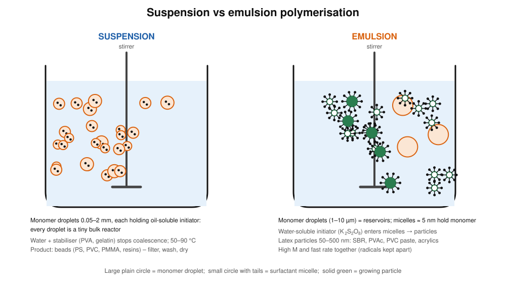

**Suspension polymerisation**

- Water-insoluble monomer is dispersed as droplets (0.05 to 2 mm) by vigorous stirring in water containing a stabiliser (PVA, gelatin, $`Ca_3(PO_4)_2`$).
- Initiator dissolves in the monomer; every droplet acts as a **tiny bulk reactor**, so heat is removed by the water.
- Product: hard polymer beads that are filtered, washed and dried.
- Uses: PS beads (expandable foam), PVC resin, PMMA beads, ion-exchange resin beads.

**Emulsion polymerisation (Harkins-Smith-Ewart picture)**

- Monomer is emulsified in water with surfactant (SDS) above the critical micelle concentration; water-soluble initiator (persulfate or redox) is used.
- Most monomer sits in large droplets (reservoirs, 1 to 10 µm); a small amount is solubilised in micelles (about 5 nm).
- Radicals formed in water enter micelles, which become polymer particles; monomer diffuses from droplets to the particles, which grow to 50 to 500 nm.
- Radicals are kept apart in separate particles, so **both high rate and high molar mass** are obtained.
- Rate: $`R_p \propto [S]^{0.6}[I]^{0.4}`$. Product is a latex used directly (paints, adhesives, SBR).

| Feature | Suspension | Emulsion |
|---|---|---|
| Particle size | 0.05 to 2 mm (beads) | 0.05 to 0.5 µm (latex) |
| Initiator | Oil-soluble | Water-soluble |
| Stabiliser | Polymer (PVA) | Surfactant (SDS) |
| Locus | Monomer droplet | Micelle / latex particle |
| Isolation | Filter | Coagulate or use latex |
| Purity | Cleaner (little additive) | Contains surfactant residue |

#### Q1(iii) Monodispersity, polydispersity and degree of polydispersity

> **Monodisperse:** all chains have **identical** molar mass. **Polydisperse:** chains differ in molar mass (a distribution). **Degree of polydispersity (polydispersity index, PDI, dispersity Đ):** $`\bar{M}_w/\bar{M}_n`$, a measure of the breadth of the distribution.

```math
\bar{M}_n = \frac{\sum n_i M_i}{\sum n_i}, \qquad \bar{M}_w = \frac{\sum n_i M_i^2}{\sum n_i M_i}, \qquad \bar{M}_z = \frac{\sum n_i M_i^3}{\sum n_i M_i^2}, \qquad \text{PDI} = \frac{\bar{M}_w}{\bar{M}_n}
```

- Order: $`\bar{M}_n \le \bar{M}_w \le \bar{M}_z`$; PDI = 1 only for a perfectly monodisperse sample (natural proteins, DNA, living anionic polymers approach 1.01 to 1.1).
- Typical PDI: radical polymerisation 1.5 to 2 (combination about 1.5, disproportionation about 2); step-growth about 2; Ziegler-Natta PE 3 to 8; LDPE can exceed 10.

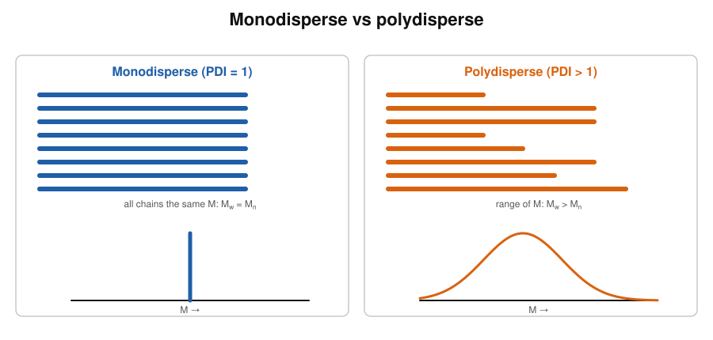

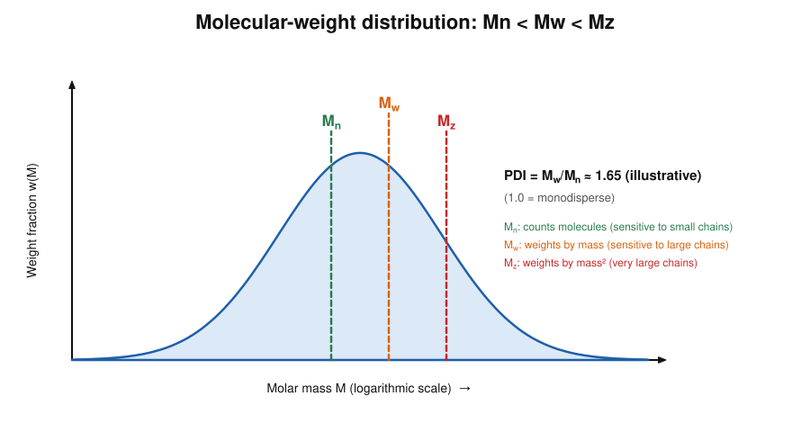

| Feature | Monodisperse | Polydisperse |
|---|---|---|
| Chain lengths | All equal | Many different |
| PDI | 1 | > 1 |
| $`\bar{M}_n`$ vs $`\bar{M}_w`$ | Equal | $`\bar{M}_w > \bar{M}_n`$ |
| Example | Proteins, DNA, living polystyrene (≈ 1.05) | Most synthetic polymers (PE, PVC, PS) |

#### Q1(iv) Physical and chemical degradation of polymers

> **Degradation:** an undesirable change in structure and properties (loss of M, colour, strength) caused by heat, light, oxygen, chemicals or stress.

**Physical degradation** (no bond breaking; the polymer chains stay intact):

- Swelling and dissolution by solvents; **environmental stress cracking** (PE in detergents).
- Loss or migration of plasticiser or additive (PVC becomes brittle); physical ageing (densification below Tg).
- Softening or creep above Tg or Tm; mechanical fatigue and abrasion.

**Chemical degradation** (covalent bonds break or form):

| Route | Cause | Result | Example |
|---|---|---|---|
| Random chain scission | Heat, shear, hydrolysis | M falls fast, no monomer | PE, PP, PET and nylon hydrolysis |
| Depolymerisation (unzipping) | Heat | Monomer released from chain end | PMMA → MMA, PTFE → TFE, PS → styrene |
| Side-group elimination | Heat | Small molecule lost, polyene formed (colour) | PVC loses HCl, turns yellow |
| Oxidation (autoxidation) | $`O_2`$ + heat | Radical cycle, brittleness | PP, rubbers |
| Photo-oxidation | UV 290 to 400 nm | Yellowing, chalking, cracks | Outdoor PE, PP |
| Hydrolysis / ozonolysis | Water, acid, $`O_3`$ | Scission | Polyesters, polyamides; diene rubbers |

```math
RH \rightarrow R^\bullet \xrightarrow{+O_2} ROO^\bullet \xrightarrow{+RH} ROOH + R^\bullet, \qquad ROOH \rightarrow RO^\bullet + {}^\bullet OH
```

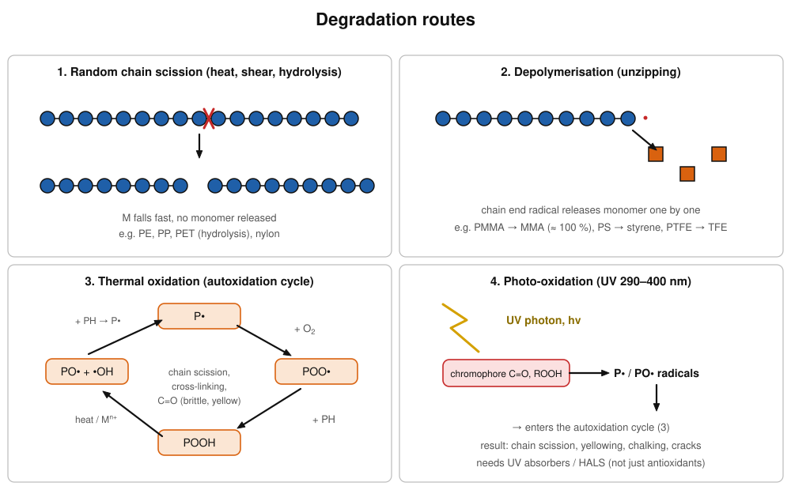

**Protection:** antioxidants (against oxidation), UV stabilisers (against photo-oxidation), acid scavengers for PVC (Ca/Zn stearates).

#### Q1(v-a) Proof of the weight-average molar mass formula

> **To prove:** $`\bar{M}_w = \dfrac{\sum n_i m_i^2}{\sum n_i m_i}`$

Let $`n_i`$ be the number of molecules of molar mass $`m_i`$.

**Step 1: number average**, each molecule counts once:

```math
\bar{M}_n = \frac{\sum n_i m_i}{\sum n_i}
```

**Step 2: weight average**, each species is weighted by its **weight fraction** $`w_i`$:

```math
\bar{M}_w = \sum w_i m_i
```

**Step 3: weight fraction** = mass of species $`i`$ over total mass:

```math
w_i = \frac{n_i m_i}{\sum n_i m_i}
```

**Step 4: substitute:**

```math
\bar{M}_w = \sum \left( \frac{n_i m_i}{\sum n_i m_i} \right) m_i = \frac{\sum n_i m_i^2}{\sum n_i m_i} \qquad \blacksquare
```

(The denominator is constant, so it comes out of the sum.) Also $`\text{PDI} = \bar{M}_w/\bar{M}_n`$.

**Worked numerical example.** A sample has 1 mol of $`m = 10\,000`$, 2 mol of $`20\,000`$ and 1 mol of $`40\,000`$ g/mol.

| $`n_i`$ (mol) | $`m_i`$ (g/mol) | $`n_i m_i`$ | $`n_i m_i^2`$ |
|---|---|---|---|
| 1 | 10 000 | 10 000 | $`1\times10^{8}`$ |
| 2 | 20 000 | 40 000 | $`8\times10^{8}`$ |
| 1 | 40 000 | 40 000 | $`16\times10^{8}`$ |
| **Σ = 4** | | **90 000** | **$`25\times10^{8}`$** |

```math
\bar{M}_n = \frac{90\,000}{4} = 22\,500 \qquad \bar{M}_w = \frac{25\times10^{8}}{90\,000} = 27\,778 \qquad \text{PDI} = \frac{27\,778}{22\,500} = 1.23
```

Check with weight fractions: $`w = 0.111,\ 0.444,\ 0.444`$ gives $`\bar{M}_w = 0.111(10\,000)+0.444(20\,000)+0.444(40\,000) = 27\,778`$ ✓.

#### Q1(v-b) Four photostabilizers and four antioxidants (name and structure)

**Photostabilizers** (protect against UV photo-oxidation):

| No. | Name | Class | Action |
|---|---|---|---|
| 1 | 2-Hydroxy-4-methoxybenzophenone | UV absorber | Absorbs UV, dissipates as heat by proton transfer (ESIPT) |
| 2 | 2-(2H-Benzotriazol-2-yl)-4-methylphenol (Tinuvin P) | UV absorber | Same o-hydroxyaryl mechanism |
| 3 | Bis(2,2,6,6-tetramethyl-4-piperidyl) sebacate (Tinuvin 770) | HALS | Scavenges radicals via regenerated nitroxyl (N–O•) |
| 4 | Nickel bis(dibutyldithiocarbamate) | Quencher | Accepts energy from excited chromophores |

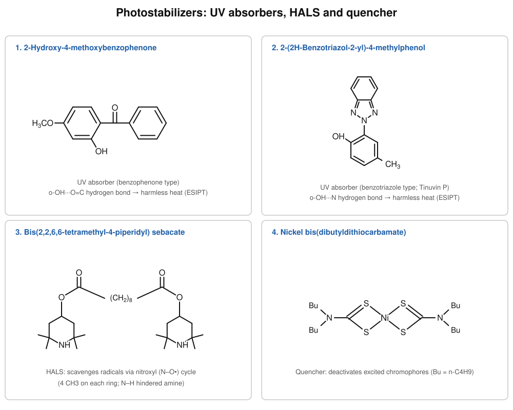

**Antioxidants** (protect against thermal oxidation):

| No. | Name | Class | Action |
|---|---|---|---|
| 1 | BHT (2,6-di-tert-butyl-4-methylphenol) | Primary (hindered phenol) | Donates phenolic H to $`ROO^\bullet`$, forming a stable phenoxy radical |
| 2 | Irganox 1076 (octadecyl 3-(3,5-di-tert-butyl-4-hydroxyphenyl)propionate) | Primary | Same, but less volatile and less extractable |
| 3 | Irgafos 168 (tris(2,4-di-tert-butylphenyl) phosphite) | Secondary (phosphite) | Reduces $`ROOH \rightarrow ROH`$; P(III) → P(V) |
| 4 | DLTDP (dilauryl 3,3'-thiodipropionate) | Secondary (thioester) | Decomposes hydroperoxides; synergist with phenols |

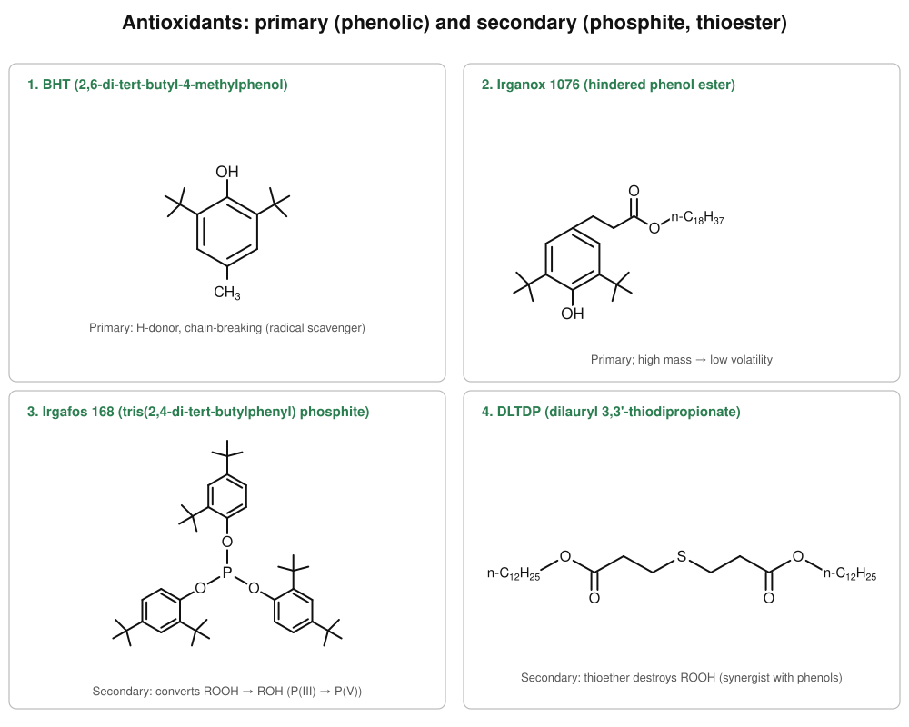

---

### Q2 (SET-B)

#### Q2(i) Relation between Tg and Tm

> **Tg (glass transition temperature):** the temperature range where an amorphous polymer (or the amorphous part of a semicrystalline one) changes from a hard glass to a soft rubber (segmental motion starts).
> **Tm (melting temperature):** the temperature where the crystalline regions melt (a first-order transition).

- Tg exists for all polymers with an amorphous part; Tm only for crystallisable ones. Tg is always below Tm.
- **Boyer-Beaman rule (temperatures in kelvin):**

```math
\frac{T_g}{T_m} \approx \frac{1}{2} \;\text{(symmetrical polymers)}, \qquad \frac{T_g}{T_m} \approx \frac{2}{3} \;\text{(unsymmetrical polymers)}, \qquad \text{overall } \; \tfrac{1}{2} \lesssim \frac{T_g}{T_m} \lesssim \tfrac{2}{3}
```

- **The ratio must be calculated in kelvin** ($`K = {}^\circ C + 273`$). Symmetrical chains (polyethylene, polyisobutylene) lie near ½; unsymmetrical chains with side groups (PP, PS, PVC, nylon, PET) lie near ⅔. It is an empirical rule with exceptions (for example PE, whose Tg is itself uncertain).
- Both rise with chain stiffness and intermolecular forces.

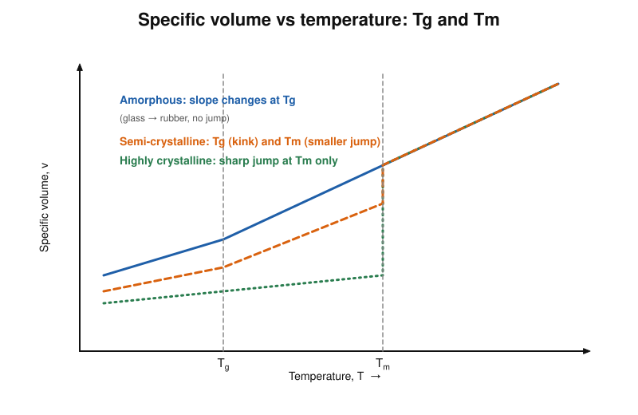

| Feature | Tg | Tm |
|---|---|---|
| Transition | Second-order-like (kinetic, rate dependent) | First-order (thermodynamic) |
| Seen in | Amorphous part | Crystalline part |
| Volume curve | Change of **slope** | Sharp **jump** |
| Enthalpy | Step in heat capacity | Latent heat (endotherm) |

#### Q2(ii) Diagrams of amorphous, crystalline and semi-crystalline polymers

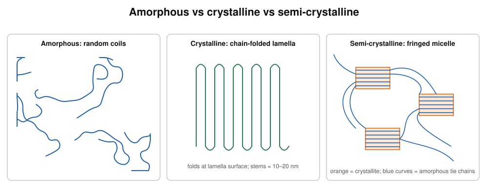

- **Amorphous:** chains in random coils with no long-range order (atactic PS, PMMA).
- **Crystalline (ideal):** chains regularly folded into lamellae (PE single crystals); real polymers never reach 100 %.
- **Semi-crystalline:** ordered crystallites (fringed micelle model) embedded in amorphous matrix, joined by tie chains (HDPE, PP, nylon, PET).

#### Q2(iii) Difference between crystalline and amorphous polymer

| Feature | Crystalline (semi-crystalline) | Amorphous |
|---|---|---|
| Chain arrangement | Ordered, folded or parallel chains | Random coil |
| Structural requirement | Regular, symmetrical, small side groups; high tacticity (isotactic, syndiotactic) | Irregular, atactic, bulky groups, branching |
| Transitions | Tg and sharp Tm | Tg only; softens gradually |
| Density | Higher | Lower |
| Optical | Translucent or opaque (scattering) | Transparent (PS, PMMA) |
| Mechanical | Strong, stiff, tough; good chemical resistance | Brittle below Tg; weaker solvent resistance |
| Solubility | Dissolves with difficulty | Dissolves more easily |
| Examples | HDPE, iPP, nylon-6,6, PET | Atactic PS, PMMA, PC, PVC (mostly) |

#### Q2(iv) Tg and Tm values of polymers

Standard textbook values, approximate (they vary with tacticity, crystallinity, molar mass and measurement method):

| Polymer | Tg (°C) | Tm (°C) | Tg/Tm (K) | Remark |
|---|---|---|---|---|
| Polyethylene (HDPE) | about −120 (range −125 to −100; some report higher) | 130 to 137 | about 0.4 | Symmetrical; below the rule because its Tg is poorly defined |
| Polypropylene (isotactic) | −20 to 0 (about −10) | 160 to 176 | about 0.60 | Unsymmetrical, rule holds |
| PET | 67 to 80 (about 70) | 250 to 265 | about 0.64 | Rigid ring backbone |
| Nylon-6,6 | 45 to 70 (about 50 dry) | 255 to 265 | about 0.60 | H-bonding raises both |
| Polystyrene (atactic) | 90 to 105 | none (amorphous; isotactic about 240) | | Bulky phenyl group |
| PMMA (atactic) | 100 to 125 | none (amorphous) | | |
| PVC | 75 to 105 | weakly crystalline (about 170 to 220 for syndiotactic) | | |
| PVK | about 200 (200 to 230) | amorphous | | Bulky carbazole group |

*Worked check (iPP):* Tg = −10 + 273 = 263 K, Tm = 165 + 273 = 438 K, ratio = 0.60, which lies between ½ and ⅔ ✓.

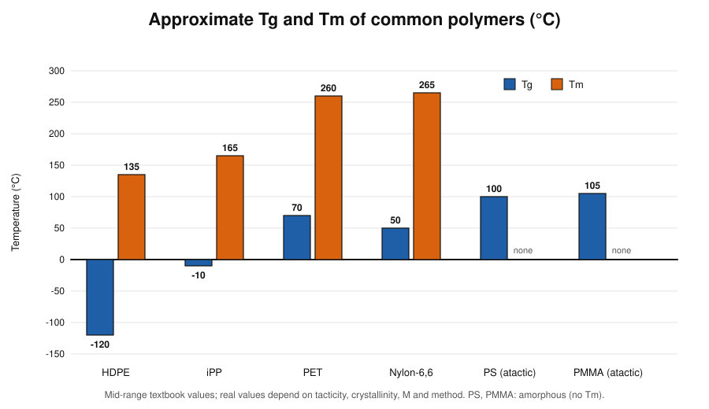

#### Q2(v) Importance of Tg and factors that influence it

> **Importance:** Tg fixes the temperature boundary between hard-glassy and soft-rubbery behaviour, so it controls service temperature, processing and mechanical properties.

- **Upper use temperature** of amorphous plastics (PS, PMMA, PC) is about Tg; below Tg they are rigid but brittle.
- **Lower use temperature** of elastomers (rubbers need Tg far below room temperature: natural rubber about −70 °C, SBR about −55 °C).
- Sets **processing windows** (moulding, thermoforming and film blowing above Tg; annealing and drawing between Tg and Tm).
- Guides **plasticiser and copolymer choice** (tuning flexibility), and shows compatibility of blends (one or two Tg).
- Measured by DSC, DMA, TMA, dilatometry.

**Factors influencing Tg**

| Factor | Effect on Tg | Reason / example |
|---|---|---|
| Backbone flexibility | Flexible chain (Si–O, C–O) lowers; rigid rings raise | PDMS −123 °C vs PET 70 °C |
| Bulky or rigid side group | Raises | PS (100 °C) > PE; PVK about 200 °C |
| Polar groups, H-bonding | Raises | PVC, PAN, nylon |
| Flexible side chain length | Lowers (internal plasticisation) | Poly(alkyl methacrylates): methyl 105 °C, butyl about 20 °C |
| Molar mass | Rises, then plateaus | Flory-Fox: $`T_g = T_{g,\infty} - K/\bar{M}_n`$ |
| Cross-linking | Raises | Restricts motion (vulcanised rubber, thermosets) |
| Plasticiser | Lowers | DOP in PVC |
| Copolymer composition | Between the two homopolymers | Fox: $`\dfrac{1}{T_g} = \dfrac{w_1}{T_{g1}} + \dfrac{w_2}{T_{g2}}`$ |
| Tacticity | Syndiotactic PMMA > atactic > isotactic | Chain packing |
| Test conditions | Faster heating or higher frequency raises apparent Tg; pressure raises | Kinetic transition |
| Crystallinity | Raises (restricts the amorphous part) | Semicrystalline nylon |

**OR: Why is the Tg of polyvinyl carbazole higher than that of polyethylene?**

> **Answer:** because the pendant **carbazole** group is huge, planar and rigid, it hinders backbone rotation, so much more thermal energy is needed before segments can move. PE has only H on its backbone, so it rotates easily.

- **Bulky rigid side group:** large three-ring carbazole sterically blocks C–C bond rotation (restricted rotation, high chain stiffness).
- **Less free volume available for motion:** the bulky groups fill the space around the backbone and the planar rings attract each other by π–π stacking, so the chain must be heated much more before enough free volume opens for segmental motion.
- **Result:** PVK Tg about 200 °C (about 473 K) against PE about −120 °C (about 153 K).

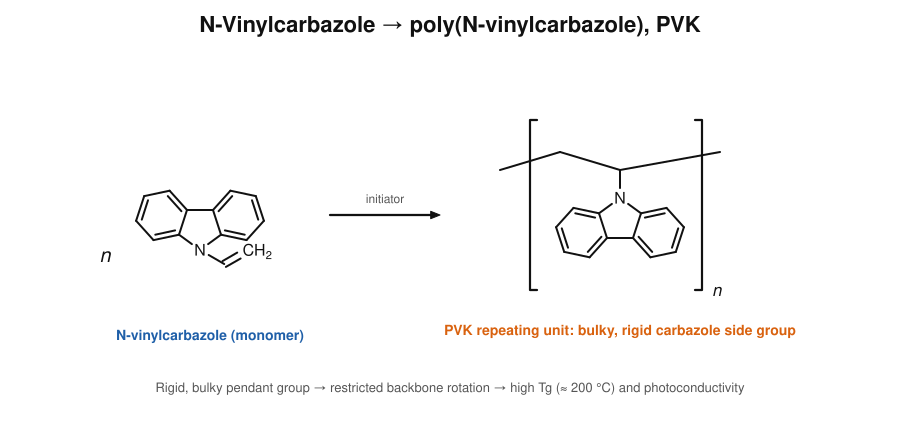

| Feature | Polyvinyl carbazole (PVK) | Polyethylene (PE) |
|---|---|---|
| Side group | Carbazole (3 fused rings) | H atoms |
| Rotation about backbone | Strongly restricted | Free |
| Chain stiffness | High | Low |
| Tg | About 200 °C | About −120 °C |
| State at 25 °C | Glassy | Rubbery amorphous part (plus crystals) |

**Factors considered for the selection of a plasticizer for commercial application**

> **Plasticizer:** a low-volatility, miscible additive that lowers Tg (and modulus) and makes a polymer flexible (for example di-2-ethylhexyl phthalate, DOP, in PVC).

| Factor | Meaning |
|---|---|
| Compatibility | Must be miscible with the polymer (similar solubility parameter); otherwise it exudes |
| Efficiency | Large fall in Tg per part added (phr) |
| Low volatility | Does not evaporate during processing or service |
| Permanence | Low migration, extraction and exudation into liquids, food, other plastics |
| Thermal and light stability | No discolouration or decomposition at processing T |
| Low-temperature flexibility | Keeps polymer flexible in cold (adipates, sebacates) |
| Toxicity and regulation | Safe for toys, food contact and medical use (phthalate restrictions → DOTP, citrates) |
| Electrical and flame properties | Insulation and flame resistance (phosphate esters) |
| Cost and availability | Economical in bulk |
| Effect on other properties | Strength, hardness, processing (gelation), odour |

---

## Extra: one-page quick-revision summary

| Topic | Key points to remember |
|---|---|
| Monomer vs mer | Monomer = small molecule; mer = repeating unit in the chain; nylon-6,6 mer is from two monomers |
| Oligomer / DP | DP = $`\bar{M}_n/M_0`$; oligomers DP < about 20 |
| Retarder / inhibitor | Inhibitor stops (induction period); retarder slows |
| Graft / network | Graft = branches of B on A; network = cross-linked 3-D |
| Homo / co / bio / organic | One vs two or more monomers; living cells; C backbone vs Si–O etc. |
| Thermoplastic / thermoset | Linear, remeltable vs cross-linked, infusible |
| Free radical | Initiation, propagation, termination (combination, disproportionation); $`R_p \propto [I]^{1/2}`$ |
| Ionic | Cationic: donor monomers, Lewis acid, −80 °C; anionic: acceptor monomers, n-BuLi, living, PDI about 1 |
| Suspension / emulsion | Droplets, oil-soluble initiator, beads vs micelles, water-soluble initiator, latex |
| $`\bar{M}_n, \bar{M}_w`$ | $`\bar{M}_w = \sum n_i m_i^2 / \sum n_i m_i`$; $`\bar{M}_n \le \bar{M}_w \le \bar{M}_z`$; PDI = $`\bar{M}_w/\bar{M}_n`$ |
| Degradation | Physical (swelling, cracking, plasticiser loss) vs chemical (scission, unzipping, oxidation, photo, hydrolysis) |
| Stabilisers | UV absorber, quencher, HALS; primary (phenol) and secondary (phosphite, thioester) antioxidants |
| Tg / Tm | Tg/Tm ≈ ½ to ⅔ in K; Tg: slope change, Tm: jump |
| PVK vs PE | Bulky rigid carbazole → restricted rotation → high Tg |
| Plasticizer | Compatible, efficient, non-volatile, permanent, stable, non-toxic, cheap |

## Extra: mnemonics and memory tips

- **Inhibitor = Induction period**; **Retarder = Reduces rate**.
- **$`\bar{M}_n \le \bar{M}_w \le \bar{M}_z`$:** the averages weight $`m_i`$ with higher and higher powers (1, 2, 3 in the sums), so each is larger than the one before.
- **Boyer-Beaman:** "Symmetric = Half, Skewed = Two-thirds" (and always use kelvin).
- **Thermo-PLASTIC** = can be re-shaped like plastic bottles; **thermo-SET** = once SET (like concrete) it stays.
- **Cationic needs Donors, Anionic needs Acceptors** (C-D, A-A).
- **Anionic = Alive** (living polymers).
- **Suspension = Soluble in monomer (initiator)**; **Emulsion = Everything in water (initiator)**.
- **Primary antioxidant = Phenol (donates H)**; **Secondary = Phosphite/Sulfur (decomposes ROOH)**.
- **HALS = Hindered Amine Light Stabilizer** (it kills radicals, not UV light).

## Extra: common exam mistakes

1. Treating "five pairs" literally and leaving three pairs out; answer all eight.
2. Calling a retarder a "weaker inhibitor" without saying that **only the inhibitor** gives an induction period.
3. Using Celsius in the Tg/Tm ratio.
4. Writing $`\bar{M}_w = \sum n_i m_i / \sum n_i`$ (that is $`\bar{M}_n`$); forgetting $`w_i = n_i m_i / \sum n_i m_i`$ in the proof.
5. Drawing the repeating unit without brackets and subscript $`n`$, or putting the brackets inside the bonds.
6. Mixing up initiator solubility in suspension (monomer-soluble) and emulsion (water-soluble).
7. Writing only "PE has low Tg" for PVK vs PE; give reasons (bulky rigid group, restricted rotation, free volume).
8. Giving a single exact Tg or Tm value; state a range and the polymer's tacticity or crystallinity.
9. Saying anionic polymerisation has a termination step; it is living until a terminator is added.
10. Forgetting that thermosets are cross-linked and cannot be remelted.

## Extra: 10 likely follow-up viva questions

| No. | Question | Short answer |
|---|---|---|
| 1 | Why does the rate in free radical polymerisation depend on $`[I]^{1/2}`$? | Termination is bimolecular ($`R_t \propto [M^\bullet]^2`$) and steady state equates $`R_i`$ to $`R_t`$. |
| 2 | Why can anionic polymerisation give block copolymers? | Chains stay living, so a second monomer can be added to the same carbanion ends. |
| 3 | What is the effect of increasing chain length on Tg? | Tg rises and plateaus (Flory-Fox). |
| 4 | Why is the polymer bead in suspension polymerisation easy to cool? | Each droplet is small and surrounded by water, which removes heat. |
| 5 | What is a plasticiser and how does it work? | A miscible low-volatility additive that increases free volume and chain mobility, lowering Tg. |
| 6 | Why does PVC turn yellow on heating? | HCl loss forms conjugated polyenes; Ca/Zn stearate stabilisers are added. |
| 7 | How do HALS differ from UV absorbers? | HALS trap radicals (regenerated nitroxyl); absorbers filter UV and dissipate it as heat. |
| 8 | Why is PDI = 1 rare? | Statistical chain growth and termination give a distribution. |
| 9 | Which technique gives high M and high rate together? | Emulsion polymerisation (radicals isolated in particles). |
| 10 | Why does isotactic PP crystallise but atactic PP does not? | Regular stereochemistry allows close packing of chains. |

## Extra: one-glance comparison cheat sheet

| Pair | Item A | Item B | Key difference | Example |
|---|---|---|---|---|
| Monomer / mer | Small reactive molecule | Repeating unit in chain | Molecule vs fragment | Styrene / $`-[CH_2CH(Ph)]-`$ |
| Oligomer / polymer | DP < about 20 | DP ≥ about 100 | Properties depend on DP vs not | Wax / HDPE |
| Retarder / inhibitor | Slows | Stops, then normal | Induction period | Nitrobenzene / hydroquinone |
| Graft / network | B branches on A | Cross-linked 3-D | Soluble vs insoluble | HIPS / Bakelite |
| Biological / non-biological | Cells make | Factory makes | Origin, exact sequence | Protein / nylon |
| Homo / co | One monomer | Two or more | Composition | PS / SBR |
| Organic / inorganic | C backbone | No C in backbone | Backbone atoms | PE / silicone |
| Thermoplastic / thermoset | Re-meltable | Infusible | Cross-links | PVC / epoxy |
| Free radical / ionic | Radical, random | Ion, living possible | Active centre | LDPE / SBS |
| Suspension / emulsion | Beads, oil-soluble initiator | Latex, water-soluble initiator | Particle size, locus | PS beads / SBR latex |
| Monodisperse / polydisperse | PDI = 1 | PDI > 1 | Distribution | DNA / PE |
| Amorphous / crystalline | Random coil, Tg only | Ordered, Tg + Tm | Order | PMMA / HDPE |
| Physical / chemical degradation | No bonds broken | Bonds broken | Chemistry | Swelling / scission |
| Primary / secondary antioxidant | H donor (phenol) | ROOH decomposer | Mode of action | BHT / Irgafos 168 |
| UV absorber / HALS | Absorbs UV | Scavenges radicals | Mode of action | Benzotriazole / Tinuvin 770 |
