# WPE 101: Polymer Science & Engineering: Solved Question Bank (2019–2024)

**Bangladesh University of Textiles · B.Sc. in Textile Engineering · Level-1 Term-II**
Final examinations 2019–2024 · 72 topic groups · 165 question appearances · 5 numericals

> [!NOTE]
> Every topic is answered once in a consolidated, exam-ready form. The years in which it appeared are kept so you can prioritise revision.

---

## How to use this file

| Marks | What to write |
|---|---|
| 2–3 | One-line definition + two key points (+ one example) |
| 4–6 | Definition, labelled diagram / scheme, comparison table, example |
| Numerical | **Given → formula → substitution → answer with unit** (round only at the end) |

**Priority legend:** 🔴 MUST-DO (5–6 of 6 exams) · 🟠 HIGH (3–4 exams) · 🟡 MEDIUM (2 exams) · ⚪ ONCE (1 exam)

**Symbols:** $\overline{M}_n$ = number-average, $\overline{M}_w$ = weight-average molar mass, $\mathit{Đ}$ = dispersity (called *PDI* in most exam papers) $=\overline{M}_w/\overline{M}_n$.

> [!IMPORTANT]
> Thermal values (Tg, Tm) and DP values are **approximate, grade-dependent** numbers. Say "about" or give a range in the exam.

### Highest-yield topics

| Rank | Topic | Seen in |
|---|---|---|
| 🔴 | Polydispersity / PDI ([4.1](#q4-1)) | 5 / 6 years |
| 🔴 | Glass-transition temperature ([7.1](#q7-1)) | 5 / 6 years |
| 🟠 | Polymer terminology, DP, classification ([1.1](#q1-1), [1.2](#q1-2), [1.3](#q1-3)) | 4 / 6 |
| 🟠 | Inhibitor / retarder ([2.1](#q2-1)) · Polycondensation types ([3.1](#q3-1)) | 4 / 6 |
| 🟠 | Molecular-weight methods ([4.2](#q4-2)) · Bulk vs emulsion ([5.1](#q5-1)) | 4 / 6 |
| 🟠 | Crystallinity ([7.2](#q7-2)) · Nylon 6,6 ([8.1](#q8-1)) | 4 / 6 |

---

## Contents

| Chapter | Topics |
|---|---|
| [Chapter 1: Introduction and Basic Concepts](#chapter-1-introduction-and-basic-concepts) | [1.1](#q1-1) · [1.2](#q1-2) · [1.3](#q1-3) · [1.4](#q1-4) · [1.5](#q1-5) · [1.6](#q1-6) · [1.7](#q1-7) · [1.8](#q1-8) · [1.9](#q1-9) · [1.10](#q1-10) · [1.11](#q1-11) · [1.12](#q1-12) |
| [Chapter 2: Chain (Addition) Polymerization](#chapter-2-chain-addition-polymerization) | [2.1](#q2-1) · [2.2](#q2-2) · [2.3](#q2-3) · [2.4](#q2-4) · [2.5](#q2-5) · [2.6](#q2-6) · [2.7](#q2-7) |
| [Chapter 3: Step (Condensation) Polymerization](#chapter-3-step-condensation-polymerization) | [3.1](#q3-1) · [3.2](#q3-2) · [3.3](#q3-3) · [3.4](#q3-4) · [3.5](#q3-5) · [3.6](#q3-6) · [3.7](#q3-7) |
| [Chapter 4: Molecular Weight of Polymers](#chapter-4-molecular-weight-of-polymers) | [4.1](#q4-1) · [4.2](#q4-2) · [4.3](#q4-3) · [4.4](#q4-4) · [4.5](#q4-5) · [4.6](#q4-6) · [4.7](#q4-7) · [4.8](#q4-8) |
| [Chapter 5: Polymerization Techniques](#chapter-5-polymerization-techniques) | [5.1](#q5-1) · [5.2](#q5-2) · [5.3](#q5-3) · [5.4](#q5-4) · [5.5](#q5-5) |
| [Chapter 6: Polymer Degradation and Stabilization](#chapter-6-polymer-degradation-and-stabilization) | [6.1](#q6-1) · [6.2](#q6-2) · [6.3](#q6-3) · [6.4](#q6-4) · [6.5](#q6-5) · [6.6](#q6-6) |
| [Chapter 7: Polymer Properties (Crystallinity, Tg, Forces)](#chapter-7-polymer-properties-crystallinity-tg-forces) | [7.1](#q7-1) · [7.2](#q7-2) · [7.3](#q7-3) · [7.4](#q7-4) · [7.5](#q7-5) · [7.6](#q7-6) · [7.7](#q7-7) · [7.8](#q7-8) · [7.9](#q7-9) · [7.10](#q7-10) · [7.11](#q7-11) · [7.12](#q7-12) |
| [Chapter 8: Textile and Special Polymers, Recycling](#chapter-8-textile-and-special-polymers-recycling) | [8.1](#q8-1) · [8.2](#q8-2) · [8.3](#q8-3) · [8.4](#q8-4) · [8.5](#q8-5) · [8.6](#q8-6) · [8.7](#q8-7) · [8.8](#q8-8) · [8.9](#q8-9) · [8.10](#q8-10) |
| [Chapter 9: Numerical Problems](#chapter-9-numerical-problems) | [9.1](#q9-1) · [9.2](#q9-2) · [9.3](#q9-3) · [9.4](#q9-4) · [9.5](#q9-5) |
| Extra sections | [Formula sheet](#formula-sheet) · [Extra practice](#extra-practice-problems-with-answers) · [Common mistakes](#common-mistakes-examiners-penalise) · [Mnemonics](#memory-aids) · [Glossary](#glossary) · [Corrections](#corrections-and-notes-on-the-source-bank) · [Figure index](#figure-index) |

---

# Chapter 1: Introduction and Basic Concepts

## 1.1 Define polymer, repeat unit, end group and monomer residue

`🟠 HIGH` · 4/6 exams · 2024 · 2022 · 2020 · 2019

**Polymer:** a substance made of macromolecules whose structure consists of many repeated constitutional units (Greek *poly* = many, *meros* = part). Examples: polyethylene, PET, nylon 6,6, cellulose, proteins.

| Term | Meaning | Example (polyethylene) |
|---|---|---|
| **Monomer** | small molecule that can react to form a polymer | ethene, CH₂=CH₂ |
| **Repeat unit** | smallest structural unit repeated along the chain | –CH₂–CH₂– |
| **Monomer residue** | the part of the monomer that is built into the chain after reaction (the π bond is used up) | –CH₂–CH₂– |
| **End group** | group at a chain terminus, fixed by the initiator and the termination step | R– (from initiator), –H |

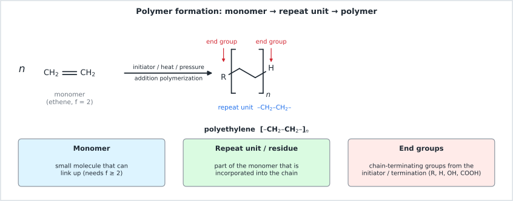

*Figure 1.1: n ethene → polyethylene. The bracketed part is the repeat unit.*

$$n\,\mathrm{CH_2{=}CH_2}\;\longrightarrow\;[\,\mathrm{-CH_2-CH_2-}\,]_n$$

> [!TIP]
> **Extra:** in condensation polymers the repeat unit is *not* the same as the monomer, because small molecules (H₂O) are lost. In nylon 6,6 the repeat unit contains **both** monomer residues.

---

## 1.2 Degree of polymerization (DP): definition and structures of textile fibres

`🟠 HIGH` · 4/6 exams · 2023 · 2021 · 2020 · 2019

**DP** is the number of repeat units in a polymer chain. Because a sample contains chains of different length, the *number-average* DP is reported:

$$\overline{DP}_n \approx \frac{\overline{M}_n}{M_0}$$

where $M_0$ is the molar mass of the repeat unit (end-group mass neglected for long chains).

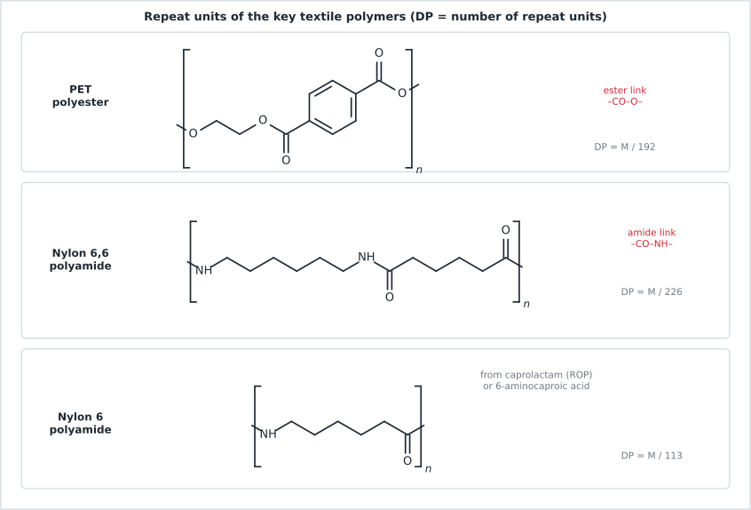

*Figure 1.2: Repeat units of the main textile polymers, with the characteristic link highlighted.*

| Polymer | Repeat unit | $M_0$ (g/mol) | Typical fibre DP* |
|---|---|---|---|
| PET | –O–CH₂CH₂–O–CO–C₆H₄–CO– | 192 | ≈ 100–150 |
| Nylon 6,6 | –NH(CH₂)₆NH–CO(CH₂)₄CO– | 226 | ≈ 100–150 |
| Nylon 6 | –NH(CH₂)₅–CO– | 113 | ≈ 100–200 |
| Cellulose (cotton) | anhydroglucose, C₆H₁₀O₅ | 162 | thousands (≈ 5000, see [9.5](#q9-5)) |

\*Grade-dependent. Cellulose acetate: some –OH groups esterified to –OCOCH₃ (degree of substitution DS ≤ 3).

> [!TIP]
> **Worked mini-example:** a PET with $\overline{M}_n = 19\,200$ has $\overline{DP}_n \approx 19\,200/192 = 100$.

---

## 1.3 Classify polymers by geometrical structure and by behaviour towards heat

`🟠 HIGH` · 4/6 exams · 2024 · 2022 · 2020 · 2019

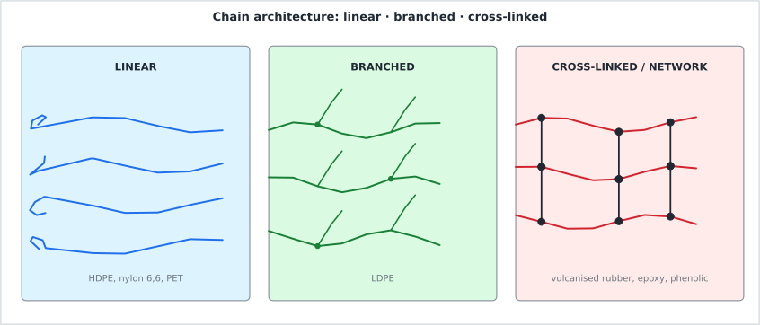

*Figure 1.3: Chain architecture.*

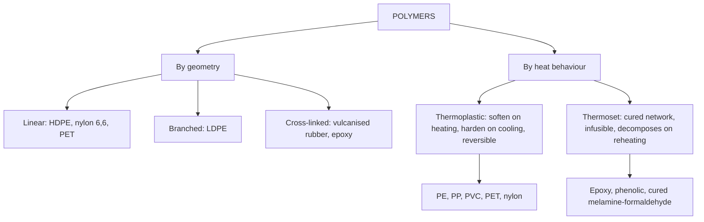

| Property | Thermoplastic | Thermoset |
|---|---|---|
| Structure | linear / branched, no covalent network | dense 3-D covalent network |
| On heating | softens, flows | does not melt; chars at high T |
| Re-moulding / recycling | possible | not possible |
| Solubility | soluble in suitable solvents | insoluble, swells at most |
| Examples | PE, PP, PET, nylon | epoxy, Bakelite, MF resin |

---

## 1.4 Biopolymers: definition, examples, comparison with synthetic polymers

`🟠 HIGH` · 3/6 exams · 2022 · 2021 · 2019

**Biopolymers** are polymers produced by living organisms or derived from renewable biological feedstock. Examples: cellulose, starch, proteins (wool, silk), natural rubber, chitin, polyhydroxyalkanoates (PHA); PLA is *bio-based* (from lactic acid).

| Basis | Biopolymer | Synthetic polymer |
|---|---|---|
| Source | plants, animals, microbes (renewable) | petroleum / natural-gas monomers |
| Made by | enzymatic biosynthesis (or bio-based synthesis) | industrial chain / step polymerization |
| Composition control | exact sequence (proteins); natural variability | designed, uniform grades |
| End of life | often biodegradable | mostly persistent (PE, PET, nylon) |
| Examples | cotton, wool, silk, starch | PE, PP, PET, nylon 6,6 |

> [!WARNING]
> *Bio-based* (carbon origin) ≠ *biodegradable* (ability to be broken down by microbes). PLA is bio-based and compostable only under industrial conditions; some fossil-based polymers (PCL, PBAT) are biodegradable.

---

## 1.5 Homopolymer vs copolymer

`🟠 HIGH` · 3/6 exams · 2022 · 2021 · 2019

A **homopolymer** is made from one type of monomer; a **copolymer** contains two or more chemically different monomer units.

| Feature | Homopolymer | Copolymer |
|---|---|---|
| Monomer types | one | two or more |
| Sequence | one repeat type | random, alternating, block or graft |
| Property tuning | limited | easy (flexibility, toughness, Tg, adhesion) |
| Examples | PE, PS, PVC | SBR, ABS, EVA, SAN |

See the sequence types in [1.11](#q1-11).

---

## 1.6 Monomer vs repeating unit; structures of PVA, polystyrene and common natural / synthetic polymers

`🟡 MEDIUM` · 2/6 exams · 2023 · 2022

* **Monomer:** a molecule able to form a polymer. **Repeat unit:** the smallest pattern repeated in the chain. They are *identical in composition* in addition polymers of one monomer (ethene → –CH₂CH₂–) but *differ* in step polymers (loss of H₂O).
* **Polystyrene** comes directly from styrene.
* **Poly(vinyl alcohol)** cannot come from vinyl alcohol (unstable; it tautomerises to acetaldehyde). It is made by **hydrolysis of poly(vinyl acetate)**.

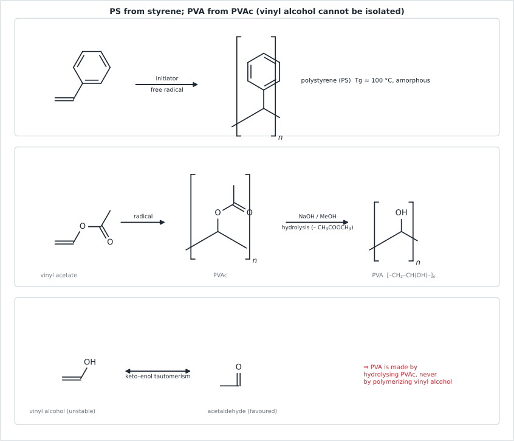

*Figure 1.6: Styrene → PS; vinyl acetate → PVAc → PVA.*

| Natural polymers | Repeat unit | Synthetic polymers | Repeat unit |
|---|---|---|---|
| Cellulose | β-glucose residue, [C₆H₁₀O₅]ₙ | PE | –CH₂–CH₂– |
| Protein (wool, silk) | –NH–CHR–CO– | Nylon 6 | –NH(CH₂)₅CO– |
| Natural rubber | cis-1,4-isoprene unit | PVC | –CH₂–CHCl– |
| Starch | α-glucose residue | PET | see [8.8](#q8-8) |

The structures of the common vinyl polymers are drawn in [2.5](#q2-5).

---

## 1.7 Distinguish between an oligomer and a polymer

`🟡 MEDIUM` · 2/6 exams · 2024 · 2023

| Feature | Oligomer | Polymer |
|---|---|---|
| Number of units | few (≈ 2 to 20–30) | many (hundreds to thousands) |
| Molar mass | low (< ≈ 10³–10⁴ g/mol) | high |
| Effect of adding/removing one unit | changes properties **noticeably** | practically **no** change |
| Mechanical use | waxy, brittle, not useful as plastics/fibres | strong, tough, film/fibre forming |
| Examples | PE wax, low-DP polyethylene glycol, resin pre-polymers | HDPE, PET, nylon, cellulose |

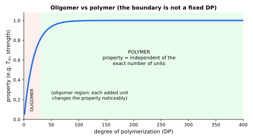

*Figure 1.7: Property vs DP. There is **no universal DP cut-off**; the boundary is where the property stops depending on chain length.*

---

## 1.8 Why is polymer science important in textile engineering?

`🟡 MEDIUM` · 2/6 exams · 2024 · 2020

Almost every textile fibre, yarn, dye-binder, finish and coating is a **polymer**. Polymer science links molecular structure to processing and performance.

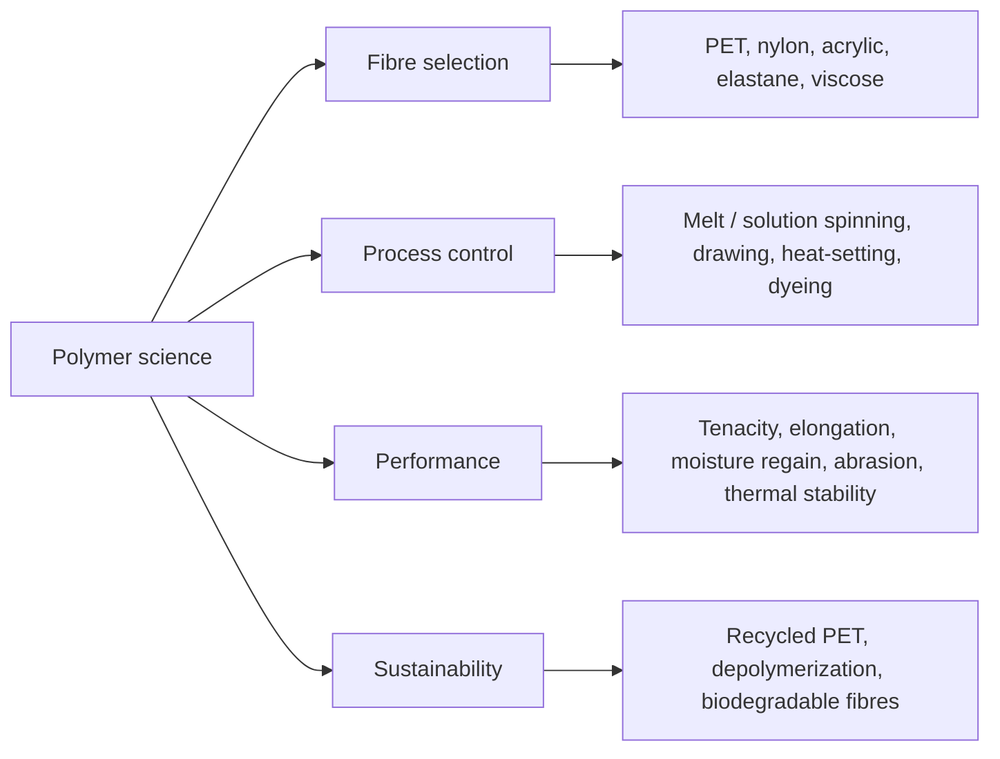

* **Molecular weight** → spinnability and strength. **Tg** → dyeing temperature, heat-setting, texturing. **Crystallinity / orientation** → tenacity, dye uptake.
* **Degradation knowledge** → stabilisers, correct storage, UV durability of outdoor textiles.

---

## 1.9 Differentiate among elastomers, plastics and biopolymers

`⚪ ONCE` · 1/6 exams · 2023

| Class | Defining basis | Chains / structure | Examples |
|---|---|---|---|
| **Elastomer** | large *reversible* deformation (> 200 %) | flexible, lightly cross-linked, Tg far below room temperature | natural rubber, silicone rubber, spandex (elastane) |
| **Plastic** | can be *shaped* under heat/pressure | thermoplastic or thermoset | PE, PP, PVC, epoxy |
| **Biopolymer** | *biological origin* | any | cellulose, starch, PHA, PLA |

> [!NOTE]
> The classes overlap: **natural rubber is both a biopolymer and an elastomer**; PLA is a bio-based plastic.

---

## 1.10 Discuss monomer functionality with examples

`⚪ ONCE` · 1/6 exams · 2022

**Functionality (f)** is the number of reactive groups (bonding sites) on a monomer that can take part in polymer formation.

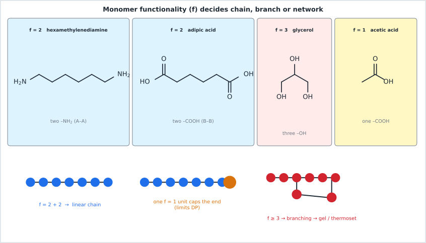

*Figure 1.10: f = 2 gives linear chains, f = 1 stops growth, f ≥ 3 gives branching and networks.*

| f | Effect | Examples |
|---|---|---|
| 1 | chain stopper (limits DP) | acetic acid, monofunctional alcohol |
| 2 | linear polymer | HMDA, adipic acid, ethylene glycol, terephthalic acid; vinyl monomers (C=C counts as f = 2) |
| ≥ 3 | branching → cross-linking → thermoset | glycerol, melamine (f = 6), formaldehyde with phenol |

> [!TIP]
> **Extra:** the average functionality of a mixture sets the gel point; above a critical conversion the whole mass turns into one insoluble network (Bakelite, epoxy cure).

---

## 1.11 Classify copolymers with examples

`⚪ ONCE` · 1/6 exams · 2019

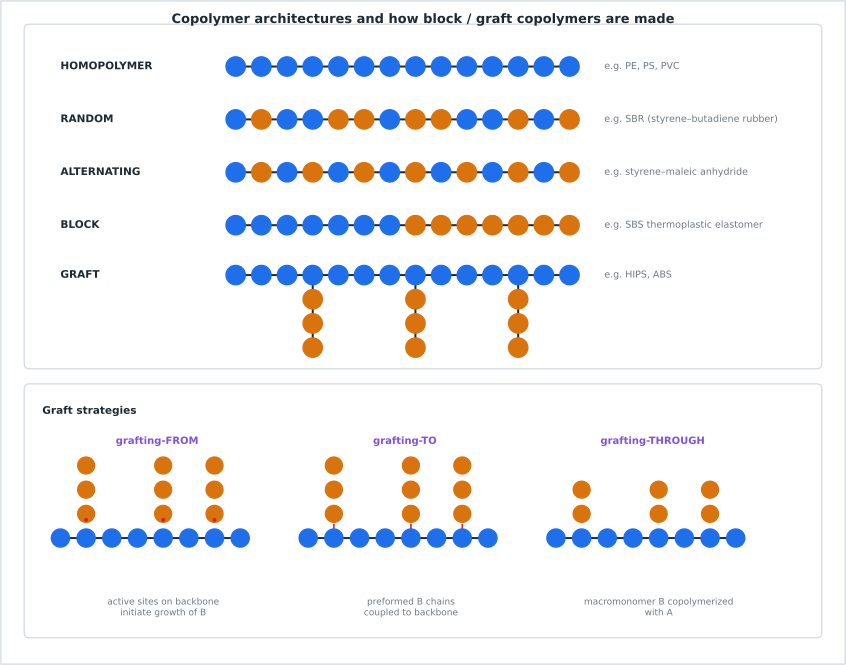

*Figure 1.11: Blue = monomer A, orange = monomer B.*

| Type | Arrangement | Example |
|---|---|---|
| Random (statistical) | irregular A and B | SBR (styrene–butadiene rubber) |
| Alternating | –ABABAB– | styrene–maleic anhydride |
| Block | long runs –AAAA–BBBB– | SBS thermoplastic elastomer |
| Graft | B side chains on an A backbone | HIPS, ABS (grafted onto polybutadiene) |

---

## 1.12 Techniques for preparing block and graft copolymers

`⚪ ONCE` · 1/6 exams · 2021

**Block copolymers**

1. **Sequential addition** of monomers to a *living* chain end (anionic / controlled radical): A is polymerized fully, then B is added.
2. **Coupling** of separately made A and B blocks through end-group reaction.
3. **Chain extension** from a macro-initiator (a polymer A that carries an initiating end).

**Graft copolymers**: see the lower part of Figure 1.11.

| Strategy | Principle |
|---|---|
| Grafting-**from** | active sites (radicals, ions) created on backbone A; monomer B grows from them |
| Grafting-**to** | pre-made B chains with reactive ends are coupled to backbone A |
| Grafting-**through** | a macromonomer B is copolymerized with monomer A |

Methods to create sites on the backbone: chemical (redox, peroxide), radiation (γ, electron beam), UV photo-grafting, plasma.

> [!TIP]
> **Textile link:** radiation / plasma grafting of acrylic acid onto polyester makes it hydrophilic and dyeable.

---

# Chapter 2: Chain (Addition) Polymerization

## 2.1 Inhibitor and retarder: definitions and functions in polymerization

`🟠 HIGH` · 4/6 exams · 2024 · 2023 · 2020 · 2019

* An **inhibitor** reacts rapidly with initiating / propagating radicals and forms stable, unreactive species. Polymerization is **completely suppressed** until the inhibitor is used up (**induction period**). Examples: hydroquinone, p-benzoquinone, BHT, dissolved oxygen.
* A **retarder** is less efficient: it **slows** the reaction (lower rate) but does not stop it and gives no clear induction period. Examples: nitrobenzene, some phenols at low concentration.

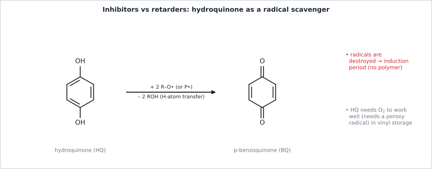

*Figure 2.1a: Hydroquinone scavenges radicals (H-atom transfer); the resulting semiquinone/quinone species cannot restart a chain.*

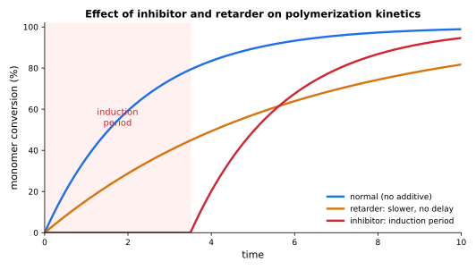

*Figure 2.1b: Conversion vs time. Inhibitor → delay; retarder → slower slope.*

| Feature | Inhibitor | Retarder |
|---|---|---|
| Effect | stops polymerization (temporarily) | slows polymerization |
| Kinetic sign | induction period | lower slope, no delay |
| Consumed? | yes, completely | partly |
| Use | storage and transport of monomers (stops premature polymerization) | rate / heat control |

> [!TIP]
> **Extra (practice):** commercial styrene and MMA contain ≈ 10–50 ppm of inhibitor (e.g. 4-tert-butylcatechol, MEHQ). It is removed by washing with NaOH or by distillation immediately before polymerization (see [5.3](#q5-3)).

---

## 2.2 Free-radical polymerization: mechanism and example

`🟡 MEDIUM` · 2/6 exams · 2020 · 2019

Free-radical chain polymerization of vinyl monomers has **three steps**: initiation, propagation, termination (plus optional chain transfer). Example: **styrene**.

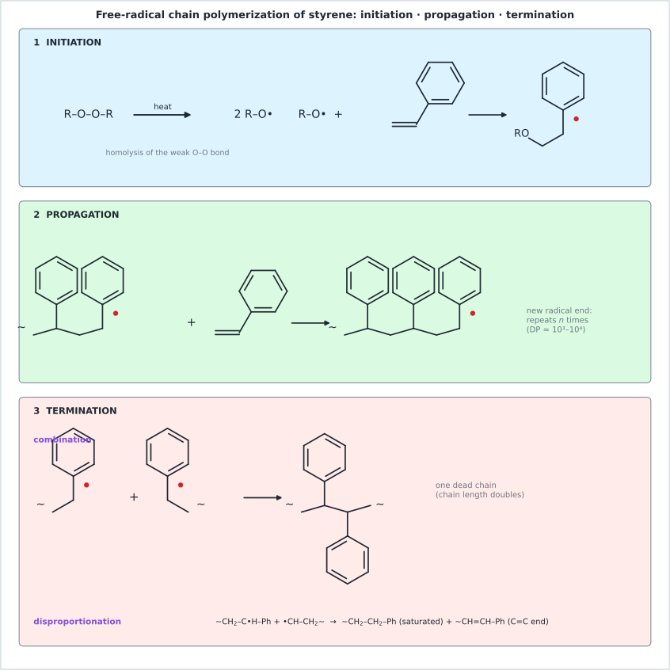

*Figure 2.2: Initiation, propagation and the two termination modes.*

1. **Initiation.** The initiator splits homolytically: $\mathrm{R{-}O{-}O{-}R \xrightarrow{\Delta} 2\,RO^{\bullet}}$. The radical adds to the CH₂ end of the C=C bond, giving the more stable benzyl-type radical.
2. **Propagation.** $\mathrm{P^{\bullet} + CH_2{=}CHPh \rightarrow P{-}CH_2{-}C^{\bullet}HPh}$ repeated thousands of times. Each addition takes only ≈ 10⁻³ s; a whole chain forms in about a second.
3. **Termination.** Two radical chains **combine** (one chain, double length) or **disproportionate** (H transfer; one saturated, one unsaturated chain).

| Termination mode | Result | Typical for |
|---|---|---|
| Combination | one dead chain, $\overline{DP}$ doubles | polystyrene |
| Disproportionation | two dead chains (one C=C end) | PMMA at higher temperature |

**Kinetics (extra):** rate of polymerization $R_p = k_p\,[M]\,\sqrt{\dfrac{f\,k_d\,[I]}{k_t}}$, so $R_p \propto [I]^{1/2}$ and the kinetic chain length $\nu \propto [I]^{-1/2}$. Doubling the initiator increases the rate by only 1.41× but lowers $\overline{M}_n$.

---

## 2.3 Initiators used in free-radical polymerization: meaning and structures

`🟡 MEDIUM` · 2/6 exams · 2022 · 2020

An **initiator** is a compound that produces free radicals under heat, light or redox conditions and so starts chain polymerization.

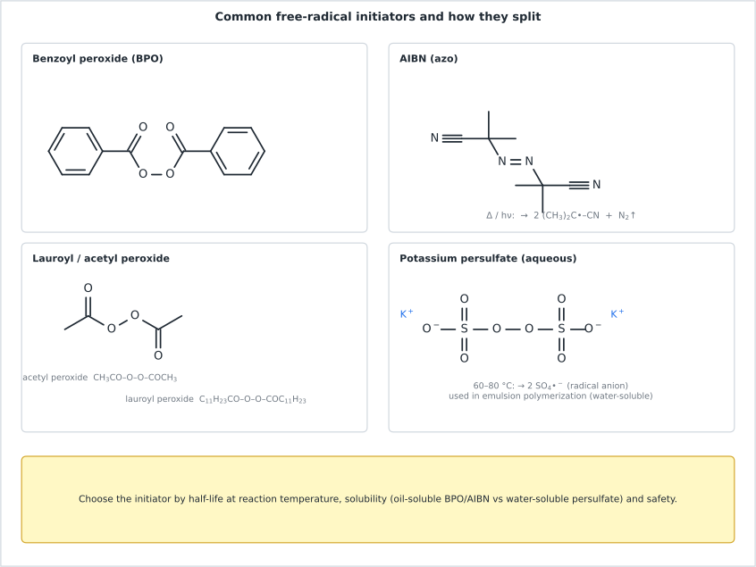

*Figure 2.3: BPO, AIBN, acetyl peroxide, lauroyl peroxide and potassium persulfate.*

| Initiator | Type | Radicals formed | Typical use |
|---|---|---|---|
| Benzoyl peroxide (BPO) | peroxide | C₆H₅COO• → C₆H₅• + CO₂ | bulk / solution, PS, PMMA |
| AIBN | azo | (CH₃)₂C•–CN + N₂↑ | clean, no oxygenated residue |
| Lauroyl peroxide | peroxide | C₁₁H₂₃COO• | oil-soluble, PVC suspension |
| Potassium persulfate | inorganic | SO₄•⁻ | emulsion polymerization (water phase) |
| Fe²⁺ / H₂O₂ | redox | HO• | low-temperature emulsion |

> [!TIP]
> **Selection criteria:** decomposition temperature (half-life ≈ 10 h at the reaction temperature), solubility in the medium, safety (peroxides can explode), no colour / residue.

---

## 2.4 What is a Ziegler–Natta catalyst?

`🟡 MEDIUM` · 2/6 exams · 2023 · 2020

A **Ziegler–Natta (ZN) catalyst** is a *coordination catalyst system*: a transition-metal halide of Groups IV–VIII (e.g. TiCl₄, TiCl₃) activated by an organometallic co-catalyst of Groups I–III (e.g. Al(C₂H₅)₃, Al(C₂H₅)₂Cl).

$$\mathrm{TiCl_4 + Al(C_2H_5)_3 \longrightarrow \text{active Ti–C}_2\mathrm{H_5\ sites\ (with\ a\ vacant\ site)}}$$

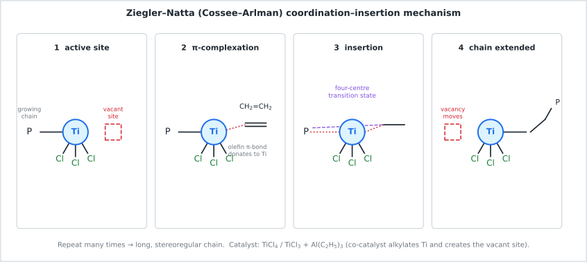

*Figure 2.4: Cossee–Arlman mechanism. Alkene binds at the vacant site, then inserts into the Ti–C bond; the vacancy moves and the cycle repeats.*

**Importance**

* Gives **linear HDPE** at low pressure (1–50 atm, 60–100 °C) instead of high-pressure radical LDPE (> 1000 atm).
* Gives **stereoregular (isotactic) polypropylene** (see [2.7](#q2-7)); radical polymerization of propene gives only low-MW atactic material.
* Used for PE, PP, polybutadiene and ethylene–propylene rubbers.

---

## 2.5 Monomers used in chain polymerization with chemical structures

`⚪ ONCE` · 1/6 exams · 2021

Chain-growth monomers contain a C=C double bond (or a strained ring). The π bond is opened and each unit adds to the active chain end.

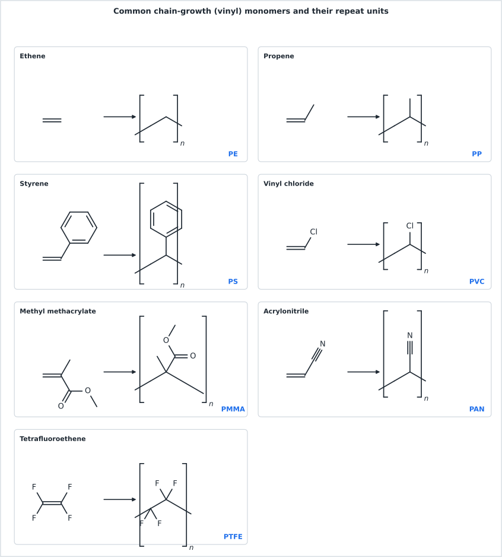

*Figure 2.5: Monomer → polymer repeat unit for the seven standard vinyl monomers.*

| Monomer | Polymer | Main use |
|---|---|---|
| Ethene | PE | films, bags, pipes |
| Propene | PP | fibres, ropes, carpets, nonwovens |
| Styrene | PS | packaging, foam |
| Vinyl chloride | PVC | pipes, coated fabrics, artificial leather |
| Methyl methacrylate | PMMA | acrylic glass, optical fibre cladding |
| Acrylonitrile | PAN | acrylic fibre, carbon-fibre precursor |
| Tetrafluoroethene | PTFE | Teflon™, non-stick fabric finishes, membranes |

---

## 2.6 What are CTA and CTR (chain-transfer agent and chain-transfer reaction)?

`⚪ ONCE` · 1/6 exams · 2019

* **Chain-transfer reaction (CTR):** the active centre of a growing chain is passed to another molecule (monomer, solvent, polymer or a deliberately added agent). The old chain stops growing; the new radical can start another chain.
* **Chain-transfer agent (CTA):** a compound added on purpose to **control (lower) molar mass**. Examples: thiols (dodecyl mercaptan, R–SH), CCl₄, CBr₄.

$$\mathrm{P_n^{\bullet} + X{-}H \longrightarrow P_n{-}H + X^{\bullet}}\qquad \mathrm{X^{\bullet} + M \longrightarrow X{-}M^{\bullet}\ (new\ chain)}$$

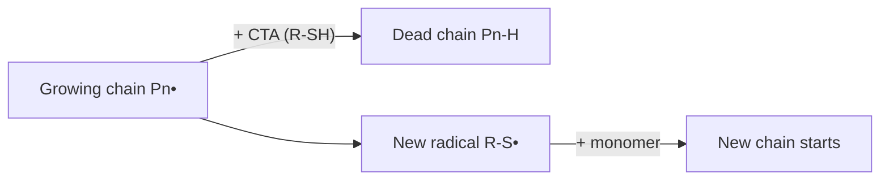

* More CTA → shorter chains, **lower $\overline{M}_n$**, rate almost unchanged.
* Mayo equation (extra): $\dfrac{1}{\overline{DP}_n} = \dfrac{1}{(\overline{DP}_n)_0} + C_S\,\dfrac{[S]}{[M]}$, where $C_S$ is the chain-transfer constant.

---

## 2.7 What is tacticity?

`⚪ ONCE` · 1/6 exams · 2024

**Tacticity** is the stereochemical arrangement of the pendant groups along the backbone of a vinyl polymer (e.g. –CH₃ in polypropylene).

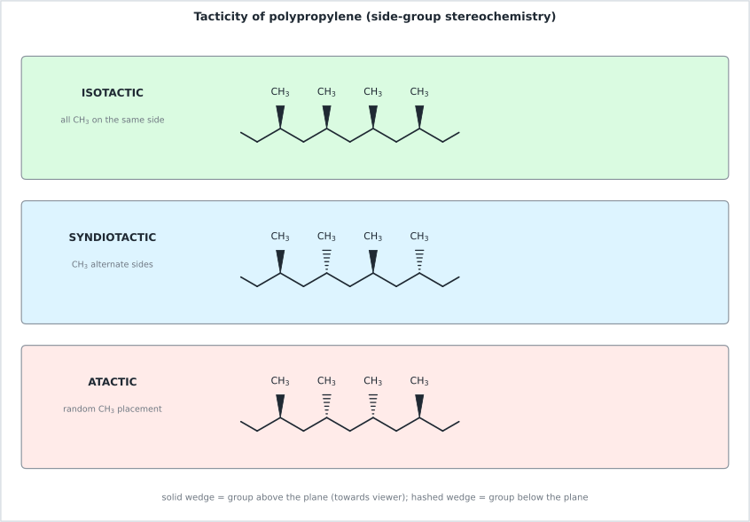

*Figure 2.7: Zig-zag backbone; solid wedge = group above the plane, hashed wedge = group below the plane.*

| Type | Arrangement | Crystallinity | Typical property of PP |
|---|---|---|---|
| Isotactic | all CH₃ same side | high | Tm ≈ 165 °C, fibre / moulding grade |
| Syndiotactic | CH₃ alternate sides | moderate | Tm ≈ 130 °C |
| Atactic | random | **none** (amorphous) | soft, sticky, by-product |

Ziegler–Natta (and metallocene) catalysts control tacticity; free-radical polymerization gives atactic chains.

---

# Chapter 3: Step (Condensation) Polymerization

## 3.1 Types of polycondensation: AA–BB and A–B, with examples

`🟠 HIGH` · 4/6 exams · 2024 · 2022 · 2021 · 2019

| Type | Monomers | Example |
|---|---|---|
| **AA–BB** | two different bifunctional monomers (A–A + B–B) | diamine + diacid → nylon 6,6; diol + diacid → PET |
| **A–B** | one monomer carrying both A and B groups | 6-aminocaproic acid → nylon 6; hydroxy-acid → polyester (PLA from lactic acid) |

$$\mathrm{H_2N{-}R{-}NH_2 + HOOC{-}R'{-}COOH \longrightarrow [\,{-}NH{-}R{-}NH{-}CO{-}R'{-}CO{-}\,]_n + (2n-1)\,H_2O}$$

$$\mathrm{H_2N{-}(CH_2)_5{-}COOH \longrightarrow [\,{-}NH{-}(CH_2)_5{-}CO{-}\,]_n + (n-1)\,H_2O}$$

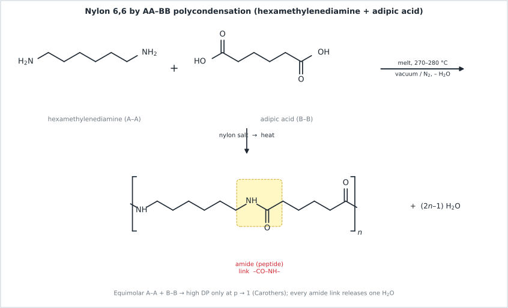

*Figure 3.1: AA–BB example (HMDA + adipic acid). The amide link is highlighted.*

> [!IMPORTANT]
> AA–BB needs **exact 1:1 stoichiometry**; A–B monomers are automatically balanced. High DP needs p → 1 (see [3.7](#q3-7)).

---

## 3.2 Step polymerization: definition, conditions, salient features, limitations

`🟠 HIGH` · 3/6 exams · 2021 · 2020 · 2019

**Definition.** Polymer forms by stepwise reaction between functional groups of monomers, dimers, trimers … any two species can react. High molar mass is obtained only at very high conversion.

**Conditions**

* Monomers of f ≥ 2 (f = 2 for linear polymers); **stoichiometric balance** of A and B groups.
* High purity (no monofunctional impurities); high conversion (> 99 %).
* Adequate temperature and catalyst; **removal of the by-product** (H₂O, CH₃OH, HCl) by vacuum or N₂ sweep to drive the equilibrium.

**Salient features**

* Monomer disappears early (becomes dimers, oligomers); polymer chains of all sizes coexist.
* $\overline{DP}_n$ rises slowly then sharply near the end ([Figure 3.7](#q3-7)).
* No initiator needed (catalyst only); reaction rate is the same for each functional group, independent of chain length.

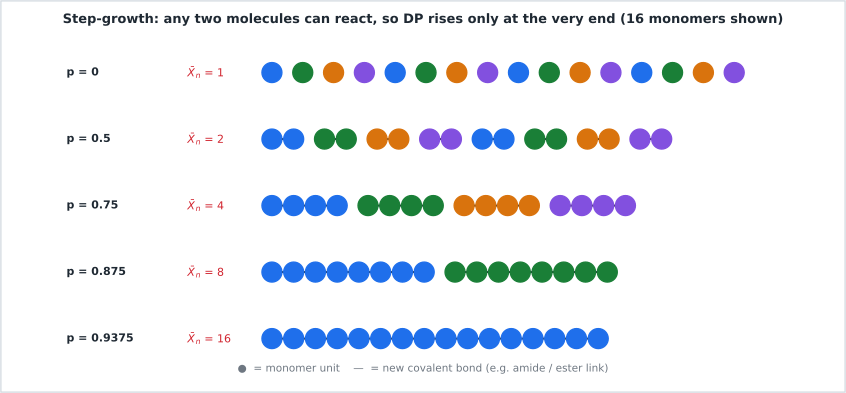

*Figure 3.2: Sixteen monomers: only at p = 0.9375 do they become one chain of DP 16.*

**Limitations**

* Long reaction times, high temperature; viscous melt makes by-product removal hard.
* Very sensitive to impurities and stoichiometric imbalance (limits DP).
* Side reactions (cyclisation, degradation) at high temperature.

---

## 3.3 Differentiate between chain-growth and step-growth polymerization

`🟠 HIGH` · 3/6 exams · 2022 · 2021 · 2019

| Feature | Chain growth | Step growth |
|---|---|---|
| Growing species | active chain end (radical, ion, coordination site) | any two functional groups |
| Monomer | C=C vinyl, rings | bifunctional (A–A, B–B, A–B) |
| Initiator | required | not required (catalyst optional) |
| Molar mass | high from the start; little change with time | rises slowly; high only at p > 0.99 |
| Monomer in mixture | present until the end | disappears early |
| By-product | none (vinyl) | often (H₂O, HCl); none in polyaddition |
| Termination | yes (combination / disproportionation) | none |
| Chain length control | initiator, CTA, temperature | conversion, stoichiometry |
| Examples | PE, PS, PVC, PAN | PET, nylon 6,6, polyurethane |

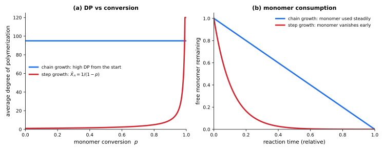

*Figure 3.3: (a) DP vs conversion; (b) monomer consumption.*

---

## 3.4 Ring-opening polymerization (ROP): short note and example

`🟠 HIGH` · 3/6 exams · 2022 · 2021 · 2019

**ROP** converts cyclic monomers into linear polymers by opening the ring. It is driven by **ring strain** (relief of angle / torsional strain) and can be ionic, coordination-insertion or hydrolytic. No small molecule is lost, so the repeat unit has the same composition as the monomer.

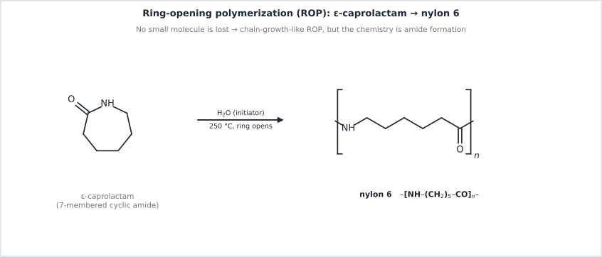

*Figure 3.4: ε-Caprolactam → nylon 6 (hydrolytic ROP: a little water opens the first rings to give amino-acid chain ends; polymerization then proceeds at 250–270 °C).*

| Cyclic monomer | Polymer | Use |
|---|---|---|
| ε-Caprolactam | nylon 6 | tyre cord, carpets, hosiery |
| Lactide | PLA | bio-based fibre, packaging |
| Ethylene oxide | poly(ethylene oxide) | PEG, sizing |
| ε-Caprolactone | polycaprolactone | biomedical |

---

## 3.5 Describe the mechanism of step polymerization

`🟡 MEDIUM` · 2/6 exams · 2023 · 2022

Illustrated with **polyesterification** of a diacid and a diol (acid-catalysed):

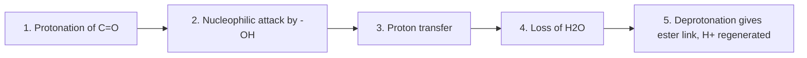

$$\mathrm{HOOC{-}R{-}COOH + HO{-}R'{-}OH \rightleftharpoons HOOC{-}R{-}COO{-}R'{-}OH + H_2O}$$

* The **same** reaction occurs between monomer + monomer, monomer + oligomer, oligomer + oligomer: so chain length grows in **steps**.
* Because it is an equilibrium, **water is continuously removed** (Le Chatelier).

| Stage | Species present |
|---|---|
| Early (p ≈ 0.5) | mostly dimers, trimers |
| p = 0.9 | $\overline{DP}_n$ = 10 |
| p = 0.99 | $\overline{DP}_n$ = 100 (usable polymer) |

---

## 3.6 Polycondensation vs polyaddition in step polymerization

`🟡 MEDIUM` · 2/6 exams · 2021 · 2019

| Feature | Polycondensation | Polyaddition |
|---|---|---|
| By-product | small molecule (H₂O, HCl, CH₃OH) | **none** |
| Repeat unit vs monomers | differs (atoms lost) | same total atoms |
| Examples | PET, nylon 6,6, phenol-formaldehyde | polyurethane, epoxy cure |
| Typical reaction | acid + alcohol/amine | isocyanate + alcohol |

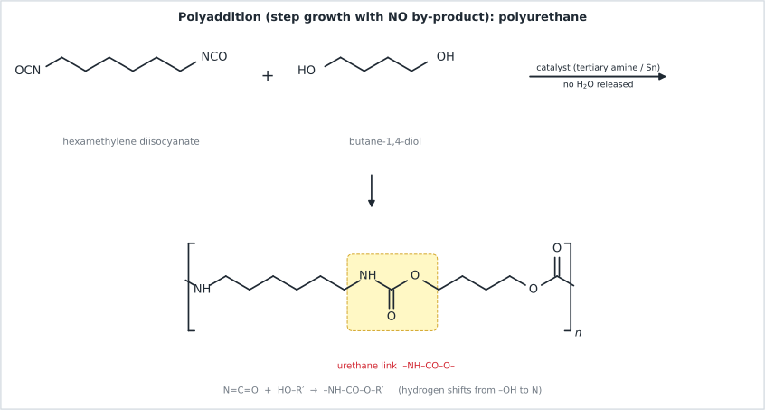

*Figure 3.6: Diisocyanate + diol → polyurethane. A hydrogen moves from OH to N; nothing is eliminated.*

> [!WARNING]
> "Condensation" is **not** a synonym for all step-growth; polyaddition is step growth without condensation.

---

## 3.7 Describe the connection between DP and extent of reaction (Carothers equation)

`⚪ ONCE` · 1/6 exams · 2024

Let $p$ = fraction of functional groups that have reacted. For $N_0$ initial molecules, after reaction $N = N_0(1-p)$ molecules remain. Hence

$$\overline{X}_n=\frac{N_0}{N}=\frac{1}{1-p}\qquad(\text{balanced A–A + B–B, equal reactivity, no side reactions})$$

| p | 0.50 | 0.90 | 0.95 | 0.99 | 0.999 |
|---|---|---|---|---|---|
| $\overline{X}_n$ | 2 | 10 | 20 | 100 | 1000 |

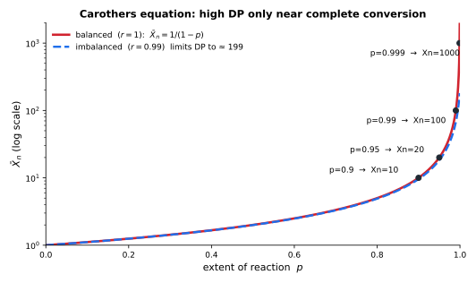

*Figure 3.7: A tiny increase in p near 1 gives a huge DP. Imbalance (r < 1) caps the DP.*

**Stoichiometric imbalance:** with ratio $r = N_A/N_B \le 1$

$$\overline{X}_n=\frac{1+r}{1+r-2rp}\quad\Rightarrow\quad \overline{X}_n(p{=}1)=\frac{1+r}{1-r}$$

For $r=0.99$ the maximum DP is $1.99/0.01 = 199$, so even perfect conversion cannot give a very long chain unless the stoichiometry is exact.

---

# Chapter 4: Molecular Weight of Polymers

## 4.1 Define monodispersity, polydispersity and index of polydispersity (PDI)

`🔴 MUST-DO` · 5/6 exams · 2024 · 2023 · 2021 · 2020 · 2019

* **Monodisperse:** all chains have the same molar mass (e.g. proteins, some living-polymer standards). $\overline{M}_w=\overline{M}_n$.
* **Polydisperse:** chains differ in molar mass; synthetic polymers are always polydisperse. $\overline{M}_w>\overline{M}_n$.
* **Polydispersity index (PDI) / dispersity (Đ):**

$$\mathrm{PDI}=\mathit{Đ}=\frac{\overline{M}_w}{\overline{M}_n}\;\ge 1$$

PDI is dimensionless; PDI = 1 only for a perfectly uniform sample. IUPAC now prefers the term *dispersity*, symbol Đ.

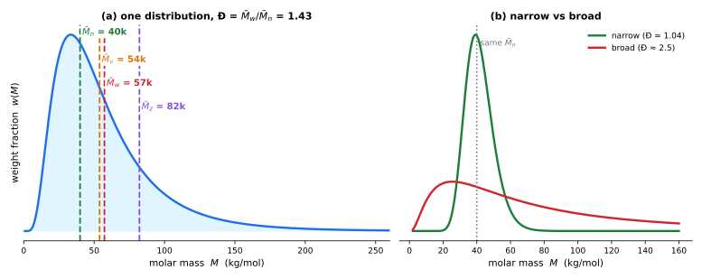

*Figure 4.1: (a) the averages always follow Mn < Mv < Mw < Mz; (b) narrow and broad distributions with the same Mn.*

| Polymer / route | Typical PDI |
|---|---|
| Living anionic polymer | 1.01–1.1 |
| Free radical (termination by combination) | ≈ 1.5 |
| Free radical (disproportionation) | ≈ 2 |
| Step growth at high conversion (Flory: Đ = 1 + p) | ≈ 2 |
| Ziegler–Natta polyolefins | 4–10 |
| Branched LDPE | 20 and above |

> [!TIP]
> **Why it matters in textiles:** a narrow distribution gives uniform melt viscosity, so steady spinning and fewer filament breaks. A long high-mass tail raises $\overline{M}_w$ and the melt viscosity; low-mass chains lower strength and increase fuming.

---

## 4.2 Methods for determining molecular weight, including end-group analysis

`🟠 HIGH` · 4/6 exams · 2024 · 2022 · 2021 · 2020

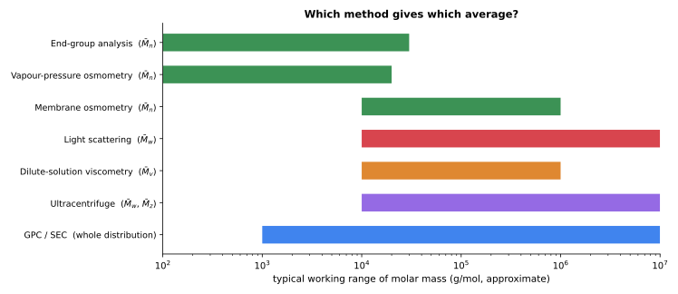

*Figure 4.2: Each method measures a different average. Working ranges are approximate.*

| Method | Principle | Average |
|---|---|---|
| **End-group analysis** | titrate / measure a known terminal group (–COOH, –OH, –NH₂) | $\overline{M}_n$ |
| Membrane osmometry | osmotic pressure: $\pi/c = RT/\overline{M}_n$ (at c → 0) | $\overline{M}_n$ |
| Vapour-pressure osmometry, cryoscopy, ebulliometry | colligative properties (only low MW) | $\overline{M}_n$ |
| Light scattering | $Kc/R_\theta = 1/\overline{M}_w + 2A_2c$ | $\overline{M}_w$ |
| Ultracentrifugation | sedimentation velocity / equilibrium | $\overline{M}_w$, $\overline{M}_z$ |
| Dilute-solution viscometry | Mark–Houwink: $[\eta]=K\,\overline{M}_v^{\,a}$ | $\overline{M}_v$ |
| GPC / SEC | separation by hydrodynamic size | whole distribution (all averages) |

**End-group analysis (principle).** Each chain has a known number of titratable end groups (functionality $f$). Then

$$\overline{M}_n=\frac{\text{mass of sample}}{\text{moles of chains}}=\frac{f\times\text{mass}}{\text{moles of end groups}}$$

It works only for **low-to-medium MW (< ≈ 25 000)**, linear chains, known end-group count, no branching and no cyclisation. Worked numerical: [9.4](#q9-4).

---

## 4.3 Number-average (Mn) vs weight-average (Mw) molecular weight

`🟠 HIGH` · 3/6 exams · 2023 · 2020 · 2019

| Feature | $\overline{M}_n$ | $\overline{M}_w$ |
|---|---|---|
| Weighting | each **molecule** counts equally | each molecule counts by its **mass** |
| Formula | $\dfrac{\sum N_iM_i}{\sum N_i}$ | $\dfrac{\sum N_iM_i^2}{\sum N_iM_i}$ |
| Sensitive to | number of small chains | few very large chains |
| Method | osmometry, end-group | light scattering |
| Relation | $\overline{M}_n\le\overline{M}_w$; equal only if monodisperse | |

**Worked illustration.** Mix 1 mol of M = 10 000 and 1 mol of M = 30 000: $\overline{M}_n = 20\,000$. The mass fractions are 0.25 and 0.75, so $\overline{M}_w = 0.25(10\,000)+0.75(30\,000)=25\,000$ and PDI = 1.25.

---

## 4.4 Derive the expression for number-average molecular weight ($\overline{M}_n$)

`🟠 HIGH` · 3/6 exams · 2024 · 2023 · 2021

**Given:** a sample has $N_1$ molecules of mass $M_1$, $N_2$ of mass $M_2$, … $N_i$ of mass $M_i$.

1. Total number of molecules: $N=\sum N_i$
2. Total mass of the sample: $W=\sum N_iM_i$
3. $\overline{M}_n$ is, by definition, total mass divided by total number of molecules (an ordinary arithmetic mean over molecules):

$$\boxed{\overline{M}_n=\frac{\sum N_iM_i}{\sum N_i}=\sum x_iM_i}\qquad x_i=\frac{N_i}{\sum N_j}\ (\text{number fraction})$$

*(If $N_i$ is in moles the same formula gives g/mol.)*

---

## 4.5 Derive the expression for weight-average molecular weight ($\overline{M}_w$)

`🟠 HIGH` · 3/6 exams · 2023 · 2022 · 2020

1. Mass of class *i*: $W_i=N_iM_i$. Total mass: $W=\sum N_jM_j$.
2. Weight (mass) fraction: $w_i=\dfrac{W_i}{W}=\dfrac{N_iM_i}{\sum N_jM_j}$.
3. $\overline{M}_w$ is the **mass-fraction-weighted** mean:

$$\overline{M}_w=\sum w_iM_i=\frac{\sum N_iM_i\cdot M_i}{\sum N_jM_j}$$

$$\boxed{\overline{M}_w=\frac{\sum N_iM_i^{2}}{\sum N_iM_i}}$$

**Extra: why $\overline{M}_w\ge\overline{M}_n$.** $\overline{M}_w/\overline{M}_n=\dfrac{\sum N_iM_i^2\,\sum N_i}{(\sum N_iM_i)^2}\ge 1$ by the Cauchy–Schwarz inequality; equality only if all $M_i$ are equal. Next higher average: $\overline{M}_z=\dfrac{\sum N_iM_i^3}{\sum N_iM_i^2}$.

---

## 4.6 Relationship between molecular weight and degree of polymerization

`🟠 HIGH` · 3/6 exams · 2024 · 2021 · 2020

$$\overline{M}_n = \overline{DP}_n\times M_0\quad\Longleftrightarrow\quad \overline{DP}_n=\frac{\overline{M}_n}{M_0}\qquad \overline{DP}_w=\frac{\overline{M}_w}{M_0}$$

$M_0$ = molar mass of the repeat unit (for a homopolymer, end groups neglected). For a **copolymer** use the composition-weighted mean $\overline{M}_0=\sum f_jM_{0,j}$.

| Example | $M_0$ | $\overline{M}_n$ | $\overline{DP}_n$ |
|---|---|---|---|
| Polyethylene | 28 | 28 000 | 1000 |
| PET | 192 | 19 200 | 100 |
| Nylon 6,6 | 226 | 22 600 | 100 |

Note: for nylon 6,6 the repeat unit contains **two** monomer residues, so the number of monomer molecules used is $2\,\overline{DP}_n$. Hence one must state clearly whether DP counts repeat units or monomer units.

---

## 4.7 Significance of molecular weight for polymer properties; why must it be controlled?

`🟠 HIGH` · 3/6 exams · 2021 · 2020 · 2019

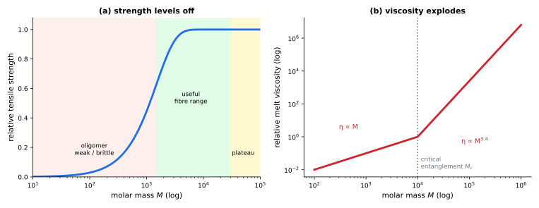

*Figure 4.7: Strength levels off above a certain M; melt viscosity rises as M^3.4 above the critical entanglement mass.*

| Property | Effect of increasing M |
|---|---|
| Tensile strength, toughness, tenacity | increase, then reach a plateau (entanglement) |
| Tg | rises up to a limiting value (Flory–Fox) |
| Melt / solution viscosity | rises sharply (∝ M^3.4) → harder spinning |
| Solubility | falls |
| Fatigue / abrasion resistance | improves |

**Why control it?**

* Too **low** M → weak, brittle fibre, poor drawing.
* Too **high** M → melt too viscous, high spinning temperature, degradation, die swell.
* Uniform M (low PDI) → consistent spinning, fibre quality and dyeing.

**How:** monomer / initiator ratio, chain-transfer agents, temperature, reaction time / conversion, catalyst, stoichiometric balance and end-capping (step growth).

---

## 4.8 Draw a molecular-weight distribution and mark Mn, Mw and other averages

`⚪ ONCE` · 1/6 exams · 2020

Use **Figure 4.1 (a)**: plot weight fraction $w(M)$ against $M$ and mark

$$\overline{M}_n<\overline{M}_v<\overline{M}_w<\overline{M}_z$$

For the sample drawn: $\overline{M}_n=40$, $\overline{M}_w\approx 57$, $\overline{M}_z\approx 82$ kg/mol, giving PDI ≈ 1.43. The peak (mode) lies to the left of $\overline{M}_w$ because the curve has a high-mass tail.

> [!TIP]
> In the exam draw a skewed bell curve, label axes ("molar mass M", "weight fraction"), and put **Mn leftmost, then Mv, Mw, Mz**.

---

# Chapter 5: Polymerization Techniques

## 5.1 Compare bulk and emulsion polymerization, including merits and demerits

`🟠 HIGH` · 4/6 exams · 2024 · 2022 · 2021 · 2020

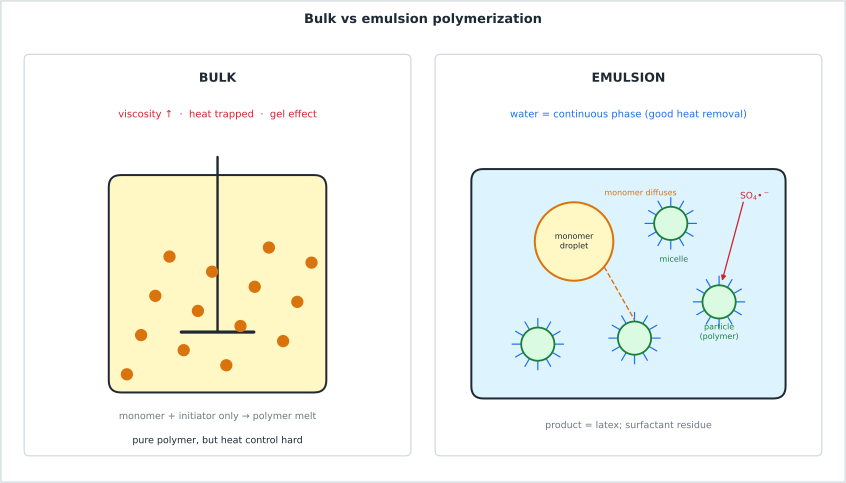

*Figure 5.1: Bulk (monomer + initiator only) vs emulsion (monomer droplets, micelles, water).*

**Emulsion polymerization (mechanism).** Monomer is dispersed in water by surfactant (micelles + large monomer droplets). A *water-soluble* initiator (persulfate) makes radicals in the water; they enter monomer-swollen **micelles**, where polymerization takes place. Droplets only act as monomer reservoirs; the product is a **latex**.

| Feature | Bulk | Emulsion |
|---|---|---|
| Medium | monomer + initiator | water + surfactant + monomer + water-soluble initiator |
| Heat removal | **difficult** (high viscosity, gel effect) | **easy** (water, low viscosity) |
| Rate and MW | MW and rate coupled | high rate **and** high MW simultaneously |
| Product | pure, transparent block | latex (needs coagulation / drying) |
| Contamination | very little | surfactant, initiator residue |
| Merits | simple, pure, cast shapes (PMMA sheet) | excellent control, fast, safe, latex used directly |
| Demerits | gel effect, local overheating, broad PDI | costly isolation, residues, wastewater |
| Uses | PMMA sheets, PS, LDPE | paints, adhesives, SBR, PVC paste, textile binders |

---

## 5.2 Explain solid-phase and gas-phase polymerization techniques

`🟠 HIGH` · 3/6 exams · 2022 · 2021 · 2020

**Solid-phase (solid-state) polymerization.** Reaction proceeds in the solid state, below the melting point, in crystalline monomer or in polymer chips. Diffusion is slow, so the temperature is high (just below Tm) and a vacuum or inert-gas sweep removes by-products.

* Radiation / thermal polymerization of crystalline monomers (acrylamide, trioxane).
* **SSP of PET and nylon chips:** chips at ≈ 200–230 °C under vacuum / N₂ raise the intrinsic viscosity (bottle and tyre-cord grade) by further condensation while EG / H₂O escape. Because it is below Tm there is no thermal degradation.

**Gas-phase polymerization.** Gaseous monomer (ethene, propene) contacts a solid supported catalyst (ZN or metallocene) in a **fluidised-bed** reactor; polymer grows as particles around the catalyst.

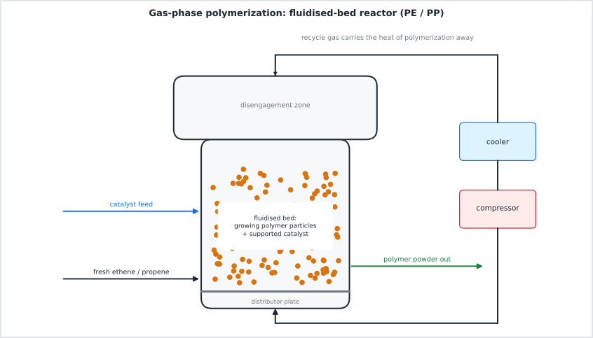

*Figure 5.2: Recycle gas fluidises the bed and removes the heat of polymerization.*

| Technique | Merits | Demerits |
|---|---|---|
| Solid phase | no solvent, no melt degradation, high MW | very slow, limited to crystalline / particulate materials |
| Gas phase | no solvent, low cost, direct powder, used for LLDPE, PP | catalyst must be very active, static / hot spots, particle agglomeration |

---

## 5.3 How can raw materials be purified before polymerization?

`🟡 MEDIUM` · 2/6 exams · 2024 · 2020

Impurities act as inhibitors, chain-transfer agents or catalyst poisons, and cause colour, branching or low MW.

| Material | Typical purification |
|---|---|
| Liquid monomer (styrene, MMA, VAc) | NaOH wash (removes hydroquinone), drying, vacuum distillation |
| Solid monomer (adipic acid, terephthalic acid) | recrystallisation, filtration |
| Gaseous monomer (ethene, propene) | pass through O₂ / H₂O traps, molecular sieves |
| Solvent | drying, distillation |
| Initiator (BPO, AIBN) | recrystallisation from methanol / ethanol |

> [!WARNING]
> Remove the storage inhibitor only **immediately before use** and store the purified monomer cold and dark.

---

## 5.4 Conditions considered when selecting a polymerization technique

`⚪ ONCE` · 1/6 exams · 2022

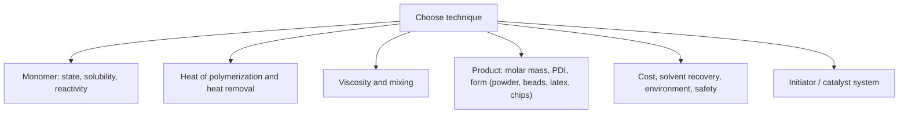

| Requirement | Technique that fits |
|---|---|
| Pure, optical-grade block | bulk |
| Solution product (dope, coating) | solution |
| Beads / powder, good heat control | suspension |
| Latex, very high MW, fast | emulsion |
| Polyolefin powder, no solvent | gas phase |

---

## 5.5 Describe solution polymerization with an example and uses

`⚪ ONCE` · 1/6 exams · 2024

Monomer and initiator are dissolved in a **solvent**; the solvent lowers viscosity and carries away the heat.

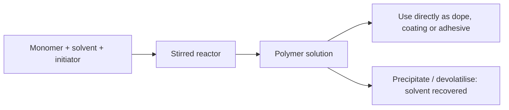

**Example:** acrylonitrile polymerized in DMF, DMAc or aqueous NaSCN gives a PAN spinning dope that goes straight to wet or dry spinning of acrylic fibre. Another: radical polymerization of MMA in toluene.

| Merits | Demerits |
|---|---|
| good heat transfer, low viscosity | solvent chain transfer lowers MW |
| solution is ready for spinning / coating | solvent recovery and cost; fire / toxicity |
| uniform temperature | lower rate (dilution); trace solvent in product |

**Solvent choice:** dissolves monomer **and** polymer, low chain-transfer constant, suitable boiling point, inert, cheap, recyclable.

---

# Chapter 6: Polymer Degradation and Stabilization

## 6.1 Antioxidants: how they protect polymers, reactions and examples

`🟡 MEDIUM` · 2/6 exams · 2022 · 2019

Polymers react with oxygen by a **radical chain (auto-oxidation)** that is accelerated by heat, light and metal ions. **Antioxidants** interrupt this chain.

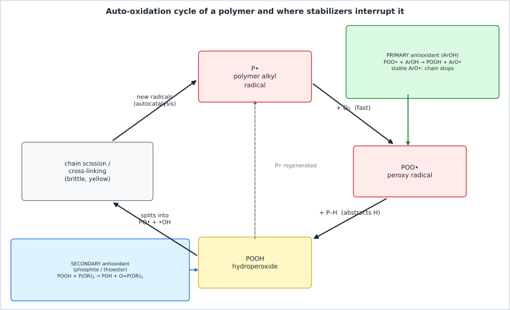

*Figure 6.1a: Primary antioxidants intercept POO•; secondary antioxidants destroy POOH.*

$$\mathrm{P{-}H \xrightarrow{\text{heat, light}} P^{\bullet}}\qquad \mathrm{P^{\bullet}+O_2\rightarrow POO^{\bullet}}\qquad \mathrm{POO^{\bullet}+P{-}H\rightarrow POOH+P^{\bullet}}$$

$$\text{Primary (chain-breaking):}\ \ \mathrm{POO^{\bullet}+ArOH\rightarrow POOH+ArO^{\bullet}}\ (\text{stable})$$

$$\text{Secondary (peroxide decomposer):}\ \ \mathrm{POOH+P(OR)_3\rightarrow POH+O{=}P(OR)_3}$$

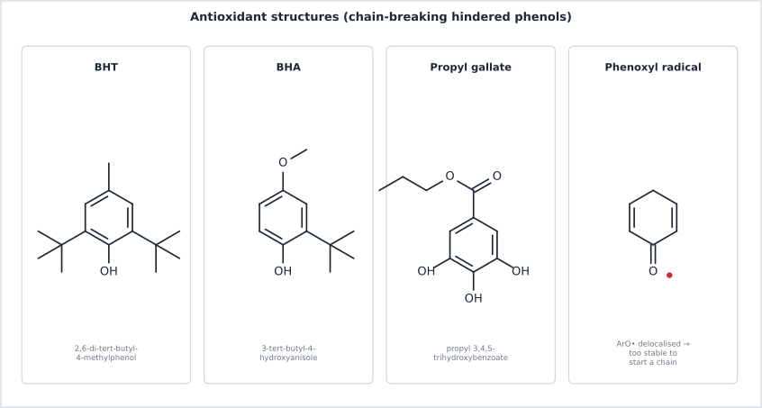

*Figure 6.1b: Hindered phenols (BHT, BHA, propyl gallate) donate their phenolic H; the aryloxy radical is stabilised by resonance and the bulky tert-butyl groups.*

| Class | Action | Examples |
|---|---|---|
| Primary (radical scavengers) | donate H to POO• | hindered phenols (BHT, Irganox 1010), aromatic amines |
| Secondary (hydroperoxide decomposers) | convert POOH to alcohol | phosphites (Irgafos 168), thioesters |
| Synergistic blend | both | phenol + phosphite in PP, PE, nylon |

---

## 6.2 Compare thermal and mechanical degradation

`🟡 MEDIUM` · 2/6 exams · 2024 · 2023

| Feature | Thermal degradation | Mechanical degradation |
|---|---|---|
| Cause | heat (processing, service) | shear, tension, grinding, fatigue, ultrasound |
| Mechanism | bond cleavage, unzipping, elimination, oxidation | stress-induced chain scission (mechano-radicals) |
| Where | melt, extruder, high-T service | screw / die, milling, repeated flexing |
| Typical result | molar-mass loss, discolouration, volatiles (e.g. HCl from PVC) | lower MW (long chains break first), cracks, fibrillation |
| Prevention | lower T and residence time, stabilisers, inert gas | reduce shear, proper screw design, lubricants |
| Example | PVC → HCl, polyene colour; PMMA → MMA | polymer chain breakage in high-shear extrusion, fibre abrasion |

---

## 6.3 Factors responsible for polymer degradation

`🟡 MEDIUM` · 2/6 exams · 2024 · 2022

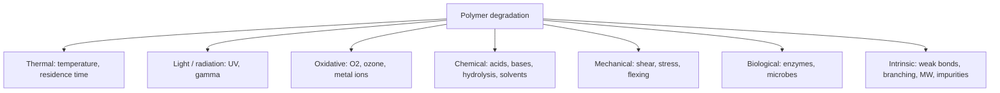

* **Weak links** in the chain (tertiary C–H in PP, C–Cl in PVC, ester and amide links for hydrolysis).
* **Impurities** (catalyst residues, peroxides) start degradation early.
* **Environment** in textiles: sunlight (UV), humidity, chlorine bleach, dye-bath pH and temperature, washing and abrasion.

---

## 6.4 Explain random and chain-end degradation with a schematic distinction

`🟡 MEDIUM` · 2/6 exams · 2022 · 2019

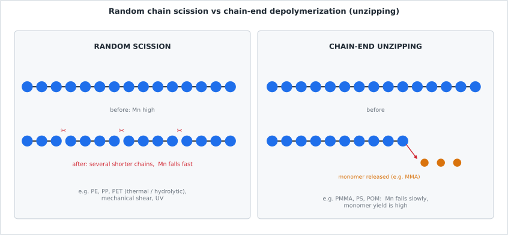

*Figure 6.4: Random scission cuts anywhere in the chain; unzipping removes units successively from the end.*

| Feature | Random chain scission | Chain-end (unzipping) |
|---|---|---|
| Where bond breaks | anywhere along backbone | at the chain end / weak end group |
| MW change | **falls rapidly** | falls slowly |
| Volatile product | little monomer | **mostly monomer** |
| Examples | PE, PP, PET, cellulose | PMMA (→ MMA), PS, polyoxymethylene |

---

## 6.5 Light (photo) stabilizers: short note, names and functions

`🟡 MEDIUM` · 2/6 exams · 2020 · 2019

UV light (290–400 nm) has enough energy to break C–C and C–H bonds and starts photo-oxidation (yellowing, cracking). **Light stabilisers** protect the polymer.

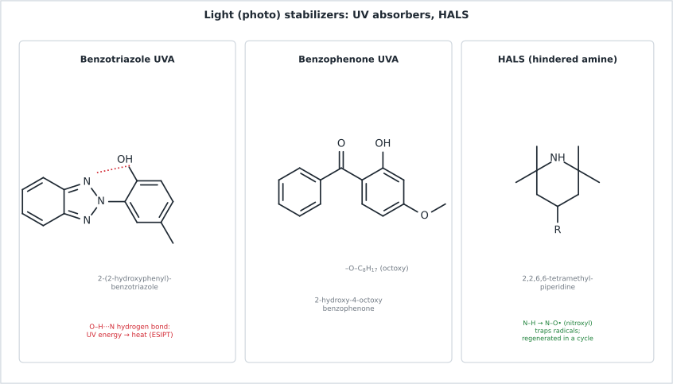

*Figure 6.5: Benzotriazole and benzophenone UV absorbers, and a HALS.*

| Type | Function | Example |
|---|---|---|
| **UV absorbers** | absorb UV and release it as harmless heat (ESIPT) | 2-hydroxybenzophenones, 2-(2-hydroxyphenyl)benzotriazoles |
| **HALS** (hindered amine light stabilisers) | scavenge radicals via a regenerative nitroxyl cycle | tetramethylpiperidine derivatives (Tinuvin 770) |
| **Quenchers** | deactivate excited states | nickel chelates |
| **Screens / pigments** | reflect or absorb light | carbon black, TiO₂, ZnO |

---

## 6.6 Define polymer degradation

`⚪ ONCE` · 1/6 exams · 2022

**Polymer degradation** is any undesirable chemical or physical change that deteriorates the properties of a polymer (strength, elongation, colour, appearance, molar mass) through chain scission, cross-linking, side-group elimination, oxidation or hydrolysis.

Examples: yellowing and embrittlement of PP ropes in sunlight; HCl loss from PVC on heating; hydrolysis of PET and nylon by hot acids; cotton tendering by acid / bleach.

---

# Chapter 7: Polymer Properties (Crystallinity, Tg, Forces)

## 7.1 Define glass-transition temperature (Tg) and explain its importance

`🔴 MUST-DO` · 5/6 exams · 2024 · 2023 · 2021 · 2020 · 2019

**Definition.** The glass-transition temperature **Tg** is the temperature (range) at which the **amorphous regions** of a polymer change on heating from a hard, glassy state to a soft, rubbery state because long-range segmental motion of chains (about 20–50 atoms) becomes possible. It is a *kinetic*, second-order-like transition, **not** a melting point.

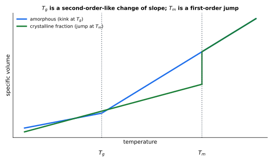

*Figure 7.1a: At Tg the slope of specific volume vs T changes; at Tm there is a first-order jump.*

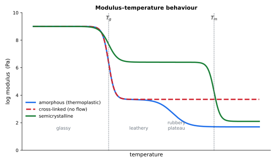

*Figure 7.1b: Modulus drops by about 3 orders of magnitude through Tg.*

**Importance**

* **Service temperature:** a plastic must be used below Tg (PS, PMMA), a rubber above Tg (natural rubber, Tg ≈ –70 °C).
* **Dyeing / texturing:** polyester is dyed above its Tg (≈ 75 °C; carriers or high temperature, 130 °C) because dye diffuses only when chains move.
* **Heat-setting and drawing** are done between Tg and Tm.
* **Processing and fibre handle**, dimensional stability, ironing temperature.

| Below Tg | Above Tg |
|---|---|
| glassy, hard, brittle | rubbery / leathery, flexible |
| low expansion | high expansion |
| high modulus (≈ 10⁹ Pa) | low modulus (≈ 10⁶ Pa) |

---

## 7.2 Define crystallinity and amorphousness in polymers

`🟠 HIGH` · 4/6 exams · 2024 · 2023 · 2021 · 2020

* **Crystallinity:** the fraction of a polymer in which chains (or segments) are packed in a regular, repeating 3-D order (lamellae, folded chains). No polymer is 100 % crystalline; they are **semicrystalline**.
* **Amorphousness:** random, coil-like arrangement without long-range order.

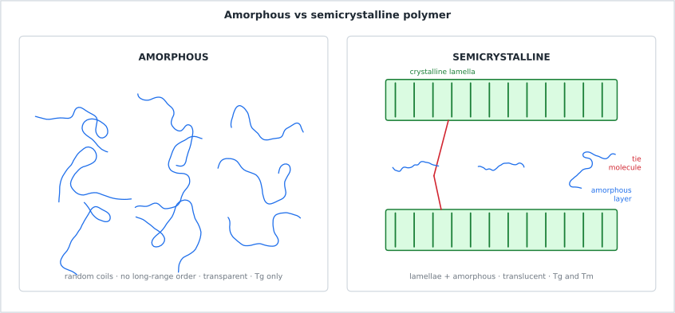

*Figure 7.2: Random coils (left); crystalline lamellae joined by tie molecules and amorphous layers (right).*

---

## 7.3 Compare crystalline and amorphous polymers, including orientation

`🟠 HIGH` · 3/6 exams · 2024 · 2021 · 2019

| Property | Crystalline (semicrystalline) | Amorphous |
|---|---|---|
| Chain packing | ordered, regular | random |
| Density | higher | lower |
| Appearance | opaque / translucent (light scattering) | transparent |
| Thermal transitions | Tg **and** sharp Tm | only Tg (softens gradually) |
| Strength, stiffness, hardness | higher | lower |
| Chemical / solvent resistance | better | poorer |
| Dye uptake | **lower** (dye enters only amorphous regions) | higher |
| Orientation by drawing | strongly increases crystallinity and strength | aligns chains, little crystallisation |
| Examples | HDPE, isotactic PP, nylon 6,6, PET fibre | atactic PS, PMMA, PVC, rubbers |

Orientation is explained in [7.10](#q7-10).

---

## 7.4 Intermolecular forces of attraction and cohesive energy density (CED)

`🟠 HIGH` · 3/6 exams · 2023 · 2020 · 2019

| Force | Typical energy | Example polymer |
|---|---|---|
| London dispersion | 0.5–2 kJ/mol per CH₂ (additive over the chain) | polyethylene |
| Dipole–dipole | 2–15 kJ/mol | PVC (C–Cl), PET (ester) |
| Hydrogen bond | 12–30 kJ/mol | nylon (N–H···O=C), cellulose (O–H···O), proteins |
| Ionic / ion–dipole | strongest | ionomers, wool / acid dye sites |

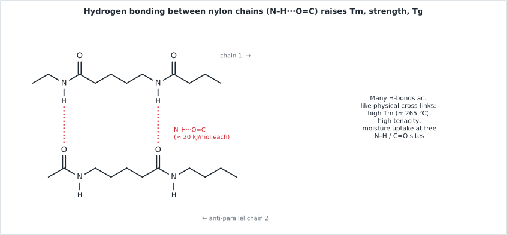

*Figure 7.4: Hydrogen bonds between neighbouring nylon chains act like physical cross-links.*

**Cohesive energy density** is the energy needed to remove a molecule from its neighbours per unit volume:

$$\mathrm{CED}=\frac{\Delta E_v}{V_m}=\frac{\Delta H_v-RT}{V_m}\qquad \delta=\sqrt{\mathrm{CED}}\ \ (\text{Hildebrand solubility parameter})$$

* High CED → strong forces → high Tg, Tm, stiffness, solvent resistance (nylon, PAN).
* A polymer dissolves best in a solvent with **similar δ** (rule "like dissolves like").

---

## 7.5 Degree of crystallinity and factors affecting crystallinity

`🟠 HIGH` · 3/6 exams · 2024 · 2021 · 2019

The **degree of crystallinity** is the mass (or volume) fraction of the crystalline phase, typically 10–90 %.

$$X_c(\%)=\frac{\Delta H_m-\Delta H_{cc}}{\Delta H_m^{\circ}}\times100\ \ (\text{DSC})\qquad X_w=\frac{\rho_c(\rho_s-\rho_a)}{\rho_s(\rho_c-\rho_a)}\ \ (\text{density})$$

**Worked examples (extra)**

* *Density:* ρ_s = 0.96, ρ_a = 0.85, ρ_c = 1.00 g/cm³ → $X_w = \dfrac{1.00\,(0.11)}{0.96\,(0.15)} = 0.764$ → **76 %**.
* *DSC:* ΔH_m = 120 J/g, ΔH_cc = 20 J/g, ΔH_m° (100 % PE) = 293 J/g → $X_c=\dfrac{100}{293}\times100 = $ **34 %**.

**Factors that increase crystallinity**

* Regular, symmetrical, linear chains; isotactic or syndiotactic configuration
* Strong secondary forces (H-bonding, polar groups)
* Small, flexible side groups; no or few branches / cross-links
* Slow cooling, annealing, nucleating agents, **drawing / orientation**
* Moderate molecular weight and narrow distribution

**Factors that decrease it:** bulky side groups (atactic PS), random copolymerization, branching (LDPE < HDPE), cross-linking, rapid quenching, plasticizers.

---

## 7.6 Explain the relation between Tg and Tm with a graphical representation

`🟡 MEDIUM` · 2/6 exams · 2023 · 2021

* **Tg** relates to the *amorphous* phase; **Tm** to the *crystalline* phase. A semicrystalline polymer shows both, and **Tg < Tm**.
* Empirical rule (absolute temperature): $T_g \approx \tfrac{1}{2}\,T_m$ for symmetric polymers (e.g. PE, PET) and $\approx \tfrac{2}{3}\,T_m$ for unsymmetrical ones (PS, PVC, PMMA). It is only an approximate rule.

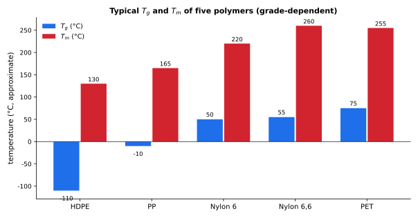

*Figure 7.6: Tg and Tm for five polymers; in every case Tg < Tm.*

Graphs for the exam: specific volume vs T ([Figure 7.1a](#q7-1)) and modulus vs T ([Figure 7.1b](#q7-1)). Only Tg appears for amorphous polymers; Tg (small step) **and** Tm (first-order jump) for semicrystalline ones.

**Check with PET:** Tg ≈ 348 K (75 °C) and Tm ≈ 528 K (255 °C), so Tg/Tm ≈ 0.66.

---

## 7.7 What is the fringed-micelle structure of a polymer?

`🟡 MEDIUM` · 2/6 exams · 2024 · 2020

The **fringed-micelle model** (Hermann, Gerngross; 1930s) describes a semicrystalline polymer as small crystalline regions (**micelles**, ≈ 10 nm) embedded in an amorphous matrix. A single long chain passes through several crystallites and the amorphous regions between them. The chain ends and disordered segments protrude as "fringes".

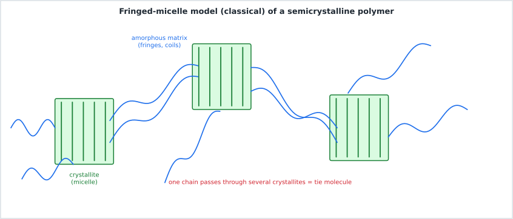

*Figure 7.7: Crystallites (green) joined by tie chains through the amorphous matrix.*

* Explains: coexistence of order and disorder; sharp X-ray crystalline reflections plus an amorphous halo; moderate density.
* Tie molecules transfer stress between crystallites, which gives toughness.
* Modern view: *folded-chain lamellae* and spherulites (extra), with the fringed micelle as a good model for fibres (oriented, drawn polymer).

---

## 7.8 Factors influencing the glass-transition temperature (Tg)

`🟡 MEDIUM` · 2/6 exams · 2023 · 2021

Tg rises when chain motion is **restricted** and falls when it is **eased**.

| Factor | Effect on Tg | Example |
|---|---|---|
| Chain flexibility | flexible (–O–, –CH₂–) lowers; rigid rings raise | silicone –100 °C; PET 75 °C; PC 150 °C |
| Bulky side groups | raise | PS (100 °C) > PE (–110 °C) |
| Polar groups / H-bonding | raise | PVC (80 °C) > PE; nylon > PE |
| Molecular weight | rises up to a limit: $T_g=T_g^{\infty}-K/\overline{M}_n$ | Flory–Fox |
| Cross-linking | raises | vulcanised rubber vs raw rubber |
| Plasticizer / moisture | **lowers** | PVC with DOP; wet nylon |
| Copolymerization | intermediate value (Fox: $1/T_g=w_1/T_{g1}+w_2/T_{g2}$) | SBR |
| Crystallinity, heating rate, pressure | raise (slightly) | – |

---

## 7.9 Define flow temperature (Tf); give Tg and Tm values for five polymers

`🟡 MEDIUM` · 2/6 exams · 2022 · 2021

**Flow temperature (Tf)** is the temperature above which a polymer flows as a viscous liquid under load (chains slip past each other). For a crystalline polymer Tf ≈ Tm; for an amorphous one Tf lies well above Tg and depends on molecular weight, load and the test method. The order is Tg < Tf (< Tdecomp).

| Polymer | Tg (°C) | Tm (°C) | Note |
|---|---|---|---|
| HDPE | ≈ –120 to –100 | ≈ 125–135 | semicrystalline |
| Polypropylene (isotactic) | ≈ –20 to 0 | ≈ 160–170 | |
| Nylon 6 | ≈ 40–60 (dry) | ≈ 215–225 | moisture lowers Tg |
| Nylon 6,6 | ≈ 45–60 (dry) | ≈ 255–265 | moisture lowers Tg |
| PET | ≈ 70–80 | ≈ 245–265 | depends on crystallinity |

See the bar chart in [7.6](#q7-6). Polystyrene (atactic): Tg ≈ 100 °C, **no Tm**.

---

## 7.10 Effects of crystallinity on polymer properties; explain orientation

`⚪ ONCE` · 1/6 exams · 2019

**Effects of increasing crystallinity:** density ↑, stiffness / modulus ↑, tensile strength ↑, hardness ↑, melting and heat resistance ↑, chemical resistance and barrier ↑, dye uptake ↓, transparency ↓, elongation / impact strength ↓, moisture regain ↓ (in cotton, nylon).

**Orientation** is the alignment of polymer chains (and crystallites) along a preferred direction, produced by **drawing** (cold or hot) a spun fibre or film. It raises tenacity and modulus in the draw direction, lowers elongation, increases crystallinity and makes the fibre **anisotropic**.

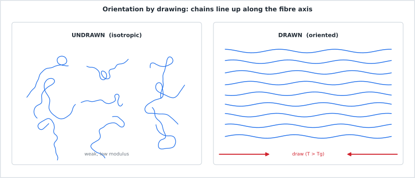

*Figure 7.10: Drawing above Tg aligns coils along the fibre axis.*

| Type | Direction | Example |
|---|---|---|
| Uniaxial | one direction | textile fibres, tapes |
| Biaxial | two directions | PET film, BOPP packaging |

---

## 7.11 Describe the calorimetric method for determining Tg (DSC)

`⚪ ONCE` · 1/6 exams · 2022

**Differential scanning calorimetry (DSC)** measures the heat flow difference between a sample and an inert reference while both are heated at a constant rate (typically 10 °C/min) under N₂.

1. Weigh 5–10 mg sample in an aluminium pan; empty pan as reference.
2. First heating erases thermal history; cool; heat again.
3. Plot heat flow against temperature.
4. At **Tg** the heat capacity increases, giving a **step (baseline shift)**. Tg is the midpoint or onset of the step.

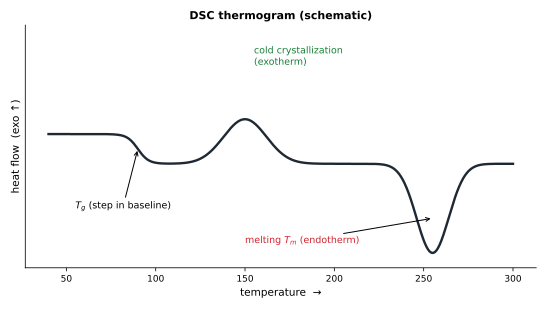

*Figure 7.11: Tg is a step; cold crystallization is an exotherm; melting is an endotherm.*

| DSC event | Shape | Meaning |
|---|---|---|
| Tg | step | amorphous phase softens |
| Tc (cold crystallization) | exothermic peak | chains crystallize on heating |
| Tm | endothermic peak | crystals melt; area = ΔH_m |

---

## 7.12 What is a plasticizer? What factors are considered when selecting one?

`⚪ ONCE` · 1/6 exams · 2019

A **plasticizer** is a low-molar-mass, low-volatility liquid (or solid) added to a polymer to make it **softer and more flexible and easier to process**. It sits between chains, reduces the intermolecular forces and increases free volume, so Tg, modulus and melt viscosity fall.

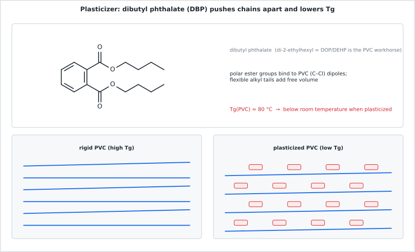

*Figure 7.12: Dibutyl phthalate (DBP) as an example; DOP (DEHP) is the standard for PVC.*

**Selection factors**

| Factor | Why |
|---|---|
| Compatibility with the polymer | no exudation / blooming |
| Efficiency | small amount lowers Tg a lot |
| Low volatility and migration | permanence of softness |
| Thermal, light and hydrolytic stability | no colour, no loss in service |
| Resistance to extraction (water, oils, detergents) | washing / dry-cleaning durability |
| Low toxicity, odour; legal limits (phthalate restrictions) | safety, children's articles |
| Low cost, availability | economics |

---

# Chapter 8: Textile and Special Polymers, Recycling

## 8.1 Nylon 6,6: synthesis and polymer-formation reaction

`🟠 HIGH` · 4/6 exams · 2024 · 2022 · 2021 · 2019

Nylon 6,6 is a linear **polyamide** made by AA–BB polycondensation of **hexamethylenediamine (HMDA, 6 C)** and **adipic acid (6 C)**: hence "6,6".

*Figure 8.1: HMDA + adipic acid → nylon 6,6 + water.*

$$n\,\mathrm{H_2N{-}(CH_2)_6{-}NH_2}+n\,\mathrm{HOOC{-}(CH_2)_4{-}COOH}\longrightarrow\left[\,\mathrm{{-}NH{-}(CH_2)_6{-}NH{-}CO{-}(CH_2)_4{-}CO{-}}\,\right]_n+(2n-1)\,\mathrm{H_2O}$$

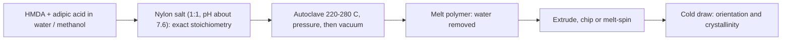

* The **nylon salt** (hexamethylenediammonium adipate) is isolated and purified; it guarantees a 1:1 ratio of –NH₂ to –COOH.
* A little acetic acid is added as **chain stopper** (viscosity stabiliser) to fix the molar mass.
* **Properties:** Tm ≈ 265 °C, Tg ≈ 50 °C (dry), high strength and abrasion resistance from H-bonds ([7.4](#q7-4)); moisture regain ≈ 4 %.
* **Uses:** carpets, tyre cord, hosiery, parachute and outdoor fabrics, airbags.

---

## 8.2 PET / polyester fibre: manufacture and production from recycled PET bottles

`🟠 HIGH` · 3/6 exams · 2024 · 2023 · 2021

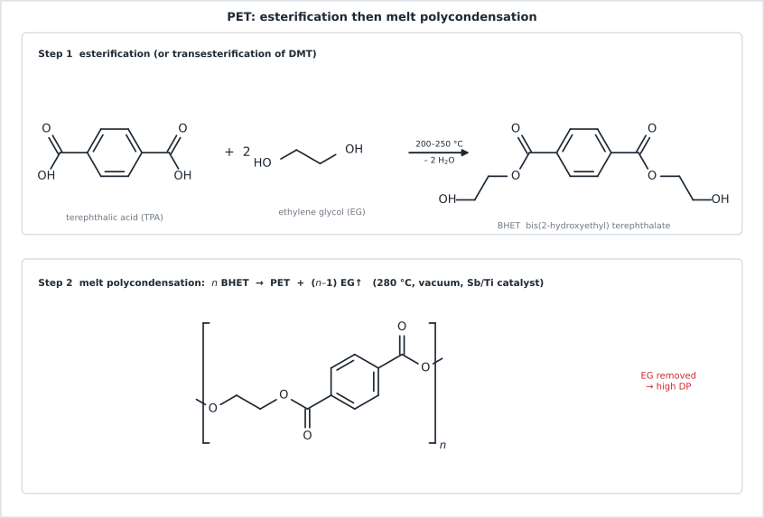

*Figure 8.2a: Esterification of terephthalic acid (TPA) with ethylene glycol (EG) to BHET, then melt polycondensation to PET.*

$$\mathrm{TPA + 2\,EG \xrightarrow{200-250\,^\circ C} BHET + 2\,H_2O}\qquad n\,\mathrm{BHET}\xrightarrow{280\,^\circ C,\ \text{vacuum}}\mathrm{PET}+(n-1)\,\mathrm{EG}\uparrow$$

(Older route: dimethyl terephthalate DMT + EG → BHET + CH₃OH, then polycondensation.)

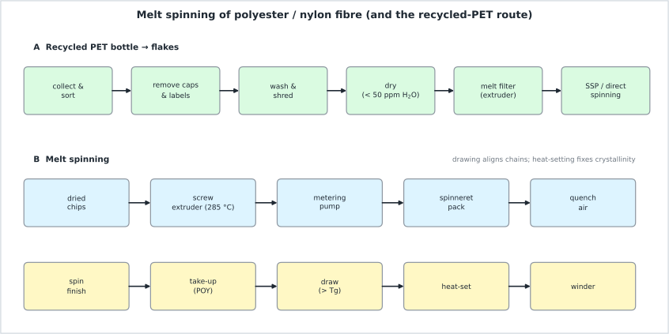

*Figure 8.2b: Virgin chips or recycled flakes → melt spinning → drawing → heat-setting.*

**Fibre production:** chips are dried (< 50 ppm water, else hydrolysis lowers MW), melted at ≈ 285 °C, filtered, pumped through a spinneret, quenched with air, treated with spin finish, taken up (POY), then **drawn** (3–5×) above Tg and **heat-set**.

**Recycled bottle PET → fibre**

* **Quality controls:** residual PVC / glue, colour, moisture, intrinsic viscosity (restored by SSP), acetaldehyde.
* **Benefits:** lower energy than virgin PET (roughly half), less landfill; used for fleece, T-shirts, carpets, nonwovens.

---

## 8.3 Classify liquid-crystal polymers (LCPs) with examples

`🟠 HIGH` · 3/6 exams · 2024 · 2023 · 2022

LCPs contain rigid rod-like **mesogenic** groups that form an ordered, yet flowing, **mesophase** between crystal and isotropic liquid.

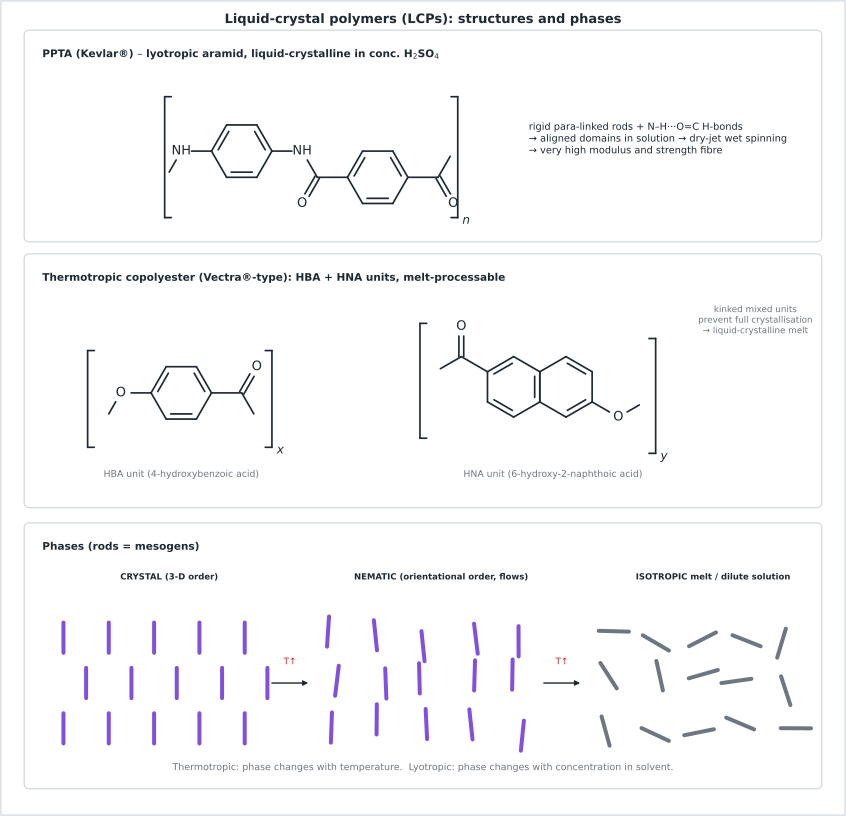

*Figure 8.3: PPTA, Vectra-type HBA / HNA copolyester and the phase sequence.*

| Basis | Class | Mesophase appears on… | Example |
|---|---|---|---|
| Mode of formation | **Thermotropic** | heating the polymer (melt) | Vectra (HBA / HNA copolyester) |
| | **Lyotropic** | dissolving in a solvent (above a critical concentration) | Kevlar (PPTA in H₂SO₄), cellulose derivatives |
| Position of mesogen | **Main-chain** | mesogen is in the backbone | Kevlar, Vectra |
| | **Side-chain** | mesogen hangs as a pendant group | polyacrylates with cyanobiphenyl side groups |
| Phase type | nematic, smectic, cholesteric | – | – |

---

## 8.4 Features and properties required of a fibre-forming polymer

`🟡 MEDIUM` · 2/6 exams · 2023 · 2021

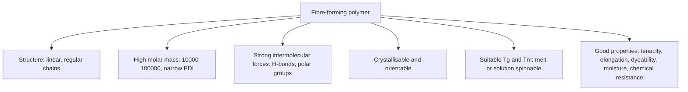

* **Linear, regular chain** so that chains can align along the fibre axis (branching and cross-links prevent drawing).
* $\overline{M}_n$ high enough for entanglement (DP ≈ 100–200 for nylon / PET), but not so high that melt is unspinnable.
* Polar groups for cohesion (amide, ester, nitrile); **Tm well below decomposition** (melt spinning) or soluble in a solvent (solution spinning).
* Tg above use temperature, so that the fibre keeps shape in wear and washing.

---

## 8.5 Depolymerization: mechanism and applications

`🟡 MEDIUM` · 2/6 exams · 2024 · 2022

**Depolymerization** converts a polymer back into monomers or oligomers. It is the **reverse of polymerization** and follows the unzipping or chain-scission modes of [6.4](#q6-4).

| Route | Reagent / condition | Result |
|---|---|---|
| Thermal / pyrolysis | 300–500 °C, inert gas | PMMA → MMA (> 90 %); PS → styrene; mixed plastics → oil |
| Glycolysis | excess ethylene glycol, 180–240 °C | PET → BHET (re-polymerizable) |
| Methanolysis | methanol, high T and P | PET → DMT + EG |
| Hydrolysis | water / acid / base | PET → TPA + EG; nylon 6 → caprolactam |
| Aminolysis, enzymolysis | amines, PETase | oligomers / monomers |

$$\mathrm{PET + EG \xrightarrow{\text{glycolysis}} BHET\ (\text{see Figure 8.2a})}$$

**Applications:** recovery of monomer for **chemical recycling** (closed loop for bottles and fibres), waste reduction, feedstock recycling of mixed or contaminated waste, reuse of nylon 6 carpet waste (caprolactam recovery).

---

## 8.6 Explain polymer recycling

`🟡 MEDIUM` · 2/6 exams · 2023 · 2019

| Level | Name | Example |
|---|---|---|
| Primary | reuse of clean production scrap | spinning waste fed back |
| Secondary | **mechanical** recycling | PET bottle flakes → fibre; HDPE → pipes |
| Tertiary | **chemical / feedstock** recycling | PET glycolysis; pyrolysis oil |
| Quaternary | energy recovery | incineration of mixed waste |

**Challenges:** mixed polymers, dyes and fillers, property loss on every cycle (chain scission), contamination (PVC in PET), cost of collection and sorting.

---

## 8.7 Urea-formaldehyde and melamine-formaldehyde resins: notes and textile uses

`🟡 MEDIUM` · 2/6 exams · 2023 · 2022

*Figure 8.7: Methylolation (alkaline, ≈ 40–60 °C) followed by acid-catalysed condensation and cross-linking.*

* **Urea (f = 4)** or **melamine (f = 6, triazine ring)** reacts with formaldehyde to give **methylol** (–NH–CH₂OH) groups; these condense (–H₂O) with other N–H or methylol groups into a **cross-linked, infusible thermoset**.
* Melamine resins have better **water, heat and hardness** properties than UF; UF is cheaper.

| Resin | Textile / other uses |
|---|---|
| UF | adhesive for particle board; early durable-press (crease-resistant) finishes for cotton |
| MF | **durable-press, wrinkle-resistant and shrink-resistant finishes** for cellulosic fabrics; flame-retardant and water-repellent finishes; laminates (Formica), dinnerware |

**Finishing mechanism:** resin pre-condensate is padded on cotton, dried and cured (acid catalyst, 150 °C). It cross-links cellulose –OH groups (Cell–O–CH₂–N<), giving crease recovery at a cost of some strength loss and **formaldehyde release** (limited by Oeko-Tex and other standards; low-formaldehyde DMDHEU resins are now preferred).

---

## 8.8 Write the repeat-unit structures of polyethylene, polyester, nylon 6 and nylon 6,6

`🟡 MEDIUM` · 2/6 exams · 2024 · 2019

*Figure 8.8a: PET (polyester), nylon 6,6 and nylon 6.*

*Figure 8.8b: Polyethylene (first panel) with the other vinyl polymers.*

| Polymer | Repeat unit |
|---|---|
| Polyethylene (PE) | –[CH₂–CH₂]ₙ– |
| Polyester (PET) | –[O–CH₂CH₂–O–CO–C₆H₄–CO]ₙ– (para-phenylene) |
| Nylon 6 | –[NH–(CH₂)₅–CO]ₙ– |
| Nylon 6,6 | –[NH–(CH₂)₆–NH–CO–(CH₂)₄–CO]ₙ– |

---

## 8.9 Define liquid-crystal polymer and crystallizability

`🟡 MEDIUM` · 2/6 exams · 2022 · 2019

* **Liquid-crystal polymer (LCP):** a polymer that forms an anisotropic **mesophase**: molecules keep orientational order (parallel rods) while the material can still flow like a liquid (see Figure 8.3).
* **Crystallizability:** the *ability* (tendency) of a polymer to crystallise under suitable conditions, decided by regularity, symmetry, tacticity, flexibility and secondary forces (PE, nylon, isotactic PP: high; atactic PS: none).

| Term | Meaning |
|---|---|
| Crystallizability | potential to crystallise (property of the chemical structure) |
| Degree of crystallinity | fraction actually crystalline in a given sample (depends on processing) |

---

## 8.10 State applications of liquid-crystal polymers

`⚪ ONCE` · 1/6 exams · 2022

| Property | Applications |
|---|---|
| Very high strength and modulus (aramid fibre) | body armour, bullet-proof vests, cut-resistant gloves, ropes, tyre cord, aerospace composites, fire-fighter suits |
| Low viscosity melt, thin-wall moulding | electrical connectors, sockets, SMD components (thermotropic LCP, e.g. Vectra) |
| Dimensional stability, low thermal expansion | precision parts, fibre-optic components, microwave-oven dishes |
| Chemical and heat resistance, low gas permeability | films, medical equipment, sterilisable trays |

**Limits:** anisotropic shrinkage, weld-line weakness, high price.

---

# Chapter 9: Numerical Problems

**Method (always write it):**

$$\overline{M}_n=\frac{\sum n_iM_i}{\sum n_i}\qquad\overline{M}_w=\frac{\sum n_iM_i^2}{\sum n_iM_i}\qquad \mathrm{PDI}=\frac{\overline{M}_w}{\overline{M}_n}$$

Set up a table with columns **nᵢ, Mᵢ, nᵢMᵢ, nᵢMᵢ²**, add the columns, then substitute.

*Figure 9: Bar charts of the data in 9.1–9.3 with Mn (green) and Mw (red).*

## 9.1 Calculate Mn, Mw and PDI for Pen, Book, Paper and Pencil (2020 Q4d)

`⚪ ONCE` · 2020

| Item | nᵢ | Mᵢ | nᵢMᵢ | nᵢMᵢ² |
|---|---|---|---|---|
| Pen | 10 | 20 | 200 | 4 000 |
| Book | 15 | 50 | 750 | 37 500 |
| Paper | 5 | 10 | 50 | 500 |
| Pencil | 2 | 15 | 30 | 450 |
| **Σ** | **32** | | **1 030** | **42 450** |

$$\overline{M}_n=\frac{1030}{32}=\mathbf{32.19}\ \mathrm{g/mol}\qquad \overline{M}_w=\frac{42\,450}{1030}=\mathbf{41.21}\ \mathrm{g/mol}$$

$$\mathrm{PDI}=\frac{41.2136}{32.1875}=\mathbf{1.280}$$

> [!NOTE]
> The source bank gives PDI = 1.2801; exact arithmetic gives 1.28042 ≈ **1.280**. Quote 1.28.

---

## 9.2 Calculate Mn, Mw and PDI for Onion, Brinjal, Cabbage and Cauliflower (2021 Q4d)

`⚪ ONCE` · 2021

| Item | nᵢ | Mᵢ | nᵢMᵢ | nᵢMᵢ² |
|---|---|---|---|---|
| Onion | 4 | 10 | 40 | 400 |
| Brinjal | 6 | 20 | 120 | 2 400 |
| Cabbage | 7 | 100 | 700 | 70 000 |
| Cauliflower | 3 | 250 | 750 | 187 500 |
| **Σ** | **20** | | **1 610** | **260 300** |

$$\overline{M}_n=\frac{1610}{20}=\mathbf{80.50}\qquad\overline{M}_w=\frac{260\,300}{1610}=\mathbf{161.68}\qquad\mathrm{PDI}=\frac{161.68}{80.50}=\mathbf{2.008}$$

---

## 9.3 Find Mn, Mw and PDI for M = 15, 20, 120, 200 and n = 2, 5, 8, 3 (2022 Q4c)

`⚪ ONCE` · 2022

| Class | nᵢ | Mᵢ | nᵢMᵢ | nᵢMᵢ² |
|---|---|---|---|---|
| 1 | 2 | 15 | 30 | 450 |
| 2 | 5 | 20 | 100 | 2 000 |
| 3 | 8 | 120 | 960 | 115 200 |
| 4 | 3 | 200 | 600 | 120 000 |
| **Σ** | **18** | | **1 690** | **237 650** |

$$\overline{M}_n=\frac{1690}{18}=\mathbf{93.89}\qquad\overline{M}_w=\frac{237\,650}{1690}=\mathbf{140.62}\qquad\mathrm{PDI}=\frac{140.62}{93.89}=\mathbf{1.498}$$

---

## 9.4 End-group titration: Mn for 1 g polymer with two OH ends; 0.8 mL of 0.1 N NaOH (2019 Q4b)

`⚪ ONCE` · 2019

**Given:** mass = 1.00 g; two titratable end groups per chain (f = 2); titrant 0.8 mL of 0.1 N.

1. Equivalents titrated: $0.1\ \mathrm{eq/L}\times0.8\times10^{-3}\ \mathrm{L}=8.0\times10^{-5}$ eq (= moles of end groups).
2. Moles of chains $=\dfrac{8.0\times10^{-5}}{2}=4.0\times10^{-5}$ mol.
3. $\overline{M}_n=\dfrac{1.00\ \mathrm{g}}{4.0\times10^{-5}\ \mathrm{mol}}=\mathbf{25\,000\ g/mol}$.

> [!NOTE]
> Strictly, NaOH titrates acid (–COOH) end groups. The problem statement uses "OH ends" with NaOH; follow the question as given and state the assumption "1 titratable group = 1 equivalent". If only **one** end were titratable the answer would be 12 500 g/mol: always state *f*.

---

## 9.5 DP reduction from cellulose (DP 5000) to regenerated cellulose (DP 500): merits and demerits (2023 Q2b)

`⚪ ONCE` · 2023

$$\Delta\mathrm{DP}=5000-500=4500\qquad\text{reduction}=\frac{4500}{5000}\times100=\mathbf{90\,\%}$$

In terms of molar mass ($M_0 = 162$): 5000 × 162 ≈ 8.1 × 10⁵ g/mol → 500 × 162 ≈ 8.1 × 10⁴ g/mol.

*Figure 9.5: Cellulose repeat unit and the ten-fold chain shortening on regeneration (viscose / lyocell).*

| Merits of the lower DP | Demerits |
|---|---|
| dissolves in the spinning solvent (alkali / CS₂ route, or NMMO for lyocell) | fewer entanglements: **lower tenacity**, especially wet strength |
| lower dope viscosity: easy filtration, extrusion, spinning | lower durability and abrasion resistance |
| uniform, controllable fibre; silk-like drape and lustre | **degradation losses** (ageing, xanthation) cost raw material |
| good dye affinity (more amorphous) | lower crystallinity / orientation than cotton |

> [!TIP]
> Final properties also depend on regeneration, coagulation, drawing and crystallinity; **DP alone does not decide fibre performance**.

---

## Formula sheet

| Topic | Formula |
|---|---|
| Number-average MW | $\overline{M}_n=\sum n_iM_i/\sum n_i$ |
| Weight-average MW | $\overline{M}_w=\sum n_iM_i^2/\sum n_iM_i=\sum w_iM_i$ |
| z-average | $\overline{M}_z=\sum n_iM_i^3/\sum n_iM_i^2$ |
| Dispersity / PDI | $\overline{M}_w/\overline{M}_n\ge1$ |
| Degree of polymerization | $\overline{DP}_n=\overline{M}_n/M_0$ |
| Carothers (balanced) | $\overline{X}_n=1/(1-p)$ |
| Carothers (imbalance r) | $\overline{X}_n=(1+r)/(1+r-2rp)$ |
| End-group analysis | $\overline{M}_n = f\times m/n_{\text{end groups}}$ |
| Osmometry | $\pi/c=RT/\overline{M}_n$ |
| Mark–Houwink | $[\eta]=K\overline{M}_v^{a}$ |
| Crystallinity (DSC) | $X_c=(\Delta H_m-\Delta H_{cc})/\Delta H_m^\circ$ |
| Crystallinity (density) | $X_w=\rho_c(\rho_s-\rho_a)/[\rho_s(\rho_c-\rho_a)]$ |
| CED and δ | $\mathrm{CED}=(\Delta H_v-RT)/V_m,\ \delta=\sqrt{\mathrm{CED}}$ |
| Fox (copolymer Tg) | $1/T_g=w_1/T_{g1}+w_2/T_{g2}$ |
| Free-radical rate | $R_p=k_p[M]\sqrt{fk_d[I]/k_t}$ |

---

## Extra practice problems with answers

<b>E1.</b> A sample has 2 mol of M = 10 000, 3 mol of M = 20 000 and 1 mol of M = 50 000. Find Mn, Mw and PDI.

| nᵢ | Mᵢ | nᵢMᵢ | nᵢMᵢ² |
|---|---|---|---|
| 2 | 10 000 | 20 000 | 2.0 × 10⁸ |
| 3 | 20 000 | 60 000 | 1.2 × 10⁹ |
| 1 | 50 000 | 50 000 | 2.5 × 10⁹ |
| Σ = 6 | | 130 000 | 3.9 × 10⁹ |

$\overline{M}_n=130\,000/6=21\,667$, $\overline{M}_w=3.9\times10^{9}/1.3\times10^{5}=30\,000$, PDI = 1.385.

<b>E2.</b> What extent of reaction is needed to get DPₙ = 200 in an A–A + B–B polyester? What is the maximum DP if the ratio of groups is r = 0.98?

$p = 1-1/\overline{X}_n = 1-1/200 = 0.995$ (99.5 %). Maximum DP at $p=1$: $(1+r)/(1-r)=1.98/0.02=99$. So a 2 % imbalance makes DP 200 impossible.

<b>E3.</b> A nylon 6,6 sample has Mn = 22 600 g/mol. Find DPₙ and the number of monomer molecules per chain.

$\overline{DP}_n = 22\,600/226 \approx 100$ repeat units. Each repeat unit contains one diamine and one diacid residue, so ≈ 200 monomer molecules were joined per chain.

<b>E4.</b> 2.0 g of a polyester with one titratable –COOH per chain consumes 2.5 mL of 0.1 N KOH. Find Mn.

Equivalents = 0.1 × 2.5 × 10⁻³ = 2.5 × 10⁻⁴ = moles of chains (f = 1). $\overline{M}_n = 2.0/2.5\times10^{-4} = 8000$ g/mol.

<b>E5.</b> A polyethylene has ρ = 0.96 g/cm³ (amorphous 0.85, crystal 1.00). Find the mass-fraction crystallinity.

$X_w=\dfrac{1.00(0.96-0.85)}{0.96(1.00-0.85)}=0.764$, i.e. 76 %.

<b>E6 (theory).</b> Why does doubling the initiator concentration not double the molar mass in a free-radical polymerization?

$R_p\propto[I]^{1/2}$ and the kinetic chain length $\nu\propto[I]^{-1/2}$: more initiator gives more chains, each shorter, so $\overline{M}_n$ **falls** by $\sqrt2$ while the rate rises by $\sqrt2$.

---

## Common mistakes examiners penalise

| Mistake | Correct |
|---|---|
| Writing PDI = Mn/Mw | PDI = **Mw/Mn ≥ 1** |
| Calling all step growth "condensation" | polyaddition (polyurethane) is step growth without by-product |
| "Tg is the melting point of the amorphous part" | Tg is a glass-to-rubber transition, **not** melting |
| Giving Tm for polystyrene or atactic PP | amorphous polymers have **Tg only** |
| Vinyl alcohol as the monomer of PVA | PVA comes from **hydrolysis of PVAc** |
| Bulk ↔ emulsion mix-up of heat removal | emulsion removes heat well (water); bulk does not |
| Forgetting units / wrong rounding in numericals | units (g/mol), round only at the end |
| Quoting exact Tg / Tm values with no "about" | write "≈" and, if possible, a range |
| Drawing PET ring as ortho or meta | **para**-disubstituted (terephthalate) |
| Nylon 6,6 water balance written as 2n | exact: **(2n – 1)** H₂O (2n is accepted for large n) |

---

## Memory aids

* **Mn < Mv < Mw < Mz**: "**N**ever **V**iew **W**eird **Z**ebras".
* **Initiation → Propagation → Termination**: I-P-T, "In Plastic Tubes".
* **Tg: T**ough **g**lass → rubber; **Tm: m**elts crystals; "**g**lass **m**elts later (Tg < Tm)".
* **Inhibitor = Induction period; Retarder = Reduced rate.**
* **Primary antioxidants donate H; secondary ones decompose hydroperoxides (POOH).**
* **Random scission → MW falls fast; unzipping → monomer comes out** (PMMA).
* Nylon numbers = carbon atoms: **diamine first, diacid second** (6,6 = HMDA + adipic acid).

---

## Glossary

| Term | Short meaning |
|---|---|
| Autoacceleration (gel effect) | rate rise in bulk polymerization when viscosity slows termination |
| Cohesive energy density | energy per volume to separate molecules |
| Dispersity (Đ) | Mw / Mn |
| Functionality | number of reactive sites on a monomer |
| Living polymerization | chain ends stay active; no termination; narrow PDI |
| Mesogen | rigid unit that causes liquid-crystalline order |
| Oligomer | molecule of a few repeat units |
| SSP | solid-state post-condensation of PET / nylon chips |
| Tie molecule | chain connecting two crystallites |
| Tacticity | stereochemical arrangement of side groups |

---

## Corrections and notes on the source bank

* **File name:** the naming pattern you gave uses `wpe-103`, but the uploaded bank is **WPE 101**, so this file is `wpe-101-polymer-science-2019-2024-ques-solve-v261111-1.md`. Rename it if you want the other code.
* **Numerical 9.1:** exact PDI = 1.2804 (the source bank prints 1.2801).
* **Nylon 6,6:** the by-product is (2n – 1) H₂O for a chain of n repeat units.
* **9.4:** NaOH titrates acidic ends; the problem is solved exactly as stated, with f = 2.
* Thermal values and DP values are typical teaching ranges and depend on grade, moisture and test method.

---

*End of file. Good luck in WPE 101.*
